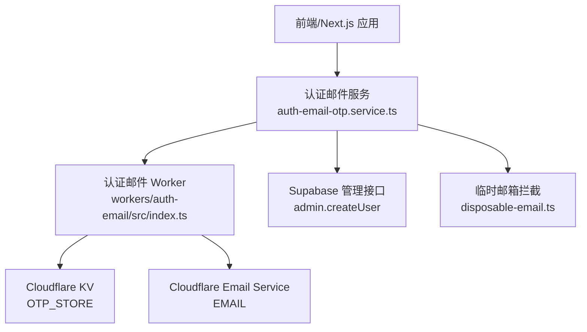
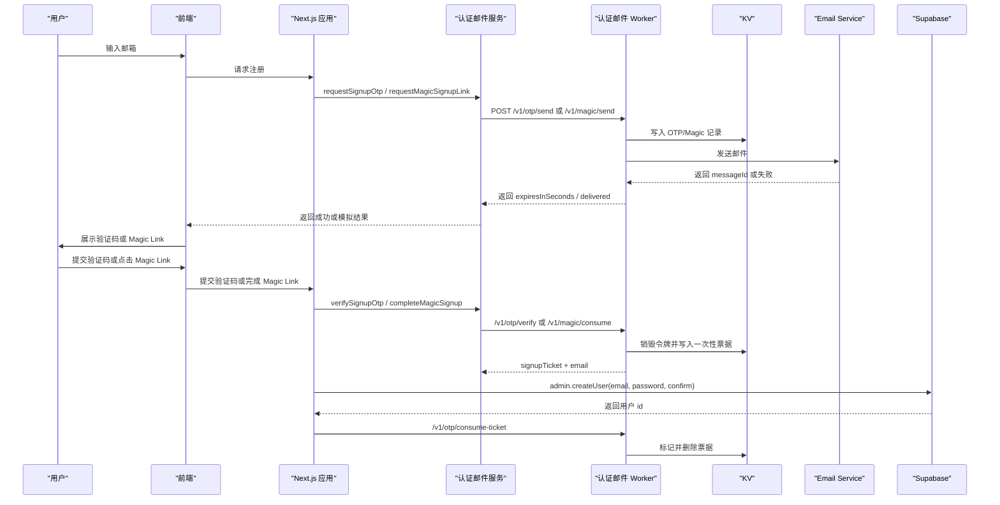
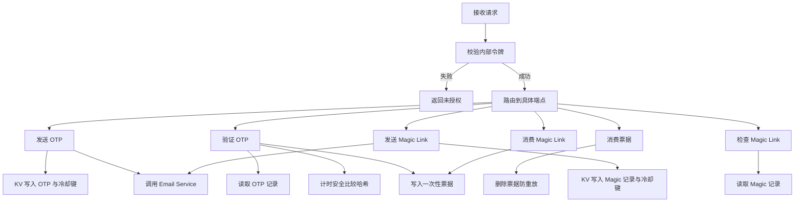
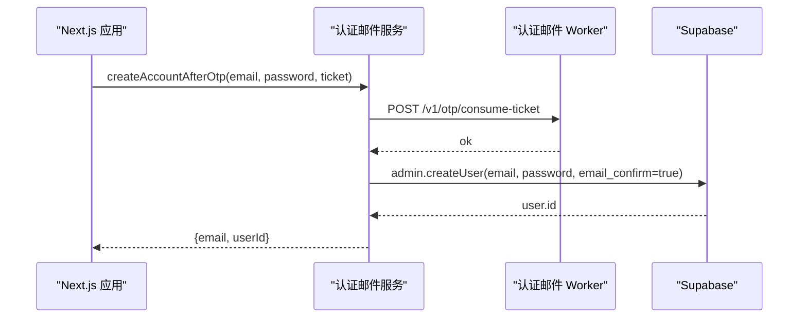
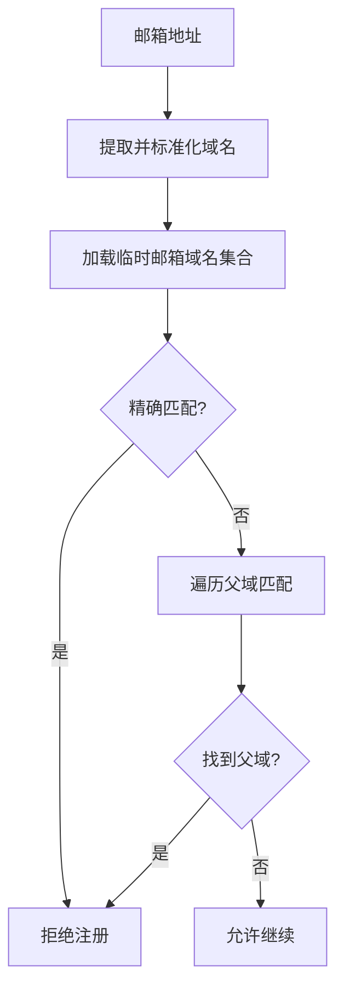
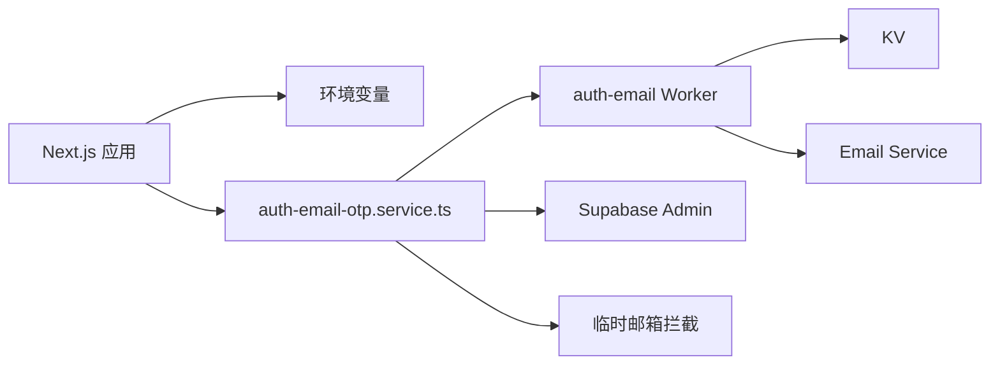

# 认证邮件 Worker

<cite>
**本文引用的文件**   
- [workers/auth-email/src/index.ts](file://workers/auth-email/src/index.ts)
- [workers/auth-email/wrangler.toml](file://workers/auth-email/wrangler.toml)
- [workers/auth-email/wrangler.app.jsonc](file://workers/auth-email/wrangler.app.jsonc)
- [workers/auth-email/package.json](file://workers/auth-email/package.json)
- [src/server/services/auth-email-otp.service.ts](file://src/server/services/auth-email-otp.service.ts)
- [src/server/services/auth-credentials.service.ts](file://src/server/services/auth-credentials.service.ts)
- [src/server/email-verifier/disposable-email.ts](file://src/server/email-verifier/disposable-email.ts)
- [src/server/email-verifier/disposable-email.check.ts](file://src/server/email-verifier/disposable-email.check.ts)
</cite>

## 目录
1. [简介](#简介)
2. [项目结构](#项目结构)
3. [核心组件](#核心组件)
4. [架构总览](#架构总览)
5. [详细组件分析](#详细组件分析)
6. [依赖关系分析](#依赖关系分析)
7. [性能与可靠性](#性能与可靠性)
8. [故障排查指南](#故障排查指南)
9. [结论](#结论)
10. [附录：API 与配置](#附录api-与配置)

## 简介
本文件系统化文档化认证邮件 Worker，涵盖用户注册、登录和后续账户创建流程中的邮箱验证与 Magic Link 机制。该 Worker 是认证系统的边界服务，负责：
- 生成并存储一次性验证码（OTP）；
- 通过 Cloudflare Email Service 发送 OTP 或 Magic Link 邮件；
- 校验验证码、销毁令牌并签发一次性注册票据；
- 通过内部 API 与 Next.js 应用协作，最终与 Supabase 的 `auth.users` 表同步完成账户创建；
- 提供速率限制、冷却时间、计时安全比较、过期清理等安全机制。

当前实现聚焦于“新用户注册”场景。Magic Link 目前仅用于注册，尚不支持现有用户的 Magic Link 登录。密码重置不在本 Worker 的职责范围内。

## 项目结构
认证邮件功能由两部分组成：
- 独立的 Cloudflare Worker：处理认证相关 HTTP 端点、KV 存储、邮件发送。
- Next.js 应用侧的服务层：封装调用逻辑、本地开发回退、业务校验以及与 Supabase 的账户创建对接。

**图表来源**
- [workers/auth-email/src/index.ts:1-682](file://workers/auth-email/src/index.ts#L1-L682)
- [src/server/services/auth-email-otp.service.ts:1-477](file://src/server/services/auth-email-otp.service.ts#L1-L477)
- [src/server/email-verifier/disposable-email.ts:1-93](file://src/server/email-verifier/disposable-email.ts#L1-L93)

**章节来源**
- [workers/auth-email/src/index.ts:1-682](file://workers/auth-email/src/index.ts#L1-L682)
- [src/server/services/auth-email-otp.service.ts:1-477](file://src/server/services/auth-email-otp.service.ts#L1-L477)

## 核心组件
- 认证邮件 Worker
  - 暴露 `/v1/otp/send`、`/v1/otp/verify`、`/v1/otp/consume-ticket`、`/v1/magic/send`、`/v1/magic/inspect`、`/v1/magic/consume` 六个端点。
  - 使用 KV 存储 OTP 记录、冷却键、Magic Token 记录、一次性票据。
  - 使用 Cloudflare Email Service 发送 OTP 与 Magic Link 邮件。
- Next.js 认证邮件服务
  - 对外暴露请求 OTP、验证 OTP、创建账户、请求 Magic Link、检查 Magic Link、完成 Magic Link 注册等方法。
  - 当 Worker 未配置时启用本地内存回退，便于开发调试。
  - 在创建账户前调用 Supabase Admin API 写入 `auth.users`，并保证 profile 存在。
- 临时邮箱拦截器
  - 基于内置域名列表，拒绝一次性/临时邮箱注册。

**章节来源**
- [workers/auth-email/src/index.ts:1-682](file://workers/auth-email/src/index.ts#L1-L682)
- [src/server/services/auth-email-otp.service.ts:1-477](file://src/server/services/auth-email-otp.service.ts#L1-L477)
- [src/server/email-verifier/disposable-email.ts:1-93](file://src/server/email-verifier/disposable-email.ts#L1-L93)

## 架构总览
认证邮件 Worker 作为受信任的内部服务，被 Next.js 应用通过内部 token 访问。整个注册流程分为两个阶段：
1. 邮箱验证阶段：通过 OTP 或 Magic Link 证明邮箱所有权。
2. 账户创建阶段：使用一次性票据调用 Supabase 创建用户，确保 `auth.users` 与业务 profile 一致。

**图表来源**
- [workers/auth-email/src/index.ts:201-682](file://workers/auth-email/src/index.ts#L201-L682)
- [src/server/services/auth-email-otp.service.ts:1-477](file://src/server/services/auth-email-otp.service.ts#L1-L477)

## 详细组件分析

### 认证邮件 Worker
Worker 承担认证邮件的核心职责：
- 内部鉴权：要求 `Authorization: Bearer <token>` 或 `x-clauxen-internal` 头。
- OTP 流程：
  - `/v1/otp/send`：生成 6 位数字验证码，计算哈希并写入 KV，设置冷却键，发送邮件。
  - `/v1/otp/verify`：校验验证码，达到最大尝试次数后删除记录；成功后删除 OTP 并签发一次性票据。
  - `/v1/otp/consume-ticket`：确认票据未被重复使用后立即删除。
- Magic Link 流程：
  - `/v1/magic/send`：生成随机 token，写入 KV，构造 `/auth/magic?token=...` 链接并发送邮件。
  - `/v1/magic/inspect`：读取 token 信息而不消耗它。
  - `/v1/magic/consume`：销毁 magic token 并签发一次性票据。
- 邮件模板：
  - OTP 邮件包含 6 位验证码、有效期说明和安全提示。
  - Magic Link 邮件包含按钮式链接和纯文本备用链接。
- 安全特性：
  - 计时安全字符串比较防止侧信道攻击。
  - 验证码哈希存储，避免明文保存。
  - KV 过期时间与冷却键共同控制重发频率。
  - 随机票据长度足够，降低碰撞概率。

**图表来源**
- [workers/auth-email/src/index.ts:201-682](file://workers/auth-email/src/index.ts#L201-L682)

**章节来源**
- [workers/auth-email/src/index.ts:1-682](file://workers/auth-email/src/index.ts#L1-L682)

### Next.js 认证邮件服务
该服务封装 Worker 调用并提供开发回退：
- 请求注册 OTP：
  - 先进行邮箱格式与临时邮箱校验。
  - 若 Worker 已配置，则调用 `/v1/otp/send`。
  - 否则在本地内存中生成验证码并输出日志。
- 验证注册 OTP：
  - 调用 `/v1/otp/verify` 获得一次性票据。
  - 本地模式同样维护内存映射。
- 创建账户：
  - 调用 `/v1/otp/consume-ticket` 确认票据有效。
  - 调用 Supabase Admin API 创建用户，并设置邮箱已确认。
  - 调用 `ensureUserRecord` 确保业务 profile 存在。
- Magic Link 注册：
  - 请求 Magic Link 时检查邮箱是否已有账户。
  - 调用 `/v1/magic/send`，或在本地模式生成 debug URL。
  - 检查 Magic Link 有效性后，调用 `/v1/magic/consume` 获得票据。
  - 最终走相同账户创建路径。

**图表来源**
- [src/server/services/auth-email-otp.service.ts:201-477](file://src/server/services/auth-email-otp.service.ts#L201-L477)

**章节来源**
- [src/server/services/auth-email-otp.service.ts:1-477](file://src/server/services/auth-email-otp.service.ts#L1-L477)

### 临时邮箱拦截器
临时邮箱拦截器在 Next.js 侧运行，阻止一次性/临时邮箱进入认证流程：
- 从构建产物加载临时邮箱域名列表。
- 支持父域匹配，例如子域命中父域黑名单时也会拒绝。
- 抛出统一业务错误，供上层 UI 和 API 处理。
- 提供安全模式函数，避免列表加载失败时阻断应用外壳。

**图表来源**
- [src/server/email-verifier/disposable-email.ts:1-93](file://src/server/email-verifier/disposable-email.ts#L1-L93)

**章节来源**
- [src/server/email-verifier/disposable-email.ts:1-93](file://src/server/email-verifier/disposable-email.ts#L1-L93)
- [src/server/email-verifier/disposable-email.check.ts:1-40](file://src/server/email-verifier/disposable-email.check.ts#L1-L40)

## 依赖关系分析
- Worker 对 Cloudflare 环境绑定依赖：
  - `EMAIL`：Cloudflare Email Service。
  - `OTP_STORE`：Cloudflare KV Namespace。
  - `AUTH_EMAIL_INTERNAL_TOKEN`：内部认证令牌。
  - `FROM_EMAIL`、`FROM_NAME`：发件人配置。
  - `OTP_TTL_SECONDS`、`OTP_MAX_ATTEMPTS`、`OTP_RESEND_COOLDOWN_SECONDS`、`MAGIC_LINK_TTL_SECONDS`、`MAGIC_LINK_COOLDOWN_SECONDS`：行为参数。
- Next.js 应用依赖：
  - `env.authEmailWorkerUrl`、`env.authEmailInternalToken`：Worker 地址与内部令牌。
  - `env.authDevBypass`：本地开发回退开关。
  - `getSupabaseAdmin()`：Supabase 管理接口。
  - `ensureUserRecord`：业务 profile 同步。
  - `assertEmailNotDisposable`：临时邮箱拦截。

**图表来源**
- [workers/auth-email/wrangler.toml:1-26](file://workers/auth-email/wrangler.toml#L1-L26)
- [workers/auth-email/wrangler.app.jsonc:1-24](file://workers/auth-email/wrangler.app.jsonc#L1-L24)
- [src/server/services/auth-email-otp.service.ts:1-477](file://src/server/services/auth-email-otp.service.ts#L1-L477)

**章节来源**
- [workers/auth-email/wrangler.toml:1-26](file://workers/auth-email/wrangler.toml#L1-L26)
- [workers/auth-email/wrangler.app.jsonc:1-24](file://workers/auth-email/wrangler.app.jsonc#L1-L24)
- [src/server/services/auth-email-otp.service.ts:1-477](file://src/server/services/auth-email-otp.service.ts#L1-L477)

## 性能与可靠性

### 邮件发送与队列
- Worker 直接调用 Email Service，不引入独立队列。
- 若 Email Service 不可用或未绑定，Worker 返回 `simulated: true` 并在本地模式下提供 debugCode/debugUrl，以便开发测试。
- 建议将邮件发送视为外部 I/O 操作，必要时在上层增加重试或异步任务，但当前 Worker 没有内置重试策略。

### 重试策略
- Worker 端没有自动重试逻辑。
- 如果上层需要重试，应捕获 5xx 或特定错误码，并使用指数退避与去抖策略，避免风暴式重发。

### 错误处理
- 无效请求返回 400，如邮箱格式错误、验证码长度不正确。
- 速率限制返回 429，附带 `retryAfterSeconds`。
- 验证码错误返回 400，附带剩余尝试次数。
- 票据无效或已使用返回 400。
- 邮件发送失败返回 502，并携带错误码与消息。
- 未配置 Worker 时，Next.js 服务返回 503，提示缺少环境变量。

### 日志记录
- Worker 在 Email Service 缺失时记录模拟日志。
- Worker 在邮件发送失败时记录错误码与消息。
- Next.js 本地模式会输出 OTP 与 Magic Link 的调试信息。

### 数据一致性
- OTP 与 Magic Token 在 KV 中按 TTL 过期。
- 一次性票据在消费后立即删除，防止重放。
- 账户创建前先消费票据，再调用 Supabase 创建用户，确保票据与用户状态一致。
- `auth.users` 与业务 profile 通过 `ensureUserRecord` 保持同步。

### 与其他 Worker 的关系
- 本 Worker 专注于认证邮件与一次性凭证管理。
- 其他 Worker 如 `chat-coord`、`billing`、`oauth-broker` 与本 Worker 无直接调用关系。
- 认证相关 OAuth 回调由 `native-auth` 与 `oauth-broker` 处理，但邮箱验证仍由本 Worker 负责。

**章节来源**
- [workers/auth-email/src/index.ts:201-682](file://workers/auth-email/src/index.ts#L201-L682)
- [src/server/services/auth-email-otp.service.ts:1-477](file://src/server/services/auth-email-otp.service.ts#L1-L477)

## 故障排查指南

### 常见问题
- 未配置 Worker 地址或内部令牌：
  - 现象：调用认证邮件服务时报 503，提示未配置。
  - 处理：设置 `AUTH_EMAIL_WORKER_URL` 与 `AUTH_EMAIL_INTERNAL_TOKEN`。
- 本地开发无法发送邮件：
  - 现象：`delivered: false`，`simulated: true`。
  - 处理：启用 `AUTH_DEV_BYPASS`，查看控制台输出的 debugCode 或 debugUrl。
- 邮箱已被占用：
  - 现象：注册时返回 409，提示邮箱已存在。
  - 处理：引导用户登录或使用不同邮箱。
- 验证码错误过多：
  - 现象：返回 429，提示尝试次数过多。
  - 处理：重新发送验证码。
- 临时邮箱被拒绝：
  - 现象：返回 `disposable_email` 错误。
  - 处理：更换常规邮箱。
- 邮件发送失败：
  - 现象：Worker 返回 502，包含错误码与消息。
  - 处理：检查 Email Service 绑定、发件人地址、域名白名单及网络权限。

### 诊断步骤
1. 检查 Worker 健康端点与健康响应。
2. 确认 KV 命名空间绑定是否正确。
3. 确认 Email Service 已绑定且发件人地址已授权。
4. 检查环境变量是否完整。
5. 在 Next.js 侧检查内部令牌与 Worker 地址。
6. 使用临时邮箱检查脚本验证黑名单是否生效。

**章节来源**
- [workers/auth-email/src/index.ts:201-682](file://workers/auth-email/src/index.ts#L201-L682)
- [src/server/services/auth-email-otp.service.ts:1-477](file://src/server/services/auth-email-otp.service.ts#L1-L477)
- [src/server/email-verifier/disposable-email.check.ts:1-40](file://src/server/email-verifier/disposable-email.check.ts#L1-L40)

## 结论
认证邮件 Worker 以最小依赖实现安全的邮箱验证与 Magic Link 注册流程。它将一次性凭证、冷却控制和邮件发送集中在一个边界服务中，并通过内部 API 与 Next.js 应用解耦。配合 Supabase 管理接口，系统在验证邮箱后创建用户并同步业务数据。当前实现适用于新用户注册，尚未覆盖密码重置与现有用户 Magic Link 登录。生产部署需确保环境变量、KV、Email Service 和内部令牌正确配置。

## 附录：API 与配置

### Worker 端点概览
- `/health`：健康检查，返回 Worker 状态。
- `/v1/otp/send`：发送 OTP 邮件。
- `/v1/otp/verify`：验证 OTP，返回一次性票据。
- `/v1/otp/consume-ticket`：消费票据，立即删除防重放。
- `/v1/magic/send`：发送 Magic Link 邮件。
- `/v1/magic/inspect`：检查 Magic Link 有效性。
- `/v1/magic/consume`：消费 Magic Link，返回一次性票据。

所有受保护端点均要求内部认证头。

### 环境变量与绑定
- Worker 配置来自 `wrangler.toml` 与 `wrangler.app.jsonc`。
- 关键变量包括 `FROM_EMAIL`、`FROM_NAME`、`OTP_TTL_SECONDS`、`OTP_MAX_ATTEMPTS`、`OTP_RESEND_COOLDOWN_SECONDS`、`MAGIC_LINK_TTL_SECONDS`、`MAGIC_LINK_COOLDOWN_SECONDS`、`AUTH_EMAIL_INTERNAL_TOKEN`。
- 关键绑定包括 `EMAIL` 与 `OTP_STORE`。

### Next.js 环境变量
- `AUTH_EMAIL_WORKER_URL`：Worker 基础地址。
- `AUTH_EMAIL_INTERNAL_TOKEN`：内部认证令牌。
- `AUTH_DEV_BYPASS`：本地开发回退开关。
- `APP_URL`：用于构造 Magic Link 的基础域名。

### 与 Supabase 的用户表同步
- 注册流程通过 Supabase Admin API 创建用户，并标记邮箱已确认。
- 随后调用 `ensureUserRecord` 确保业务 profile 存在。
- 这与 `auth-credentials.service.ts` 中直接写 `auth.users` 的方式不同：认证邮件流程使用管理接口完成注册。

**章节来源**
- [workers/auth-email/wrangler.toml:1-26](file://workers/auth-email/wrangler.toml#L1-L26)
- [workers/auth-email/wrangler.app.jsonc:1-24](file://workers/auth-email/wrangler.app.jsonc#L1-L24)
- [src/server/services/auth-email-otp.service.ts:201-477](file://src/server/services/auth-email-otp.service.ts#L201-L477)
- [src/server/services/auth-credentials.service.ts:1-91](file://src/server/services/auth-credentials.service.ts#L1-L91)