# 账单处理 Worker

<cite>
**本文引用的文件**   
- [workers/billing/src/index.ts](file://workers/billing/src/index.ts)
- [workers/billing/src/types.ts](file://workers/billing/src/types.ts)
- [workers/billing/src/email.ts](file://workers/billing/src/email.ts)
- [workers/billing/src/invoice-pdf.ts](file://workers/billing/src/invoice-pdf.ts)
- [workers/billing/src/razorpay-invoice-upload.ts](file://workers/billing/src/razorpay-invoice-upload.ts)
- [src/server/billing/billing-worker.ts](file://src/server/billing/billing-worker.ts)
- [src/server/billing/razorpay.ts](file://src/server/billing/razorpay.ts)
- [src/server/billing/billing-email.ts](file://src/server/billing/billing-email.ts)
- [src/server/billing/invoice.ts](file://src/server/billing/invoice.ts)
- [src/app/api/v1/webhooks/razorpay/route.ts](file://src/app/api/v1/webhooks/razorpay/route.ts)
- [src/app/api/v1/billing/orders/razorpay-callback/route.ts](file://src/app/api/v1/billing/orders/razorpay-callback/route.ts)
- [supabase/migrations/20260910120000_billing_invoices.sql](file://supabase/migrations/20260910120000_billing_invoices.sql)
</cite>

## 目录
1. [引言](#引言)
2. [项目结构](#项目结构)
3. [核心组件](#核心组件)
4. [架构总览](#架构总览)
5. [详细组件分析](#详细组件分析)
6. [依赖关系分析](#依赖关系分析)
7. [性能与容量特性](#性能与容量特性)
8. [故障排查指南](#故障排查指南)
9. [结论](#结论)

## 引言
本文件围绕“账单处理 Worker”及其与主应用计费系统的协作，系统性文档化 Razorpay 支付集成、Webhook 回调处理、订阅与订单生命周期、PDF 发票生成、邮件发送、R2 文件存储、Razorpay Documents 附件上传、数据一致性保障以及安全验证机制。该 Worker 是 Cloudflare Workers 上的服务端编排器：它不直接暴露给浏览器，而是由主应用通过内部令牌调用；所有 Razorpay 密钥和 R2 访问权限仅驻留在 Worker 环境，避免前端泄露敏感凭据。

## 项目结构
该项目将计费相关能力分为两类：
- 主应用 Node.js 层：负责业务编排、数据库写入、Razorpay API 调用（可通过 Worker 代理）、Webhook 入口、发票数据组装。
- Cloudflare billing Worker：提供 Razorpay 代理、发票 PDF 生成、R2 存储、Razorpay Documents 附件上传、通知邮件。

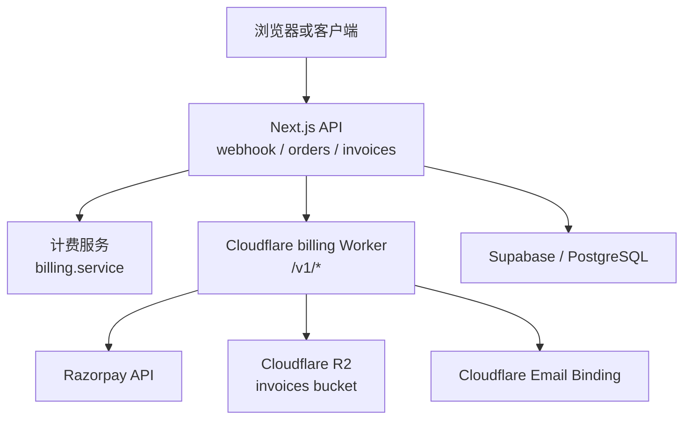

**图示来源**
- [src/app/api/v1/webhooks/razorpay/route.ts:1-70](file://src/app/api/v1/webhooks/razorpay/route.ts#L1-L70)
- [workers/billing/src/index.ts:1-652](file://workers/billing/src/index.ts#L1-L652)
- [src/server/billing/billing-worker.ts:1-243](file://src/server/billing/billing-worker.ts#L1-L243)

**章节来源**
- [workers/billing/src/index.ts:1-652](file://workers/billing/src/index.ts#L1-L652)
- [src/server/billing/billing-worker.ts:1-243](file://src/server/billing/billing-worker.ts#L1-L243)

## 核心组件
- Cloudflare billing Worker 路由与鉴权：统一入口，区分内部调用与用户 PDF 下载。
- Razorpay 代理接口：订单、支付、UPI QR、客户令牌、S2S 支付等。
- 发票生成与交付：PDF 构建、R2 双份存储、Razorpay Documents 附件、邮件回执。
- 主应用计费桥接：内部令牌转发、错误映射、可选直连 Razorpay。
- Webhook 入口：签名校验、载荷校验、委托计费服务处理事件。
- 发票数据模型与视图转换：从订单/支付行构造不可信数据之外的权威发票载荷。

**章节来源**
- [workers/billing/src/index.ts:1-652](file://workers/billing/src/index.ts#L1-L652)
- [src/server/billing/billing-worker.ts:1-243](file://src/server/billing/billing-worker.ts#L1-L243)
- [src/server/billing/razorpay.ts:1-1054](file://src/server/billing/razorpay.ts#L1-L1054)
- [src/server/billing/invoice.ts:1-212](file://src/server/billing/invoice.ts#L1-L212)
- [src/app/api/v1/webhooks/razorpay/route.ts:1-70](file://src/app/api/v1/webhooks/razorpay/route.ts#L1-L70)

## 架构总览
billing Worker 对外暴露三类能力：
1. Razorpay 代理：以 `/v1/razorpay/*` 路径对内部可信方开放，转发到 `api.razorpay.com`。
2. 发票工作流：`/v1/invoices/generate` 与 `/v1/invoices/fulfill`，分别用于纯生成和“生成+附件+邮件”的端到端交付。
3. 用户发票下载：`/v1/invoices/:paymentId/pdf`，支持内部访问和用户 JWT 鉴权。

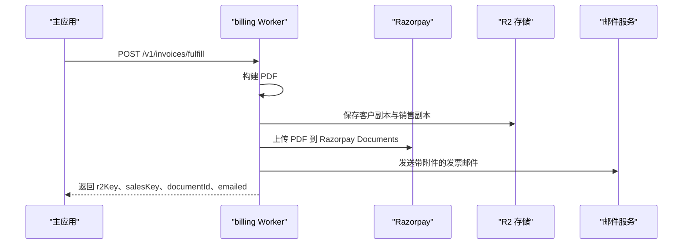

**图示来源**
- [workers/billing/src/index.ts:201-652](file://workers/billing/src/index.ts#L201-L652)
- [workers/billing/src/invoice-pdf.ts:1-200](file://workers/billing/src/invoice-pdf.ts#L1-L200)
- [workers/billing/src/razorpay-invoice-upload.ts:1-142](file://workers/billing/src/razorpay-invoice-upload.ts#L1-L142)
- [workers/billing/src/email.ts:1-200](file://workers/billing/src/email.ts#L1-L200)

## 详细组件分析

### 1. 内部鉴权与用户鉴权
- 内部接口使用 `Authorization: Bearer <BILLING_INTERNAL_TOKEN>` 或 `x-clauxen-billing: <TOKEN>` 头进行鉴权，比较采用时序安全实现，避免侧信道泄漏。
- 用户 PDF 下载允许携带 Supabase JWT，Worker 调用 Supabase `/auth/v1/user` 解析用户身份，并限制只能获取自身前缀下的 R2 对象。

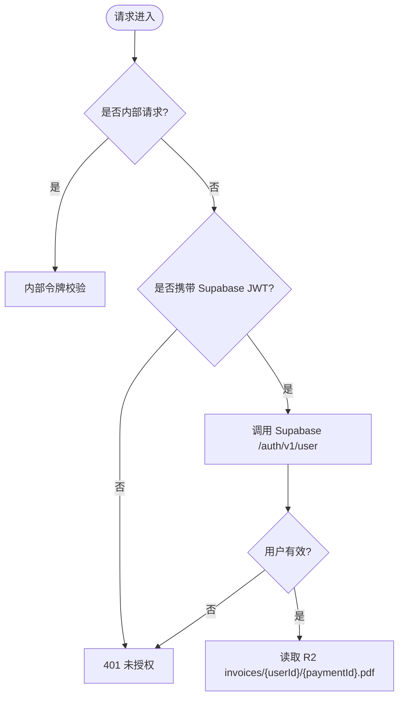

**图示来源**
- [workers/billing/src/index.ts:1-200](file://workers/billing/src/index.ts#L1-L200)

**章节来源**
- [workers/billing/src/index.ts:1-200](file://workers/billing/src/index.ts#L1-L200)

### 2. Razorpay 代理与安全校验
- Worker 将所有 `/v1/razorpay/*` 请求强制要求内部鉴权，再按方法+路径匹配转发到对应 Razorpay REST 接口。
- 提供 `/v1/razorpay/verify-signature` 工具接口，使用 HMAC-SHA256 计算 `orderId|paymentId`，并与传入签名做时序安全比较，用于客户端或上游系统做幂等与防篡改校验。
- 主应用的 `razorpay.ts` 还实现了 Webhook 签名校验：基于原始请求体与 `x-razorpay-signature` 头，使用 `crypto.createHmac("sha256", webhookSecret)` 比对十六进制摘要，并使用时序安全比较函数。

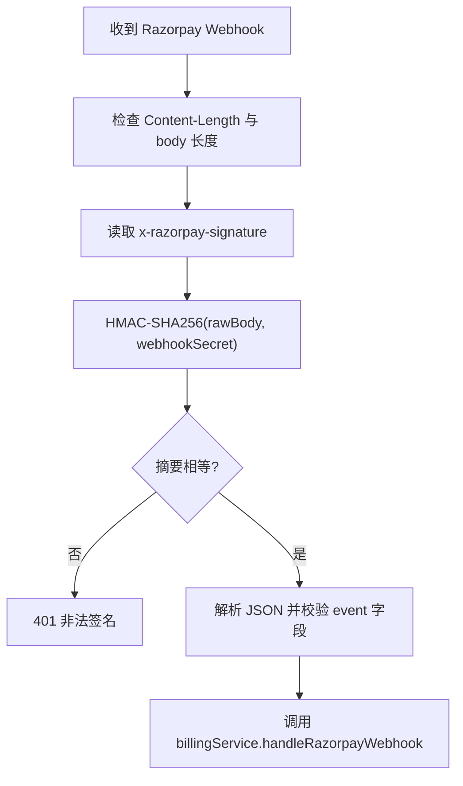

**图示来源**
- [src/app/api/v1/webhooks/razorpay/route.ts:1-70](file://src/app/api/v1/webhooks/razorpay/route.ts#L1-L70)
- [src/server/billing/razorpay.ts:600-732](file://src/server/billing/razorpay.ts#L600-L732)

**章节来源**
- [workers/billing/src/index.ts:201-652](file://workers/billing/src/index.ts#L201-L652)
- [src/server/billing/razorpay.ts:1-1054](file://src/server/billing/razorpay.ts#L1-L1054)
- [src/app/api/v1/webhooks/razorpay/route.ts:1-70](file://src/app/api/v1/webhooks/razorpay/route.ts#L1-L70)

### 3. 发票 PDF 生成与模板定制
- 使用 `pdf-lib` 在 Worker 内生成 A4 PDF，包含品牌 Logo、发行主体信息、GSTIN/LUT 声明、发票元信息、BILLED TO 区域、金额明细。
- 支持三种发票类型：
  - `domestic_gst`：国内增值税，显示 GSTIN。
  - `export_lut`：零税率出口，显示 LUT 声明。
  - `exempt_gstin`：有 GSTIN 但免收税。
- 货币格式化使用 `Intl.NumberFormat`，INR 使用 `en-IN`，USD 使用 `en-US`；日期使用印度本地化格式。
- Logo 以 Base64 JPEG 嵌入，若加载失败则降级为无 Logo 发票。

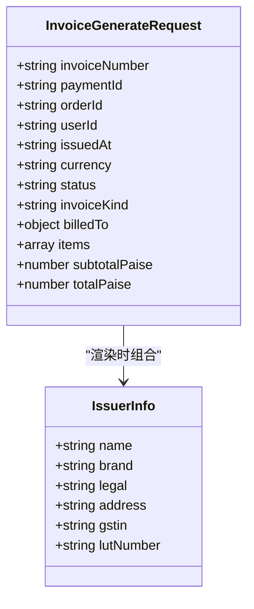

**图示来源**
- [workers/billing/src/types.ts:1-80](file://workers/billing/src/types.ts#L1-L80)
- [workers/billing/src/invoice-pdf.ts:1-200](file://workers/billing/src/invoice-pdf.ts#L1-L200)

**章节来源**
- [workers/billing/src/invoice-pdf.ts:1-200](file://workers/billing/src/invoice-pdf.ts#L1-L200)
- [workers/billing/src/types.ts:1-80](file://workers/billing/src/types.ts#L1-L80)

### 4. 发票文件存储与下载
- 生成 PDF 后同时写入两份 R2 对象：
  - 客户副本：`invoices/{userId}/{paymentId}.pdf`
  - 销售团队归档：`invoices/sales/{yyyy}/{mm}/{paymentId}.pdf`
- 两个对象均带有自定义元数据，包括 `invoiceNumber`、`paymentId`、`userId`、`orderId`、`planName`，销售副本额外标记 `audience=sales`。
- 用户下载通过 `/v1/invoices/:paymentId/pdf` 提供，需满足内部或用户 JWT 鉴权，并按 `userId` 前缀限制读取。

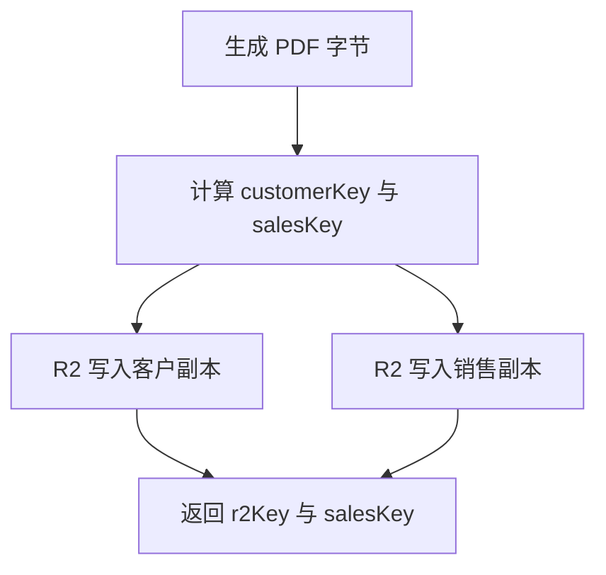

**图示来源**
- [workers/billing/src/index.ts:201-300](file://workers/billing/src/index.ts#L201-L300)

**章节来源**
- [workers/billing/src/index.ts:201-300](file://workers/billing/src/index.ts#L201-L300)

### 5. Razorpay Documents 附件上传
- 优先尝试通用文档上传：目的为 `opgsp_export_invoice` 或 `invoice`，成功后调用 PATCH 将文档 ID 写入支付备注。
- 如果通用上传失败，回退到支付级文档上传 `/v1/payments/{paymentId}/documents`。
- 任何单步失败都记录警告日志但不阻断整个流程，确保 PDF 仍保存在 R2。

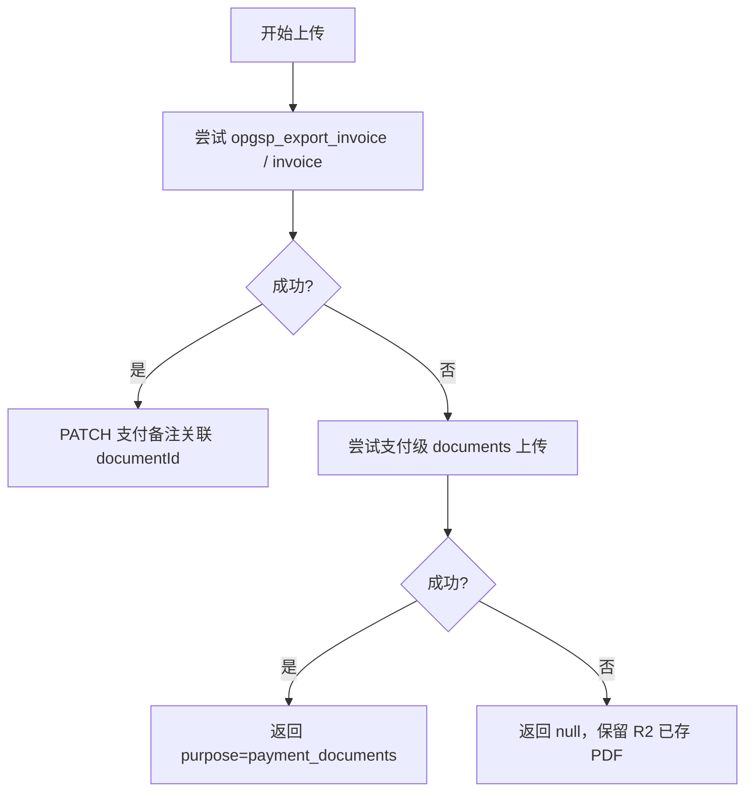

**图示来源**
- [workers/billing/src/razorpay-invoice-upload.ts:1-142](file://workers/billing/src/razorpay-invoice-upload.ts#L1-L142)

**章节来源**
- [workers/billing/src/razorpay-invoice-upload.ts:1-142](file://workers/billing/src/razorpay-invoice-upload.ts#L1-L142)

### 6. 邮件发送与收据模板
- 发票支付完成邮件由 Worker 内构建 HTML 与文本模板，包含付款成功文案、发票号、金额、计划名称、开票抬头、地址摘要、设置页链接与 PDF 下载按钮。
- 邮件通过 Cloudflare Email Binding 发送，附件为刚生成的 PDF 二进制副本。
- 邮件结果根据 delivered/queued/permanent_bounces/suppressed_recipients 判定是否成功送达，并记录可能的错误原因。

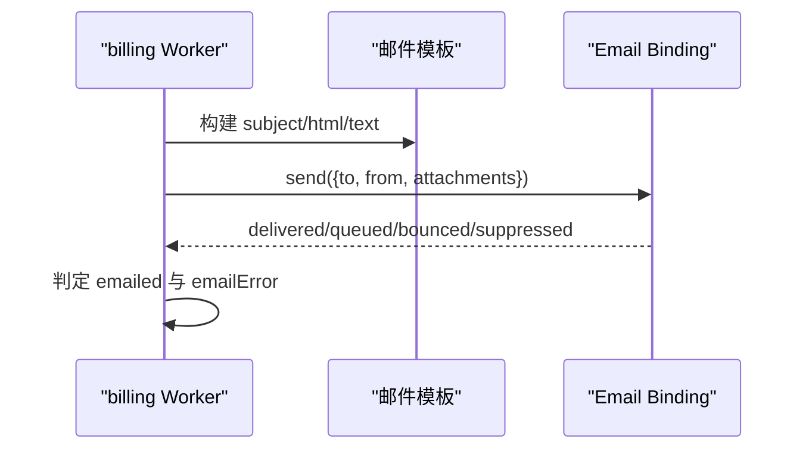

**图示来源**
- [workers/billing/src/email.ts:1-200](file://workers/billing/src/email.ts#L1-L200)
- [workers/billing/src/index.ts:400-652](file://workers/billing/src/index.ts#L400-L652)

**章节来源**
- [workers/billing/src/email.ts:1-200](file://workers/billing/src/email.ts#L1-L200)
- [workers/billing/src/index.ts:400-652](file://workers/billing/src/index.ts#L400-L652)

### 7. 与主应用计费系统的同步机制
- 主应用通过 `billing-worker.ts` 的 `billingWorkerFetch` 将请求转发到 Worker，附带 `Authorization` 与 `x-clauxen-billing` 内部令牌。
- 当 Worker 未配置或密钥缺失时，主应用可选择回退到直连 Razorpay；捕获 503 或 `billing_unavailable` 时按策略降级。
- 发票生成封装为 `generateInvoiceOnWorker`，交付封装为 `fulfillInvoiceOnWorker`，失败路径返回 `null` 并记录日志，不抛错中断上层事务。

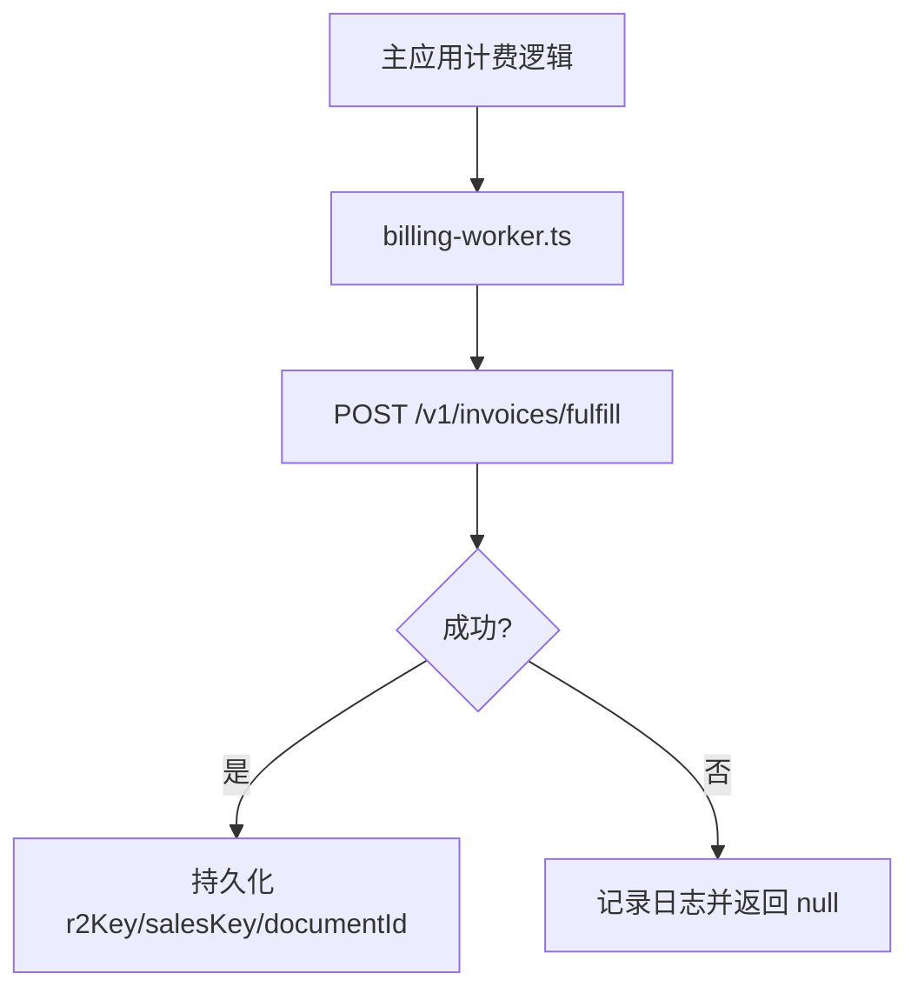

**图示来源**
- [src/server/billing/billing-worker.ts:1-243](file://src/server/billing/billing-worker.ts#L1-L243)

**章节来源**
- [src/server/billing/billing-worker.ts:1-243](file://src/server/billing/billing-worker.ts#L1-L243)

### 8. 数据一致性与幂等性
- 数据库发票表 `billing_invoices` 使用 `payment_id` 作为唯一键，保证每个 Razorpay 支付只生成一张发票。
- 发票行记录包含 `r2_key`、`r2_url`、`razorpay_document_id`、`evidence`、`emailed_at`，便于审计与重试。
- 主应用在构造发票载荷时从不信任客户端金额，而是从数据库中的订单/支付行计算 subtotal、tax、total。

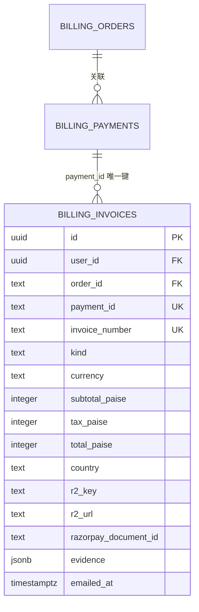

**图示来源**
- [supabase/migrations/20260910120000_billing_invoices.sql:1-58](file://supabase/migrations/20260910120000_billing_invoices.sql#L1-L58)

**章节来源**
- [supabase/migrations/20260910120000_billing_invoices.sql:1-58](file://supabase/migrations/20260910120000_billing_invoices.sql#L1-L58)
- [src/server/billing/invoice.ts:1-212](file://src/server/billing/invoice.ts#L1-L212)

### 9. 支付回调与 Webhook 处理
- Webhook 入口先限制请求体大小，再进行签名校验；无效签名返回 401。
- 载荷解析后委托 `billingService.handleRazorpayWebhook`，该服务负责更新订单、订阅、支付状态及触发后续发票生成。
- Custom Checkout 回调用于网银跳转场景，校验订单归属当前登录用户，并调用 `billingService.verifyCheckoutPayment` 后再重定向。

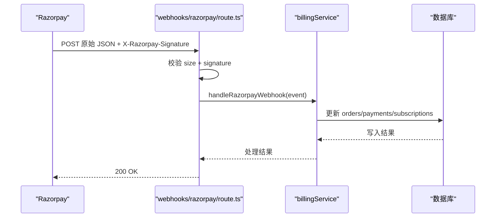

**图示来源**
- [src/app/api/v1/webhooks/razorpay/route.ts:1-70](file://src/app/api/v1/webhooks/razorpay/route.ts#L1-L70)
- [src/app/api/v1/billing/orders/razorpay-callback/route.ts:1-111](file://src/app/api/v1/billing/orders/razorpay-callback/route.ts#L1-L111)

**章节来源**
- [src/app/api/v1/webhooks/razorpay/route.ts:1-70](file://src/app/api/v1/webhooks/razorpay/route.ts#L1-L70)
- [src/app/api/v1/billing/orders/razorpay-callback/route.ts:1-111](file://src/app/api/v1/billing/orders/razorpay-callback/route.ts#L1-L111)

### 10. 税务计算逻辑与多语言支持
- 税务标签来自订单元数据中的 `tax.label`；若无且存在税额，则 INR 使用 “IGST (18%)”，USD 使用 “Tax”。
- 发票种类决定展示内容：国内显示 GSTIN，出口显示 LUT 零税率声明，免税场景不显示税额。
- 货币与日期格式化使用 `Intl.NumberFormat` 与 `toLocaleDateString("en-IN")`，目前模板面向英语与印度本地化；如需其他语言，可在模板字符串中扩展文案，并在 `email.ts` 与 `invoice-pdf.ts` 中添加多语言分支。

**章节来源**
- [src/server/billing/invoice.ts:1-212](file://src/server/billing/invoice.ts#L1-L212)
- [workers/billing/src/invoice-pdf.ts:1-200](file://workers/billing/src/invoice-pdf.ts#L1-L200)
- [workers/billing/src/email.ts:1-200](file://workers/billing/src/email.ts#L1-L200)

### 11. Stripe/Razorpay API 集成说明
- 当前代码库明确实现的是 Razorpay 集成，包括订单创建、支付查询、卡证据、S2S token 支付、OTP 提交、UPI QR、支付链接、Webhook 签名校验。
- 未发现 Stripe SDK 或 Stripe 专用路由；如未来接入 Stripe，建议复用现有 Worker 抽象模式：新增 `/v1/stripe/*` 代理、Stripe Webhook 签名校验、发票生成与邮件发送复用现有流程。

**章节来源**
- [src/server/billing/razorpay.ts:1-1054](file://src/server/billing/razorpay.ts#L1-L1054)
- [workers/billing/src/index.ts:201-652](file://workers/billing/src/index.ts#L201-L652)

## 依赖关系分析
- 主应用计费模块依赖 `@/server/billing/billing-worker` 作为 Worker 通信桥；依赖 `@/server/billing/razorpay.ts` 作为 Razorpay 封装；依赖 `@/server/billing/invoice.ts` 组装发票载荷。
- billing Worker 依赖 `pdf-lib` 生成 PDF，依赖 R2 Bucket 存储发票，依赖 Cloudflare Email Binding 发送邮件，依赖 Razorpay REST API 完成文档上传。
- 外部依赖包括 Razorpay API、Supabase Auth、R2、Email Binding。

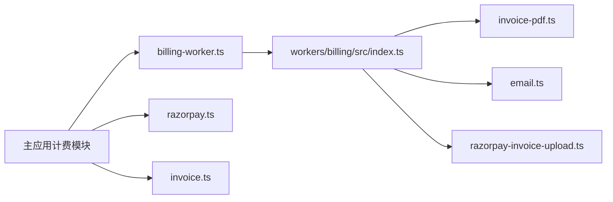

**图示来源**
- [src/server/billing/billing-worker.ts:1-243](file://src/server/billing/billing-worker.ts#L1-L243)
- [workers/billing/src/index.ts:1-652](file://workers/billing/src/index.ts#L1-L652)

**章节来源**
- [src/server/billing/billing-worker.ts:1-243](file://src/server/billing/billing-worker.ts#L1-L243)
- [workers/billing/src/index.ts:1-652](file://workers/billing/src/index.ts#L1-L652)

## 性能与容量特性
- Webhook 入口限制最大请求体为 256KB，防止恶意大负载消耗 CPU 与内存。
- PDF 生成在服务端执行，避免浏览器渲染开销；Logo 加载失败会降级，不影响整体生成。
- R2 写入使用并行 `Promise.all` 同时保存客户与销售副本，减少等待时间。
- 邮件发送异步处理，即使失败也不阻塞 PDF 与附件上传的成功返回。
- Worker 内部令牌比较使用时序安全实现，避免常量时间攻击。

[本节为通用性能讨论，不直接分析具体代码行]

## 故障排查指南
- 401 未授权：
  - 内部接口缺少或错误的 `BILLING_INTERNAL_TOKEN`。
  - 用户 PDF 下载缺少 Supabase JWT 或用户不匹配。
- 503 不可用：
  - Worker 未配置 Razorpay 密钥或 Email Binding。
  - 主应用未配置 `billingWorkerUrl` 与内部令牌。
- Webhook 401：
  - `x-razorpay-signature` 与原始请求体不匹配，可能因篡改或密钥不一致。
- 发票未送达：
  - 邮件返回 permanent_bounces 或 suppressed_recipients，检查收件人邮箱有效性。
- Razorpay 文档未关联：
  - 通用文档上传失败但支付级文档可能成功，查看日志中的 `purpose` 字段。

**章节来源**
- [workers/billing/src/index.ts:1-652](file://workers/billing/src/index.ts#L1-L652)
- [src/app/api/v1/webhooks/razorpay/route.ts:1-70](file://src/app/api/v1/webhooks/razorpay/route.ts#L1-L70)
- [workers/billing/src/razorpay-invoice-upload.ts:1-142](file://workers/billing/src/razorpay-invoice-upload.ts#L1-L142)

## 结论
billing Worker 将 Razorpay 密钥、R2 访问与 PDF 生成集中在边缘运行时，为主应用提供安全的计费编排能力。通过内部令牌鉴权、Webhook 签名校验、时序安全比较、数据库唯一约束与可观测日志，系统在支付回调、发票生成、文件存储与邮件发送方面具备较好的安全性与可靠性。未来如需扩展 Stripe 或其他支付方式，建议沿用 Worker 代理模式与现有发票/邮件流水线，保持职责分离与最小权限原则。