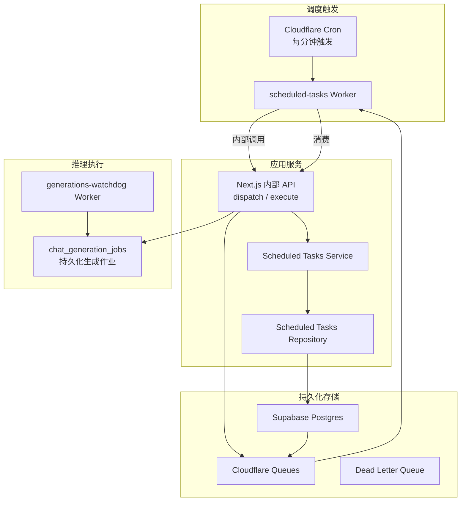
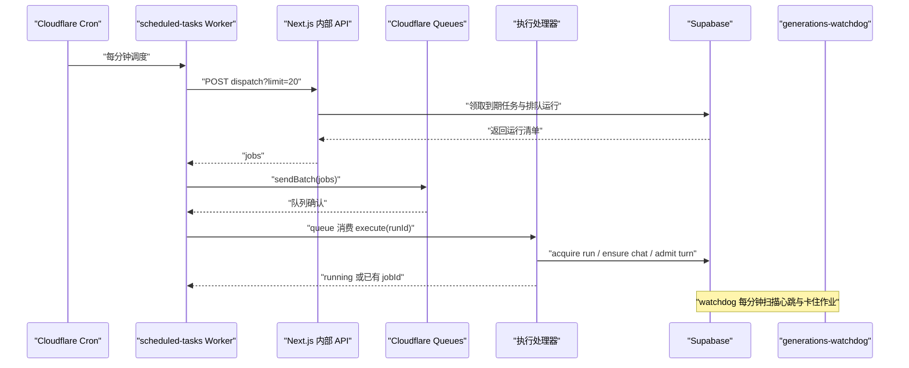
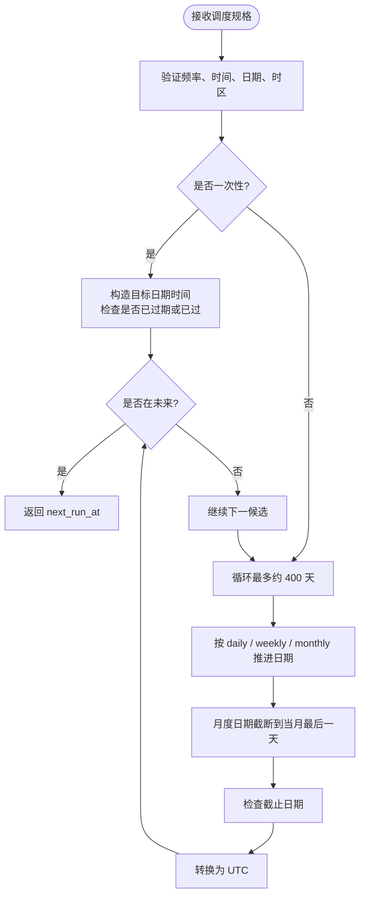
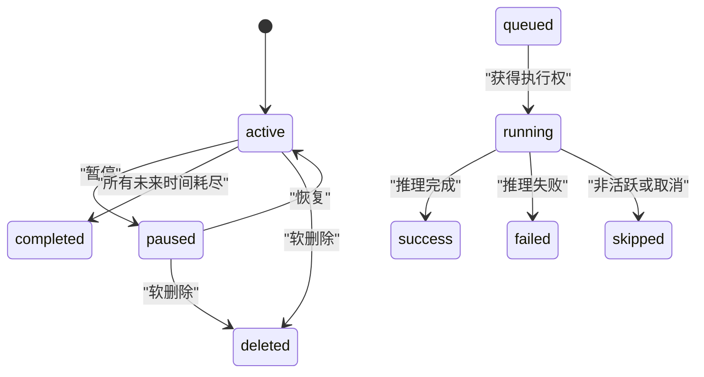
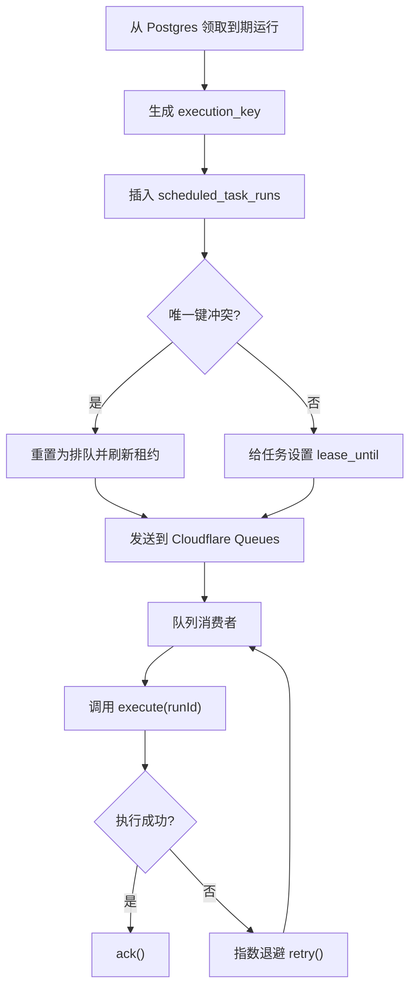
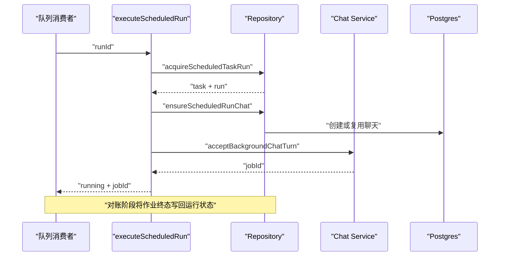
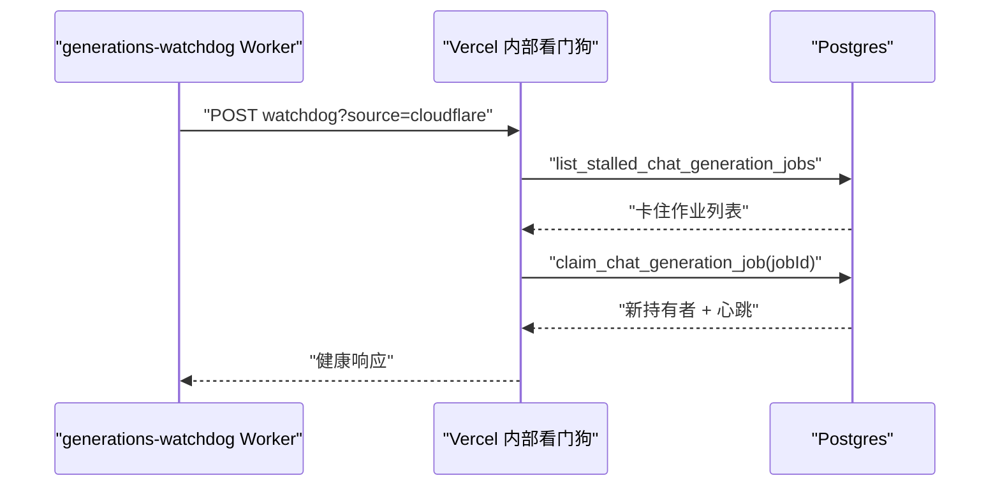
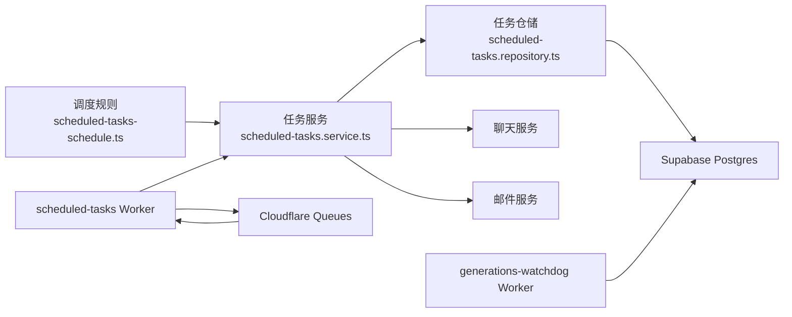

# 后台任务

<cite>
**本文引用的文件**   
- [docs/scheduled-tasks.md](file://docs/scheduled-tasks.md)
- [docs/background-execution.md](file://docs/background-execution.md)
- [docs/background-generations.md](file://docs/background-generations.md)
- [src/server/services/scheduled-tasks.service.ts](file://src/server/services/scheduled-tasks.service.ts)
- [src/server/services/scheduled-tasks-schedule.ts](file://src/server/services/scheduled-tasks-schedule.ts)
- [src/server/repositories/scheduled-tasks.repository.ts](file://src/server/repositories/scheduled-tasks.repository.ts)
- [workers/scheduled-tasks/src/index.ts](file://workers/scheduled-tasks/src/index.ts)
- [workers/generations-watchdog/src/index.ts](file://workers/generations-watchdog/src/index.ts)
- [supabase/migrations/20260725083000_scheduled_tasks.sql](file://supabase/migrations/20260725083000_scheduled_tasks.sql)
- [supabase/migrations/20260826093629_durable_automation_queue.sql](file://supabase/migrations/20260826093629_durable_automation_queue.sql)
- [supabase/migrations/20261010032958_scheduled_task_reconciliation_indexes.sql](file://supabase/migrations/20261010032958_scheduled_task_reconciliation_indexes.sql)
- [supabase/migrations/20260929120000_chat_generation_jobs.sql](file://supabase/migrations/20260929120000_chat_generation_jobs.sql)
- [supabase/migrations/20260929130000_generations_watchdog_cron.sql](file://supabase/migrations/20260929130000_generations_watchdog_cron.sql)
- [supabase/migrations/20260929140000_watchdog_heartbeats.sql](file://supabase/migrations/20260929140000_watchdog_heartbeats.sql)
- [tests/scheduled-tasks.test.ts](file://tests/scheduled-tasks.test.ts)
</cite>

## 目录
1. [引言](#引言)
2. [项目结构](#项目结构)
3. [核心组件](#核心组件)
4. [架构总览](#架构总览)
5. [详细组件分析](#详细组件分析)
6. [依赖关系分析](#依赖关系分析)
7. [性能与资源限制](#性能与资源限制)
8. [开发指南](#开发指南)
9. [故障排查](#故障排查)
10. [结论](#结论)

## 引言
本仓库的后台任务系统围绕“定时调度、持久化队列、分布式执行、看门狗恢复”四个维度构建：  
- 使用 Supabase Postgres 作为任务定义、执行历史、运行租约和结果状态的权威来源。  
- 使用 Cloudflare Queues 提供至少一次投递，结合数据库唯一执行键和租约实现幂等。  
- 通过 Cloudflare Worker 的 Cron Trigger 驱动每分钟一次的调度与回收。  
- 将任务实际推理过程交给可持久化的聊天生成作业，由 generations-watchdog 负责心跳检测、断点续跑和失败恢复。  

因此，该系统不是传统意义上的“BullMQ 队列”，而是“Postgres + Cloudflare Queues + Cloudflare Worker Cron”的组合；但就能力而言，它实现了任务调度、优先级（按到期时间）、重试、死信队列、看门狗监控和分布式工作节点扩展。

## 项目结构
后台任务相关代码分布在以下区域：
- 服务端服务层：调度规则、任务校验、执行入口、结果对账与通知。
- 数据访问层：任务、执行记录、通知、锁与索引查询。
- Cloudflare Worker：调度派发、队列消费、错误重试、看门狗转发。
- Supabase 迁移：任务表、执行记录、自动化通知、聊天生成作业、看门狗心跳。
- 文档与测试：架构说明、调度算法测试、生产冒烟流程。

**图示来源**
- [workers/scheduled-tasks/src/index.ts:1-245](file://workers/scheduled-tasks/src/index.ts#L1-L245)
- [src/server/services/scheduled-tasks.service.ts:440-516](file://src/server/services/scheduled-tasks.service.ts#L440-L516)
- [src/server/repositories/scheduled-tasks.repository.ts:260-420](file://src/server/repositories/scheduled-tasks.repository.ts#L260-L420)
- [supabase/migrations/20260929120000_chat_generation_jobs.sql:1-182](file://supabase/migrations/20260929120000_chat_generation_jobs.sql#L1-L182)

**章节来源**
- [docs/scheduled-tasks.md:1-69](file://docs/scheduled-tasks.md#L1-L69)
- [docs/background-execution.md:1-38](file://docs/background-execution.md#L1-L38)

## 核心组件
- 调度规则引擎：根据频率、本地时间、时区、截止日期计算下一次运行时间，并处理闰年、月末截断、夏令时缺失与重复时间。
- 任务服务：校验输入、创建/更新/删除任务、手动运行、派发到期任务、执行运行、完成对账、通知投递。
- 任务仓储：封装所有 SQL，包括幂等执行键、租约、状态机、索引优化、事务安全。
- scheduled-tasks Worker：每分钟拉取到期任务，写入 Cloudflare Queues；消费者调用执行接口，带指数退避重试和死信队列。
- generations-watchdog Worker：每分钟探测 Vercel 内部的看门狗端点，用于恢复卡住的长时推理切片。
- 持久化模型：`scheduled_tasks`、`scheduled_task_runs`、`automation_notifications`、`chat_generation_jobs`、`private.watchdog_heartbeats`。

**章节来源**
- [src/server/services/scheduled-tasks-schedule.ts:1-316](file://src/server/services/scheduled-tasks-schedule.ts#L1-L316)
- [src/server/services/scheduled-tasks.service.ts:1-200](file://src/server/services/scheduled-tasks.service.ts#L1-L200)
- [src/server/repositories/scheduled-tasks.repository.ts:1-200](file://src/server/repositories/scheduled-tasks.repository.ts#L1-L200)
- [workers/scheduled-tasks/src/index.ts:1-245](file://workers/scheduled-tasks/src/index.ts#L1-L245)
- [workers/generations-watchdog/src/index.ts:1-183](file://workers/generations-watchdog/src/index.ts#L1-L183)
- [supabase/migrations/20260725083000_scheduled_tasks.sql:1-115](file://supabase/migrations/20260725083000_scheduled_tasks.sql#L1-L115)

## 架构总览
后台任务系统包含两条主线：

1. **定时任务调度线**  
   - Cloudflare Cron 每分钟触发 `clauxen-scheduled-tasks` Worker。  
   - Worker 调用 Next.js 内部 `/api/v1/internal/scheduled-tasks/dispatch`，获取一批待执行运行。  
   - Worker 将运行批量发送到 `clauxen-automation-runs` 队列。  
   - 队列消费者调用 `/api/v1/internal/scheduled-tasks/execute`，原子取得运行，创建或复用结果聊天，提交聊天生成作业。

2. **持久化推理执行线**  
   - 聊天生成作业存储在 `chat_generation_jobs`，以切片方式推进。  
   - 每个切片有软预算、硬预算、心跳、检查点和尝试次数。  
   - generations-watchdog 每分钟探测，发现心跳过期或未认领的作业后，重新触发后续切片。

**图示来源**
- [workers/scheduled-tasks/src/index.ts:58-145](file://workers/scheduled-tasks/src/index.ts#L58-L145)
- [src/server/services/scheduled-tasks.service.ts:440-516](file://src/server/services/scheduled-tasks.service.ts#L440-L516)
- [supabase/migrations/20260826093629_durable_automation_queue.sql:1-104](file://supabase/migrations/20260826093629_durable_automation_queue.sql#L1-L104)
- [supabase/migrations/20260929120000_chat_generation_jobs.sql:1-182](file://supabase/migrations/20260929120000_chat_generation_jobs.sql#L1-L182)

## 详细组件分析

### 调度规则与时区处理
调度规则是纯函数集合，不直接访问数据库，职责明确：
- 解析 `HH:MM` 本地时间。
- 在指定 IANA 时区中计算日期部件。
- 将本地墙钟时间转换为 UTC，正确处理夏令时缺失和重复时间。
- 为一次性、每日、每周、每月四种频率计算下一个未来运行时间。
- 支持包含截止日期的语义，并处理月末天数截断。

**图示来源**
- [src/server/services/scheduled-tasks-schedule.ts:1-316](file://src/server/services/scheduled-tasks-schedule.ts#L1-L316)

**章节来源**
- [src/server/services/scheduled-tasks-schedule.ts:1-316](file://src/server/services/scheduled-tasks-schedule.ts#L1-L316)
- [tests/scheduled-tasks.test.ts:1-34](file://tests/scheduled-tasks.test.ts#L1-L34)

### 任务生命周期与状态机
任务和服务层共同维护两个实体：
- `scheduled_tasks`：用户拥有的定时自动化，包含名称、提示、频率、时间、时区、截止日期、状态、下次运行时间、通知模式、模型模式等。
- `scheduled_task_runs`：每次尝试运行的执行记录，包含状态、开始结束时间、错误信息、摘要、执行键、排队时间、租约过期时间、尝试次数。

任务状态：
- `active`：正常运行。
- `paused`：暂停，不产生新的 `next_run_at`。
- `completed`：所有未来时间都耗尽。
- `failed`：业务标记失败。
- `deleted`：软删除，保留聊天和历史。

运行状态：
- `queued`：等待执行。
- `running`：正在执行。
- `success`：成功。
- `failed`：失败。
- `skipped`：被跳过，例如任务暂停或非活跃时才开始。

**图示来源**
- [supabase/migrations/20260725083000_scheduled_tasks.sql:1-115](file://supabase/migrations/20260725083000_scheduled_tasks.sql#L1-L115)
- [supabase/migrations/20260826093629_durable_automation_queue.sql:1-104](file://supabase/migrations/20260826093629_durable_automation_queue.sql#L1-L104)
- [src/server/repositories/scheduled-tasks.repository.ts:260-420](file://src/server/repositories/scheduled-tasks.repository.ts#L260-L420)

**章节来源**
- [src/server/services/scheduled-tasks.service.ts:201-516](file://src/server/services/scheduled-tasks.service.ts#L201-L516)
- [src/server/repositories/scheduled-tasks.repository.ts:201-640](file://src/server/repositories/scheduled-tasks.repository.ts#L201-L640)
- [supabase/migrations/20260725083000_scheduled_tasks.sql:1-115](file://supabase/migrations/20260725083000_scheduled_tasks.sql#L1-L115)

### 队列管理与幂等设计
队列并非 BullMQ，而是 Cloudflare Queues；持久性、幂等性和可靠性由数据库保证：
- 每条运行拥有稳定 `execution_key`，格式通常基于任务 ID 和计划时间，避免重复投递导致重复执行。
- 队列投递至少一次，所以数据库通过唯一索引 `scheduled_task_runs_execution_key_idx` 去重。
- 任务行上的 `lease_until` 和 `lease_run_id` 防止同一任务同时派发多个运行。
- 运行行上的 `lease_expires_at` 和 `attempt_count` 允许超时重试。
- 失败消息进入指数退避重试；网络错误、服务器错误、限流均会重试；最终失败进入死信队列。

**图示来源**
- [src/server/repositories/scheduled-tasks.repository.ts:260-420](file://src/server/repositories/scheduled-tasks.repository.ts#L260-L420)
- [workers/scheduled-tasks/src/index.ts:145-245](file://workers/scheduled-tasks/src/index.ts#L145-L245)
- [supabase/migrations/20260826093629_durable_automation_queue.sql:1-104](file://supabase/migrations/20260826093629_durable_automation_queue.sql#L1-L104)

**章节来源**
- [docs/scheduled-tasks.md:1-69](file://docs/scheduled-tasks.md#L1-L69)
- [workers/scheduled-tasks/src/index.ts:1-245](file://workers/scheduled-tasks/src/index.ts#L1-L245)
- [supabase/migrations/20260826093629_durable_automation_queue.sql:1-104](file://supabase/migrations/20260826093629_durable_automation_queue.sql#L1-L104)

### 任务执行与结果对账
执行流程的核心是 `executeScheduledRun`：
1. 原子获取运行，如果已被其他实例抢占则返回现有状态。
2. 如果运行已结束，直接返回终端状态。
3. 如果存在已有聊天，则查找对应的聊天生成作业，避免重复提交。
4. 如果任务当前非活跃，标记为跳过。
5. 确保结果聊天存在，并通过聊天服务接受后台对话轮次。
6. 提交成功后返回运行 ID、聊天 ID 和作业 ID。
7. 捕获异常：超过最大尝试次数标记失败，否则重新排队并重试。

结果对账由 `reconcileScheduledRuns` 驱动：
- 读取仍在运行但聊天生成作业已进入终态的运行。
- 将 `complete` 映射为 `success`，`cancelled` 映射为 `skipped`，其余映射为 `failed`。
- 生成摘要，必要时标记需要用户交互。
- 随后尝试投递应用内通知和邮件。

**图示来源**
- [src/server/services/scheduled-tasks.service.ts:280-440](file://src/server/services/scheduled-tasks.service.ts#L280-L440)
- [src/server/repositories/scheduled-tasks.repository.ts:420-640](file://src/server/repositories/scheduled-tasks.repository.ts#L420-L640)

**章节来源**
- [src/server/services/scheduled-tasks.service.ts:201-516](file://src/server/services/scheduled-tasks.service.ts#L201-L516)
- [src/server/repositories/scheduled-tasks.repository.ts:420-640](file://src/server/repositories/scheduled-tasks.repository.ts#L420-L640)

### 看门狗监控、心跳检测与故障恢复
看门狗机制分为两部分：

1. **定时任务调度看门狗**  
   - Cloudflare Cron 每分钟触发 `clauxen-scheduled-tasks`。  
   - Worker 调用 Next.js 内部派发接口，若失败则记录日志。  
   - 队列消费器对 409、429、5xx 和网络错误进行指数退避重试，最大延迟 900 秒。

2. **长时推理看门狗**  
   - `clauxen-generations-watchdog` 每分钟调用内部 `/api/v1/internal/generations/watchdog`。  
   - 该端点扫描 `chat_generation_jobs`，找到心跳过旧、未认领或卡住的作业。  
   - 通过原子函数 `claim_chat_generation_job` 抢占有效作业，更新心跳、锁定信息和尝试次数。  
   - 心跳表 `private.watchdog_heartbeats` 记录每分钟的探测来源和结果，便于运维观察。

**图示来源**
- [workers/generations-watchdog/src/index.ts:1-183](file://workers/generations-watchdog/src/index.ts#L1-L183)
- [supabase/migrations/20260929120000_chat_generation_jobs.sql:1-182](file://supabase/migrations/20260929120000_chat_generation_jobs.sql#L1-L182)
- [supabase/migrations/20260929140000_watchdog_heartbeats.sql:1-17](file://supabase/migrations/20260929140000_watchdog_heartbeats.sql#L1-L17)

**章节来源**
- [docs/background-execution.md:1-38](file://docs/background-execution.md#L1-L38)
- [docs/background-generations.md:1-115](file://docs/background-generations.md#L1-L115)
- [workers/generations-watchdog/src/index.ts:1-183](file://workers/generations-watchdog/src/index.ts#L1-L183)
- [supabase/migrations/20260929120000_chat_generation_jobs.sql:1-182](file://supabase/migrations/20260929120000_chat_generation_jobs.sql#L1-L182)
- [supabase/migrations/20260929140000_watchdog_heartbeats.sql:1-17](file://supabase/migrations/20260929140000_watchdog_heartbeats.sql#L1-L17)

### 任务优先级、资源限制与清理策略
- **优先级**：默认按 `next_run_at` 升序派发，体现“先到先执行”。手动运行优先于定时任务，但不改变任务的常规周期。
- **并发控制**：
  - 每个聊天只有一个活动生成作业。
  - 每个任务在同一时刻只能有一个运行被派发。
  - 每个运行在同一时刻只能被一个执行实例获取。
- **资源限制**：
  - 用户最多 15 个活跃任务。
  - 技能 ID 最多 20 个，长度不超过 160。
  - 附件引用最多 20 条。
  - 单次提示最多 8000 字符。
  - 任务名称最多 50 字符。
- **清理策略**：
  - 任务软删除保留聊天和历史。
  - 通知去重：每条运行只生成一条通知。
  - 通知投递失败保留重试机会，直到成功或任务结束。
  - 长时推理作业的终端结果保留窗口由生成作业文档定义，通常为 7 天；聊天转录保存在聊天历史中。

**章节来源**
- [src/server/services/scheduled-tasks.service.ts:1-200](file://src/server/services/scheduled-tasks.service.ts#L1-L200)
- [src/server/repositories/scheduled-tasks.repository.ts:1-200](file://src/server/repositories/scheduled-tasks.repository.ts#L1-L200)
- [supabase/migrations/20261010032958_scheduled_task_reconciliation_indexes.sql:1-9](file://supabase/migrations/20261010032958_scheduled_task_reconciliation_indexes.sql#L1-L9)
- [docs/background-generations.md:1-115](file://docs/background-generations.md#L1-L115)

## 依赖关系分析
后台任务系统的依赖可以分层理解：

**图示来源**
- [src/server/services/scheduled-tasks-schedule.ts:1-316](file://src/server/services/scheduled-tasks-schedule.ts#L1-L316)
- [src/server/services/scheduled-tasks.service.ts:1-516](file://src/server/services/scheduled-tasks.service.ts#L1-L516)
- [src/server/repositories/scheduled-tasks.repository.ts:1-640](file://src/server/repositories/scheduled-tasks.repository.ts#L1-L640)
- [workers/scheduled-tasks/src/index.ts:1-245](file://workers/scheduled-tasks/src/index.ts#L1-L245)
- [workers/generations-watchdog/src/index.ts:1-183](file://workers/generations-watchdog/src/index.ts#L1-L183)

**章节来源**
- [docs/scheduled-tasks.md:1-69](file://docs/scheduled-tasks.md#L1-L69)
- [docs/background-execution.md:1-38](file://docs/background-execution.md#L1-L38)

## 性能与资源限制
- **调度粒度**：Cron 每分钟触发一次，因此调度精度是分钟级，不是精确秒级。
- **批处理大小**：调度派发默认限制 20，队列消费批量发送，减少请求开销。
- **数据库锁**：大量使用 `FOR UPDATE SKIP LOCKED` 避免锁竞争和等待。
- **索引优化**：
  - 按用户、状态、更新时间排序的任务列表。
  - 按 `next_run_at` 的部分索引加速到期任务查找。
  - 按运行状态、租约过期时间和排队时间的索引加速领取。
  - 按运行结束时间和通知标志的部分索引加速通知对账。
  - 按聊天生成作业心跳的部分索引加速看门狗扫描。
- **重试策略**：
  - 队列消费者使用指数退避，上限 900 秒。
  - 执行服务对突发失败最多重试 5 次。
  - 看门狗对网络错误进行有限次数重试。
- **内存与体积**：
  - 聊天生成作业保存完整 checkpoint JSON，适合恢复但不适合超大上下文无限增长。
  - 任务名称、提示、技能 ID、附件引用均有上限，防止元数据膨胀。

**章节来源**
- [src/server/repositories/scheduled-tasks.repository.ts:1-200](file://src/server/repositories/scheduled-tasks.repository.ts#L1-L200)
- [supabase/migrations/20261010032958_scheduled_task_reconciliation_indexes.sql:1-9](file://supabase/migrations/20261010032958_scheduled_task_reconciliation_indexes.sql#L1-L9)
- [supabase/migrations/20260929120000_chat_generation_jobs.sql:1-182](file://supabase/migrations/20260929120000_chat_generation_jobs.sql#L1-L182)
- [workers/scheduled-tasks/src/index.ts:145-245](file://workers/scheduled-tasks/src/index.ts#L145-L245)

## 开发指南

### 如何新增一个后台任务类型
1. 确定任务属于“定时调度”还是“即时后台推理”。  
2. 如果是定时任务，在 `scheduled-tasks.service.ts` 中扩展输入校验、运行提示或通知逻辑。  
3. 如果需要新的数据库字段，添加 Supabase 迁移并在 repository 中读写。  
4. 如果需要新的调度行为，扩展 `scheduled-tasks-schedule.ts` 中的 `computeNextRunAt`。  
5. 如果任务需要更长的推理过程，使用聊天生成作业路径，而不是同步 HTTP 响应。  
6. 添加单元测试覆盖边界情况，尤其是时区、周末、月末、夏令时和重复时间。

### 如何编写任务校验
- 校验必填字段、长度、枚举值、日历日期、星期、月份、时区。
- 计算 `next_run_at`，如果没有未来运行时间则拒绝。
- 限制活跃任务数量，避免用户滥用。
- 对 skillIds 和 attachmentRefs 做去重和长度限制。

### 如何处理错误
- 客户端错误使用明确的 AppError 和 HTTP 400。
- 找不到任务或运行使用 404。
- 并发冲突使用 409。
- 临时失败使用 503 并重新排队。
- 队列消费失败使用指数退避重试。
- 不可恢复错误进入死信队列。
- 通知投递失败记录日志，保留重试机会。

### 如何记录日志
- Worker 层记录派发、入队、执行确认、重试和终端状态。
- 服务层记录对账、通知投递失败。
- 看门狗记录探测失败、网络错误和状态码。
- 所有关键事件都应包含 `runId`、`taskId`、`status` 和必要上下文。

**章节来源**
- [src/server/services/scheduled-tasks.service.ts:1-200](file://src/server/services/scheduled-tasks.service.ts#L1-L200)
- [src/server/services/scheduled-tasks-schedule.ts:1-316](file://src/server/services/scheduled-tasks-schedule.ts#L1-L316)
- [workers/scheduled-tasks/src/index.ts:1-245](file://workers/scheduled-tasks/src/index.ts#L1-L245)
- [workers/generations-watchdog/src/index.ts:1-183](file://workers/generations-watchdog/src/index.ts#L1-L183)

## 故障排查

### 任务没有执行
- 检查 Cloudflare Cron 是否正常触发。
- 检查 `next_run_at` 是否正确计算，特别是时区和截止时间。
- 检查任务是否被暂停或删除。
- 检查任务是否已达到 15 个活跃任务上限。
- 检查队列是否有积压。

### 任务重复执行
- 检查 `execution_key` 是否稳定。
- 检查唯一索引是否生效。
- 检查队列是否发生重复投递。
- 检查运行租约是否及时释放。

### 任务长时间运行但未完成
- 检查聊天生成作业是否存在。
- 检查心跳是否更新。
- 检查 generations-watchdog 是否成功探测。
- 检查 Vercel 内部令牌和连接配置。
- 检查是否达到切片或尝试次数上限。

### 通知未送达
- 检查通知模式是否为 `off`。
- 检查是否已经投递成功。
- 检查邮件地址是否存在。
- 检查邮件服务是否返回失败。
- 查看 `automation_notifications` 的状态和重试标志。

**章节来源**
- [docs/scheduled-tasks.md:1-69](file://docs/scheduled-tasks.md#L1-L69)
- [docs/background-execution.md:1-38](file://docs/background-execution.md#L1-L38)
- [supabase/migrations/20260826093629_durable_automation_queue.sql:1-104](file://supabase/migrations/20260826093629_durable_automation_queue.sql#L1-L104)
- [supabase/migrations/20260929140000_watchdog_heartbeats.sql:1-17](file://supabase/migrations/20260929140000_watchdog_heartbeats.sql#L1-L17)

## 结论
该后台任务系统以 Supabase 为权威状态源，以 Cloudflare Queues 为可靠传输层，以 Cloudflare Worker 为调度与恢复驱动，形成了具备幂等、重试、看门狗、分布式能力和持久化恢复能力的任务平台。虽然它不使用 BullMQ，但其设计目标一致：让任务可调度、可观测、可恢复、可扩展。

对于开发者而言，最重要的原则是：
- 把稳定性放在第一优先级：幂等键、租约、状态机、重试和死信队列。
- 把可恢复性放在第二优先级：检查点、心跳、看门狗和结果对账。
- 把性能放在第三优先级：分批、索引、锁竞争控制和资源上限。
- 把可观测性贯穿始终：结构化日志、心跳表和运行历史。