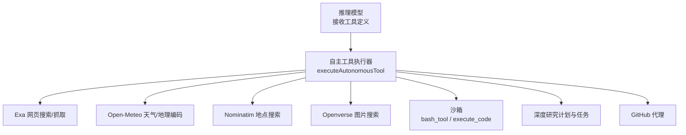
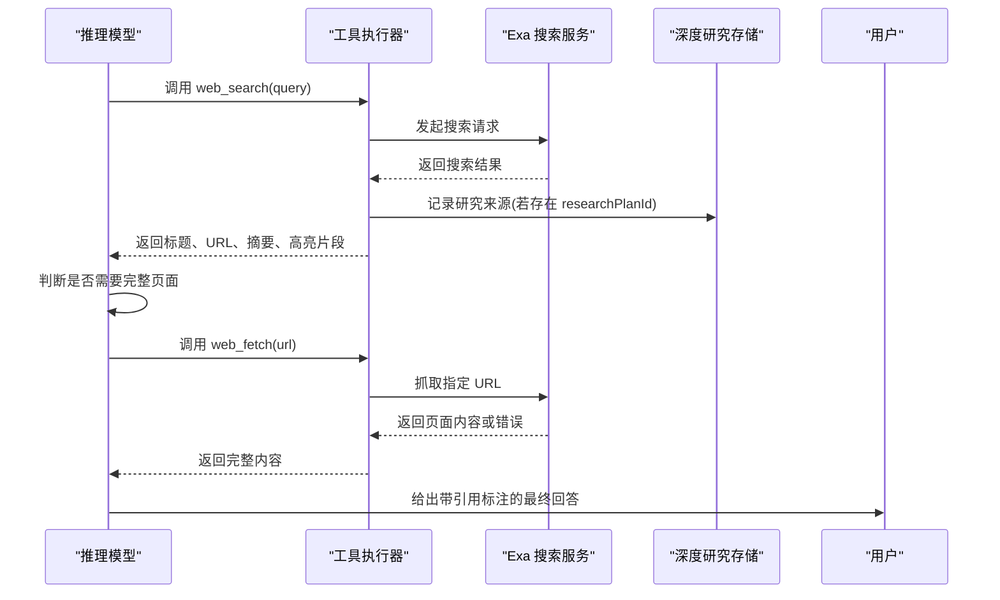
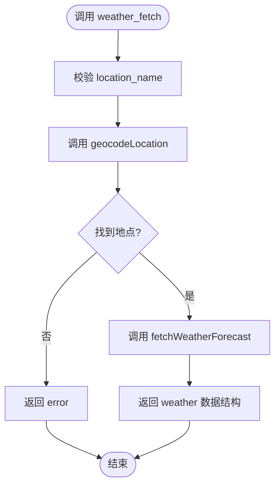
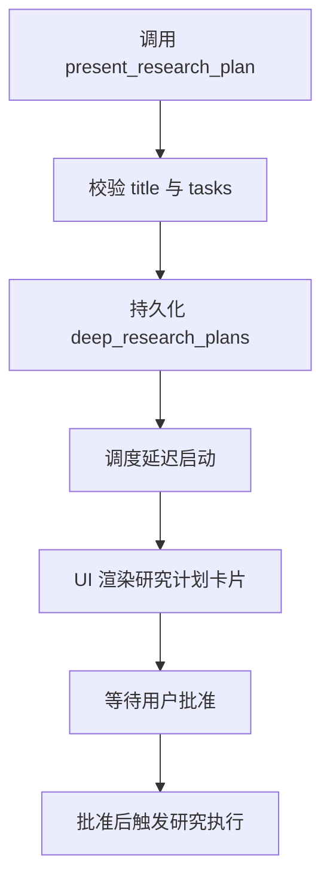
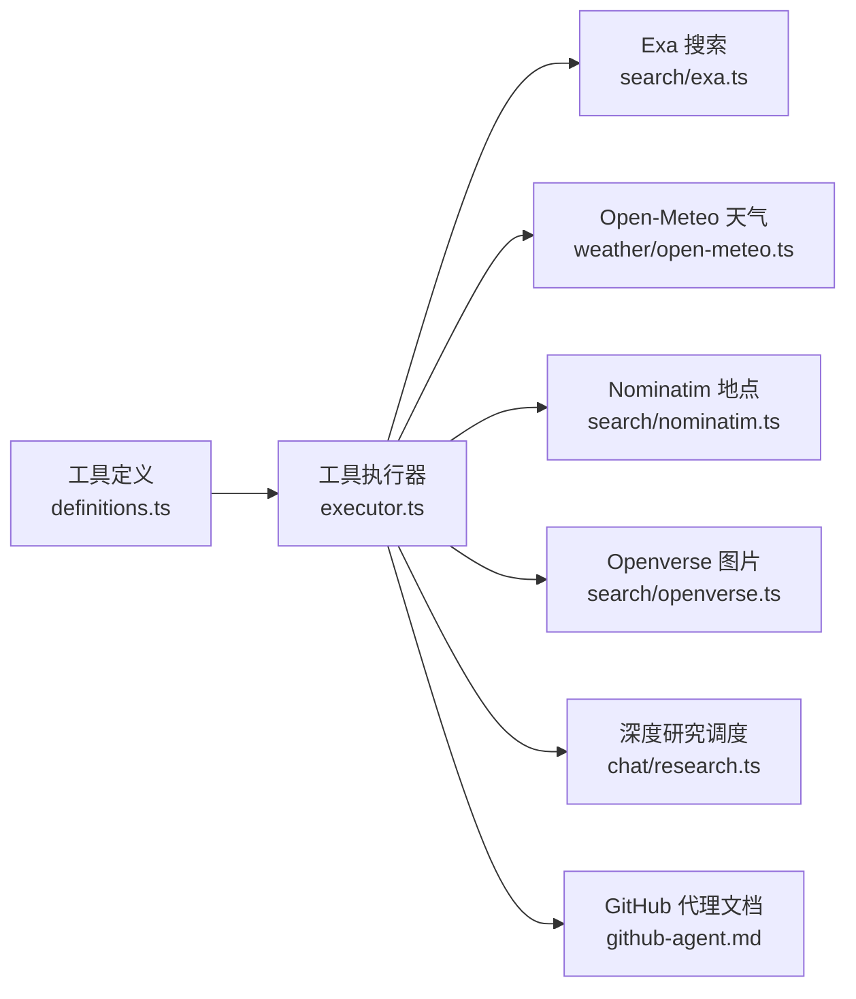

# 内置工具详解

<cite>
**本文引用的文件**   
- [autonomous-tools/definitions.ts](file://src/server/inference/autonomous-tools/definitions.ts)
- [autonomous-tools/executor.ts](file://src/server/inference/autonomous-tools/executor.ts)
- [search/exa.ts](file://src/server/search/exa.ts)
- [weather/open-meteo.ts](file://src/server/weather/open-meteo.ts)
- [search/nominatim.ts](file://src/server/search/nominatim.ts)
- [search/openverse.ts](file://src/server/search/openverse.ts)
- [chat/research.ts](file://src/server/chat/research.ts)
- [deep-research.md](file://docs/deep-research.md)
- [github-agent.md](file://docs/github-agent.md)
</cite>

## 目录
1. [引言](#引言)
2. [项目结构](#项目结构)
3. [核心组件](#核心组件)
4. [架构总览](#架构总览)
5. [详细工具分析](#详细工具分析)
6. [依赖关系分析](#依赖关系分析)
7. [性能与调用策略](#性能与调用策略)
8. [错误处理与异常恢复](#错误处理与异常恢复)
9. [常见问题排查](#常见问题排查)
10. [结论](#结论)

## 引言
本文面向使用 Clauxen 自动代理的用户和集成方，系统化梳理所有内置工具。重点覆盖：
- 网页搜索、网页抓取、图片搜索、地点搜索、天气查询
- GitHub 代理操作
- 深度研究计划展示与任务进度更新
- 沙箱执行、文件读写、附件读取、交互式提问
- 定时任务管理

每个工具均说明：
- 决策信号：何时应该调用
- 能力说明：能做什么、不能做什么
- 参数定义：必填字段、可选字段、取值范围
- 返回值格式：主结果、进度事件、错误字段
- 使用场景与链式调用提示
- 常见用法模式与最佳实践
- 错误处理和异常情况

## 项目结构
内置工具的“声明层”和“执行层”分离清晰：
- 声明层：`src/server/inference/autonomous-tools/definitions.ts` 定义工具名称、描述、参数 Schema 以及模型如何被引导。
- 执行层：`src/server/inference/autonomous-tools/executor.ts` 根据工具名分发到具体实现，并与外部服务或本地沙箱交互。
- 外部能力：Exa 网页搜索、Open-Meteo 天气与地理编码、Nominatim 地点搜索、Openverse 图片搜索。
- 深度研究：`src/server/chat/research.ts` 与 `docs/deep-research.md` 负责持久化研究计划、调度、状态迁移和报告。
- GitHub 代理：由文档和 Worker 集成提供，Executor 仅暴露 `github_agent` 入口。

**图表来源**
- [autonomous-tools/executor.ts:200-721](file://src/server/inference/autonomous-tools/executor.ts#L200-L721)
- [autonomous-tools/definitions.ts:1-200](file://src/server/inference/autonomous-tools/definitions.ts#L1-L200)
- [chat/research.ts:1-200](file://src/server/chat/research.ts#L1-L200)

**章节来源**
- [autonomous-tools/definitions.ts:1-584](file://src/server/inference/autonomous-tools/definitions.ts#L1-L584)
- [autonomous-tools/executor.ts:1-730](file://src/server/inference/autonomous-tools/executor.ts#L1-L730)
- [chat/research.ts:1-200](file://src/server/chat/research.ts#L1-L200)
- [deep-research.md:1-39](file://docs/deep-research.md#L1-L39)

## 核心组件
### 工具声明与执行契约
- 工具以函数形式声明，包含 `name`、`description`、`parameters`，部分工具启用严格校验 `strict: true`。
- 执行器统一返回 `{ output, pauseForUser? }`；某些工具还通过 `onToolProgress` 推送中间状态，例如搜索流式结果、沙箱标准输出等。

### 上下文对象
执行器接收 `ToolExecutionContext`，关键信息包括：
- `conversationId`：对话标识
- `userId`：当前用户标识（用于需要登录的工具）
- `researchPlanId`：深度研究计划标识（仅深度研究流程中设置）
- `toolCallId`：工具调用追踪标识
- `onToolProgress`：向 UI 推送进度事件的回调

**章节来源**
- [autonomous-tools/executor.ts:1-60](file://src/server/inference/autonomous-tools/executor.ts#L1-L60)
- [autonomous-tools/definitions.ts:1-20](file://src/server/inference/autonomous-tools/definitions.ts#L1-L20)

## 架构总览
以下时序图展示一次典型“先搜索再阅读”的链式调用：

**图表来源**
- [autonomous-tools/executor.ts:200-280](file://src/server/inference/autonomous-tools/executor.ts#L200-L280)
- [search/exa.ts:1-200](file://src/server/search/exa.ts#L1-L200)
- [chat/research.ts:1-200](file://src/server/chat/research.ts#L1-L200)

**章节来源**
- [autonomous-tools/executor.ts:200-360](file://src/server/inference/autonomous-tools/executor.ts#L200-L360)
- [search/exa.ts:1-238](file://src/server/search/exa.ts#L1-L238)

## 详细工具分析

### 网页搜索 web_search
- **决策信号**：需要最新、可溯源的事实信息时主动使用。
- **能力说明**：调用 Exa 的自动类型搜索，返回标题、URL、摘要、发布日期、图标和高亮片段；支持流式进展事件。
- **适用场景**：新闻、技术事实、产品对比、政策变化等需要联网证据的回答。
- **链式调用提示**：搜索结果不足时，再用 `web_fetch` 获取完整页面；深度研究中会记录来源 URL。
- **参数**
  - `query`：必填，简短自然短语。
  - `num_results`：可选，默认普通聊天较小，深度研究最多可到 30。
- **返回值**
  - `query`
  - `results`：每项含 `index`、`title`、`url`、`snippet`、`publishedDate`、`favicon`、`highlights`
  - `searchType`：固定为自动类型
- **进度事件**
  - `status: "searching"`：开始连接
  - `status: "streaming"`：流式内容增量
  - `status: "results"`：逐步到达的搜索结果

**章节来源**
- [autonomous-tools/definitions.ts:100-160](file://src/server/inference/autonomous-tools/definitions.ts#L100-L160)
- [autonomous-tools/executor.ts:200-280](file://src/server/inference/autonomous-tools/executor.ts#L200-L280)
- [search/exa.ts:1-238](file://src/server/search/exa.ts#L1-L238)

#### 调用示例
- 普通问答：用一句话描述正在搜索，然后调用 `web_search`，最后基于返回结果写出带索引引用的答案。
- 深度研究：在已批准的研究计划中，系统允许更高数量的结果，并自动记录检索到的 URL。

---

### 网页抓取 web_fetch
- **决策信号**：已有明确 URL，且搜索摘要不足以支撑最终答案。
- **能力说明**：通过 Exa 抓取单个 HTTPS 页面的正文；不会直接开放任意网络访问，避免 SSRF 风险。
- **链式调用提示**：通常紧跟 `web_search`；抓取后判断信息是否充分，必要时继续搜索。
- **参数**
  - `url`：必填，完全限定的 HTTPS 地址。
- **返回值**
  - 成功：`url`、`title`、`snippet`
  - 失败：`url`、`error`
- **安全约束**：不直接做裸 HTTP 抓取；失败时返回结构化错误而非抛出未捕获异常。

**章节来源**
- [autonomous-tools/definitions.ts:160-200](file://src/server/inference/autonomous-tools/definitions.ts#L160-L200)
- [autonomous-tools/executor.ts:280-330](file://src/server/inference/autonomous-tools/executor.ts#L280-L330)

#### 调用示例
- 官方文档、README、完整文章、API 参考：先用搜索找到准确 URL，再调用 `web_fetch`。

---

### 图片搜索 image_search
- **决策信号**：回答需要插图帮助理解，且交付物不是纯文本或代码。
- **能力说明**：从 Openverse 搜索开源许可图片，返回缩略图、原图、替代文本、落地页、作者和许可证。
- **限制**：图片是示意性 CC 授权资源，不应作为特定人物、品牌或产品的官方照片。
- **参数**
  - `query`：必填。
  - `max_results`：可选，默认约 3，上限受实现保护。
- **返回值**
  - `query`
  - `images`：数组，每项含 `url`、`thumbnail`、`alt`、`landingUrl`、`creator`、`license`

**章节来源**
- [autonomous-tools/definitions.ts:200-260](file://src/server/inference/autonomous-tools/definitions.ts#L200-L260)
- [autonomous-tools/executor.ts:330-360](file://src/server/inference/autonomous-tools/executor.ts#L330-L360)
- [search/openverse.ts:1-51](file://src/server/search/openverse.ts#L1-L51)

#### 调用示例
- 制作图文报告、教程配图、概念可视化时使用；纯技术分析或已有相关图片时可跳过。

---

### 地点搜索 places_search
- **决策信号**：需要查找具体地点、地名、商业场所或地址。
- **能力说明**：使用 OpenStreetMap 的免费 Nominatim 接口，返回名称、显示名称、经纬度、类别、类型和地址信息。
- **限制**：不提供评分、评论、照片等 Google 特色功能；如需评价类信息应结合 `web_search`。
- **参数**
  - `query`：必填，例如“布鲁克林的咖啡店”或“埃菲尔铁塔”。
  - `max_results`：可选，默认约 5，上限约 10。
- **返回值**
  - `query`
  - `results`：地点数组

**章节来源**
- [autonomous-tools/definitions.ts:200-260](file://src/server/inference/autonomous-tools/definitions.ts#L200-L260)
- [autonomous-tools/executor.ts:360-390](file://src/server/inference/autonomous-tools/executor.ts#L360-L390)
- [search/nominatim.ts:1-62](file://src/server/search/nominatim.ts#L1-L62)

#### 调用示例
- “查一下北京国家图书馆的地址和坐标”“推荐东京站附近的餐厅位置”。

---

### 天气查询 weather_fetch
注意：仓库中该工具的实际名称为 `weather_fetch`，并非 `fetch_weather_forecast`。
- **决策信号**：询问某地当前天气、出行穿衣建议、户外活动天气背景。
- **能力说明**：通过 Open-Meteo 进行地理编码和天气预报，返回当前位置、当前实况、逐小时预报、每日预报。
- **参数**
  - `location_name`：必填，自然语言地名。
  - `units`：必填，`metric` 或 `imperial`；美国地区常用英制，其他地区默认公制。
- **返回值**
  - `place`：地理编码结果
  - `units`：使用的单位
  - `current`：温度、体感温度、湿度、白天标志、天气代码、条件、风速风向、阵风、降水量
  - `hourly`：逐小时温度、降水概率、天气代码、条件
  - `daily`：日期、最高最低温、日出日落、降水概率、最大风速、紫外线指数等
- **异常行为**
  - 无法解析地名时返回 `error`，提示找不到匹配地点。
  - 地理编码失败时不会继续请求天气预报。

**图表来源**
- [autonomous-tools/executor.ts:390-430](file://src/server/inference/autonomous-tools/executor.ts#L390-L430)
- [weather/open-meteo.ts:1-200](file://src/server/weather/open-meteo.ts#L1-L200)

**章节来源**
- [autonomous-tools/definitions.ts:200-260](file://src/server/inference/autonomous-tools/definitions.ts#L200-L260)
- [autonomous-tools/executor.ts:390-430](file://src/server/inference/autonomous-tools/executor.ts#L390-L430)
- [weather/open-meteo.ts:1-249](file://src/server/weather/open-meteo.ts#L1-L249)

#### 调用示例
- “旧金山今天适合穿外套吗？”：选择 `imperial` 或 `metric`，让工具决定单位，然后根据返回数值解释。
- “东京未来三天有雨吗？”：查看 `daily` 中的降水概率和天气条件。

---

### GitHub 代理 github_agent
- **决策信号**：操作已连接的 GitHub 仓库、读取元数据或文件、创建变更分支和草稿拉取请求。
- **能力说明**：
  - 枚举用户安装的仓库
  - 读取仓库元数据和文件
  - 在 `clauxen/` 新分支上提交更改并创建草稿 PR，从不直接修改基础分支或合并
- **安全约束**
  - 未登录用户会被拒绝
  - 写入必须基于用户指令
  - 网络失败需保留相同 `request_id`，检查分支后再决定是否重试
  - 不得要求或打印 GitHub Token
- **参数**
  - `operation`：必填，枚举值 `repositories`、`read`、`create_change`
  - `owner`、`repo`：仓库所有者与名称
  - `ref`：分支、标签或提交
  - `path`：文件或目录路径
  - `request_id`：创建变更时的唯一 UUID
  - `base_branch`、`expected_head_sha`：基础分支和期望头提交
  - `title`、`body`：拉取请求标题和正文
  - `files`：待写入文件的 `path` 与完整 UTF-8 `content` 列表
- **返回值**
  - 成功：与操作相关的结果对象
  - 失败：包含 `error` 的对象
- **前端入口**
  - 应用设置中链接到 `/github`，用于授权和安装 GitHub App。

**章节来源**
- [autonomous-tools/definitions.ts:1-60](file://src/server/inference/autonomous-tools/definitions.ts#L1-L60)
- [autonomous-tools/executor.ts:200-240](file://src/server/inference/autonomous-tools/executor.ts#L200-L240)
- [github-agent.md:1-108](file://docs/github-agent.md#L1-L108)

#### 调用示例
- 先调用 `repositories` 列出仓库
- 再调用 `read` 读取 README 或配置文件
- 最后对代码变更调用 `create_change`，传入新分支、完整文件内容和 PR 信息

---

### 深度研究 present_research_plan
- **决策信号**：用户选择“深度研究”时，先呈现可编辑研究计划卡片，不直接执行研究。
- **能力说明**：
  - 保存标题和 3–8 个具体任务
  - 生成服务器端拥有的 60 秒审批窗口
  - 渲染为原生卡片后等待用户确认
- **参数**
  - `title`：必填，最长 200 字符
  - `tasks`：必填，3–8 条字符串任务，每条最长 1000 字符
- **返回值**
  - 成功：`status: "plan_presented"`、标题、任务列表、自动开始时间、提示消息
  - 重复计划：返回错误，表示已有已批准计划
  - 缺少拥有会话：返回错误
- **后续流程**
  - 工具之后应以自然语言写概述
  - 等待批准后再进入实际研究阶段

**图表来源**
- [autonomous-tools/executor.ts:620-721](file://src/server/inference/autonomous-tools/executor.ts#L620-L721)
- [chat/research.ts:1-120](file://src/server/chat/research.ts#L1-L120)
- [deep-research.md:1-39](file://docs/deep-research.md#L1-L39)

**章节来源**
- [autonomous-tools/definitions.ts:60-100](file://src/server/inference/autonomous-tools/definitions.ts#L60-L100)
- [autonomous-tools/executor.ts:620-721](file://src/server/inference/autonomous-tools/executor.ts#L620-L721)
- [chat/research.ts:1-120](file://src/server/chat/research.ts#L1-L120)
- [deep-research.md:1-39](file://docs/deep-research.md#L1-L39)

---

### 深度研究 research_task_update
- **决策信号**：在已批准的研究任务执行过程中，更新当前任务索引及其运行或完成状态。
- **能力说明**：
  - 仅在存在 `researchPlanId` 时可用
  - 收集并核验证据后才标记任务完成
  - 将进度持久化，使 UI 进度条反映已完成任务
- **参数**
  - `task_index`：必填，0–7 的任务索引
  - `status`：必填，`running` 或 `complete`
- **返回值**
  - 成功：`status: "saved"`
  - 失败：`error`，例如没有活跃研究、任务不可用或研究暂停

**章节来源**
- [autonomous-tools/definitions.ts:100-140](file://src/server/inference/autonomous-tools/definitions.ts#L100-L140)
- [autonomous-tools/executor.ts:600-620](file://src/server/inference/autonomous-tools/executor.ts#L600-L620)
- [chat/research.ts:1-200](file://src/server/chat/research.ts#L1-L200)
- [deep-research.md:1-39](file://docs/deep-research.md#L1-L39)

---

### 其他重要内置工具概览

#### bash_tool
- 用途：在隔离 Linux 沙箱中运行 Shell 命令。
- 决策信号：文件目录操作、包安装、构建脚本、git 等更适合命令行完成的步骤。
- 参数：`description`、`command`、`output_paths`
- 返回值：退出码、标准输出、标准错误、错误信息、沙箱 ID、工作目录、产物列表。

#### execute_code
- 用途：在 Python 沙箱中执行分析、计算、数据处理、图表生成。
- 决策信号：需要 Python 计算、验证逻辑、生成文件输出。
- 参数：`description`、`code`、`output_paths`
- 返回值：标准输出、标准错误、错误对象、Python 结果、沙箱和工作目录、产物列表。

#### read_skill
- 用途：读取沙箱环境技能文档，了解可用库和格式处理能力。
- 决策信号：不确定沙箱环境、需要 PDF/PPTX/图表等特殊格式时。
- 参数：`skill_id`

#### read_attachment
- 用途：读取用户上传的文件，支持文本切片分页和图片预览。
- 参数：`file_id`、`offset`、`limit`

#### file_read / create_file
- 用途：在工作区读取或创建文本文件；`create_file` 会自动呈现可下载视图。
- 参数：`path`、`content`、可选 `description`

#### ask_user_input_v0
- 用途：交互式问卷，适用于需求澄清、偏好收集、方案权衡。
- 返回值：`pauseForUser: true`，表示需要等待用户选择。

#### 定时任务工具
- `create_scheduled_task`：创建一次性、每日、每周、每月自动化任务。
- `list_scheduled_tasks`：列出用户定时任务。
- `cancel_scheduled_task`：按 ID 取消任务。

**章节来源**
- [autonomous-tools/definitions.ts:200-584](file://src/server/inference/autonomous-tools/definitions.ts#L200-L584)
- [autonomous-tools/executor.ts:430-721](file://src/server/inference/autonomous-tools/executor.ts#L430-L721)

## 依赖关系分析

**图表来源**
- [autonomous-tools/definitions.ts:1-584](file://src/server/inference/autonomous-tools/definitions.ts#L1-L584)
- [autonomous-tools/executor.ts:1-730](file://src/server/inference/autonomous-tools/executor.ts#L1-L730)
- [search/exa.ts:1-238](file://src/server/search/exa.ts#L1-L238)
- [weather/open-meteo.ts:1-249](file://src/server/weather/open-meteo.ts#L1-L249)
- [search/nominatim.ts:1-62](file://src/server/search/nominatim.ts#L1-L62)
- [search/openverse.ts:1-51](file://src/server/search/openverse.ts#L1-L51)
- [chat/research.ts:1-200](file://src/server/chat/research.ts#L1-L200)
- [github-agent.md:1-108](file://docs/github-agent.md#L1-L108)

**章节来源**
- [autonomous-tools/executor.ts:1-120](file://src/server/inference/autonomous-tools/executor.ts#L1-L120)
- [search/exa.ts:1-238](file://src/server/search/exa.ts#L1-L238)
- [weather/open-meteo.ts:1-249](file://src/server/weather/open-meteo.ts#L1-L249)
- [search/nominatim.ts:1-62](file://src/server/search/nominatim.ts#L1-L62)
- [search/openverse.ts:1-51](file://src/server/search/openverse.ts#L1-L51)

## 性能与调用策略
- **网页搜索**：Exa 支持流式 SSE，执行器会优先发送 `searching`、`streaming`、`results` 进度，减少 UI 空白等待。
- **深度研究**：普通聊天保留较少搜索结果；深度研究允许更高数量结果，并在同一轮中多次搜索，但会对来源 URL 去重。
- **网页抓取**：只通过 Exa 抓取，避免直接开放任意网络访问；失败时返回结构化错误。
- **沙箱输出**：当工具产生用户可见产物时，应将文件写入工作区相对路径，并通过 `output_paths` 上报，由执行器上传并呈现。
- **链式调用建议**
  - 搜索 → 抓取 → 分析 → 生成文件 → 列出产出路径
  - 地点 → 天气 → 行动建议
  - 研究计划 → 搜索多个角度 → 更新任务进度 → 汇总报告

[本节为通用指导，不直接分析具体文件]

## 错误处理与异常恢复
### 通用错误模式
- 工具执行器多数情况下返回 `{ output: { error: ... } }`，而不是直接抛出未捕获异常，便于上层稳定处理。
- 需要登录的工具在未登录时返回明确的登录错误。
- 深度研究在非研究上下文中调用任务更新时会返回错误。

### 具体工具错误
- `web_fetch`：URL 为空、抓取失败、无内容时返回结构化错误。
- `weather_fetch`：地理编码失败时返回找不到地点的错误。
- `github_agent`：未登录或外部操作失败时返回错误对象。
- `present_research_plan`：重复计划或缺少拥有会话时返回错误。
- `research_task_update`：无研究计划、任务不可用或研究暂停时返回错误。
- 沙箱工具：标准错误、执行错误、产物路径读取错误会以 `stderr`、`error`、`outputPathErrors` 等形式返回。

**章节来源**
- [autonomous-tools/executor.ts:200-721](file://src/server/inference/autonomous-tools/executor.ts#L200-L721)
- [weather/open-meteo.ts:1-200](file://src/server/weather/open-meteo.ts#L1-L200)
- [chat/research.ts:1-200](file://src/server/chat/research.ts#L1-L200)

## 常见问题排查
- **问题：天气查询报找不到地点**
  - 检查 `location_name` 是否为真实地名；工具内部只做一次地理编码，失败即返回错误。
  - 可先用 `places_search` 确认地点是否存在，再调用 `weather_fetch`。
- **问题：网页搜索结果为空或延迟过长**
  - 检查网络、Exa API 配置；搜索可能走流式或回退阻塞请求，极端情况可能超时返回空结果。
  - 缩短查询词，提高查询精确度。
- **问题：深度研究计划无法编辑**
  - 一旦计划进入研究流程，不再允许编辑；应先取消或重试，再重新呈现计划。
- **问题：GitHub 代理写入失败**
  - 不要盲目重试新 UUID；应保留原 `request_id`，检查分支是否已存在，再决定是否重试。
- **问题：沙箱文件未出现在产物面板**
  - 确认文件写入工作区相对路径，并在 `output_paths` 中精确列出；避免使用绝对路径。

**章节来源**
- [autonomous-tools/executor.ts:200-721](file://src/server/inference/autonomous-tools/executor.ts#L200-L721)
- [search/exa.ts:1-238](file://src/server/search/exa.ts#L1-L238)
- [weather/open-meteo.ts:1-249](file://src/server/weather/open-meteo.ts#L1-L249)
- [github-agent.md:1-108](file://docs/github-agent.md#L1-L108)

## 结论
内置工具围绕“搜索—阅读—分析—生成—汇报”这一主线设计：
- 网页搜索和网页抓取负责外部事实来源
- 地点搜索和天气查询提供现实世界地理与气象信息
- 图片搜索辅助视觉表达
- GitHub 代理连接版本控制系统
- 深度研究工具将多轮搜索、任务进度和报告组织成可审计流程
- 沙箱、文件和附件工具支撑本地分析与产物输出
- 定时任务工具将对话意图转化为长期自动化

正确使用这些工具的关键在于：先判断是否需要联网证据，再选择合适的工具组合；遵循工具描述中的决策信号、链式调用提示和安全约束；始终关注返回值中的错误字段，并结合进度事件提升用户体验。