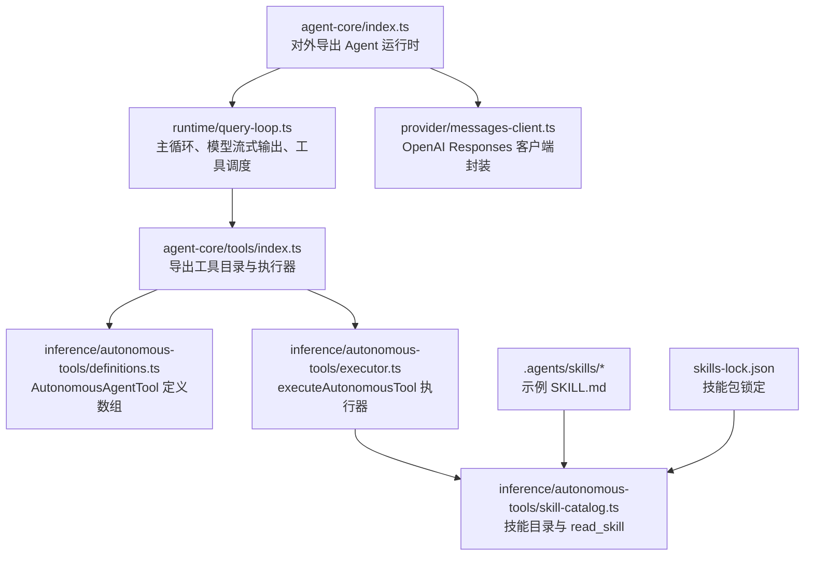
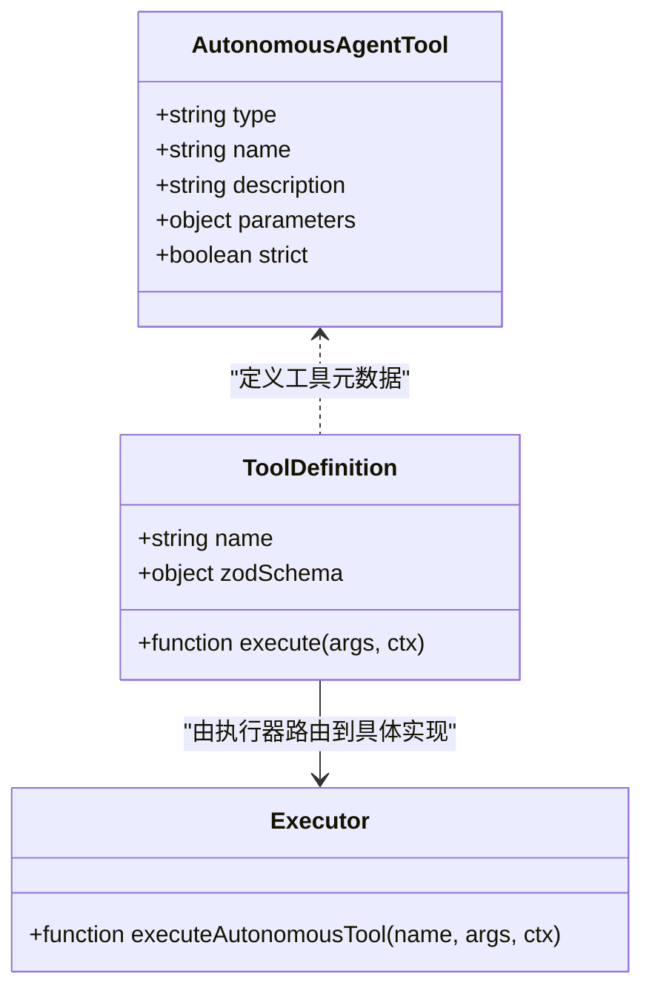
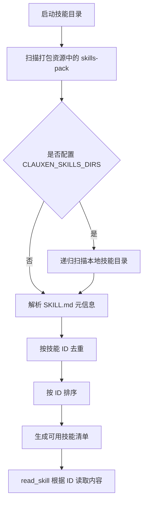

# 工具开发指南

<cite>
**本文引用的文件**   
- [agent-core/index.ts](file://src/server/agent-core/index.ts)
- [messages-client.ts](file://src/server/agent-core/provider/messages-client.ts)
- [run-agent.ts](file://src/server/agent-core/runtime/run-agent.ts)
- [query-loop.ts](file://src/server/agent-core/runtime/query-loop.ts)
- [sdk-tools.d.ts](file://src/server/agent-core/sdk-tools.d.ts)
- [tools/index.ts](file://src/server/agent-core/tools/index.ts)
- [definitions.ts](file://src/server/inference/autonomous-tools/definitions.ts)
- [executor.ts](file://src/server/inference/autonomous-tools/executor.ts)
- [skill-catalog.ts](file://src/server/inference/autonomous-tools/skill-catalog.ts)
- [clauxen-cli/SKILL.md](file://.agents/skills/clauxen-cli/SKILL.md)
- [frontend-design/SKILL.md](file://.agents/skills/frontend-design/SKILL.md)
- [skills-lock.json](file://skills-lock.json)
</cite>

## 目录
1. [简介](#简介)
2. [项目结构](#项目结构)
3. [核心概念：AutonomousAgentTool](#核心概念autonomousagenttool)
4. [工具定义规范与参数验证](#工具定义规范与参数验证)
5. [工具注册机制与发现流程](#工具注册机制与发现流程)
6. [技能目录与预置技能扩展](#技能目录与预置技能扩展)
7. [工具执行架构与通信协议](#工具执行架构与通信协议)
8. [完整工具开发示例](#完整工具开发示例)
9. [测试、调试与性能优化](#测试调试与性能优化)
10. [常见问题排查](#常见问题排查)
11. [结论](#结论)

## 简介
本指南面向需要为 Clauxen Agent 系统开发自定义工具的开发者。内容涵盖：
- 如何编写符合系统的工具定义；
- 如何使用 `AutonomousAgentTool` 类型和 Zod 校验规则；
- 工具注册、发现与执行的完整链路；
- 如何通过技能目录（skills-pack）扩展图表生成、数据分析、文档处理等能力；
- 从简单 HTTP 请求到复杂文件处理的示例路径；
- 测试方法、调试技巧及性能优化建议；
- 工具与 Agent 核心系统的集成方式，以及与 OpenAI Responses API 的通信协议。

## 项目结构
Agent 工具相关代码主要分布在以下区域：
- `src/server/agent-core`：对外暴露的 Agent 运行时入口、OpenAI 消息客户端封装、查询循环与执行编排。
- `src/server/inference/autonomous-tools`：自主 Agent 工具定义、执行器、工作区与技能目录。
- `.agents/skills`：本地示例技能描述文件。
- `skills-lock.json`：锁定已引入的技能包来源与哈希。



**图示来源**
- [agent-core/index.ts:1-33](file://src/server/agent-core/index.ts#L1-L33)
- [messages-client.ts:1-18](file://src/server/agent-core/provider/messages-client.ts#L1-L18)
- [run-agent.ts:1-14](file://src/server/agent-core/runtime/run-agent.ts#L1-L14)
- [query-loop.ts:1-1208](file://src/server/agent-core/runtime/query-loop.ts#L1-L1208)
- [tools/index.ts:1-7](file://src/server/agent-core/tools/index.ts#L1-L7)
- [definitions.ts:1-200](file://src/server/inference/autonomous-tools/definitions.ts#L1-L200)
- [executor.ts:1-200](file://src/server/inference/autonomous-tools/executor.ts#L1-L200)
- [skill-catalog.ts:1-125](file://src/server/inference/autonomous-tools/skill-catalog.ts#L1-L125)
- [skills-lock.json:1-17](file://skills-lock.json#L1-L17)

**章节来源**
- [agent-core/index.ts:1-33](file://src/server/agent-core/index.ts#L1-L33)
- [run-agent.ts:1-14](file://src/server/agent-core/runtime/run-agent.ts#L1-L14)
- [tools/index.ts:1-7](file://src/server/agent-core/tools/index.ts#L1-L7)

## 核心概念：AutonomousAgentTool
`AutonomousAgentTool` 是自主 Agent 使用的工具描述结构，用于驱动模型进行“何时使用、做什么、如何与其他工具协作”的决策。其必需字段包括：
- `type`：固定为 `"function"`，表示该工具是一个函数型工具。
- `name`：工具唯一名称，例如 `web_search`、`web_fetch`、`read_skill`。
- `description`：面向模型的说明文本，包含使用场景、行为约束、与其他工具的衔接提示。
- `parameters`：JSON Schema 风格的参数对象，用于声明输入字段、类型、必填项、枚举值、范围限制等。
- `strict`：可选布尔值，启用严格模式后，模型调用必须完全匹配 schema，减少参数漂移。

该类型在工具定义文件中被导出并组成 `autonomousAgentTools` 数组，作为整个 Agent 工具集的基础。每个工具的描述不仅要解释功能，还要明确模型何时调用、禁止事项以及后续步骤建议。



**图示来源**
- [definitions.ts:1-200](file://src/server/inference/autonomous-tools/definitions.ts#L1-L200)
- [executor.ts:1-200](file://src/server/inference/autonomous-tools/executor.ts#L1-L200)

**章节来源**
- [definitions.ts:1-200](file://src/server/inference/autonomous-tools/definitions.ts#L1-L200)

## 工具定义规范与参数验证
### 工具定义规范
每个工具定义应遵循以下原则：
- **明确触发条件**：在 `description` 中写明模型应在什么情况下主动调用工具。
- **清晰行为边界**：说明工具能做什么、不能做什么，避免模型产生错误预期。
- **链式协作提示**：如果工具需要与其他工具配合，要在描述中给出顺序建议。
- **严格参数约束**：优先使用 `strict: true` 与 JSON Schema 限制，降低无效调用。
- **可观测性**：对耗时或外部调用的工具，提供进度回调或中间结果。

### 参数验证规则
Agent 主循环会为常见工具维护一组 Zod 校验规则，用于在将参数交给执行器前做二次校验和自愈修复。这包括：
- 基础类型校验：字符串、数字、布尔值、数组、对象。
- 数值范围校验：最小值、最大值、整数要求。
- 枚举值校验：如状态、单位、频率等有限集合。
- 必填字段校验：通过 `required` 与 Zod schema 组合确保关键参数存在。
- 默认值填充：部分可选字段可在未传入时提供默认值。

对于未在内置 Zod 列表中定义的自定义工具，推荐在执行器入口处增加独立校验逻辑，或使用统一的 `healToolArgs` 风格包装器。

### 返回值格式要求
工具执行返回的是 `ToolExecutionOutcome`，主要字段包括：
- `output`：工具实际产出，可以是任意 JSON 可序列化对象。
- `pauseForUser`：可选布尔值，表示是否需要暂停等待用户确认。
- `clarificationQuestion`：可选问题文本，用于向用户发起澄清。

对于文件、图片、笔记、PDF 等复杂产物，Executor 会将沙箱中的输出发布为制品记录，包含路径、内容、存储路径、MIME 类型、大小等信息，供上层 UI 渲染或下游任务消费。

**章节来源**
- [query-loop.ts:1-1208](file://src/server/agent-core/runtime/query-loop.ts#L1-L1208)
- [executor.ts:1-200](file://src/server/inference/autonomous-tools/executor.ts#L1-L200)

## 工具注册机制与发现流程
### 工具注册
当前系统的工具注册采用“集中定义、集中导出”的方式：
1. 在 `definitions.ts` 中定义 `AutonomousAgentTool[]`。
2. 通过 `tools/index.ts` 统一导出 `autonomousAgentTools`。
3. 在 `agent-core/index.ts` 中再次导出，供更高层调用方使用。

这种设计让工具列表成为单一事实来源，便于在 UI、运行时、审计日志中保持一致视图。

### 工具发现
工具发现分为两类：
- **内置工具**：来自 `autonomousAgentTools` 数组，包括 GitHub 操作、研究计划展示、网页搜索、网页抓取、天气查询、地点搜索、图片搜索、文件读写、代码执行、Bash 命令、技能读取等。
- **动态技能工具**：通过 `read_skill` 工具加载技能目录中的 `SKILL.md`，使模型能够基于技能描述扩展自身行为。

```mermaid
sequenceDiagram
    participant Model as "推理模型"
    participant Loop as "Agent 主循环"
    participant Tools as "autonomousAgentTools"
    participant Exec as "executeAutonomousTool"
    participant Skill as "skill-catalog"

    Model->>Loop: "生成工具调用"
    Loop->>Tools: "解析工具名称与参数"
    Loop->>Exec: "executeAutonomousTool(名称, 参数, 上下文)"
    alt 内置工具
      Exec-->>Loop: "返回 output"
    else 技能工具
      Exec->>Skill: "listAvailableSkills / readSkill"
      Skill-->>Exec: "技能元数据或内容"
      Exec-->>Loop: "返回技能内容或可用技能列表"
    end
    Loop-->>Model: "继续下一轮推理或结束"
```

**图示来源**
- [definitions.ts:1-200](file://src/server/inference/autonomous-tools/definitions.ts#L1-L200)
- [executor.ts:1-200](file://src/server/inference/autonomous-tools/executor.ts#L1-L200)
- [skill-catalog.ts:1-125](file://src/server/inference/autonomous-tools/skill-catalog.ts#L1-L125)
- [query-loop.ts:1-1208](file://src/server/agent-core/runtime/query-loop.ts#L1-L1208)

**章节来源**
- [tools/index.ts:1-7](file://src/server/agent-core/tools/index.ts#L1-L7)
- [agent-core/index.ts:1-33](file://src/server/agent-core/index.ts#L1-L33)
- [definitions.ts:1-200](file://src/server/inference/autonomous-tools/definitions.ts#L1-L200)
- [executor.ts:1-200](file://src/server/inference/autonomous-tools/executor.ts#L1-L200)
- [skill-catalog.ts:1-125](file://src/server/inference/autonomous-tools/skill-catalog.ts#L1-L125)

## 技能目录与预置技能扩展
### 技能目录结构
技能以 Markdown 文件形式组织，核心约定如下：
- 每个技能目录包含一个 `SKILL.md` 文件。
- `SKILL.md` 首行标题通常作为技能描述。
- 可通过 YAML front matter 添加 `name`、`description`、`metadata`、`license` 等元信息。
- 技能 ID 通常由父目录名或文件名决定，小写规范化。

### 预置技能
仓库中已有两个示例技能：
- `clauxen-cli`：提供 macOS 上 GitHub CLI、GitLab CLI、Cloudflare CLI、Supabase CLI 的安全使用指引，强调凭据安全、Keychain 注入、令牌隐藏与健康检查。
- `frontend-design`：提供前端视觉设计方向、排版、色彩、动效、文案与自我批评流程的指导。

这些技能不是直接可执行代码，而是给 Agent 的行为引导，使其在执行图表生成、文档处理、设计评审等任务时具备领域知识。

### 技能加载机制
技能加载过程：
1. 从构建时打包的文本资源中扫描包含 `/skills-pack/` 且以 `SKILL.md` 结尾的文件。
2. 支持通过环境变量 `CLAUXEN_SKILLS_DIRS` 追加额外本地技能目录。
3. 递归扫描目录，收集所有 `SKILL.md`。
4. 解析首行标题作为描述，按 ID 去重并排序。
5. `read_skill` 工具可根据技能 ID 查找并返回技能内容。



**图示来源**
- [skill-catalog.ts:1-125](file://src/server/inference/autonomous-tools/skill-catalog.ts#L1-L125)

### 扩展方式
要扩展图表生成、数据分析、文档处理等能力，可按以下步骤：
1. 创建新的技能目录，例如 `data-analysis-skill`。
2. 在该目录中创建 `SKILL.md`，写明分析目标、输入数据格式、处理流程、输出产物、注意事项。
3. 如需在生产环境携带，将其放入 `skills-pack` 并通过构建脚本打包；或在开发环境通过 `CLAUXEN_SKILLS_DIRS` 指向本地目录。
4. 通过 `read_skill` 工具让模型获取技能内容，从而获得领域指导。
5. 若技能需要执行真实逻辑，不要只放文档，应同时新增工具定义和执行器分支，并在 Zod 层增加参数校验。

**章节来源**
- [clauxen-cli/SKILL.md:1-75](file://.agents/skills/clauxen-cli/SKILL.md#L1-L75)
- [frontend-design/SKILL.md:1-71](file://.agents/skills/frontend-design/SKILL.md#L1-L71)
- [skill-catalog.ts:1-125](file://src/server/inference/autonomous-tools/skill-catalog.ts#L1-L125)
- [skills-lock.json:1-17](file://skills-lock.json#L1-L17)

## 工具执行架构与通信协议
### 执行架构
Agent 主循环负责与 OpenAI Responses API 交互，并将工具调用转换为服务端执行：
1. 模型在一次推理中可能输出思考、叙述和工具调用。
2. 工具调用关闭本轮叙述，进入工具执行阶段。
3. 工具按顺序执行，工具结果以 `tool_result` 块返回。
4. 下一轮推理继续使用工具结果推进任务。
5. 如果一轮中没有工具调用，则本轮文本作为最终答案持久化。

### 通信协议
Agent 与 OpenAI 的通信基于 Responses API：
- 输入侧使用 `OpenAIInputItem`。
- 输出侧使用 `OpenAIOutputItem`。
- 工具定义使用 `OpenAIToolDefinition`。
- 流式事件使用 `OpenAIStreamPart`。
- 工具描述通过 `toOpenAITools` 转换后发送给模型。

```mermaid
sequenceDiagram
    participant Client as "客户端"
    participant Loop as "Agent 主循环"
    participant OpenAI as "OpenAI Responses API"
    participant Executor as "executeAutonomousTool"

    Client->>Loop: "发起 Agent 对话"
    Loop->>OpenAI: "发送带 tools 的消息"
    OpenAI-->>Loop: "返回模型输出与工具调用"
    Loop->>Executor: "执行工具"
    Executor-->>Loop: "返回 tool_result"
    Loop->>OpenAI: "发送 tool_result 继续推理"
    OpenAI-->>Loop: "返回最终文本或更多工具调用"
    Loop-->>Client: "流式输出叙述、工具行、制品"
```

**图示来源**
- [query-loop.ts:1-1208](file://src/server/agent-core/runtime/query-loop.ts#L1-L1208)
- [messages-client.ts:1-18](file://src/server/agent-core/provider/messages-client.ts#L1-L18)
- [executor.ts:1-200](file://src/server/inference/autonomous-tools/executor.ts#L1-L200)

**章节来源**
- [query-loop.ts:1-1208](file://src/server/agent-core/runtime/query-loop.ts#L1-L1208)
- [messages-client.ts:1-18](file://src/server/agent-core/provider/messages-client.ts#L1-L18)

## 完整工具开发示例
以下示例均以“路径指引”形式呈现，不直接粘贴源码。

### 示例一：简单 HTTP 请求工具
适合场景：调用内部 REST API、第三方轻量接口、健康检查。

开发步骤：
1. 在 `definitions.ts` 中添加一个新 `AutonomousAgentTool`，命名例如 `http_request_tool`。
2. 在 `parameters` 中声明 URL、方法、头、体、超时等字段，并使用 `required` 与类型限制。
3. 在 `executor.ts` 的 `executeAutonomousTool` 中新增 `if (name === "http_request_tool")` 分支。
4. 使用项目内 HTTP 客户端或受控 fetch 发起请求，处理成功、失败、超时、非 2xx 响应。
5. 在 `query-loop.ts` 的 Zod 校验映射中为该工具添加参数校验。
6. 返回 `ToolExecutionOutcome`，将 JSON 响应放入 `output`。

关键注意事项：
- 不要允许任意命令执行；HTTP 工具应限制域名、方法、头部白名单。
- 对敏感头进行脱敏。
- 对大响应设置体积上限。
- 对重试策略做幂等判断。

**章节来源**
- [definitions.ts:1-200](file://src/server/inference/autonomous-tools/definitions.ts#L1-L200)
- [executor.ts:1-200](file://src/server/inference/autonomous-tools/executor.ts#L1-L200)
- [query-loop.ts:1-1208](file://src/server/agent-core/runtime/query-loop.ts#L1-L1208)

### 示例二：复杂文件处理工具
适合场景：解析 CSV、转换 PDF、提取图片元数据、批量重命名、归档压缩。

开发步骤：
1. 定义工具，例如 `file_processor`，参数包括输入路径、处理类型、输出路径、选项。
2. 在 Executor 中使用工作区 API 读取受限文件，必要时调用沙箱执行 Node 脚本或系统命令。
3. 使用 `publishSandboxOutputs` 将产物写入持久存储，并生成制品记录。
4. 在 Zod 层校验输入路径、输出路径、处理类型枚举。
5. 返回包含制品信息的 `output`，以便 UI 展示下载链接或预览。

关键注意事项：
- 所有文件访问必须走作用域限制，防止越权读取。
- 二进制文件应控制最大体积。
- 对文本类产物保留原始内容与 MIME 类型。
- 对长时间任务考虑异步返回与进度回调。

**章节来源**
- [executor.ts:1-200](file://src/server/inference/autonomous-tools/executor.ts#L1-L200)
- [sdk-tools.d.ts:1-200](file://src/server/agent-core/sdk-tools.d.ts#L1-L200)

### 示例三：结合技能的智能工具
适合场景：数据分析、报告生成、设计评审、代码审查。

开发步骤：
1. 先创建技能 `SKILL.md`，描述业务目标、输入格式、处理步骤、输出标准。
2. 让模型通过 `read_skill` 加载技能，理解领域知识。
3. 再定义实际执行工具，把技能中的流程固化为可重复调用的函数。
4. 工具执行过程中可分段输出进度，例如“正在解析数据”“正在生成图表”“正在校验结果”。

关键注意事项：
- 技能不等于执行逻辑，二者互补。
- 技能描述应避免硬编码密钥或路径。
- 执行工具要兜底异常，并把错误结构化返回。

**章节来源**
- [skill-catalog.ts:1-125](file://src/server/inference/autonomous-tools/skill-catalog.ts#L1-L125)
- [executor.ts:1-200](file://src/server/inference/autonomous-tools/executor.ts#L1-L200)

## 测试、调试与性能优化
### 测试方法
- **单元测试工具定义**：验证 `parameters` schema 合法，必填字段、枚举、范围正确。
- **单元测试执行器分支**：模拟输入、断言输出结构与错误信息。
- **端到端测试**：通过 Agent 主循环触发工具调用，验证流式输出、制品记录与最终答案。
- **技能测试**：验证 `listAvailableSkills` 能发现新技能，`read_skill` 能正确返回内容。

建议测试用例覆盖：
- 正常路径。
- 参数缺失。
- 非法枚举值。
- 网络超时。
- 文件不存在。
- 权限不足。
- 超大输入或输出。

### 调试技巧
- 观察 Agent 主循环输出的思考、叙述、工具行，确认模型是否正确选择工具。
- 在 Executor 分支中加入结构化日志，记录输入摘要、耗时、错误栈。
- 对沙箱输出路径进行显式打印，确认产物是否生成。
- 使用 `read_skill` 查看技能是否被正确加载。
- 对高频外部调用增加慢请求告警。

### 性能优化建议
- 将频繁使用的工具描述保持简洁但足够明确，减少模型误判。
- 对大文件、大响应设置体积上限。
- 对可缓存的外部结果做短期缓存。
- 对长任务使用异步返回与进度回调，避免阻塞主循环。
- 对重复计算或重复 IO 做去重。
- 对工具调用次数设置上限，避免无限工具循环。

**章节来源**
- [query-loop.ts:1-1208](file://src/server/agent-core/runtime/query-loop.ts#L1-L1208)
- [executor.ts:1-200](file://src/server/inference/autonomous-tools/executor.ts#L1-L200)
- [skill-catalog.ts:1-125](file://src/server/inference/autonomous-tools/skill-catalog.ts#L1-L125)

## 常见问题排查
| 现象 | 可能原因 | 排查建议 |
|---|---|---|
| 模型不调用自定义工具 | 工具未加入 `autonomousAgentTools` 或描述不够明确 | 检查工具定义位置与 `description`，确认主循环是否导出 |
| 参数被拒绝 | Zod 校验失败或 JSON Schema 不一致 | 检查 `query-loop.ts` 中的 Zod 映射与工具定义 |
| 技能找不到 | 技能未被打包或未配置 `CLAUXEN_SKILLS_DIRS` | 检查技能路径、ID 规范、环境变量 |
| 工具返回空结果 | 输出路径未发布或沙箱文件未写入 | 检查 `output_paths`、作用域读取、持久化逻辑 |
| 外部调用超时 | 网络不稳定或服务端限流 | 增加重试、超时、降级策略 |
| 模型反复调用同一工具 | 描述缺少终止条件或结果不清晰 | 在描述中明确成功标志与下一步动作 |

**章节来源**
- [definitions.ts:1-200](file://src/server/inference/autonomous-tools/definitions.ts#L1-L200)
- [query-loop.ts:1-1208](file://src/server/agent-core/runtime/query-loop.ts#L1-L1208)
- [executor.ts:1-200](file://src/server/inference/autonomous-tools/executor.ts#L1-L200)
- [skill-catalog.ts:1-125](file://src/server/inference/autonomous-tools/skill-catalog.ts#L1-L125)

## 结论
Cl auxen 的工具体系以 `AutonomousAgentTool` 为中心，通过集中定义、集中导出、集中执行的方式，将模型推理、工具调用、外部服务、文件系统与技能描述整合在一起。开发自定义工具时，应同时关注三类内容：
- 面向模型的描述与参数 schema；
- 面向执行器的健壮实现与安全边界；
- 面向运行时的校验、日志、制品与性能控制。

技能目录则为 Agent 提供了可扩展的领域知识层，使工具不只是函数调用，还能承载流程、最佳实践与约束。按照本指南完成定义、注册、执行、测试与优化后，即可构建从简单 HTTP 请求到复杂文件处理、从通用工具到领域专用能力的完整工具生态。