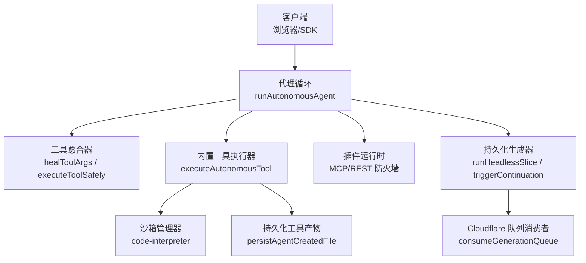
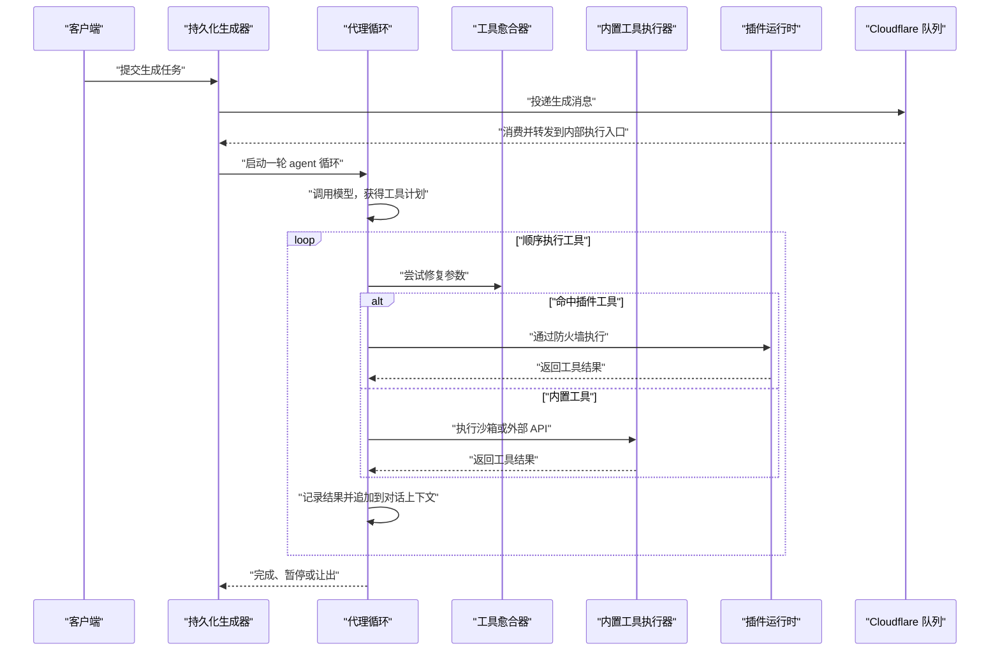
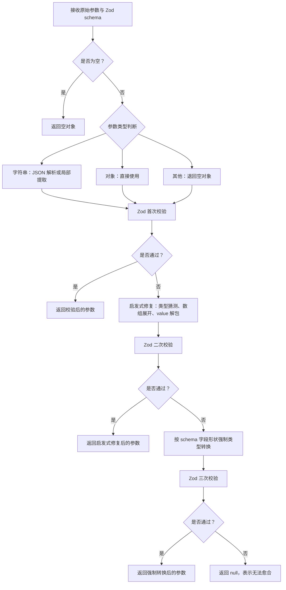
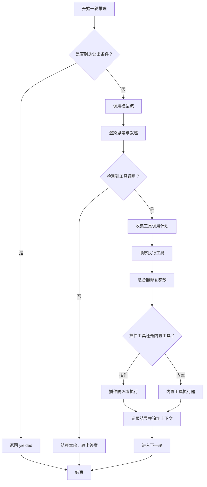
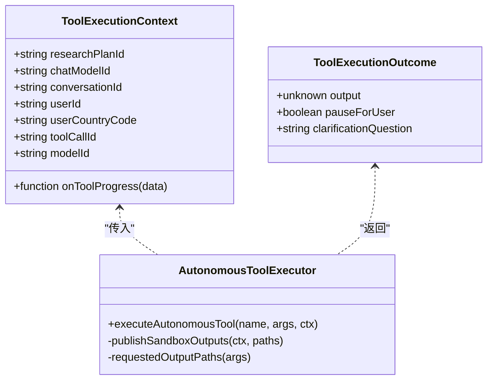
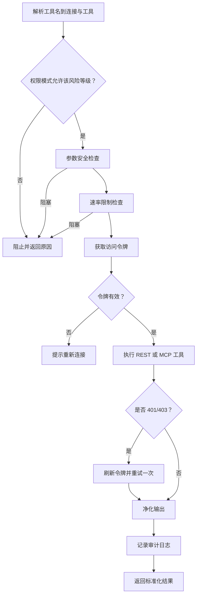
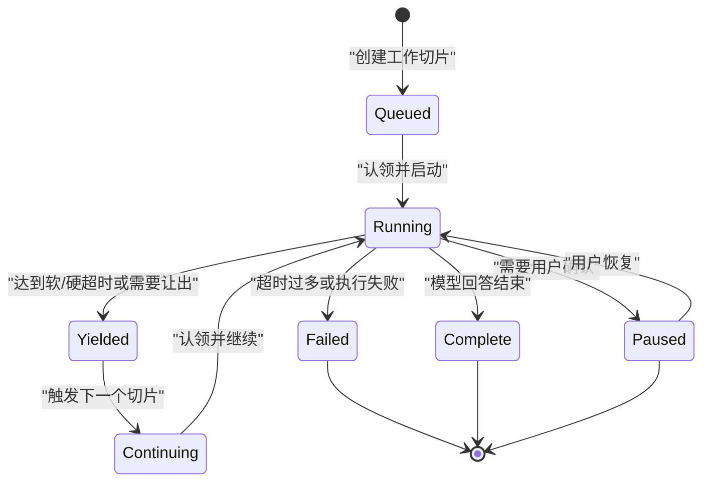
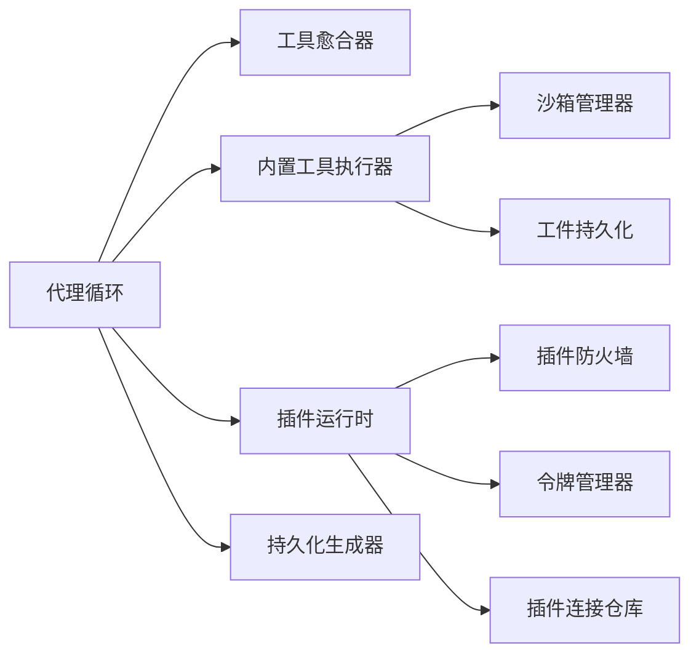

# 工具执行引擎

<cite>
**本文引用的文件**   
- [tool-healer.ts](file://src/server/inference/tool-healer.ts)
- [query-loop.ts](file://src/server/agent-core/runtime/query-loop.ts)
- [executor.ts](file://src/server/inference/autonomous-tools/executor.ts)
- [plugin-runtime.ts](file://src/server/plugins/plugin-runtime.ts)
- [generation-queue.ts](file://src/server/cloudflare/generation-queue.ts)
- [durable-generation.ts](file://src/server/chat/durable-generation.ts)
- [persist-agent-file.ts](file://src/server/inference/autonomous-tools/persist-agent-file.ts)
- [sandbox-manager.ts](file://src/server/sandbox/sandbox-manager.ts)
</cite>

## 目录
1. [引言](#引言)
2. [项目结构](#项目结构)
3. [核心组件](#核心组件)
4. [架构总览](#架构总览)
5. [详细组件分析](#详细组件分析)
6. [依赖关系分析](#依赖关系分析)
7. [性能与并发特性](#性能与并发特性)
8. [故障排除指南](#故障排除指南)
9. [结论](#结论)

## 引言
本文件面向“工具执行引擎”的完整实现，聚焦以下目标：
- 工具调度机制：任务队列、并发控制、负载均衡。
- 执行上下文管理：用户信息、会话状态、模型属性如何传递。
- 工具结果处理：输出格式化、错误恢复、重试策略。
- 工具愈合器（tool-healer）：自动修复参数、错误分类与智能重试。
- 持久化文件：存储路径、版本语义、清理策略。
- 性能优化、资源监控与排障建议。
- 提供执行流程时序图与状态转换图。

该引擎围绕“自主代理循环 + 自愈工具层 + 沙箱执行 + 插件防火墙 + 持久化切片调度”构建，既能保障交互体验，也能在长时间运行和外部依赖失败时保持稳定。

## 项目结构
从代码组织看，工具执行引擎横跨四个层次：
- 代理循环层：负责多轮推理、工具调用计划、SSE 流式输出、可恢复切片。
- 工具执行层：内置工具路由、沙箱隔离、插件安全网关。
- 自愈层：对 LLM 输出的参数进行确定性修复，避免无谓重询。
- 持久化调度层：将长任务切分为多个受心跳保护的工作切片，并通过队列或内部接口继续执行。

**图示来源**
- [query-loop.ts:201-500](file://src/server/agent-core/runtime/query-loop.ts#L201-L500)
- [query-loop.ts:801-1208](file://src/server/agent-core/runtime/query-loop.ts#L801-L1208)
- [tool-healer.ts:1-213](file://src/server/inference/tool-healer.ts#L1-L213)
- [executor.ts:1-200](file://src/server/inference/autonomous-tools/executor.ts#L1-L200)
- [plugin-runtime.ts:1-370](file://src/server/plugins/plugin-runtime.ts#L1-L370)
- [durable-generation.ts:201-611](file://src/server/chat/durable-generation.ts#L201-L611)
- [generation-queue.ts:1-56](file://src/server/cloudflare/generation-queue.ts#L1-L56)

**章节来源**
- [query-loop.ts:1-200](file://src/server/agent-core/runtime/query-loop.ts#L1-L200)
- [durable-generation.ts:1-200](file://src/server/chat/durable-generation.ts#L1-L200)

## 核心组件
- 工具愈合器：把 LLM 可能输错的参数按 Zod schema 做三阶段修复，最终再调用工具。
- 代理循环：维护对话历史、渲染思考与叙述流、顺序执行工具、记录工具结果、支持暂停与切片。
- 内置工具执行器：统一封装搜索、天气、地点、图片、技能、Bash、代码执行、文件读写等能力。
- 插件运行时：将用户连接的外部工具暴露为代理工具，并经过权限、速率限制、参数检查、输出净化和审计。
- 持久化生成器：将一次长对话切分为多个工作切片，持有协调租约、心跳、取消信号，并在超时或中断后继续。
- Cloudflare 队列消费者：把生成请求投递到内部执行入口，失败则延迟重试。
- 沙箱管理器：对外部代码执行提供隔离会话、复用策略与元数据追踪。
- 工件持久化：将工具产生的文件写入对象存储，并在数据库登记元信息。

**章节来源**
- [tool-healer.ts:1-213](file://src/server/inference/tool-healer.ts#L1-L213)
- [query-loop.ts:201-500](file://src/server/agent-core/runtime/query-loop.ts#L201-L500)
- [executor.ts:1-200](file://src/server/inference/autonomous-tools/executor.ts#L1-L200)
- [plugin-runtime.ts:1-370](file://src/server/plugins/plugin-runtime.ts#L1-L370)
- [durable-generation.ts:201-611](file://src/server/chat/durable-generation.ts#L201-L611)
- [generation-queue.ts:1-56](file://src/server/cloudflare/generation-queue.ts#L1-L56)
- [sandbox-manager.ts:1-200](file://src/server/sandbox/sandbox-manager.ts#L1-L200)
- [persist-agent-file.ts:1-102](file://src/server/inference/autonomous-tools/persist-agent-file.ts#L1-L102)

## 架构总览
工具执行引擎的整体执行路径如下：
1. 客户端发起聊天或后台生成。
2. 持久化生成器创建或认领工作切片，启动切片运行时。
3. 代理循环根据系统提示、模型配置和用户消息发起一轮模型调用。
4. 模型返回文本、思考内容以及工具调用计划。
5. 代理循环顺序执行工具；若命中已连接插件，则走插件防火墙；否则进入内置工具执行器。
6. 所有工具参数先经愈合器修复；执行结果被格式化为字符串、错误或带图像的文件工件。
7. 每个工具结果写回对话上下文，供下一轮推理使用。
8. 当达到软超时、硬超时或需要用户确认时，循环返回“yielded”或“paused”，由持久化层续跑。
9. 工具产物可通过工件持久化落盘，后续以可下载链接呈现。

**图示来源**
- [durable-generation.ts:201-611](file://src/server/chat/durable-generation.ts#L201-L611)
- [generation-queue.ts:1-56](file://src/server/cloudflare/generation-queue.ts#L1-L56)
- [query-loop.ts:801-1208](file://src/server/agent-core/runtime/query-loop.ts#L801-L1208)
- [plugin-runtime.ts:201-370](file://src/server/plugins/plugin-runtime.ts#L201-L370)

## 详细组件分析

### 工具愈合器：参数自动修复与安全防护
工具愈合器的职责是把不可靠的 LLM 输出转换为符合 Zod schema 的工具输入，从而避免整个代理因参数类型错误而崩溃。其核心流程是：
- 如果原始参数为空，返回空对象。
- 如果原始参数是字符串，尝试 JSON 解析；失败时再用部分 JSON 解析器提取键值对。
- 如果已经是非数组对象，直接使用。
- 第一次校验：直接按 schema 验证。
- 第二次启发式修复：把数字字符串转数字、布尔字符串转布尔、单元素数组取首项、含单一 value 字段的对象解包。
- 第三次按字段形状强制类型转换：字符串、数字、布尔分别按 schema 类型转换。
- 全部失败时返回 null，上层会包装为错误输出。

**图示来源**
- [tool-healer.ts:1-213](file://src/server/inference/tool-healer.ts#L1-L213)

#### 执行上下文结构
愈合器和代理循环共用一组上下文字段，用于追踪工具调用的来源和影响范围：
- 研究计划标识：用于深度研究任务的进度与证据预算。
- 聊天模型标识：用于追溯当前轮次使用的模型。
- 用户标识：决定权限、插件连接、工件归属。
- 会话标识：用于沙箱复用、日志关联和文件命名。
- 国家代码：影响天气单位、本地化行为。
- 工具调用标识：唯一标记一次工具调用，便于前端展示和工件去重。
- 进度回调：向 UI 推送搜索命中、沙箱标准输出等中间状态。

**章节来源**
- [tool-healer.ts:1-213](file://src/server/inference/tool-healer.ts#L1-L213)
- [query-loop.ts:801-1208](file://src/server/agent-core/runtime/query-loop.ts#L801-L1208)

#### 错误恢复与重试
- 参数愈合失败：不触发 LLM 重新生成，而是直接返回结构化错误，让上层把工具标记为失败。
- 工具执行异常：捕获错误并转为 `{ error }` 输出，保证代理循环继续推进。
- 插件认证失败：插件运行时会在 401/403 时刷新令牌并重试一次；仍失败则引导用户重新连接插件。

**章节来源**
- [tool-healer.ts:201-213](file://src/server/inference/tool-healer.ts#L201-L213)
- [plugin-runtime.ts:201-370](file://src/server/plugins/plugin-runtime.ts#L201-L370)

### 代理循环：任务调度、并发控制与结果处理
代理循环是整个工具执行引擎的调度中枢，它维护“推理 → 叙述 → 工具调用 → 工具结果 → 下一轮”的顺序流。

关键设计点：
- 最大步数上限：普通对话最多 24 步，深度研究最多 96 步。
- 并行度：模型流是流式的，但工具调用是顺序执行的，以避免沙箱状态竞争和前端工具行错乱。
- 插件工具优先直出：只把少量低风险工具放入直接工具列表，其余通过搜索工具再调用。
- 工具结果归一化：字符串、对象、错误对象、图片工件都统一编码为工具结果。
- 可恢复性：每轮结束后保存对话快照、工具调用计划和已完成结果，以便切片恢复。
- 暂停与让出：遇到需要用户确认的工具或达到切片超时时，循环返回 `paused` 或 `yielded`。

**图示来源**
- [query-loop.ts:501-800](file://src/server/agent-core/runtime/query-loop.ts#L501-L800)
- [query-loop.ts:801-1208](file://src/server/agent-core/runtime/query-loop.ts#L801-L1208)

#### 执行上下文传递
代理循环将用户信息、会话信息和模型信息注入到工具执行上下文中：
- `userId`：来自选项，决定插件连接、工件归属和安全边界。
- `conversationId`：来自选项，作为会话主键。
- `userCountryCode`：来自选项，用于天气等本地化场景。
- `modelId`：当前模型标识，便于追踪和审计。
- `researchPlanId`：深度研究计划标识，驱动证据预算和特殊结果过滤。
- `chatModelId`：平台配置中的聊天模型标识。
- `onProgress`：用于向 SSE 推送搜索命中、沙箱输出等实时数据。

**章节来源**
- [query-loop.ts:801-1208](file://src/server/agent-core/runtime/query-loop.ts#L801-L1208)

#### 工具结果处理流程
- 字符串结果：直接作为工具响应。
- 对象结果：包含 `error` 字段时被标记为工具错误。
- 文件工件：`create_file`、`file_write`、`bash_tool`、`execute_code` 的结果会被解析为文件路径、内容、存储路径、MIME 类型和大小。
- 图片结果：如果结果包含 `kind=image` 且带有 `fileId`，代理循环会把图片块注入下一轮对话，使模型能“看到”生成的图片。
- 搜索命中：`web_search` 的结果数组会单独推送给前端，用于搜索结果卡片。

**章节来源**
- [query-loop.ts:801-1208](file://src/server/agent-core/runtime/query-loop.ts#L801-L1208)
- [executor.ts:1-200](file://src/server/inference/autonomous-tools/executor.ts#L1-L200)

### 内置工具执行器：沙箱与外部服务
内置工具执行器承担具体业务能力，包括：
- 网络搜索、网页抓取、天气查询、地点搜索、图片搜索。
- 技能目录读取。
- Bash 命令执行，配合安全校验。
- 代码执行，配合沙箱环境。
- 文件读写，配合作用域工作区。
- GitHub Agent 操作，需要登录用户。

对于沙箱相关工具：
- 输出路径会被规范化并限制数量。
- 文本文件较小内容可直接嵌入结果，大文件或二进制只保留元信息。
- 如果存在 `userId`，文件会被持久化到对象存储，并登记到用户文件表。
- 读取失败会记录警告并继续执行其他输出路径。

**图示来源**
- [executor.ts:1-200](file://src/server/inference/autonomous-tools/executor.ts#L1-L200)

**章节来源**
- [executor.ts:1-200](file://src/server/inference/autonomous-tools/executor.ts#L1-L200)

### 插件运行时：权限、速率限制与安全净化
插件运行时把用户连接的第三方工具暴露为代理工具，名称形如 `mcp__<slug>__<tool>`。它的关键职责：
- 加载用户启用的连接和工具。
- 将只读工具优先放入直接工具列表，其余通过搜索工具发现。
- 在执行前检查风险等级与连接权限模式。
- 检查参数是否包含危险指令。
- 检查全局速率限制。
- 获取访问令牌；必要时刷新令牌并重试一次。
- 对输出进行净化，移除敏感令牌和注入指令。
- 记录工具调用审计日志。

**图示来源**
- [plugin-runtime.ts:201-370](file://src/server/plugins/plugin-runtime.ts#L201-L370)

**章节来源**
- [plugin-runtime.ts:1-370](file://src/server/plugins/plugin-runtime.ts#L1-L370)

### 持久化文件处理：存储、版本与清理
工具产生的文件通过工件持久化模块写入对象存储，并在数据库中登记：
- 文件名从路径末尾提取。
- 根据扩展名推断 MIME 类型。
- 使用随机 artifactId 生成存储路径，避免同名覆盖。
- 写入对象存储后，创建用户文件记录，携带来源、聊天 ID、工作区路径和内容哈希。
- 返回 `fileId`、`storagePath`、`mimeType`、`sizeBytes`，供前端展示和下载。

文件生命周期建议：
- 工件默认属于“artifacts”用途，适合短期到中期的对话产物。
- 如果业务需要长期保留，应结合用户库存储或归档策略。
- 清理策略应基于对象存储桶的生命周期规则，并结合数据库中的 `metadata.purpose` 和 `created_at` 字段。

**章节来源**
- [persist-agent-file.ts:1-102](file://src/server/inference/autonomous-tools/persist-agent-file.ts#L1-L102)

### 沙箱管理器：隔离执行与会话复用
沙箱管理器负责与外部代码解释器 SDK 交互，提供：
- 创建新沙箱。
- 连接已有沙箱。
- 按用户和会话查找或复用沙箱。
- 列出用户可见的沙箱。
- 校验沙箱所有权，防止跨用户访问。

沙箱复用键由 `userId` 和 `conversationId` 组成，确保同一会话内的多次工具调用可以共享状态，提高代码执行效率。

**章节来源**
- [sandbox-manager.ts:1-200](file://src/server/sandbox/sandbox-manager.ts#L1-L200)

### 持久化生成器与队列：长时间任务切片
持久化生成器负责把一次长对话拆成多个工作切片：
- 软超时：例如 240 秒，达到时主动让出。
- 硬超时：例如 270 秒，强制中止当前模型流。
- 心跳：周期性更新工作切片状态，防止被 watchdog 误判为停滞。
- 协调租约：防止多个切片同时编辑同一个聊天。
- 取消信号：用户停止、研究计划暂停或取消时会中断切片。
- 切片上限：最多 48 个切片，尝试上限 5 次，超过后标记失败。
- 恢复：watchdog 扫描停滞任务，重新触发下一个切片。

Cloudflare 队列消费者负责把生成消息转发到内部执行入口，并根据响应决定是否 ack 或延迟重试。

**图示来源**
- [durable-generation.ts:201-611](file://src/server/chat/durable-generation.ts#L201-L611)
- [generation-queue.ts:1-56](file://src/server/cloudflare/generation-queue.ts#L1-L56)

**章节来源**
- [durable-generation.ts:201-611](file://src/server/chat/durable-generation.ts#L201-L611)
- [generation-queue.ts:1-56](file://src/server/cloudflare/generation-queue.ts#L1-L56)

## 依赖关系分析
工具执行引擎的依赖关系可以概括为：
- 代理循环依赖：
  - 模型提供者：发送工具定义、接收工具调用和结果。
  - 工具愈合器：修复参数。
  - 内置工具执行器：执行搜索、代码、文件、天气、地点、图片等操作。
  - 插件运行时：执行用户授权的第三方工具。
  - 持久化生成器：在超长任务中接管执行。
- 内置工具执行器依赖：
  - 沙箱管理器：隔离代码执行。
  - 工件持久化：保存工具产物。
  - 外部服务：Exa、OpenMeteo、Nominatim、Openverse 等。
- 插件运行时依赖：
  - 插件连接仓库：加载连接、工具和审计记录。
  - 令牌管理器：获取和刷新访问令牌。
  - 防火墙：权限、参数、速率限制、输出净化。

**图示来源**
- [query-loop.ts:201-500](file://src/server/agent-core/runtime/query-loop.ts#L201-L500)
- [executor.ts:1-200](file://src/server/inference/autonomous-tools/executor.ts#L1-L200)
- [plugin-runtime.ts:1-370](file://src/server/plugins/plugin-runtime.ts#L1-L370)
- [durable-generation.ts:201-611](file://src/server/chat/durable-generation.ts#L201-L611)

**章节来源**
- [query-loop.ts:201-500](file://src/server/agent-core/runtime/query-loop.ts#L201-L500)
- [executor.ts:1-200](file://src/server/inference/autonomous-tools/executor.ts#L1-L200)
- [plugin-runtime.ts:1-370](file://src/server/plugins/plugin-runtime.ts#L1-L370)
- [durable-generation.ts:201-611](file://src/server/chat/durable-generation.ts#L201-L611)

## 性能与并发特性
- 工具顺序执行：避免沙箱状态竞争，降低调试复杂度。
- 模型流式输出：思考内容和叙述内容边到边渲染，提升首屏体验。
- 切片调度：将长任务拆成多个短切片，避免 serverless 函数超时。
- 心跳保活：防止长时间运行的切片被误判为僵尸任务。
- 协调租约：保证同一聊天不会被多个切片同时修改。
- 插件缓存：插件工具目录在用户维度构建一次，避免重复发现。
- 沙箱复用：同一会话内复用沙箱，减少冷启动成本。
- 工件内联与小文件优化：小文本文件可直接嵌入结果，减少额外 IO。
- 队列重试：生成队列消费失败时延迟重试，提高鲁棒性。

优化建议：
- 对频繁使用的插件工具，考虑缓存工具描述和 schema。
- 对沙箱执行结果，可按内容哈希做去重缓存。
- 对大文件工件，优先使用预签名直传，减少服务端带宽压力。
- 对模型调用，合理设置 thinking budget，避免过度推理。
- 对队列消费，可增加指数退避和死信队列，避免无限重试。

[本节为通用性能讨论，不直接分析特定文件]

## 故障排除指南

### 工具参数总是失败
- 现象：工具参数无法通过 Zod 校验，最终返回错误。
- 排查：
  - 查看愈合器是否成功执行启发式修复或类型强制转换。
  - 检查 LLM 是否返回了错误的类型，例如把数字写成字符串。
  - 确认工具定义的 schema 是否与真实业务一致。
- 相关位置：
  - [tool-healer.ts:1-213](file://src/server/inference/tool-healer.ts#L1-L213)

### 插件工具报未授权
- 现象：插件工具返回 401/403，或提示需要重新连接。
- 排查：
  - 检查插件连接状态是否为活跃。
  - 检查令牌是否过期，插件运行时是否已尝试刷新并重试。
  - 检查插件防火墙是否阻止了参数或操作。
- 相关位置：
  - [plugin-runtime.ts:201-370](file://src/server/plugins/plugin-runtime.ts#L201-L370)

### 长任务提前结束或反复让出
- 现象：生成任务没有完成，而是不断 yield。
- 排查：
  - 检查软超时和硬超时阈值。
  - 检查是否需要用户确认导致 paused。
  - 检查是否达到切片上限或尝试上限。
  - 检查协调租约是否冲突。
- 相关位置：
  - [durable-generation.ts:201-611](file://src/server/chat/durable-generation.ts#L201-L611)

### 工具产物文件不存在
- 现象：前端显示工具执行成功，但文件无法下载。
- 排查：
  - 检查工件持久化是否成功写入对象存储。
  - 检查用户文件记录是否创建成功。
  - 检查存储桶权限和预签名 URL 是否有效。
- 相关位置：
  - [persist-agent-file.ts:1-102](file://src/server/inference/autonomous-tools/persist-agent-file.ts#L1-L102)

### 沙箱执行不稳定
- 现象：代码执行偶发失败或状态不一致。
- 排查：
  - 检查沙箱是否被正确复用。
  - 检查沙箱所有权校验是否通过。
  - 检查输出路径是否存在且可读。
- 相关位置：
  - [sandbox-manager.ts:1-200](file://src/server/sandbox/sandbox-manager.ts#L1-L200)
  - [executor.ts:1-200](file://src/server/inference/autonomous-tools/executor.ts#L1-L200)

**章节来源**
- [tool-healer.ts:1-213](file://src/server/inference/tool-healer.ts#L1-L213)
- [plugin-runtime.ts:201-370](file://src/server/plugins/plugin-runtime.ts#L201-L370)
- [durable-generation.ts:201-611](file://src/server/chat/durable-generation.ts#L201-L611)
- [persist-agent-file.ts:1-102](file://src/server/inference/autonomous-tools/persist-agent-file.ts#L1-L102)
- [sandbox-manager.ts:1-200](file://src/server/sandbox/sandbox-manager.ts#L1-L200)
- [executor.ts:1-200](file://src/server/inference/autonomous-tools/executor.ts#L1-L200)

## 结论
工具执行引擎通过“自愈参数 + 顺序工具执行 + 沙箱隔离 + 插件防火墙 + 持久化切片”形成一套兼顾用户体验与稳定性的系统。它能够在 LLM 输出不稳定、外部依赖失败、serverless 超时等现实约束下，仍然给出可靠、可观测、可恢复的执行结果。

实践中应重点关注：
- 工具 schema 的正确性和一致性。
- 插件权限、速率限制和输出净化的配置。
- 切片超时、心跳、租约和上限参数的调优。
- 工件存储的生命周期和清理策略。
- 可观测性与日志，尤其是工具调用、插件调用、沙箱事件和生成切片状态。