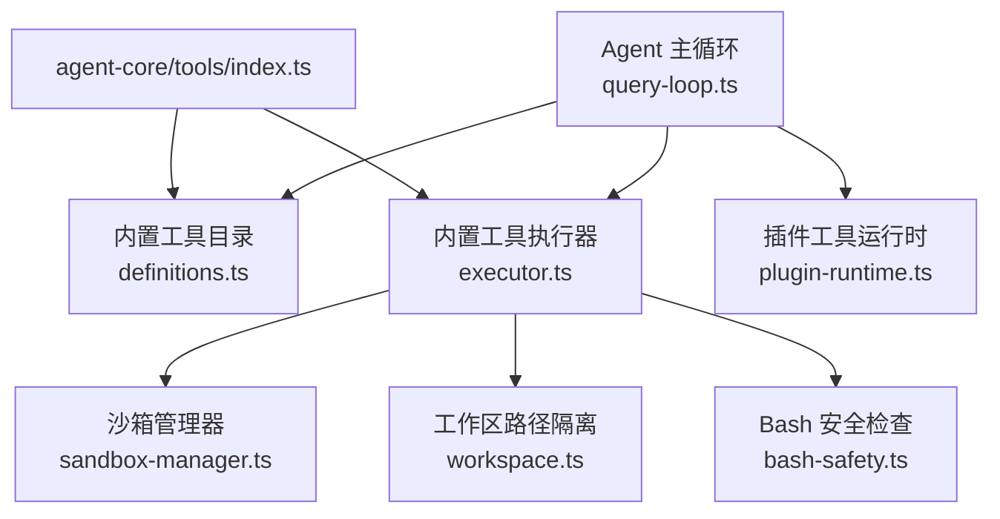
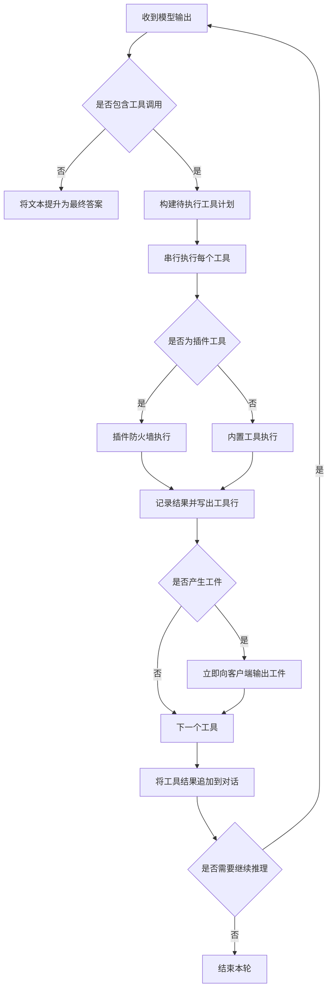
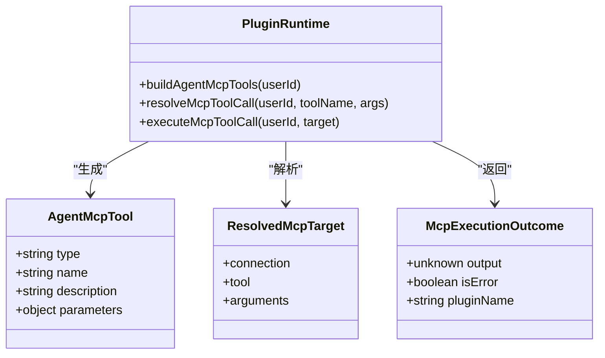
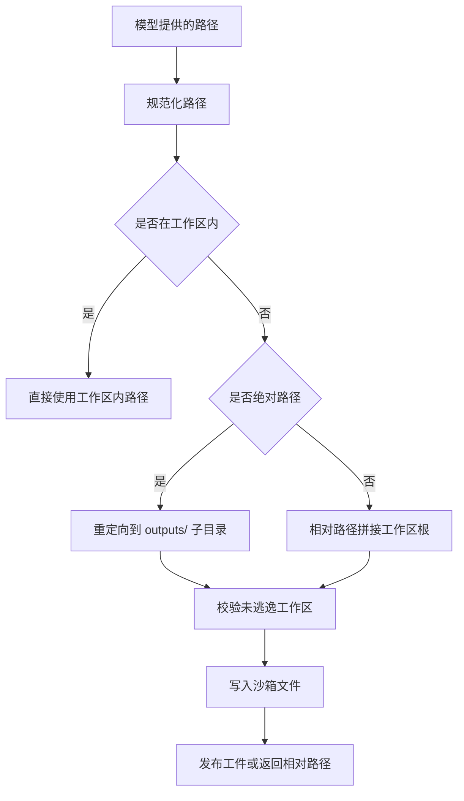
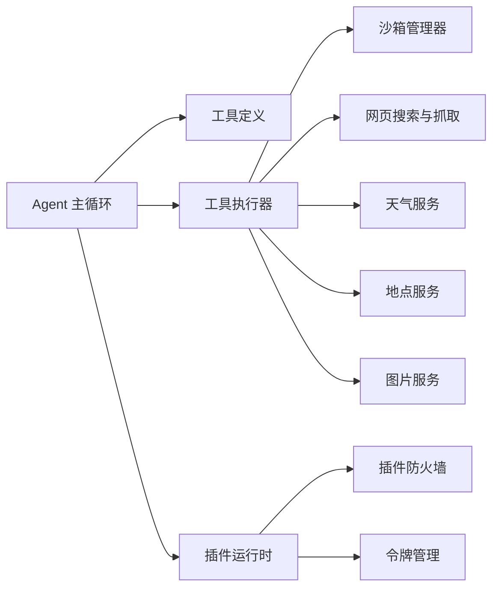
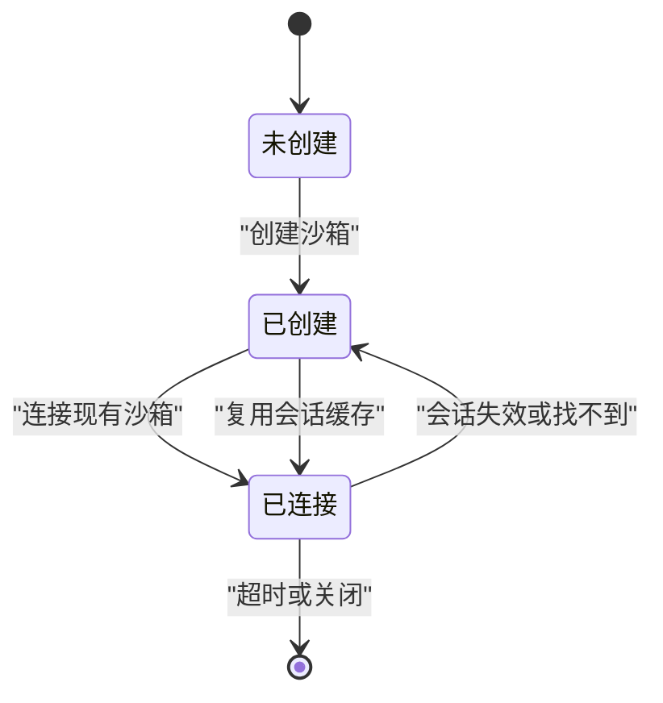

# 工具系统

<cite>
**本文引用的文件**   
- [agent-core/tools/index.ts](file://src/server/agent-core/tools/index.ts)
- [autonomous-tools/definitions.ts](file://src/server/inference/autonomous-tools/definitions.ts)
- [autonomous-tools/executor.ts](file://src/server/inference/autonomous-tools/executor.ts)
- [query-loop.ts](file://src/server/agent-core/runtime/query-loop.ts)
- [plugin-runtime.ts](file://src/server/plugins/plugin-runtime.ts)
- [bash-safety.ts](file://src/server/inference/bash-safety.ts)
- [workspace.ts](file://src/server/inference/autonomous-tools/workspace.ts)
- [sandbox-manager.ts](file://src/server/sandbox/sandbox-manager.ts)
</cite>

## 目录

1. [引言](#引言)
2. [项目结构](#项目结构)
3. [核心组件](#核心组件)
4. [架构总览](#架构总览)
5. [详细组件分析](#详细组件分析)
6. [依赖关系分析](#依赖关系分析)
7. [性能与并发特性](#性能与并发特性)
8. [沙箱与安全](#沙箱与安全)
9. [工具开发指南](#工具开发指南)
10. [测试方法](#测试方法)
11. [故障排查](#故障排查)
12. [结论](#结论)

## 引言

本仓库中的“工具系统”是 Clauxen 智能体对话的核心扩展机制。它把模型生成的函数调用映射到可执行、可审计、可恢复的工具，涵盖网页搜索、网页抓取、地点查询、图片搜索、天气查询、代码执行、Shell 命令、文件读写、技能文档读取、附件读取、GitHub 操作、插件工具以及任务调度等能力。

工具系统的关键设计目标是：

- **统一入口**：通过 agent-core 暴露工具目录和执行器，让聊天循环只关心“调用哪个工具、传入什么参数”。
- **安全边界**：对 Shell 命令、外部网络访问、文件系统写入和第三方插件调用施加明确限制。
- **可观测性**：在流式响应中实时输出思考过程、叙述文本、工具状态、标准输出和错误。
- **可恢复性**：将每轮模型输出和工具结果持久化，支持服务器超时后从断点继续。
- **可扩展性**：新增内置工具只需补充定义、参数校验和执行逻辑；用户连接的外部插件也可作为工具注册。

## 项目结构

工具系统主要分布在以下模块：

| 路径 | 职责 |
|---|---|
| `src/server/agent-core/tools` | 向 agent-core 暴露内置工具的目录和执行入口 |
| `src/server/inference/autonomous-tools` | 内置工具的定义、执行器、工作区、技能目录和附件读取 |
| `src/server/agent-core/runtime` | 自主代理主循环，负责模型轮次、工具调度、流式事件和重试 |
| `src/server/plugins` | 已连接插件的 MCP/REST 工具目录、解析器和执行防火墙 |
| `src/server/inference` | Bash 安全检查、视觉附件、训练转录格式等辅助逻辑 |
| `src/server/sandbox` | 基于 Novita Sandbox 的代码解释器会话管理 |



**图表来源**
- [query-loop.ts:1-200](file://src/server/agent-core/runtime/query-loop.ts#L1-L200)
- [autonomous-tools/definitions.ts:1-320](file://src/server/inference/autonomous-tools/definitions.ts#L1-L320)
- [autonomous-tools/executor.ts:1-200](file://src/server/inference/autonomous-tools/executor.ts#L1-L200)
- [plugin-runtime.ts:1-200](file://src/server/plugins/plugin-runtime.ts#L1-L200)
- [sandbox-manager.ts:1-120](file://src/server/sandbox/sandbox-manager.ts#L1-L120)
- [workspace.ts:1-120](file://src/server/inference/autonomous-tools/workspace.ts#L1-L120)
- [bash-safety.ts:1-27](file://src/server/inference/bash-safety.ts#L1-L27)
- [agent-core/tools/index.ts:1-7](file://src/server/agent-core/tools/index.ts#L1-L7)

**章节来源**
- [agent-core/tools/index.ts:1-7](file://src/server/agent-core/tools/index.ts#L1-L7)
- [query-loop.ts:1-200](file://src/server/agent-core/runtime/query-loop.ts#L1-L200)

## 核心组件

### 内置工具完整列表

当前内置工具按能力分组如下：

| 工具名 | 功能类别 | 主要用途 | 关键输入字段 | 关键返回字段 |
|---|---|---|---|---|
| `github_agent` | GitHub 集成 | 列出仓库、读取仓库元数据和文件、创建分支并发起草稿 PR | `operation`、`owner`、`repo`、`ref`、`path`、`request_id`、`files` 等 | GitHub 操作结果或错误对象 |
| `web_search` | 网页搜索 | 使用 Exa 搜索最新、事实性或近期信息 | `query`、可选 `num_results` | `query`、`results`、`searchType` |
| `web_fetch` | 网页抓取 | 获取已知 URL 的完整内容 | `url` | `url`、`title`、`snippet` 或错误 |
| `places_search` | 地点查询 | 通过 OpenStreetMap Nominatim 搜索地点 | `query`、可选 `max_results` | `query`、`results` |
| `image_search` | 图片搜索 | 搜索开源许可图片 | `query`、可选 `max_results` | `query`、`images` |
| `weather_fetch` | 天气查询 | 获取当前位置、逐小时和未来七天预报 | `location_name`、可选 `units` | 位置坐标和天气数据 |
| `bash_tool` | Shell 命令 | 在 Linux 沙箱中运行 shell 命令 | `description`、`command`、`output_paths` | `exitCode`、`stdout`、`stderr`、`artifacts` |
| `execute_code` | Python 代码执行 | 在沙箱中执行 Python 并观察输出 | `description`、`code`、`output_paths` | `stdout`、`stderr`、`result`、`artifacts` |
| `read_skill` | 环境知识 | 读取沙箱技能文档，了解可用库和文件格式处理规则 | `skill_id` | 技能 ID、路径和内容 |
| `read_attachment` | 附件读取 | 读取用户上传的文件或图像 | `file_id`、可选 `offset`、`limit` | 文本片段或图像块 |
| `file_read` | 文件读取 | 读取工作区内的文本文件 | `path` | `path`、`content` |
| `create_file` / `file_write` | 文件写入 | 在工作区写入文本文件 | `path`、`content`、可选 `description` | `path`、`content`、可选存储元数据 |
| `present_files` | 兼容占位 | 旧版模型仍可能调用的废弃工具 | 无必要参数 | 包含 `deprecated` 的成功结果 |
| `present_research_plan` | 深度研究计划 | 呈现可编辑的研究计划卡片 | `title`、`tasks` | 计划确认结果 |
| `research_task_update` | 研究进度 | 更新深度研究任务的索引和状态 | `task_index`、`status` | 任务更新结果 |
| `ask_user_input_v0` | 用户交互 | 暂停生成并向用户提问 | `questions` | 进入暂停状态 |
| `create_scheduled_task` | 定时任务 | 创建一次性、每日、每周或每月任务 | `name`、`requirement`、`frequency`、时间字段 | 任务创建结果 |
| `list_scheduled_tasks` | 定时任务列表 | 列出用户的定时任务 | 可选 `include_completed` | 任务列表 |
| `cancel_scheduled_task` | 取消定时任务 | 取消指定任务 | `task_id` | 取消结果 |

这些工具的名称和能力描述位于自动化工具定义文件中；参数类型、枚举值和长度限制同时由 Zod schema 进行自愈合校验。

**章节来源**
- [autonomous-tools/definitions.ts:1-320](file://src/server/inference/autonomous-tools/definitions.ts#L1-L320)
- [query-loop.ts:200-400](file://src/server/agent-core/runtime/query-loop.ts#L200-L400)

### 工具定义规范

每个内置工具是一个具有固定结构的函数型工具定义：

| 字段 | 含义 | 说明 |
|---|---|---|
| `type` | 工具类型 | 固定为函数型工具 |
| `name` | 工具名称 | 用于模型调用和路由分发 |
| `description` | 工具描述 | 决定模型何时使用该工具、如何使用、如何与其他工具串联 |
| `parameters` | 参数模式 | JSON Schema 风格的对象，声明必填字段、枚举、范围、最大长度等 |
| `strict` | 严格模式 | 部分工具启用严格模式，要求模型严格按 schema 传参 |

工具描述不是纯技术注释，而是驱动模型自主行为的指令：它需要回答三个问题：

1. 什么时候应该使用该工具。
2. 该工具能做什么。
3. 如何与其他工具组合。

例如，网页搜索强调主动使用、引用格式和避免编造索引；网页抓取强调先搜索再抓取；代码执行强调先读技能文档；Bash 工具强调输出产物应放在工作区输出目录。

**章节来源**
- [autonomous-tools/definitions.ts:1-120](file://src/server/inference/autonomous-tools/definitions.ts#L1-L120)

### 参数验证与返回值格式

工具参数存在两层校验：

1. **OpenAI 工具 schema**：模型侧根据 JSON Schema 生成函数调用。
2. **Zod 自愈合校验**：agent-core 维护一套与内置工具对应的 Zod schema，在工具执行前尝试修复或拒绝非法参数。

Zod schema 覆盖的主要字段包括：

| 工具 | 关键字段约束 |
|---|---|
| `web_search` | `query` 必填；`num_results` 可选，整数且 1 到 30 |
| `web_fetch` | `url` 必填 |
| `weather_fetch` | `location_name` 必填；`units` 可选，仅允许特定枚举值 |
| `places_search` | `query` 必填；`max_results` 可选 |
| `image_search` | `query` 必填；`max_results` 可选 |
| `execute_code` | `description`、`code`、`output_paths` 必填 |
| `bash_tool` | `description`、`command`、`output_paths` 必填 |
| `read_skill` | `skill_id` 必填 |
| `file_read` | `path` 必填 |
| `create_file` / `file_write` | `path`、`content` 必填；`description` 可选 |
| `present_research_plan` | `title` 非空且最多 200 字符；`tasks` 3 到 8 项，每项最多 1000 字符 |
| `research_task_update` | `task_index` 0 到 7；`status` 为运行或完成 |
| `ask_user_input_v0` | 问题数组最少 1 个、最多 3 个，每个选项 2 到 4 项 |
| `create_scheduled_task` | 名称、需求、频率和时间字段受严格类型约束 |

返回值通常采用结构化对象而非纯字符串，以便前端渲染工具卡片、搜索结果、工件文件和错误提示。常见返回结构包括：

| 工具类 | 典型返回结构 |
|---|---|
| 搜索类 | `query`、`results`、`index`、`title`、`url`、`snippet` |
| 天气类 | 位置和气象数据 |
| 沙箱类 | `stdout`、`stderr`、`error`、`exitCode`、`sandboxId`、`workspace`、`artifacts` |
| 文件类 | `path`、`content`、`fileId`、`storagePath`、`mimeType`、`sizeBytes` |
| 插件类 | `plugin`、`tool`、`content`、`notice`、可选 `blocked`、`error` |
| 交互类 | 触发暂停或用户输入请求 |

**章节来源**
- [query-loop.ts:200-400](file://src/server/agent-core/runtime/query-loop.ts#L200-L400)
- [autonomous-tools/executor.ts:1-200](file://src/server/inference/autonomous-tools/executor.ts#L1-L200)

## 架构总览

工具系统的执行路径可以分为三类：

1. **内置工具**：由 `autonomousAgentTools` 提供，由 `executeAutonomousTool` 执行。
2. **插件工具**：来自用户已连接的插件，以 `mcp__<插件>__<工具>` 命名，经过插件防火墙执行。
3. **MCP 搜索与调用**：当直接工具不足时，模型可通过内置搜索工具查找更多插件工具，再通过调用工具执行。

```mermaid
sequenceDiagram
    participant Client as "客户端"
    participant Loop as "Agent 主循环"
    participant Model as "推理提供商"
    participant Executor as "内置工具执行器"
    participant Plugin as "插件运行时"
    participant Sandbox as "沙箱"

    Client->>Loop: "开始对话轮次"
    Loop->>Model: "发送消息、系统提示和工具定义"
    Model-->>Loop: "工具调用"
    Loop->>Loop: "解析参数并判断工具归属"
    alt "插件工具"
        Loop->>Plugin: "解析并执行 mcp__* 工具"
        Plugin-->>Loop: "带审计和安全过滤的结果"
    else "内置工具"
        Loop->>Executor: "执行内置工具"
        alt "代码或 Shell"
            Executor->>Sandbox: "运行命令或代码"
            Sandbox-->>Executor: "标准输出、错误和工件"
        end
        Executor-->>Loop: "结构化结果"
    end
    Loop-->>Client: "流式输出工具状态、内容和工件"
```

**图表来源**
- [query-loop.ts:662-1119](file://src/server/agent-core/runtime/query-loop.ts#L662-L1119)
- [plugin-runtime.ts:200-370](file://src/server/plugins/plugin-runtime.ts#L200-L370)
- [autonomous-tools/executor.ts:200-528](file://src/server/inference/autonomous-tools/executor.ts#L200-L528)

**章节来源**
- [query-loop.ts:200-661](file://src/server/agent-core/runtime/query-loop.ts#L200-L661)
- [plugin-runtime.ts:1-200](file://src/server/plugins/plugin-runtime.ts#L1-L200)

## 详细组件分析

### Agent 主循环与工具调度

Agent 主循环是工具系统的控制中枢。它负责：

- 构建内置工具和插件工具集合。
- 将工具定义转换为推理提供商所需的函数工具格式。
- 接收模型输出的思考片段、叙述文本和工具调用。
- 将工具调用顺序执行。
- 将工具结果写回对话上下文，驱动下一轮推理。
- 支持超时切片、重试、暂停和用户中断。

关键行为包括：

- 默认单轮最多 24 步；深度研究模式允许更多步骤。
- 模型流式返回时，思考、叙述和工具调用分别流式写出。
- 工具调用在单轮内串行执行，因为沙箱是状态化的，而且 UI 需要自上而下的可读顺序。
- 工具结果会序列化为字符串写回对话，同时保留结构化工件供前端展示。
- 如果工具返回 `pauseForUser` 或调用 `ask_user_input_v0`，循环会暂停并释放生成租约。



**图表来源**
- [query-loop.ts:662-1119](file://src/server/agent-core/runtime/query-loop.ts#L662-L1119)

**章节来源**
- [query-loop.ts:200-661](file://src/server/agent-core/runtime/query-loop.ts#L200-L661)
- [query-loop.ts:662-1119](file://src/server/agent-core/runtime/query-loop.ts#L662-L1119)

### 内置工具执行器

`executeAutonomousTool` 是所有内置工具的统一入口。它根据工具名分派到具体实现，并共享以下通用能力：

- 工作区初始化。
- 沙箱保持活跃。
- 标准输出和标准错误流式转发。
- 输出路径发布为工件。
- 用户认证检查。
- 深度研究上下文注入。

#### 网页工具

| 工具 | 外部依赖 | 安全要点 |
|---|---|---|
| `web_search` | Exa | 支持流式结果和中间结果推送；深度研究中记录来源 |
| `web_fetch` | Exa | 不允许直接原始 HTTP 抓取，防止 SSRF |
| `places_search` | OpenStreetMap Nominatim | 免费地点搜索 |
| `image_search` | Openverse | 开源许可图片 |
| `weather_fetch` | Open-Meteo | 地理位置编码 + 天气预报 |

`web_fetch` 明确禁止绕过 Exa 直接抓取，以避免访问内部地址或云元数据接口。

#### 计算与文件工具

| 工具 | 执行环境 | 输出处理 |
|---|---|---|
| `bash_tool` | Linux 沙箱中的 shell | 支持 stdout/stderr 流式输出和工件上传 |
| `execute_code` | Python 沙箱 | 支持日志、结果对象和工件上传 |
| `read_skill` | 本地技能目录 | 返回环境事实，指导后续代码或文件操作 |
| `read_attachment` | 用户附件服务 | 支持分页读取长文件 |
| `file_read` / `create_file` / `file_write` | 工作区文件系统 | 路径隔离、二进制和文本混合处理 |

#### GitHub 工具

`github_agent` 是专用集成入口，不直接执行 GitHub API，而是委托给 GitHub agent 模块。它要求用户登录，并在描述中明确禁止直接推送基础分支或合并；写操作应在新的分支上创建提交并打开草稿 PR。

**章节来源**
- [autonomous-tools/executor.ts:1-528](file://src/server/inference/autonomous-tools/executor.ts#L1-L528)

### 插件工具运行时

插件工具来自用户连接的第三方服务，可能是 REST 工具集或 MCP 工具。它们具有以下特点：

- 工具名称以 `mcp__` 开头，便于主循环识别。
- 工具目录按风险等级排序，优先向模型展示只读工具。
- 当工具数量超过直接展示上限时，提供搜索工具 `mcp__plugins__search_tools` 和调用工具 `mcp__plugins__call_tool`。
- 执行前检查权限模式、参数、速率限制和令牌有效性。
- 执行后清理敏感信息，并记录审计日志。



**图表来源**
- [plugin-runtime.ts:1-200](file://src/server/plugins/plugin-runtime.ts#L1-L200)
- [plugin-runtime.ts:200-370](file://src/server/plugins/plugin-runtime.ts#L200-L370)

**章节来源**
- [plugin-runtime.ts:1-370](file://src/server/plugins/plugin-runtime.ts#L1-L370)

### 工作区与文件路径隔离

工作区围绕会话维度组织，而不是全局共享。核心规则：

- 每个会话对应一个沙箱工作区根目录。
- 相对路径会被解析到工作区内。
- 绝对路径若在工作区外，会被重定向到 `outputs/` 子目录。
- 写路径逃逸工作区会抛出错误。
- 读路径允许多候选路径，便于模型从 `/tmp` 等位置找回产物。
- 所有文件操作都通过沙箱文件接口，而不是 Node.js 直接文件系统。



**图表来源**
- [workspace.ts:1-190](file://src/server/inference/autonomous-tools/workspace.ts#L1-L190)

**章节来源**
- [workspace.ts:1-190](file://src/server/inference/autonomous-tools/workspace.ts#L1-L190)

## 依赖关系分析

工具系统的依赖关系可以理解为四层：

1. **表现层**：Agent 主循环负责流式事件、模型轮次和工具编排。
2. **工具层**：内置工具定义与执行器分离，插件工具通过运行时抽象。
3. **资源层**：沙箱、Exa、Nominatim、Openverse、Open-Meteo、GitHub 和数据库。
4. **基础设施层**：环境变量、令牌管理、速率限制、审计日志和持久化。



**图表来源**
- [query-loop.ts:200-661](file://src/server/agent-core/runtime/query-loop.ts#L200-L661)
- [autonomous-tools/executor.ts:1-200](file://src/server/inference/autonomous-tools/executor.ts#L1-L200)
- [plugin-runtime.ts:1-200](file://src/server/plugins/plugin-runtime.ts#L1-L200)

**章节来源**
- [query-loop.ts:200-661](file://src/server/agent-core/runtime/query-loop.ts#L200-L661)
- [autonomous-tools/executor.ts:1-200](file://src/server/inference/autonomous-tools/executor.ts#L1-L200)
- [plugin-runtime.ts:1-200](file://src/server/plugins/plugin-runtime.ts#L1-L200)

## 性能与并发特性

### 并发控制

- **工具串行执行**：同一轮内的工具调用按顺序执行，避免沙箱状态竞争和 UI 显示混乱。
- **插件工具串行执行**：插件调用同样在主循环中串行处理。
- **外部 I/O 并行**：插件目录加载时对多个连接并行拉取工具能力，但最终执行仍是串行的。
- **模型流式并发**：思考、叙述、工具调用和工具输出都是流式处理，不会等待整轮完成才输出。

### 资源隔离

- 沙箱会话按用户和会话键缓存，减少重复创建。
- 工作区按会话隔离，不同会话不能互相读写。
- 沙箱默认超时时间为 5 分钟，并可配置空闲超时。
- 沙箱生命周期由 `createSandboxKeepAlive` 和标准输出/错误回调维持活跃。

### 超时与切片

- 普通对话单轮最多 24 步。
- 深度研究模式允许更多轮次。
- 支持 `shouldYield` 和 `yieldSignal`，在轮次边界停止并返回“已切片”，由上层继续下一段。
- 模型流被独立中止信号控制，硬切片只影响当前轮，不影响显式用户终止。

### 重试与恢复

- 可重试的提供商错误在深度研究模式下最多重试一次。
- 每轮结束后记录下一步索引、对话快照、叙述计数和工具调用 ID。
- 恢复时跳过已执行的工具，但对外部写操作保守处理：不确定执行结果的工具不会盲目重放。

**章节来源**
- [query-loop.ts:200-661](file://src/server/agent-core/runtime/query-loop.ts#L200-L661)
- [query-loop.ts:662-1119](file://src/server/agent-core/runtime/query-loop.ts#L662-L1119)
- [sandbox-manager.ts:1-120](file://src/server/sandbox/sandbox-manager.ts#L1-L120)

## 沙箱与安全

### 沙箱环境

沙箱基于 Novita Sandbox 代码解释器实现，主要特性：

- 动态加载沙箱 SDK。
- 设置服务端 API Key，但不暴露给客户端。
- 创建或复用会话级沙箱。
- 通过 metadata 标记应用、用户、会话、自动恢复和空闲超时。
- 支持列举、连接、信息查询和所有权校验。



**图表来源**
- [sandbox-manager.ts:1-120](file://src/server/sandbox/sandbox-manager.ts#L1-L120)

**章节来源**
- [sandbox-manager.ts:1-120](file://src/server/sandbox/sandbox-manager.ts#L1-L120)

### 安全限制

| 类别 | 安全措施 |
|---|---|
| Shell 命令 | 白名单式危险模式匹配，包括递归删除、格式化磁盘、DD 设备写入、无限循环、全局 chmod 和管道执行 shell |
| 命令长度 | 最大 8000 字符 |
| 网页抓取 | 仅允许通过 Exa，禁止直接原始 fetch |
| 文件路径 | 工作区根隔离，逃逸路径报错，绝对路径重定向到输出目录 |
| 插件权限 | 按只读、读写、破坏性分级，受连接权限模式限制 |
| 插件参数 | 参数检查和输出清理，移除敏感指令 |
| 插件令牌 | 令牌注入和刷新，失败时要求重新连接 |
| 审计 | 插件工具调用记录名称、风险、状态、耗时和摘要 |

**章节来源**
- [bash-safety.ts:1-27](file://src/server/inference/bash-safety.ts#L1-L27)
- [workspace.ts:1-190](file://src/server/inference/autonomous-tools/workspace.ts#L1-L190)
- [plugin-runtime.ts:200-370](file://src/server/plugins/plugin-runtime.ts#L200-L370)

## 工具开发指南

### 新增内置工具的步骤

1. **定义工具**：在 `autonomous-tools/definitions.ts` 中添加工具定义，包含名称、描述和参数 schema。
2. **添加参数校验**：在 `query-loop.ts` 的 Zod schema 映射中添加相同字段的校验规则。
3. **实现执行逻辑**：在 `autonomous-tools/executor.ts` 的 `executeAutonomousTool` 中添加工具分支。
4. **处理输出工件**：如果需要产出文件，使用工作区 API 写入 `outputs/`，并通过 `output_paths` 暴露给主循环。
5. **流式反馈**：通过 `onToolProgress` 或主循环的 `sse.writeToolData` 输出中间状态。
6. **错误处理**：返回结构化错误对象，避免直接抛出未捕获异常。
7. **安全性审查**：如涉及 Shell、网络、文件或用户数据，必须增加最小权限、路径校验或白名单。

### 自定义工具最佳实践

| 场景 | 推荐方式 |
|---|---|
| 简单只读查询 | 使用 Exa、Nominatim、Openverse 或 Open-Meteo 等已有外部服务 |
| 复杂数据处理 | 使用 `execute_code`，并在执行前调用 `read_skill` 确认环境 |
| 文件构建 | 使用 `bash_tool` 或 `execute_code`，并将产物放入 `outputs/` |
| 用户文件访问 | 使用 `read_attachment`，不要假设文件已在提示词中 |
| 第三方系统集成 | 优先使用插件连接，通过 `plugin-runtime` 获得权限控制和审计 |
| 敏感写操作 | 明确提示用户确认，避免静默修改账户数据 |

### 工具描述编写建议

- 明确指出何时使用、何时不使用。
- 给出与其他工具的顺序提示。
- 避免把参数当作 JSON 输出给用户。
- 对于会产生可见产物的工具，说明如何在 UI 中呈现。
- 对于需要外部凭据或权限的工具，说明失败时的引导信息。

**章节来源**
- [autonomous-tools/definitions.ts:1-320](file://src/server/inference/autonomous-tools/definitions.ts#L1-L320)
- [query-loop.ts:200-400](file://src/server/agent-core/runtime/query-loop.ts#L200-L400)
- [autonomous-tools/executor.ts:1-200](file://src/server/inference/autonomous-tools/executor.ts#L1-L200)

## 测试方法

当前仓库没有专门针对工具系统的集中测试文件，但可以从以下角度设计测试：

### 单元测试

- 验证 Zod schema 对合法参数接受、非法参数拒绝。
- 验证 Bash 安全规则拦截危险命令。
- 验证工作区路径解析不会逃逸会话目录。
- 验证 `requestedOutputPaths` 只提取字符串路径，并有数量上限。

### 集成测试

- 模拟外部搜索、天气、地点和图片服务返回。
- 验证工具执行器的返回结构是否符合前端期望。
- 验证插件防火墙在只读模式下阻止写操作。
- 验证插件令牌过期后触发重新授权流程。

### 端到端测试

- 验证 Agent 主循环在工具调用、流式输出、工件展示和最终答案之间的顺序。
- 验证深度研究模式下搜索结果来源记录和任务进度更新。
- 验证超时切片后能正确恢复并避免重放不确定副作用。

**章节来源**
- [bash-safety.ts:1-27](file://src/server/inference/bash-safety.ts#L1-L27)
- [autonomous-tools/executor.ts:1-200](file://src/server/inference/autonomous-tools/executor.ts#L1-L200)
- [plugin-runtime.ts:200-370](file://src/server/plugins/plugin-runtime.ts#L200-L370)

## 故障排查

| 现象 | 可能原因 | 处理建议 |
|---|---|---|
| Bash 命令被拒绝 | 命中危险命令模式或超长 | 简化命令，避免危险语法 |
| 网页抓取返回无内容 | Exa 无法提取页面正文 | 改用搜索或更换 URL |
| 天气查询找不到地点 | 地名无法地理编码 | 提供更明确的城市和国家 |
| 文件读取失败 | 路径不在工作区或文件不存在 | 检查相对路径和输出目录 |
| 插件工具不可用 | 连接未激活或工具发现未完成 | 重新同步插件能力或重新连接 |
| 插件返回未授权 | 令牌过期或权限不足 | 重新授权或调整连接权限 |
| 工具结果丢失 | 工件路径错误或未列入 `output_paths` | 确保写入 `outputs/` 并填写精确路径 |
| 对话意外中断 | 用户中止、切片超时或提供商错误 | 查看 SSE 错误消息并检查超时配置 |

**章节来源**
- [autonomous-tools/executor.ts:200-528](file://src/server/inference/autonomous-tools/executor.ts#L200-L528)
- [plugin-runtime.ts:200-370](file://src/server/plugins/plugin-runtime.ts#L200-L370)
- [query-loop.ts:662-1119](file://src/server/agent-core/runtime/query-loop.ts#L662-L1119)

## 结论

工具系统以 Agent 主循环为中心，将模型意图转化为安全的、可观测的、可恢复的外部能力调用。内置工具覆盖搜索、抓取、地点、图片、天气、代码执行、Shell、文件、附件、GitHub、研究和定时任务；插件工具则通过运行时抽象接入第三方服务。

其核心优势在于：

- 工具定义与执行逻辑解耦，便于扩展和维护。
- 参数校验结合自然语言描述，既约束模型又引导正确使用。
- 沙箱和工作区提供进程级和文件级隔离。
- 插件工具具备权限、速率、审计和令牌管理能力。
- 流式输出和切片恢复保证用户体验和服务可靠性。

未来扩展时应优先考虑：

- 保持工具描述对用户和模型双重友好。
- 坚持最小权限原则，尤其是写操作和网络访问。
- 为高风险工具增加显式确认和可观测指标。
- 将复杂业务逻辑下沉到服务层，而不是全部塞进工具描述。
- 持续完善测试覆盖，特别是边界路径、错误恢复和外部依赖异常。