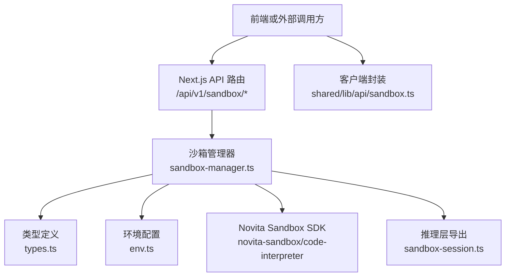
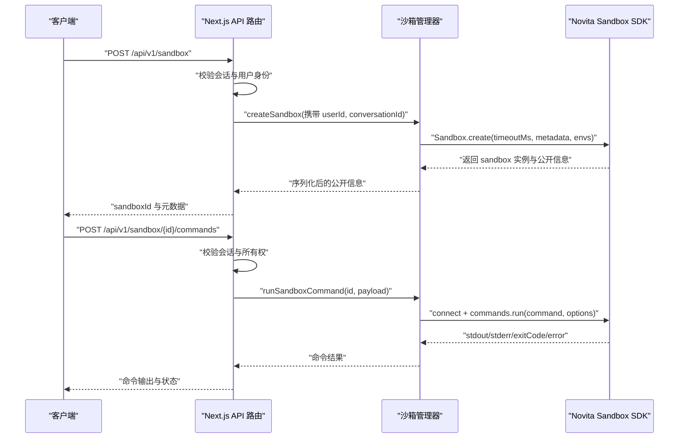
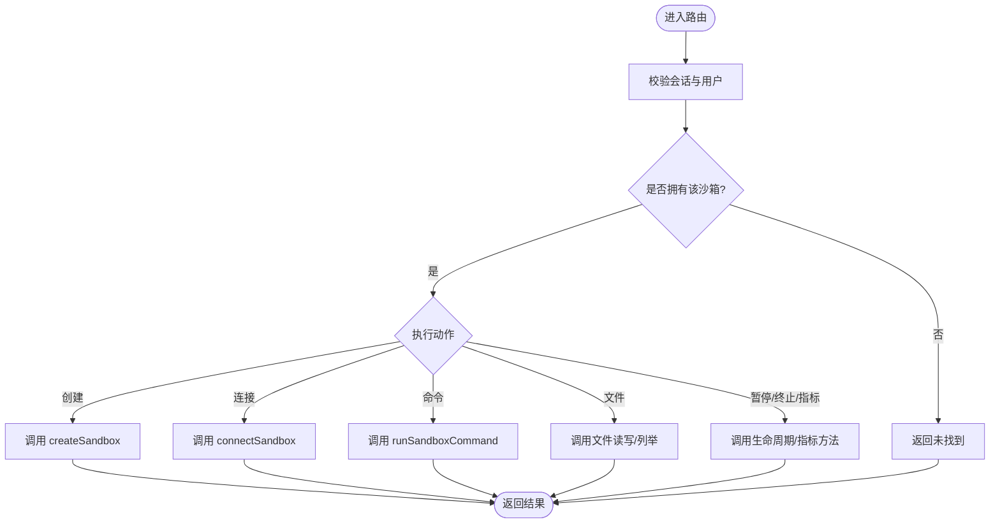
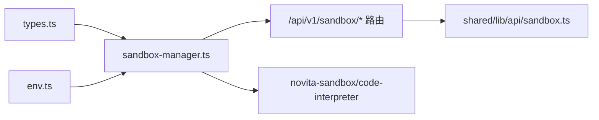

# 沙箱安全与环境隔离

<cite>
**本文引用的文件**   
- [src/server/sandbox/types.ts](file://src/server/sandbox/types.ts)
- [src/server/sandbox/sandbox-manager.ts](file://src/server/sandbox/sandbox-manager.ts)
- [src/server/inference/sandbox-session.ts](file://src/server/inference/sandbox-session.ts)
- [src/shared/lib/api/sandbox.ts](file://src/shared/lib/api/sandbox.ts)
- [src/app/api/v1/sandbox/route.ts](file://src/app/api/v1/sandbox/route.ts)
- [src/app/api/v1/sandbox/[sandboxId]/route.ts](file://src/app/api/v1/sandbox/[sandboxId]/route.ts)
- [src/app/api/v1/sandbox/[sandboxId]/timeout/route.ts](file://src/app/api/v1/sandbox/[sandboxId]/timeout/route.ts)
- [src/app/api/v1/sandbox/[sandboxId]/pause/route.ts](file://src/app/api/v1/sandbox/[sandboxId]/pause/route.ts)
- [src/app/api/v1/sandbox/[sandboxId]/metrics/route.ts](file://src/app/api/v1/sandbox/[sandboxId]/metrics/route.ts)
- [src/app/api/v1/sandbox/[sandboxId]/host/route.ts](file://src/app/api/v1/sandbox/[sandboxId]/host/route.ts)
- [src/app/api/v1/sandbox/[sandboxId]/files/route.ts](file://src/app/api/v1/sandbox/[sandboxId]/files/route.ts)
- [src/app/api/v1/sandbox/[sandboxId]/connect/route.ts](file://src/app/api/v1/sandbox/[sandboxId]/connect/route.ts)
- [src/app/api/v1/sandbox/[sandboxId]/commands/route.ts](file://src/app/api/v1/sandbox/[sandboxId]/commands/route.ts)
- [src/server/config/env.ts](file://src/server/config/env.ts)
</cite>

## 目录
1. [引言](#引言)
2. [项目结构](#项目结构)
3. [核心组件](#核心组件)
4. [架构总览](#架构总览)
5. [详细组件分析](#详细组件分析)
6. [依赖关系分析](#依赖关系分析)
7. [性能与资源限制](#性能与资源限制)
8. [故障排查指南](#故障排查指南)
9. [结论](#结论)
10. [附录：配置选项与使用示例](#附录配置选项与使用示例)

## 引言
本文件面向需要理解并安全使用代码执行沙箱的开发者，系统化说明当前仓库中的沙箱实现。该沙箱基于 Novita Sandbox SDK，通过服务端 API 暴露创建、连接、命令执行、文件读写、进程暂停/终止、指标查询等能力，并在服务端完成用户身份校验、所有权检查、会话缓存和生命周期管理。本文重点覆盖以下主题：
- Novita Sandbox 集成方式与安全边界
- 代码执行与命令执行的隔离机制
- 文件系统访问控制与会话管理机制
- 超时控制、自动保活与资源清理策略
- 工作区管理与路径访问
- 监控、审计与常见问题诊断
- 配置项说明和安全最佳实践

## 项目结构
沙箱相关代码主要分布在以下位置：
- 类型定义：`src/server/sandbox/types.ts`
- 沙箱管理器：`src/server/sandbox/sandbox-manager.ts`
- 推理层适配导出：`src/server/inference/sandbox-session.ts`
- 客户端 API 封装：`src/shared/lib/api/sandbox.ts`
- Next.js API 路由：`src/app/api/v1/sandbox/**`
- 环境变量解析：`src/server/config/env.ts`

**图表来源**
- [src/app/api/v1/sandbox/route.ts:1-58](file://src/app/api/v1/sandbox/route.ts#L1-L58)
- [src/server/sandbox/sandbox-manager.ts:1-200](file://src/server/sandbox/sandbox-manager.ts#L1-L200)
- [src/server/sandbox/types.ts:1-46](file://src/server/sandbox/types.ts#L1-L46)
- [src/server/inference/sandbox-session.ts:1-35](file://src/server/inference/sandbox-session.ts#L1-L35)
- [src/shared/lib/api/sandbox.ts:1-117](file://src/shared/lib/api/sandbox.ts#L1-L117)
- [src/server/config/env.ts:1-200](file://src/server/config/env.ts#L1-L200)

**章节来源**
- [src/server/sandbox/types.ts:1-46](file://src/server/sandbox/types.ts#L1-L46)
- [src/server/sandbox/sandbox-manager.ts:1-200](file://src/server/sandbox/sandbox-manager.ts#L1-L200)
- [src/server/inference/sandbox-session.ts:1-35](file://src/server/inference/sandbox-session.ts#L1-L35)
- [src/shared/lib/api/sandbox.ts:1-117](file://src/shared/lib/api/sandbox.ts#L1-L117)
- [src/app/api/v1/sandbox/route.ts:1-58](file://src/app/api/v1/sandbox/route.ts#L1-L58)

## 核心组件
- 沙箱类型与请求模型：定义创建参数、会话上下文、公开信息、命令请求、文件写入请求等。
- 沙箱管理器：封装 Novita Sandbox SDK 调用，提供创建、连接、列表、信息查询、暂停、终止、命令执行、代码执行、文件操作、主机地址获取、运行状态检查、会话清理等功能。
- 推理层适配：将沙箱管理器导出为统一入口，并提供已废弃的兼容性方法。
- API 路由层：所有沙箱操作均通过受认证的 Next.js API 路由暴露，并在进入业务逻辑前进行用户身份验证和沙箱所有权检查。
- 客户端 API：对 `/api/v1/sandbox` 系列接口进行封装，便于前端或后端服务调用。

**章节来源**
- [src/server/sandbox/types.ts:1-46](file://src/server/sandbox/types.ts#L1-L46)
- [src/server/sandbox/sandbox-manager.ts:1-200](file://src/server/sandbox/sandbox-manager.ts#L1-L200)
- [src/server/inference/sandbox-session.ts:1-35](file://src/server/inference/sandbox-session.ts#L1-L35)
- [src/shared/lib/api/sandbox.ts:1-117](file://src/shared/lib/api/sandbox.ts#L1-L117)

## 架构总览
下图展示从客户端到 Novita Sandbox 的整体流程，包括鉴权、所有权校验、会话复用、命令执行与文件操作。

**图表来源**
- [src/app/api/v1/sandbox/route.ts:1-58](file://src/app/api/v1/sandbox/route.ts#L1-L58)
- [src/app/api/v1/sandbox/[sandboxId]/commands/route.ts:1-28](file://src/app/api/v1/sandbox/[sandboxId]/commands/route.ts#L1-L28)
- [src/server/sandbox/sandbox-manager.ts:200-423](file://src/server/sandbox/sandbox-manager.ts#L200-L423)

## 详细组件分析

### 类型与数据模型
沙箱类型集中在 `types.ts`，用于描述：
- 创建参数：用户标识、对话标识、超时时间、自动暂停/恢复、空闲超时、元数据、环境变量。
- 会话上下文：用户标识与对话标识，用于会话键生成与现有沙箱查找。
- 公开信息：沙箱 ID、模板 ID、名称、元数据、启动时间、结束时间、状态、CPU 核数、内存大小。
- 命令请求：命令字符串、是否后台执行、工作目录、环境变量、超时、标准输出/错误回调。
- 文件写入请求：单文件或批量文件写入的结构。

这些类型是沙箱管理器与 API 路由之间数据契约的基础，确保输入输出结构清晰、可序列化。

**章节来源**
- [src/server/sandbox/types.ts:1-46](file://src/server/sandbox/types.ts#L1-L46)

### 沙箱管理器
沙箱管理器是沙箱能力的核心实现，职责包括：
- 动态加载 Novita Sandbox SDK 类，避免冷启动成本过高；在首次使用前注入提供商密钥到进程环境变量。
- 会话索引与代码上下文索引：
  - `sessionIndex` 将用户与对话组合映射到最近使用的沙箱 ID，实现快速重连。
  - `codeContextIndex` 缓存 Python 代码执行上下文，避免频繁重建导致的导入丢失问题。
- 会话键构建：以 `userId:conversationId` 作为键，匿名用户与默认对话也有兜底值。
- 元数据处理：将应用标记、用户标识、对话标识、自动恢复标志与空闲超时写入元数据；空闲超时必须大于等于 60 秒才生效。
- 沙箱发现与复用：优先从本地会话缓存取 ID，失败则按用户与对话查找远端运行中或已暂停的沙箱，再回退到新创建。
- 生命周期操作：暂停、终止、设置超时、获取指标、判断运行状态。
- 命令与代码执行：支持同步与后台命令、标准输出与错误流、Python 代码执行上下文。
- 文件操作：读取文本/字节、写入单文件或批量写入、创建目录、列出目录。
- 公开主机地址：根据端口生成可访问的主机地址与 URL。
- 会话清理：清除会话映射与代码上下文缓存。

关键安全点：
- 所有对外暴露的 API 路由在进入业务逻辑前都调用 `assertSandboxOwnedBy`，缺失所有权或属于其他用户时返回“未找到”，以避免泄露沙箱存在性。
- 创建沙箱时删除客户端传入的 `userId` 字段，防止伪造归属。
- 默认超时、最大保活时间与最小保活间隔均有硬编码上限，防止无限延长。

**章节来源**
- [src/server/sandbox/sandbox-manager.ts:1-200](file://src/server/sandbox/sandbox-manager.ts#L1-L200)
- [src/server/sandbox/sandbox-manager.ts:200-423](file://src/server/sandbox/sandbox-manager.ts#L200-L423)

### API 路由层
路由层负责：
- 认证：通过 `requireSession` 获取当前用户。
- 权限：通过 `assertSandboxOwnedBy` 校验沙箱归属。
- 参数处理：从 URL 与 JSON body 中提取参数，并进行基础转换。
- 转发：调用沙箱管理器对应函数并返回标准化 JSON。

主要路由：
- 列表与创建：`GET /api/v1/sandbox`、`POST /api/v1/sandbox`
- 查询与销毁：`GET /api/v1/sandbox/{id}`、`DELETE /api/v1/sandbox/{id}`
- 连接：`POST /api/v1/sandbox/{id}/connect`
- 超时调整：`PATCH /api/v1/sandbox/{id}/timeout`
- 暂停：`POST /api/v1/sandbox/{id}/pause`
- 指标：`GET /api/v1/sandbox/{id}/metrics`
- 主机地址：`GET /api/v1/sandbox/{id}/host?port=...`
- 文件：`GET/POST/PUT /api/v1/sandbox/{id}/files`
- 命令：`POST /api/v1/sandbox/{id}/commands`

**图表来源**
- [src/app/api/v1/sandbox/route.ts:1-58](file://src/app/api/v1/sandbox/route.ts#L1-L58)
- [src/app/api/v1/sandbox/[sandboxId]/route.ts:1-29](file://src/app/api/v1/sandbox/[sandboxId]/route.ts#L1-L29)
- [src/app/api/v1/sandbox/[sandboxId]/commands/route.ts:1-28](file://src/app/api/v1/sandbox/[sandboxId]/commands/route.ts#L1-L28)
- [src/app/api/v1/sandbox/[sandboxId]/files/route.ts:1-59](file://src/app/api/v1/sandbox/[sandboxId]/files/route.ts#L1-L59)
- [src/server/sandbox/sandbox-manager.ts:200-423](file://src/server/sandbox/sandbox-manager.ts#L200-L423)

**章节来源**
- [src/app/api/v1/sandbox/route.ts:1-58](file://src/app/api/v1/sandbox/route.ts#L1-L58)
- [src/app/api/v1/sandbox/[sandboxId]/route.ts:1-29](file://src/app/api/v1/sandbox/[sandboxId]/route.ts#L1-L29)
- [src/app/api/v1/sandbox/[sandboxId]/timeout/route.ts:1-20](file://src/app/api/v1/sandbox/[sandboxId]/timeout/route.ts#L1-L20)
- [src/app/api/v1/sandbox/[sandboxId]/pause/route.ts:1-19](file://src/app/api/v1/sandbox/[sandboxId]/pause/route.ts#L1-L19)
- [src/app/api/v1/sandbox/[sandboxId]/metrics/route.ts:1-20](file://src/app/api/v1/sandbox/[sandboxId]/metrics/route.ts#L1-L20)
- [src/app/api/v1/sandbox/[sandboxId]/host/route.ts:1-22](file://src/app/api/v1/sandbox/[sandboxId]/host/route.ts#L1-L22)
- [src/app/api/v1/sandbox/[sandboxId]/files/route.ts:1-59](file://src/app/api/v1/sandbox/[sandboxId]/files/route.ts#L1-L59)
- [src/app/api/v1/sandbox/[sandboxId]/connect/route.ts:1-23](file://src/app/api/v1/sandbox/[sandboxId]/connect/route.ts#L1-L23)
- [src/app/api/v1/sandbox/[sandboxId]/commands/route.ts:1-28](file://src/app/api/v1/sandbox/[sandboxId]/commands/route.ts#L1-L28)

### 客户端 API 封装
客户端侧通过 `shared/lib/api/sandbox.ts` 提供统一的 HTTP 调用方法，涵盖：
- 列表、创建、查询、终止
- 暂停、连接、超时设置
- 指标查询、命令执行
- 文件读取与写入
- 主机地址获取

该方法封装了请求体构造、超时设置与错误传播，降低上层业务直接处理 HTTP 细节的成本。

**章节来源**
- [src/shared/lib/api/sandbox.ts:1-117](file://src/shared/lib/api/sandbox.ts#L1-L117)

### 推理层适配
推理层通过 `sandbox-session.ts` 重新导出沙箱管理器的全部能力，同时保留一个已废弃的兼容方法，以便旧代码继续工作。这种方式将沙箱能力集中到管理器，推理层只做薄包装，减少重复实现。

**章节来源**
- [src/server/inference/sandbox-session.ts:1-35](file://src/server/inference/sandbox-session.ts#L1-L35)

## 依赖关系分析
- 沙箱管理器依赖：
  - Novita Sandbox SDK：通过动态 import 加载，运行时注入 `NOVITA_API_KEY` 与 `Provider_API_Key`。
  - 类型定义：约束输入输出结构。
  - 数据库错误工具：统一抛出“未找到”异常，用于所有权检查失败场景。
  - 环境配置：读取提供商 API Key 与默认超时等。
- API 路由依赖：
  - 认证模块：强制要求有效会话。
  - 沙箱管理器：承载具体业务逻辑。
- 客户端依赖：
  - 通用 API 客户端：封装网络请求。

**图表来源**
- [src/server/sandbox/types.ts:1-46](file://src/server/sandbox/types.ts#L1-L46)
- [src/server/sandbox/sandbox-manager.ts:1-200](file://src/server/sandbox/sandbox-manager.ts#L1-L200)
- [src/server/config/env.ts:1-200](file://src/server/config/env.ts#L1-L200)
- [src/shared/lib/api/sandbox.ts:1-117](file://src/shared/lib/api/sandbox.ts#L1-L117)

**章节来源**
- [src/server/sandbox/sandbox-manager.ts:1-200](file://src/server/sandbox/sandbox-manager.ts#L1-L200)
- [src/server/config/env.ts:1-200](file://src/server/config/env.ts#L1-L200)

## 性能与资源限制
- 默认超时：创建或连接沙箱时使用默认超时，值为固定常量。
- 保活机制：长耗时命令在执行过程中会周期性延长沙箱空闲超时，但每次延长时间有上限，且整体不超过最大沙箱超时。
- 保活节流：避免对每个 stdout 块都调用超时设置，改为固定时间窗口内最多一次。
- 会话缓存：同一用户与对话优先复用已有沙箱，减少创建与连接开销。
- Python 上下文缓存：避免反复重建代码执行上下文，提高多次执行效率。
- 列表分页：沙箱列表通过分页器拉取，直至达到限制数量。

这些机制共同保证高并发下的资源利用率与稳定性，同时防止恶意或失控任务长期占用资源。

**章节来源**
- [src/server/sandbox/sandbox-manager.ts:1-200](file://src/server/sandbox/sandbox-manager.ts#L1-L200)
- [src/server/sandbox/sandbox-manager.ts:200-423](file://src/server/sandbox/sandbox-manager.ts#L200-L423)

## 故障排查指南
常见排查步骤与建议：
- 无法创建沙箱：
  - 检查环境变量中是否正确配置提供商 API Key；管理器会在首次使用时注入该密钥。
  - 确认请求头与会话有效，且未绕过鉴权。
- 找不到沙箱：
  - 所有权检查失败时会返回“未找到”，这是有意设计，避免泄露沙箱是否存在。
  - 检查传入的 `sandboxId` 是否属于当前用户。
- 命令执行无响应：
  - 检查命令是否设置为后台执行；后台命令返回进程 ID，不等待退出码。
  - 关注 stdout/stderr 流是否被消费；保活机制仅在活跃输出时延长超时。
- 沙箱过早退出：
  - 若命令缓慢但持续输出，保活机制应延长超时；若仍超时，检查是否超过最大超时上限。
  - 可通过 `/api/v1/sandbox/{id}/timeout` 调整超时。
- 文件访问异常：
  - 检查路径是否在沙箱文件系统允许范围内；当前实现委托给 SDK 的文件系统接口。
  - 批量写入时注意请求体结构是数组还是单个对象。
- 资源泄漏：
  - 调用终止后，管理器会清理会话索引与代码上下文索引。
  - 如需主动清理会话映射，可使用会话清理方法。

**章节来源**
- [src/server/sandbox/sandbox-manager.ts:200-423](file://src/server/sandbox/sandbox-manager.ts#L200-L423)
- [src/app/api/v1/sandbox/[sandboxId]/timeout/route.ts:1-20](file://src/app/api/v1/sandbox/[sandboxId]/timeout/route.ts#L1-L20)
- [src/app/api/v1/sandbox/[sandboxId]/files/route.ts:1-59](file://src/app/api/v1/sandbox/[sandboxId]/files/route.ts#L1-L59)

## 结论
该沙箱实现以 Novita Sandbox SDK 为基础，在服务端集中管理生命周期、会话复用、权限校验与资源限制。API 路由层统一鉴权与所有权检查，避免敏感信息泄露；管理器内部通过超时上限、保活节流与索引清理降低资源泄漏风险。对于文件系统与命令执行，建议在生产环境中结合平台级策略进一步收紧权限，并完善审计日志与告警机制。

## 附录：配置选项与使用示例

### 配置选项
- 环境变量
  - 提供商 API Key：由管理器注入 `NOVITA_API_KEY` 与 `Provider_API_Key`；也可通过环境配置读取。
  - 默认沙箱超时：可从环境配置中读取默认超时值。
- 创建沙箱参数
  - `userId`：用于元数据与会话键。
  - `conversationId`：用于会话键与远端查找。
  - `timeoutMs`：沙箱超时毫秒数。
  - `autoPause`：是否启用自动暂停。
  - `autoResume`：是否允许自动恢复。
  - `idleTimeoutSeconds`：空闲超时秒数，需大于等于 60。
  - `metadata`：自定义元数据，服务端会追加应用标识与用户标识。
  - `envs`：沙箱进程环境变量。
- 命令执行参数
  - `command`：要执行的命令。
  - `background`：是否后台执行。
  - `cwd`：工作目录。
  - `envs`：命令级环境变量。
  - `timeoutMs`：命令级超时。
  - `onStdout`/`onStderr`：输出回调。
- 文件写入参数
  - 单文件：`path` 与 `content`。
  - 批量文件：`files` 数组，每项包含 `path` 与 `content`。

**章节来源**
- [src/server/sandbox/types.ts:1-46](file://src/server/sandbox/types.ts#L1-L46)
- [src/server/sandbox/sandbox-manager.ts:1-200](file://src/server/sandbox/sandbox-manager.ts#L1-L200)
- [src/server/config/env.ts:1-200](file://src/server/config/env.ts#L1-L200)

### 使用示例（概念性）
- 创建沙箱
  - 客户端调用 `POST /api/v1/sandbox`，携带可选超时、自动暂停、自动恢复、空闲超时、对话标识与元数据。
  - 服务端返回沙箱公开信息，包含沙箱 ID。
- 连接沙箱
  - 客户端调用 `POST /api/v1/sandbox/{id}/connect`，可指定连接超时。
- 执行命令
  - 客户端调用 `POST /api/v1/sandbox/{id}/commands`，提交命令与工作目录、环境变量、超时。
  - 后台命令返回进程 ID；前台命令返回退出码、标准输出、标准错误与错误信息。
- 文件操作
  - 读取：`PUT /api/v1/sandbox/{id}/files`，请求体包含路径。
  - 写入：`POST /api/v1/sandbox/{id}/files`，请求体可以是单文件或批量文件。
  - 列举：`GET /api/v1/sandbox/{id}/files?path=/`。
- 生命周期
  - 暂停：`POST /api/v1/sandbox/{id}/pause`。
  - 终止：`DELETE /api/v1/sandbox/{id}`。
  - 设置超时：`PATCH /api/v1/sandbox/{id}/timeout`。
  - 指标：`GET /api/v1/sandbox/{id}/metrics`。
  - 主机地址：`GET /api/v1/sandbox/{id}/host?port=3000`。

以上示例仅描述调用结构与语义；实际实现请参考对应 API 路由与服务端管理器。

**章节来源**
- [src/shared/lib/api/sandbox.ts:1-117](file://src/shared/lib/api/sandbox.ts#L1-L117)
- [src/app/api/v1/sandbox/route.ts:1-58](file://src/app/api/v1/sandbox/route.ts#L1-L58)
- [src/app/api/v1/sandbox/[sandboxId]/commands/route.ts:1-28](file://src/app/api/v1/sandbox/[sandboxId]/commands/route.ts#L1-L28)
- [src/app/api/v1/sandbox/[sandboxId]/files/route.ts:1-59](file://src/app/api/v1/sandbox/[sandboxId]/files/route.ts#L1-L59)