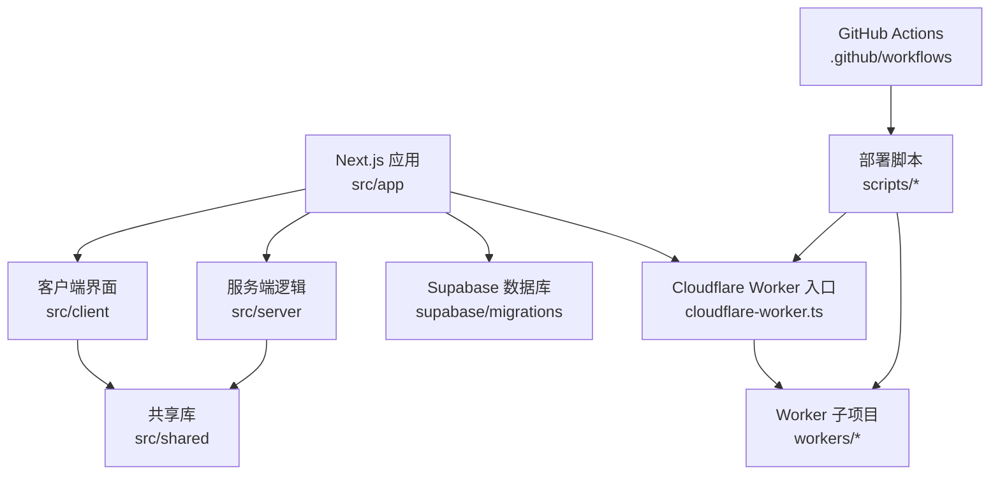
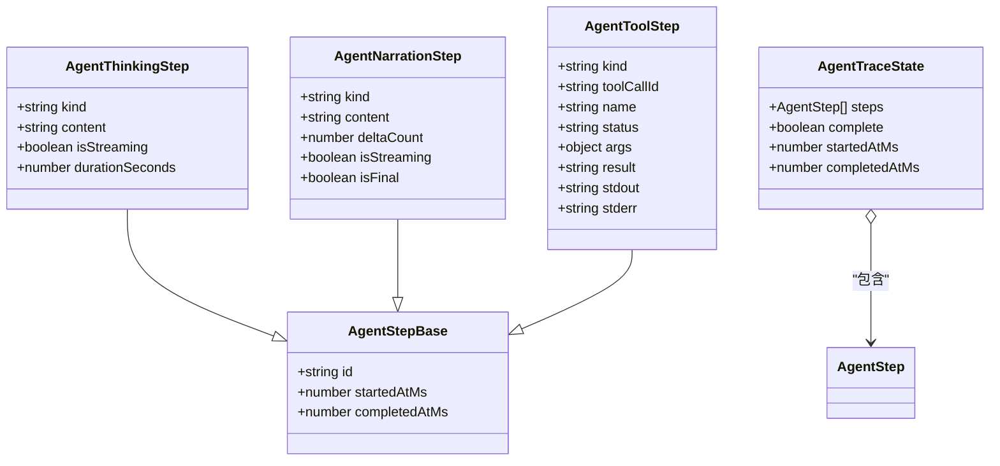
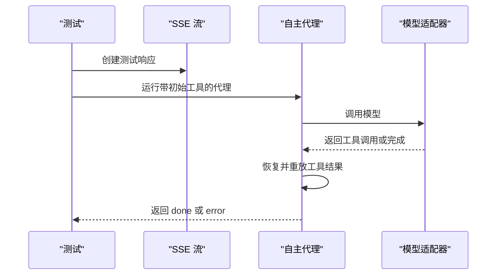
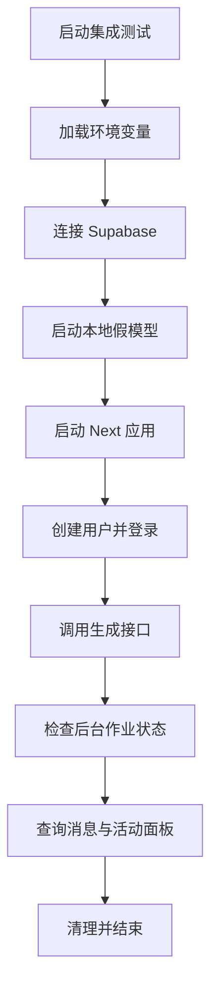

# 开发指南

<cite>
**本文引用的文件**   
- [README.md](file://README.md)
- [package.json](file://package.json)
- [CLAUDE.md](file://CLAUDE.md)
- [eslint.config.mjs](file://eslint.config.mjs)
- [.editorconfig](file://.editorconfig)
- [.gitignore](file://.gitignore)
- [.prettierignore](file://.prettierignore)
- [next.config.ts](file://next.config.ts)
- [tsconfig.json](file://tsconfig.json)
- [tailwind.config.ts](file://tailwind.config.ts)
- [wrangler.jsonc](file://wrangler.jsonc)
- [cloudflare-worker.ts](file://cloudflare-worker.ts)
- [apphosting.yaml](file://apphosting.yaml)
- [vercel.json](file://vercel.json)
- [docker-compose.yml](file://docker-compose.yml)
- [scripts/deploy-cloudflare-workers.sh](file://scripts/deploy-cloudflare-workers.sh)
- [.github/workflows/deploy-cloudflare-app.yml](file://.github/workflows/deploy-cloudflare-app.yml)
- [.github/workflows/deploy-cloudflare-workers.yml](file://.github/workflows/deploy-cloudflare-workers.yml)
- [src/shared/lib/agent-trace.ts](file://src/shared/lib/agent-trace.ts)
- [src/server/agent-core/runtime/query-loop.ts](file://src/server/agent-core/runtime/query-loop.ts)
- [tests/background-generation.test.ts](file://tests/background-generation.test.ts)
- [tests/background-generation.integration.ts](file://tests/background-generation.integration.ts)
- [tests/deep-research.test.ts](file://tests/deep-research.test.ts)
- [tests/durable-research.test.ts](file://tests/durable-research.test.ts)
- [tests/cloudflare-runtime.test.ts](file://tests/cloudflare-runtime.test.ts)
- [workers/github-agent/agent.test.ts](file://workers/github-agent/agent.test.ts)
</cite>

## 目录

1. [引言](#引言)
2. [项目结构](#项目结构)
3. [代码规范与命名约定](#代码规范与命名约定)
4. [依赖管理与环境配置](#依赖管理与环境配置)
5. [测试策略与编写方法](#测试策略与编写方法)
6. [调试技巧与性能分析](#调试技巧与性能分析)
7. [代码审查标准](#代码审查标准)
8. [新功能开发流程与提交规范](#新功能开发流程与提交规范)
9. [版本发布与部署流程](#版本发布与部署流程)
10. [常用开发工具与 IDE 配置](#常用开发工具与-ide-配置)
11. [常见问题解答与故障排除](#常见问题解答与故障排除)
12. [结论](#结论)

## 引言

Clauxen 是一个基于 Next.js、React 和 Supabase 的全栈 AI 聊天平台，包含流式推理、工具执行、后台生成任务、计费、插件系统和 Cloudflare Workers 侧车服务。仓库采用应用路由、共享库、服务端模块、客户端组件和独立 Worker 的组合方式组织代码；开发和部署同时支持 Vercel 与 Cloudflare Workers。

该项目适合希望理解现代全栈 AI 应用架构的开发者阅读：前端使用 React 与 Tailwind，状态管理使用 Zustand 和 React Query，后端通过 Next API 与 Supabase 交互，并通过多个 Cloudflare Worker 处理认证邮件、计费、聊天协调、历史、定时任务和 R2 存储等职责。

**章节来源**
- [README.md:1-89](file://README.md#L1-L89)

## 项目结构

仓库顶层按职责划分：

| 路径 | 职责 |
|---|---|
| `src/app` | Next.js App Router 页面、API 路由、认证入口和营销页面 |
| `src/client` | 客户端组件、Hooks、Zustand 状态、功能域和 Web Worker |
| `src/server` | 服务端逻辑：代理核心、推理、聊天、计费、数据库、插件、沙箱、搜索等 |
| `src/shared` | 前后端共享类型、工具函数、Agent Trace 模型和流协议 |
| `supabase/migrations` | PostgreSQL 迁移脚本，定义聊天、消息、研究、账单、插件等表结构 |
| `workers` | 独立的 Cloudflare Worker 子项目，如 GitHub Agent、OAuth Broker、Chat Coord 等 |
| `scripts` | 构建、部署、环境变量同步和运维辅助脚本 |
| `tests` | Node 内置测试、集成测试和 Cloudflare Worker 测试 |
| `.github/workflows` | GitHub Actions 工作流，用于 Cloudflare 应用和 Worker 部署 |

**图表来源**
- [README.md:37-89](file://README.md#L37-L89)
- [cloudflare-worker.ts:1-22](file://cloudflare-worker.ts#L1-L22)
- [.github/workflows/deploy-cloudflare-app.yml:1-42](file://.github/workflows/deploy-cloudflare-app.yml#L1-L42)

**章节来源**
- [README.md:37-89](file://README.md#L37-L89)

## 代码规范与命名约定

### 语言与运行环境

- 主要语言：TypeScript、JavaScript、TSX。
- 最低 Node 版本：`>=20.0.0`。
- 包管理器：npm ≥ 10，仓库锁定 npm 11.12.1。
- TypeScript 编译目标为 ES2017，启用严格模式、隔离模块和 bundler 解析。
- JSX 使用 `react-jsx` 模式。

**章节来源**
- [package.json:1-20](file://package.json#L1-L20)
- [tsconfig.json:1-25](file://tsconfig.json#L1-L25)

### 编辑器格式规则

`.editorconfig` 规定：

- UTF-8 编码。
- LF 换行。
- 缩进为空格，缩进宽度为 2。
- 文件末尾保留空行。
- 自动删除行尾空白（Markdown 文件除外）。

**章节来源**
- [.editorconfig:1-12](file://.editorconfig#L1-L12)

### ESLint 规则

ESLint 使用 `eslint-config-next/core-web-vitals` 作为基础，并启用安全规则：

- 禁止 `eval`、`new Function`、隐式 `eval`。
- 禁用不安全正则、子进程、随机数弱实现和无转义模板输出。
- 关闭部分 Next.js 旧规则，因为应用使用传统 `<a href>` 导航。
- 关闭部分 React Hooks 严格检查，以兼容现有流式聊天和虚拟滚动实现。
- 忽略 `workers/**`，说明 Worker 子项目可单独维护其风格。
- 忽略构建产物、node_modules、Wrangler 缓存等目录。

**章节来源**
- [eslint.config.mjs:1-58](file://eslint.config.mjs#L1-L58)

### Prettier 格式化

Prettier 负责仓库级格式化，忽略 `.next`、`dist`、`node_modules`、`coverage` 和 `package-lock.json`。

**章节来源**
- [.prettierignore:1-5](file://.prettierignore#L1-L5)
- [package.json:35-40](file://package.json#L35-L40)

### 命名约定

从源码和组织方式可以归纳以下约定：

| 类别 | 约定 | 示例依据 |
|---|---|---|
| 文件名 | 小写加连字符或下划线，TypeScript 使用 `.ts` / `.tsx` | `query-loop.ts`、`agent-trace.ts` |
| 类型名 | 大驼峰，例如 `AgentStep`、`AgentTraceState` | [src/shared/lib/agent-trace.ts:23-75](file://src/shared/lib/agent-trace.ts#L23-L75) |
| 函数名 | 小驼峰，描述性动词短语，例如 `createAgentTrace`、`findToolStep` | [src/shared/lib/agent-trace.ts:95-115](file://src/shared/lib/agent-trace.ts#L95-L115) |
| 常量 | 大写加下划线，例如 `MAX_STEPS` | [src/server/agent-core/runtime/query-loop.ts:60-70](file://src/server/agent-core/runtime/query-loop.ts#L60-L70) |
| 环境变量 | 全大写，区分公开与内部密钥 | [package.json:55-70](file://package.json#L55-L70)、[README.md:75-89](file://README.md#L75-L89) |
| Worker 名称 | 语义化短横线组合，例如 `clauxen-chat-coord` | [wrangler.jsonc:10-30](file://wrangler.jsonc#L10-L30) |
| 数据库迁移 | 时间戳前缀 + 业务语义 | `supabase/migrations/20261026120000_plugin_native_oauth.sql` |

**章节来源**
- [src/shared/lib/agent-trace.ts:23-115](file://src/shared/lib/agent-trace.ts#L23-L115)
- [src/server/agent-core/runtime/query-loop.ts:60-70](file://src/server/agent-core/runtime/query-loop.ts#L60-L70)
- [wrangler.jsonc:10-30](file://wrangler.jsonc#L10-L30)
- [README.md:75-89](file://README.md#L75-L89)

### Git 忽略规则

需要避免提交的内容包括：

- 构建产物：`.next`、`.open-next`、`.wrangler`、`dist`。
- 依赖：`node_modules`。
- 敏感环境变量：`.env*`、`supabase/functions/.env`。
- 本地开发状态：`.tools/`、`storage/uploads/`、日志、临时目录。
- IDE 配置中仅保留 `vscode/settings.json`。

**章节来源**
- [.gitignore:1-67](file://.gitignore#L1-L67)

## 依赖管理与环境配置

### 包依赖分类

| 分类 | 用途 | 典型依赖 |
|---|---|---|
| 运行时依赖 | Next.js、React、Supabase、OpenAI、Razorpay、Zod、Zustand 等 | `next`、`react`、`@supabase/supabase-js`、`openai`、`zod`、`zustand` |
| 开发依赖 | ESLint、Prettier、TypeScript、Wrangler、Supabase CLI、Tailwind | `eslint`、`prettier`、`typescript`、`wrangler`、`supabase` |
| 覆盖依赖 | 修复安全或兼容性问题 | `axios`、`postcss`、`ws`、`prismjs` |

**章节来源**
- [package.json:10-185](file://package.json#L10-L185)

### 关键脚本

| 命令 | 作用 |
|---|---|
| `npm run dev` | 启动开发服务器，端口 9002 |
| `npm run build` | 预打包服务端文本和研究导出，再执行 Next 构建 |
| `npm run lint` | ESLint 检查，不允许警告 |
| `npm run typecheck` | 生成 Next 类型并执行 `tsc --noEmit` |
| `npm run format` | 使用 Prettier 格式化整个仓库 |
| `npm run worker` | 启动本地 BullMQ 工作进程 |
| `npm run supabase:*` | 推送数据库迁移或部署 Supabase 函数 |
| `npm run cf:*` | Cloudflare OpenNext 构建、预览和部署 |
| `npm test:*` | 运行不同范围的测试 |

**章节来源**
- [package.json:21-54](file://package.json#L21-L54)
- [README.md:57-74](file://README.md#L57-L74)

### Next.js 配置要点

`next.config.ts` 设置了：

- 开发允许的跨源地址。
- 图片优化格式 AVIF 和 WebP。
- 远程图片允许列表，包括 R2、OpenAI、chatgpt.com 等。
- 安全响应头：内容类型嗅探防护、帧保护、引用策略、权限策略、HSTS 和 CSP。
- 生产环境移除 `console` 调用，但保留 `error` 和 `warn`。
- 将重型服务端依赖放入 `serverExternalPackages`，避免进入客户端图。
- 静态资源缓存控制。

**章节来源**
- [next.config.ts:1-199](file://next.config.ts#L1-L199)
- [next.config.ts:201-251](file://next.config.ts#L201-L251)

### Cloudflare Worker 入口

`cloudflare-worker.ts` 是 OpenNext 生成的 Worker 入口包装器：

- 拦截 `/api/v1/storage/object`，交给 R2 签名对象处理器。
- 其他请求交给 OpenNext 生成的 handler。
- 队列消费由 `consumeGenerationQueue` 处理，并将请求转发给同一个 handler。

**章节来源**
- [cloudflare-worker.ts:1-22](file://cloudflare-worker.ts#L1-L22)

### Wrangler 配置

`wrangler.jsonc` 定义了：

- 主入口为 `cloudflare-worker.ts`。
- 自定义域名和 workers.dev。
- 多个 Worker 服务绑定，如 GitHub Agent、Chat Coord、Billing、Auth Email 等。
- Hyperdrive 连接本地和生产 Postgres。
- 多个 R2 Bucket 绑定。
- Generation Queue 生产者与消费者。
- 观测采样率和环境变量。

**章节来源**
- [wrangler.jsonc:1-117](file://wrangler.jsonc#L1-L117)

### Vercel 配置

`vercel.json` 定义：

- Next.js 框架和区域。
- 静态资源和 API 的缓存策略。
- 安全响应头。
- 长耗时 API 函数的内存与超时限制。

**章节来源**
- [vercel.json:1-180](file://vercel.json#L1-L180)

### Docker 本地依赖

`docker-compose.yml` 提供：

- pgvector PostgreSQL 16。
- Redis 7。
- 健康检查和持久卷。

**章节来源**
- [docker-compose.yml:1-34](file://docker-compose.yml#L1-L34)

## 测试策略与编写方法

项目测试分为三类：

1. **单元测试**：验证纯函数、模型解析、Agent Trace 行为、Worker 安全逻辑。
2. **集成测试**：启动真实 Next 应用实例，连接 Supabase，验证后台生成、会话和持久化。
3. **Cloudflare Worker 测试**：验证队列消费、R2 签名访问、请求资源生命周期。

### 测试框架与命令

- Node 内置 `node:test` 和 `assert/strict`。
- TS 测试通过 `tsx --test` 运行。
- MJS 测试直接通过 `node --test` 运行。

| 命令 | 范围 |
|---|---|
| `npm run test:chat-startup` | Chat 启动相关测试 |
| `npm run test:auth` | 认证会话测试 |
| `npm run test:scheduled` | 定时任务测试 |
| `npm run test:background` | 后台生成单元测试 |
| `npm run test:background:integration` | 后台生成集成测试 |
| `npm run test:cloudflare` | Cloudflare Worker 运行时测试 |
| `npm run test:cloudflare:build` | Cloudflare 构建测试 |

**章节来源**
- [package.json:35-54](file://package.json#L35-L54)

### 单元测试示例

#### Agent Trace 数据模型

`src/shared/lib/agent-trace.ts` 定义了统一的 Agent 活动模型：

- 单一扁平步骤列表。
- 三种步骤类型：思考、叙述、工具。
- 工具步骤携带名称、参数、结果、标准输出、错误信息。
- 最终答案通过 `answer_finalize` 提升为消息正文。

**图表来源**
- [src/shared/lib/agent-trace.ts:23-115](file://src/shared/lib/agent-trace.ts#L23-L115)

#### 后台生成恢复逻辑

`tests/background-generation.test.ts` 验证：

- 断开订阅不会完成持久任务。
- 后台任务返回 `backgrounded` 且不再发送合成 `done`。
- 已完成的流保持完成状态。
- 恢复时重放保存的工具结果，不重复执行副作用。
- 未知外部动作阻止恢复。
- 检查点失败阻止工具执行。

**图表来源**
- [tests/background-generation.test.ts:1-120](file://tests/background-generation.test.ts#L1-L120)

**章节来源**
- [tests/background-generation.test.ts:1-200](file://tests/background-generation.test.ts#L1-L200)
- [src/shared/lib/agent-trace.ts:23-115](file://src/shared/lib/agent-trace.ts#L23-L115)

### 深度研究与耐久研究测试

`tests/deep-research.test.ts` 验证：

- 模型输出的研究计划是否被正确解析。
- 渲染卡片时保留前后普通文本。
- 拒绝不完整、畸形、空值、超长计划。
- 工作元数据不出现在用户可见消息中。
- 批准的编辑在重新加载后仍然存在。
- 研究计划以工具形式流式输出，并在后续轮次生成答案。

`tests/durable-research.test.ts` 验证：

- 倒计时基于持久截止时间。
- 研究搜索上限与普通聊天不同。
- 耐久研究启用 provider thinking，即使聊天偏好未开启。
- 来源 URL 去重并过滤无效链接。
- 大型研究检查点压缩证据并保持来源完整性。
- 临时提供商失败重试，但不重试无效凭据。

**章节来源**
- [tests/deep-research.test.ts:1-170](file://tests/deep-research.test.ts#L1-L170)
- [tests/durable-research.test.ts:1-200](file://tests/durable-research.test.ts#L1-L200)

### 集成测试方法

`tests/background-generation.integration.ts` 是显式集成测试：

- 要求真实的 Supabase 凭据。
- 创建专用测试用户。
- 使用本地假模型模拟 SSE 流。
- 启动真实 Next 应用。
- 调用 `/api/v1/chats/{id}/generate`。
- 验证后台任务状态、消息持久化和重复提交幂等。

**图表来源**
- [tests/background-generation.integration.ts:1-200](file://tests/background-generation.integration.ts#L1-L200)

**章节来源**
- [tests/background-generation.integration.ts:1-200](file://tests/background-generation.integration.ts#L1-L200)

### Cloudflare Worker 测试

`tests/cloudflare-runtime.test.ts` 验证：

- 单次调用内复用数据库资源池。
- 并发请求隔离资源。
- 异常后仍执行清理。
- 响应路径外仍可等待清理完成。
- R2 私有上传下载。
- 令牌缺失、过期、篡改、方法不匹配、桶越权、路径遍历均被拒绝。

`workers/github-agent/agent.test.ts` 验证：

- 加密凭据上下文隔离。
- 篡改密文被拒绝。
- Webhook HMAC 校验。
- 请求体大小限制。
- 跨站写入被拒绝。
- 匿名用户和伪造会话无法授权。
- 危险路径、重复文件、缺少基线 SHA 和幂等 ID 被拒绝。

**章节来源**
- [tests/cloudflare-runtime.test.ts:1-200](file://tests/cloudflare-runtime.test.ts#L1-L200)
- [workers/github-agent/agent.test.ts:1-200](file://workers/github-agent/agent.test.ts#L1-L200)

## 调试技巧与性能分析

### 本地开发

推荐流程：

1. 安装依赖。
2. 复制 `.env.example` 到 `.env.local`。
3. 启动 PostgreSQL 和 Redis。
4. 推送 Supabase 迁移。
5. 启动开发服务器。

**章节来源**
- [README.md:57-74](file://README.md#L57-L74)

### 调试建议

- 使用 `npm run dev` 启动 Next 开发服务器。
- 使用 `npm run typecheck` 检查类型错误。
- 使用 `npm run lint` 检查代码质量。
- 使用 `npm run format` 统一格式。
- 使用 `npm run test:*` 定位具体功能问题。
- 使用 `npm run cf:preview` 预览 Cloudflare OpenNext 构建。
- 使用 `npm run cf:typegen` 生成 Cloudflare 类型。

**章节来源**
- [package.json:21-54](file://package.json#L21-L54)

### 性能分析方向

根据配置文件可知，项目关注以下性能维度：

- 图片格式 AVIF/WebP。
- 静态资源长期缓存。
- 服务端重型依赖外置。
- 包导入优化。
- Cloudflare Worker 队列批处理和并发限制。
- Hyperdrive 数据库加速。
- 观测采样率。

**章节来源**
- [next.config.ts:140-199](file://next.config.ts#L140-L199)
- [wrangler.jsonc:50-117](file://wrangler.jsonc#L50-L117)

## 代码审查标准

### 必须通过的前置检查

- `npm run lint` 零警告。
- `npm run typecheck` 无类型错误。
- 相关单元测试通过。
- 涉及数据库变更时，迁移脚本可读且可逆。
- 新增依赖需有明确理由，并评估安全风险。

**章节来源**
- [package.json:35-40](file://package.json#L35-L40)

### 安全性审查

- 不暴露 `NEXT_PUBLIC_` 敏感信息。
- 不引入 `eval`、动态 `require`、不安全正则。
- 对外部输入使用 Zod 校验。
- 对 R2、Webhook、OAuth、GitHub API 进行身份和权限校验。
- 不提交 `.env*`、密钥、私钥。

**章节来源**
- [README.md:75-89](file://README.md#L75-L89)
- [eslint.config.mjs:1-58](file://eslint.config.mjs#L1-L58)
- [tests/cloudflare-runtime.test.ts:120-200](file://tests/cloudflare-runtime.test.ts#L120-L200)
- [workers/github-agent/agent.test.ts:1-200](file://workers/github-agent/agent.test.ts#L1-L200)

### 架构审查

- 新逻辑应放在 `src/server` 对应领域模块。
- 共享类型放在 `src/shared`。
- 客户端 UI 放在 `src/client/components`。
- Worker 逻辑放在 `workers/<service>`。
- 不要将重型库打入客户端包。
- 不要绕过 CSP、鉴权和速率限制。

**章节来源**
- [README.md:37-56](file://README.md#L37-L56)
- [next.config.ts:160-180](file://next.config.ts#L160-L180)

## 新功能开发流程与提交规范

### 新功能开发流程

1. 确认需求属于哪个领域：聊天、代理、工具、插件、计费、存储、Worker 等。
2. 在 `src/server` 或 `workers` 中实现核心逻辑。
3. 在 `src/shared` 中定义共享类型和数据模型。
4. 在 `src/client` 中添加 UI 或 Hook。
5. 编写单元测试。
6. 必要时编写集成测试。
7. 更新迁移脚本（如需数据库变更）。
8. 更新环境变量说明。
9. 运行 lint、typecheck、format、test。
10. 提交变更并创建 Pull Request。

**章节来源**
- [README.md:37-56](file://README.md#L37-L56)
- [package.json:35-54](file://package.json#L35-L54)

### 提交规范

当前仓库没有强制的 commit message 格式钩子，但从最近提交记录可以看到自然语言风格的提交信息，例如：

- `fix(ui): match sidebar sizing to reference and edge-trigger preview`
- `chore: add Qoder workspace index ignore rules`
- `feat(plugins): native provider OAuth, secure plugin runtime, and redesigned marketplace`

建议遵循：

- 使用英文提交信息。
- 使用简短动词开头：`feat`、`fix`、`chore`、`docs`、`refactor`、`test`。
- 在冒号后描述变更原因和影响。
- 关联需求或问题编号。
- 避免把无关改动混入一个提交。

**章节来源**
- [README.md:1-10](file://README.md#L1-L10)

## 版本发布与部署流程

### 应用部署

Cloudflare 应用部署工作流：

1. 手动触发。
2. 安装 Node 24 和依赖。
3. 运行 Cloudflare 构建测试、运行时测试、后台测试、定时任务测试。
4. 执行 `npm run cf:build`。
5. 执行 `npm run cf:deploy`。
6. 执行 HTTP 验证脚本。

**章节来源**
- [.github/workflows/deploy-cloudflare-app.yml:1-42](file://.github/workflows/deploy-cloudflare-app.yml#L1-L42)
- [package.json:41-54](file://package.json#L41-L54)

### Worker 部署

Cloudflare Worker 部署工作流：

1. 解析 `CLOUDFLARE_API_TOKEN` 或 `Cloudflare_Token`。
2. 若两者都缺失则跳过部署。
3. 执行 `scripts/deploy-cloudflare-workers.sh`。
4. 如有 Vercel Token，则同步 AUTH_EMAIL 相关环境变量。

脚本会依次部署：

- chat-history
- r2-gateway
- auth-email
- chat-coord
- scheduled-tasks（可选）
- billing（可选）
- generations-watchdog（可选）

**章节来源**
- [.github/workflows/deploy-cloudflare-workers.yml:1-48](file://.github/workflows/deploy-cloudflare-workers.yml#L1-L48)
- [scripts/deploy-cloudflare-workers.sh:1-200](file://scripts/deploy-cloudflare-workers.sh#L1-L200)

### 发布前检查清单

- 所有测试通过。
- Lint 零警告。
- 类型检查通过。
- 环境变量已在 Vercel 或 Cloudflare 设置。
- 数据库迁移已评审。
- Worker 密钥已轮换或确认有效。
- 安全头和 CSP 仍满足第三方服务需求。
- 长耗时 API 函数的内存和超时配置合理。

**章节来源**
- [package.json:35-54](file://package.json#L35-L54)
- [vercel.json:120-180](file://vercel.json#L120-L180)
- [next.config.ts:201-251](file://next.config.ts#L201-L251)

## 常用开发工具与 IDE 配置

### 推荐工具

| 工具 | 用途 |
|---|---|
| VS Code | 主要 IDE |
| ESLint | 代码质量检查 |
| Prettier | 代码格式化 |
| TypeScript | 类型检查 |
| Supabase CLI | 数据库迁移和函数部署 |
| Wrangler | Cloudflare Worker 开发部署 |
| Docker Compose | 本地 Postgres 和 Redis |
| Node 内置测试 | 单元测试和集成测试 |

**章节来源**
- [package.json:105-185](file://package.json#L105-L185)
- [docker-compose.yml:1-34](file://docker-compose.yml#L1-L34)

### IDE 配置建议

- 启用 ESLint 和 Prettier 插件。
- 保存时自动格式化。
- 使用 TypeScript 语言服务。
- 忽略 `.next`、`.open-next`、`.wrangler`、`dist`、`node_modules`。
- 不要提交 `.vscode/*`，只保留 `settings.json`。

**章节来源**
- [.gitignore:25-35](file://.gitignore#L25-L35)
- [.prettierignore:1-5](file://.prettierignore#L1-L5)

### 快捷键技巧

本节为通用建议，因不同操作系统和 IDE 配置而异：

- 保存时自动格式化。
- 使用全局搜索查找类型和函数引用。
- 使用重构功能重命名变量和函数。
- 使用终端内联运行 `npm run lint`、`npm run typecheck`、`npm test`。
- 使用 Git 暂存区分步提交。

[本节为通用指导，不直接分析具体源码文件]

## 常见问题解答与故障排除

### 本地数据库连接失败

- 确认 `docker compose up -d` 已启动 PostgreSQL 和 Redis。
- 确认端口 5433 和 6379 未被占用。
- 确认 `.env.local` 中的 Supabase 或本地数据库地址正确。
- 使用 `npm run supabase:db:push` 同步迁移。

**章节来源**
- [README.md:57-74](file://README.md#L57-L74)
- [docker-compose.yml:1-34](file://docker-compose.yml#L1-L34)

### 开发服务器无法启动

- 检查 Node 版本是否满足 `>=20.0.0`。
- 检查 npm 版本是否满足 `>=10.0.0`。
- 检查 `npm ci` 或 `npm install` 是否成功。
- 检查是否有未提交的构建产物导致缓存污染。

**章节来源**
- [package.json:1-10](file://package.json#L1-L10)
- [README.md:57-74](file://README.md#L57-L74)

### 测试失败

- 先运行 `npm run lint` 和 `npm run typecheck`。
- 使用最小复现用例缩小问题范围。
- 对于集成测试，确认 Supabase 凭据可用。
- 对于 Cloudflare Worker 测试，确认环境变量和模拟依赖。

**章节来源**
- [tests/background-generation.integration.ts:1-60](file://tests/background-generation.integration.ts#L1-L60)
- [tests/cloudflare-runtime.test.ts:1-60](file://tests/cloudflare-runtime.test.ts#L1-L60)

### 部署失败

- Cloudflare 应用部署需要 `CLOUDFLARE_API_TOKEN` 和 Supabase 公开变量。
- Worker 部署需要有效的 Cloudflare Token。
- 如果缺少 Vercel Token，AUTH_EMAIL 环境变量同步会被跳过。
- 检查环境变量是否包含敏感值，不应以 `NEXT_PUBLIC_` 前缀暴露。

**章节来源**
- [.github/workflows/deploy-cloudflare-app.yml:15-42](file://.github/workflows/deploy-cloudflare-app.yml#L15-L42)
- [.github/workflows/deploy-cloudflare-workers.yml:15-48](file://.github/workflows/deploy-cloudflare-workers.yml#L15-L48)
- [scripts/deploy-cloudflare-workers.sh:1-80](file://scripts/deploy-cloudflare-workers.sh#L1-L80)
- [README.md:75-89](file://README.md#L75-L89)

### 构建产物过大或客户端包异常

- 检查是否引入了重型服务端依赖。
- 确认这些依赖位于 `serverExternalPackages`。
- 检查 `transpilePackages` 是否误包含大库。
- 使用 `npm run typecheck` 和 `npm run lint` 提前发现潜在问题。

**章节来源**
- [next.config.ts:140-180](file://next.config.ts#L140-L180)

## 结论

该仓库是一个结构清晰、职责分离的全栈 AI 应用。它使用 Next.js 承载前端和服务端逻辑，使用 Supabase 作为数据库和认证后端，使用多个 Cloudflare Worker 扩展边缘能力。开发流程强调类型安全、安全规则、测试覆盖和可观测性。

对新加入的开发者，建议优先熟悉以下顺序：

1. 阅读 README 了解整体架构。
2. 运行 `npm install`、`docker compose up`、`npm run dev`。
3. 理解 `src/shared/lib/agent-trace.ts` 中的 Agent Trace 模型。
4. 阅读 `src/server/agent-core/runtime/query-loop.ts` 中的自主代理循环。
5. 阅读 `tests/background-generation.test.ts` 和 `tests/background-generation.integration.ts` 理解测试风格。
6. 在修改代码后始终运行 lint、typecheck、format 和相关测试。
7. 提交变更前确认环境变量和部署脚本不受破坏。

[本节为总结性内容，不直接分析具体源码文件]