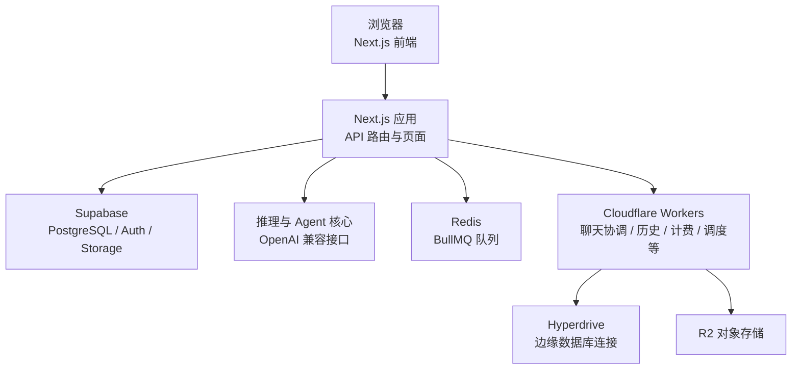
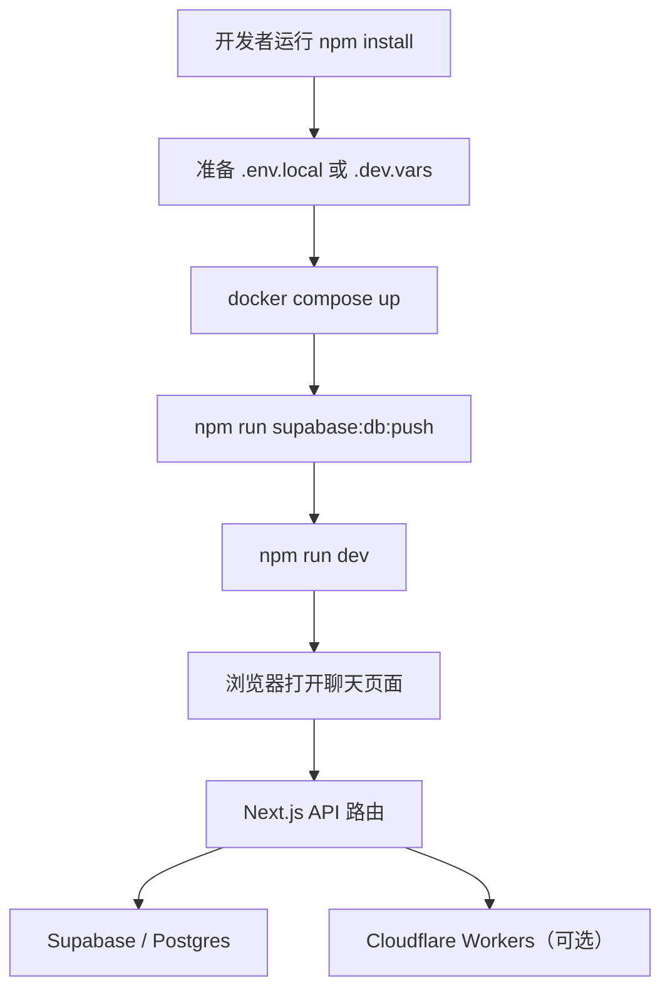
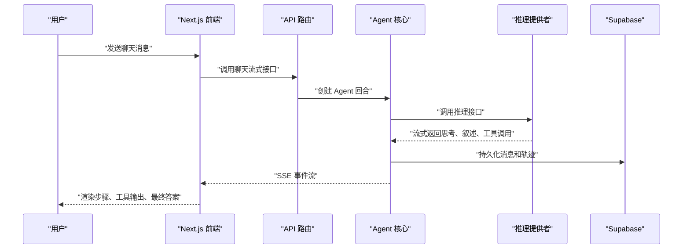
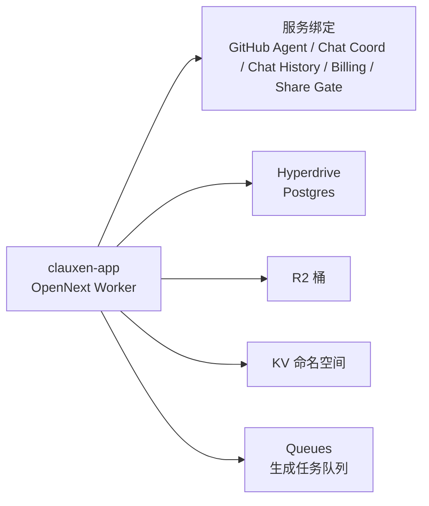

# 快速开始

<cite>
**本文引用的文件**   
- [README.md](file://README.md)
- [package.json](file://package.json)
- [CLAUDE.md](file://CLAUDE.md)
- [next.config.ts](file://next.config.ts)
- [vercel.json](file://vercel.json)
- [apphosting.yaml](file://apphosting.yaml)
- [wrangler.jsonc](file://wrangler.jsonc)
- [docker-compose.yml](file://docker-compose.yml)
- [supabase/config.toml](file://supabase/config.toml)
- [cloudflare-worker.ts](file://cloudflare-worker.ts)
- [scripts/bootstrap-db-env.mjs](file://scripts/bootstrap-db-env.mjs)
- [src/server/config/env.ts](file://src/server/config/env.ts)
- [docs/cloudflare-workers-setup.md](file://docs/cloudflare-workers-setup.md)
- [scripts/prepare-cloudflare-env.mjs](file://scripts/prepare-cloudflare-env.mjs)
</cite>

## 目录

1. [项目介绍](#项目介绍)
2. [核心价值主张](#核心价值主张)
3. [技术栈概览](#技术栈概览)
4. [本地开发环境搭建](#本地开发环境搭建)
5. [运行命令与第一个聊天示例](#运行命令与第一个聊天示例)
6. [整体架构概念](#整体架构概念)
7. [常见环境配置问题与解决方案](#常见环境配置问题与解决方案)
8. [给新手与进阶开发者的建议](#给新手与进阶开发者的建议)
9. [结论](#结论)

## 项目介绍

Clauxen Web App 是一个全栈 AI 对话平台，使用 Next.js（App Router）、React 和 Supabase 构建。它不只是“把大模型回复渲染到页面上”，而是围绕一个自主 Agent 回合引擎组织整个系统：客户端发起对话请求，服务端调用推理提供者，Agent 在思考、叙述、工具执行之间循环推进，最终把结构化结果持久化到数据库或对象存储中。

从仓库根目录的说明可以看到，该项目还提供：

- 流式回答、思考阶段、第一人称进度叙述；
- 聊天视图中的实时工具与活动轨迹；
- 产物卡片、项目、深度研究任务、定时任务；
- 计费与支付能力；
- 由 Cloudflare Workers 组成的侧车服务集群。

对初学者来说，可以把 Clauxen 理解为一个以“聊天”为中心的现代 Web 应用；对经验丰富的开发者来说，它更像一套可复用的 AI Agent 运行时 + 多 Worker 边缘服务集合。

**章节来源**
- [README.md:1-89](file://README.md#L1-L89)

## 核心价值主张

Clauxen 的核心价值不是单一功能，而是把多种 AI 能力整合到一个连贯体验中：

| 价值 | 含义 |
|---|---|
| **可观测的 Agent 行为** | 每个助手回合都包含有序步骤列表，包括思考、叙述和工具调用，便于调试和展示用户可理解的进展。 |
| **流式交互** | 推理、叙述文本、工具输出通过类型化的服务器发送事件协议逐步到达前端，降低首字节延迟。 |
| **工具扩展性** | 支持网页搜索、代码沙箱、文件读写、技能加载、计划任务以及 MCP 连接器等工具表面。 |
| **多部署目标** | Next.js 应用可部署到 Vercel、Cloudflare Workers、Firebase App Hosting 等平台。 |
| **数据与身份统一** | Supabase 提供 PostgreSQL、向量扩展、认证、存储等基础设施能力。 |
| **边缘服务解耦** | 邮件、计费、聊天协调、历史查询、调度任务等能力下沉到独立的 Cloudflare Workers。 |

这些特性意味着：你不仅能跑通一次对话，还能在此基础上扩展工具、接入新的推理模型、增加后台任务或改造 UI 组件。

**章节来源**
- [README.md:1-89](file://README.md#L1-L89)

## 技术栈概览

### 前端与框架

- Next.js 16（App Router）
- React 19
- TypeScript
- Tailwind CSS 4
- shadcn/radix 组件基元
- Zustand 状态管理
- React Query

Next.js 是本次项目的入口层：它负责页面路由、API 路由、静态资源、安全响应头、图片优化，以及与后端推理、Supabase、对象存储、第三方服务的集成。

### 后端与 Agent 核心

- 服务端 Agent 循环位于 `src/server/agent-core` 相关路径；
- 推理、SSE 流、工具注册表、沙箱、提示词等逻辑集中在 `src/server/inference` 和相关模块；
- Supabase 作为主数据库和认证后端；
- BullMQ 与 Redis 用于队列任务；
- OpenAI Responses API 作为主要推理接口，同时兼容其他 OpenAI 风格上游。

### 边缘服务

Cloudflare Workers 侧车服务包括：

- 认证邮件；
- 计费；
- 聊天协调；
- 聊天历史；
- R2 网关；
- 调度任务；
- OAuth 代理；
- GitHub Agent；
- 插件 OAuth；
- Supabase 代理等。

### 数据存储

- PostgreSQL（pgvector）；
- Supabase 认证、存储；
- Cloudflare R2 对象存储；
- Redis（本地开发时通过 Docker Compose 启动）。



**图示来源**
- [next.config.ts:1-200](file://next.config.ts#L1-L200)
- [wrangler.jsonc:1-117](file://wrangler.jsonc#L1-L117)
- [docker-compose.yml:1-34](file://docker-compose.yml#L1-L34)

**章节来源**
- [README.md:1-89](file://README.md#L1-L89)
- [package.json:1-185](file://package.json#L1-L185)

## 本地开发环境搭建

### 前置要求

根据项目脚本定义，Node.js 版本要求为大于等于 20.0.0，npm 版本要求为大于等于 10.0.0。不过 README 中给出的推荐版本是 Node 24.x 与 npm ≥ 10。建议使用较新的 Node LTS 版本，并通过包管理器锁定版本，避免后续依赖解析出现意外差异。

你需要准备：

- Node.js ≥ 20（推荐 24.x）；
- npm ≥ 10；
- Docker（用于本地 Postgres 与 Redis）；
- 可选：已登录并创建好 Supabase 项目的 CLI 或 Dashboard；
- 可选：Cloudflare Wrangler 与账号（用于本地预览或部署 Cloudflare Workers）。

### 安装依赖

在项目根目录执行依赖安装：

```bash
npm install
```

这会安装 Next.js、React、Supabase SDK、Cloudflare 类型、测试工具、Lint 与格式化依赖等全部必要包。

**章节来源**
- [package.json:1-185](file://package.json#L1-L185)

### 环境变量配置

#### 最小可用配置

要让本地开发尽可能顺利，至少需要以下信息：

| 类别 | 变量 | 用途 |
|---|---|---|
| 应用地址 | `NEXT_PUBLIC_APP_URL` | 前端应用公开地址，默认指向本地开发端口 |
| Supabase | `NEXT_PUBLIC_SUPABASE_URL` | Supabase 项目 URL |
| Supabase | `NEXT_PUBLIC_SUPABASE_ANON_KEY` | 前端匿名访问密钥 |
| Supabase | `SUPABASE_SERVICE_ROLE_KEY` | 服务端服务角色密钥 |
| 数据库 | `POSTGRES_URL_NON_POOLING` 或 `DATABASE_URL` | 数据库连接字符串 |
| 推理接口 | `Provider_API_Key` 或其别名 | 推理模型 API 密钥 |
| 会话安全 | `JWT_SECRET` | JWT 签名密钥 |
| 内部通信令牌 | `CHAT_COORD_INTERNAL_TOKEN` | 聊天协调 Worker 内部令牌 |
| 内部通信令牌 | `CHAT_HISTORY_INTERNAL_TOKEN` | 聊天历史 Worker 内部令牌 |
| 内部通信令牌 | `SCHEDULED_TASKS_INTERNAL_TOKEN` | 调度任务内部令牌 |
| 内部通信令牌 | `BILLING_INTERNAL_TOKEN` | 计费 Worker 内部令牌 |
| 支付加密 | `PAYMENT_METHOD_ENCRYPTION_KEY` | 支付方式敏感字段加密密钥 |

注意：README 明确提醒不要把机密放在以 `NEXT_PUBLIC_` 开头的变量中，因为这些变量会被打包进浏览器端。

#### 本地开发常用模式

对于纯本地开发，你可以：

1. 复制模板环境变量文件生成 `.env.local`；
2. 填入 Supabase、推理密钥、JWT 密钥等；
3. 使用 Docker Compose 启动本地数据库和 Redis；
4. 推送 Supabase 迁移；
5. 启动 Next.js 开发服务器。

如果将来要使用 Cloudflare 本地预览，脚本会合并多个环境变量文件，生成 `.dev.vars`，并检查一组必需变量是否缺失。

**章节来源**
- [README.md:1-89](file://README.md#L1-L89)
- [scripts/prepare-cloudflare-env.mjs:1-95](file://scripts/prepare-cloudflare-env.mjs#L1-L95)

#### 数据库连接与环境预处理

`scripts/bootstrap-db-env.mjs` 会在构建前尝试从 `POSTGRES_PRISMA_URL`、`POSTGRES_URL_NON_POOLING`、`POSTGRES_URL` 或 `DATABASE_URL` 中推导 `DATABASE_URL`。这是为 Supabase 或外部数据库连接做兼容处理的重要一步。

如果你只设置了 `POSTGRES_URL_NON_POOLING`，该脚本会自动补上 `DATABASE_URL`，从而让依赖数据库连接的构建流程继续执行。

**章节来源**
- [scripts/bootstrap-db-env.mjs:1-11](file://scripts/bootstrap-db-env.mjs#L1-L11)

#### 关键服务端环境变量逻辑

`src/server/config/env.ts` 是服务端环境变量的集中解析位置。它会：

- 读取应用地址；
- 决定是否需要认证才能聊天；
- 解析数据库连接；
- 解析 Supabase 服务角色密钥；
- 解析推理 API 密钥与基础地址；
- 解析 Exa、AssemblyAI、Razorpay、R2、Workers 地址等；
- 提供 `requireDatabaseUrl`、`requireProviderApiKey`、`requireOpenAIApiKey`、`requireExaApiKey`、`requireR2InProduction` 等校验函数。

例如，当数据库 URL 未配置时，`requireDatabaseUrl` 会抛出错误；当推理密钥未配置时，对应 require 函数也会抛错。这有助于在开发早期发现配置问题。

**章节来源**
- [src/server/config/env.ts:1-200](file://src/server/config/env.ts#L1-L200)
- [src/server/config/env.ts:201-395](file://src/server/config/env.ts#L201-L395)

### 数据库初始化

项目使用 Supabase 管理数据库迁移，迁移文件位于 `supabase/migrations`。本地开发时推荐先启动容器，再执行数据库迁移。

#### 启动本地数据库与 Redis

项目根目录提供 `docker-compose.yml`，其中包含：

- `postgres`：基于 `pgvector/pgvector:pg16`，端口映射为 `5433:5432`；
- `redis`：基于 `redis:7-alpine`，端口映射为 `6379:6379`。

启动命令如下：

```bash
docker compose up -d
```

启动后，Postgres 用户名、密码、数据库名由 compose 配置设定；Redis 用于 BullMQ 等队列任务。

**章节来源**
- [docker-compose.yml:1-34](file://docker-compose.yml#L1-L34)

#### 推送数据库迁移

项目脚本定义了 Supabase 相关命令。推荐使用：

```bash
npm run supabase:db:push
```

或者直接使用 Supabase CLI：

```bash
supabase db push
```

Supabase 项目 ID 位于 `supabase/config.toml`。

**章节来源**
- [package.json:1-185](file://package.json#L1-L185)
- [supabase/config.toml:1-1](file://supabase/config.toml#L1-L1)

### Cloudflare Workers 本地开发（可选）

如果你希望本地运行或预览 Cloudflare Workers 部分，可以参考 `docs/cloudflare-workers-setup.md`。它提供了两种部署方式：

- 使用 `wrangler login`；
- 使用 API Token。

脚本会根据环境变量生成内部令牌，并在 Vercel 与 Cloudflare 两端保持共享密钥一致。



**图示来源**
- [docs/cloudflare-workers-setup.md:1-70](file://docs/cloudflare-workers-setup.md#L1-L70)
- [scripts/prepare-cloudflare-env.mjs:1-95](file://scripts/prepare-cloudflare-env.mjs#L1-L95)

## 运行命令与第一个聊天示例

### 基本运行命令

| 命令 | 作用 |
|---|---|
| `npm run dev` | 启动本地开发服务器，默认端口 9002 |
| `npm run build` | 生产构建，会先执行必要的 bundle 脚本 |
| `npm run lint` | ESLint 检查，不允许警告 |
| `npm run typecheck` | Next 类型生成与 TypeScript 检查 |
| `npm run format` | Prettier 格式化 |
| `npm run worker` | 本地运行 BullMQ 队列工作进程 |
| `npm run supabase:*` | 数据库迁移、Edge Functions 等 Supabase 操作 |
| `npm run cf:preview` | Cloudflare 本地预览 |
| `npm run cf:build` | Cloudflare 构建 |
| `npm run cf:deploy` | Cloudflare 部署 |

**章节来源**
- [README.md:1-89](file://README.md#L1-L89)
- [package.json:1-185](file://package.json#L1-L185)

### 第一次启动聊天

完成依赖安装、环境变量配置、数据库迁移后，可以按以下步骤进行第一个聊天示例：

1. 启动本地数据库和 Redis：

   ```bash
   docker compose up -d
   ```

2. 推送数据库迁移：

   ```bash
   npm run supabase:db:push
   ```

3. 启动开发服务器：

   ```bash
   npm run dev
   ```

4. 在浏览器中打开 `http://localhost:9002`。

5. 进入登录或注册流程，或使用本地开发可用的认证方式。

6. 新建一条聊天消息，输入类似以下内容：

   > “请帮我解释 Clauxen 的前端和服务端是怎么协作的。”

7. 观察聊天界面中的流式响应、Agent 步骤轨迹、工具调用状态和最终答案。

如果聊天没有返回结果，优先检查：

- `NEXT_PUBLIC_SUPABASE_URL` 和 `NEXT_PUBLIC_SUPABASE_ANON_KEY` 是否正确；
- `SUPABASE_SERVICE_ROLE_KEY` 是否配置；
- `Provider_API_Key` 或其他推理密钥是否有效；
- 数据库是否能通过 `DATABASE_URL` 或 `POSTGRES_URL_NON_POOLING` 访问；
- 本地 Postgres 是否可通过 `docker compose ps` 确认正在运行。

**章节来源**
- [README.md:1-89](file://README.md#L1-L89)
- [package.json:1-185](file://package.json#L1-L185)

## 整体架构概念

### 前端 Next.js

Next.js 应用承担以下职责：

- 渲染页面和用户界面；
- 处理 `/api/v1/*` 等 API 路由；
- 管理认证、计费、聊天、文件、设置等业务接口；
- 配置安全响应头、内容安全策略、远程图片白名单；
- 通过 `serverExternalPackages` 把重型服务端依赖排除在前端包之外；
- 通过 `transpilePackages` 和 `experimental.optimizePackageImports` 优化包体积。

`next.config.ts` 中还定义了开发允许来源、CSP、远程图片域名、R2 公共 URL 模式等，这些都是影响本地开发和生产行为的关键点。

**章节来源**
- [next.config.ts:1-200](file://next.config.ts#L1-L200)

### 服务端 Agent 核心

Agent 核心负责驱动 AI 对话循环。README 指出，每一轮会流式输出：

- 思考阶段；
- 叙述阶段；
- 严格函数调用；
- 工具顺序执行；
- 下一轮输入；
- 最终回答持久化。

这意味着：前端看到的不是单一 LLM 输出，而是一组结构化的 Agent 行为事件。



**图示来源**
- [README.md:1-89](file://README.md#L1-L89)

**章节来源**
- [README.md:1-89](file://README.md#L1-L89)

### Cloudflare Workers 侧车

Cloudflare Workers 在 Clauxen 中承担更独立、更边缘的任务。`wrangler.jsonc` 定义了：

- 应用入口；
- 自定义域名；
- 资产目录绑定；
- 多个 Worker 服务绑定；
- Hyperdrive 数据库连接；
- R2 桶；
- KV 命名空间；
- Queues；
- 区域与限制；
- 环境变量。

`cloudflare-worker.ts` 是 OpenNext 构建生成的 Worker 入口封装，它还处理 `/api/v1/storage/object` 签名对象访问和队列消费。



**图示来源**
- [wrangler.jsonc:1-117](file://wrangler.jsonc#L1-L117)
- [cloudflare-worker.ts:1-22](file://cloudflare-worker.ts#L1-L22)

**章节来源**
- [wrangler.jsonc:1-117](file://wrangler.jsonc#L1-L117)
- [cloudflare-worker.ts:1-22](file://cloudflare-worker.ts#L1-L22)

### Supabase 的角色

Supabase 在本项目中既是数据库，也是认证和存储后端。服务端通过环境变量解析 Supabase URL 与服务角色密钥，前端通过公开 URL 和匿名密钥访问。Chat-history Worker 还支持通过 Hyperdrive 直接访问数据库，并通过缓存减少重复认证和查询压力。

**章节来源**
- [src/server/config/env.ts:1-200](file://src/server/config/env.ts#L1-L200)
- [workers/chat-history/src/index.ts:1-200](file://workers/chat-history/src/index.ts#L1-L200)

## 常见环境配置问题与解决方案

### 问题一：启动时报数据库 URL 未配置

**现象**：构建或运行时报数据库 URL 未配置错误。

**原因**：

- 未设置 `DATABASE_URL`；
- 未设置 `POSTGRES_URL_NON_POOLING`；
- Docker 中的 Postgres 未启动；
- 连接字符串不正确。

**解决**：

1. 启动 Docker：

   ```bash
   docker compose up -d
   ```

2. 确认环境变量中包含 `POSTGRES_URL_NON_POOLING` 或 `DATABASE_URL`。

3. 如需 Supabase 直连，确保 `NEXT_PUBLIC_SUPABASE_URL`、`NEXT_PUBLIC_SUPABASE_ANON_KEY`、`SUPABASE_SERVICE_ROLE_KEY` 正确。

4. 重新执行数据库迁移：

   ```bash
   npm run supabase:db:push
   ```

**章节来源**
- [src/server/config/env.ts:201-395](file://src/server/config/env.ts#L201-L395)
- [docker-compose.yml:1-34](file://docker-compose.yml#L1-L34)
- [scripts/bootstrap-db-env.mjs:1-11](file://scripts/bootstrap-db-env.mjs#L1-L11)

### 问题二：聊天能打开但无法发送消息

**现象**：页面可访问，但聊天接口返回错误或无响应。

**原因**：

- 缺少推理 API 密钥；
- Supabase 匿名密钥或服务角色密钥无效；
- 聊天需要认证但未登录；
- `AUTH_REQUIRED_FOR_CHAT` 开启但会话未建立。

**解决**：

1. 设置推理密钥：`Provider_API_Key` 或其兼容别名。
2. 设置 Supabase 公开密钥和服务角色密钥。
3. 登录应用或启用本地开发认证绕过（仅限本地非生产环境）。
4. 检查 `AUTH_REQUIRED_FOR_CHAT` 是否为 `true`。

**章节来源**
- [src/server/config/env.ts:1-200](file://src/server/config/env.ts#L1-L200)
- [README.md:1-89](file://README.md#L1-L89)

### 问题三：Cloudflare 本地预览缺少必填变量

**现象**：运行 Cloudflare 本地预览时报缺少迁移凭证。

**原因**：

`scripts/prepare-cloudflare-env.mjs` 会检查一组必需变量，包括：

- `Provider_API_Key`；
- `SUPABASE_SERVICE_ROLE_KEY`；
- `NEXT_PUBLIC_SUPABASE_URL`；
- `NEXT_PUBLIC_SUPABASE_ANON_KEY`；
- `JWT_SECRET`；
- 各类内部通信令牌；
- 支付方法加密密钥。

**解决**：

1. 在 `.env.local` 或 `.dev.vars` 中补齐缺失变量。
2. 重新运行 Cloudflare 预览或部署流程。
3. 如果是首次部署 Cloudflare Workers，参考 `docs/cloudflare-workers-setup.md` 生成内部令牌。

**章节来源**
- [scripts/prepare-cloudflare-env.mjs:1-95](file://scripts/prepare-cloudflare-env.mjs#L1-L95)
- [docs/cloudflare-workers-setup.md:1-70](file://docs/cloudflare-workers-setup.md#L1-L70)

### 问题四：R2 对象存储不可用

**现象**：上传文件或访问对象失败，或在生产环境触发 R2 必须配置的错误。

**原因**：

`src/server/config/env.ts` 在生产或 Cloudflare 平台上可能要求使用 R2 对象存储。如果没有配置 R2 S3 兼容端点、访问密钥或账户 ID，就会抛出错误。

**解决**：

1. 设置 `R2_S3_ENDPOINT`、`R2_ACCESS_KEY_ID`、`R2_SECRET_ACCESS_KEY`；
2. 或者设置 `R2_ACCOUNT_ID`；
3. 如果需要自定义公开域名，设置 `R2_PUBLIC_BASE_URL`；
4. 本地开发时可暂时关闭强制 R2，但生产环境应保留 R2 配置。

**章节来源**
- [src/server/config/env.ts:201-395](file://src/server/config/env.ts#L201-L395)
- [next.config.ts:1-200](file://next.config.ts#L1-L200)

### 问题五：本地端口冲突

**现象**：`npm run dev` 报错端口被占用。

**原因**：

`package.json` 中 `dev` 脚本固定使用端口 9002。

**解决**：

修改 `package.json` 中的 `dev` 脚本端口参数，或停止占用 9002 端口的进程。

**章节来源**
- [package.json:1-185](file://package.json#L1-L185)

### 问题六：误将机密放入前端变量

**现象**：构建警告、安全扫描告警或浏览器网络面板泄露密钥。

**原因**：

README 明确禁止使用 `NEXT_PUBLIC_` 前缀存放机密。

**解决**：

- 把密钥放入服务端环境变量；
- 仅暴露真正需要给浏览器使用的公开值；
- 使用 `npm run audit:public-env` 检查公开环境变量。

**章节来源**
- [README.md:1-89](file://README.md#L1-L89)
- [package.json:1-185](file://package.json#L1-L185)

## 给新手与进阶开发者的建议

### 新手建议

1. **先跑通，再理解**  
   先把 Next.js 开发服务器跑起来，看到聊天界面即可。不要一开始就深入 Cloudflare Workers 或 Agent 内部实现。

2. **从环境变量入手**  
   大多数启动问题都来自环境变量。建议先确认 Supabase、数据库、推理密钥三项是否齐全。

3. **从 Docker 开始**  
   本地数据库和 Redis 是稳定的起点。只要 `docker compose ps` 显示正常，就能排除一半以上的环境问题。

4. **从短消息开始测试**  
   第一条消息尽量简单，比如“你好”或“解释一下这个项目的目录结构”。这样可以先验证认证、数据库、推理链路是否正常。

5. **遇到问题先看错误信息**  
   本项目在服务端多处使用显式错误提示，例如数据库未配置、密钥未配置、R2 未配置等。

### 进阶开发者建议

1. **区分 Next.js 与 Cloudflare Worker 的职责**  
   Next.js 负责页面、API 路由、业务编排；Cloudflare Workers 更适合边缘任务、队列消费、对象访问、长期运行的协调逻辑。

2. **关注 `src/server/config/env.ts`**  
   它是理解本服务如何读取环境变量、校验密钥、选择存储和 Worker 地址的关键入口。

3. **阅读迁移文件而非猜测数据库结构**  
   `supabase/migrations` 中的 SQL 文件比任何文档都更接近真实数据结构。

4. **使用 Cloudflare 本地预览前先准备好所有内部令牌**  
   内部通信令牌需要在 Vercel 和 Cloudflare 两侧保持一致，否则 Worker 间调用可能被拒绝。

5. **不要把 Agent 输出当成普通 LLM 输出**  
   它是一个带步骤、工具、叙事的结构化流。调试时应同时查看前端 trace 和后端日志。

6. **谨慎对待 `VERCEL`、`HOSTING_PLATFORM`、`NODE_ENV`**  
   这些变量会影响认证绕过、R2 强制、生产行为、头部策略等关键逻辑。

**章节来源**
- [src/server/config/env.ts:1-200](file://src/server/config/env.ts#L1-L200)
- [src/server/config/env.ts:201-395](file://src/server/config/env.ts#L201-L395)
- [wrangler.jsonc:1-117](file://wrangler.jsonc#L1-L117)
- [README.md:1-89](file://README.md#L1-L89)

## 结论

Clauxen Web App 是一个以 Next.js 为入口、Supabase 为数据与身份底座、Cloudflare Workers 为边缘能力补充的全栈 AI 平台。它的快速开始路径可以概括为：

1. 安装 Node.js 和 npm；
2. 克隆仓库并安装依赖；
3. 配置 Supabase、数据库、推理密钥等环境变量；
4. 启动 Docker 并推送数据库迁移；
5. 运行 `npm run dev`；
6. 打开浏览器发送第一条聊天消息；
7. 根据需要扩展 Agent 工具、Worker 服务或前端界面。

对初学者而言，重点是把环境跑通；对有经验的开发者而言，重点是通过环境变量、Agent 流协议、Worker 绑定和迁移文件理解系统边界。当你能够稳定发送第一条消息后，就可以逐步探索聊天流、Agent 工具、对象存储、计费、调度任务和 Cloudflare Workers 的更多细节。

**章节来源**
- [README.md:1-89](file://README.md#L1-L89)
- [package.json:1-185](file://package.json#L1-L185)
- [docker-compose.yml:1-34](file://docker-compose.yml#L1-L34)
- [src/server/config/env.ts:1-200](file://src/server/config/env.ts#L1-L200)
- [src/server/config/env.ts:201-395](file://src/server/config/env.ts#L201-L395)