# MCP 连接器

<cite>
**本文引用的文件**   
- [connect-pages.ts](file://src/server/plugins/connect-pages.ts)
- [connector-endpoints.generated.json](file://src/server/plugins/connector-endpoints.generated.json)
- [build-connector-endpoints.mjs](file://scripts/build-connector-endpoints.mjs)
- [connector-registry.ts](file://src/server/plugins/connector-registry.ts)
- [mcp-client.ts](file://src/server/plugins/mcp-client.ts)
- [plugin-connect.ts](file://src/server/plugins/plugin-connect.ts)
- [oauth-discovery.ts](file://src/server/plugins/oauth-discovery.ts)
- [rest-toolsets.ts](file://src/server/plugins/rest-toolsets.ts)
- [plugin-runtime.ts](file://src/server/plugins/plugin-runtime.ts)
- [plugin-connections.repository.ts](file://src/server/repositories/plugin-connections.repository.ts)
- [mcp-introspect.ts](file://src/shared/lib/mcp-introspect.ts)
</cite>

## 目录
1. [简介](#简介)
2. [项目结构与角色划分](#项目结构与角色划分)
3. [核心组件总览](#核心组件总览)
4. [架构概览](#架构概览)
5. [详细组件分析](#详细组件分析)
6. [依赖关系分析](#依赖关系分析)
7. [性能与可靠性特征](#性能与可靠性特征)
8. [故障排查指南](#故障排查指南)
9. [连接器开发指南](#连接器开发指南)
10. [结论](#结论)

## 简介
本文件面向 Model Context Protocol（MCP）连接器的实现与维护。仓库中的 MCP 支持以“插件平台”形式存在：系统根据市场目录决定某个插件是否通过远程 MCP 服务器连接，还是退化为本地 REST 工具集；认证采用 OAuth 2.0 + OpenID Connect，并遵循 MCP 的授权发现规范；连接成功后会同步能力、发现工具，并把工具暴露给 Agent 运行时调用。

本文重点覆盖以下目标：
- MCP 协议握手、消息格式与错误处理策略。
- 客户端实现：服务端 HTTP Streamable MCP 客户端、内省客户端。
- 连接器注册机制：端点生成脚本、端点映射 JSON、连接器解析器。
- 连接发现流程、能力同步、工具发现过程。
- 连接页面 `connect-pages.ts` 的弹窗结果页逻辑。
- `connector-endpoints.generated.json` 的构建与端点映射机制。
- 连接器开发指南：自定义 MCP 连接器、协议版本兼容、调试技巧。

## 项目结构与角色划分
仓库中与 MCP 连接器相关的主要职责如下：

| 层级 | 文件 | 职责 |
|---|---|---|
| 构建期 | [build-connector-endpoints.mjs](file://scripts/build-connector-endpoints.mjs) | 从公共 MCP 数据集与市场目录生成服务端可用的端点映射 JSON。 |
| 配置层 | [connector-endpoints.generated.json](file://src/server/plugins/connector-endpoints.generated.json) | 存储已验证的远程 MCP 服务地址与传输类型。 |
| 连接器注册层 | [connector-registry.ts](file://src/server/plugins/connector-registry.ts) | 将插件 ID 解析为 `mcp` 或 `rest` 连接器规格，并提供可用性判断。 |
| 连接编排层 | [plugin-connect.ts](file://src/server/plugins/plugin-connect.ts) | 启动连接、完成回调、刷新能力、断开连接。 |
| OAuth 发现层 | [oauth-discovery.ts](file://src/server/plugins/oauth-discovery.ts) | 按 RFC 9728 探测受保护资源、发现授权服务器、校验 URL。 |
| MCP 客户端层 | [mcp-client.ts](file://src/server/plugins/mcp-client.ts) | 建立会话、发现工具/资源/提示词、调用工具、结果格式化。 |
| REST 工具集 | [rest-toolsets.ts](file://src/server/plugins/rest-toolsets.ts) | 当没有可用远程 MCP 时，提供第一方 REST 工具。 |
| Agent 运行时 | [plugin-runtime.ts](file://src/server/plugins/plugin-runtime.ts) | 把已连接的 MCP 工具注册到 Agent，执行调用并通过防火墙。 |
| 连接持久化 | [plugin-connections.repository.ts](file://src/server/repositories/plugin-connections.repository.ts) | 保存连接、工具、能力、状态和审计信息。 |
| 连接 UI | [connect-pages.ts](file://src/server/plugins/connect-pages.ts) | 生成连接成功/失败的轻量 HTML 结果页。 |
| 内省工具 | [mcp-introspect.ts](file://src/shared/lib/mcp-introspect.ts) | API 路由中探测远程 MCP 服务器的工具列表。 |

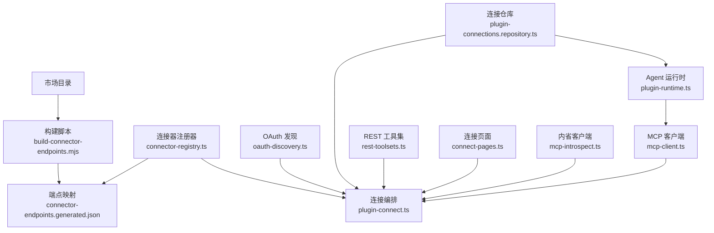

**图表来源**
- [build-connector-endpoints.mjs:1-107](file://scripts/build-connector-endpoints.mjs#L1-L107)
- [connector-endpoints.generated.json:1-200](file://src/server/plugins/connector-endpoints.generated.json#L1-L200)
- [connector-registry.ts:1-200](file://src/server/plugins/connector-registry.ts#L1-L200)
- [plugin-connect.ts:1-200](file://src/server/plugins/plugin-connect.ts#L1-L200)
- [oauth-discovery.ts:1-260](file://src/server/plugins/oauth-discovery.ts#L1-L260)
- [mcp-client.ts:1-200](file://src/server/plugins/mcp-client.ts#L1-L200)
- [plugin-runtime.ts:1-200](file://src/server/plugins/plugin-runtime.ts#L1-L200)
- [rest-toolsets.ts:1-200](file://src/server/plugins/rest-toolsets.ts#L1-L200)
- [plugin-connections.repository.ts:1-220](file://src/server/repositories/plugin-connections.repository.ts#L1-L220)
- [connect-pages.ts:1-99](file://src/server/plugins/connect-pages.ts#L1-L99)
- [mcp-introspect.ts:1-200](file://src/shared/lib/mcp-introspect.ts#L1-L200)

**章节来源**
- [build-connector-endpoints.mjs:1-107](file://scripts/build-connector-endpoints.mjs#L1-L107)
- [connector-registry.ts:1-200](file://src/server/plugins/connector-registry.ts#L1-L200)
- [plugin-connect.ts:1-200](file://src/server/plugins/plugin-connect.ts#L1-L200)
- [plugin-runtime.ts:1-200](file://src/server/plugins/plugin-runtime.ts#L1-L200)

## 核心组件总览
MCP 连接器体系由五类组件构成：

1. **连接器注册器**：根据插件 ID 返回 `mcp` 或 `rest` 连接器规格。若没有远端 MCP 地址，则退化为 REST 工具集；若只有本地 stdio 服务器，则标记为不可连接。
2. **连接编排器**：负责启动连接、构造 OAuth 授权链接、处理回调、保存令牌、刷新能力。
3. **OAuth 发现器**：按 MCP 授权规范探测受保护资源、发现授权服务器、校验所有外部 URL。
4. **MCP 客户端**：基于 JSON-RPC 2.0 与 Streamable HTTP 传输建立会话、分页拉取工具/资源/提示词、调用工具。
5. **Agent 运行时**：把已连接插件的工具暴露为 Agent 函数，并在调用前经过权限、速率限制、参数检查和输出清洗。

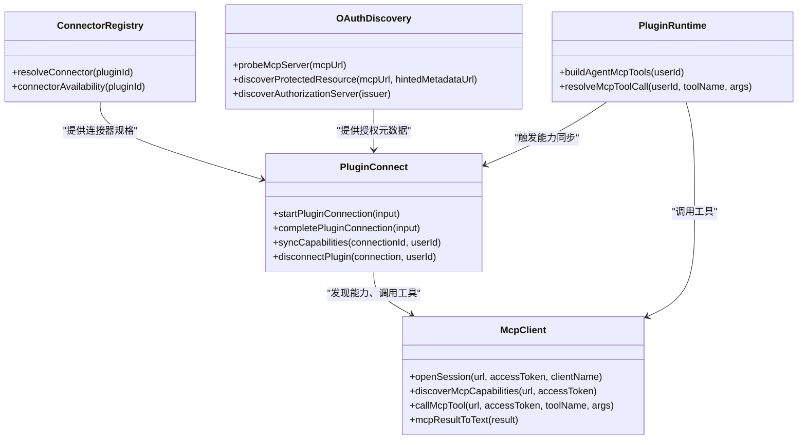

**图表来源**
- [connector-registry.ts:1-200](file://src/server/plugins/connector-registry.ts#L1-L200)
- [plugin-connect.ts:1-200](file://src/server/plugins/plugin-connect.ts#L1-L200)
- [oauth-discovery.ts:1-260](file://src/server/plugins/oauth-discovery.ts#L1-L260)
- [mcp-client.ts:1-200](file://src/server/plugins/mcp-client.ts#L1-L200)
- [plugin-runtime.ts:1-200](file://src/server/plugins/plugin-runtime.ts#L1-L200)

**章节来源**
- [connector-registry.ts:1-200](file://src/server/plugins/connector-registry.ts#L1-L200)
- [plugin-connect.ts:1-200](file://src/server/plugins/plugin-connect.ts#L1-L200)
- [mcp-client.ts:1-200](file://src/server/plugins/mcp-client.ts#L1-L200)
- [plugin-runtime.ts:1-200](file://src/server/plugins/plugin-runtime.ts#L1-L200)

## 架构概览
下图展示一次典型“用户连接 MCP 插件 → 发现工具 → Agent 调用工具”的整体流程。

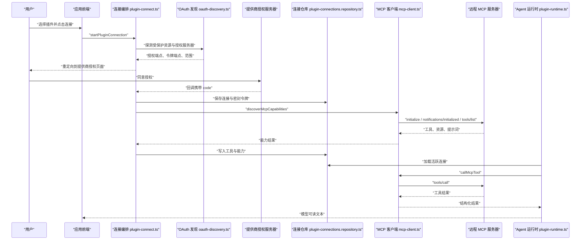

**图表来源**
- [plugin-connect.ts:201-524](file://src/server/plugins/plugin-connect.ts#L201-L524)
- [oauth-discovery.ts:1-260](file://src/server/plugins/oauth-discovery.ts#L1-L260)
- [mcp-client.ts:1-428](file://src/server/plugins/mcp-client.ts#L1-L428)
- [plugin-runtime.ts:1-200](file://src/server/plugins/plugin-runtime.ts#L1-L200)
- [plugin-connections.repository.ts:1-220](file://src/server/repositories/plugin-connections.repository.ts#L1-L220)

## 详细组件分析

### 连接器注册与端点映射机制
连接器注册器承担两个关键任务：
- 将插件 ID 映射为连接器规格：可能是 `mcp`，也可能是 `rest`。
- 判断插件当前是否可连接：例如仅本地 stdio 服务器或提供商未配置时不可连接。

端点映射来自构建脚本生成的 JSON。构建脚本读取公共 MCP 数据集与市场目录，筛选出公开 HTTPS 的 http/sse 端点，并为每个插件保留第一个有效端点。

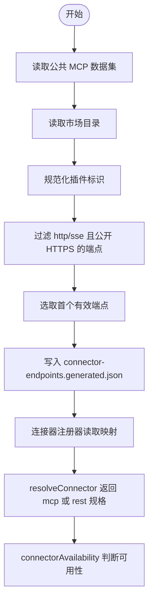

**图表来源**
- [build-connector-endpoints.mjs:1-107](file://scripts/build-connector-endpoints.mjs#L1-L107)
- [connector-endpoints.generated.json:1-200](file://src/server/plugins/connector-endpoints.generated.json#L1-L200)
- [connector-registry.ts:1-200](file://src/server/plugins/connector-registry.ts#L1-L200)

#### 端点映射数据结构
`connector-endpoints.generated.json` 是插件 ID 到端点的映射表。每个条目包含：
- `transport`：传输类型，通常是 `http`。
- `url`：远程 MCP 服务的 HTTPS 地址。

该文件在服务端直接作为静态 JSON 导入，避免 Cloudflare Workers 等环境中无法直接读取文件系统的问题。

**章节来源**
- [build-connector-endpoints.mjs:1-107](file://scripts/build-connector-endpoints.mjs#L1-L107)
- [connector-endpoints.generated.json:1-200](file://src/server/plugins/connector-endpoints.generated.json#L1-L200)
- [connector-registry.ts:1-200](file://src/server/plugins/connector-registry.ts#L1-L200)

### 连接器注册器
连接器注册器维护两类连接器：
- `mcp`：使用远程 MCP 服务器，遵循 MCP OAuth 规范。
- `rest`：没有可用远程 MCP 时使用第一方 REST 工具集。

它还维护覆盖规则，用于指定特定插件的提供商、MCP 地址、默认作用域或强制走 REST 工具集。

关键行为：
- 如果插件不存在或覆盖规则为 `unavailable`，返回空规格。
- 如果是 `rest`，返回 REST 工具集名称与作用域。
- 如果是 `mcp`，优先使用覆盖规则中的 MCP 地址，否则查找端点映射。
- 如果没有 MCP 地址，插件被视为“仅本地运行”，不可连接。

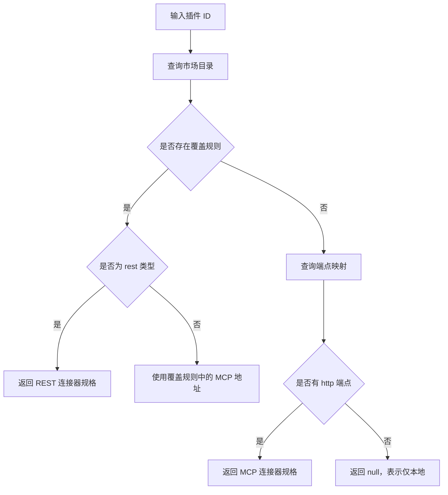

**图表来源**
- [connector-registry.ts:1-200](file://src/server/plugins/connector-registry.ts#L1-L200)

**章节来源**
- [connector-registry.ts:1-200](file://src/server/plugins/connector-registry.ts#L1-L200)

### 连接编排与 OAuth 流程
连接编排器负责完整生命周期：
- 启动连接：解析连接器规格，决定是否需要 OAuth。
- 发现授权：对需要认证的 MCP 服务器，先探测受保护资源，再发现授权服务器。
- 构造授权链接：包含 PKCE、scope、resource 等参数。
- 完成回调：交换令牌、保存连接、保存密封令牌、触发能力同步。
- 断开连接：尝试撤销令牌，然后删除本地连接。

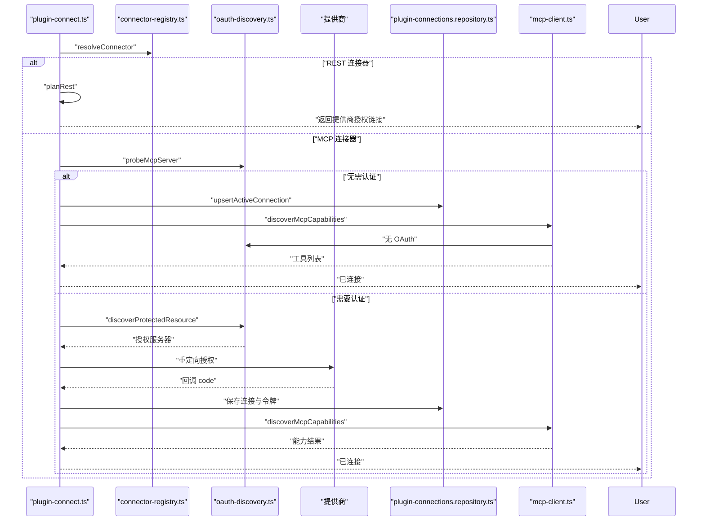

**图表来源**
- [plugin-connect.ts:201-524](file://src/server/plugins/plugin-connect.ts#L201-L524)
- [connector-registry.ts:1-200](file://src/server/plugins/connector-registry.ts#L1-L200)
- [oauth-discovery.ts:1-260](file://src/server/plugins/oauth-discovery.ts#L1-L260)
- [mcp-client.ts:1-200](file://src/server/plugins/mcp-client.ts#L1-L200)
- [plugin-connections.repository.ts:1-220](file://src/server/repositories/plugin-connections.repository.ts#L1-L220)

#### OAuth 发现与安全校验
OAuth 发现模块实现了 MCP 授权规范的关键步骤：
- 只接受公开的 HTTPS URL。
- 拒绝本地地址、私有网段、含凭据的 URL。
- 通过 `www-authenticate` 头解析受保护资源元数据地址。
- 从 `.well-known/oauth-protected-resource` 和 `.well-known/oauth-authorization-server` 或 OpenID Configuration 中发现端点。
- 支持动态客户端注册与预注册提供商两种模式。

**章节来源**
- [plugin-connect.ts:201-524](file://src/server/plugins/plugin-connect.ts#L201-L524)
- [oauth-discovery.ts:1-260](file://src/server/plugins/oauth-discovery.ts#L1-L260)

### MCP 协议握手与消息格式
MCP 客户端使用 JSON-RPC 2.0，并通过 Streamable HTTP 传输。协议握手顺序如下：

1. 发送 `initialize`，携带协议版本、客户端信息与空能力。
2. 部分服务器会返回会话 ID，随后客户端发送 `notifications/initialized`。
3. 使用会话发起 `tools/list`、`resources/list`、`prompts/list`。
4. 使用 `tools/call` 调用工具。

消息格式要点：
- 请求体为 JSON-RPC 对象，包含 `jsonrpc`、`id`、`method`、`params`。
- 响应可能为普通 JSON 或 SSE 帧；SSE 帧中 `data:` 行包含 JSON。
- 认证通过 `Authorization: Bearer` 头传递访问令牌。
- 会话通过 `mcp-session-id` 请求头维持。
- 超时时间为 60 秒，请求头允许 `application/json` 与 `text/event-stream`。

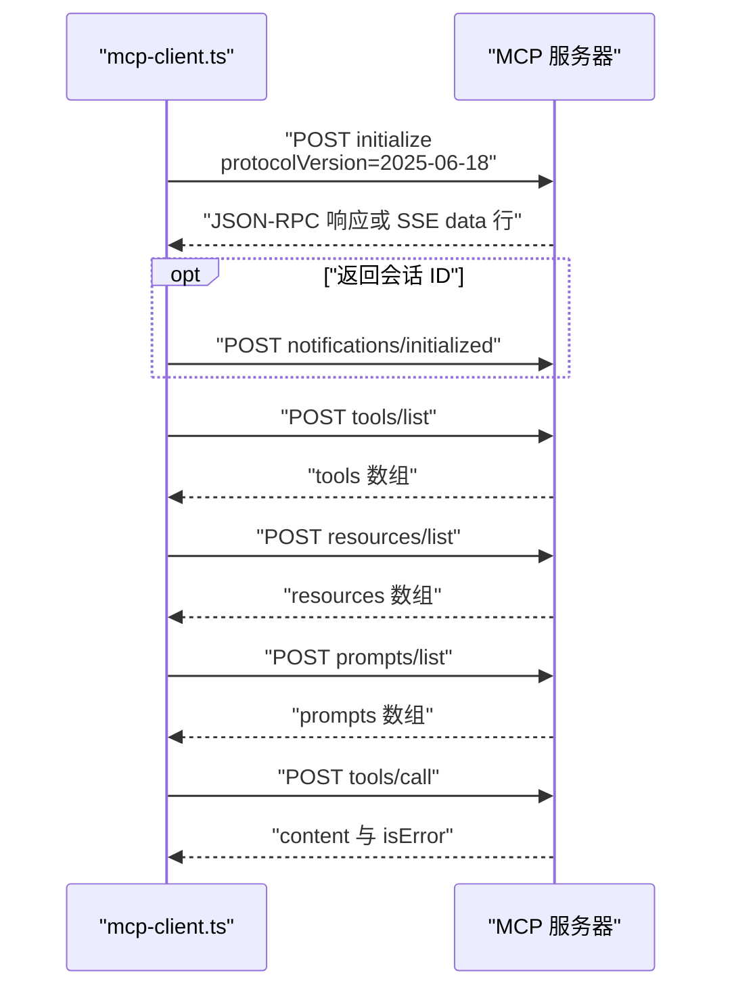

**图表来源**
- [mcp-client.ts:1-200](file://src/server/plugins/mcp-client.ts#L1-L200)
- [mcp-client.ts:201-428](file://src/server/plugins/mcp-client.ts#L201-L428)

#### 协议版本兼容性
代码中显式声明协议版本为 `2025-06-18`。这表示客户端期望服务器实现该版本的 MCP Streamable HTTP 语义。对于不支持 `initialize` 的简化服务器，代码容忍 `-32601 method not found`，继续尝试后续能力发现。

**章节来源**
- [mcp-client.ts:1-200](file://src/server/plugins/mcp-client.ts#L1-L200)
- [mcp-client.ts:201-428](file://src/server/plugins/mcp-client.ts#L201-L428)

### 连接发现流程
连接发现分为三个阶段：

1. **插件级别发现**：`connector-registry.ts` 根据插件 ID 判断是否可连接，以及是 MCP 还是 REST。
2. **服务器级别发现**：`oauth-discovery.ts` 探测 MCP 服务器是否需要认证，并发现授权服务器。
3. **能力级别发现**：`mcp-client.ts` 通过 `discoverMcpCapabilities` 拉取工具、资源、提示词。

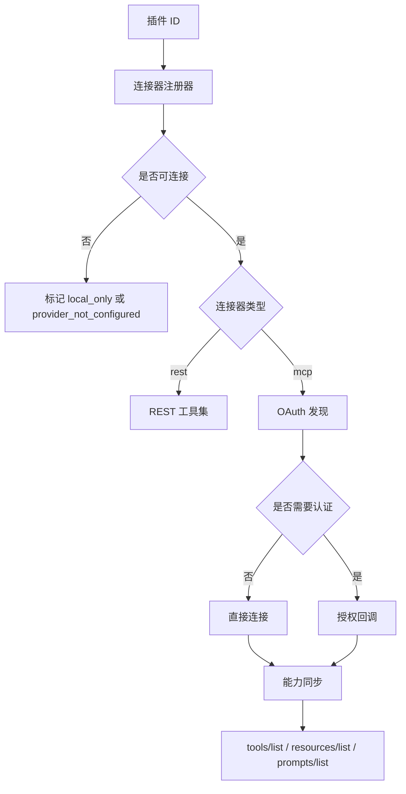

**图表来源**
- [connector-registry.ts:1-200](file://src/server/plugins/connector-registry.ts#L1-L200)
- [oauth-discovery.ts:1-260](file://src/server/plugins/oauth-discovery.ts#L1-L260)
- [mcp-client.ts:201-428](file://src/server/plugins/mcp-client.ts#L201-L428)

**章节来源**
- [connector-registry.ts:1-200](file://src/server/plugins/connector-registry.ts#L1-L200)
- [oauth-discovery.ts:1-260](file://src/server/plugins/oauth-discovery.ts#L1-L260)
- [mcp-client.ts:201-428](file://src/server/plugins/mcp-client.ts#L201-L428)

### 能力同步与工具发现
能力同步在连接完成后立即执行，并在 Agent 运行时加载工具时发现缺失工具后重试。

同步逻辑：
- REST 连接器：从工具集定义生成工具列表，清空资源与提示词能力。
- MCP 连接器：获取访问令牌，调用 `discoverMcpCapabilities`，写入工具、资源、提示词。
- 认证失败时将连接状态设为需要重新授权。

工具风险等级分类：
- 若工具标注 `destructiveHint=true`，标记为破坏性。
- 若工具标注 `readOnlyHint=true`，标记为只读。
- 根据工具名匹配读写关键词，推测风险等级。

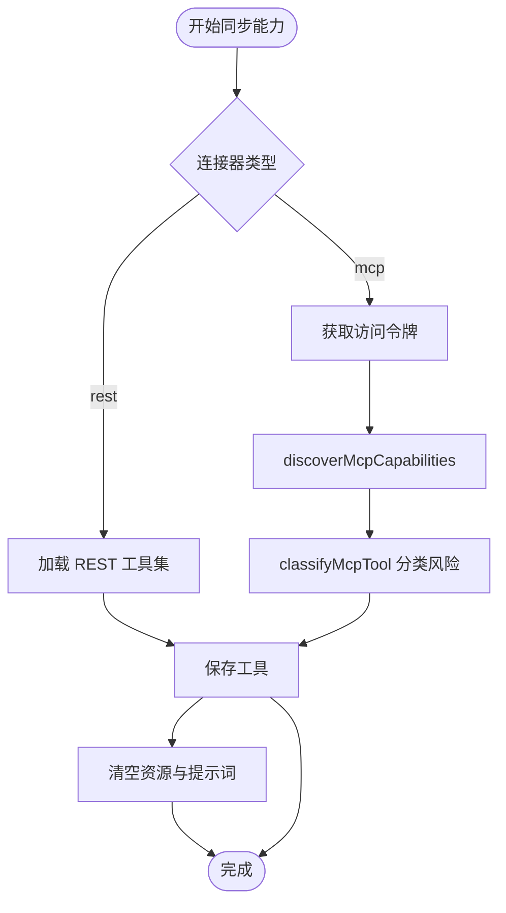

**图表来源**
- [plugin-connect.ts:430-524](file://src/server/plugins/plugin-connect.ts#L430-L524)
- [rest-toolsets.ts:1-200](file://src/server/plugins/rest-toolsets.ts#L1-L200)
- [mcp-client.ts:201-428](file://src/server/plugins/mcp-client.ts#L201-L428)

**章节来源**
- [plugin-connect.ts:430-524](file://src/server/plugins/plugin-connect.ts#L430-L524)
- [rest-toolsets.ts:1-200](file://src/server/plugins/rest-toolsets.ts#L1-L200)
- [mcp-client.ts:201-428](file://src/server/plugins/mcp-client.ts#L201-L428)

### 连接页面生成逻辑
`connect-pages.ts` 生成连接弹窗的结果页。它不是 MCP 协议实现，而是 OAuth 授权完成后用于通知打开页面的结果载体。

主要行为：
- 生成安全转义的 HTML。
- 向 opener 窗口发送 origin 受限的 `postMessage`。
- 成功时延迟关闭弹窗。
- 使用 nonce CSP、禁止 iframe、禁止缓存等安全头。
- 成功返回 200，失败返回 400。

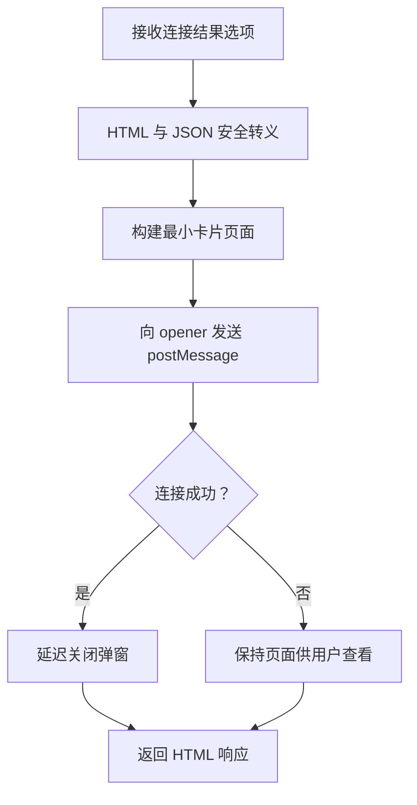

**图表来源**
- [connect-pages.ts:1-99](file://src/server/plugins/connect-pages.ts#L1-L99)

**章节来源**
- [connect-pages.ts:1-99](file://src/server/plugins/connect-pages.ts#L1-L99)

### Agent 运行时与工具暴露
Agent 运行时将已连接插件的工具暴露为函数：
- 工具命名格式为 `mcp__<插件slug>__<工具名>`。
- 最多直接暴露有限数量的工具，其余通过搜索工具发现。
- 每次调用先解析连接与工具，再通过 MCP 客户端调用远程工具。
- 结果转换为模型可读文本，图片转为占位标记，结构化内容转为 JSON。

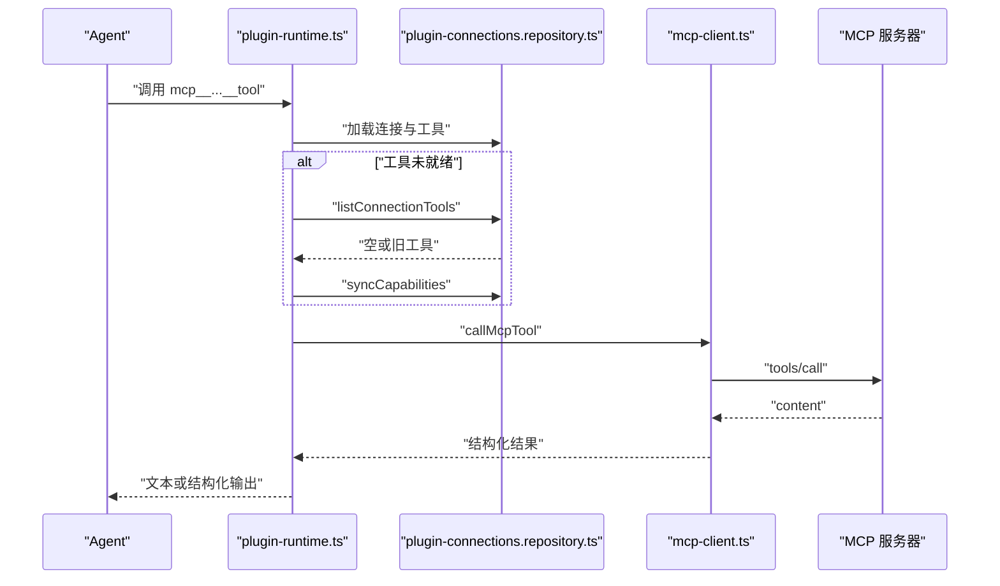

**图表来源**
- [plugin-runtime.ts:1-200](file://src/server/plugins/plugin-runtime.ts#L1-L200)
- [mcp-client.ts:201-428](file://src/server/plugins/mcp-client.ts#L201-L428)
- [plugin-connections.repository.ts:1-220](file://src/server/repositories/plugin-connections.repository.ts#L1-L220)

**章节来源**
- [plugin-runtime.ts:1-200](file://src/server/plugins/plugin-runtime.ts#L1-L200)
- [mcp-client.ts:201-428](file://src/server/plugins/mcp-client.ts#L201-L428)
- [plugin-connections.repository.ts:1-220](file://src/server/repositories/plugin-connections.repository.ts#L1-L220)

## 依赖关系分析
MCP 连接器系统的耦合关系如下：

- 构建脚本与服务端 JSON 是编译期/构建期依赖。
- 连接器注册器依赖端点映射 JSON 与市场目录。
- 连接编排器依赖连接器注册器、OAuth 发现器、仓库与 MCP 客户端。
- MCP 客户端依赖 JSON-RPC 与 HTTP 网络栈。
- Agent 运行时依赖连接编排器与仓库。
- REST 工具集独立于 MCP 客户端，但共享连接与令牌管理。

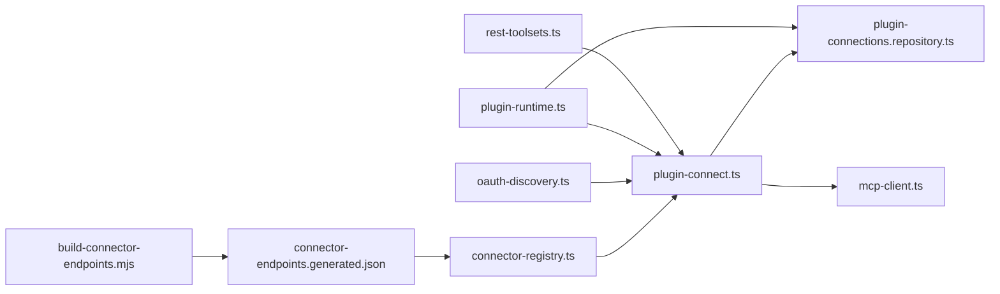

**图表来源**
- [build-connector-endpoints.mjs:1-107](file://scripts/build-connector-endpoints.mjs#L1-L107)
- [connector-endpoints.generated.json:1-200](file://src/server/plugins/connector-endpoints.generated.json#L1-L200)
- [connector-registry.ts:1-200](file://src/server/plugins/connector-registry.ts#L1-L200)
- [plugin-connect.ts:1-200](file://src/server/plugins/plugin-connect.ts#L1-L200)
- [oauth-discovery.ts:1-260](file://src/server/plugins/oauth-discovery.ts#L1-L260)
- [mcp-client.ts:1-200](file://src/server/plugins/mcp-client.ts#L1-L200)
- [plugin-runtime.ts:1-200](file://src/server/plugins/plugin-runtime.ts#L1-L200)
- [rest-toolsets.ts:1-200](file://src/server/plugins/rest-toolsets.ts#L1-L200)
- [plugin-connections.repository.ts:1-220](file://src/server/repositories/plugin-connections.repository.ts#L1-L220)

**章节来源**
- [connector-registry.ts:1-200](file://src/server/plugins/connector-registry.ts#L1-L200)
- [plugin-connect.ts:1-200](file://src/server/plugins/plugin-connect.ts#L1-L200)
- [plugin-runtime.ts:1-200](file://src/server/plugins/plugin-runtime.ts#L1-L200)

## 性能与可靠性特征
- **协议版本固定**：客户端硬编码协议版本，减少协商开销，但也要求服务器实现兼容版本。
- **SSE 兼容解析**：客户端能解析普通 JSON 与 SSE 帧，提高与不同 MCP 服务器实现的兼容性。
- **分页限制**：能力发现最多分页 5 次，防止无限拉取。
- **请求超时**：握手与工具调用有明确超时，避免长期阻塞。
- **会话复用**：同一会话内多次调用，降低重复握手成本。
- **静默容错**：部分初始化失败会被容忍，以便兼容简化服务器。
- **连接状态**：认证失败会将连接标记为需要重新授权，便于前端引导用户重新连接。

[本节为通用性能讨论，不直接分析具体代码片段]

## 故障排查指南

### 常见问题分类
| 现象 | 可能原因 | 排查建议 |
|---|---|---|
| 插件显示“仅本地运行” | 连接器注册器未找到可用 MCP 或 REST 连接器 | 检查插件 ID、市场目录、端点映射 JSON。 |
| 提供商未配置 | OAuth 提供商凭据未在工作区配置 | 检查提供商凭据与配置。 |
| 连接后立即需要重新授权 | 访问令牌过期或被吊销 | 重新完成 OAuth 回调。 |
| 工具列表为空 | 服务器未返回工具、鉴权失败或能力同步失败 | 使用内省客户端测试 MCP 地址。 |
| 工具调用超时 | 服务器响应慢或网络不可达 | 检查 MCP 服务器可达性与超时时间。 |
| 401/403 | 凭证无效或作用域不足 | 检查令牌、scope、resource 指示符。 |
| SSE 响应无法解析 | 服务器返回非标准 SSE 帧 | 检查 `data:` 行与 JSON 结构。 |

### 关键错误码与消息
- MCP 客户端错误码：`unauthorized`、`forbidden`、`not_found`、`timeout`、`protocol_error`、`unavailable`。
- OAuth 发现错误码：`invalid_url`、`discovery_failed`、`registration_unavailable`、`token_exchange_failed`、`server_unreachable`。
- 内省错误：`invalid-url`、`auth-required`、`no-tools`、`timeout`、`unavailable`。

### 调试技巧
1. **使用内省客户端**：调用 `introspectMcpServer` 快速验证 MCP 地址是否能返回工具列表。
2. **检查端点映射**：确认插件 ID 是否在 `connector-endpoints.generated.json` 中有对应 HTTPS 地址。
3. **检查连接器规格**：调用 `resolveConnector` 确认插件被识别为 `mcp` 或 `rest`。
4. **观察连接状态**：查看数据库中连接状态是否为 `active` 或 `reauthorization_required`。
5. **验证 OAuth 流程**：确认回调地址、state、PKCE、scope、resource 参数正确。
6. **查看工具风险分类**：确认工具名称是否符合只读或破坏性命名约定。

**章节来源**
- [mcp-introspect.ts:1-209](file://src/shared/lib/mcp-introspect.ts#L1-L209)
- [mcp-client.ts:1-428](file://src/server/plugins/mcp-client.ts#L1-L428)
- [oauth-discovery.ts:1-260](file://src/server/plugins/oauth-discovery.ts#L1-L260)
- [connector-registry.ts:1-200](file://src/server/plugins/connector-registry.ts#L1-L200)
- [plugin-connections.repository.ts:1-220](file://src/server/repositories/plugin-connections.repository.ts#L1-L220)

## 连接器开发指南

### 自定义 MCP 连接器实现
如果你要提供一个新的 MCP 连接器，请按以下步骤操作：

1. **发布 MCP 服务器**
   - 实现 JSON-RPC 2.0。
   - 实现 Streamable HTTP 传输。
   - 支持 `initialize`、`notifications/initialized`、`tools/list`、`tools/call`。
   - 可选支持 `resources/list`、`prompts/list`。
   - 建议使用 `2025-06-18` 协议版本。

2. **添加 MCP 元数据**
   - 在公共 MCP 数据集中添加你的插件。
   - 至少包含一个 `http` 或 `sse` 类型的公开 HTTPS 端点。
   - 确保端点不会被构建脚本的安全过滤规则拒绝。

3. **更新市场目录**
   - 在市场目录中添加插件条目，使构建脚本能够映射到插件 ID。

4. **验证端点映射**
   - 运行构建脚本，确认 `connector-endpoints.generated.json` 中出现你的端点。
   - 使用内省客户端验证 MCP 服务器能返回工具列表。

5. **配置 OAuth**
   - 如果你的 MCP 服务器需要认证，配置受保护资源元数据与授权服务器。
   - 或使用预注册提供商，让连接器自动使用已知提供商。

6. **测试连接流程**
   - 测试 `startPluginConnection`、`completePluginConnection`、`syncCapabilities`。
   - 验证工具风险分类、Agent 工具命名、工具调用结果。

### 协议版本兼容性
- 客户端固定使用协议版本 `2025-06-18`。
- 如果服务器不支持 `initialize`，实现应容忍方法未找到错误并继续能力发现。
- 如果服务器返回 SSE，客户端应能解析 `data:` 行。
- 如果服务器不支持资源或提示词，客户端应安全返回空列表。

### 安全注意事项
- MCP 服务器地址必须为公开 HTTPS。
- OAuth 端点必须为公开 HTTPS，不能包含用户名密码，不能指向本地或私有地址。
- 令牌以密封形式存储，不应在日志或 API 响应中泄露。
- 工具调用结果需经过清理，避免模型接收到不安全或过大内容。

### 调试技巧
- 使用 `introspectMcpServer` 验证 MCP 服务器。
- 检查 `connector-endpoints.generated.json` 是否包含你的端点。
- 检查连接器注册结果是否为 `mcp`。
- 检查连接状态是否为 `active`。
- 检查工具列表是否与 MCP 服务器一致。
- 检查 OAuth 回调是否正确携带 state、code、redirect_uri。

**章节来源**
- [build-connector-endpoints.mjs:1-107](file://scripts/build-connector-endpoints.mjs#L1-L107)
- [connector-endpoints.generated.json:1-200](file://src/server/plugins/connector-endpoints.generated.json#L1-L200)
- [mcp-introspect.ts:1-209](file://src/shared/lib/mcp-introspect.ts#L1-L209)
- [mcp-client.ts:1-428](file://src/server/plugins/mcp-client.ts#L1-L428)
- [oauth-discovery.ts:1-260](file://src/server/plugins/oauth-discovery.ts#L1-L260)
- [connector-registry.ts:1-200](file://src/server/plugins/connector-registry.ts#L1-L200)

## 结论
本项目中的 MCP 连接器实现以“连接器注册 + OAuth 发现 + MCP 客户端 + Agent 运行时”为核心。构建期脚本将市场目录与公共 MCP 数据集转化为服务端可直接使用的端点映射；连接编排器负责 OAuth 流程与能力同步；MCP 客户端实现 JSON-RPC 2.0 与 Streamable HTTP；Agent 运行时将工具暴露给模型调用。

对于开发者而言，最重要的三件事是：
1. 确保 MCP 服务器实现兼容的协议版本与传输方式。
2. 确保插件能进入端点映射 JSON。
3. 确保 OAuth 元数据与授权服务器可被发现。

这套设计既支持成熟的第三方 MCP 服务，也保留了 REST 工具集作为降级路径，同时通过严格的安全校验与错误分类，提升了连接器平台的稳定性与可维护性。