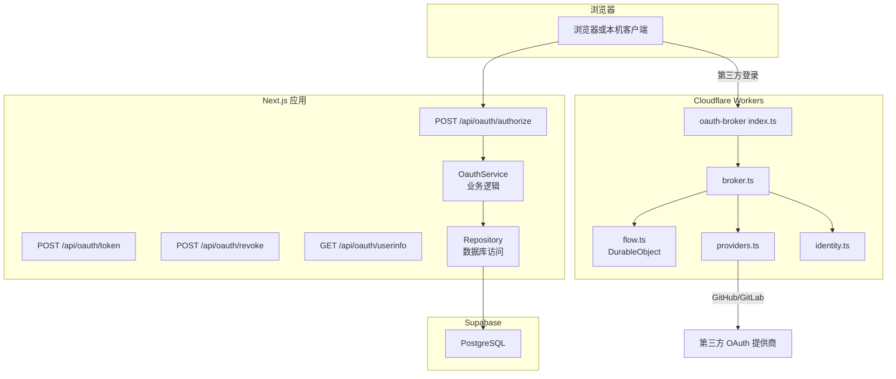
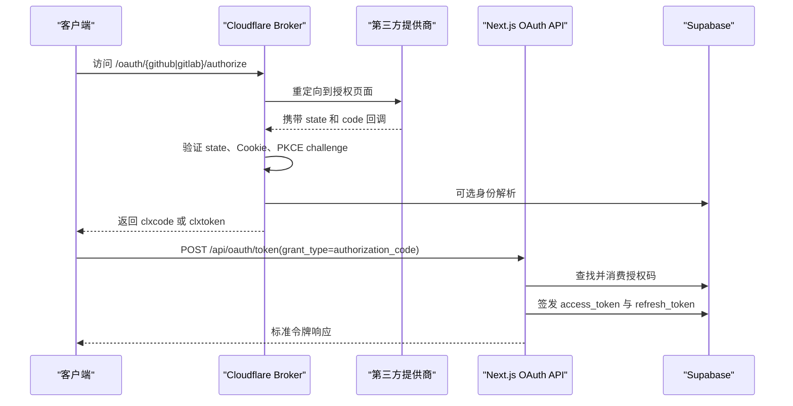
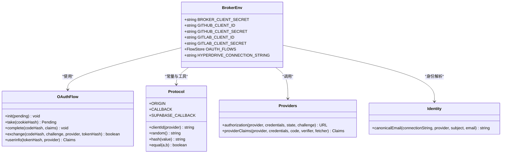
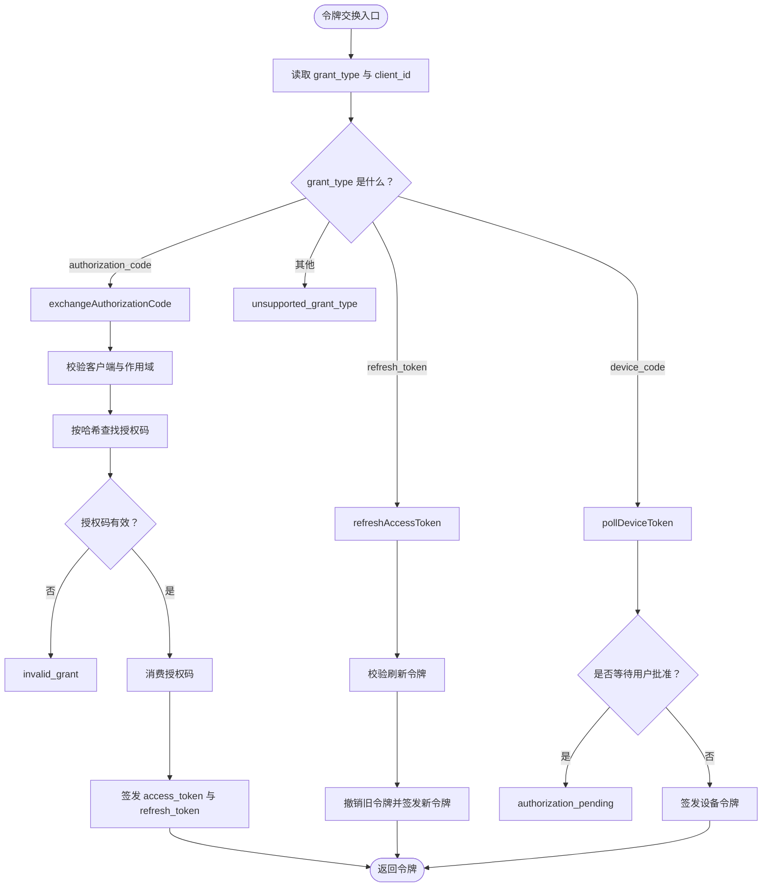
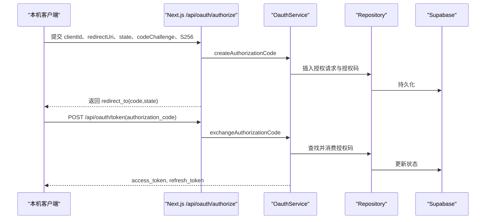
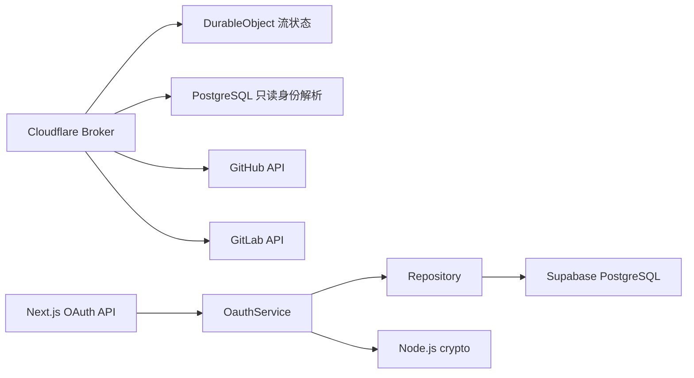

# OAuth 集成

<cite>
**本文引用的文件**   
- [workers/oauth-broker/src/index.ts](file://workers/oauth-broker/src/index.ts)
- [workers/oauth-broker/src/broker.ts](file://workers/oauth-broker/src/broker.ts)
- [workers/oauth-broker/src/flow.ts](file://workers/oauth-broker/src/flow.ts)
- [workers/oauth-broker/src/protocol.ts](file://workers/oauth-broker/src/protocol.ts)
- [workers/oauth-broker/src/providers.ts](file://workers/oauth-broker/src/providers.ts)
- [workers/oauth-broker/src/identity.ts](file://workers/oauth-broker/src/identity.ts)
- [src/server/oauth/service.ts](file://src/server/oauth/service.ts)
- [src/server/oauth/repository.ts](file://src/server/oauth/repository.ts)
- [src/server/oauth/constants.ts](file://src/server/oauth/constants.ts)
- [src/server/oauth/crypto.ts](file://src/server/oauth/crypto.ts)
- [src/server/oauth/redirect.ts](file://src/server/oauth/redirect.ts)
- [src/app/api/oauth/authorize/route.ts](file://src/app/api/oauth/authorize/route.ts)
- [src/app/api/oauth/token/route.ts](file://src/app/api/oauth/token/route.ts)
- [src/app/api/oauth/userinfo/route.ts](file://src/app/api/oauth/userinfo/route.ts)
- [src/app/api/oauth/revoke/route.ts](file://src/app/api/oauth/revoke/route.ts)
- [supabase/migrations/20260726120000_clauxen_code_oauth_client.sql](file://supabase/migrations/20260726120000_clauxen_code_oauth_client.sql)
- [supabase/migrations/20260903121500_oauth_localhost_return_urls.sql](file://supabase/migrations/20260903121500_oauth_localhost_return_urls.sql)
- [supabase/migrations/20261002173000_plugin_connections.sql](file://supabase/migrations/20261002173000_plugin_connections.sql)
- [supabase/migrations/20261017124626_clauxen_oauth_identity_lookup.sql](file://supabase/migrations/20261017124626_clauxen_oauth_identity_lookup.sql)
- [supabase/migrations/20261026120000_plugin_native_oauth.sql](file://supabase/migrations/20261026120000_plugin_native_oauth.sql)
</cite>

## 目录
1. [简介](#简介)
2. [项目结构](#项目结构)
3. [核心组件](#核心组件)
4. [架构总览](#架构总览)
5. [详细组件分析](#详细组件分析)
6. [依赖关系分析](#依赖关系分析)
7. [性能与扩展性](#性能与扩展性)
8. [安全最佳实践](#安全最佳实践)
9. [常见供应商集成示例](#常见供应商集成示例)
10. [错误处理策略](#错误处理策略)
11. [调试与故障排除](#调试与故障排除)
12. [结论](#结论)

## 简介
本文件系统性文档化当前仓库中的 OAuth 集成实现，重点覆盖：
- Cloudflare Worker 实现的第三方提供商 OAuth Broker。
- Next.js API 层实现的内部 OAuth 授权码流程、PKCE、设备码流程与令牌刷新。
- 授权客户端注册、授权 URL 生成、回调处理、令牌签发与撤销。
- 身份解析与“受保护资源发现”在现有代码中的体现方式。
- RFC 8707 资源标识在当前实现中的现状与建议。
- 安全最佳实践、状态校验、CSRF 防护、敏感数据保护建议。
- 常见供应商集成示例、错误处理与排障指南。

## 项目结构
OAuth 能力由两部分组成：
- 外部 OAuth Broker（Cloudflare Worker）：负责 GitHub、GitLab 等第三方提供商的授权码交换与用户信息获取，并对外暴露一个类 OAuth 代理端点。
- 内部 OAuth 服务（Next.js API + Supabase）：为 CLI、插件或本机应用提供标准的 `authorization_code`、`refresh_token`、设备码授权、令牌撤销以及 `/userinfo` 端点。

**图表来源**
- [workers/oauth-broker/src/index.ts:1-34](file://workers/oauth-broker/src/index.ts#L1-L34)
- [workers/oauth-broker/src/broker.ts:1-113](file://workers/oauth-broker/src/broker.ts#L1-L113)
- [workers/oauth-broker/src/flow.ts:1-43](file://workers/oauth-broker/src/flow.ts#L1-L43)
- [workers/oauth-broker/src/providers.ts:1-37](file://workers/oauth-broker/src/providers.ts#L1-L37)
- [workers/oauth-broker/src/identity.ts:1-18](file://workers/oauth-broker/src/identity.ts#L1-L18)
- [src/app/api/oauth/authorize/route.ts:1-92](file://src/app/api/oauth/authorize/route.ts#L1-L92)
- [src/app/api/oauth/token/route.ts:1-108](file://src/app/api/oauth/token/route.ts#L1-L108)
- [src/app/api/oauth/revoke/route.ts:1-43](file://src/app/api/oauth/revoke/route.ts#L1-L43)
- [src/app/api/oauth/userinfo/route.ts:1-24](file://src/app/api/oauth/userinfo/route.ts#L1-L24)
- [src/server/oauth/service.ts:1-457](file://src/server/oauth/service.ts#L1-L457)
- [src/server/oauth/repository.ts:1-200](file://src/server/oauth/repository.ts#L1-L200)

**章节来源**
- [workers/oauth-broker/src/index.ts:1-34](file://workers/oauth-broker/src/index.ts#L1-L34)
- [src/app/api/oauth/authorize/route.ts:1-92](file://src/app/api/oauth/authorize/route.ts#L1-L92)
- [src/app/api/oauth/token/route.ts:1-108](file://src/app/api/oauth/token/route.ts#L1-L108)

## 核心组件
- Cloudflare Worker OAuth Broker：
  - 入口路由重写与速率限制。
  - 第三方授权码交换、Cookie 状态、DurableObject 流式状态机。
  - GitHub、GitLab 提供商协议适配。
  - 通过只读 Postgres 角色查询身份映射。
- Next.js OAuth API：
  - 授权码创建、校验 PKCE、令牌交换、刷新、设备码授权、令牌撤销。
  - `/userinfo` 返回当前会话用户信息。
- 数据模型与常量：
  - 客户端配置、作用域、令牌 TTL、前缀、PKCE 校验工具。
  - 数据库操作封装。

**章节来源**
- [workers/oauth-broker/src/broker.ts:1-113](file://workers/oauth-broker/src/broker.ts#L1-L113)
- [workers/oauth-broker/src/flow.ts:1-43](file://workers/oauth-broker/src/flow.ts#L1-L43)
- [workers/oauth-broker/src/providers.ts:1-37](file://workers/oauth-broker/src/providers.ts#L1-L37)
- [workers/oauth-broker/src/identity.ts:1-18](file://workers/oauth-broker/src/identity.ts#L1-L18)
- [src/server/oauth/service.ts:1-457](file://src/server/oauth/service.ts#L1-L457)
- [src/server/oauth/repository.ts:1-200](file://src/server/oauth/repository.ts#L1-L200)
- [src/server/oauth/constants.ts:1-29](file://src/server/oauth/constants.ts#L1-L29)
- [src/server/oauth/crypto.ts:1-43](file://src/server/oauth/crypto.ts#L1-L43)
- [src/server/oauth/redirect.ts:1-28](file://src/server/oauth/redirect.ts#L1-L28)

## 架构总览
系统存在两条 OAuth 路径：
1. 第三方登录路径：浏览器 → Cloudflare Worker → GitHub/GitLab → 回调 → Broker → 返回临时授权码或令牌。
2. 内部 OAuth 路径：本机客户端或 CLI → Next.js `/api/oauth/*` → Supabase → 标准 OAuth 响应。

**图表来源**
- [workers/oauth-broker/src/index.ts:1-34](file://workers/oauth-broker/src/index.ts#L1-L34)
- [workers/oauth-broker/src/broker.ts:1-113](file://workers/oauth-broker/src/broker.ts#L1-L113)
- [workers/oauth-broker/src/providers.ts:1-37](file://workers/oauth-broker/src/providers.ts#L1-L37)
- [src/app/api/oauth/token/route.ts:1-108](file://src/app/api/oauth/token/route.ts#L1-L108)
- [src/server/oauth/service.ts:1-457](file://src/server/oauth/service.ts#L1-L457)

## 详细组件分析

### Cloudflare Worker OAuth Broker
Broker 的职责是作为第三方提供商的“窄接口”，把 GitHub 和 GitLab 的 OAuth 细节封装成统一的 `/oauth/{provider}/authorize|token|userinfo` 端点。

关键行为：
- 入口处理：对特定域名和路径进行 Supabase 授权跳转重写；对其他请求做 IP 限流后交给 broker 处理器。
- 授权流程：校验 `client_id`、固定回调地址、`response_type=code`、state 长度、PKCE S256 challenge；将浏览器 secret 写入 Cookie，并将 verifier 的哈希存入 DurableObject。
- 回调处理：校验 state 前缀与 Cookie 哈希；若第三方返回 error，则返回统一错误；否则交换 token、调用身份解析、完成 flow、返回 `clxcode`。
- 令牌交换：接受 Basic 认证或表单字段；校验服务端 secret、grant_type、redirect_uri、`clxcode`、code_verifier；成功后返回 `clxtoken`。
- 用户信息：Bearer 头中解析 `clxtoken`，从 DurableObject 读取已完成的 claims。

**图表来源**
- [workers/oauth-broker/src/index.ts:1-34](file://workers/oauth-broker/src/index.ts#L1-L34)
- [workers/oauth-broker/src/broker.ts:1-113](file://workers/oauth-broker/src/broker.ts#L1-L113)
- [workers/oauth-broker/src/flow.ts:1-43](file://workers/oauth-broker/src/flow.ts#L1-L43)
- [workers/oauth-broker/src/protocol.ts:1-65](file://workers/oauth-broker/src/protocol.ts#L1-L65)
- [workers/oauth-broker/src/providers.ts:1-37](file://workers/oauth-broker/src/providers.ts#L1-L37)
- [workers/oauth-broker/src/identity.ts:1-18](file://workers/oauth-broker/src/identity.ts#L1-L18)

**章节来源**
- [workers/oauth-broker/src/index.ts:1-34](file://workers/oauth-broker/src/index.ts#L1-L34)
- [workers/oauth-broker/src/broker.ts:1-113](file://workers/oauth-broker/src/broker.ts#L1-L113)
- [workers/oauth-broker/src/flow.ts:1-43](file://workers/oauth-broker/src/flow.ts#L1-L43)
- [workers/oauth-broker/src/protocol.ts:1-65](file://workers/oauth-broker/src/protocol.ts#L1-L65)
- [workers/oauth-broker/src/providers.ts:1-37](file://workers/oauth-broker/src/providers.ts#L1-L37)
- [workers/oauth-broker/src/identity.ts:1-18](file://workers/oauth-broker/src/identity.ts#L1-L18)

### Next.js 内部 OAuth 服务
内部 OAuth 服务面向本机客户端、CLI 与插件，实现标准授权码模式、PKCE、设备码授权、刷新与撤销。

主要职责：
- 作用域定义与校验：内置 `CLAUXEN_CODE_SCOPES`，强制包含 `openid` 与 `code:inference`。
- 授权码创建：仅支持 `response_type=code`、`code_challenge_method=S256`，校验 loopback 回调，记录授权请求、授权码、同意授权与事件。
- 令牌交换：校验客户端、授权码状态、过期时间、回调一致性与 PKCE；一次性消费授权码；签发 access_token 与 refresh_token。
- 刷新令牌：校验客户端、令牌有效性、过期时间；失败复用场景下撤销整个刷新令牌家族；签发新令牌并记录事件。
- 设备码授权：支持 `urn:ietf:params:oauth:grant-type:device_code`，生成设备码和用户码，允许用户批准，轮询换取令牌。
- 令牌撤销：兼容访问令牌、刷新令牌及无前缀不透明令牌，遵循 RFC 7009 语义。
- `/userinfo`：基于当前会话返回用户信息，而不是直接解析外部 access_token。

**图表来源**
- [src/app/api/oauth/token/route.ts:1-108](file://src/app/api/oauth/token/route.ts#L1-L108)
- [src/server/oauth/service.ts:1-457](file://src/server/oauth/service.ts#L1-L457)
- [src/server/oauth/crypto.ts:1-43](file://src/server/oauth/crypto.ts#L1-L43)
- [src/server/oauth/redirect.ts:1-28](file://src/server/oauth/redirect.ts#L1-L28)

**章节来源**
- [src/app/api/oauth/token/route.ts:1-108](file://src/app/api/oauth/token/route.ts#L1-L108)
- [src/server/oauth/service.ts:1-457](file://src/server/oauth/service.ts#L1-L457)
- [src/server/oauth/constants.ts:1-29](file://src/server/oauth/constants.ts#L1-L29)
- [src/server/oauth/crypto.ts:1-43](file://src/server/oauth/crypto.ts#L1-L43)
- [src/server/oauth/redirect.ts:1-28](file://src/server/oauth/redirect.ts#L1-L28)

### 授权客户端注册与配置
内部 OAuth 客户端存储在 `public.oauth_clients`，并通过 repository 查询。CLI 专用客户端 ID 为 `clauxen-code`，其作用域集合用于限制可请求的范围。本地回环回调地址需要满足 loopback 规范。

相关迁移与配置包括：
- 客户端表与索引。
- 本地回环回调白名单。
- 插件连接与原生 OAuth 支持。

**章节来源**
- [src/server/oauth/repository.ts:1-200](file://src/server/oauth/repository.ts#L1-L200)
- [src/server/oauth/constants.ts:1-29](file://src/server/oauth/constants.ts#L1-L29)
- [supabase/migrations/20260726120000_clauxen_code_oauth_client.sql](file://supabase/migrations/20260726120000_clauxen_code_oauth_client.sql)
- [supabase/migrations/20260903121500_oauth_localhost_return_urls.sql](file://supabase/migrations/20260903121500_oauth_localhost_return_urls.sql)
- [supabase/migrations/20261002173000_plugin_connections.sql](file://supabase/migrations/20261002173000_plugin_connections.sql)

### 授权码模式与 PKCE 扩展
- 内部服务严格支持 `response_type=code` 与 `code_challenge_method=S256`。
- 授权码创建时记录 `code_challenge`，令牌交换时使用 `code_verifier` 计算 SHA-256 并与挑战值比较。
- Cloudflare Broker 同样要求 `code_challenge_method=S256`，并在回调阶段校验 challenge 与 verifier。

**图表来源**
- [src/app/api/oauth/authorize/route.ts:1-92](file://src/app/api/oauth/authorize/route.ts#L1-L92)
- [src/app/api/oauth/token/route.ts:1-108](file://src/app/api/oauth/token/route.ts#L1-L108)
- [src/server/oauth/service.ts:1-457](file://src/server/oauth/service.ts#L1-L457)
- [src/server/oauth/crypto.ts:1-43](file://src/server/oauth/crypto.ts#L1-L43)

**章节来源**
- [src/server/oauth/service.ts:1-457](file://src/server/oauth/service.ts#L1-L457)
- [src/server/oauth/crypto.ts:1-43](file://src/server/oauth/crypto.ts#L1-L43)

### 回调处理与安全校验
- Cloudflare Broker 的回调处理会检查 state 前缀、Cookie 哈希、flow 阶段，避免重放与过期。
- 第三方错误会被转换为统一的 `access_denied` 错误描述。
- 成功回调会调用身份解析函数，再通过 DurableObject 完成流程，最终返回临时 `clxcode`。

**章节来源**
- [workers/oauth-broker/src/broker.ts:1-113](file://workers/oauth-broker/src/broker.ts#L1-L113)
- [workers/oauth-broker/src/flow.ts:1-43](file://workers/oauth-broker/src/flow.ts#L1-L43)

### 令牌刷新机制
内部服务的刷新流程：
- 校验客户端允许 `refresh_token`。
- 查找刷新令牌哈希；若已失效或被复用，则撤销整个刷新令牌家族。
- 撤销旧刷新令牌，签发新的 access_token 与 refresh_token，并保留 familyId 以便追踪轮换。
- 记录 `token_refreshed` 事件。

**章节来源**
- [src/server/oauth/service.ts:1-457](file://src/server/oauth/service.ts#L1-L457)
- [src/server/oauth/repository.ts:1-200](file://src/server/oauth/repository.ts#L1-L200)

### 供应商发现、保护资源发现与 RFC 8707
- 供应商发现：当前代码没有实现 `.well-known/openid-configuration` 或通用 OIDC 发现端点。第三方提供商选择由 Broker 硬编码，内部客户端配置由数据库与常量管理。
- 保护资源发现：当前未实现 `resource_servers`、`introspection` 或标准资源发现；Broker 的 `/userinfo` 返回的是内部 claims，不是标准 OpenID Connect userinfo。
- RFC 8707 资源标识：当前未实现 `resource` 参数；内部作用域通过 `scope` 控制，但未将资源 URI 纳入令牌或鉴权决策。

建议：
- 如需 OIDC 发现，新增 `.well-known/openid-configuration` 端点，声明支持的 grant_types、scopes、token_endpoint、revocation_endpoint 等。
- 如需资源发现，新增 `resource_servers` 或 `introspection` 端点，并在令牌颁发时绑定资源标识。
- 如需 RFC 8707，扩展 scope 与 access_token 元数据，使后端服务可依据 `resource` 执行细粒度授权。

[本节为概念性说明，不直接分析具体代码文件]

### 安全最佳实践
- 状态验证：
  - Broker 使用 `clx.` 前缀 state、Cookie 哈希与 DurableObject 阶段校验。
  - 内部服务记录 state 的哈希，避免明文存储。
- CSRF 防护：
  - Broker 使用 `__Host-*` Cookie 名称与 `SameSite=Lax`。
  - 内部 `/api/oauth/authorize` 要求已登录会话，降低 CSRF 风险。
- PKCE：
  - 强制 S256，禁止其他方法。
  - 本机回调仅允许 loopback 地址。
- 令牌安全：
  - 令牌以不透明字符串形式存储哈希；访问令牌 TTL 较短，刷新令牌 TTL 较长但可轮换。
  - 刷新令牌复用失败时撤销家族，防止重放。
- 输入与负载限制：
  - Broker 对正文大小、参数唯一性、URL 参数进行校验。
- 最小权限：
  - 身份解析使用只读事务与受限数据库角色。

**章节来源**
- [workers/oauth-broker/src/broker.ts:1-113](file://workers/oauth-broker/src/broker.ts#L1-L113)
- [workers/oauth-broker/src/protocol.ts:1-65](file://workers/oauth-broker/src/protocol.ts#L1-L65)
- [workers/oauth-broker/src/identity.ts:1-18](file://workers/oauth-broker/src/identity.ts#L1-L18)
- [src/server/oauth/service.ts:1-457](file://src/server/oauth/service.ts#L1-L457)
- [src/server/oauth/redirect.ts:1-28](file://src/server/oauth/redirect.ts#L1-L28)

### 常见 OAuth 提供商集成示例
当前 Broker 支持两个提供商：
- GitHub：
  - 授权 URL 指向 GitHub 登录授权端点。
  - 令牌交换使用 GitHub 令牌端点。
  - 用户信息通过 GitHub API，邮箱需为主邮箱且已验证。
- GitLab：
  - 授权 URL 指向 GitLab OAuth 授权端点。
  - 令牌交换使用 GitLab 令牌端点。
  - 用户信息通过 GitLab API v4，要求邮箱已确认。

集成步骤要点：
1. 在提供商后台注册 OAuth 应用，填写回调地址为 Broker 的回调地址。
2. 配置 Broker 环境变量中的提供商客户端 ID 与密钥。
3. 客户端发起 `/oauth/{github|gitlab}/authorize`，携带 state、PKCE challenge。
4. 提供商回调后，Broker 交换令牌并返回临时凭证。
5. 客户端再向 Broker 或内部服务换取长期令牌。

**章节来源**
- [workers/oauth-broker/src/providers.ts:1-37](file://workers/oauth-broker/src/providers.ts#L1-L37)
- [workers/oauth-broker/src/index.ts:1-34](file://workers/oauth-broker/src/index.ts#L1-L34)

### 错误处理策略
- Broker：
  - 所有异常包装为带 HTTP 状态与 OAuth 错误码的 JSON。
  - 常见错误包括 `invalid_request`、`invalid_state`、`expired_or_replayed_state`、`invalid_client`、`invalid_grant`、`provider_unavailable`、`verified_email_required`、`identity_conflict`。
- 内部服务：
  - 统一 `OauthError`，返回 `error` 与 `error_description`。
  - 常见错误包括 `invalid_scope`、`unauthorized_client`、`invalid_request`、`invalid_grant`、`expired_token`、`already_approved`、`unsupported_grant_type`。
- 令牌撤销：
  - 成功始终返回 200，符合 RFC 7009 建议。

**章节来源**
- [workers/oauth-broker/src/broker.ts:1-113](file://workers/oauth-broker/src/broker.ts#L1-L113)
- [src/app/api/oauth/authorize/route.ts:1-92](file://src/app/api/oauth/authorize/route.ts#L1-L92)
- [src/app/api/oauth/token/route.ts:1-108](file://src/app/api/oauth/token/route.ts#L1-L108)
- [src/app/api/oauth/revoke/route.ts:1-43](file://src/app/api/oauth/revoke/route.ts#L1-L43)

### 调试与故障排除
常见问题与排查方向：
- 第三方回调失败：
  - 检查 state 是否匹配、Cookie 是否存在、flow 是否仍在 pending 或 verifying 阶段。
  - 查看 Broker 日志中的 `clauxen_oauth_callback_failed` 与 stage。
- 授权码无效或已被使用：
  - 检查授权码是否过期、是否重复消费、redirect_uri 是否一致。
  - 检查 PKCE verifier 是否与 challenge 匹配。
- 刷新令牌被拒绝：
  - 检查客户端是否允许 `refresh_token`。
  - 如果刷新令牌被复用，系统会撤销整个家族；客户端应使用新刷新令牌。
- 设备码授权卡住：
  - 检查用户是否已在设备上批准。
  - 检查设备码是否过期或已被消费。
- 身份冲突：
  - 检查 `resolve_oauth_identity` 是否返回多行或空结果。
  - 确保提供商 subject 与邮箱映射一致。

**章节来源**
- [workers/oauth-broker/src/broker.ts:1-113](file://workers/oauth-broker/src/broker.ts#L1-L113)
- [workers/oauth-broker/src/flow.ts:1-43](file://workers/oauth-broker/src/flow.ts#L1-L43)
- [workers/oauth-broker/src/identity.ts:1-18](file://workers/oauth-broker/src/identity.ts#L1-L18)
- [src/server/oauth/service.ts:1-457](file://src/server/oauth/service.ts#L1-L457)

## 依赖关系分析
- Broker 依赖：
  - Cloudflare DurableObject 存储流状态。
  - Hyperdrive 连接的 PostgreSQL，用于只读身份解析。
  - 第三方提供商 HTTP API。
- 内部服务依赖：
  - Next.js 运行时。
  - Supabase PostgreSQL。
  - Node.js crypto 模块用于哈希、随机数与 PKCE。

**图表来源**
- [workers/oauth-broker/src/index.ts:1-34](file://workers/oauth-broker/src/index.ts#L1-L34)
- [workers/oauth-broker/src/flow.ts:1-43](file://workers/oauth-broker/src/flow.ts#L1-L43)
- [workers/oauth-broker/src/identity.ts:1-18](file://workers/oauth-broker/src/identity.ts#L1-L18)
- [src/server/oauth/service.ts:1-457](file://src/server/oauth/service.ts#L1-L457)
- [src/server/oauth/repository.ts:1-200](file://src/server/oauth/repository.ts#L1-L200)
- [src/server/oauth/crypto.ts:1-43](file://src/server/oauth/crypto.ts#L1-L43)

**章节来源**
- [workers/oauth-broker/src/index.ts:1-34](file://workers/oauth-broker/src/index.ts#L1-L34)
- [src/server/oauth/service.ts:1-457](file://src/server/oauth/service.ts#L1-L457)

## 性能与扩展性
- Broker 使用 DurableObject 存储每个登录尝试的状态，保证原子性；同时设置告警清理过期数据。
- Broker 对请求体与响应体使用有界读取，防止超大负载。
- 内部服务将令牌哈希入库，避免明文存储；刷新令牌家族支持轮换与批量撤销。
- 可扩展方向：
  - 增加更多提供商适配器。
  - 引入 Redis 或 KV 缓存短期状态，减少 DurableObject 压力。
  - 引入令牌签名或 JWKS，替代当前不透明令牌存储方案。

[本节为一般性讨论，不直接分析具体代码文件]

## 安全最佳实践
- 使用 HTTPS 与严格传输安全 Cookie。
- 始终启用 PKCE S256。
- 使用短生命周期 access_token 与可轮换 refresh_token。
- 限制回调地址，本机客户端使用 loopback。
- 校验 state、cookie、PKCE、redirect_uri、grant_type、client_id。
- 对第三方响应进行最小化解析与严格类型校验。
- 使用最小权限数据库角色访问身份映射。
- 记录审计事件，便于追踪授权、刷新、撤销与设备码批准。

**章节来源**
- [workers/oauth-broker/src/broker.ts:1-113](file://workers/oauth-broker/src/broker.ts#L1-L113)
- [workers/oauth-broker/src/protocol.ts:1-65](file://workers/oauth-broker/src/protocol.ts#L1-L65)
- [src/server/oauth/service.ts:1-457](file://src/server/oauth/service.ts#L1-L457)
- [src/server/oauth/crypto.ts:1-43](file://src/server/oauth/crypto.ts#L1-L43)
- [src/server/oauth/redirect.ts:1-28](file://src/server/oauth/redirect.ts#L1-L28)

## 常见 OAuth 提供商集成示例
- GitHub 集成：
  - 注册 OAuth 应用，回调地址设为 Broker 回调地址。
  - 在 Broker 环境变量配置 GitHub 客户端 ID 与密钥。
  - 客户端发起授权，Broker 交换令牌并拉取用户与邮箱。
- GitLab 集成：
  - 注册 OAuth 应用，回调地址设为 Broker 回调地址。
  - 在 Broker 环境变量配置 GitLab 客户端 ID 与密钥。
  - 客户端发起授权，Broker 交换令牌并拉取用户信息。

**章节来源**
- [workers/oauth-broker/src/providers.ts:1-37](file://workers/oauth-broker/src/providers.ts#L1-L37)
- [workers/oauth-broker/src/index.ts:1-34](file://workers/oauth-broker/src/index.ts#L1-L34)

## 错误处理策略
- 标准化错误响应结构。
- 区分客户端错误与服务端错误。
- 对第三方不可用、身份冲突、邮箱未验证等场景给出明确错误描述。
- 令牌撤销成功返回 200，避免客户端误判。

**章节来源**
- [workers/oauth-broker/src/broker.ts:1-113](file://workers/oauth-broker/src/broker.ts#L1-L113)
- [src/app/api/oauth/authorize/route.ts:1-92](file://src/app/api/oauth/authorize/route.ts#L1-L92)
- [src/app/api/oauth/token/route.ts:1-108](file://src/app/api/oauth/token/route.ts#L1-L108)
- [src/app/api/oauth/revoke/route.ts:1-43](file://src/app/api/oauth/revoke/route.ts#L1-L43)

## 调试与故障排除
- 检查 Broker 入口是否命中预期域名与路径。
- 检查 state、Cookie、flow 阶段是否一致。
- 检查授权码是否重复消费或过期。
- 检查 PKCE verifier 与 challenge 是否匹配。
- 检查刷新令牌家族是否被撤销。
- 检查设备码是否已批准或过期。
- 检查身份解析函数是否返回唯一邮箱。

**章节来源**
- [workers/oauth-broker/src/broker.ts:1-113](file://workers/oauth-broker/src/broker.ts#L1-L113)
- [workers/oauth-broker/src/flow.ts:1-43](file://workers/oauth-broker/src/flow.ts#L1-L43)
- [workers/oauth-broker/src/identity.ts:1-18](file://workers/oauth-broker/src/identity.ts#L1-L18)
- [src/server/oauth/service.ts:1-457](file://src/server/oauth/service.ts#L1-L457)

## 结论
当前 OAuth 集成分为两条清晰路径：Cloudflare Worker Broker 负责第三方提供商接入，Next.js 内部服务提供标准 OAuth 能力。实现覆盖了授权码模式、PKCE、刷新令牌、设备码授权与令牌撤销，具备较强的安全性基础。未来可在供应商发现、保护资源发现、RFC 8707 资源标识、OIDC discovery、令牌签名等方面继续演进，以满足更广泛的开放平台需求。