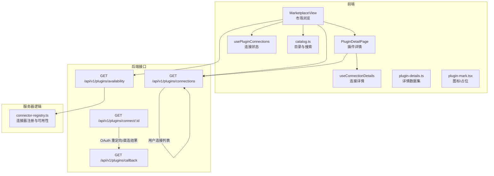
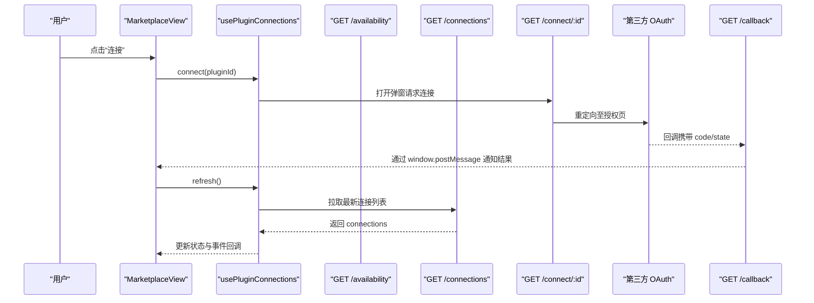
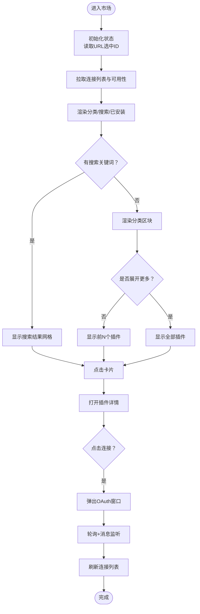
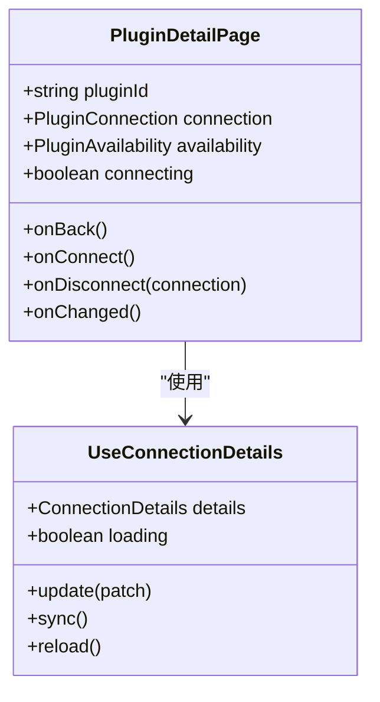
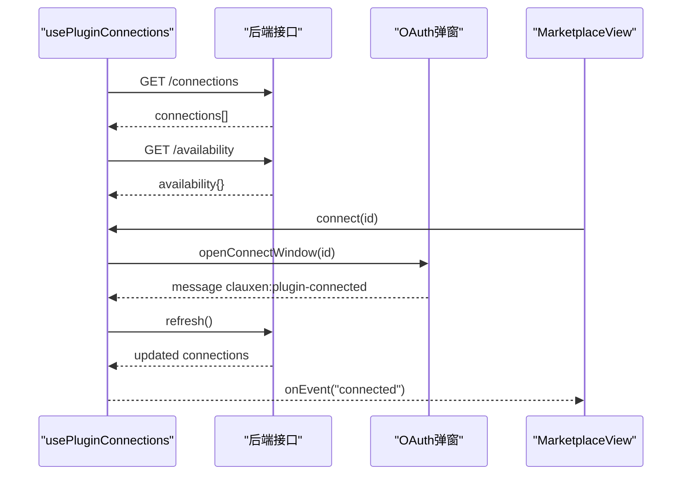
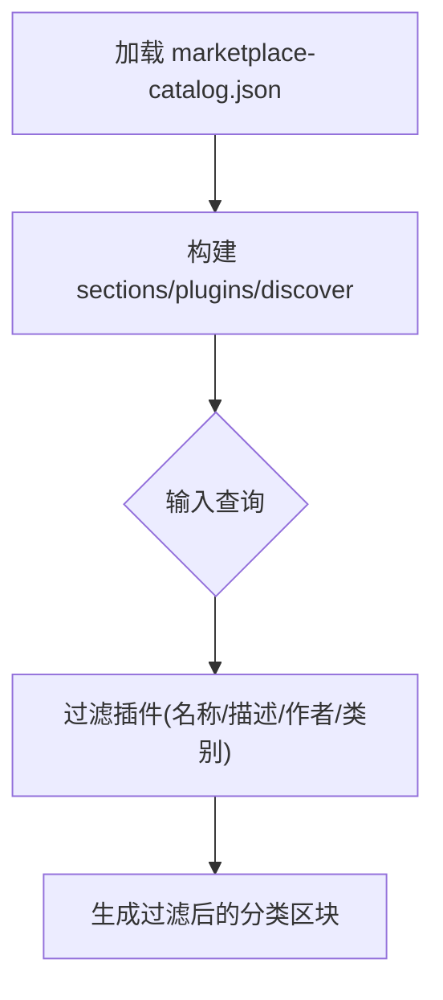
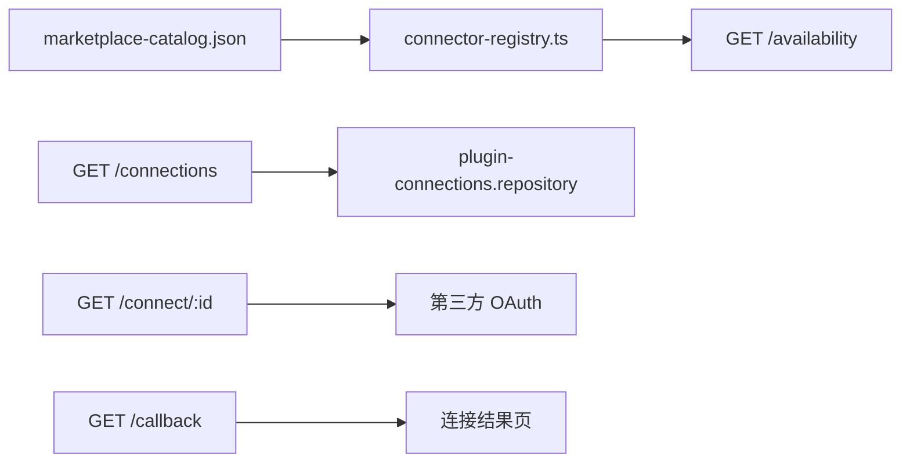
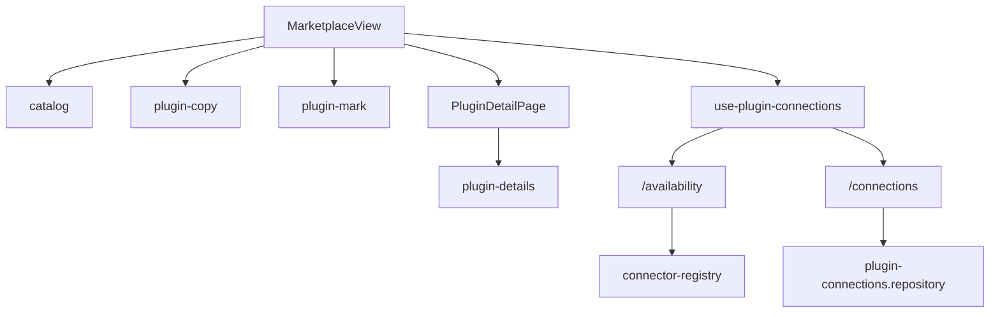

# 插件市场界面

<cite>
**本文引用的文件**   
- [marketplace-view.tsx](file://src/client/components/plugins/marketplace-view.tsx)
- [plugin-detail-page.tsx](file://src/client/components/plugins/plugin-detail-page.tsx)
- [use-plugin-connections.ts](file://src/client/components/plugins/use-plugin-connections.ts)
- [catalog.ts](file://src/client/components/plugins/catalog.ts)
- [types.ts](file://src/client/components/plugins/types.ts)
- [plugin-details.ts](file://src/client/components/plugins/plugin-details.ts)
- [plugin-copy.ts](file://src/client/components/plugins/plugin-copy.ts)
- [plugin-mark.tsx](file://src/client/components/plugins/plugin-mark.tsx)
- [route.ts（可用性接口）](file://src/app/api/v1/plugins/availability/route.ts)
- [route.ts（连接列表接口）](file://src/app/api/v1/plugins/connections/route.ts)
- [route.ts（连接启动接口）](file://src/app/api/v1/plugins/connect/[pluginId]/route.ts)
- [route.ts（回调接口）](file://src/app/api/v1/plugins/callback/route.ts)
- [connector-registry.ts](file://src/server/plugins/connector-registry.ts)
</cite>

## 目录
1. [简介](#简介)
2. [项目结构](#项目结构)
3. [核心组件](#核心组件)
4. [架构总览](#架构总览)
5. [详细组件分析](#详细组件分析)
6. [依赖关系分析](#依赖关系分析)
7. [性能与缓存策略](#性能与缓存策略)
8. [故障排查指南](#故障排查指南)
9. [结论](#结论)

## 简介
本文档聚焦于插件市场界面的前端实现、连接状态同步、目录管理与后端集成。重点覆盖：
- 市场浏览组件：分类展示、搜索、筛选、展开折叠、安装标签与“已安装”视图。
- 插件详情页面：权限模式、工具开关、资源与提示词展示、活动记录、重新授权与断开连接。
- 目录机制：静态目录 JSON、分类映射、插件匹配与过滤。
- 连接状态管理：`usePluginConnections` 与 `useConnectionDetails`，弹窗 OAuth、轮询与消息通道、乐观更新。
- UI 设计模式：卡片、状态胶囊、空状态、可访问性、移动端适配。
- 错误处理与加载状态：连接失败、弹窗拦截、断网或接口异常、刷新与重试。
- 优化建议：插件图标回退、懒加载、去抖搜索、服务端分页、缓存策略与体验改进。

## 项目结构
插件市场相关代码集中在客户端组件目录和对应 API 路由中，整体采用“前端视图 + Hook 状态层 + 后端接口 + 连接器注册表”的分层组织方式。

**图表来源**
- [marketplace-view.tsx:1-200](file://src/client/components/plugins/marketplace-view.tsx#L1-L200)
- [plugin-detail-page.tsx:1-200](file://src/client/components/plugins/plugin-detail-page.tsx#L1-L200)
- [use-plugin-connections.ts:1-200](file://src/client/components/plugins/use-plugin-connections.ts#L1-L200)
- [catalog.ts:1-52](file://src/client/components/plugins/catalog.ts#L1-L52)
- [route.ts（可用性接口）:1-25](file://src/app/api/v1/plugins/availability/route.ts#L1-L25)
- [route.ts（连接列表接口）:1-17](file://src/app/api/v1/plugins/connections/route.ts#L1-L17)
- [route.ts（连接启动接口）:1-77](file://src/app/api/v1/plugins/connect/[pluginId]/route.ts#L1-L77)
- [route.ts（回调接口）:1-70](file://src/app/api/v1/plugins/callback/route.ts#L1-L70)
- [connector-registry.ts:1-200](file://src/server/plugins/connector-registry.ts#L1-L200)

**章节来源**
- [marketplace-view.tsx:1-200](file://src/client/components/plugins/marketplace-view.tsx#L1-L200)
- [plugin-detail-page.tsx:1-200](file://src/client/components/plugins/plugin-detail-page.tsx#L1-L200)
- [use-plugin-connections.ts:1-200](file://src/client/components/plugins/use-plugin-connections.ts#L1-L200)
- [catalog.ts:1-52](file://src/client/components/plugins/catalog.ts#L1-L52)
- [route.ts（可用性接口）:1-25](file://src/app/api/v1/plugins/availability/route.ts#L1-L25)
- [route.ts（连接列表接口）:1-17](file://src/app/api/v1/plugins/connections/route.ts#L1-L17)
- [route.ts（连接启动接口）:1-77](file://src/app/api/v1/plugins/connect/[pluginId]/route.ts#L1-L77)
- [route.ts（回调接口）:1-70](file://src/app/api/v1/plugins/callback/route.ts#L1-L70)
- [connector-registry.ts:1-200](file://src/server/plugins/connector-registry.ts#L1-L200)

## 核心组件
- **MarketplaceView**：市场主视图，负责分类渲染、搜索、Tab 切换（发现/已安装）、打开插件详情、发起连接与断开连接、错误与成功 Toast 通知。
- **PluginDetailPage**：插件详情页，展示基本信息、权限模式、工具启用/禁用、资源与提示词、活动日志；提供刷新工具、重新授权、断开连接操作。
- **usePluginConnections**：连接生命周期 Hook，拉取连接列表与可用性、弹出 OAuth 窗口、监听跨源消息、轮询关闭、发起断开、暴露事件回调。
- **useConnectionDetails**：连接详情 Hook，拉取工具/资源/提示词/活动，支持乐观更新权限模式与工具开关，并提供手动刷新。
- **catalog.ts**：目录与搜索，解析静态目录 JSON，提供按 ID 获取、默认已安装、名称/描述/作者/类别模糊匹配、按查询过滤分类。
- **plugin-details.ts**：插件详情数据集（名称、开发者、能力、版本、隐私条款等）。
- **plugin-mark.tsx**：插件图标组件，支持 CDN 失败回退为本地路径，再失败显示首字母占位。
- **plugin-copy.ts**：文案清理与摘要截取，去除特定品牌词并规范化标点。

**章节来源**
- [marketplace-view.tsx:1-200](file://src/client/components/plugins/marketplace-view.tsx#L1-L200)
- [plugin-detail-page.tsx:1-200](file://src/client/components/plugins/plugin-detail-page.tsx#L1-L200)
- [use-plugin-connections.ts:1-200](file://src/client/components/plugins/use-plugin-connections.ts#L1-L200)
- [catalog.ts:1-52](file://src/client/components/plugins/catalog.ts#L1-L52)
- [plugin-details.ts:1-26](file://src/client/components/plugins/plugin-details.ts#L1-L26)
- [plugin-mark.tsx:1-66](file://src/client/components/plugins/plugin-mark.tsx#L1-L66)
- [plugin-copy.ts:1-32](file://src/client/components/plugins/plugin-copy.ts#L1-L32)

## 架构总览
插件市场从 UI 到后端的完整流程如下：

**图表来源**
- [marketplace-view.tsx:1-200](file://src/client/components/plugins/marketplace-view.tsx#L1-L200)
- [use-plugin-connections.ts:1-200](file://src/client/components/plugins/use-plugin-connections.ts#L1-L200)
- [route.ts（连接启动接口）:1-77](file://src/app/api/v1/plugins/connect/[pluginId]/route.ts#L1-L77)
- [route.ts（回调接口）:1-70](file://src/app/api/v1/plugins/callback/route.ts#L1-L70)
- [route.ts（连接列表接口）:1-17](file://src/app/api/v1/plugins/connections/route.ts#L1-L17)

## 详细组件分析

### MarketplaceView：市场浏览
- **功能要点**
  - 顶部标题与说明，移动端使用 MobilePageHeader。
  - 搜索框：实时过滤，清空按钮。
  - Tab 栏：“发现”与“已安装”，已安装数量动态显示。
  - 分类区块：标题映射、前 N 项预览、“查看更多”折叠/展开。
  - 搜索结果：平铺网格，无结果时显示空状态。
  - 插件卡片：图标、名称、描述、状态胶囊（已连接/需重新授权/即将推出/本地仅运行）、连接按钮。
  - URL 状态：通过 `?p=` 参数控制选中插件，popstate 同步。
  - 连接事件：连接成功/失败/关闭时触发 toast。

- **交互流程**
  - 点击卡片 → 设置 selectedId → 写入 URL → 滚动到顶部 → 渲染 PluginDetailPage。
  - 点击连接 → 可选鉴权检查 → 调用 usePluginConnections.connect。
  - 断开连接 → 调用 disconnect → 成功后 toast 提示。

- **状态与数据**
  - 本地状态：tab、query、expanded、selectedId。
  - 远端状态：connections、availability、loading、connectingId。
  - 计算值：connectionByPlugin、sections、searchResults、installed。

**图表来源**
- [marketplace-view.tsx:1-200](file://src/client/components/plugins/marketplace-view.tsx#L1-L200)
- [marketplace-view.tsx:201-536](file://src/client/components/plugins/marketplace-view.tsx#L201-L536)
- [use-plugin-connections.ts:1-200](file://src/client/components/plugins/use-plugin-connections.ts#L1-L200)

**章节来源**
- [marketplace-view.tsx:1-200](file://src/client/components/plugins/marketplace-view.tsx#L1-L200)
- [marketplace-view.tsx:201-536](file://src/client/components/plugins/marketplace-view.tsx#L201-L536)
- [catalog.ts:1-52](file://src/client/components/plugins/catalog.ts#L1-L52)

### PluginDetailPage：插件详情
- **功能要点**
  - 头部信息：图标、名称、开发者/类别、短描述。
  - 连接动作区：连接/重新授权/刷新工具/断开连接下拉菜单。
  - 已连接区域：权限模式选择、工具开关、资源列表、提示词列表、活动日志。
  - 关于与信息：概览、网站/隐私/条款链接。
  - 风险标签：读/写/破坏性，结合权限模式屏蔽不可用工具。

- **关键交互**
  - 刷新工具：调用 sync → 成功后 toast 并触发 onChanged。
  - 保存权限/工具开关：乐观更新本地 state → PATCH 接口 → 重新加载以核对。
  - 断开连接：二次确认式 UI（按钮禁用态），完成后触发父级刷新。

**图表来源**
- [plugin-detail-page.tsx:1-200](file://src/client/components/plugins/plugin-detail-page.tsx#L1-L200)
- [plugin-detail-page.tsx:201-574](file://src/client/components/plugins/plugin-detail-page.tsx#L201-L574)
- [use-plugin-connections.ts:201-296](file://src/client/components/plugins/use-plugin-connections.ts#L201-L296)

**章节来源**
- [plugin-detail-page.tsx:1-200](file://src/client/components/plugins/plugin-detail-page.tsx#L1-L200)
- [plugin-detail-page.tsx:201-574](file://src/client/components/plugins/plugin-detail-page.tsx#L201-L574)
- [use-plugin-connections.ts:201-296](file://src/client/components/plugins/use-plugin-connections.ts#L201-L296)

### use-plugin-connections：连接状态同步
- **核心职责**
  - 拉取 `/api/v1/plugins/connections` 与 `/api/v1/plugins/availability`。
  - 打开第三方 OAuth 弹窗 `/api/v1/plugins/connect/:id`。
  - 监听 `window.message` 接收连接成功/失败信号。
  - 轮询弹窗关闭状态，避免悬挂连接。
  - 暴露 connect、disconnect、refresh 方法，并通过 onEvent 回调通知上层。

- **数据结构**
  - PluginConnection：连接元数据（不含凭据），包含状态、权限模式、工具数、账户标签、时间戳。
  - PluginAvailability：插件是否可连接、类型（mcp/rest/local-only）、提供方标签、原因。
  - ConnectionDetails：工具、资源、提示词、活动日志。

- **错误处理**
  - getJson 统一包装响应体，非 ok 或无 data 抛出错误。
  - 连接失败通过事件传递 message。
  - 弹窗被拦截时降级为当前标签页跳转。

**图表来源**
- [use-plugin-connections.ts:1-200](file://src/client/components/plugins/use-plugin-connections.ts#L1-L200)
- [use-plugin-connections.ts:201-296](file://src/client/components/plugins/use-plugin-connections.ts#L201-L296)

**章节来源**
- [use-plugin-connections.ts:1-200](file://src/client/components/plugins/use-plugin-connections.ts#L1-L200)
- [use-plugin-connections.ts:201-296](file://src/client/components/plugins/use-plugin-connections.ts#L201-L296)

### 目录管理机制
- **静态目录**：`marketplace-catalog.json` 经 catalog.ts 导出 marketplaceCatalog，提供 sections、plugins、discover。
- **插件匹配**：pluginMatches 对名称、描述、作者、类别进行不区分大小写的模糊匹配。
- **分类过滤**：filteredSections 支持只保留已安装集合的交集。
- **默认已安装**：defaultInstalledIds 用于预置标记。

**图表来源**
- [catalog.ts:1-52](file://src/client/components/plugins/catalog.ts#L1-L52)

**章节来源**
- [catalog.ts:1-52](file://src/client/components/plugins/catalog.ts#L1-L52)
- [types.ts:1-27](file://src/client/components/plugins/types.ts#L1-L27)

### 后端接口与连接器注册
- **可用性接口**：遍历目录插件，调用 connectorAvailability 汇总可用性与原因。
- **连接列表接口**：认证用户后列出连接，未登录返回空数组。
- **连接启动接口**：根据会话与插件开始连接，直接重定向到提供方或返回直连结果页。
- **回调接口**：校验 state/code，完成连接并将结果回传给前端弹窗。
- **连接器注册**：定义 MCP/REST 两类连接器，维护提供方配置、作用域、MCP 地址与覆盖规则。

**图表来源**
- [route.ts（可用性接口）:1-25](file://src/app/api/v1/plugins/availability/route.ts#L1-L25)
- [route.ts（连接列表接口）:1-17](file://src/app/api/v1/plugins/connections/route.ts#L1-L17)
- [route.ts（连接启动接口）:1-77](file://src/app/api/v1/plugins/connect/[pluginId]/route.ts#L1-L77)
- [route.ts（回调接口）:1-70](file://src/app/api/v1/plugins/callback/route.ts#L1-L70)
- [connector-registry.ts:1-200](file://src/server/plugins/connector-registry.ts#L1-L200)

**章节来源**
- [route.ts（可用性接口）:1-25](file://src/app/api/v1/plugins/availability/route.ts#L1-L25)
- [route.ts（连接列表接口）:1-17](file://src/app/api/v1/plugins/connections/route.ts#L1-L17)
- [route.ts（连接启动接口）:1-77](file://src/app/api/v1/plugins/connect/[pluginId]/route.ts#L1-L77)
- [route.ts（回调接口）:1-70](file://src/app/api/v1/plugins/callback/route.ts#L1-L70)
- [connector-registry.ts:1-200](file://src/server/plugins/connector-registry.ts#L1-L200)

## 依赖关系分析
- MarketplaceView 依赖 catalog、plugin-copy、plugin-mark、use-plugin-connections、PluginDetailPage。
- PluginDetailPage 依赖 catalog、plugin-copy、plugin-details、use-plugin-connections。
- use-plugin-connections 依赖 sessionFetch 与多个 API 路由。
- 后端可用性接口依赖 connector-registry。
- 连接列表接口依赖插件连接仓库。

**图表来源**
- [marketplace-view.tsx:1-200](file://src/client/components/plugins/marketplace-view.tsx#L1-L200)
- [plugin-detail-page.tsx:1-200](file://src/client/components/plugins/plugin-detail-page.tsx#L1-L200)
- [use-plugin-connections.ts:1-200](file://src/client/components/plugins/use-plugin-connections.ts#L1-L200)
- [route.ts（可用性接口）:1-25](file://src/app/api/v1/plugins/availability/route.ts#L1-L25)
- [route.ts（连接列表接口）:1-17](file://src/app/api/v1/plugins/connections/route.ts#L1-L17)
- [connector-registry.ts:1-200](file://src/server/plugins/connector-registry.ts#L1-L200)

**章节来源**
- [marketplace-view.tsx:1-200](file://src/client/components/plugins/marketplace-view.tsx#L1-L200)
- [plugin-detail-page.tsx:1-200](file://src/client/components/plugins/plugin-detail-page.tsx#L1-L200)
- [use-plugin-connections.ts:1-200](file://src/client/components/plugins/use-plugin-connections.ts#L1-L200)

## 性能与缓存策略
- **插件图标优化**
  - 优先使用 CDN 地址；若失败则尝试本地镜像路径；仍失败显示首字母占位，降低布局抖动。
  - 建议使用图片懒加载与解码异步，减少首屏压力。
- **搜索与筛选**
  - 当前为即时匹配，建议在大数据量场景引入防抖与后端索引。
  - 分类预览默认固定数量，避免一次性渲染过多 DOM。
- **连接状态同步**
  - 初始拉取连接列表与可用性；连接成功后通过消息事件与轮询刷新。
  - 建议加入指数退避轮询与网络离线检测。
- **乐观更新**
  - 权限模式与工具开关先更新 UI，再向后端提交，最后重新加载以对齐真实状态。
- **缓存策略建议**
  - 目录与插件详情数据集可考虑浏览器缓存或应用内内存缓存。
  - 可用性接口可使用短期缓存（如 1-5 分钟），避免频繁探测后端。
  - 连接列表在用户活跃时可适当延长刷新间隔。

[本节为通用性能建议，不直接分析具体文件]

## 故障排查指南
- **连接弹窗被拦截**
  - 现象：无法弹出 OAuth 窗口。
  - 行为：自动降级为在当前标签页跳转到连接接口。
  - 处理：引导用户允许弹窗，或在桌面端重新尝试。
- **连接失败**
  - 现象：弹窗返回失败消息。
  - 行为：触发 failed 事件，toast 显示错误信息。
  - 处理：检查网络、提供方配置、会话状态。
- **需要重新授权**
  - 现象：状态为 reauthorization_required。
  - 行为：UI 显示“重新连接”，点击后再次走连接流程。
  - 处理：检查第三方平台令牌过期或撤销。
- **断开连接失败**
  - 现象：删除连接接口报错。
  - 行为：捕获错误并 toast 提示。
  - 处理：重试或联系管理员检查权限。
- **工具刷新失败**
  - 现象：sync 接口报错。
  - 行为：toast 提示“无法刷新工具”。
  - 处理：检查插件连通性、权限与作用域。

**章节来源**
- [use-plugin-connections.ts:1-200](file://src/client/components/plugins/use-plugin-connections.ts#L1-L200)
- [plugin-detail-page.tsx:201-574](file://src/client/components/plugins/plugin-detail-page.tsx#L201-L574)
- [route.ts（连接启动接口）:1-77](file://src/app/api/v1/plugins/connect/[pluginId]/route.ts#L1-L77)
- [route.ts（回调接口）:1-70](file://src/app/api/v1/plugins/callback/route.ts#L1-L70)

## 结论
插件市场界面通过清晰的组件分层、稳定的状态管理与完善的后端集成，实现了从浏览、搜索、筛选到连接、配置、监控的完整用户体验。核心优势包括：
- 直观的卡片与状态标识，配合空状态与帮助文案。
- 灵活的目录机制与搜索过滤，支持分类与已安装视图。
- 健壮的连接流程，支持弹窗 OAuth、消息同步与轮询兜底。
- 乐观更新提升交互流畅度，同时保持与服务端一致。
未来可在搜索性能、图标缓存、连接轮询策略与数据缓存方面进一步优化，以提升大规模插件场景下的体验与性能。

[本节为总结性内容，不直接分析具体文件]