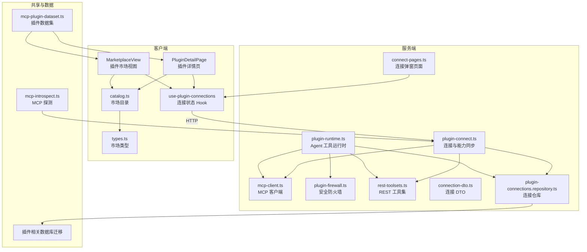
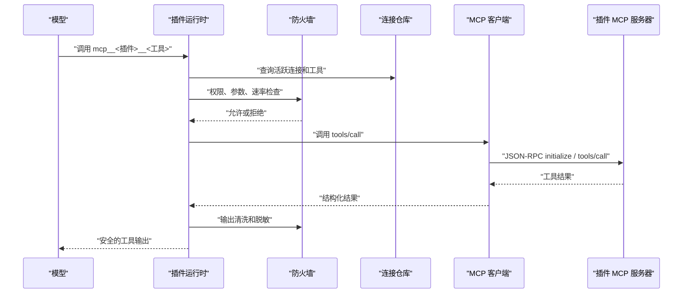
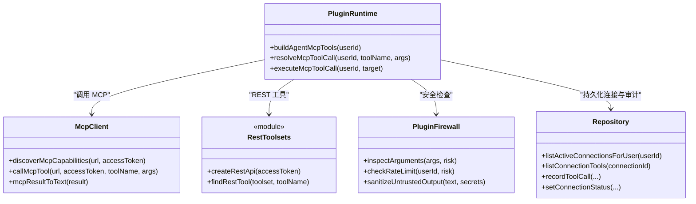
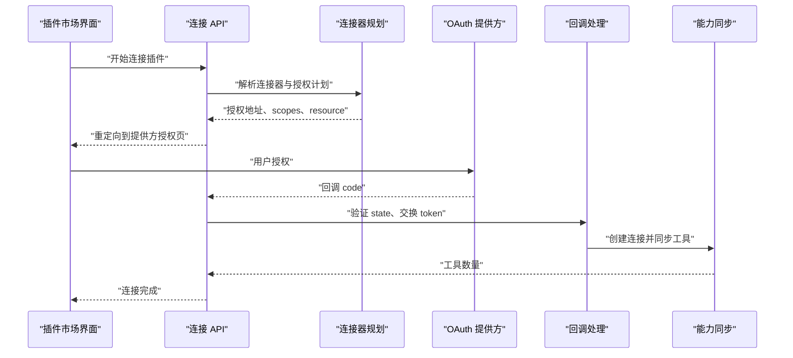
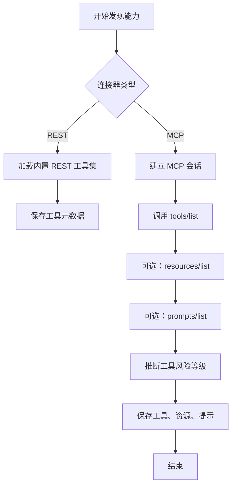
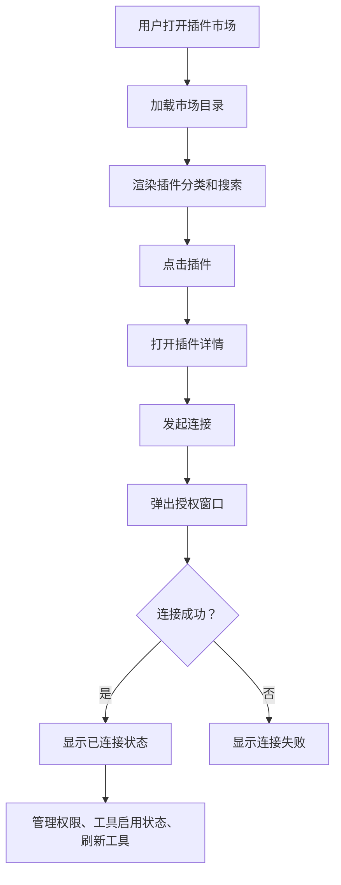
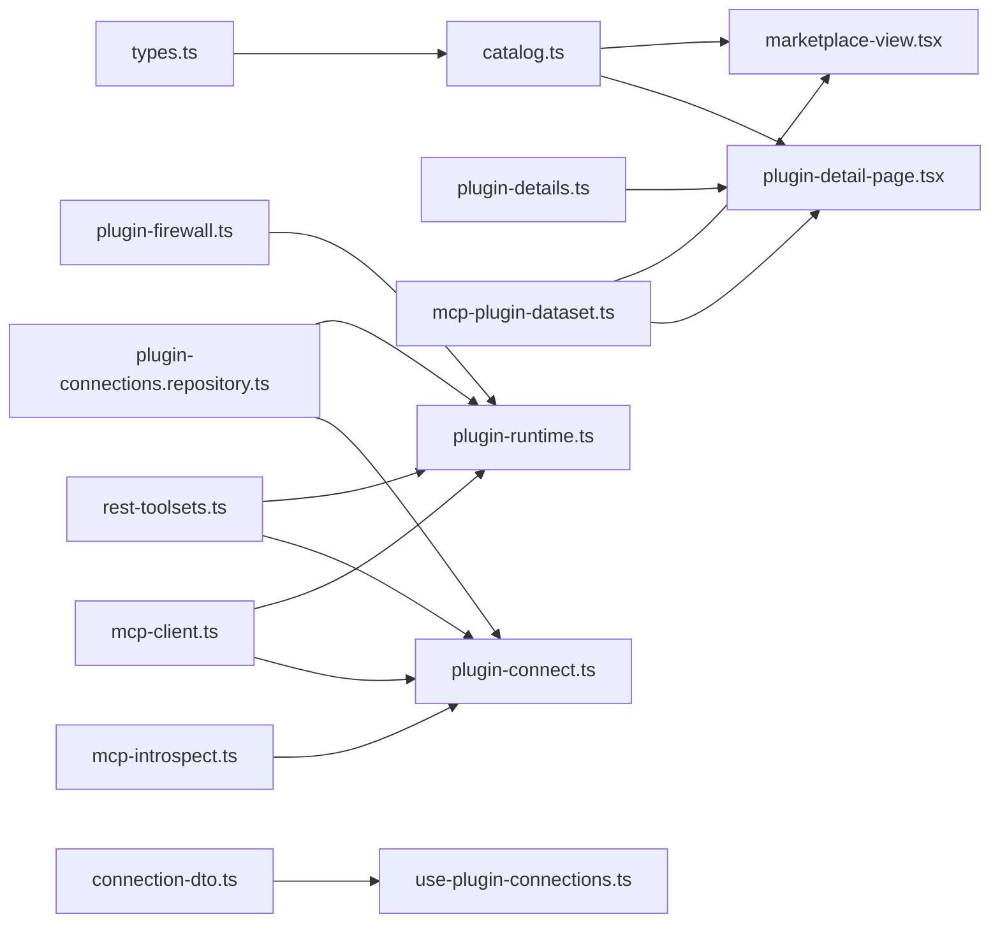
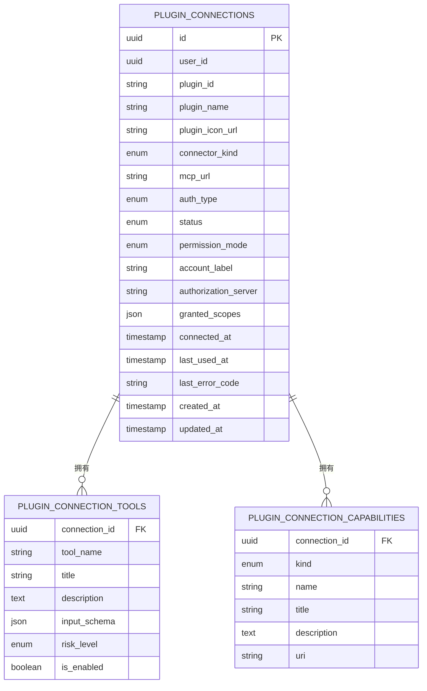

# 插件开发指南

<cite>
**本文引用的文件**   
- [plugin-runtime.ts](file://src/server/plugins/plugin-runtime.ts)
- [mcp-client.ts](file://src/server/plugins/mcp-client.ts)
- [plugin-connect.ts](file://src/server/plugins/plugin-connect.ts)
- [connection-dto.ts](file://src/server/plugins/connection-dto.ts)
- [rest-toolsets.ts](file://src/server/plugins/rest-toolsets.ts)
- [plugin-firewall.ts](file://src/server/plugins/plugin-firewall.ts)
- [connect-pages.ts](file://src/server/plugins/connect-pages.ts)
- [plugin-connections.repository.ts](file://src/server/repositories/plugin-connections.repository.ts)
- [types.ts](file://src/client/components/plugins/types.ts)
- [catalog.ts](file://src/client/components/plugins/catalog.ts)
- [plugin-details.ts](file://src/client/components/plugins/plugin-details.ts)
- [use-plugin-connections.ts](file://src/client/components/plugins/use-plugin-connections.ts)
- [marketplace-view.tsx](file://src/client/components/plugins/marketplace-view.tsx)
- [plugin-detail-page.tsx](file://src/client/components/plugins/plugin-detail-page.tsx)
- [mcp-plugin-dataset.ts](file://src/shared/lib/mcp-plugin-dataset.ts)
- [mcp-introspect.ts](file://src/shared/lib/mcp-introspect.ts)
- [20261002173000_plugin_connections.sql](file://supabase/migrations/20261002173000_plugin_connections.sql)
- [20261026120000_plugin_native_oauth.sql](file://supabase/migrations/20261026120000_plugin_native_oauth.sql)
</cite>

## 目录

1. [引言](#引言)
2. [项目结构](#项目结构)
3. [核心组件](#核心组件)
4. [架构总览](#架构总览)
5. [详细组件分析](#详细组件分析)
6. [依赖关系分析](#依赖关系分析)
7. [性能与安全特性](#性能与安全特性)
8. [开发环境与本地测试](#开发环境与本地测试)
9. [插件包结构与元数据规范](#插件包结构与元数据规范)
10. [连接、认证与 MCP 工具定义](#连接认证与-mcp-工具定义)
11. [打包、发布与维护流程](#打包发布与维护流程)
12. [故障排查指南](#故障排查指南)
13. [结论](#结论)

## 引言

本指南面向需要为当前平台编写扩展插件的开发者。系统支持两类插件：

- **MCP 插件**：实现标准 Model Context Protocol，通过 Streamable HTTP JSON-RPC 暴露 `tools/list` 和 `tools/call`。
- **REST 内置工具集**：当目标服务没有可用 MCP 服务器时，平台以 REST 工具集形式提供受控 API 调用。

插件在用户侧表现为“已连接的应用”，在模型侧表现为命名形如 `mcp__<插件>__<工具>` 的函数式工具。所有凭证由服务端注入，模型不会直接看到令牌；所有输入输出均经过防火墙校验、速率限制、输出清洗和审计追踪。

## 项目结构

插件相关代码分布在服务端运行时、前端插件市场界面、共享数据集以及数据库迁移中。

**图表来源**
- [marketplace-view.tsx:1-200](file://src/client/components/plugins/marketplace-view.tsx#L1-L200)
- [plugin-detail-page.tsx:1-200](file://src/client/components/plugins/plugin-detail-page.tsx#L1-L200)
- [use-plugin-connections.ts:1-200](file://src/client/components/plugins/use-plugin-connections.ts#L1-L200)
- [plugin-runtime.ts:1-200](file://src/server/plugins/plugin-runtime.ts#L1-L200)
- [mcp-client.ts:1-200](file://src/server/plugins/mcp-client.ts#L1-L200)
- [plugin-connect.ts:1-200](file://src/server/plugins/plugin-connect.ts#L1-L200)
- [mcp-plugin-dataset.ts:1-200](file://src/shared/lib/mcp-plugin-dataset.ts#L1-L200)
- [plugin-connections.repository.ts:1-200](file://src/server/repositories/plugin-connections.repository.ts#L1-L200)

**章节来源**
- [marketplace-view.tsx:1-200](file://src/client/components/plugins/marketplace-view.tsx#L1-L200)
- [plugin-detail-page.tsx:1-200](file://src/client/components/plugins/plugin-detail-page.tsx#L1-L200)
- [plugin-runtime.ts:1-200](file://src/server/plugins/plugin-runtime.ts#L1-L200)
- [mcp-plugin-dataset.ts:1-200](file://src/shared/lib/mcp-plugin-dataset.ts#L1-L200)

## 核心组件

### Agent 工具运行时

运行时负责把用户的插件连接转换为聊天 Agent 可用的工具。它执行以下职责：

- 加载用户活跃连接及其工具。
- 将工具注册为 Agent 函数。
- 将工具调用解析到具体连接和工具。
- 调用 REST 工具集或远程 MCP 工具。
- 应用权限模式、参数检查、速率限制、凭据注入和输出清洗。
- 记录审计日志并更新连接使用信息。

关键行为包括：

- 直接暴露的工具数量上限为 48，超出部分通过搜索工具发现。
- 工具名称格式为 `mcp__<插件标识>__<工具名>`。
- 工具风险等级分为只读、写入和破坏性三类。
- 连接权限模式为只读或读写，只读模式下禁止写入和破坏性工具。
- 调用失败时可能触发重新授权提示。

**章节来源**
- [plugin-runtime.ts:1-200](file://src/server/plugins/plugin-runtime.ts#L1-L200)
- [plugin-runtime.ts:201-370](file://src/server/plugins/plugin-runtime.ts#L201-L370)

### MCP 客户端

MCP 客户端是服务端专用组件，用于与远端 MCP 服务器建立会话、列举工具和调用工具。它支持：

- JSON-RPC 2.0。
- Streamable HTTP 传输。
- SSE 分帧响应。
- Bearer 认证。
- 会话头 `mcp-session-id`。
- 工具、资源、提示的列表分页。

典型错误码包括未授权、禁止访问、未找到、超时、协议错误和不可用。

**章节来源**
- [mcp-client.ts:1-200](file://src/server/plugins/mcp-client.ts#L1-L200)
- [mcp-client.ts:201-428](file://src/server/plugins/mcp-client.ts#L201-L428)

### 插件连接与 OAuth

连接流程围绕 OAuth 2.0 展开：

- 启动连接时生成 state 和 PKCE code verifier。
- 根据连接器类型选择 REST 或 MCP 计划。
- MCP 连接器可动态发现授权服务器、受保护资源和 scopes。
- 回调完成后交换 token，保存连接和密封令牌。
- 连接成功后同步工具、资源和提示。
- 断开连接时尝试撤销 provider 令牌并删除本地密钥。

**章节来源**
- [plugin-connect.ts:1-200](file://src/server/plugins/plugin-connect.ts#L1-L200)
- [plugin-connect.ts:201-524](file://src/server/plugins/plugin-connect.ts#L201-L524)

### 安全防火墙

防火墙是插件调用的统一安全边界：

- 限制参数大小。
- 阻止写操作中携带疑似凭证的参数。
- 按用户统计每分钟调用次数。
- 对写操作设置更严格速率。
- 清理不可见字符、HTML 注释、脚本样式。
- 替换可疑指令行。
- 脱敏常见密钥、令牌、API Key 模式。
- 截断过长输出并标记为外部数据。

**章节来源**
- [plugin-firewall.ts:1-167](file://src/server/plugins/plugin-firewall.ts#L1-L167)

### REST 工具集

对于没有合适 MCP 服务器的提供商，平台提供内置 REST 工具集。示例包括 Google Drive、Outlook、OneDrive、Teams、SharePoint 等。每个工具定义包含名称、标题、描述、风险等级、输入 Schema 和执行函数。

**章节来源**
- [rest-toolsets.ts:1-200](file://src/server/plugins/rest-toolsets.ts#L1-L200)

### 连接页面

连接弹窗页面是一个最小 HTML 页面，用于向主应用发送 postMessage 结果并关闭自身。它包含：

- 成功与失败的卡片样式。
- 基于 origin 的安全 postMessage。
- CSP、Referrer Policy 和 X-Frame-Options 头。
- 返回插件页面的链接。

**章节来源**
- [connect-pages.ts:1-99](file://src/server/plugins/connect-pages.ts#L1-L99)

### 连接数据模型

连接实体记录用户、插件、连接器类型、认证方式、状态、权限模式、账户标签、授权服务器、granted scopes、时间戳等。工具表记录工具名、标题、描述、输入 Schema、风险等级和启用状态。

**章节来源**
- [plugin-connections.repository.ts:1-200](file://src/server/repositories/plugin-connections.repository.ts#L1-L200)
- [20261002173000_plugin_connections.sql:10-207](file://supabase/migrations/20261002173000_plugin_connections.sql#L10-L207)
- [20261026120000_plugin_native_oauth.sql:10-156](file://supabase/migrations/20261026120000_plugin_native_oauth.sql#L10-L156)

## 架构总览

下图展示一次模型调用插件工具的完整路径。

**图表来源**
- [plugin-runtime.ts:1-200](file://src/server/plugins/plugin-runtime.ts#L1-L200)
- [plugin-runtime.ts:201-370](file://src/server/plugins/plugin-runtime.ts#L201-L370)
- [mcp-client.ts:1-200](file://src/server/plugins/mcp-client.ts#L1-L200)
- [plugin-firewall.ts:1-167](file://src/server/plugins/plugin-firewall.ts#L1-L167)

## 详细组件分析

### 插件运行时类与方法

**图表来源**
- [plugin-runtime.ts:1-200](file://src/server/plugins/plugin-runtime.ts#L1-L200)
- [plugin-runtime.ts:201-370](file://src/server/plugins/plugin-runtime.ts#L201-L370)
- [mcp-client.ts:201-428](file://src/server/plugins/mcp-client.ts#L201-L428)
- [rest-toolsets.ts:1-200](file://src/server/plugins/rest-toolsets.ts#L1-L200)
- [plugin-firewall.ts:1-167](file://src/server/plugins/plugin-firewall.ts#L1-L167)
- [plugin-connections.repository.ts:1-200](file://src/server/repositories/plugin-connections.repository.ts#L1-L200)

### 插件连接序列图

**图表来源**
- [plugin-connect.ts:1-200](file://src/server/plugins/plugin-connect.ts#L1-L200)
- [plugin-connect.ts:201-524](file://src/server/plugins/plugin-connect.ts#L201-L524)
- [use-plugin-connections.ts:1-200](file://src/client/components/plugins/use-plugin-connections.ts#L1-L200)

### 工具发现流程图

**图表来源**
- [plugin-connect.ts:430-524](file://src/server/plugins/plugin-connect.ts#L430-L524)
- [mcp-client.ts:201-428](file://src/server/plugins/mcp-client.ts#L201-L428)

### 插件市场与详情交互

**图表来源**
- [marketplace-view.tsx:1-200](file://src/client/components/plugins/marketplace-view.tsx#L1-L200)
- [plugin-detail-page.tsx:1-200](file://src/client/components/plugins/plugin-detail-page.tsx#L1-L200)
- [use-plugin-connections.ts:1-200](file://src/client/components/plugins/use-plugin-connections.ts#L1-L200)

**章节来源**
- [plugin-runtime.ts:1-370](file://src/server/plugins/plugin-runtime.ts#L1-L370)
- [plugin-connect.ts:1-524](file://src/server/plugins/plugin-connect.ts#L1-L524)
- [mcp-client.ts:1-428](file://src/server/plugins/mcp-client.ts#L1-L428)
- [marketplace-view.tsx:1-200](file://src/client/components/plugins/marketplace-view.tsx#L1-L200)
- [plugin-detail-page.tsx:1-200](file://src/client/components/plugins/plugin-detail-page.tsx#L1-L200)

## 依赖关系分析

**图表来源**
- [types.ts:1-27](file://src/client/components/plugins/types.ts#L1-L27)
- [catalog.ts:1-52](file://src/client/components/plugins/catalog.ts#L1-L52)
- [plugin-details.ts:1-26](file://src/client/components/plugins/plugin-details.ts#L1-L26)
- [mcp-plugin-dataset.ts:1-200](file://src/shared/lib/mcp-plugin-dataset.ts#L1-L200)
- [plugin-connections.repository.ts:1-200](file://src/server/repositories/plugin-connections.repository.ts#L1-L200)
- [plugin-runtime.ts:1-200](file://src/server/plugins/plugin-runtime.ts#L1-L200)
- [plugin-connect.ts:1-200](file://src/server/plugins/plugin-connect.ts#L1-L200)
- [mcp-client.ts:1-200](file://src/server/plugins/mcp-client.ts#L1-L200)
- [mcp-introspect.ts:1-200](file://src/shared/lib/mcp-introspect.ts#L1-L200)

**章节来源**
- [types.ts:1-27](file://src/client/components/plugins/types.ts#L1-L27)
- [catalog.ts:1-52](file://src/client/components/plugins/catalog.ts#L1-L52)
- [plugin-connections.repository.ts:1-200](file://src/server/repositories/plugin-connections.repository.ts#L1-L200)
- [plugin-runtime.ts:1-200](file://src/server/plugins/plugin-runtime.ts#L1-L200)

## 性能与安全特性

### 性能特性

- 插件工具目录最多直接暴露 48 个工具，其余通过搜索发现，避免过度填充 Agent 上下文。
- MCP 列表方法采用分页，最多读取 5 页。
- 数据集索引在服务进程内构建一次，避免重复扫描。
- 工具调用审计日志包含耗时字段。
- 连接查询按最近使用时间排序，减少无关连接干扰。

### 安全特性

- 模型不持有任何插件令牌。
- 参数序列化后检查长度和内容。
- 非只读工具不允许传递疑似密钥、令牌或密码。
- 每分钟调用次数限制默认 40 次，写操作限制更低。
- 输出清洗移除不可见字符、脚本、注释、可疑指令和敏感字符串。
- 输出被标记为外部数据，提醒模型不要盲从。
- 连接弹窗页面禁用 frame、表单和基础 URI 导航，并使用 nonce 限制脚本。

**章节来源**
- [plugin-runtime.ts:1-200](file://src/server/plugins/plugin-runtime.ts#L1-L200)
- [mcp-client.ts:201-428](file://src/server/plugins/mcp-client.ts#L201-L428)
- [mcp-plugin-dataset.ts:150-254](file://src/shared/lib/mcp-plugin-dataset.ts#L150-L254)
- [plugin-firewall.ts:1-167](file://src/server/plugins/plugin-firewall.ts#L1-L167)
- [connect-pages.ts:1-99](file://src/server/plugins/connect-pages.ts#L1-L99)

## 开发环境与本地测试

### 环境要求

- Node.js 运行环境。
- TypeScript 编译配置。
- 后端依赖 PostgreSQL 和 Supabase 迁移。
- 若需要调试 MCP 服务器，准备一个支持 Streamable HTTP 的 MCP 服务。

### 本地运行建议

- 先执行数据库迁移，确保插件连接、工具表和 API Key 表存在。
- 使用开发环境变量配置应用 URL、OAuth 提供方和必要密钥。
- 若测试内置 REST 工具集，需配置对应提供商的 OAuth 客户端。
- 若测试 MCP 插件，可使用本地 MCP 服务器或公开 MCP 端点。

### 本地测试方法

- 打开插件市场页面，查看插件列表是否来自市场目录。
- 对无认证的 MCP 插件，尝试直接连接并观察工具是否同步。
- 对需要 OAuth 的插件，确认跳转至提供方授权页、回调后返回插件页面。
- 在插件详情页检查工具列表、风险等级、启用开关和最后使用时间。
- 在聊天中触发插件工具调用，观察防火墙拦截、重试和重新授权提示。
- 检查审计日志是否记录调用状态、风险等级和耗时。

**章节来源**
- [20261002173000_plugin_connections.sql:10-207](file://supabase/migrations/20261002173000_plugin_connections.sql#L10-L207)
- [20261026120000_plugin_native_oauth.sql:10-156](file://supabase/migrations/20261026120000_plugin_native_oauth.sql#L10-L156)
- [use-plugin-connections.ts:1-200](file://src/client/components/plugins/use-plugin-connections.ts#L1-L200)
- [marketplace-view.tsx:1-200](file://src/client/components/plugins/marketplace-view.tsx#L1-L200)

## 插件包结构与元数据规范

### 插件包结构

当前仓库中的插件元数据主要由两部分组成：

1. **市场目录**：定义插件 ID、名称、描述、作者、图标、分类、安装状态和分组。
2. **插件详情数据集**：提供更详细的介绍、开发者、版本、网站、隐私政策、术语、提示词、应用和技能说明。

推荐插件包至少包含：

- 稳定的插件 ID。
- 人类可读的名称和简短描述。
- 清晰的图标 URL。
- 准确的分类。
- 必要的法律和联系方式链接。
- 对外暴露的 MCP 服务器地址或 REST 工具集标识。
- 语义化版本号。

### 市场目录类型

市场目录包含三部分：

- discover：发现源列表。
- sections：分类区块及对应插件 ID。
- plugins：插件详细信息映射。

每个插件包含：

- id
- name
- description
- author
- iconUrl
- category
- installed

**章节来源**
- [types.ts:1-27](file://src/client/components/plugins/types.ts#L1-L27)
- [catalog.ts:1-52](file://src/client/components/plugins/catalog.ts#L1-L52)

### 插件详情类型

插件详情包含：

- id
- name
- author
- shortDescription
- overview
- iconUrl
- capabilities
- developer
- category
- version
- websiteUrl
- privacyUrl
- termsUrl
- prompts
- apps
- skills

该类型由客户端插件详情模块加载，用于详情页展示。

**章节来源**
- [plugin-details.ts:1-26](file://src/client/components/plugins/plugin-details.ts#L1-L26)

### 公共 MCP 插件数据集

公共数据集用于构建插件发现索引，包含：

- plugin.id
- plugin.name
- plugin.displayName
- plugin.description
- plugin.logoUrl
- plugin.tags
- plugin.curatedCategories
- plugin.publisher
- plugin.createdAt
- plugin.updatedAt
- plugin.mcp.servers
- plugin.declaredMcpServers
- plugin.skills
- plugin.commands
- plugin.hooks
- plugin.rules
- plugin.subagents

数据集由爬虫脚本生成并随仓库提交，服务端在进程内缓存。

**章节来源**
- [mcp-plugin-dataset.ts:1-200](file://src/shared/lib/mcp-plugin-dataset.ts#L1-L200)
- [mcp-plugin-dataset.ts:201-254](file://src/shared/lib/mcp-plugin-dataset.ts#L201-L254)

### 图标配置

图标来源优先级如下：

1. 插件详情中的 iconUrl。
2. 市场目录中的 iconUrl。
3. 连接记录中的插件图标 URL。

插件应提供稳定、可访问且尺寸合理的图标 URL。建议使用透明背景 PNG 或 SVG。

**章节来源**
- [plugin-detail-page.tsx:1-200](file://src/client/components/plugins/plugin-detail-page.tsx#L1-L200)
- [types.ts:1-27](file://src/client/components/plugins/types.ts#L1-L27)

### 描述文件结构

推荐描述文件结构：

| 字段 | 用途 | 建议 |
|---|---|---|
| id | 唯一标识 | 使用小写字母、数字、短横线 |
| name | 显示名称 | 简洁明确 |
| shortDescription | 一行简介 | 适合列表展示 |
| overview | 详细说明 | 解释能力、权限和注意事项 |
| iconUrl | 图标地址 | 可缓存、跨域可控 |
| category | 分类 | 与市场分类对齐 |
| version | 版本 | 遵循语义化版本 |
| websiteUrl | 官网 | 帮助文档和问题反馈 |
| privacyUrl | 隐私政策 | 说明数据处理方式 |
| termsUrl | 使用条款 | 说明限制和责任 |
| capabilities | 能力摘要 | 列出主要 MCP 工具或 REST 功能 |

**章节来源**
- [plugin-details.ts:1-26](file://src/client/components/plugins/plugin-details.ts#L1-L26)
- [marketplace-view.tsx:1-200](file://src/client/components/plugins/marketplace-view.tsx#L1-L200)

## 连接、认证与 MCP 工具定义

### MCP 工具定义

MCP 工具定义包含：

- name：工具名。
- description：工具描述。
- inputSchema：JSON Schema 形式的输入参数。

运行时将这些定义转为 Agent 工具，并将 schema 作为模型可调用的参数结构。

**章节来源**
- [mcp-client.ts:1-200](file://src/server/plugins/mcp-client.ts#L1-L200)
- [plugin-runtime.ts:1-200](file://src/server/plugins/plugin-runtime.ts#L1-L200)

### 工具风险等级推断

工具风险等级由注解和名称启发式推断：

- annotations.destructiveHint 为 true 时标记为破坏性。
- annotations.readOnlyHint 为 true 时标记为只读。
- 名称匹配删除、销毁、终止等动词时标记为破坏性。
- 名称匹配获取、列表、搜索、读取、查询等动词时标记为只读。
- 其他情况默认为写入。

**章节来源**
- [plugin-connect.ts:430-524](file://src/server/plugins/plugin-connect.ts#L430-L524)

### 连接数据模型

**图表来源**
- [plugin-connections.repository.ts:1-200](file://src/server/repositories/plugin-connections.repository.ts#L1-L200)
- [20261002173000_plugin_connections.sql:10-207](file://supabase/migrations/20261002173000_plugin_connections.sql#L10-L207)
- [20261026120000_plugin_native_oauth.sql:112-156](file://supabase/migrations/20261026120000_plugin_native_oauth.sql#L112-L156)

### 连接 DTO

连接 DTO 是客户端安全视图，不包含令牌材料，仅暴露：

- id
- pluginId
- pluginName
- pluginIconUrl
- connectorKind
- authType
- status
- permissionMode
- accountLabel
- grantedScopes
- toolCount
- connectedAt
- lastUsedAt

**章节来源**
- [connection-dto.ts:1-20](file://src/server/plugins/connection-dto.ts#L1-L20)

### MCP 探测

服务端还提供轻量 MCP 探测接口，用于在不具备完整连接流程的情况下探测远端 MCP 服务器是否可用、是否需要认证、是否暴露工具。

**章节来源**
- [mcp-introspect.ts:1-200](file://src/shared/lib/mcp-introspect.ts#L1-L200)

**章节来源**
- [plugin-connect.ts:201-524](file://src/server/plugins/plugin-connect.ts#L201-L524)
- [plugin-connections.repository.ts:1-200](file://src/server/repositories/plugin-connections.repository.ts#L1-L200)
- [mcp-introspect.ts:1-200](file://src/shared/lib/mcp-introspect.ts#L1-L200)

## 打包、发布与维护流程

### 插件打包

插件不需要像传统 npm 包那样被平台统一分发。平台主要通过以下方式识别插件：

- 公共 MCP 插件数据集。
- 市场目录。
- 插件详情数据集。
- 连接器注册（针对内置 REST 工具集）。

打包时应确保：

- 插件 ID 稳定且可解析。
- MCP 服务器地址稳定。
- 图标和描述文案准确。
- 版本变更有记录。
- 如果引入新工具，工具名和 schema 保持向后兼容。

**章节来源**
- [mcp-plugin-dataset.ts:1-200](file://src/shared/lib/mcp-plugin-dataset.ts#L1-L200)
- [catalog.ts:1-52](file://src/client/components/plugins/catalog.ts#L1-L52)
- [plugin-details.ts:1-26](file://src/client/components/plugins/plugin-details.ts#L1-L26)

### 发布流程

推荐流程：

1. 发布 MCP 服务器或 REST 工具集。
2. 更新公共 MCP 插件数据集。
3. 更新市场目录和插件详情。
4. 在内部连接器注册表中添加或更新连接器。
5. 在插件市场页面验证插件可见性。
6. 进行 OAuth 连接测试。
7. 在聊天环境中验证工具发现和调用。
8. 监控审计日志和用户反馈。

**章节来源**
- [mcp-plugin-dataset.ts:150-254](file://src/shared/lib/mcp-plugin-dataset.ts#L150-L254)
- [marketplace-view.tsx:1-200](file://src/client/components/plugins/marketplace-view.tsx#L1-L200)
- [plugin-detail-page.tsx:1-200](file://src/client/components/plugins/plugin-detail-page.tsx#L1-L200)

### 审核标准

虽然仓库中没有集中定义的审核清单，但可以从现有安全机制推导审核重点：

- 工具名称和描述是否清晰。
- 输入 Schema 是否安全。
- 风险等级是否合理。
- OAuth scopes 是否最小化。
- 是否暴露敏感数据。
- 是否支持断开连接和数据清理。
- 是否支持重新授权。
- 输出是否可能被注入指令或泄露密钥。
- 是否对用户可见的权限模式和控制项进行明确提示。

**章节来源**
- [plugin-firewall.ts:1-167](file://src/server/plugins/plugin-firewall.ts#L1-L167)
- [plugin-connect.ts:430-524](file://src/server/plugins/plugin-connect.ts#L430-L524)
- [plugin-runtime.ts:1-200](file://src/server/plugins/plugin-runtime.ts#L1-L200)

### 更新与维护指南

维护插件时应关注：

- 工具新增或改名时更新 MCP 工具定义。
- 破坏性变更前先降低风险等级或通过过渡期策略处理。
- 定期刷新工具列表，确保 UI 与实际能力一致。
- 处理 OAuth 过期和重新授权。
- 监控审计日志中的 blocked、error 和 ok 状态。
- 更新插件详情中的版本、隐私政策和联系方式。
- 如果 MCP 服务器不再可达，及时从市场目录中隐藏或标记为废弃。

**章节来源**
- [plugin-connect.ts:430-524](file://src/server/plugins/plugin-connect.ts#L430-L524)
- [plugin-runtime.ts:201-370](file://src/server/plugins/plugin-runtime.ts#L201-L370)
- [plugin-detail-page.tsx:1-200](file://src/client/components/plugins/plugin-detail-page.tsx#L1-L200)

## 故障排查指南

### 常见问题

| 问题 | 可能原因 | 处理方式 |
|---|---|---|
| 插件无法连接 | 浏览器拦截弹窗 | 允许弹窗或使用全页重定向 |
| 连接后立即失败 | OAuth state 过期或用户不一致 | 重新发起连接 |
| 工具列表为空 | MCP 服务器未返回工具或权限不足 | 检查 MCP 服务器和 scopes |
| 工具调用报未授权 | 令牌过期或凭证失效 | 重新连接插件 |
| 工具被屏蔽 | 参数过大、包含敏感内容或超过速率限制 | 缩小参数、移除密钥、等待后重试 |
| 输出包含可疑指令 | 第三方返回内容包含注入指令 | 依赖防火墙清洗，不要手动转发原始内容 |
| 插件显示本地可用但无法连接 | 连接器未注册或 MCP 地址无效 | 检查连接器注册和 MCP URL |
| 断开后仍能看到工具 | 工具缓存未刷新 | 在插件详情页刷新工具 |

### 调试技巧

- 使用插件详情页的“刷新工具”按钮验证能力同步。
- 检查连接状态是否为 active 或 reauthorization_required。
- 检查工具风险等级是否符合预期。
- 查看审计日志中的 detail 字段，了解被阻断原因。
- 对 MCP 服务器使用 introspect 接口验证工具列表。
- 对 OAuth 回调失败，检查 state 哈希、code verifier 和 redirect_uri。
- 对输出异常，检查防火墙是否移除了指令或脱敏了密钥。

**章节来源**
- [use-plugin-connections.ts:1-200](file://src/client/components/plugins/use-plugin-connections.ts#L1-L200)
- [plugin-detail-page.tsx:1-200](file://src/client/components/plugins/plugin-detail-page.tsx#L1-L200)
- [plugin-firewall.ts:1-167](file://src/server/plugins/plugin-firewall.ts#L1-L167)
- [plugin-connect.ts:201-524](file://src/server/plugins/plugin-connect.ts#L201-L524)
- [mcp-introspect.ts:1-200](file://src/shared/lib/mcp-introspect.ts#L1-L200)

## 结论

该平台将插件抽象为两类能力：标准化的 MCP 工具和平台内置的 REST 工具集。插件生态围绕连接、认证、工具发现、安全执行和用户界面展开。开发者应优先保证工具定义清晰、权限最小、风险正确、输出安全，并通过市场目录和插件详情数据集为用户提供可靠的可发现性和可维护性。

在实际生产中，插件的价值不仅取决于它能做什么，还取决于模型能否安全、准确地调用它。因此，工具名称、描述、Schema、风险等级和连接体验同样重要。