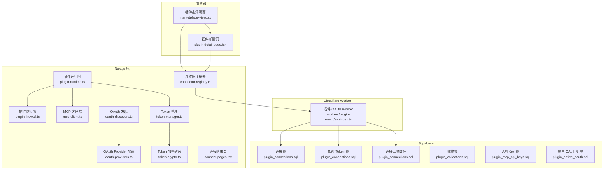
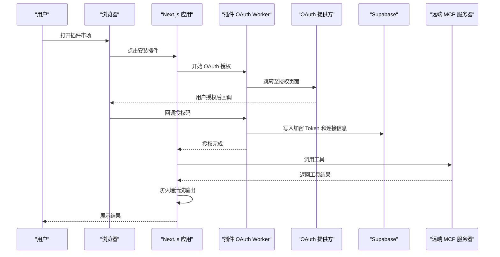
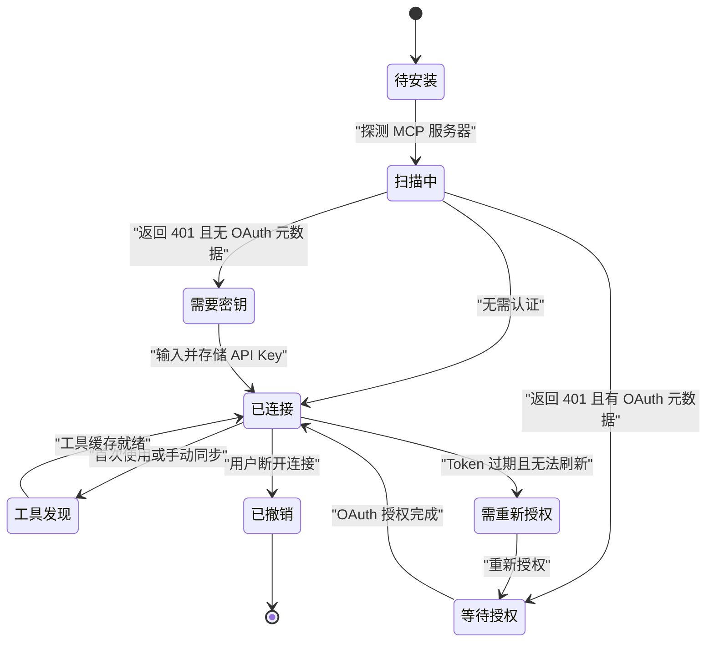
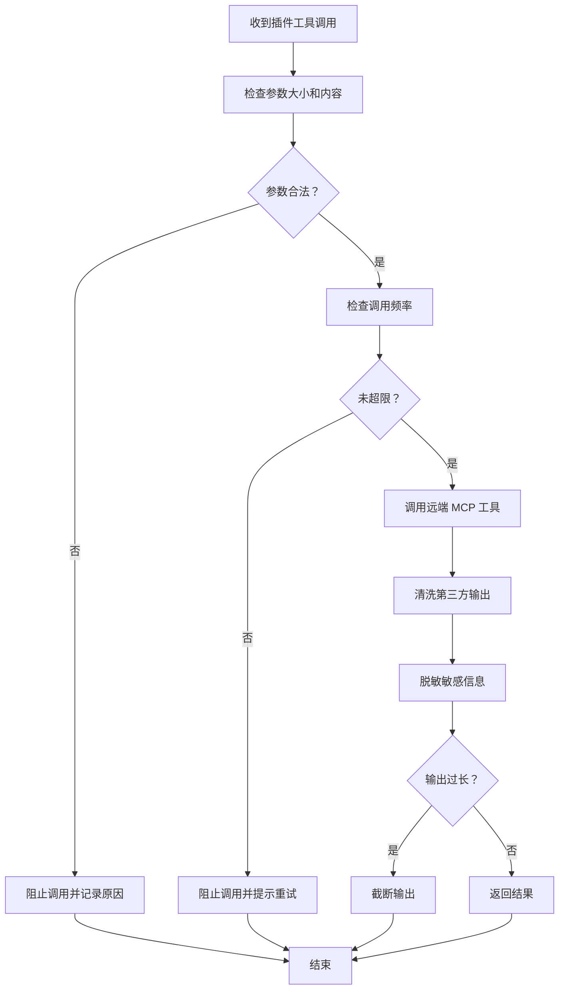
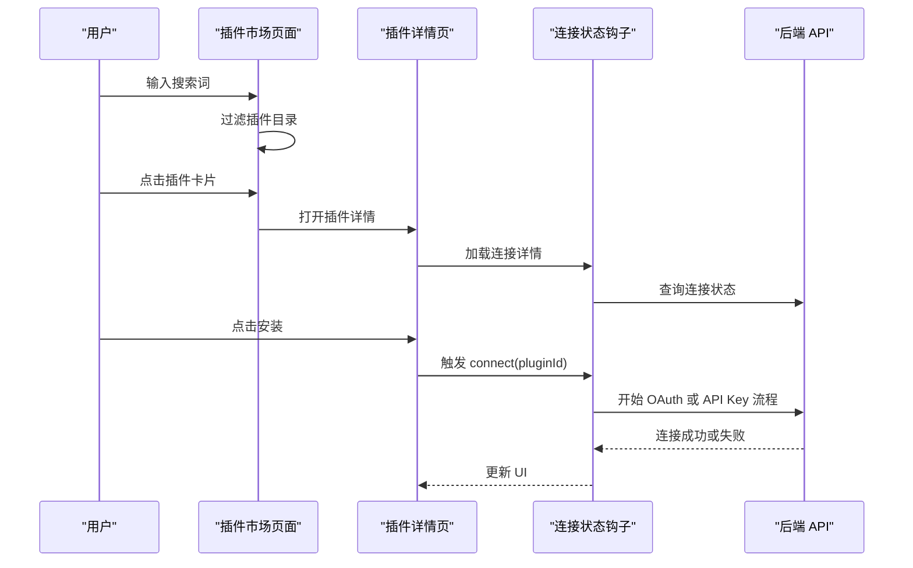
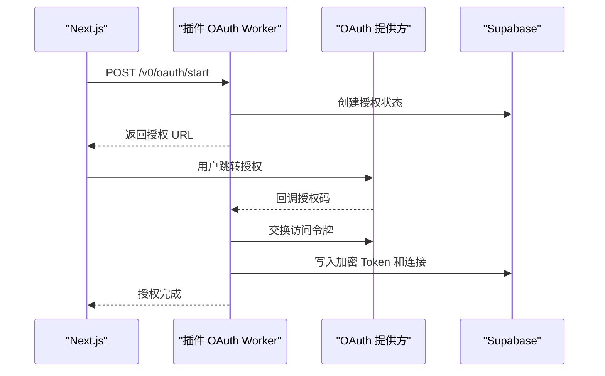
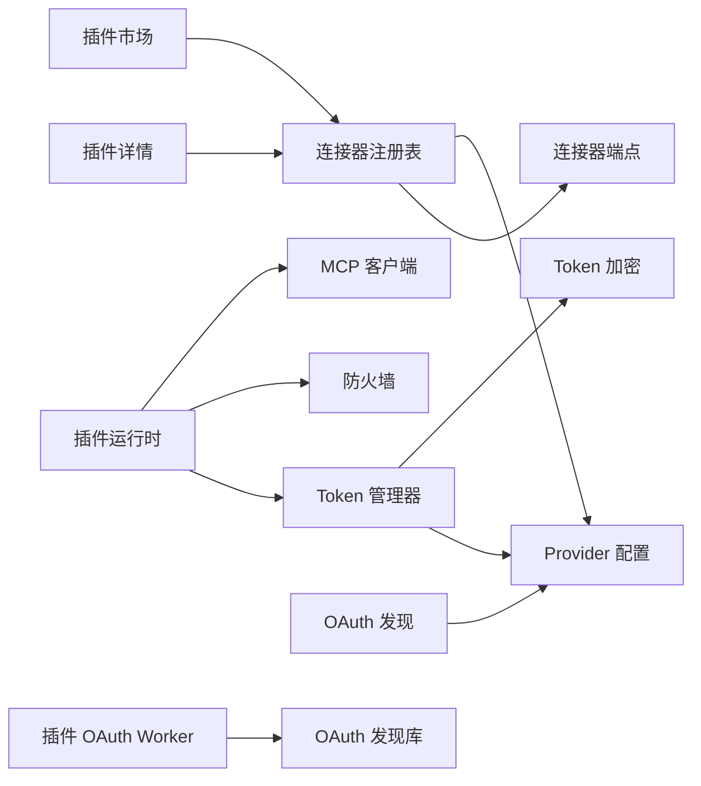

# 插件系统

<cite>
**本文引用的文件**   
- [src/server/plugins/plugin-firewall.ts](file://src/server/plugins/plugin-firewall.ts)
- [src/server/plugins/mcp-client.ts](file://src/server/plugins/mcp-client.ts)
- [src/server/plugins/oauth-discovery.ts](file://src/server/plugins/oauth-discovery.ts)
- [src/server/plugins/oauth-providers.ts](file://src/server/plugins/oauth-providers.ts)
- [src/server/plugins/token-manager.ts](file://src/server/plugins/token-manager.ts)
- [src/server/plugins/token-crypto.ts](file://src/server/plugins/token-crypto.ts)
- [src/server/plugins/connect-pages.ts](file://src/server/plugins/connect-pages.ts)
- [src/server/plugins/connection-dto.ts](file://src/server/plugins/connection-dto.ts)
- [src/server/plugins/connector-registry.ts](file://src/server/plugins/connector-registry.ts)
- [src/server/plugins/plugin-runtime.ts](file://src/server/plugins/plugin-runtime.ts)
- [workers/plugin-oauth/src/index.ts](file://workers/plugin-oauth/src/index.ts)
- [scripts/build-connector-endpoints.mjs](file://scripts/build-connector-endpoints.mjs)
- [src/client/components/plugins/marketplace-view.tsx](file://src/client/components/plugins/marketplace-view.tsx)
- [src/client/components/plugins/plugin-detail-page.tsx](file://src/client/components/plugins/plugin-detail-page.tsx)
- [docs/plugins-self-hosted.md](file://docs/plugins-self-hosted.md)
- [supabase/migrations/20260902171154_mcp_plugin_installations.sql](file://supabase/migrations/20260902171154_mcp_plugin_installations.sql)
- [supabase/migrations/20260913000000_plugin_collections.sql](file://supabase/migrations/20260913000000_plugin_collections.sql)
- [supabase/migrations/20260913010000_plugin_mcp_api_keys.sql](file://supabase/migrations/20260913010000_plugin_mcp_api_keys.sql)
- [supabase/migrations/20261002173000_plugin_connections.sql](file://supabase/migrations/20261002173000_plugin_connections.sql)
- [supabase/migrations/20261026120000_plugin_native_oauth.sql](file://supabase/migrations/20261026120000_plugin_native_oauth.sql)
</cite>

## 目录

1. [简介](#简介)
2. [项目结构](#项目结构)
3. [核心组件](#核心组件)
4. [架构总览](#架构总览)
5. [详细组件分析](#详细组件分析)
6. [依赖关系分析](#依赖关系分析)
7. [性能与资源限制](#性能与资源限制)
8. [故障排查指南](#故障排查指南)
9. [插件开发与集成指南](#插件开发与集成指南)
10. [版本、发布与更新流程](#版本发布与更新流程)
11. [结论](#结论)

## 简介

本仓库实现了一个自托管的插件与连接器平台，主要面向三类能力：

- **MCP 连接器**：通过 Model Context Protocol 的 Streamable HTTP 传输，发现并调用远程 MCP 服务器的工具。
- **插件市场机制**：提供 Marketplace 页面、分类浏览、搜索、安装、连接、断开、保存收藏和工具刷新。
- **原生 OAuth 支持**：使用 RFC 9728、RFC 8414、PKCE、动态客户端注册或预注册 Provider，将用户授权交给真实 OAuth 提供方，而不是在本地伪造 Token。

系统由三个关键部分组成：

| 部分 | 职责 | 部署位置 |
|---|---|---|
| Next.js 应用 | 插件市场 UI、安装流程、聊天运行时、审计、加密存储 | Vercel / Next.js |
| Cloudflare Worker `plugin-oauth` | 处理 MCP OAuth 授权、回调、Token 交换、刷新、写入 Supabase | Cloudflare Workers |
| Supabase Postgres | 连接元数据、已发现工具、OAuth Token 密文、审计日志、收藏表 | Supabase |

文档目标读者包括：

- 想理解插件系统如何工作的后端工程师。
- 需要对接 MCP 协议的插件作者。
- 需要集成 Google、GitHub、Slack、Microsoft 等原生 OAuth 的应用开发者。
- 运维人员，负责配置网关、环境变量、数据库迁移和错误排查。

## 项目结构

插件相关代码分布在服务端、Worker、数据库迁移和前端页面中：



**图表来源**

- [src/client/components/plugins/marketplace-view.tsx:1-200](file://src/client/components/plugins/marketplace-view.tsx#L1-L200)
- [src/client/components/plugins/plugin-detail-page.tsx:1-200](file://src/client/components/plugins/plugin-detail-page.tsx#L1-L200)
- [src/server/plugins/connector-registry.ts:1-200](file://src/server/plugins/connector-registry.ts#L1-L200)
- [src/server/plugins/plugin-runtime.ts:1-200](file://src/server/plugins/plugin-runtime.ts#L1-L200)
- [src/server/plugins/plugin-firewall.ts:1-167](file://src/server/plugins/plugin-firewall.ts#L1-L167)
- [src/server/plugins/mcp-client.ts:1-200](file://src/server/plugins/mcp-client.ts#L1-L200)
- [src/server/plugins/oauth-discovery.ts:1-200](file://src/server/plugins/oauth-discovery.ts#L1-L200)
- [src/server/plugins/oauth-providers.ts:1-200](file://src/server/plugins/oauth-providers.ts#L1-L200)
- [src/server/plugins/token-manager.ts:1-200](file://src/server/plugins/token-manager.ts#L1-L200)
- [src/server/plugins/token-crypto.ts:1-44](file://src/server/plugins/token-crypto.ts#L1-L44)
- [src/server/plugins/connect-pages.ts:1-99](file://src/server/plugins/connect-pages.ts#L1-L99)
- [workers/plugin-oauth/src/index.ts:1-200](file://workers/plugin-oauth/src/index.ts#L1-L200)
- [supabase/migrations/20261002173000_plugin_connections.sql:1-200](file://supabase/migrations/20261002173000_plugin_connections.sql#L1-L200)
- [supabase/migrations/20260913000000_plugin_collections.sql:1-39](file://supabase/migrations/20260913000000_plugin_collections.sql#L1-L39)
- [supabase/migrations/20260913010000_plugin_mcp_api_keys.sql:1-21](file://supabase/migrations/20260913010000_plugin_mcp_api_keys.sql#L1-L21)
- [supabase/migrations/20261026120000_plugin_native_oauth.sql:1-200](file://supabase/migrations/20261026120000_plugin_native_oauth.sql#L1-L200)

**章节来源**

- [docs/plugins-self-hosted.md:1-200](file://docs/plugins-self-hosted.md#L1-L200)
- [scripts/build-connector-endpoints.mjs:1-107](file://scripts/build-connector-endpoints.mjs#L1-L107)

## 核心组件

### 插件防火墙

插件防火墙是插件调用的统一安全入口。所有模型调用插件工具前都会经过它，主要职责包括：

- 检查参数大小是否超过上限。
- 阻止向外部服务发送看起来像密码、Token、私钥或 API Key 的参数。
- 按用户维度做每分钟调用次数限制。
- 对写操作设置更严格的速率限制。
- 清理不可见字符、HTML 注释、脚本和样式。
- 替换可能包含注入指令的行。
- 对输出中的敏感信息进行脱敏。
- 截断过长的第三方返回内容。
- 为模型添加“外部数据不可信”的安全提示。

防火墙定义的关键常量包括：

| 名称 | 含义 | 默认值 |
|---|---|---:|
| 最大参数字节数 | 序列化后的参数上限 | 64,000 |
| 最大输出字符数 | 插件返回文本上限 | 24,000 |
| 每分钟调用上限 | 每个用户的插件调用限制 | 40 |
| 每分钟写操作上限 | 非读操作的额外限制 | 12 |

**章节来源**

- [src/server/plugins/plugin-firewall.ts:1-167](file://src/server/plugins/plugin-firewall.ts#L1-L167)

### MCP 客户端

MCP 客户端负责与远端 MCP 服务器进行 JSON-RPC 2.0 通信，协议版本固定为 `2025-06-18`。它支持两种响应格式：

- 普通 JSON。
- 以 `data:` 事件帧形式返回的 SSE 流式响应。

主要行为：

- 建立会话时发送 `initialize`。
- 发送 `notifications/initialized`。
- 调用 `tools/list` 获取工具列表。
- 调用 `tools/call` 执行工具。
- 根据 HTTP 状态码映射出客户端错误类型。
- 使用 `Authorization: Bearer` 携带访问令牌。
- 维护可选的 `mcp-session-id` 会话头。
- 请求超时时间为 60 秒。

**章节来源**

- [src/server/plugins/mcp-client.ts:1-200](file://src/server/plugins/mcp-client.ts#L1-L200)

### OAuth 发现模块

OAuth 发现模块实现了 MCP 授权规范的核心流程：

1. 校验 MCP URL 必须是公开的 HTTPS 地址。
2. 发送未认证的 `initialize` 探测远端 MCP 服务器。
3. 如果返回 401 或 403，从 `WWW-Authenticate` 头中提取受保护资源元数据 URL。
4. 读取 RFC 9728 受保护资源元数据。
5. 解析 RFC 8414 授权服务器元数据。
6. 选择预注册 Provider、客户端 ID 元数据文档或动态客户端注册。
7. 生成 PKCE verifier，构造授权 URL。
8. 回调后交换授权码和访问令牌。

该模块还内置了私有地址拦截器，拒绝 `localhost`、`.local`、`.internal`、内网 IP 等地址作为 OAuth 端点。

**章节来源**

- [src/server/plugins/oauth-discovery.ts:1-200](file://src/server/plugins/oauth-discovery.ts#L1-L200)

### OAuth Provider 配置

Provider 配置集中管理 Clauxen 预先注册的 OAuth 提供方，包括：

- Google
- GitHub
- Slack
- Microsoft

每个 Provider 配置包含授权端点、令牌端点、发行者主机、令牌认证方式、身份范围、范围分隔符和资源指示符支持标志。Provider 凭据来自环境变量，例如 `PLUGIN_OAUTH_GOOGLE_CLIENT_ID` 和 `PLUGIN_OAUTH_GOOGLE_CLIENT_SECRET`。

此外，模块还提供：

- 根据授权服务器域名匹配 Provider。
- 查询用户账号标签，用于连接显示。
- 尝试在 Provider 侧撤销 Token。

**章节来源**

- [src/server/plugins/oauth-providers.ts:1-200](file://src/server/plugins/oauth-providers.ts#L1-L200)

### Token 管理器

Token 管理器负责为已连接插件获取可用访问令牌，并在必要时刷新：

- 无认证连接直接返回空令牌。
- 若已有有效 Token，则复用。
- 若即将过期，则使用 refresh_token 刷新。
- 刷新失败时返回重新授权错误。
- 使用事务锁防止并发刷新造成竞争条件。
- 刷新成功后旋转并持久化新的密封 Token。

**章节来源**

- [src/server/plugins/token-manager.ts:1-200](file://src/server/plugins/token-manager.ts#L1-L200)

### Token 加密封装

Token 加密封装使用 AES-256-GCM 对 Token 材料进行加密后再写入数据库。密钥派生自支付加密密钥或 JWT Secret，并通过域分隔符隔离，避免与其他路径共享密钥。

注意：

- 明文 Token 不会进入日志。
- 解密失败返回空值，而不是抛出异常。
- 未配置加密密钥时会抛出配置错误。

**章节来源**

- [src/server/plugins/token-crypto.ts:1-44](file://src/server/plugins/token-crypto.ts#L1-L44)

### 连接器注册表

连接器注册表决定每个 Marketplace 插件的连接方式：

| 连接器类型 | 说明 |
|---|---|
| MCP | 使用远端 MCP 服务器，遵循 MCP OAuth 协议。 |
| REST | 没有可用远端 MCP 时，使用 Clauxen 自有 REST 工具集调用提供方 API。 |

注册表还支持覆盖规则，例如 Gmail、Google Calendar、GitHub、Slack、Linear、Outlook、Microsoft Graph 等。

**章节来源**

- [src/server/plugins/connector-registry.ts:1-200](file://src/server/plugins/connector-registry.ts#L1-L200)

### 插件运行时

插件运行时将用户的连接暴露给聊天 Agent：

- 将每个启用的工具转换为 Agent 函数。
- 命名格式为 `mcp__<插件标识>__<工具名>`。
- 限制直接暴露的工具数量，超出时使用搜索工具。
- 根据权限模式过滤工具：只读模式禁止写工具和破坏性工具。
- 每次调用都走防火墙：参数检查、速率限制、Token 注入、输出清洗、审计记录。
- 支持 `mcp__plugins__search_tools` 和 `mcp__plugins__call_tool` 两个内部工具。

**章节来源**

- [src/server/plugins/plugin-runtime.ts:1-200](file://src/server/plugins/plugin-runtime.ts#L1-L200)

### 连接结果页

连接结果页是一个轻量级 HTML 页面，用于在弹窗中通知用户连接成功或失败，并向 opener 窗口发送 origin 受限的 `postMessage`。页面自带 CSP、X-Frame-Options 和无引用策略。

**章节来源**

- [src/server/plugins/connect-pages.ts:1-99](file://src/server/plugins/connect-pages.ts#L1-L99)

### 连接数据传输对象

连接 DTO 是客户端可见的连接视图，明确不包含 Token 材料。它暴露连接 ID、插件标识、名称、图标、连接器类型、认证类型、状态、权限模式、账号标签、授予范围、工具数量和连接时间。

**章节来源**

- [src/server/plugins/connection-dto.ts:1-20](file://src/server/plugins/connection-dto.ts#L1-L20)

## 架构总览

整体架构分为四层：



**图表来源**

- [src/client/components/plugins/marketplace-view.tsx:1-200](file://src/client/components/plugins/marketplace-view.tsx#L1-L200)
- [workers/plugin-oauth/src/index.ts:1-200](file://workers/plugin-oauth/src/index.ts#L1-L200)
- [src/server/plugins/oauth-discovery.ts:1-200](file://src/server/plugins/oauth-discovery.ts#L1-L200)
- [src/server/plugins/mcp-client.ts:1-200](file://src/server/plugins/mcp-client.ts#L1-L200)
- [src/server/plugins/plugin-runtime.ts:1-200](file://src/server/plugins/plugin-runtime.ts#L1-L200)
- [src/server/plugins/plugin-firewall.ts:1-167](file://src/server/plugins/plugin-firewall.ts#L1-L167)

## 详细组件分析

### 插件生命周期

插件生命周期包括以下阶段：



**图表来源**

- [supabase/migrations/20261002173000_plugin_connections.sql:1-200](file://supabase/migrations/20261002173000_plugin_connections.sql#L1-L200)
- [src/server/plugins/oauth-discovery.ts:1-200](file://src/server/plugins/oauth-discovery.ts#L1-L200)
- [src/server/plugins/token-manager.ts:1-200](file://src/server/plugins/token-manager.ts#L1-L200)

#### 安装流程

安装流程会根据插件连接器类型选择不同的路径：

| 场景 | 行为 |
|---|---|
| 公开 MCP 服务器 | 直接探测并同步工具。 |
| 需要 OAuth 的 MCP 服务器 | 通过 Worker 发起原生 OAuth 授权。 |
| 仅返回 401 但没有 OAuth 元数据的服务器 | 要求用户提供 API Key。 |
| REST 连接器 | 使用预注册 Provider 的 OAuth 流程，然后调用自有工具集。 |

**章节来源**

- [src/server/plugins/connector-registry.ts:1-200](file://src/server/plugins/connector-registry.ts#L1-L200)
- [src/server/plugins/oauth-discovery.ts:1-200](file://src/server/plugins/oauth-discovery.ts#L1-L200)
- [docs/plugins-self-hosted.md:1-200](file://docs/plugins-self-hosted.md#L1-L200)

#### 卸载流程

卸载流程会：

- 将连接状态设为已撤销。
- 删除加密 Token。
- 触发 Provider 侧的 Token 撤销（尽力而为）。
- 保留连接历史用于审计。
- 在 UI 上移除活跃连接。

**章节来源**

- [src/server/plugins/oauth-providers.ts:1-200](file://src/server/plugins/oauth-providers.ts#L1-L200)
- [supabase/migrations/20261002173000_plugin_connections.sql:1-200](file://supabase/migrations/20261002173000_plugin_connections.sql#L1-L200)

#### 连接配置

连接配置存储在公共表和私有表中：

| 表 | 用途 | 访问控制 |
|---|---|---|
| `public.plugin_connections` | 连接元数据 | 行级安全策略 |
| `private.plugin_oauth_tokens` | 加密 Access Token、Refresh Token、过期时间 | 仅 service_role |
| `public.plugin_connection_tools` | 已发现工具缓存 | 仅 owner 可读 |
| `public.plugin_collections` | 用户收藏 | 仅 owner 可写 |
| `private.plugin_mcp_api_keys` | 本地模式 API Key | 仅 service_role |

**章节来源**

- [supabase/migrations/20261002173000_plugin_connections.sql:1-200](file://supabase/migrations/20261002173000_plugin_connections.sql#L1-L200)
- [supabase/migrations/20260913000000_plugin_collections.sql:1-39](file://supabase/migrations/20260913000000_plugin_collections.sql#L1-L39)
- [supabase/migrations/20260913010000_plugin_mcp_api_keys.sql:1-21](file://supabase/migrations/20260913010000_plugin_mcp_api_keys.sql#L1-L21)

### 插件防火墙与安全隔离

插件防火墙提供三层防护：

1. **入站防护**：参数大小限制、敏感参数检测、每用户速率限制。
2. **出站防护**：禁止将疑似凭证写入写操作。
3. **出站输出防护**：清理不可见字符、HTML、脚本、样式、注入指令，并脱敏敏感信息。



**图表来源**

- [src/server/plugins/plugin-firewall.ts:1-167](file://src/server/plugins/plugin-firewall.ts#L1-L167)

**章节来源**

- [src/server/plugins/plugin-firewall.ts:1-167](file://src/server/plugins/plugin-firewall.ts#L1-L167)

### 权限控制

权限控制涉及两个层面：

| 层面 | 控制内容 |
|---|---|
| 连接级权限 | 只读或读写模式。 |
| 工具级风险 | 读、写、破坏性。 |

只读模式下，写工具和破坏性工具会被隐藏；读写模式允许全部工具。工具风险等级还会影响 Agent 描述和用户确认提示。

**章节来源**

- [src/server/plugins/plugin-runtime.ts:1-200](file://src/server/plugins/plugin-runtime.ts#L1-L200)
- [supabase/migrations/20261026120000_plugin_native_oauth.sql:1-200](file://supabase/migrations/20261026120000_plugin_native_oauth.sql#L1-L200)

### 资源限制

系统对插件调用设置了多处资源限制：

| 限制项 | 默认值 | 目的 |
|---|---:|---|
| 参数序列化大小 | 64KB | 防止过大请求。 |
| 插件输出长度 | 24KB | 防止大段第三方内容污染上下文。 |
| 每分钟调用次数 | 40 | 防止滥用。 |
| 每分钟写操作次数 | 12 | 降低误操作风险。 |
| MCP 请求超时 | 60 秒 | 防止远端卡死。 |
| OAuth 发现超时 | 8 秒 | 快速失败。 |
| Token 刷新超时 | 15 秒 | 避免长时间阻塞。 |

**章节来源**

- [src/server/plugins/plugin-firewall.ts:1-167](file://src/server/plugins/plugin-firewall.ts#L1-L167)
- [src/server/plugins/mcp-client.ts:1-200](file://src/server/plugins/mcp-client.ts#L1-L200)
- [src/server/plugins/oauth-discovery.ts:1-200](file://src/server/plugins/oauth-discovery.ts#L1-L200)
- [src/server/plugins/token-manager.ts:1-200](file://src/server/plugins/token-manager.ts#L1-L200)

### 插件市场浏览、搜索和安装

插件市场前端由两个主要页面组成：

- **MarketplaceView**：负责分类、搜索、连接状态、Toast 通知、移动端头部。
- **PluginDetailPage**：负责插件详情、工具列表、权限模式、工具启用开关、同步、断开连接。



**图表来源**

- [src/client/components/plugins/marketplace-view.tsx:1-200](file://src/client/components/plugins/marketplace-view.tsx#L1-L200)
- [src/client/components/plugins/plugin-detail-page.tsx:1-200](file://src/client/components/plugins/plugin-detail-page.tsx#L1-L200)

**章节来源**

- [src/client/components/plugins/marketplace-view.tsx:1-200](file://src/client/components/plugins/marketplace-view.tsx#L1-L200)
- [src/client/components/plugins/plugin-detail-page.tsx:1-200](file://src/client/components/plugins/plugin-detail-page.tsx#L1-L200)

### 原生 OAuth 支持

原生 OAuth 支持将授权过程交给真实 OAuth 提供方，而不是在本地生成假 Token。其核心改进包括：

- 新增 `connector_kind`，区分 MCP 和 REST。
- 新增 `permission_mode`，区分只读和读写。
- 新增 `account_label`，显示关联账号。
- 使用 `private.plugin_oauth_states` 存储一次性、带过期时间的授权状态。
- 使用 `private.plugin_oauth_clients` 缓存动态注册的 OAuth 客户端。
- 新增 `plugin_connection_capabilities`，记录资源与提示模板。
- 新增 `plugin_tool_calls`，记录工具调用审计轨迹。
- 不再保留旧的本地 Token 连接。



**图表来源**

- [workers/plugin-oauth/src/index.ts:1-200](file://workers/plugin-oauth/src/index.ts#L1-L200)
- [supabase/migrations/20261026120000_plugin_native_oauth.sql:1-200](file://supabase/migrations/20261026120000_plugin_native_oauth.sql#L1-L200)

**章节来源**

- [workers/plugin-oauth/src/index.ts:1-200](file://workers/plugin-oauth/src/index.ts#L1-L200)
- [supabase/migrations/20261026120000_plugin_native_oauth.sql:1-200](file://supabase/migrations/20261026120000_plugin_native_oauth.sql#L1-L200)

## 依赖关系分析

### 模块依赖图



**图表来源**

- [src/server/plugins/connector-registry.ts:1-200](file://src/server/plugins/connector-registry.ts#L1-L200)
- [src/server/plugins/oauth-providers.ts:1-200](file://src/server/plugins/oauth-providers.ts#L1-L200)
- [src/server/plugins/plugin-runtime.ts:1-200](file://src/server/plugins/plugin-runtime.ts#L1-L200)
- [src/server/plugins/mcp-client.ts:1-200](file://src/server/plugins/mcp-client.ts#L1-L200)
- [src/server/plugins/plugin-firewall.ts:1-167](file://src/server/plugins/plugin-firewall.ts#L1-L167)
- [src/server/plugins/token-manager.ts:1-200](file://src/server/plugins/token-manager.ts#L1-L200)
- [src/server/plugins/token-crypto.ts:1-44](file://src/server/plugins/token-crypto.ts#L1-L44)
- [src/server/plugins/oauth-discovery.ts:1-200](file://src/server/plugins/oauth-discovery.ts#L1-L200)
- [workers/plugin-oauth/src/index.ts:1-200](file://workers/plugin-oauth/src/index.ts#L1-L200)

### 数据库依赖关系

```mermaid
erDiagram
  PLUGIN_CONNECTIONS {
    uuid id PK
    uuid user_id FK
    text plugin_id
    text plugin_name
    text plugin_icon_url
    text mcp_url
    text auth_type
    text status
    text connector_kind
    text permission_mode
    text account_label
    text authorization_server
    text[] granted_scopes
    timestamptz connected_at
    timestamptz last_used_at
    timestamptz created_at
    timestamptz updated_at
  }

  PLUGIN_OAUTH_TOKENS {
    uuid connection_id PK FK
    text access_token_sealed
    text refresh_token_sealed
    text token_type
    timestamptz expires_at
    text[] scopes
    jsonb raw_extras
    jsonb oauth_meta
    text client_secret_sealed
    timestamptz created_at
    timestamptz updated_at
  }

  PLUGIN_CONNECTION_TOOLS {
    uuid connection_id FK
    text tool_name
    text title
    text description
    jsonb input_schema
    boolean is_enabled
    text risk_level
    timestamptz discovered_at
  }

  PLUGIN_COLLECTIONS {
    uuid user_id FK
    text plugin_id
    timestamptz created_at
  }

  PLUGIN_MCP_API_KEYS {
    uuid installation_id PK FK
    text encrypted_api_key
    text api_key_nonce
    integer encryption_key_version
    timestamptz created_at
    timestamptz updated_at
  }

  PLUGIN_TOOL_CALLS {
    bigint id PK
    uuid user_id FK
    uuid connection_id FK
    text plugin_id
    text tool_name
    text risk_level
    text status
    text detail
    integer duration_ms
    timestamptz created_at
  }

  PLUGIN_CONNECTIONS ||--o{ PLUGIN_OAUTH_TOKENS : "拥有"
  PLUGIN_CONNECTIONS ||--o{ PLUGIN_CONNECTION_TOOLS : "暴露"
  PLUGIN_CONNECTIONS ||--o{ PLUGIN_TOOL_CALLS : "被调用"
  USER ||--o{ PLUGIN_COLLECTIONS : "收藏"
```

**图表来源**

- [supabase/migrations/20261002173000_plugin_connections.sql:1-200](file://supabase/migrations/20261002173000_plugin_connections.sql#L1-L200)
- [supabase/migrations/20260913000000_plugin_collections.sql:1-39](file://supabase/migrations/20260913000000_plugin_collections.sql#L1-L39)
- [supabase/migrations/20260913010000_plugin_mcp_api_keys.sql:1-21](file://supabase/migrations/20260913010000_plugin_mcp_api_keys.sql#L1-L21)
- [supabase/migrations/20261026120000_plugin_native_oauth.sql:1-200](file://supabase/migrations/20261026120000_plugin_native_oauth.sql#L1-L200)

**章节来源**

- [supabase/migrations/20261002173000_plugin_connections.sql:1-200](file://supabase/migrations/20261002173000_plugin_connections.sql#L1-L200)
- [supabase/migrations/20260913000000_plugin_collections.sql:1-39](file://supabase/migrations/20260913000000_plugin_collections.sql#L1-L39)
- [supabase/migrations/20260913010000_plugin_mcp_api_keys.sql:1-21](file://supabase/migrations/20260913010000_plugin_mcp_api_keys.sql#L1-L21)
- [supabase/migrations/20261026120000_plugin_native_oauth.sql:1-200](file://supabase/migrations/20261026120000_plugin_native_oauth.sql#L1-L200)

## 性能与资源限制

插件系统的性能设计重点在于：

- 避免浏览器直接调用远端 MCP 服务器。
- 在服务端统一发起网络请求。
- 对 MCP 请求设置超时。
- 对 OAuth 发现设置较短超时，快速失败。
- 对 Token 刷新使用事务锁，避免并发刷新。
- 对输出进行截断，防止模型上下文膨胀。
- 对调用进行审计，便于定位慢调用和异常调用。

优化建议：

- 如果某个 MCP 服务器频繁返回大响应，应优先在提供方侧分页或裁剪。
- 如果 OAuth 提供方延迟高，应增加超时和重试上限，并监控失败率。
- 如果用户连接了大量插件，应优先启用只读模式，减少写操作风险。
- 如果插件工具过多，应依赖搜索工具，而不是把所有工具都放入直接工具列表。

[本节为通用性能指导，不直接分析具体代码文件]

## 故障排查指南

常见错误和处理方式如下：

| 错误类别 | 含义 | 处理方式 |
|---|---|---|
| 连接器网关必需 | 需要 OAuth 但缺少网关配置 | 配置网关 URL 和内部 Token，或改用公开/API Key 插件。 |
| 连接器服务不可用 | 网关存在但不可达 | 部署 Worker，检查健康检查端点。 |
| 插件 API Key 必需 | 服务器 401 且没有 OAuth 元数据 | 在 UI 中输入有效 API Key。 |
| 插件 API Key 无效 | 提供方拒绝 Key | 检查提供方 Key 是否正确。 |
| MCP 不可达 | DNS、TLS 或远端服务不可用 | 稍后重试或报告插件问题。 |
| MCP OAuth 不可发现 | 远端没有声明 OAuth 端点 | 更换插件或修复提供方配置。 |
| 需要重新授权 | Token 过期且无法自动刷新 | 移除并重连插件。 |
| 连接器未配置 | REST OAuth 应用未配置 | 运行连接器 OAuth 配置命令。 |

**章节来源**

- [docs/plugins-self-hosted.md:1-200](file://docs/plugins-self-hosted.md#L1-L200)
- [src/server/plugins/oauth-discovery.ts:1-200](file://src/server/plugins/oauth-discovery.ts#L1-L200)
- [src/server/plugins/token-manager.ts:1-200](file://src/server/plugins/token-manager.ts#L1-L200)

## 插件开发与集成指南

### MCP 协议规范要点

插件若要作为 MCP 连接器接入，应满足：

- 支持 JSON-RPC 2.0。
- 支持 Streamable HTTP 传输。
- 支持 `initialize`、`notifications/initialized`、`tools/list`、`tools/call`。
- 返回合法的 `inputSchema`，以便前端生成参数表单。
- 如需认证，支持 RFC 9728 受保护资源元数据。
- 如使用 OAuth，支持 RFC 8414 授权服务器元数据。
- 建议使用标准 HTTP 状态码表示未授权、禁止访问、未找到和不可用。

MCP 客户端期望的协议版本是 `2025-06-18`。

**章节来源**

- [src/server/plugins/mcp-client.ts:1-200](file://src/server/plugins/mcp-client.ts#L1-L200)
- [src/server/plugins/oauth-discovery.ts:1-200](file://src/server/plugins/oauth-discovery.ts#L1-L200)

### OAuth 集成示例

对于 Google、GitHub、Slack、Microsoft 等已知 Provider，系统已经内置配置。开发者只需配置环境变量中的 Client ID 和 Client Secret，并确保回调 URI 正确。

对于自定义 MCP 服务器：

1. 部署支持 RFC 9728 的 MCP 服务器。
2. 配置授权服务器。
3. 确保 `.well-known/oauth-protected-resource` 可访问。
4. 确保授权服务器符合 RFC 8414。
5. 支持 PKCE。
6. 支持资源指示符（除非 Provider 不支持）。
7. 确保远端 MCP URL 是公开 HTTPS。

**章节来源**

- [src/server/plugins/oauth-providers.ts:1-200](file://src/server/plugins/oauth-providers.ts#L1-L200)
- [src/server/plugins/oauth-discovery.ts:1-200](file://src/server/plugins/oauth-discovery.ts#L1-L200)
- [workers/plugin-oauth/src/index.ts:1-200](file://workers/plugin-oauth/src/index.ts#L1-L200)

### 插件开发最佳实践

- 不要把密码、Token、私钥放在工具参数中。
- 尽量返回结构化小响应。
- 不要依赖浏览器直接调用远端 MCP。
- 不要在插件输出中包含可执行的系统指令。
- 对写操作和破坏性操作做好幂等性和确认提示。
- 对敏感输出进行脱敏。
- 对长响应进行分页或截断。
- 对 OAuth 失败提供明确错误消息。
- 对未授权状态使用标准 401。
- 对未找到工具使用明确的错误响应。

**章节来源**

- [src/server/plugins/plugin-firewall.ts:1-167](file://src/server/plugins/plugin-firewall.ts#L1-L167)
- [src/server/plugins/mcp-client.ts:1-200](file://src/server/plugins/mcp-client.ts#L1-L200)

## 版本、发布与更新流程

### 连接器端点构建

连接器端点不是运行时动态生成的，而是通过脚本从 MCP 数据集和市场目录构建。构建产物是 `connector-endpoints.generated.json`，供 Cloudflare Workers 等无法直接读取 `public/` 的路径导入。

构建流程：

1. 读取 MCP 插件数据。
2. 读取市场目录。
3. 规范化插件标识和名称。
4. 查找精确匹配、归一化匹配和模糊匹配。
5. 筛选 HTTP 或 SSE 传输的公开 HTTPS MCP 服务器。
6. 排除本地地址、IP 地址和特定代理主机。
7. 生成压缩后的端点映射。

**章节来源**

- [scripts/build-connector-endpoints.mjs:1-107](file://scripts/build-connector-endpoints.mjs#L1-L107)

### 数据库迁移

插件相关的数据库变更通过 Supabase 迁移文件管理，主要包括：

- MCP 插件安装基础表。
- 插件收藏表。
- 本地模式 API Key 表。
- 连接、Token、工具缓存、权限、审计和能力表。
- 原生 OAuth 扩展。

迁移文件采用增量式 SQL，并启用行级安全和 service_role 控制。

**章节来源**

- [supabase/migrations/20260902171154_mcp_plugin_installations.sql:1-52](file://supabase/migrations/20260902171154_mcp_plugin_installations.sql#L1-L52)
- [supabase/migrations/20260913000000_plugin_collections.sql:1-39](file://supabase/migrations/20260913000000_plugin_collections.sql#L1-L39)
- [supabase/migrations/20260913010000_plugin_mcp_api_keys.sql:1-21](file://supabase/migrations/20260913010000_plugin_mcp_api_keys.sql#L1-L21)
- [supabase/migrations/20261002173000_plugin_connections.sql:1-200](file://supabase/migrations/20261002173000_plugin_connections.sql#L1-L200)
- [supabase/migrations/20261026120000_plugin_native_oauth.sql:1-200](file://supabase/migrations/20261026120000_plugin_native_oauth.sql#L1-L200)

### 更新机制

插件更新主要通过以下机制完成：

- 市场目录更新后重新构建连接器端点。
- 用户手动同步连接工具。
- 首次使用时自动发现工具。
- Token 自动刷新。
- 连接状态变化后 UI 刷新。
- 旧版本地 Token 连接被清理。

**章节来源**

- [src/server/plugins/plugin-runtime.ts:1-200](file://src/server/plugins/plugin-runtime.ts#L1-L200)
- [src/client/components/plugins/plugin-detail-page.tsx:1-200](file://src/client/components/plugins/plugin-detail-page.tsx#L1-L200)
- [supabase/migrations/20261026120000_plugin_native_oauth.sql:1-200](file://supabase/migrations/20261026120000_plugin_native_oauth.sql#L1-L200)

## 结论

这个插件系统围绕 MCP 协议、原生 OAuth 和自托管连接器构建，核心特点是：

- 不依赖 Nango、Pipedream 等第三方连接器云。
- 将授权交给真实 OAuth 提供方。
- 将 Token 加密后存入 Supabase。
- 通过防火墙对插件调用进行参数、速率和输出三重保护。
- 通过数据库迁移管理连接、工具、权限和审计。
- 通过 Marketplace 页面提供完整的插件发现、安装和管理体验。

对于插件作者，最重要的原则是：**不要信任第三方输出，不要发送敏感参数，不要假设浏览器可以直接调用远端服务**。  
对于平台使用者，最重要的原则是：**只启用必要的权限，定期查看连接状态，遇到问题先检查认证和网络可达性**。

[本节为总结性内容，不直接分析具体代码文件]