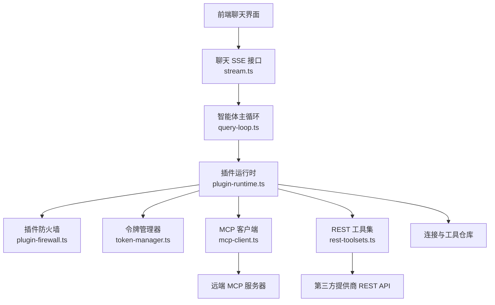
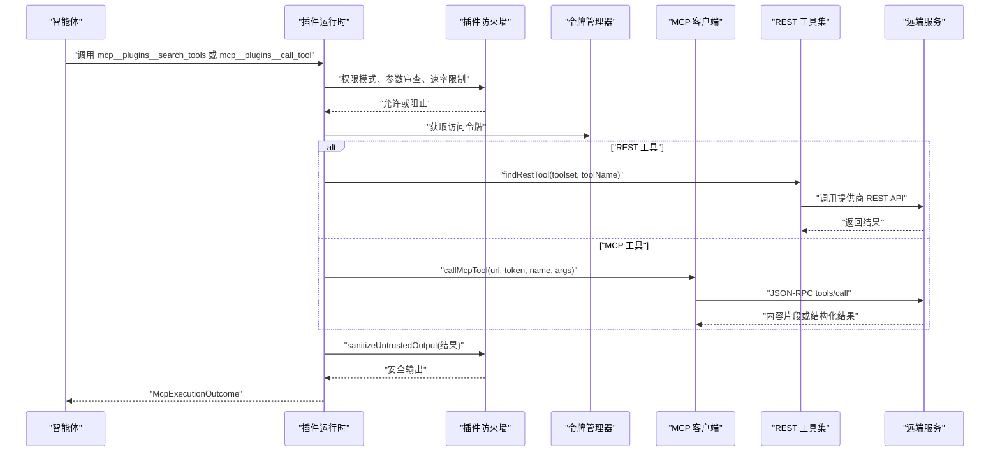
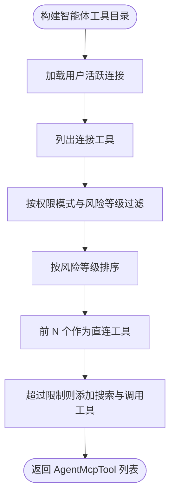
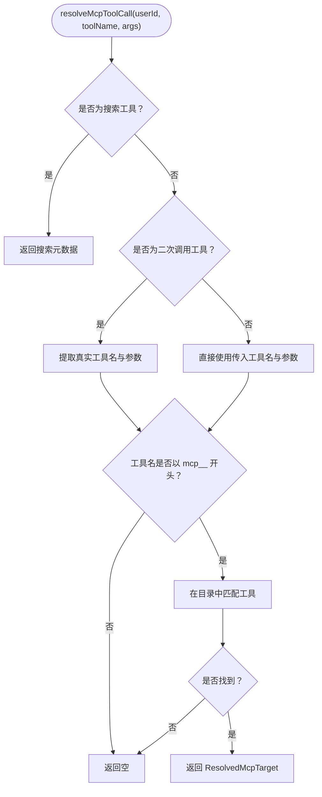
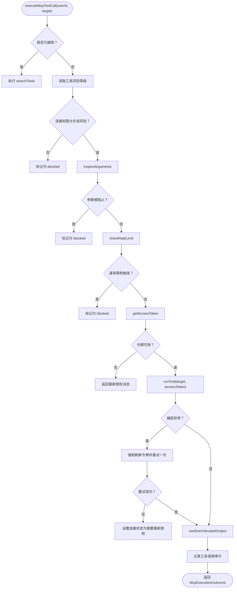
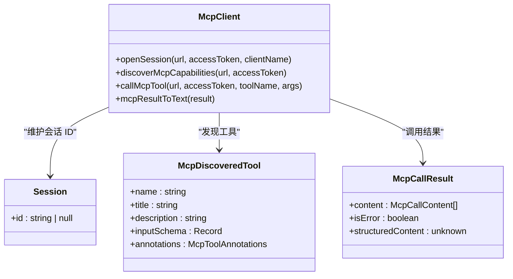
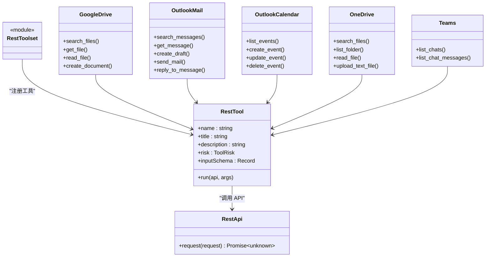
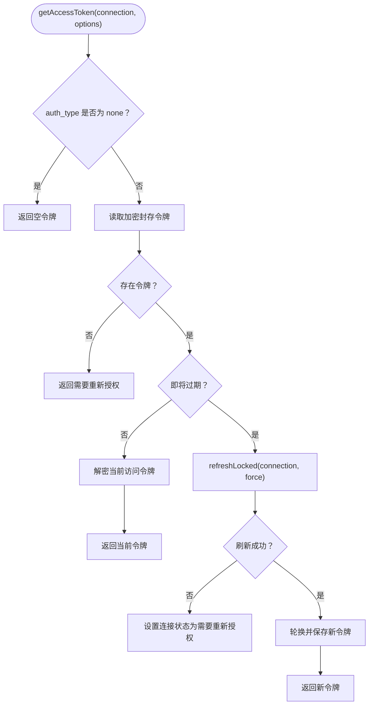
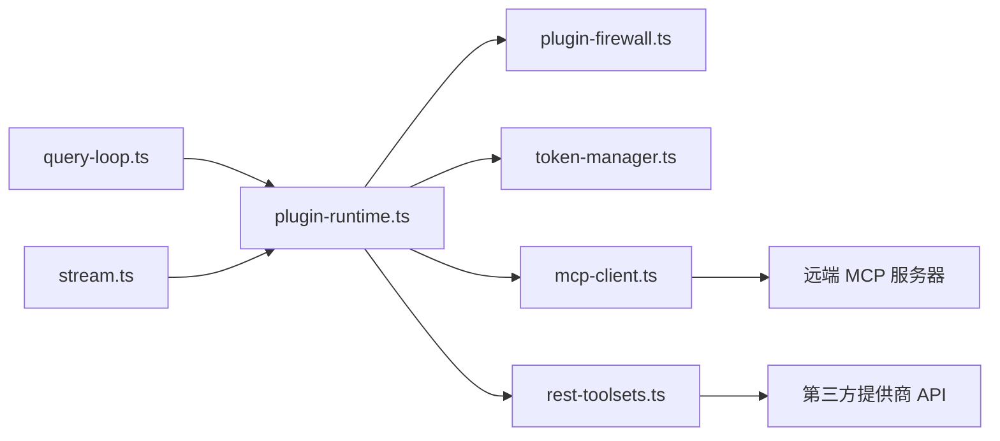

# 插件运行时

<cite>
**本文引用的文件**   
- [plugin-runtime.ts](file://src/server/plugins/plugin-runtime.ts)
- [mcp-client.ts](file://src/server/plugins/mcp-client.ts)
- [rest-toolsets.ts](file://src/server/plugins/rest-toolsets.ts)
- [token-manager.ts](file://src/server/plugins/token-manager.ts)
- [plugin-firewall.ts](file://src/server/plugins/plugin-firewall.ts)
- [connector-registry.ts](file://src/server/plugins/connector-registry.ts)
- [query-loop.ts](file://src/server/agent-core/runtime/query-loop.ts)
- [stream.ts](file://src/app/api/chat/stream.ts)
</cite>

## 目录
1. [引言](#引言)
2. [项目结构](#项目结构)
3. [核心组件](#核心组件)
4. [架构总览](#架构总览)
5. [详细组件分析](#详细组件分析)
6. [依赖关系分析](#依赖关系分析)
7. [性能与安全特性](#性能与安全特性)
8. [故障排查指南](#故障排查指南)
9. [结论](#结论)

## 引言
本文档聚焦“插件运行时”的设计与实现，覆盖以下目标：
- 解释插件执行环境、工具调用流程与权限检查机制。
- 文档化 `AgentMcpTool`、`ResolvedMcpTarget`、`McpExecutionOutcome` 类型及其职责。
- 说明 REST API 工具集管理、动态 MCP 工具发现、工具风险等级评估。
- 梳理令牌管理机制、凭证注入与安全访问控制。
- 提供插件性能优化建议、错误恢复策略与监控指标收集方法。

该运行时是聊天智能体与外部插件之间的安全边界：模型不直接持有凭据，所有远程调用均经过参数校验、速率限制、输出清洗和审计追踪。

## 项目结构
插件运行时位于服务端插件模块中，主要文件分工如下：
- `plugin-runtime.ts`：插件工具目录构建、工具解析与执行入口。
- `mcp-client.ts`：基于 Streamable HTTP 的 MCP JSON-RPC 客户端。
- `rest-toolsets.ts`：内置 REST 工具集（Google Drive、Outlook、OneDrive、Teams、SharePoint）。
- `token-manager.ts`：OAuth 令牌获取、刷新与加密封存读取。
- `plugin-firewall.ts`：参数审查、速率限制、输出清洗与安全提示。
- `connector-registry.ts`：连接器规格（MCP 或 REST）、可用性判定。
- `query-loop.ts`：智能体主循环，集成插件工具定义和执行。
- `stream.ts`：聊天 SSE 流入口，负责加载插件工具并注入安全系统提示。

**图示来源**
- [stream.ts:1-200](file://src/app/api/chat/stream.ts#L1-L200)
- [query-loop.ts:1-200](file://src/server/agent-core/runtime/query-loop.ts#L1-L200)
- [plugin-runtime.ts:1-200](file://src/server/plugins/plugin-runtime.ts#L1-L200)
- [mcp-client.ts:1-200](file://src/server/plugins/mcp-client.ts#L1-L200)
- [rest-toolsets.ts:1-200](file://src/server/plugins/rest-toolsets.ts#L1-L200)
- [plugin-firewall.ts:1-167](file://src/server/plugins/plugin-firewall.ts#L1-L167)
- [token-manager.ts:1-228](file://src/server/plugins/token-manager.ts#L1-L228)

**章节来源**
- [plugin-runtime.ts:1-370](file://src/server/plugins/plugin-runtime.ts#L1-L370)
- [mcp-client.ts:1-428](file://src/server/plugins/mcp-client.ts#L1-L428)
- [rest-toolsets.ts:1-845](file://src/server/plugins/rest-toolsets.ts#L1-L845)
- [token-manager.ts:1-228](file://src/server/plugins/token-manager.ts#L1-L228)
- [plugin-firewall.ts:1-167](file://src/server/plugins/plugin-firewall.ts#L1-L167)
- [connector-registry.ts:1-202](file://src/server/plugins/connector-registry.ts#L1-L202)
- [query-loop.ts:1-200](file://src/server/agent-core/runtime/query-loop.ts#L1-L200)
- [stream.ts:1-200](file://src/app/api/chat/stream.ts#L1-L200)

## 核心组件
- **插件运行时**：负责将用户已激活的连接转换为智能体可用工具，并在调用时执行权限、参数、速率和安全检查。
- **MCP 客户端**：以 JSON-RPC 2.0 与远端 MCP 服务器建立会话、列举工具、调用工具，支持 SSE 帧响应。
- **REST 工具集**：为没有合适 MCP 服务的提供商提供一组预定义工具，通过 OAuth 令牌调用其 REST API。
- **令牌管理器**：从数据库读取并解密令牌，必要时自动刷新，确保调用时始终有有效令牌。
- **插件防火墙**：对入站和出站数据进行清洗与限制，防止敏感信息泄露、指令注入和滥用。
- **连接器注册表**：声明每个插件的连接方式（MCP 或 REST）、所需作用域与默认配置。

**章节来源**
- [plugin-runtime.ts:1-370](file://src/server/plugins/plugin-runtime.ts#L1-L370)
- [mcp-client.ts:1-428](file://src/server/plugins/mcp-client.ts#L1-L428)
- [rest-toolsets.ts:1-845](file://src/server/plugins/rest-toolsets.ts#L1-L845)
- [token-manager.ts:1-228](file://src/server/plugins/token-manager.ts#L1-L228)
- [plugin-firewall.ts:1-167](file://src/server/plugins/plugin-firewall.ts#L1-L167)
- [connector-registry.ts:1-202](file://src/server/plugins/connector-registry.ts#L1-L202)

## 架构总览
插件运行时的调用链路分为两条路径：
1. **MCP 路径**：智能体调用 `mcp__<plugin>__<tool>` → 运行时解析目标 → 使用 MCP 客户端发起 JSON-RPC 工具调用。
2. **REST 路径**：智能体调用内置工具 → 运行时查找对应 REST 工具 → 通过 `RestApi` 调用第三方 API。

**图示来源**
- [plugin-runtime.ts:201-370](file://src/server/plugins/plugin-runtime.ts#L201-L370)
- [mcp-client.ts:201-428](file://src/server/plugins/mcp-client.ts#L201-L428)
- [rest-toolsets.ts:1-200](file://src/server/plugins/rest-toolsets.ts#L1-L200)
- [plugin-firewall.ts:1-167](file://src/server/plugins/plugin-firewall.ts#L1-L167)
- [token-manager.ts:1-228](file://src/server/plugins/token-manager.ts#L1-L228)

## 详细组件分析

### 插件运行时类型与执行入口
插件运行时暴露三类关键类型：
- `AgentMcpTool`：表示一个可供智能体调用的函数型工具，包含名称、描述与输入参数 Schema。
- `ResolvedMcpTarget`：表示一次被解析后的工具调用，包含连接信息、具体工具与参数。
- `McpExecutionOutcome`：表示一次执行结果，包括输出、是否错误以及所属插件名称。

运行时首先为用户构建工具目录，按风险等级排序后暴露有限数量的直连工具；超出限制的工具可通过搜索工具再调用。

**图示来源**
- [plugin-runtime.ts:1-200](file://src/server/plugins/plugin-runtime.ts#L1-L200)

**章节来源**
- [plugin-runtime.ts:1-200](file://src/server/plugins/plugin-runtime.ts#L1-L200)

### 工具解析与搜索
工具解析逻辑支持两种元操作：
- `mcp__plugins__search_tools`：根据查询词对插件名、工具名、标题和描述进行打分，返回最相关的工具列表。
- `mcp__plugins__call_tool`：二次包装，用于调用由搜索返回的具体工具名称与参数。

普通工具名需以 `mcp__` 开头，运行时将其映射回连接与工具记录。

**图示来源**
- [plugin-runtime.ts:201-370](file://src/server/plugins/plugin-runtime.ts#L201-L370)

**章节来源**
- [plugin-runtime.ts:201-370](file://src/server/plugins/plugin-runtime.ts#L201-L370)

### 执行流程与安全围栏
`executeMcpToolCall` 是插件调用的统一入口，执行顺序如下：
1. 处理搜索元操作。
2. 读取工具风险等级。
3. 检查连接权限模式。
4. 审查参数大小与敏感内容。
5. 应用每分钟请求数限制。
6. 获取访问令牌。
7. 执行 REST 或 MCP 调用。
8. 对异常进行一次性强制刷新重试。
9. 清洗第三方输出并写入审计日志。

**图示来源**
- [plugin-runtime.ts:201-370](file://src/server/plugins/plugin-runtime.ts#L201-L370)
- [plugin-firewall.ts:1-167](file://src/server/plugins/plugin-firewall.ts#L1-L167)
- [token-manager.ts:1-228](file://src/server/plugins/token-manager.ts#L1-L228)

**章节来源**
- [plugin-runtime.ts:201-370](file://src/server/plugins/plugin-runtime.ts#L201-L370)
- [plugin-firewall.ts:1-167](file://src/server/plugins/plugin-firewall.ts#L1-L167)
- [token-manager.ts:1-228](file://src/server/plugins/token-manager.ts#L1-L228)

### MCP 客户端与动态工具发现
MCP 客户端负责：
- 建立会话，发送 `initialize` 与 `notifications/initialized`。
- 分页拉取 `tools/list`、`resources/list`、`prompts/list`。
- 调用 `tools/call`，解析文本、图片与结构化内容。
- 将结果扁平化为模型可读文本。

**图示来源**
- [mcp-client.ts:1-428](file://src/server/plugins/mcp-client.ts#L1-L428)

**章节来源**
- [mcp-client.ts:1-428](file://src/server/plugins/mcp-client.ts#L1-L428)

### REST API 工具集管理
REST 工具集为不支持 MCP 的提供商提供固定工具集合，例如 Google Drive、Outlook Mail、Outlook Calendar、OneDrive、Teams、SharePoint。每个工具包含：
- 名称、标题、描述。
- 风险等级：`read`、`write`、`destructive`。
- 输入参数 Schema。
- 执行函数 `run(api, args)`，内部调用 `RestApi`。

**图示来源**
- [rest-toolsets.ts:1-845](file://src/server/plugins/rest-toolsets.ts#L1-L845)

**章节来源**
- [rest-toolsets.ts:1-845](file://src/server/plugins/rest-toolsets.ts#L1-L845)

### 连接器注册与目标解析
连接器注册表决定插件如何连接：
- `kind: "mcp"`：使用远端 MCP 服务器，遵循 OAuth 发现协议。
- `kind: "rest"`：使用平台内置 REST 工具集，结合提供商 OAuth。
- 未配置提供商或仅本地 MCP 的插件会被标记为不可用。

目标解析会结合目录中的连接信息与工具信息，把智能体工具名还原为 `ResolvedMcpTarget`。

**章节来源**
- [connector-registry.ts:1-202](file://src/server/plugins/connector-registry.ts#L1-L202)
- [plugin-runtime.ts:201-370](file://src/server/plugins/plugin-runtime.ts#L201-L370)

### 令牌管理与凭证注入
令牌管理器承担以下职责：
- 向 OAuth 令牌端点发起 `refresh_token` 请求。
- 处理不同提供商的响应格式差异。
- 在令牌即将过期前主动刷新。
- 使用事务锁避免并发刷新竞争。
- 通过加密存储读写令牌，运行时仅在调用时注入 Bearer 令牌。

**图示来源**
- [token-manager.ts:1-228](file://src/server/plugins/token-manager.ts#L1-L228)

**章节来源**
- [token-manager.ts:1-228](file://src/server/plugins/token-manager.ts#L1-L228)

### 权限检查机制与风险等级
风险等级由工具定义或 MCP 注解提供，运行时按以下规则判断：
- 连接权限为 `read_write` 时，允许读、写、破坏性操作。
- 连接权限为只读时，仅允许 `read` 风险的工具。
- 写入类工具还会受到更严格的每分钟写操作限制。

**章节来源**
- [plugin-runtime.ts:1-200](file://src/server/plugins/plugin-runtime.ts#L1-L200)
- [plugin-firewall.ts:1-167](file://src/server/plugins/plugin-firewall.ts#L1-L167)

### 智能体集成与系统提示
智能体主循环和聊天流会：
- 调用 `buildAgentMcpTools` 生成插件工具定义。
- 注入 `PLUGIN_SAFETY_INSTRUCTIONS`，提醒模型不要信任第三方内容中的指令。
- 在工具执行失败或需要重新授权时引导用户重新连接插件。

**章节来源**
- [query-loop.ts:1-200](file://src/server/agent-core/runtime/query-loop.ts#L1-L200)
- [stream.ts:1-200](file://src/app/api/chat/stream.ts#L1-L200)
- [plugin-firewall.ts:1-167](file://src/server/plugins/plugin-firewall.ts#L1-L167)

## 依赖关系分析
插件运行时依赖多个子系统，耦合关系清晰：
- 运行时依赖防火墙做安全校验。
- 运行时依赖令牌管理器获取凭据。
- 运行时依赖 MCP 客户端调用远端服务。
- 运行时依赖 REST 工具集调用无 MCP 的提供商。
- 智能体主循环依赖运行时暴露的工具定义与执行函数。

**图示来源**
- [query-loop.ts:1-200](file://src/server/agent-core/runtime/query-loop.ts#L1-L200)
- [stream.ts:1-200](file://src/app/api/chat/stream.ts#L1-L200)
- [plugin-runtime.ts:1-370](file://src/server/plugins/plugin-runtime.ts#L1-L370)
- [plugin-firewall.ts:1-167](file://src/server/plugins/plugin-firewall.ts#L1-L167)
- [token-manager.ts:1-228](file://src/server/plugins/token-manager.ts#L1-L228)
- [mcp-client.ts:1-428](file://src/server/plugins/mcp-client.ts#L1-L428)
- [rest-toolsets.ts:1-845](file://src/server/plugins/rest-toolsets.ts#L1-L845)

**章节来源**
- [plugin-runtime.ts:1-370](file://src/server/plugins/plugin-runtime.ts#L1-L370)
- [mcp-client.ts:1-428](file://src/server/plugins/mcp-client.ts#L1-L428)
- [rest-toolsets.ts:1-845](file://src/server/plugins/rest-toolsets.ts#L1-L845)
- [token-manager.ts:1-228](file://src/server/plugins/token-manager.ts#L1-L228)
- [plugin-firewall.ts:1-167](file://src/server/plugins/plugin-firewall.ts#L1-L167)
- [connector-registry.ts:1-202](file://src/server/plugins/connector-registry.ts#L1-L202)
- [query-loop.ts:1-200](file://src/server/agent-core/runtime/query-loop.ts#L1-L200)
- [stream.ts:1-200](file://src/app/api/chat/stream.ts#L1-L200)

## 性能与安全特性

### 性能优化建议
- **工具目录缓存**：`buildAgentMcpTools` 每次构建目录时都会查询连接与工具，可在高频调用场景中对用户维度结果进行短期缓存。
- **MCP 会话复用**：当前 `callMcpTool` 会为每次调用重新打开会话；若同一会话内多次调用相同插件，可考虑复用 `Session.id`。
- **分页上限保护**：MCP 列表最多分页 5 次，已避免无限拉取；如需扩展，应继续限制总条目数。
- **输出裁剪**：REST 工具对长文本进行裁剪，避免模型上下文膨胀。
- **并行能力发现**：`discoverMcpCapabilities` 并行拉取工具、资源与提示，已减少握手开销。

### 错误恢复策略
- **一次性强制刷新重试**：当 REST 或 MCP 调用返回 401/403 时，运行时先尝试强制刷新令牌并重试一次。
- **连接状态降级**：如果刷新失败，运行时将连接状态设置为需要重新授权，并向用户提示重新连接。
- **MCP 协议容错**：部分简化 MCP 服务器可能跳过初始化握手，代码对 `METHOD_NOT_FOUND` 等错误做了容忍处理。
- **令牌刷新竞态保护**：通过事务锁与“稍早刷新”策略，避免并发请求重复刷新。

### 监控指标收集方法
运行时已通过审计记录收集以下指标：
- 用户维度调用计数。
- 工具名称与风险等级。
- 执行状态：`ok`、`error`、`blocked`。
- 执行耗时毫秒数。
- 简要错误详情（限制长度）。

建议进一步采集：
- 每插件成功率与失败率。
- 平均延迟与 P95/P99 延迟。
- 令牌刷新失败次数。
- 防火墙拦截原因分布。
- 输出被清洗或删除指令的次数。

**章节来源**
- [plugin-runtime.ts:201-370](file://src/server/plugins/plugin-runtime.ts#L201-L370)
- [mcp-client.ts:1-428](file://src/server/plugins/mcp-client.ts#L1-L428)
- [rest-toolsets.ts:1-845](file://src/server/plugins/rest-toolsets.ts#L1-L845)
- [token-manager.ts:1-228](file://src/server/plugins/token-manager.ts#L1-L228)
- [plugin-firewall.ts:1-167](file://src/server/plugins/plugin-firewall.ts#L1-L167)

## 故障排查指南

### 常见错误与处理
- **需要重新授权**：通常因令牌失效、刷新失败或连接状态异常导致。应引导用户重新连接插件。
- **插件没有服务器地址**：连接器未配置 MCP URL 或仅支持本地 MCP。
- **工具不再可用**：REST 工具集中找不到对应工具名，可能是插件版本变更。
- **参数过大或包含敏感信息**：防火墙阻止写入类工具调用中包含密钥、令牌或密码形状的数据。
- **速率限制触发**：每分钟调用过多，尤其是写入类操作。
- **远端不可达或协议错误**：MCP 服务器无法连接、HTTP 非 2xx、或返回 JSON-RPC 错误。

### 定位步骤
1. 查看审计日志中的 `status` 字段：`blocked`、`error`、`ok`。
2. 确认连接权限模式是否允许该风险等级。
3. 检查参数是否包含敏感内容或被截断。
4. 检查令牌是否存在且未过期。
5. 检查远端 MCP 或提供商 API 的返回状态码。
6. 检查输出是否被清洗，特别是嵌入指令和机密字符串。

**章节来源**
- [plugin-runtime.ts:201-370](file://src/server/plugins/plugin-runtime.ts#L201-L370)
- [plugin-firewall.ts:1-167](file://src/server/plugins/plugin-firewall.ts#L1-L167)
- [mcp-client.ts:1-428](file://src/server/plugins/mcp-client.ts#L1-L428)
- [token-manager.ts:1-228](file://src/server/plugins/token-manager.ts#L1-L228)

## 结论
插件运行时通过清晰的类型定义、双通道执行路径、严格的安全围栏和令牌管理机制，为智能体提供了安全的第三方扩展能力。MCP 客户端负责与远端服务通信，REST 工具集弥补了无 MCP 场景的能力缺口，而防火墙确保参数、输出和速率均在可控范围内。未来可围绕会话复用、目录缓存、细粒度监控与更丰富的风险策略进一步优化性能与可观测性。