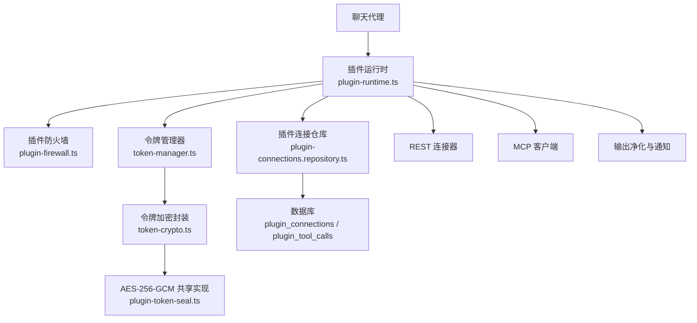
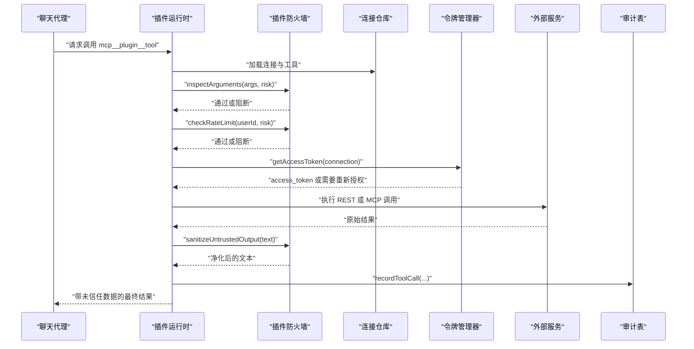
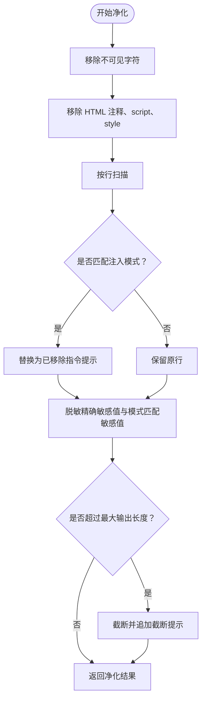
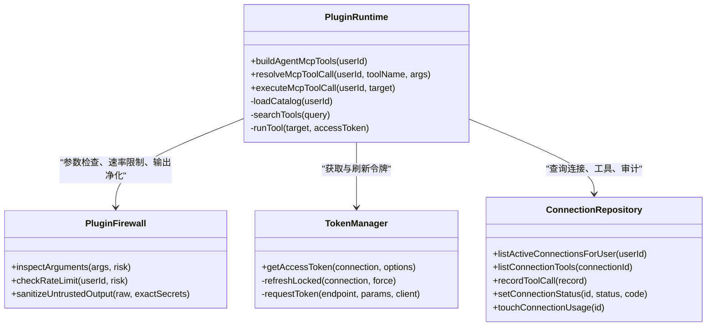
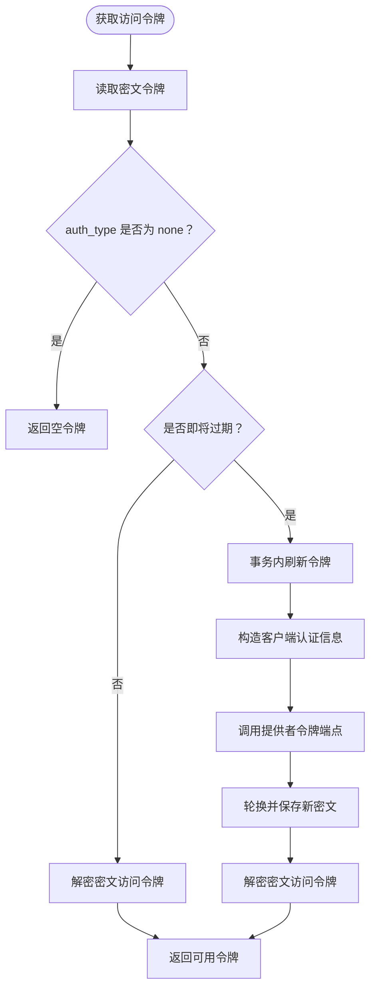
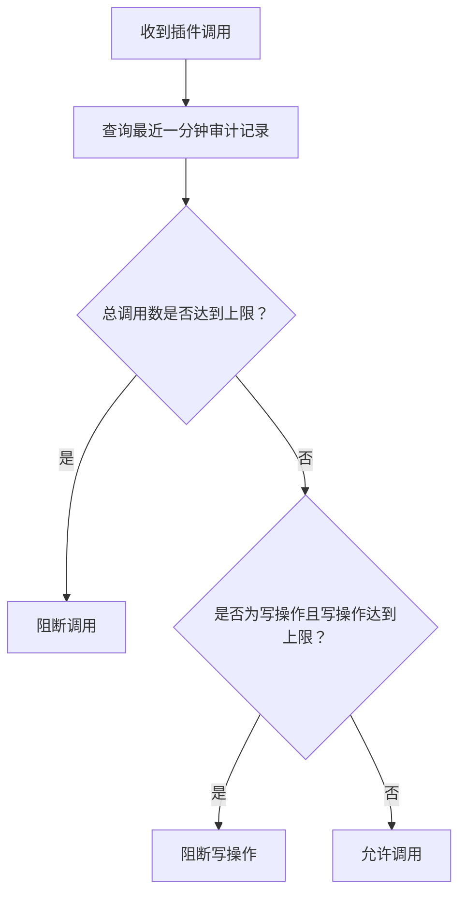
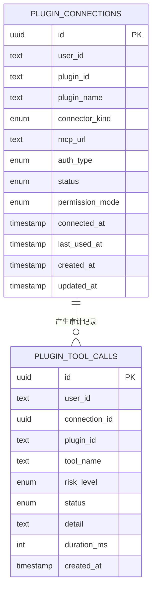
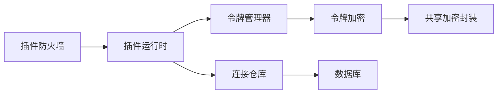
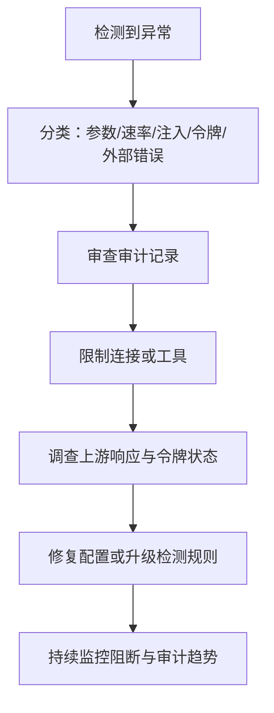

# 插件防火墙

<cite>
**本文引用的文件**   
- [src/server/plugins/plugin-firewall.ts](file://src/server/plugins/plugin-firewall.ts)
- [src/server/plugins/plugin-runtime.ts](file://src/server/plugins/plugin-runtime.ts)
- [src/server/plugins/token-crypto.ts](file://src/server/plugins/token-crypto.ts)
- [src/server/plugins/token-manager.ts](file://src/server/plugins/token-manager.ts)
- [src/shared/lib/plugin-token-seal.ts](file://src/shared/lib/plugin-token-seal.ts)
- [src/server/http/rate-limit.ts](file://src/server/http/rate-limit.ts)
- [src/server/http/durable-rate-limit.ts](file://src/server/http/durable-rate-limit.ts)
- [src/server/repositories/plugin-connections.repository.ts](file://src/server/repositories/plugin-connections.repository.ts)
- [supabase/migrations/20261026120000_plugin_native_oauth.sql](file://supabase/migrations/20261026120000_plugin_native_oauth.sql)
</cite>

## 目录
1. [简介](#简介)
2. [项目结构与定位](#项目结构与定位)
3. [核心组件](#核心组件)
4. [架构总览](#架构总览)
5. [详细组件分析](#详细组件分析)
6. [依赖关系分析](#依赖关系分析)
7. [性能与资源特性](#性能与资源特性)
8. [故障排查与安全事件响应](#故障排查与安全事件响应)
9. [结论](#结论)

## 简介
本文件系统化文档化“插件防火墙”的安全设计。该机制为所有第三方插件调用提供统一安全边界，涵盖以下方面：
- 安全隔离：以运行时网关、权限模式、工具风险等级和连接状态控制插件能力。
- 参数验证：对入参序列化大小、敏感信息外泄进行拦截。
- 输出净化：剥离不可见字符、脚本样式、指令注入片段，并脱敏敏感值。
- 攻击检测：识别提示词注入、数据外泄、隐藏指令等模式。
- 速率限制：按用户维度统计插件调用，区分读操作与写操作限额。
- 审计日志：记录每次调用的结果、风险等级、耗时与阻断原因。
- 令牌保护：使用 AES-256-GCM 加密存储 OAuth 凭据，仅在调用前解密。
- 数据传输安全：通过 HTTPS 与认证头传输令牌；失败时不向模型泄露错误细节。
- 配置项与策略：包含默认阈值、系统级安全提示、连接权限模式等。

## 项目结构与定位
插件防火墙位于服务端插件子系统中，是聊天代理执行外部插件调用的必经通道。其职责可概括为：
- 暴露给代理的工具定义由插件运行时构建。
- 所有工具调用在 `executeMcpToolCall` 中经过防火墙检查。
- 实际调用通过 REST 连接器或 MCP 客户端完成。
- 敏感令牌由 token-manager 与 token-crypto 管理，数据库仅保存密文。
- 审计写入 `plugin_tool_calls` 表，供后续审计与分析。

**图表来源**
- [src/server/plugins/plugin-runtime.ts:1-60](file://src/server/plugins/plugin-runtime.ts#L1-L60)
- [src/server/plugins/plugin-firewall.ts:1-40](file://src/server/plugins/plugin-firewall.ts#L1-L40)
- [src/server/plugins/token-manager.ts:1-40](file://src/server/plugins/token-manager.ts#L1-L40)
- [src/server/plugins/token-crypto.ts:1-25](file://src/server/plugins/token-crypto.ts#L1-L25)
- [src/shared/lib/plugin-token-seal.ts:1-20](file://src/shared/lib/plugin-token-seal.ts#L1-L20)
- [src/server/repositories/plugin-connections.repository.ts:1-30](file://src/server/repositories/plugin-connections.repository.ts#L1-L30)
- [supabase/migrations/20261026120000_plugin_native_oauth.sql:153-190](file://supabase/migrations/20261026120000_plugin_native_oauth.sql#L153-L190)

**章节来源**
- [src/server/plugins/plugin-runtime.ts:1-60](file://src/server/plugins/plugin-runtime.ts#L1-L60)
- [src/server/plugins/plugin-firewall.ts:1-40](file://src/server/plugins/plugin-firewall.ts#L1-L40)

## 核心组件
- 插件防火墙：负责参数检查、速率限制、输出净化和安全提示。
- 插件运行时：负责工具目录构建、工具解析、执行流程编排、异常处理与审计。
- 令牌管理器：负责 OAuth 令牌获取、刷新、过期判断与持久化。
- 令牌加密模块：负责基于环境密钥派生 AES-256-GCM 密钥，并封装 seal/unseal。
- 共享加密封装：跨 Node 与 Worker 的 Web Crypto AES-GCM 实现。
- 通用速率限制：进程内滑动窗口计数。
- 持久化速率限制：基于数据库固定窗口的计数，并提供本地回退。
- 插件连接仓库：管理连接、工具、审计行和密文令牌读写。

**章节来源**
- [src/server/plugins/plugin-firewall.ts:1-167](file://src/server/plugins/plugin-firewall.ts#L1-L167)
- [src/server/plugins/plugin-runtime.ts:1-200](file://src/server/plugins/plugin-runtime.ts#L1-L200)
- [src/server/plugins/token-manager.ts:1-200](file://src/server/plugins/token-manager.ts#L1-L200)
- [src/server/plugins/token-crypto.ts:1-44](file://src/server/plugins/token-crypto.ts#L1-L44)
- [src/shared/lib/plugin-token-seal.ts:1-119](file://src/shared/lib/plugin-token-seal.ts#L1-L119)
- [src/server/http/rate-limit.ts:1-41](file://src/server/http/rate-limit.ts#L1-L41)
- [src/server/http/durable-rate-limit.ts:1-47](file://src/server/http/durable-rate-limit.ts#L1-L47)
- [src/server/repositories/plugin-connections.repository.ts:1-80](file://src/server/repositories/plugin-connections.repository.ts#L1-L80)

## 架构总览
插件调用从代理侧进入运行时，随后依次经历：
1. 工具解析：确定目标连接与工具名称。
2. 权限检查：根据连接的 permission_mode 与工具 risk_level 判断是否允许。
3. 参数检查：序列化体积限制与敏感内容拦截。
4. 速率限制：按用户维度统计最近一分钟调用次数。
5. 令牌获取：从密文中解密访问令牌，必要时刷新。
6. 工具执行：REST 或 MCP 调用。
7. 输出净化：清理不可见字符、HTML、脚本、指令注入，并脱敏敏感值。
8. 审计记录：写入 `plugin_tool_calls`，包括状态、风险等级、耗时与可选详情。

**图表来源**
- [src/server/plugins/plugin-runtime.ts:201-370](file://src/server/plugins/plugin-runtime.ts#L201-L370)
- [src/server/plugins/plugin-firewall.ts:41-167](file://src/server/plugins/plugin-firewall.ts#L41-L167)
- [src/server/plugins/token-manager.ts:120-200](file://src/server/plugins/token-manager.ts#L120-L200)
- [supabase/migrations/20261026120000_plugin_native_oauth.sql:153-190](file://supabase/migrations/20261026120000_plugin_native_oauth.sql#L153-L190)

## 详细组件分析

### 插件防火墙
插件防火墙是所有插件调用的安全门控。它承担三类职责：
- 出站检查：在调用外部服务前检查参数体积、敏感内容。
- 并发与配额：按用户维度限制每分钟调用次数，写操作限额更严格。
- 入站净化：在模型读取外部结果前清理不安全内容与指令注入，并标记未信任数据。

关键常量与策略：
- 最大参数体积：64KB。
- 最大输出长度：24000 字符。
- 每分钟调用上限：40 次。
- 每分钟写操作上限：12 次。
- 敏感模式：覆盖私有密钥、Bearer token、多种 API key、云厂商密钥、JWT 片段等。
- 注入模式：覆盖忽略旧指令、替换系统提示、伪装角色、指示发送凭证、禁止告知用户等。
- 不可见字符：移除零宽空格、双向控制字符、零宽断连符等。

输出净化流程如下：

**图表来源**
- [src/server/plugins/plugin-firewall.ts:41-167](file://src/server/plugins/plugin-firewall.ts#L41-L167)

安全注意事项：
- 正则表达式在循环中复用并重置索引，避免状态污染。
- 注入检测按行执行，便于统计被移除指令的数量。
- 敏感值既支持已知精确列表，也支持通用模式匹配。
- 输出始终附带“未信任数据”系统提示，提醒模型不要直接执行其中指令。

**章节来源**
- [src/server/plugins/plugin-firewall.ts:1-167](file://src/server/plugins/plugin-firewall.ts#L1-L167)

### 插件运行时
插件运行时负责把用户已连接的插件暴露为代理可用的工具，并确保每个调用都走防火墙。

主要职责：
- 构建代理工具目录：优先将只读工具放入直接可见集合，其余可通过搜索工具查找。
- 工具名称规范化：将插件 ID 与工具名转换为安全的代理工具名。
- 权限过滤：根据连接的 `permission_mode` 与工具的 `risk_level` 决定是否允许执行。
- 工具执行：REST 连接器直接运行工具集；MCP 连接器通过客户端调用远程工具。
- 认证重试：遇到 401/403 时尝试强制刷新令牌后再执行一次。
- 审计与使用计数：记录调用状态、风险等级、耗时，并更新连接使用时间。

**图表来源**
- [src/server/plugins/plugin-runtime.ts:1-200](file://src/server/plugins/plugin-runtime.ts#L1-L200)
- [src/server/plugins/plugin-firewall.ts:41-167](file://src/server/plugins/plugin-firewall.ts#L41-L167)
- [src/server/plugins/token-manager.ts:1-200](file://src/server/plugins/token-manager.ts#L1-L200)
- [src/server/repositories/plugin-connections.repository.ts:1-80](file://src/server/repositories/plugin-connections.repository.ts#L1-L80)

执行路径说明：
- 若目标为搜索工具，则返回工具摘要与使用方法。
- 若目标为动态调用工具，则先校验权限、参数、速率限制。
- 若令牌不可用，返回要求重新连接的消息。
- 若外部服务返回 401/403，则尝试强制刷新后重试。
- 成功后对结果进行净化，并记录审计。

**章节来源**
- [src/server/plugins/plugin-runtime.ts:1-200](file://src/server/plugins/plugin-runtime.ts#L1-L200)
- [src/server/plugins/plugin-runtime.ts:201-370](file://src/server/plugins/plugin-runtime.ts#L201-L370)

### 令牌管理与加密
令牌生命周期围绕三个层次：
- 应用层接口：`token-manager.ts` 提供获取、刷新、过期判断、OAuth 请求封装。
- 加密层接口：`token-crypto.ts` 负责从环境变量派生密钥并调用 seal/unseal。
- 底层实现：`plugin-token-seal.ts` 提供跨 Node 与 Worker 的 AES-256-GCM 实现。

安全要点：
- 密钥派生使用 SHA-256 哈希口令，并以域名分隔符限定用途，防止与其他路径密钥混用。
- 密文格式为版本前缀、IV、认证标签、密文的 base64url 拼接，便于调试与兼容。
- 解密失败返回 null，而不是抛出异常，避免误报导致服务中断。
- 令牌仅在调用前解密，数据库中不存储明文。
- 刷新令牌时采用事务锁，避免并发重复刷新。

**图表来源**
- [src/server/plugins/token-manager.ts:120-200](file://src/server/plugins/token-manager.ts#L120-L200)
- [src/server/plugins/token-crypto.ts:1-44](file://src/server/plugins/token-crypto.ts#L1-L44)
- [src/shared/lib/plugin-token-seal.ts:60-119](file://src/shared/lib/plugin-token-seal.ts#L60-L119)

**章节来源**
- [src/server/plugins/token-manager.ts:1-200](file://src/server/plugins/token-manager.ts#L1-L200)
- [src/server/plugins/token-crypto.ts:1-44](file://src/server/plugins/token-crypto.ts#L1-L44)
- [src/shared/lib/plugin-token-seal.ts:1-119](file://src/shared/lib/plugin-token-seal.ts#L1-L119)

### 速率限制策略
项目中存在两层速率限制：
- 进程内速率限制：适用于一般 API 入口，使用 Map 维护滑动窗口计数。
- 持久化速率限制：适用于需要跨实例一致性的场景，使用数据库固定窗口计数，并在数据库不可用时回退到进程内限制。

插件防火墙使用的“插件调用速率限制”并非直接使用上述通用限速器，而是通过数据库查询 `plugin_tool_calls` 表统计最近一分钟内的成功调用数量。这种设计有以下特点：
- 只统计未被阻止的记录。
- 对写操作有更严格的限额。
- 如果数据库查询失败，视为未超限，保证可用性。

**图表来源**
- [src/server/plugins/plugin-firewall.ts:70-115](file://src/server/plugins/plugin-firewall.ts#L70-L115)
- [src/server/http/rate-limit.ts:1-41](file://src/server/http/rate-limit.ts#L1-L41)
- [src/server/http/durable-rate-limit.ts:1-47](file://src/server/http/durable-rate-limit.ts#L1-L47)

**章节来源**
- [src/server/http/rate-limit.ts:1-41](file://src/server/http/rate-limit.ts#L1-L41)
- [src/server/http/durable-rate-limit.ts:1-47](file://src/server/http/durable-rate-limit.ts#L1-L47)
- [src/server/plugins/plugin-firewall.ts:70-115](file://src/server/plugins/plugin-firewall.ts#L70-L115)

### 审计日志与数据安全
审计表用于追踪插件调用行为，字段包括工具名、风险等级、状态、详情、耗时和创建时间。相关迁移还定义了枚举约束、索引以及行级安全策略：
- 普通认证用户只能读取自己的审计记录。
- 服务角色拥有全部权限。
- 匿名用户与普通认证用户对插入、更新、删除无权限。

**图表来源**
- [supabase/migrations/20261026120000_plugin_native_oauth.sql:153-190](file://supabase/migrations/20261026120000_plugin_native_oauth.sql#L153-L190)
- [src/server/plugins/plugin-runtime.ts:240-370](file://src/server/plugins/plugin-runtime.ts#L240-L370)

**章节来源**
- [supabase/migrations/20261026120000_plugin_native_oauth.sql:153-190](file://supabase/migrations/20261026120000_plugin_native_oauth.sql#L153-L190)
- [src/server/plugins/plugin-runtime.ts:240-370](file://src/server/plugins/plugin-runtime.ts#L240-L370)

## 依赖关系分析
插件防火墙依赖多个子系统形成纵深防御：
- 插件运行时依赖防火墙进行参数、配额与输出安全检查。
- 插件运行时依赖令牌管理器获取短期有效访问令牌。
- 令牌管理器依赖加密模块保护持久化令牌。
- 加密模块依赖共享 Web Crypto 实现确保跨运行时一致性。
- 插件运行时依赖连接仓库获取连接元数据、工具清单与审计写入。
- 审计表受数据库迁移定义的约束与 RLS 策略保护。

**图表来源**
- [src/server/plugins/plugin-firewall.ts:1-167](file://src/server/plugins/plugin-firewall.ts#L1-L167)
- [src/server/plugins/plugin-runtime.ts:1-200](file://src/server/plugins/plugin-runtime.ts#L1-L200)
- [src/server/plugins/token-manager.ts:1-200](file://src/server/plugins/token-manager.ts#L1-L200)
- [src/server/plugins/token-crypto.ts:1-44](file://src/server/plugins/token-crypto.ts#L1-L44)
- [src/shared/lib/plugin-token-seal.ts:1-119](file://src/shared/lib/plugin-token-seal.ts#L1-L119)
- [src/server/repositories/plugin-connections.repository.ts:1-80](file://src/server/repositories/plugin-connections.repository.ts#L1-L80)

**章节来源**
- [src/server/plugins/plugin-firewall.ts:1-167](file://src/server/plugins/plugin-firewall.ts#L1-L167)
- [src/server/plugins/plugin-runtime.ts:1-200](file://src/server/plugins/plugin-runtime.ts#L1-L200)
- [src/server/plugins/token-manager.ts:1-200](file://src/server/plugins/token-manager.ts#L1-L200)
- [src/server/plugins/token-crypto.ts:1-44](file://src/server/plugins/token-crypto.ts#L1-L44)
- [src/shared/lib/plugin-token-seal.ts:1-119](file://src/shared/lib/plugin-token-seal.ts#L1-L119)
- [src/server/repositories/plugin-connections.repository.ts:1-80](file://src/server/repositories/plugin-connections.repository.ts#L1-L80)

## 性能与资源特性
- 参数体积限制：64KB 序列化上限可防止超大负载拖慢网络与外部服务。
- 输出长度限制：24000 字符上限可降低大响应对模型上下文的影响。
- 正则扫描：注入检测逐行进行，避免整段全文反复匹配带来的额外开销。
- 速率限制：插件防火墙使用最近一分钟数据库查询统计，适合长期运行的服务端；通用速率限制提供轻量进程内回退。
- 令牌刷新：提前 60 秒刷新，避免中间时刻过期；使用事务锁减少并发刷新。
- 审计写入：失败时静默降级，不影响主调用链路。

[本节为通用性能讨论，不直接分析具体代码行]

## 故障排查与安全事件响应

### 常见故障与定位
- 插件显示需要重新连接：
  - 可能原因：令牌失效、刷新失败、连接状态被设为需重新授权。
  - 排查位置：令牌刷新流程、连接状态设置、审计详情。
- 插件调用被阻断：
  - 可能原因：参数过大、包含敏感信息、超出每分钟调用限额、写操作过多、连接权限为只读。
  - 排查位置：参数检查、速率限制、连接权限模式。
- 外部服务返回 401/403：
  - 可能原因：令牌过期、权限不足、连接被撤销。
  - 处理逻辑：尝试强制刷新一次；仍失败则标记连接需重新授权。

**章节来源**
- [src/server/plugins/plugin-runtime.ts:201-370](file://src/server/plugins/plugin-runtime.ts#L201-L370)
- [src/server/plugins/plugin-firewall.ts:70-167](file://src/server/plugins/plugin-firewall.ts#L70-L167)
- [src/server/plugins/token-manager.ts:120-200](file://src/server/plugins/token-manager.ts#L120-L200)

### 威胁检测规则建议
现有规则已覆盖常见攻击面，可在以下方向继续增强：
- 扩展敏感模式：新增更多厂商密钥前缀、内部组织令牌格式。
- 强化注入检测：增加多语言指令变体、编码混淆检测。
- 动态阈值：根据用户历史行为调整每分钟调用上限。
- 输出沙箱：对富文本输出进一步做结构化白名单校验。
- 审计告警：对高频阻断、大量指令注入、敏感值命中触发告警。

[本节为概念性安全建议，不直接分析具体代码行]

### 安全事件响应流程
建议流程：
1. 监控插件防火墙阻断指标：参数阻断、速率阻断、注入移除次数。
2. 查看审计表中的 blocked/error 记录，确认用户、工具、风险等级与耗时。
3. 若涉及敏感值命中，检查是否因上游服务意外返回凭据，并评估是否需要扩大脱敏范围。
4. 若连接频繁失败，检查 OAuth 元数据、刷新端点、令牌有效期。
5. 如确认为恶意插件或滥用行为，降低连接权限或断开连接，并记录事件。

[本图为概念性响应流程，不直接映射具体源码]

## 结论
插件防火墙通过参数验证、速率限制、输出净化、敏感信息脱敏、指令注入防护、令牌加密与审计记录，构建了面向第三方插件调用的完整安全边界。插件运行时作为执行中枢，将权限模式、工具风险等级与连接状态纳入统一决策；令牌管理器与加密模块确保敏感凭据不在持久化层暴露；数据库审计表提供可观测性与合规基础。未来可在动态阈值、富文本输出沙箱、威胁告警等方面进一步增强，使插件生态在开放与可控之间取得更好平衡。