# OAuth 授权模型

<cite>
**本文引用的文件**   
- [supabase/migrations/20261026120000_plugin_native_oauth.sql](file://supabase/migrations/20261026120000_plugin_native_oauth.sql)
- [supabase/migrations/20261002173000_plugin_connections.sql](file://supabase/migrations/20261002173000_plugin_connections.sql)
- [supabase/migrations/20260726120000_clauxen_code_oauth_client.sql](file://supabase/migrations/20260726120000_clauxen_code_oauth_client.sql)
- [supabase/migrations/20260508104000_oauth_fk_covering_indexes.sql](file://supabase/migrations/20260508104000_oauth_fk_covering_indexes.sql)
- [src/server/oauth/service.ts](file://src/server/oauth/service.ts)
- [src/server/oauth/repository.ts](file://src/server/oauth/repository.ts)
- [src/server/oauth/redirect.ts](file://src/server/oauth/redirect.ts)
- [workers/plugin-oauth/src/index.ts](file://workers/plugin-oauth/src/index.ts)
- [workers/plugin-oauth/src/supabase.ts](file://workers/plugin-oauth/src/supabase.ts)
- [src/server/plugins/token-manager.ts](file://src/server/plugins/token-manager.ts)
- [src/server/plugins/oauth-providers.ts](file://src/server/plugins/oauth-providers.ts)
- [src/server/plugins/plugin-connect.ts](file://src/server/plugins/plugin-connect.ts)
</cite>

## 目录

1. [引言](#引言)
2. [项目结构与边界](#项目结构与边界)
3. [核心数据模型](#核心数据模型)
4. [架构总览](#架构总览)
5. [详细组件分析](#详细组件分析)
6. [依赖关系分析](#依赖关系分析)
7. [性能与并发设计](#性能与并发设计)
8. [故障排查指南](#故障排查指南)
9. [结论](#结论)

## 引言

本文聚焦本仓库中“原生 OAuth 授权”的数据模型与数据流。它覆盖两类授权场景：

| 场景 | 目标 | 关键存储 |
|---|---|---|
| 平台内部 OAuth | 终端 CLI、设备码、同意授权、访问令牌和刷新令牌的签发、校验与撤销 | `public.oauth_*` 系列表 |
| 插件原生 OAuth | 为 Marketplace 插件连接外部 MCP 或 REST 提供商，完成动态客户端注册、授权码交换、令牌密封持久化与自动刷新 | `public.plugin_connections`、`private.plugin_oauth_tokens`、`private.plugin_oauth_states`、`private.plugin_oauth_clients` |

系统明确区分三类数据：

- **公开元数据**：连接名称、图标、工具列表、能力清单、审计事件等，受行级安全策略保护。
- **私密令牌材料**：经 AES-256-GCM 密封的访问令牌和刷新令牌，仅由服务角色通过数据库函数写入或读取。
- **短期授权状态**：待处理的授权请求、授权码、设备码、插件 OAuth 状态键，均带过期时间并一次使用。

## 项目结构与边界

OAuth 相关代码分布在三个层次：

1. **PostgreSQL 迁移层**：定义授权客户端、同意授权、授权码、访问令牌、刷新令牌、设备码、审计事件，以及插件连接与密封令牌表。
2. **服务端 OAuth 服务层**：实现授权码交换、刷新令牌、设备码流程、令牌解析与撤销。
3. **Cloudflare Worker 插件 OAuth 层**：执行 RFC 9728 / RFC 8414 发现、动态客户端注册、授权跳转、回调处理、令牌密封和旋转。

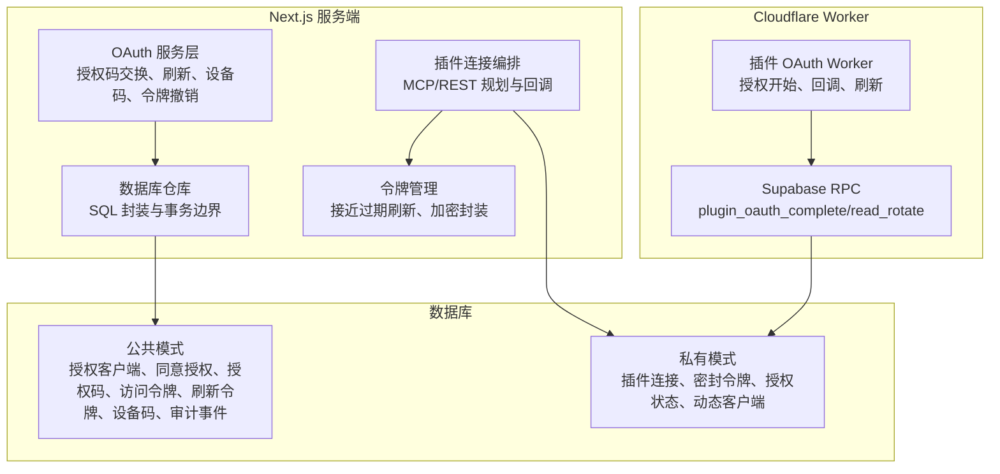

**图表来源**

- [supabase/migrations/20261002173000_plugin_connections.sql:1-88](file://supabase/migrations/20261002173000_plugin_connections.sql#L1-L88)
- [supabase/migrations/20261026120000_plugin_native_oauth.sql:60-105](file://supabase/migrations/20261026120000_plugin_native_oauth.sql#L60-L105)
- [src/server/oauth/service.ts:1-120](file://src/server/oauth/service.ts#L1-L120)
- [src/server/oauth/repository.ts:1-80](file://src/server/oauth/repository.ts#L1-L80)
- [workers/plugin-oauth/src/index.ts:1-60](file://workers/plugin-oauth/src/index.ts#L1-L60)
- [workers/plugin-oauth/src/supabase.ts:1-40](file://workers/plugin-oauth/src/supabase.ts#L1-L40)

**章节来源**

- [supabase/migrations/20261002173000_plugin_connections.sql:1-88](file://supabase/migrations/20261002173000_plugin_connections.sql#L1-L88)
- [supabase/migrations/20261026120000_plugin_native_oauth.sql:1-20](file://supabase/migrations/20261026120000_plugin_native_oauth.sql#L1-L20)
- [workers/plugin-oauth/src/index.ts:1-60](file://workers/plugin-oauth/src/index.ts#L1-L60)

## 核心数据模型

### 平台内部 OAuth 主表族

| 表名 | 职责 | 关键字段 | 安全特性 |
|---|---|---|---|
| `oauth_scopes` | 授权范围定义 | `key`、描述、声明名、是否默认、是否敏感 | 由迁移幂等写入 |
| `oauth_clients` | 已注册 OAuth 客户端 | `client_id`、类型、状态、允许授权类型、是否 PKCE、是否第一方 | 删除标记 + 状态过滤 |
| `oauth_client_redirect_uris` | 回调地址白名单 | `oauth_client_id`、`redirect_uri` | 与客户端联合约束 |
| `oauth_authorization_requests` | 授权请求记录 | 用户、客户端、回调、作用域、state 哈希、PKCE challenge、IP、UA、过期时间 | 审计基础 |
| `oauth_authorization_codes` | 一次性授权码 | code 哈希、回调、作用域、challenge、状态、过期、消费时间 | 单写多读、原子消耗 |
| `oauth_consent_grants` | 用户同意授权 | 用户、客户端、作用域集合 | upsert 合并最新范围 |
| `oauth_refresh_token_families` | 刷新令牌家族 | 用户、客户端、状态、撤销时间 | 支持批量撤销 |
| `oauth_refresh_tokens` | 刷新令牌 | family、哈希、作用域、过期、撤销、旋转前 ID | 家族关联 |
| `oauth_access_tokens` | 访问令牌 | refresh token 外键、哈希、作用域、受众、过期、最后使用时间 | 可触摸更新 |
| `oauth_device_codes` | 设备码流程 | device/user code 哈希、间隔、过期、批准、消费、元数据 | 分阶段状态机 |
| `oauth_events` | 审计事件 | 用户、客户端、事件类型、IP、UA、JSONB 元数据 | 失败不中断认证 |

### 插件原生 OAuth 主表族

| 表名 | 职责 | 关键字段 | 安全特性 |
|---|---|---|---|
| `plugin_connections` | 每用户插件连接 | 用户、插件标识、MCP URL、授权服务器、账户标识、已授予范围、状态 | RLS 所有者读写 |
| `private.plugin_oauth_tokens` | 密封令牌 | 连接外键、密封访问令牌、密封刷新令牌、类型、过期、作用域、额外字段 | 仅 service_role 可写 |
| `private.plugin_oauth_states` | 插件授权短期状态 | state 哈希、用户、插件、密封载荷、过期时间 | 索引按过期扫描 |
| `private.plugin_oauth_clients` | 动态注册客户端 | issuer、回调、client_id、密封密钥、令牌端点认证方法 | 复合主键 |
| `plugin_connection_tools` | 已发现工具缓存 | 连接、工具名、输入 schema、启用状态 | RLS 基于连接所有者 |
| `plugin_connection_capabilities` | 资源与提示能力 | 连接、类型、名称、标题、描述、URI | RLS 只读 |
| `plugin_tool_calls` | 工具调用审计 | 用户、连接、插件、工具名、风险等级、状态、耗时 | RLS 只读 |

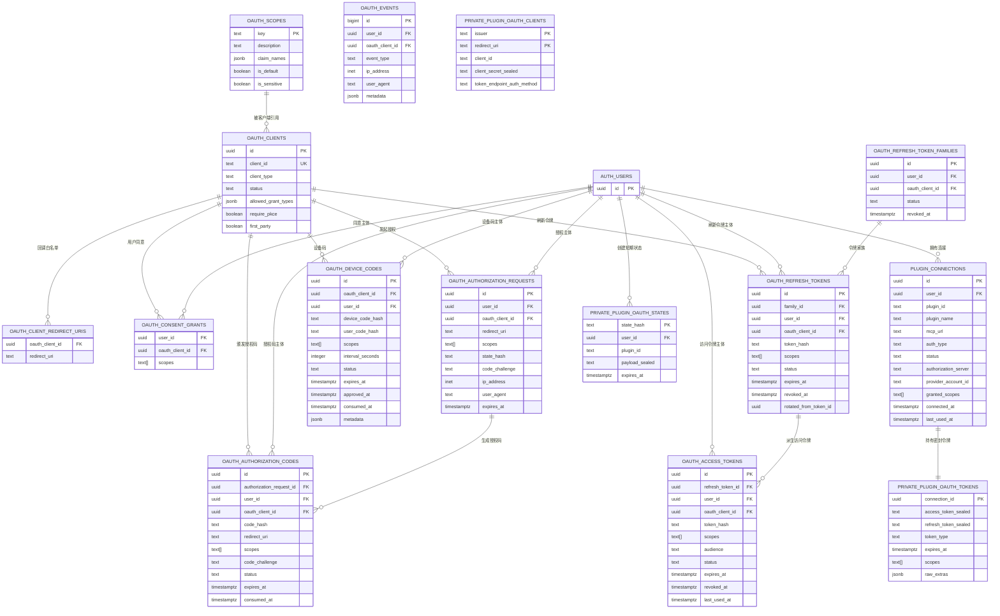

**图表来源**

- [supabase/migrations/20260508102000_platform_extension_identity_expansion.sql:344-529](file://supabase/migrations/20260508102000_platform_extension_identity_expansion.sql#L344-L529)
- [supabase/migrations/20260726120000_clauxen_code_oauth_client.sql:1-77](file://supabase/migrations/20260726120000_clauxen_code_oauth_client.sql#L1-L77)
- [supabase/migrations/20261002173000_plugin_connections.sql:1-120](file://supabase/migrations/20261002173000_plugin_connections.sql#L1-L120)
- [supabase/migrations/20261026120000_plugin_native_oauth.sql:49-105](file://supabase/migrations/20261026120000_plugin_native_oauth.sql#L49-L105)

**章节来源**

- [supabase/migrations/20260508102000_platform_extension_identity_expansion.sql:344-529](file://supabase/migrations/20260508102000_platform_extension_identity_expansion.sql#L344-L529)
- [supabase/migrations/20260726120000_clauxen_code_oauth_client.sql:1-77](file://supabase/migrations/20260726120000_clauxen_code_oauth_client.sql#L1-L77)
- [supabase/migrations/20261002173000_plugin_connections.sql:1-120](file://supabase/migrations/20261002173000_plugin_connections.sql#L1-L120)
- [supabase/migrations/20261026120000_plugin_native_oauth.sql:49-105](file://supabase/migrations/20261026120000_plugin_native_oauth.sql#L49-L105)

## 架构总览

OAuth 授权在系统中分为两条主线：

1. **平台内部 OAuth 服务**：用于 Clauxen Code CLI 和设备码登录，负责 `oauth_clients`、`oauth_authorization_codes`、`oauth_access_tokens`、`oauth_refresh_tokens`、`oauth_device_codes`、`oauth_events` 的生命周期。
2. **插件原生 OAuth Worker**：面向 MCP 和 REST 插件，负责动态客户端注册、RFC 9728 发现、授权跳转、回调交换、令牌密封、连接写入和刷新旋转。

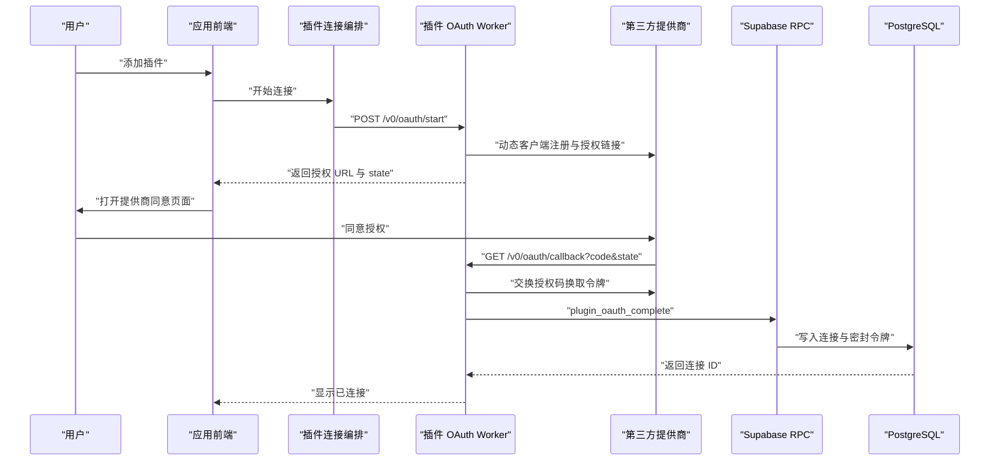

**图表来源**

- [src/server/plugins/plugin-connect.ts:1-120](file://src/server/plugins/plugin-connect.ts#L1-L120)
- [workers/plugin-oauth/src/index.ts:120-280](file://workers/plugin-oauth/src/index.ts#L120-L280)
- [supabase/migrations/20261002173000_plugin_connections.sql:201-285](file://supabase/migrations/20261002173000_plugin_connections.sql#L201-L285)
- [workers/plugin-oauth/src/supabase.ts:60-157](file://workers/plugin-oauth/src/supabase.ts#L60-L157)

**章节来源**

- [workers/plugin-oauth/src/index.ts:1-60](file://workers/plugin-oauth/src/index.ts#L1-L60)
- [workers/plugin-oauth/src/index.ts:280-450](file://workers/plugin-oauth/src/index.ts#L280-L450)
- [src/server/plugins/plugin-connect.ts:1-120](file://src/server/plugins/plugin-connect.ts#L1-L120)

## 详细组件分析

### 一、平台内部 OAuth 授权码交换流程

#### 数据流转

1. 客户端提交 `client_id`、`redirect_uri`、`response_type=code`、`code_challenge`、`scope`。
2. 服务验证客户端状态、回调地址、PKCE 方法。
3. 生成一次性授权码并写入 `oauth_authorization_codes`。
4. 插入同意授权记录。
5. 记录审计事件。
6. 客户端用授权码换取访问令牌和刷新令牌。
7. 刷新令牌使用家族机制，支持旋转和批量撤销。

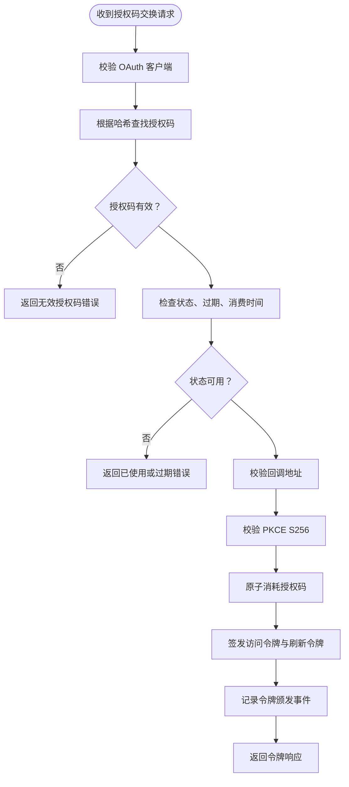

**图表来源**

- [src/server/oauth/service.ts:120-220](file://src/server/oauth/service.ts#L120-L220)
- [src/server/oauth/repository.ts:80-160](file://src/server/oauth/repository.ts#L80-L160)

#### 刷新令牌与撤销

刷新流程会：

- 校验刷新令牌哈希。
- 检测是否已被撤销或重复使用；若检测到重用，则撤销整个刷新令牌家族。
- 将旧刷新令牌标记为已撤销。
- 签发新的访问令牌和刷新令牌，并记录旋转前 ID。
- 记录刷新事件。

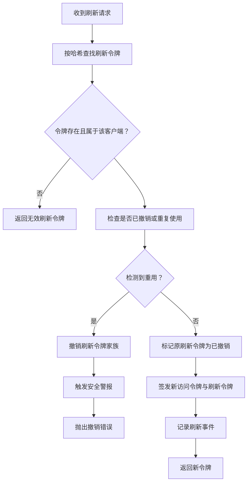

**图表来源**

- [src/server/oauth/service.ts:220-320](file://src/server/oauth/service.ts#L220-L320)
- [src/server/oauth/repository.ts:260-340](file://src/server/oauth/repository.ts#L260-L340)

#### 设备码流程

设备码流程用于无浏览器终端：

1. 客户端请求设备码。
2. 服务端保存 device code hash、user code hash、间隔和过期时间。
3. 用户在设备上输入用户码并授权。
4. 轮询接口等待令牌。
5. 授权通过后，消费设备码并签发令牌。

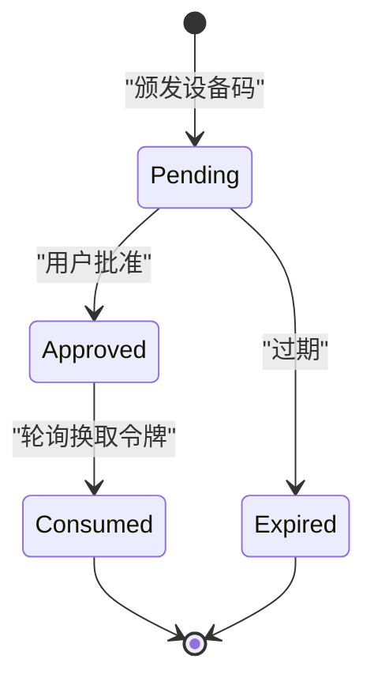

**图表来源**

- [src/server/oauth/service.ts:320-457](file://src/server/oauth/service.ts#L320-L457)
- [src/server/oauth/repository.ts:340-446](file://src/server/oauth/repository.ts#L340-L446)

#### 回调地址安全

CLI 回调地址必须满足 RFC 8252 loopback 规则：

- 协议为 `http:`。
- 路径为 `/callback`。
- 主机为 `127.0.0.1` 或 `[::1]`。
- 不允许查询参数和片段。

**章节来源**

- [src/server/oauth/service.ts:1-220](file://src/server/oauth/service.ts#L1-L220)
- [src/server/oauth/service.ts:220-457](file://src/server/oauth/service.ts#L220-L457)
- [src/server/oauth/repository.ts:1-446](file://src/server/oauth/repository.ts#L1-L446)
- [src/server/oauth/redirect.ts:1-28](file://src/server/oauth/redirect.ts#L1-L28)

### 二、插件原生 OAuth 数据模型

#### 连接表结构

`plugin_connections` 是用户侧可见的连接元数据表：

| 字段 | 含义 |
|---|---|
| `id` | 连接主键 |
| `user_id` | 所属用户 |
| `plugin_id` | Marketplace 插件标识 |
| `plugin_name` | 插件名称 |
| `mcp_url` | 远程 MCP 服务器地址 |
| `auth_type` | 认证类型，例如 `mcp_oauth2` 或 `none` |
| `status` | 连接状态，包括 pending、active、reauthorization_required、revoked、error |
| `authorization_server` | 授权服务器地址 |
| `provider_account_id` | 提供商账户标识 |
| `granted_scopes` | 已授予范围数组 |
| `connected_at` | 首次连接时间 |
| `last_used_at` | 最后使用时间 |
| `last_error_code` | 最近错误码 |
| `last_error_at` | 最近错误时间 |

该表不包含真实令牌。令牌保存在 `private.plugin_oauth_tokens`。

#### 密封令牌表

`private.plugin_oauth_tokens` 使用连接外键一对一保存：

| 字段 | 含义 |
|---|---|
| `connection_id` | 连接主键，级联删除 |
| `access_token_sealed` | AES-256-GCM 密封访问令牌 |
| `refresh_token_sealed` | 可选密封刷新令牌 |
| `token_type` | 令牌类型，通常为 Bearer |
| `expires_at` | 访问令牌过期时间 |
| `scopes` | 令牌范围 |
| `raw_extras` | 提供商返回的非敏感扩展字段 |

所有直接访问被拒绝，仅 `service_role` 可通过 SQL 函数操作。

#### 短期授权状态

`private.plugin_oauth_states` 替代进程内存中的授权映射：

| 字段 | 含义 |
|---|---|
| `state_hash` | SHA-256 哈希，主键 |
| `user_id` | 已登录用户 |
| `plugin_id` | 插件标识 |
| `payload_sealed` | AES-256-GCM 密封载荷，包含 PKCE verifier、客户端凭证、端点等 |
| `expires_at` | 十分钟后过期 |
| `created_at` | 创建时间 |

该表对普通用户和匿名用户完全拒绝访问，仅服务角色可写。

#### 动态注册客户端

`private.plugin_oauth_clients` 存储 RFC 7591 动态注册的客户端：

| 字段 | 含义 |
|---|---|
| `issuer` | 授权服务器发行者 |
| `redirect_uri` | 回调地址 |
| `client_id` | 动态客户端 ID |
| `client_secret_sealed` | 密封客户端密钥 |
| `token_endpoint_auth_method` | 令牌端点认证方法 |
| `created_at` | 注册时间 |

主键为 `(issuer, redirect_uri)`，避免同一发行者与回调组合重复注册。

#### 新增字段增强

迁移为以下表增加字段：

- `plugin_connections`：新增 `connector_kind`、`permission_mode`、`account_label`。
- `plugin_connection_tools`：新增 `risk_level`，取值 read、write、destructive。
- `plugin_connection_capabilities`：新增资源与提示能力表。
- `plugin_tool_calls`：新增工具调用审计表。
- `private.plugin_oauth_tokens`：新增 `oauth_meta` 和 `client_secret_sealed`。

**章节来源**

- [supabase/migrations/20261002173000_plugin_connections.sql:1-120](file://supabase/migrations/20261002173000_plugin_connections.sql#L1-L120)
- [supabase/migrations/20261026120000_plugin_native_oauth.sql:1-105](file://supabase/migrations/20261026120000_plugin_native_oauth.sql#L1-L105)
- [supabase/migrations/20261026120000_plugin_native_oauth.sql:105-206](file://supabase/migrations/20261026120000_plugin_native_oauth.sql#L105-L206)

### 三、插件 OAuth Worker 回调与令牌密封

Worker 的职责不是本地签发令牌，而是：

1. 接收内部调用的 `/v0/oauth/start`。
2. 执行 MCP 资源发现与授权服务器发现。
3. 动态注册客户端。
4. 生成 PKCE verifier 和 state。
5. 返回提供商授权链接。
6. 处理 `/v0/oauth/callback`，交换授权码。
7. 使用 `TOKEN_SEAL_KEY` 密封访问令牌和刷新令牌。
8. 通过 `plugin_oauth_complete` RPC 写入连接与令牌。
9. 提供 `/v0/oauth/refresh`，从数据库读取密封刷新令牌、刷新后旋转存储。

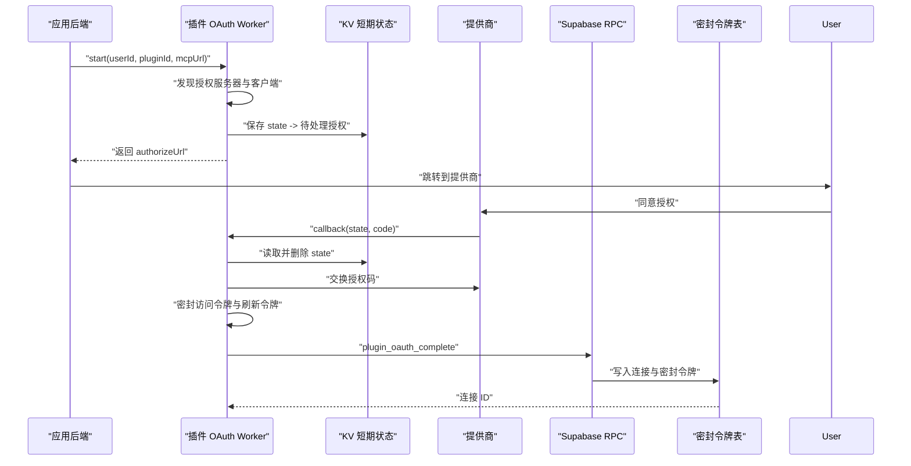

**图表来源**

- [workers/plugin-oauth/src/index.ts:120-280](file://workers/plugin-oauth/src/index.ts#L120-L280)
- [workers/plugin-oauth/src/supabase.ts:60-157](file://workers/plugin-oauth/src/supabase.ts#L60-L157)
- [supabase/migrations/20261002173000_plugin_connections.sql:201-285](file://supabase/migrations/20261002173000_plugin_connections.sql#L201-L285)

#### 刷新流程

刷新流程要求：

- 请求携带内部令牌。
- 读取连接密封刷新令牌。
- 解密后调用提供商刷新端点。
- 将新令牌重新密封并回写。
- 若无刷新令牌或解密失败，返回需要重新授权。

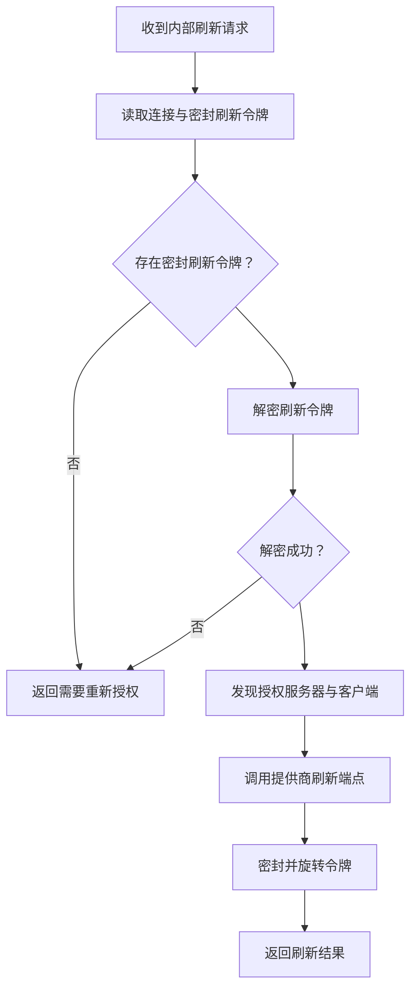

**图表来源**

- [workers/plugin-oauth/src/index.ts:320-450](file://workers/plugin-oauth/src/index.ts#L320-L450)
- [workers/plugin-oauth/src/supabase.ts:100-157](file://workers/plugin-oauth/src/supabase.ts#L100-L157)

**章节来源**

- [workers/plugin-oauth/src/index.ts:120-450](file://workers/plugin-oauth/src/index.ts#L120-L450)
- [workers/plugin-oauth/src/supabase.ts:1-157](file://workers/plugin-oauth/src/supabase.ts#L1-L157)

### 四、插件连接与令牌自动刷新

服务端插件连接模块负责在工具调用前获取可用的访问令牌。其核心逻辑是：

1. 读取连接密封令牌。
2. 如果令牌尚未接近过期，直接解密返回。
3. 如果即将过期或强制刷新，进入事务锁。
4. 再次读取当前密封令牌，防止并发刷新。
5. 若仍无刷新令牌或缺少元数据，返回需要重新授权。
6. 调用提供商刷新端点。
7. 旋转密封令牌并返回新访问令牌。

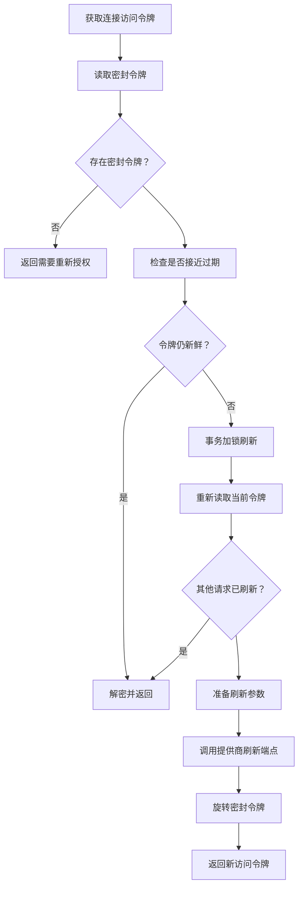

**图表来源**

- [src/server/plugins/token-manager.ts:1-228](file://src/server/plugins/token-manager.ts#L1-L228)

#### 令牌安全存储

- 访问令牌和刷新令牌以 `v1.<iv>.<tag>.<ciphertext>` base64url 格式密封。
- 密钥来自部署配置中的 `TOKEN_SEAL_KEY`。
- 公开连接表不存储明文令牌。
- 工具调用时仅在内存中解密并使用，不返回给客户端。

**章节来源**

- [src/server/plugins/token-manager.ts:1-228](file://src/server/plugins/token-manager.ts#L1-L228)
- [supabase/migrations/20261002173000_plugin_connections.sql:89-120](file://supabase/migrations/20261002173000_plugin_connections.sql#L89-L120)

### 五、OAuth 提供商配置与权限范围

预置提供商包括 Google、GitHub、Slack、Microsoft：

| 提供商 | 特点 |
|---|---|
| Google | 使用 `accounts.google.com`，请求离线访问和用户信息 |
| GitHub | 禁止注册账号，使用登录 OAuth 端点 |
| Slack | 用户令牌嵌套在 `authed_user` |
| Microsoft | 使用通用租户端点，选择账户弹窗 |

提供商配置包含：

- 授权端点。
- 令牌端点。
- 发行者主机匹配。
- 令牌认证方法。
- 身份范围。
- 范围分隔符。
- 是否发送 RFC 8707 resource indicator。

权限范围管理分为两层：

1. **平台内部范围**：由 `oauth_scopes` 定义，如 `code:inference`、`code:profile`。
2. **插件范围**：来自 MCP 服务器的 `scopesSupported`、fallback scopes，或由提供商配置注入身份范围。

**章节来源**

- [src/server/plugins/oauth-providers.ts:1-215](file://src/server/plugins/oauth-providers.ts#L1-L215)
- [supabase/migrations/20260726120000_clauxen_code_oauth_client.sql:1-77](file://supabase/migrations/20260726120000_clauxen_code_oauth_client.sql#L1-L77)
- [src/server/plugins/plugin-connect.ts:120-280](file://src/server/plugins/plugin-connect.ts#L120-L280)

### 六、会话管理与多账户支持

多账户支持体现在：

- 每个插件连接绑定一个 `user_id`。
- 每个用户可拥有多个连接。
- 唯一索引保证同一用户同一插件只有一个连接。
- 刷新令牌家族按用户和客户端分组。
- 同意授权按用户和客户端聚合。
- 工具调用审计按用户隔离。
- 插件 OAuth 短期状态绑定已登录用户。

会话层面，平台 OAuth 使用 Supabase session，插件 OAuth 使用 Cloudflare Worker KV 保存短期授权状态。两者最终都落到 Postgres 的用户表和连接表。

**章节来源**

- [supabase/migrations/20261002173000_plugin_connections.sql:20-88](file://supabase/migrations/20261002173000_plugin_connections.sql#L20-L88)
- [src/server/oauth/repository.ts:300-340](file://src/server/oauth/repository.ts#L300-L340)
- [workers/plugin-oauth/src/index.ts:60-120](file://workers/plugin-oauth/src/index.ts#L60-L120)

## 依赖关系分析

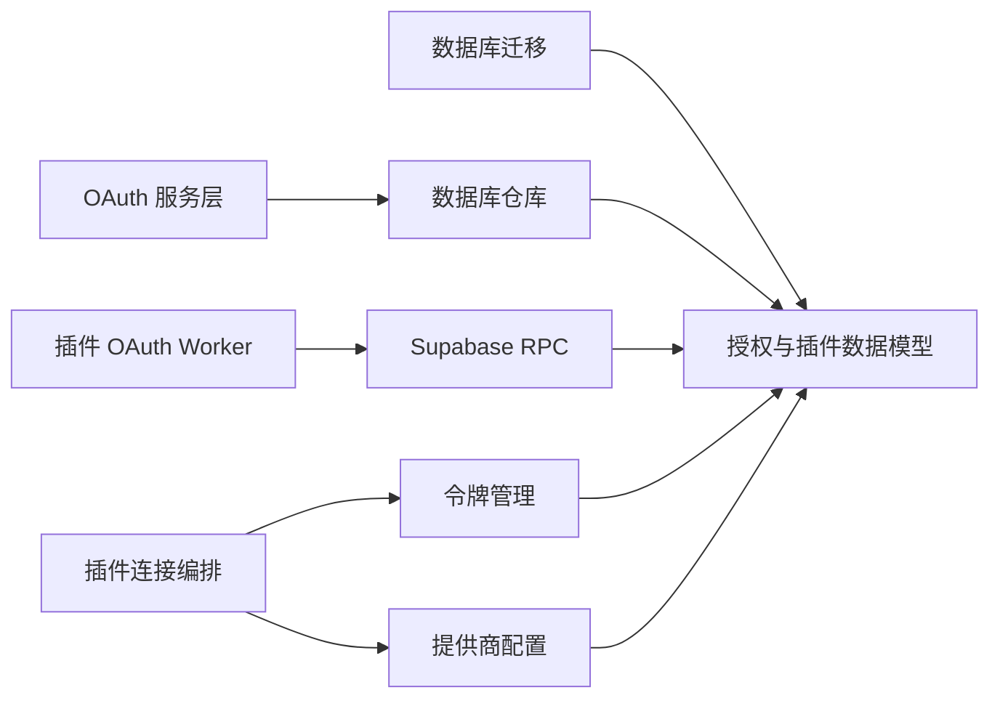

**图表来源**

- [supabase/migrations/20261002173000_plugin_connections.sql:1-120](file://supabase/migrations/20261002173000_plugin_connections.sql#L1-L120)
- [src/server/oauth/service.ts:1-120](file://src/server/oauth/service.ts#L1-L120)
- [src/server/oauth/repository.ts:1-80](file://src/server/oauth/repository.ts#L1-L80)
- [src/server/plugins/plugin-connect.ts:1-120](file://src/server/plugins/plugin-connect.ts#L1-L120)
- [src/server/plugins/token-manager.ts:1-80](file://src/server/plugins/token-manager.ts#L1-L80)
- [workers/plugin-oauth/src/supabase.ts:1-60](file://workers/plugin-oauth/src/supabase.ts#L1-L60)

**章节来源**

- [src/server/oauth/service.ts:1-120](file://src/server/oauth/service.ts#L1-L120)
- [src/server/oauth/repository.ts:1-80](file://src/server/oauth/repository.ts#L1-L80)
- [src/server/plugins/plugin-connect.ts:1-120](file://src/server/plugins/plugin-connect.ts#L1-L120)
- [src/server/plugins/token-manager.ts:1-80](file://src/server/plugins/token-manager.ts#L1-L80)
- [workers/plugin-oauth/src/supabase.ts:1-60](file://workers/plugin-oauth/src/supabase.ts#L1-L60)

## 性能与并发设计

### 索引优化

- `plugin_connections` 有用户+状态+更新时间索引，便于列出用户连接。
- `plugin_connections` 有用户+插件唯一索引，保证每用户每插件单连接。
- `plugin_connection_tools` 和 `plugin_connection_capabilities` 使用连接外键主键或唯一键。
- `oauth_authorization_codes` 和 `oauth_device_codes` 有针对 `oauth_client_id` 的外键覆盖索引，提升外键维护和扫描性能。
- `plugin_tool_calls` 有用户和连接维度的创建时间倒序索引。

### 并发控制

- 插件令牌刷新使用事务锁，防止并发刷新导致令牌覆盖。
- 刷新前二次读取当前令牌，避免竞态条件。
- 平台刷新令牌家族支持批量撤销，用于异常或重复使用检测。
- 插件短期授权状态使用 KV 过期键，避免长期泄漏。

### 过期策略

- 插件授权状态 TTL 为 900 秒。
- 动态客户端缓存 TTL 为 86400 秒。
- 访问令牌刷新提前 60 秒触发，避免工具调用中途过期。
- 平台授权码、刷新令牌、设备码均有显式过期时间。

**章节来源**

- [supabase/migrations/20261002173000_plugin_connections.sql:60-120](file://supabase/migrations/20261002173000_plugin_connections.sql#L60-L120)
- [supabase/migrations/20260508104000_oauth_fk_covering_indexes.sql:1-24](file://supabase/migrations/20260508104000_oauth_fk_covering_indexes.sql#L1-L24)
- [src/server/plugins/token-manager.ts:160-228](file://src/server/plugins/token-manager.ts#L160-L228)
- [workers/plugin-oauth/src/index.ts:60-120](file://workers/plugin-oauth/src/index.ts#L60-L120)

## 故障排查指南

### 常见错误分类

| 错误类别 | 可能原因 | 建议处理 |
|---|---|---|
| 无效授权码 | 授权码不存在、不属于该客户端、已消费、已过期、回调不匹配、PKCE 不匹配 | 重新发起授权流程 |
| 无效刷新令牌 | 令牌不存在、不属于客户端、已撤销、已过期 | 清理会话并重新授权 |
| 刷新令牌重复使用 | 并发或重放攻击 | 撤销刷新令牌家族并记录审计事件 |
| 设备码已批准或已消费 | 用户重复授权或重复轮询 | 返回冲突或无效错误 |
| 插件回调缺少 state | 授权链接过期或被篡改 | 引导用户重新连接 |
| 插件刷新无刷新令牌 | 提供商未返回刷新令牌或令牌不可读 | 提示重新连接 |
| 密封令牌无法解密 | 密钥轮换或存储损坏 | 提示重新连接并检查部署密钥 |

### 安全事件追踪

平台 OAuth 通过 `oauth_events` 记录：

- 授权码颁发。
- 令牌颁发。
- 令牌刷新。
- 设备码批准。

审计事件插入失败不会中断认证流程，因此监控应关注数据库层审计写入失败，而不是 API 层返回值。

### 安全清理

系统提供多种清理手段：

- 撤销访问令牌。
- 撤销刷新令牌。
- 撤销刷新令牌家族。
- 撤销平台 OAuth 客户端（通过状态和删除标记）。
- 撤销提供商侧授权（Google、GitHub 等）。
- 清理旧自托管连接，将其标记为已撤销。

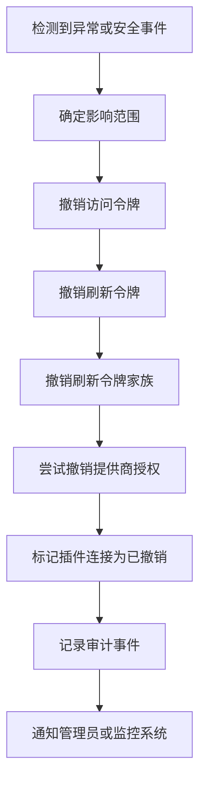

**图表来源**

- [src/server/oauth/service.ts:380-457](file://src/server/oauth/service.ts#L380-L457)
- [src/server/plugins/oauth-providers.ts:150-215](file://src/server/plugins/oauth-providers.ts#L150-L215)
- [supabase/migrations/20261026120000_plugin_native_oauth.sql:180-206](file://supabase/migrations/20261026120000_plugin_native_oauth.sql#L180-L206)

**章节来源**

- [src/server/oauth/repository.ts:380-446](file://src/server/oauth/repository.ts#L380-L446)
- [src/server/plugins/oauth-providers.ts:150-215](file://src/server/plugins/oauth-providers.ts#L150-L215)
- [supabase/migrations/20261026120000_plugin_native_oauth.sql:180-206](file://supabase/migrations/20261026120000_plugin_native_oauth.sql#L180-L206)

## 结论

本项目的 OAuth 授权模型采用分层设计：

- **平台内部 OAuth** 负责标准授权码、PKCE、设备码、访问令牌、刷新令牌、同意授权和审计事件。
- **插件原生 OAuth** 负责 MCP 和 REST 插件的动态客户端注册、授权跳转、回调交换、令牌密封和刷新旋转。
- **数据库层** 严格区分公开元数据和私密令牌，使用行级安全策略、服务角色函数和密封存储保障安全性。
- **并发控制** 通过事务锁、家族撤销、原子消耗和过期索引实现。
- **审计与恢复** 通过事件表、连接状态、提供商撤销和连接清理形成闭环。

对于后续演进，建议重点关注：

1. 统一监控审计事件写入成功率。
2. 评估刷新令牌家族规模与批量撤销性能。
3. 定期审计密封密钥轮换对历史令牌的影响。
4. 将插件 OAuth Worker 的错误分类进一步标准化，便于告警和恢复自动化。
5. 在工具调用层引入更细粒度的范围校验，确保最小权限原则。