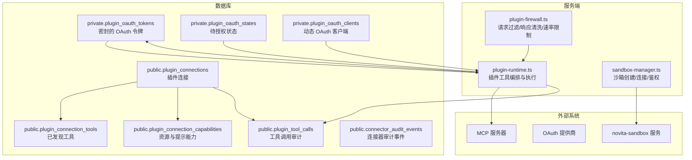
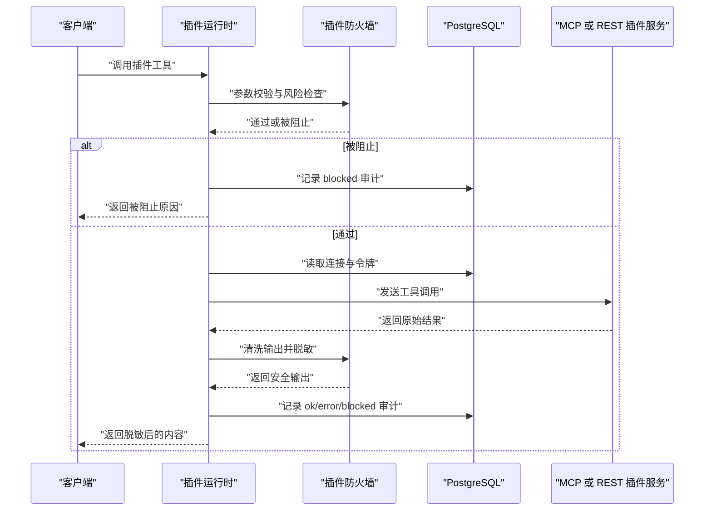
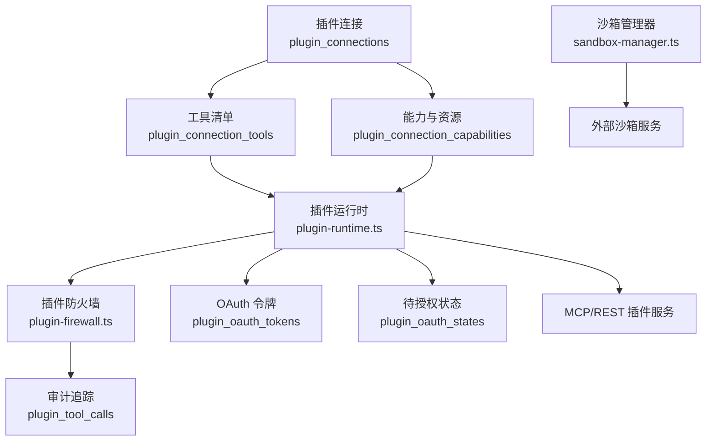
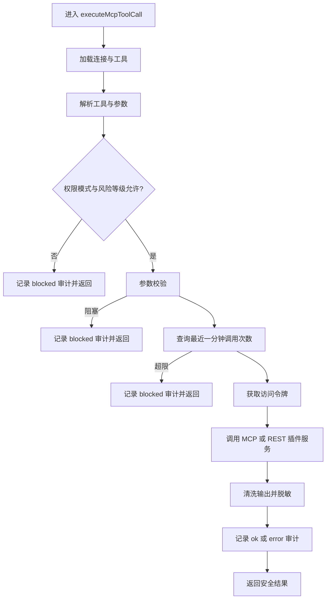
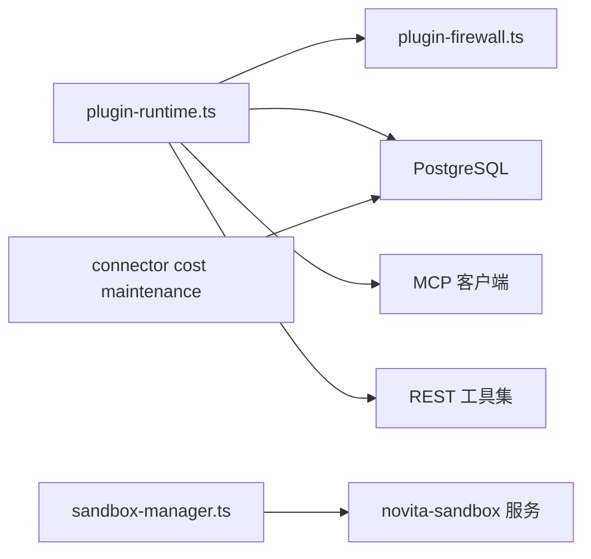

# 插件安全隔离模型

<cite>
**本文引用的文件**   
- [20261002173000_plugin_connections.sql](file://supabase/migrations/20261002173000_plugin_connections.sql)
- [20261026120000_plugin_native_oauth.sql](file://supabase/migrations/20261026120000_plugin_native_oauth.sql)
- [20260902171154_mcp_plugin_installations.sql](file://supabase/migrations/20260902171154_mcp_plugin_installations.sql)
- [20260913000000_plugin_collections.sql](file://supabase/migrations/20260913000000_plugin_collections.sql)
- [20260913010000_plugin_mcp_api_keys.sql](file://supabase/migrations/20260913010000_plugin_mcp_api_keys.sql)
- [20260830134609_connector_cost_scale_guardrails.sql](file://supabase/migrations/20260830134609_connector_cost_scale_guardrails.sql)
- [plugin-firewall.ts](file://src/server/plugins/plugin-firewall.ts)
- [plugin-runtime.ts](file://src/server/plugins/plugin-runtime.ts)
- [sandbox-manager.ts](file://src/server/sandbox/sandbox-manager.ts)
- [types.ts](file://src/server/sandbox/types.ts)
- [api/sandbox.ts](file://src/shared/lib/api/sandbox.ts)
</cite>

## 目录
1. [引言](#引言)
2. [项目结构](#项目结构)
3. [核心组件](#核心组件)
4. [架构总览](#架构总览)
5. [详细组件分析](#详细组件分析)
6. [依赖关系分析](#依赖关系分析)
7. [性能与成本限制](#性能与成本限制)
8. [故障排查指南](#故障排查指南)
9. [结论](#结论)

## 引言
本文围绕“插件安全隔离数据模型”展开，重点解释以下能力在数据库和执行层中的设计与实现：
- 插件连接、工具清单、权限模式与风险等级。
- OAuth 令牌、待授权状态、动态客户端注册等敏感数据的私有化存储。
- 插件防火墙的请求过滤、响应清洗、速率限制与审计追踪。
- 插件执行环境的沙箱配置、进程隔离与资源上限。
- 连接器成本与规模护栏、审计事件清理机制。
- 插件恶意行为检测、自动隔离与安全清理的数据流程。

该文档不直接粘贴代码内容，而是通过文件路径和行号定位源码位置，帮助读者在仓库中快速核对实现细节。

## 项目结构
插件安全相关的主要代码分布在以下区域：
- Supabase 迁移脚本定义了插件连接、工具缓存、能力元数据、OAuth 凭证、审计追踪等表结构。
- `src/server/plugins` 包含插件运行时、防火墙、MCP 客户端、OAuth 发现与提供商、令牌管理等逻辑。
- `src/server/sandbox` 提供插件或任务执行的沙箱生命周期管理。
- `src/shared/lib/api/sandbox.ts` 暴露前端可调用的一致 API。



**图表来源**
- [20261002173000_plugin_connections.sql:1-200](file://supabase/migrations/20261002173000_plugin_connections.sql#L1-L200)
- [20261026120000_plugin_native_oauth.sql:1-206](file://supabase/migrations/20261026120000_plugin_native_oauth.sql#L1-L206)
- [plugin-firewall.ts:1-167](file://src/server/plugins/plugin-firewall.ts#L1-L167)
- [plugin-runtime.ts:1-370](file://src/server/plugins/plugin-runtime.ts#L1-L370)
- [sandbox-manager.ts:1-200](file://src/server/sandbox/sandbox-manager.ts#L1-L200)

**章节来源**
- [20261002173000_plugin_connections.sql:1-200](file://supabase/migrations/20261002173000_plugin_connections.sql#L1-L200)
- [20261026120000_plugin_native_oauth.sql:1-206](file://supabase/migrations/20261026120000_plugin_native_oauth.sql#L1-L206)
- [plugin-firewall.ts:1-167](file://src/server/plugins/plugin-firewall.ts#L1-L167)
- [plugin-runtime.ts:1-370](file://src/server/plugins/plugin-runtime.ts#L1-L370)
- [sandbox-manager.ts:1-200](file://src/server/sandbox/sandbox-manager.ts#L1-L200)

## 核心组件
本节按“表结构 → 执行控制 → 审计与清理”的顺序说明插件安全隔离的关键数据模型。

### 插件配额表、资源限制表、访问控制表
这里没有名为“插件配额表”“资源限制表”“访问控制表”的独立命名表，但插件安全隔离通过多张表共同实现配额、资源与访问控制语义：
- 插件连接与权限控制：`public.plugin_connections`
- 工具风险等级与启用开关：`public.plugin_connection_tools`
- 连接暴露的资源与提示能力：`public.plugin_connection_capabilities`
- 工具调用审计与速率计数基础：`public.plugin_tool_calls`
- 连接器审计事件与清理策略：`public.connector_audit_events`

| 概念 | 对应数据表或字段 | 主要职责 | 安全要点 |
|---|---|---|---|
| 插件连接与身份 | `public.plugin_connections` | 记录用户连接的插件、MCP 地址、认证类型、状态、作用域、错误信息 | 只存脱敏元数据；令牌不在本表 |
| 令牌与刷新凭据 | `private.plugin_oauth_tokens` | 保存 AES-256-GCM 密封的 access/refresh token、过期时间、额外非敏感元数据 | 仅 service_role 可访问；客户端不可见 |
| 待授权会话 | `private.plugin_oauth_states` | 持久化单次使用、绑定用户、带过期时间的授权状态哈希 | 仅 service_role 可访问 |
| 动态 OAuth 客户端 | `private.plugin_oauth_clients` | 按发行方注册的客户端标识与密封密钥 | 仅 service_role 可访问 |
| 工具清单与风险 | `public.plugin_connection_tools` | 缓存 MCP 工具名称、标题、描述、输入 Schema、是否启用、风险等级 | 风险等级用于权限模式与 UI 提示 |
| 能力与资源 | `public.plugin_connection_capabilities` | 记录连接暴露的资源与提示能力，含 URI 与描述 | 支持只读展示与可控访问 |
| 工具调用审计 | `public.plugin_tool_calls` | 记录每次调用的用户、连接、工具、风险等级、状态、耗时、简要详情 | 不存储参数与结果正文，避免泄露敏感数据 |
| 连接器审计事件 | `public.connector_audit_events` | 记录连接器层面的审计事件，支持去重索引与 BRIN 索引 | 配合定时维护清理历史 |

**章节来源**
- [20261002173000_plugin_connections.sql:1-200](file://supabase/migrations/20261002173000_plugin_connections.sql#L1-L200)
- [20261026120000_plugin_native_oauth.sql:1-206](file://supabase/migrations/20261026120000_plugin_native_oauth.sql#L1-L206)
- [20260913010000_plugin_mcp_api_keys.sql:1-21](file://supabase/migrations/20260913010000_plugin_mcp_api_keys.sql#L1-L21)
- [20260830134609_connector_cost_scale_guardrails.sql:1-165](file://supabase/migrations/20260830134609_connector_cost_scale_guardrails.sql#L1-L165)

### 插件执行环境隔离、网络访问控制、文件系统权限
当前仓库中，插件调用主要通过两种通道：
- MCP 工具调用：插件运行时根据连接中的 MCP URL 发起网络请求。
- REST 工具集：部分插件以 REST 工具集形式暴露接口，由运行时构造受控 API 并注入令牌。

网络访问控制体现在：
- 连接级校验：MCP URL 必须为 HTTPS 格式；连接状态需为 active。
- 风险等级校验：工具的风险等级与连接权限模式匹配时才允许执行。
- 参数校验：禁止将疑似密码、令牌、私钥写入写操作参数。
- 输出清洗：移除不可见字符、HTML 注释、脚本标签、注入指令，并对敏感信息进行脱敏。

文件系统权限方面：
- 插件本身并不直接拥有宿主文件系统权限；插件运行通过 MCP 或 REST 协议访问远程服务。
- 若需要代码执行环境，则通过沙箱模块（novita-sandbox）创建隔离进程；沙箱 API 提供命令执行、文件读写、主机端口转发等能力，但这些能力属于通用执行环境，并非插件默认能力。

**章节来源**
- [plugin-firewall.ts:1-167](file://src/server/plugins/plugin-firewall.ts#L1-L167)
- [plugin-runtime.ts:1-370](file://src/server/plugins/plugin-runtime.ts#L1-L370)
- [types.ts:1-46](file://src/server/sandbox/types.ts#L1-L46)
- [api/sandbox.ts:1-117](file://src/shared/lib/api/sandbox.ts#L1-L117)

### 成本限制系统：计算资源配额、API 调用限制、存储使用监控
成本限制在仓库中体现为“连接器成本与规模护栏”，而非独立的“插件配额表”。其核心机制包括：
- 审计事件去重：通过唯一事件 ID 保证至少一次投递幂等性。
- BRIN 索引优化：对高吞吐、追加为主的审计与健康检查表使用 BRIN 索引降低写入放大。
- 定时维护函数：分批过期与删除 OAuth 交易、审批记录、审计事件、健康检查、计划任务日志，避免长事务与大 WAL 波动。
- 插件调用频率限制：插件防火墙基于最近一分钟的 `plugin_tool_calls` 统计总调用次数与写操作次数，超过阈值则拦截。

计算资源配额与内存限制：
- 沙箱创建时支持设置超时、自动暂停、空闲超时、CPU 数量、内存大小等元数据；实际资源由外部沙箱服务管理。
- 沙箱管理器封装了创建、连接、查找、列表、鉴权、指标查询等操作，并将 CPU 与内存信息序列化后返回给调用方。

API 调用限制：
- 插件防火墙内置每分钟最大调用数与写操作数限制。
- 插件运行时在失败时尝试刷新令牌并重试一次，失败后将连接标记为需要重新授权。

存储使用监控：
- 仓库未提供独立的“插件存储使用监控表”，但可通过 `plugin_tool_calls`、`connector_audit_events` 的时间范围统计间接观察插件活跃度与异常趋势。
- 连接器审计事件的清理策略将历史数据按天数分批删除，有助于控制存储增长。

**章节来源**
- [20260830134609_connector_cost_scale_guardrails.sql:1-165](file://supabase/migrations/20260830134609_connector_cost_scale_guardrails.sql#L1-L165)
- [plugin-firewall.ts:1-167](file://src/server/plugins/plugin-firewall.ts#L1-L167)
- [plugin-runtime.ts:200-370](file://src/server/plugins/plugin-runtime.ts#L200-L370)
- [sandbox-manager.ts:1-200](file://src/server/sandbox/sandbox-manager.ts#L1-L200)
- [types.ts:1-46](file://src/server/sandbox/types.ts#L1-L46)

### 插件防火墙规则、请求过滤、响应验证
插件防火墙是插件调用链路的统一入口，承担三类职责：
- 出站前过滤：参数大小限制、写操作禁止携带疑似凭据。
- 入站后清洗：移除不可见字符、HTML 注释、脚本与样式、注入指令，并对已知敏感字符串进行脱敏。
- 速率限制：基于用户维度统计最近一分钟的总调用次数与写操作次数。

关键常量与行为：
- 最大参数字节数、最大输出字符数。
- 每分钟最大调用数与写操作数。
- 敏感特征正则集合，覆盖常见密钥、令牌、云厂商密钥等模式。
- 注入指令特征集合，用于识别试图绕过模型控制的文本。
- 输出被截断时会附加截断标记，并附带“外部数据不可信”的系统提示。

**章节来源**
- [plugin-firewall.ts:1-167](file://src/server/plugins/plugin-firewall.ts#L1-L167)

### 插件沙箱环境配置管理、进程隔离、内存限制的数据库设计
沙箱配置管理主要在应用层与外部沙箱服务之间完成，而不是集中在单一数据库表中：
- 创建选项：用户 ID、对话 ID、超时、自动暂停、自动恢复、空闲超时、元数据、环境变量。
- 元数据：包含应用标识、用户标识、对话标识、自动恢复标志、空闲超时等。
- 公共信息：沙箱 ID、模板 ID、名称、元数据、开始时间、结束时间、状态、CPU 数量、内存 MB。
- 命令与文件：命令执行、后台执行、工作目录、超时、标准输出与错误回调、文件读写。
- 所有权校验：如果沙箱缺少归属元数据或不属于当前用户，则视为不存在，避免泄露存在性。

数据库层面没有专门的“沙箱配置表”；沙箱生命周期状态由外部沙箱服务维护，应用侧通过 API 查询与管理。

**章节来源**
- [types.ts:1-46](file://src/server/sandbox/types.ts#L1-L46)
- [sandbox-manager.ts:1-200](file://src/server/sandbox/sandbox-manager.ts#L1-L200)
- [api/sandbox.ts:1-117](file://src/shared/lib/api/sandbox.ts#L1-L117)

### 插件行为审计、异常检测、安全告警的数据结构
插件行为审计主要由以下数据结构承载：
- `public.plugin_tool_calls`：记录每次工具调用的用户、连接、插件、工具、风险等级、状态、耗时、简要详情。
- `public.connector_audit_events`：连接器级别审计事件，支持去重、BRIN 索引与批量清理。
- `public.audit_logs`：平台级跨领域活动日志，可用于更广泛的用户行为与管理员事件审计。

异常检测与安全告警：
- 插件运行时将调用结果标记为成功、错误或被阻止，并写入审计追踪。
- 防火墙检测到疑似凭据、注入指令、超限输出时会阻断或脱敏。
- 连接器成本维护函数会定期清理过期数据，防止日志膨胀影响性能与成本。
- 安全告警未在仓库中看到专用告警表；如需告警，可在现有审计事件上构建上层监控或告警管道。

**章节来源**
- [20261026120000_plugin_native_oauth.sql:1-206](file://supabase/migrations/20261026120000_plugin_native_oauth.sql#L1-L206)
- [20260830134609_connector_cost_scale_guardrails.sql:1-165](file://supabase/migrations/20260830134609_connector_cost_scale_guardrails.sql#L1-L165)
- [plugin-runtime.ts:200-370](file://src/server/plugins/plugin-runtime.ts#L200-L370)

### 插件恶意行为检测、自动隔离、安全清理的数据流程
恶意行为检测与自动隔离的核心流程如下：



**图表来源**
- [plugin-runtime.ts:200-370](file://src/server/plugins/plugin-runtime.ts#L200-L370)
- [plugin-firewall.ts:1-167](file://src/server/plugins/plugin-firewall.ts#L1-L167)
- [20261026120000_plugin_native_oauth.sql:1-206](file://supabase/migrations/20261026120000_plugin_native_oauth.sql#L1-L206)

自动隔离与安全清理机制：
- 当令牌失效或认证失败时，插件运行时将连接状态更新为需要重新授权，并在后续调用中阻止执行。
- 防火墙基于审计表统计调用频率，超过阈值时自动阻止更多调用。
- 连接器成本维护函数定时清理过期 OAuth 交易、审批记录、审计事件与健康检查记录，防止数据无限增长。
- 沙箱生命周期由外部服务管理，应用侧通过元数据和状态判断存活情况，并在缺失归属信息时拒绝访问。

**章节来源**
- [plugin-runtime.ts:200-370](file://src/server/plugins/plugin-runtime.ts#L200-L370)
- [plugin-firewall.ts:1-167](file://src/server/plugins/plugin-firewall.ts#L1-L167)
- [20260830134609_connector_cost_scale_guardrails.sql:1-165](file://supabase/migrations/20260830134609_connector_cost_scale_guardrails.sql#L1-L165)
- [sandbox-manager.ts:1-200](file://src/server/sandbox/sandbox-manager.ts#L1-L200)

## 架构总览
下图从“数据模型 → 执行链路 → 外部依赖”角度汇总插件安全隔离架构：



**图表来源**
- [20261002173000_plugin_connections.sql:1-200](file://supabase/migrations/20261002173000_plugin_connections.sql#L1-L200)
- [20261026120000_plugin_native_oauth.sql:1-206](file://supabase/migrations/20261026120000_plugin_native_oauth.sql#L1-L206)
- [plugin-runtime.ts:1-370](file://src/server/plugins/plugin-runtime.ts#L1-L370)
- [plugin-firewall.ts:1-167](file://src/server/plugins/plugin-firewall.ts#L1-L167)
- [sandbox-manager.ts:1-200](file://src/server/sandbox/sandbox-manager.ts#L1-L200)

## 详细组件分析

### 插件连接与工具数据模型
`public.plugin_connections` 是插件安全的中心实体，它记录了：
- 用户、插件标识、插件名称、图标 URL。
- MCP 地址、认证类型、连接状态。
- 授权服务器、提供商账户 ID、授予作用域。
- 连接时间、最后使用时间、最后错误码与错误时间。
- 连接器类型、权限模式、账户标签。

`public.plugin_connection_tools` 缓存每个连接的工具清单，包括：
- 工具名称、标题、描述、输入 Schema。
- 是否启用、风险等级。
- 发现时间。

`public.plugin_connection_capabilities` 记录连接暴露的资源与提示能力：
- 类型：资源或提示。
- 名称、标题、描述、URI。
- 发现时间。

这些表都启用了行级安全策略，并通过 service_role 开放必要的写入通道。

```mermaid
erDiagram
  PLUGIN_CONNECTIONS {
    uuid id PK
    uuid user_id FK
    text plugin_id
    text plugin_name
    text plugin_icon_url
    text mcp_url
    text auth_type
    text status
    text authorization_server
    text provider_account_id
    text[] granted_scopes
    timestamptz connected_at
    timestamptz last_used_at
    text last_error_code
    timestamptz last_error_at
    timestamptz created_at
    timestamptz updated_at
    text connector_kind
    text permission_mode
    text account_label
  }

  PLUGIN_CONNECTION_TOOLS {
    uuid connection_id FK
    text tool_name PK
    text title
    text description
    jsonb input_schema
    boolean is_enabled
    timestamptz discovered_at
    text risk_level
  }

  PLUGIN_CONNECTION_CAPABILITIES {
    uuid connection_id FK
    text kind PK
    text name PK
    text title
    text description
    text uri
    timestamptz discovered_at
  }

  PLUGIN_OAUTH_TOKENS {
    uuid connection_id PK FK
    text access_token_sealed
    text refresh_token_sealed
    text token_type
    timestamptz expires_at
    text[] scopes
    jsonb raw_extras
    jsonb oauth_meta
    text client_secret_sealed
    timestamptz created_at
    timestamptz updated_at
  }

  PLUGIN_TOOL_CALLS {
    bigint id PK
    uuid user_id FK
    uuid connection_id FK
    text plugin_id
    text tool_name
    text risk_level
    text status
    text detail
    integer duration_ms
    timestamptz created_at
  }

  PLUGIN_CONNECTIONS ||--o{ PLUGIN_CONNECTION_TOOLS : "contains"
  PLUGIN_CONNECTIONS ||--o{ PLUGIN_CONNECTION_CAPABILITIES : "exposes"
  PLUGIN_CONNECTIONS ||--o{ PLUGIN_OAUTH_TOKENS : "has sealed tokens"
  PLUGIN_CONNECTIONS ||--o{ PLUGIN_TOOL_CALLS : "audits"
```

**图表来源**
- [20261002173000_plugin_connections.sql:1-200](file://supabase/migrations/20261002173000_plugin_connections.sql#L1-L200)
- [20261026120000_plugin_native_oauth.sql:1-206](file://supabase/migrations/20261026120000_plugin_native_oauth.sql#L1-L206)

**章节来源**
- [20261002173000_plugin_connections.sql:1-200](file://supabase/migrations/20261002173000_plugin_connections.sql#L1-L200)
- [20261026120000_plugin_native_oauth.sql:1-206](file://supabase/migrations/20261026120000_plugin_native_oauth.sql#L1-L206)

### 插件运行时与防火墙协作流程
插件运行时负责：
- 加载用户活跃连接与工具清单。
- 根据风险等级与权限模式过滤工具。
- 解析代理工具名到具体连接与工具。
- 调用 MCP 或 REST 插件服务。
- 将结果交给防火墙清洗并记录审计。

防火墙负责：
- 参数序列化与大小限制。
- 写操作禁止携带疑似凭据。
- 用户维度速率限制。
- 输出不可见字符、HTML、脚本、注入指令处理。
- 敏感信息脱敏与输出截断。



**图表来源**
- [plugin-runtime.ts:200-370](file://src/server/plugins/plugin-runtime.ts#L200-L370)
- [plugin-firewall.ts:1-167](file://src/server/plugins/plugin-firewall.ts#L1-L167)

**章节来源**
- [plugin-runtime.ts:1-370](file://src/server/plugins/plugin-runtime.ts#L1-L370)
- [plugin-firewall.ts:1-167](file://src/server/plugins/plugin-firewall.ts#L1-L167)

### 沙箱环境与插件执行边界
沙箱管理器提供：
- 创建沙箱：设置超时、自动暂停、自动恢复、元数据、环境变量。
- 连接沙箱：复用会话映射，优先连接已有实例。
- 查找与列表：按用户与状态查询沙箱。
- 所有权校验：缺失归属或属于其他用户时返回不存在。
- 指标与命令：查询指标、执行命令、读写文件、获取主机端口。

这些数据模型与 API 主要用于代码执行或交互式调试环境，而不是插件默认工具调用路径。插件工具调用仍通过 MCP 或 REST 协议进行。

**章节来源**
- [sandbox-manager.ts:1-200](file://src/server/sandbox/sandbox-manager.ts#L1-L200)
- [types.ts:1-46](file://src/server/sandbox/types.ts#L1-L46)
- [api/sandbox.ts:1-117](file://src/shared/lib/api/sandbox.ts#L1-L117)

## 依赖关系分析
插件安全隔离的依赖关系可以概括为：
- 插件运行时依赖防火墙进行请求与响应安全控制。
- 插件运行时依赖数据库读取连接、工具、令牌与审计信息。
- 插件运行时依赖 MCP 客户端或 REST 工具集调用外部服务。
- 沙箱管理器依赖外部 novita-sandbox 服务提供进程隔离与资源限制。
- 连接器成本维护函数依赖 PostgreSQL 扩展与定时任务调度。



**图表来源**
- [plugin-runtime.ts:1-370](file://src/server/plugins/plugin-runtime.ts#L1-L370)
- [plugin-firewall.ts:1-167](file://src/server/plugins/plugin-firewall.ts#L1-L167)
- [sandbox-manager.ts:1-200](file://src/server/sandbox/sandbox-manager.ts#L1-L200)
- [20260830134609_connector_cost_scale_guardrails.sql:1-165](file://supabase/migrations/20260830134609_connector_cost_scale_guardrails.sql#L1-L165)

**章节来源**
- [plugin-runtime.ts:1-370](file://src/server/plugins/plugin-runtime.ts#L1-L370)
- [plugin-firewall.ts:1-167](file://src/server/plugins/plugin-firewall.ts#L1-L167)
- [sandbox-manager.ts:1-200](file://src/server/sandbox/sandbox-manager.ts#L1-L200)
- [20260830134609_connector_cost_scale_guardrails.sql:1-165](file://supabase/migrations/20260830134609_connector_cost_scale_guardrails.sql#L1-L165)

## 性能与成本限制
- 审计与运维表采用 BRIN 索引，适合时间序列追加写入场景。
- 连接器成本维护函数分批清理过期数据，避免大事务与锁竞争。
- 插件防火墙通过轻量正则与文本操作实现参数与输出清洗，避免复杂解析带来的性能开销。
- 插件运行时对直接暴露的工具数量做上限控制，并通过搜索工具保留可发现性。
- 沙箱管理器对会话进行内存映射，减少重复创建成本。

建议：
- 如需更细粒度的插件配额，可在现有 `plugin_tool_calls` 上扩展聚合视图或物化统计。
- 如需存储使用监控，可为插件连接增加用量计数器，并结合连接器审计事件做联合分析。
- 如需自动隔离高风险插件，可在审计事件达到阈值后自动将连接状态改为受限或停用。

[本节为通用性能讨论，不直接分析具体文件]

## 故障排查指南
常见问题与排查方向：
- 插件连接未激活：检查 `plugin_connections.status` 是否为 active，以及是否需要重新授权。
- 工具不可用：检查 `plugin_connection_tools.is_enabled` 与 `risk_level` 是否与权限模式匹配。
- 参数被阻止：检查是否包含疑似凭据或超出参数大小限制。
- 调用被限流：检查最近一分钟的 `plugin_tool_calls` 数量是否超过阈值。
- 输出被截断或包含警告：检查防火墙是否移除了注入指令或进行了脱敏。
- 令牌失效：检查 `plugin_oauth_tokens.expires_at` 与 `raw_extras`、`oauth_meta` 中的非敏感元数据。
- 沙箱不存在或无权限：检查沙箱元数据是否包含正确用户与对话标识，并确认所有权校验通过。
- 审计事件堆积：检查连接器成本维护函数是否正常运行，以及是否触发了批量清理。

**章节来源**
- [plugin-firewall.ts:1-167](file://src/server/plugins/plugin-firewall.ts#L1-L167)
- [plugin-runtime.ts:200-370](file://src/server/plugins/plugin-runtime.ts#L200-L370)
- [20260830134609_connector_cost_scale_guardrails.sql:1-165](file://supabase/migrations/20260830134609_connector_cost_scale_guardrails.sql#L1-L165)
- [sandbox-manager.ts:1-200](file://src/server/sandbox/sandbox-manager.ts#L1-L200)

## 结论
该项目的插件安全隔离模型以“连接为中心、工具为边界、防火墙为门控、审计为证据、沙箱为可选执行环境”的方式实现：
- 插件连接、工具清单、能力元数据、OAuth 凭证与审计追踪构成完整的数据底座。
- 插件运行时与防火墙共同实现请求过滤、响应清洗、速率限制与执行控制。
- 连接器成本维护函数提供可扩展的成本与规模护栏。
- 沙箱管理器提供进程隔离与资源限制，但主要用于代码执行场景，而非插件默认工具调用。
- 恶意行为检测、自动隔离与安全清理主要依赖防火墙阻断、连接状态变更与审计事件清理。

如需进一步扩展，建议在现有数据模型基础上补充插件级用量统计、存储限额、风险评分与自动化隔离策略，使“数据模型 → 执行控制 → 审计告警 → 自动响应”形成闭环。