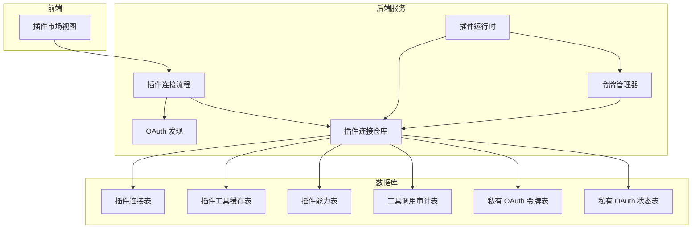
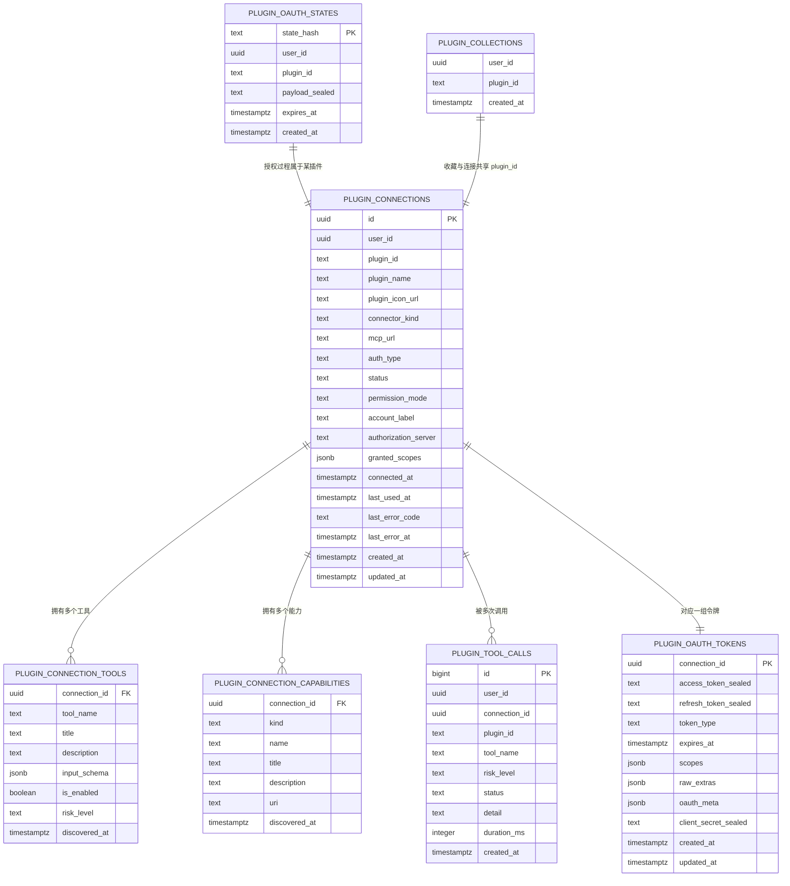
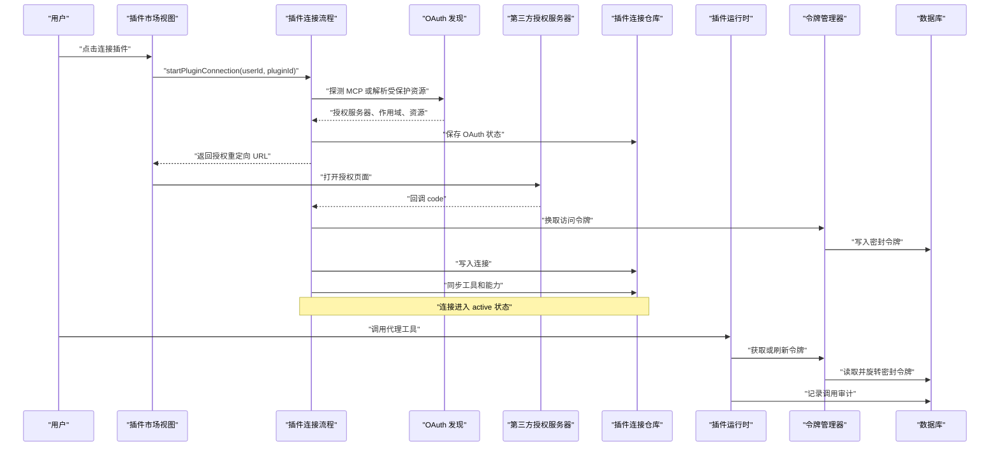
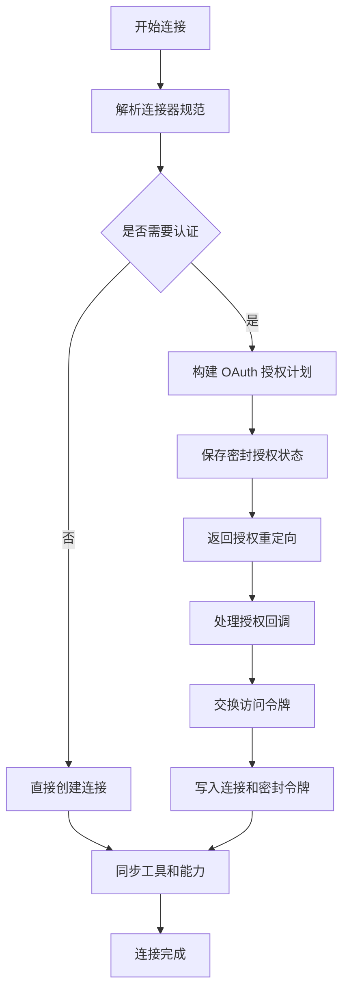
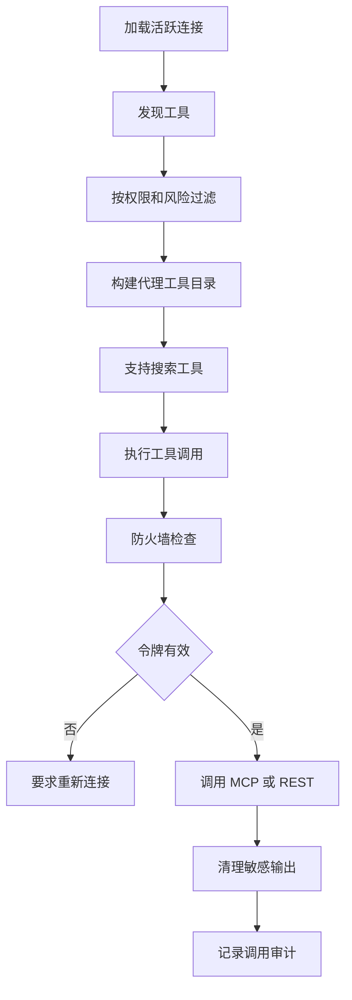
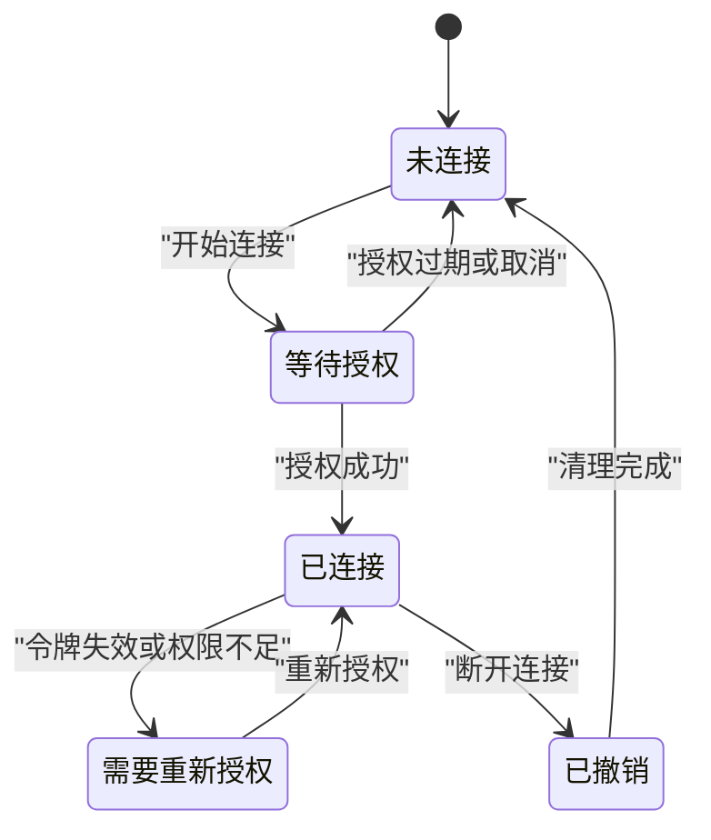
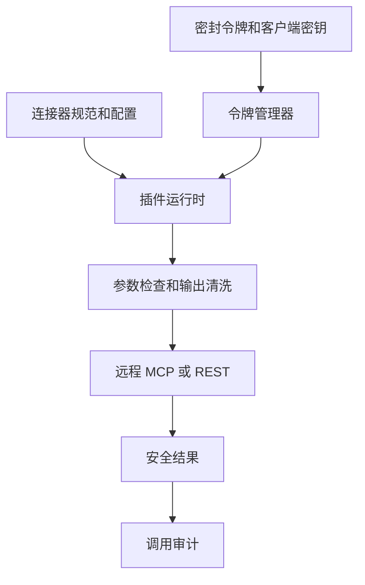
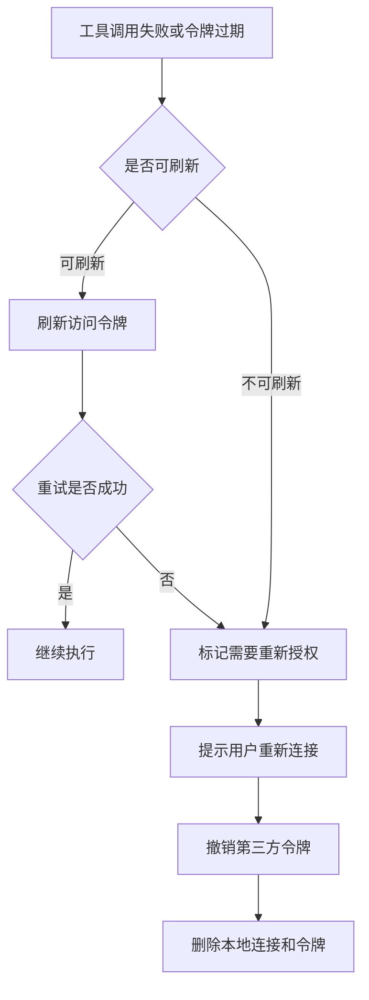

# 插件管理模型

<cite>
**本文引用的文件**
- [MCP 插件安装迁移](file://supabase/migrations/20260902171154_mcp_plugin_installations.sql)
- [插件收藏表迁移](file://supabase/migrations/20260913000000_plugin_collections.sql)
- [自托管 MCP API 密钥迁移](file://supabase/migrations/20260913010000_plugin_mcp_api_keys.sql)
- [插件连接与工具缓存迁移](file://supabase/migrations/20261002173000_plugin_connections.sql)
- [插件原生 OAuth 迁移](file://supabase/migrations/20261026120000_plugin_native_oauth.sql)
- [插件连接仓库](file://src/server/repositories/plugin-connections.repository.ts)
- [插件连接流程](file://src/server/plugins/plugin-connect.ts)
- [插件运行时](file://src/server/plugins/plugin-runtime.ts)
- [令牌管理器](file://src/server/plugins/token-manager.ts)
- [OAuth 发现模块](file://src/server/plugins/oauth-discovery.ts)
- [插件市场视图](file://src/client/components/plugins/marketplace-view.tsx)
</cite>

## 目录
1. [引言](#引言)
2. [项目结构定位](#项目结构定位)
3. [核心数据模型](#核心数据模型)
4. [架构总览](#架构总览)
5. [详细组件分析](#详细组件分析)
6. [依赖关系与冲突检测](#依赖关系与冲突检测)
7. [插件生命周期数据流](#插件生命周期数据流)
8. [配置、环境变量与运行时隔离](#配置环境变量与运行时隔离)
9. [性能监控、成本限制与配额](#性能监控成本限制与配额)
10. [故障恢复与回滚](#故障恢复与回滚)
11. [结论](#结论)

## 引言
本文围绕当前代码库中的“插件管理”能力，重点说明：
- 数据库层面如何表达插件安装、连接、工具能力、OAuth 凭证和调用审计。
- 服务器层如何实现插件发现、授权、能力同步、执行防火墙和令牌刷新。
- 前端如何展示插件市场、连接状态和可用工具。
- 插件的依赖、版本、冲突、安装状态、启用、更新、卸载等生命周期在现有实现中的真实边界。
- 哪些需求已有明确数据支撑，哪些在当前仓库中尚未实现，避免把未来设计误当作已实现功能。

## 项目结构定位
插件相关能力主要分布在以下位置：
- `supabase/migrations`：插件安装、连接、工具、能力、OAuth 状态、工具调用审计等数据库变更。
- `src/server/plugins`：插件连接、OAuth 发现、令牌管理、运行时工具注入和调用执行。
- `src/server/repositories/plugin-connections.repository.ts`：插件连接、工具、能力和调用的持久化接口。
- `src/client/components/plugins/marketplace-view.tsx`：插件市场、搜索、连接入口和用户侧状态展示。

**图表来源**
- [插件连接流程:227-412](file://src/server/plugins/plugin-connect.ts#L227-L412)
- [插件运行时:1-120](file://src/server/plugins/plugin-runtime.ts#L1-L120)
- [令牌管理器:1-120](file://src/server/plugins/token-manager.ts#L1-L120)
- [OAuth 发现模块:1-120](file://src/server/plugins/oauth-discovery.ts#L1-L120)
- [插件连接仓库:101-198](file://src/server/repositories/plugin-connections.repository.ts#L101-L198)
- [插件连接与工具缓存迁移:1-120](file://supabase/migrations/20261002173000_plugin_connections.sql#L1-L120)

**章节来源**
- [插件连接流程:227-524](file://src/server/plugins/plugin-connect.ts#L227-L524)
- [插件运行时:1-370](file://src/server/plugins/plugin-runtime.ts#L1-L370)
- [插件连接仓库:101-553](file://src/server/repositories/plugin-connections.repository.ts#L101-L553)

## 核心数据模型
当前插件数据模型不是以“插件元数据表 + 插件版本表 + 插件安装表”的传统三表形式出现，而是以“连接器目录 + 用户连接 + 工具能力 + 调用审计”为主轴。

### 连接器目录与 MCP 插件标识
`connector_catalog` 是平台对插件或 MCP 服务器的公共描述表；迁移为它增加了 `mcp_url`、基于 `metadata->>'pluginId'` 的唯一索引，以及工具名格式约束。该表承担“插件市场条目”的基础身份职责，而不是独立的“插件元数据表”。

| 字段 | 含义 | 约束或行为 |
|---|---|---|
| `mcp_url` | 可公开访问的 Streamable HTTP MCP 端点 | 必须为空或 `https://` 开头 |
| `metadata->>'pluginId'` | 插件稳定标识 | 带 `pluginId` 时存在唯一索引 |
| `connector_tools.name` | 工具名称 | 匹配小写字母、数字和下划线模式 |

**章节来源**
- [MCP 插件安装迁移:1-52](file://supabase/migrations/20260902171154_mcp_plugin_installations.sql#L1-L52)

### 插件收藏
`plugin_collections` 表示用户保存的插件收藏，用于跨设备记住“Saved”标签下的插件。它不是安装记录，也不是权限控制依据。

| 字段 | 含义 |
|---|---|
| `user_id` | 用户主键 |
| `plugin_id` | 插件标识 |
| `created_at` | 收藏创建时间 |

**章节来源**
- [插件收藏表迁移:1-39](file://supabase/migrations/20260913000000_plugin_collections.sql#L1-L39)

### 插件连接（核心安装实体）
`public.plugin_connections` 是当前系统中真正代表“用户安装并启用的插件”的核心表。每个 `(user_id, plugin_id)` 最多一条连接行，状态从 `pending` 到 `active`、`reauthorization_required`、`revoked`、`error`。

| 字段 | 含义 |
|---|---|
| `id` | 连接主键 |
| `user_id` | 所属用户 |
| `plugin_id` | 插件标识 |
| `plugin_name` | 插件显示名称 |
| `plugin_icon_url` | 插件图标地址 |
| `connector_kind` | 连接器类型，支持 `mcp` 或 `rest` |
| `mcp_url` | MCP 服务端点；原生 OAuth 后允许为空 |
| `auth_type` | 认证类型，支持 `mcp_oauth2`、`oauth2`、`none` |
| `status` | 连接状态 |
| `permission_mode` | 权限模式，`read_only` 或 `read_write` |
| `account_label` | 账户标签，例如第三方账户显示名 |
| `authorization_server` | 授权服务器地址 |
| `granted_scopes` | 已授予作用域 |
| `connected_at` | 首次连接时间 |
| `last_used_at` | 最近使用时间 |
| `last_error_code` | 最近错误码 |
| `last_error_at` | 最近错误时间 |

**章节来源**
- [插件连接与工具缓存迁移:1-120](file://supabase/migrations/20261002173000_plugin_connections.sql#L1-L120)
- [插件原生 OAuth 迁移:1-40](file://supabase/migrations/20261026120000_plugin_native_oauth.sql#L1-L40)
- [插件连接仓库:22-42](file://src/server/repositories/plugin-connections.repository.ts#L22-L42)

### 工具缓存
`public.plugin_connection_tools` 缓存一次连接暴露的工具列表。它是运行时发现结果的可查询快照，而不是插件源码清单。

| 字段 | 含义 |
|---|---|
| `connection_id` | 所属连接 |
| `tool_name` | 工具名称 |
| `title` | 工具标题 |
| `description` | 工具描述 |
| `input_schema` | 输入 JSON Schema |
| `is_enabled` | 是否启用 |
| `discovered_at` | 发现时间 |
| `risk_level` | 风险等级，`read`、`write`、`destructive` |

**章节来源**
- [插件连接与工具缓存迁移:120-200](file://supabase/migrations/20261002173000_plugin_connections.sql#L120-L200)
- [插件连接仓库:65-73](file://src/server/repositories/plugin-connections.repository.ts#L65-L73)

### 能力缓存
`public.plugin_connection_capabilities` 缓存连接暴露的资源与提示词。

| 字段 | 含义 |
|---|---|
| `connection_id` | 所属连接 |
| `kind` | 能力类型，`resource` 或 `prompt` |
| `name` | 能力名称 |
| `title` | 能力标题 |
| `description` | 能力描述 |
| `uri` | 资源 URI |
| `discovered_at` | 发现时间 |

**章节来源**
- [插件原生 OAuth 迁移:120-180](file://supabase/migrations/20261026120000_plugin_native_oauth.sql#L120-L180)

### 工具调用审计
`public.plugin_tool_calls` 记录工具调用统计和失败原因，但明确要求不存储参数和结果内容。

| 字段 | 含义 |
|---|---|
| `id` | 自增主键 |
| `user_id` | 调用用户 |
| `connection_id` | 可选关联连接 |
| `plugin_id` | 插件标识 |
| `tool_name` | 工具名称 |
| `risk_level` | 工具风险等级 |
| `status` | 调用状态，`ok`、`error`、`blocked` |
| `detail` | 简要详情 |
| `duration_ms` | 耗时毫秒数 |
| `created_at` | 创建时间 |

**章节来源**
- [插件原生 OAuth 迁移:180-240](file://supabase/migrations/20261026120000_plugin_native_oauth.sql#L180-L240)
- [插件连接仓库:83-90](file://src/server/repositories/plugin-connections.repository.ts#L83-L90)

### 私有 OAuth 令牌
`private.plugin_oauth_tokens` 使用 AES-256-GCM 密封存储访问令牌、刷新令牌、过期时间和扩展字段。应用运行时解密，客户端和服务端公开查询不会返回明文。

| 字段 | 含义 |
|---|---|
| `connection_id` | 外键指向连接 |
| `access_token_sealed` | 密封的访问令牌 |
| `refresh_token_sealed` | 密封的刷新令牌 |
| `token_type` | 令牌类型 |
| `expires_at` | 过期时间 |
| `scopes` | 作用域数组 |
| `raw_extras` | 非敏感扩展字段 |
| `oauth_meta` | 刷新和撤销所需元信息 |
| `client_secret_sealed` | 动态注册客户端密钥的密封值 |

**章节来源**
- [插件连接与工具缓存迁移:120-200](file://supabase/migrations/20261002173000_plugin_connections.sql#L120-L200)
- [插件原生 OAuth 迁移:40-100](file://supabase/migrations/20261026120000_plugin_native_oauth.sql#L40-L100)
- [插件连接仓库:54-63](file://src/server/repositories/plugin-connections.repository.ts#L54-L63)

### 私有 OAuth 状态
`private.plugin_oauth_states` 替代进程内内存状态，支持授权开始回调在不同隔离环境中完成。

| 字段 | 含义 |
|---|---|
| `state_hash` | SHA-256 哈希，主键 |
| `user_id` | 发起用户 |
| `plugin_id` | 插件标识 |
| `payload_sealed` | 密封的授权载荷 |
| `expires_at` | 过期时间 |
| `created_at` | 创建时间 |

**章节来源**
- [插件原生 OAuth 迁移:60-100](file://supabase/migrations/20261026120000_plugin_native_oauth.sql#L60-L100)

### 自托管 API 密钥
`private.plugin_mcp_api_keys` 面向旧式 gateway-less 安装，由 Next.js 加密封存，Worker 不直接读取。

| 字段 | 含义 |
|---|---|
| `installation_id` | 安装主键 |
| `encrypted_api_key` | 加密 API 密钥 |
| `api_key_nonce` | 密钥随机值 |
| `encryption_key_version` | 密钥版本 |
| `created_at` | 创建时间 |
| `updated_at` | 更新时间 |

**章节来源**
- [自托管 MCP API 密钥迁移:1-21](file://supabase/migrations/20260913010000_plugin_mcp_api_keys.sql#L1-L21)

### 数据模型关系图

**图表来源**
- [插件连接与工具缓存迁移:1-200](file://supabase/migrations/20261002173000_plugin_connections.sql#L1-L200)
- [插件原生 OAuth 迁移:60-240](file://supabase/migrations/20261026120000_plugin_native_oauth.sql#L60-L240)
- [插件收藏表迁移:1-39](file://supabase/migrations/20260913000000_plugin_collections.sql#L1-L39)

## 架构总览
插件系统按“连接器规范 → 授权计划 → 外部 OAuth → 连接写入 → 能力发现 → 工具注入 → 执行防火墙 → 审计”组织。

**图表来源**
- [插件连接流程:227-412](file://src/server/plugins/plugin-connect.ts#L227-L412)
- [插件运行时:250-370](file://src/server/plugins/plugin-runtime.ts#L250-L370)
- [令牌管理器:120-228](file://src/server/plugins/token-manager.ts#L120-L228)
- [OAuth 发现模块:120-200](file://src/server/plugins/oauth-discovery.ts#L120-L200)

**章节来源**
- [插件连接流程:227-524](file://src/server/plugins/plugin-connect.ts#L227-L524)
- [插件运行时:1-370](file://src/server/plugins/plugin-runtime.ts#L1-L370)
- [插件连接仓库:101-553](file://src/server/repositories/plugin-connections.repository.ts#L101-L553)

## 详细组件分析

### 插件连接仓库
仓库定义了连接、工具、能力、工具调用和 OAuth 状态的完整读写语义。关键类型包括：
- `PluginConnectionRow`：连接行，包含连接器类型、认证类型、权限模式和状态。
- `SealedTokens`：密封令牌、过期时间、作用域和 OAuth 元信息。
- `PluginConnectionToolRow`：工具名称、描述、输入 Schema、风险和启用状态。
- `CapabilityRow`：资源或提示词能力。
- `ToolCallRow`：调用审计记录。

重要操作包括：
- 列出用户连接和活跃连接。
- 插入或重新激活连接。
- 修改连接状态、权限模式、使用时间。
- 写入、读取、锁定、旋转密封令牌。
- 保存和消费 OAuth 状态。
- 替换工具列表、能力列表。
- 记录工具调用。

**章节来源**
- [插件连接仓库:1-200](file://src/server/repositories/plugin-connections.repository.ts#L1-L200)
- [插件连接仓库:200-553](file://src/server/repositories/plugin-connections.repository.ts#L200-L553)

### 插件连接流程
`startPluginConnection` 负责：
1. 根据插件 ID 解析连接器规范。
2. 如果是无认证的 MCP 服务器，直接创建连接并同步能力。
3. 否则计算 PKCE challenge，保存密封的待授权状态。
4. 构造授权端点 URL，返回重定向地址。
5. 回调完成后换取令牌，写入连接和密封令牌，再同步能力。
6. 分类工具风险等级，并尝试刷新已连接工具缓存。
7. 断开连接时尝试撤销第三方令牌，然后删除本地访问权限。

**图表来源**
- [插件连接流程:227-412](file://src/server/plugins/plugin-connect.ts#L227-L412)

**章节来源**
- [插件连接流程:227-524](file://src/server/plugins/plugin-connect.ts#L227-L524)

### 插件运行时
插件运行时将已连接的插件工具暴露给代理模型：
- 加载用户所有活跃连接。
- 过滤未发现的工具，必要时触发一次能力同步。
- 根据 `permission_mode` 和工具 `risk_level` 过滤可见工具。
- 将工具命名为 `mcp__<插件>__<工具>`。
- 提供搜索工具和调用工具的代理入口。
- 执行前检查权限模式、参数、速率限制和令牌有效性。
- 执行后清理敏感输出并记录审计。

**图表来源**
- [插件运行时:1-120](file://src/server/plugins/plugin-runtime.ts#L1-L120)
- [插件运行时:250-370](file://src/server/plugins/plugin-runtime.ts#L250-L370)

**章节来源**
- [插件运行时:1-370](file://src/server/plugins/plugin-runtime.ts#L1-L370)

### 令牌管理器
令牌管理器负责：
- 向第三方 OAuth 令牌端点申请访问令牌和刷新令牌。
- 从连接元信息重建客户端认证方式。
- 判断令牌是否即将过期。
- 在事务中锁定密封令牌，避免并发刷新导致覆盖。
- 刷新成功后旋转新的访问令牌和刷新令牌。
- 为无认证 MCP 连接返回空访问令牌。

**章节来源**
- [令牌管理器:1-228](file://src/server/plugins/token-manager.ts#L1-L228)

### OAuth 发现模块
OAuth 发现模块负责：
- 校验外部 URL 必须是公网 HTTPS，不允许内部地址和嵌入凭据。
- 探测 MCP 服务器是否需要 OAuth。
- 查找受保护资源元数据。
- 解析授权服务器端点。
- 支持动态注册客户端。
- 封装网络异常为 `PluginOAuthError`。

**章节来源**
- [OAuth 发现模块:1-200](file://src/server/plugins/oauth-discovery.ts#L1-L200)

### 插件市场视图
前端插件市场视图负责：
- 渲染市场分类和插件卡片。
- 根据本地连接状态展示“已连接”“连接中”“未连接”。
- 调用连接 API 启动插件授权。
- 显示连接成功、断开和搜索反馈。

**章节来源**
- [插件市场视图:1-200](file://src/client/components/plugins/marketplace-view.tsx#L1-L200)

## 依赖关系与冲突检测
需要明确区分“当前实现”和“未来期望”：

- **插件依赖关系**：当前数据库中没有 `plugin_dependencies` 或类似依赖表。插件工具之间也没有依赖图结构。
- **插件版本管理**：没有 `plugin_versions`、`installed_version`、`available_version` 等版本字段。`connector_catalog.mcp_url` 指向当前 MCP 端点，但没有语义化的版本比较逻辑。
- **冲突检测**：没有插件间冲突检测表或冲突解决策略。
- **安装状态跟踪**：通过 `plugin_connections.status` 跟踪用户级安装状态，而不是插件包管理器意义上的“已安装、已禁用、已卸载、已损坏”。
- **插件元数据**：元数据主要来自 `connector_catalog` 和连接器规范，而不是独立插件元数据表。
- **插件市场同步**：当前代码中存在插件市场 UI 和连接器解析，但没有专门的“市场同步任务”来增量拉取、解析、对比和发布插件版本。

因此，依赖图构建、冲突检测和版本比较在当前仓库中不具备对应的数据结构或算法实现。如果未来需要这些能力，应新增依赖表、版本表和冲突日志表，并在连接流程中加入拓扑排序和冲突决策。

**章节来源**
- [MCP 插件安装迁移:1-52](file://supabase/migrations/20260902171154_mcp_plugin_installations.sql#L1-L52)
- [插件连接与工具缓存迁移:1-120](file://supabase/migrations/20261002173000_plugin_connections.sql#L1-L120)

## 插件生命周期数据流
当前插件生命周期的真实边界如下：

| 阶段 | 数据变化 | 实现情况 |
|---|---|---|
| 发现 | 解析连接器、探测 MCP、识别 OAuth | 已实现 |
| 安装 | 写入 `plugin_connections`、写入密封令牌、同步工具 | 已实现 |
| 启用 | 连接状态为 `active`，工具按风险等级暴露 | 已实现 |
| 更新 | 当前没有版本对比或自动更新逻辑 | 未实现 |
| 停用 | 可通过撤销连接使令牌失效，但无独立“禁用”状态 | 部分实现 |
| 卸载 | 撤销第三方令牌、删除本地连接和令牌 | 已实现 |
| 故障恢复 | 未找到、未授权时标记 `reauthorization_required`，运行时引导重新连接 | 部分实现 |
| 回滚 | 没有插件版本回滚机制 | 未实现 |

**图表来源**
- [插件连接与工具缓存迁移:1-120](file://supabase/migrations/20261002173000_plugin_connections.sql#L1-L120)
- [插件连接流程:324-524](file://src/server/plugins/plugin-connect.ts#L324-L524)
- [插件运行时:250-370](file://src/server/plugins/plugin-runtime.ts#L250-L370)

**章节来源**
- [插件连接流程:227-524](file://src/server/plugins/plugin-connect.ts#L227-L524)
- [插件运行时:250-370](file://src/server/plugins/plugin-runtime.ts#L250-L370)

## 配置、环境变量与运行时隔离
当前实现的隔离和数据支持如下：

- **插件配置存储**：
  - 用户级连接配置存储在 `plugin_connections`。
  - 收藏插件存储在 `plugin_collections`。
  - 自托管 API 密钥存储在 `private.plugin_mcp_api_keys`。
  - 连接工具开关存储在 `plugin_connection_tools.is_enabled`。
  - 插件元数据本身不在插件专用元数据表中，而是来自连接器目录和 MCP 工具定义。

- **环境变量注入**：
  - 令牌管理器、OAuth 发现、连接器注册等后端模块使用环境变量和加密配置。
  - 但当前文档目标中提到的“环境变量注入”并未表现为通用插件配置注入器；更准确的是“运行时按需注入访问令牌”。

- **运行时隔离**：
  - 访问令牌和刷新令牌以密封形式存储在 `private.plugin_oauth_tokens`。
  - 公开 RPC 只暴露脱敏的连接元数据。
  - 插件输出经过清洗，移除可能泄露的令牌和指令。
  - 工具调用审计不存储参数和返回值内容。

**图表来源**
- [令牌管理器:120-228](file://src/server/plugins/token-manager.ts#L120-L228)
- [插件运行时:250-370](file://src/server/plugins/plugin-runtime.ts#L250-L370)

**章节来源**
- [自托管 MCP API 密钥迁移:1-21](file://supabase/migrations/20260913010000_plugin_mcp_api_keys.sql#L1-L21)
- [插件连接与工具缓存迁移:120-200](file://supabase/migrations/20261002173000_plugin_connections.sql#L120-L200)
- [插件原生 OAuth 迁移:180-240](file://supabase/migrations/20261026120000_plugin_native_oauth.sql#L180-L240)
- [令牌管理器:1-228](file://src/server/plugins/token-manager.ts#L1-L228)

## 性能监控、成本限制与配额
当前仓库中与插件相关的监控和限制能力如下：

- **性能监控**：
  - `plugin_tool_calls.duration_ms` 记录单次工具调用耗时。
  - `plugin_tool_calls.status` 区分成功、失败和被拦截。
  - `plugin_connections.last_used_at` 可用于观察连接活跃度。
  - `plugin_connections.last_error_code` 和 `last_error_at` 记录最近错误。

- **成本限制**：
  - 当前没有统一的插件成本计量表。
  - 工具调用审计适合扩展为成本追踪，但目前只保留结构化统计，不记录调用参数和响应正文。

- **配额管理**：
  - 插件运行时调用 `checkRateLimit`，并通过 `blocked` 结果阻止超限调用。
  - 这是运行时限流，不是数据库配额表。
  - 没有每插件、每用户的用量上限表。

建议的未来扩展方向：
- 增加 `plugin_usage` 或 `plugin_cost_events` 表，记录调用次数、输入大小、输出大小、外部 API 费用和累计配额。
- 增加 `plugin_quota_limits` 表，定义每用户、每插件、每月的限额。
- 在工具调用路径中将费用指标写入新表。
- 在连接管理中增加配额告警状态。

**章节来源**
- [插件原生 OAuth 迁移:180-240](file://supabase/migrations/20261026120000_plugin_native_oauth.sql#L180-L240)
- [插件运行时:250-370](file://src/server/plugins/plugin-runtime.ts#L250-L370)

## 故障恢复与回滚
当前实现中的故障处理和恢复路径如下：

### 连接状态恢复
- 当工具调用发现未找到连接或未授权时，运行时将连接状态设为 `reauthorization_required`。
- 前端可以提示用户重新连接。
- `listActiveConnectionsForUser` 同时考虑 `active` 和 `reauthorization_required`，避免遗漏需要刷新的连接。

### 令牌刷新恢复
- 令牌管理器在访问令牌即将过期时主动刷新。
- 刷新失败时返回需要重新授权。
- 运行时在遇到 401 或 403 时尝试强制刷新一次，仍失败则引导重新连接。

### 断开与撤销恢复
- 断开连接时优先尝试向第三方授权服务器撤销令牌。
- 即使撤销失败，也会删除本地连接和令牌，确保 Clauxen 不再能使用该插件。
- 旧式本地生成令牌的连接会被清理。

### 回滚机制现状
- 没有插件版本回滚。
- 没有插件安装快照。
- 没有依赖拓扑回滚。
- 最接近“回滚”的操作是撤销连接，即删除用户对该插件的访问权限。

**图表来源**
- [插件运行时:250-370](file://src/server/plugins/plugin-runtime.ts#L250-L370)
- [令牌管理器:120-228](file://src/server/plugins/token-manager.ts#L120-L228)
- [插件连接流程:450-524](file://src/server/plugins/plugin-connect.ts#L450-L524)

**章节来源**
- [插件运行时:250-370](file://src/server/plugins/plugin-runtime.ts#L250-L370)
- [令牌管理器:120-228](file://src/server/plugins/token-manager.ts#L120-L228)
- [插件连接流程:324-524](file://src/server/plugins/plugin-connect.ts#L324-L524)

## 结论
当前插件管理模型已经具备一个清晰的“连接器 → 连接 → 工具 → 能力 → 审计”主线，并在安全方面实现了：
- 第三方令牌密封存储。
- 运行时按需注入访问令牌。
- 输出清洗。
- 调用审计。
- OAuth 状态持久化。
- 连接状态和权限模式控制。

但它尚未实现文档目标中提出的部分高级插件包管理能力：
- 插件依赖图和依赖冲突检测。
- 插件版本管理和版本回滚。
- 插件市场增量同步。
- 插件成本和配额数据库模型。
- 通用的插件配置注入器。

如果需要补齐这些能力，应在现有 `plugin_connections`、`plugin_connection_tools`、`plugin_connection_capabilities`、`plugin_tool_calls` 和 `plugin_oauth_*` 表基础上，新增依赖表、版本表、冲突日志表、用量表和配额表，并在连接、同步和执行路径中加入相应验证与审计逻辑。