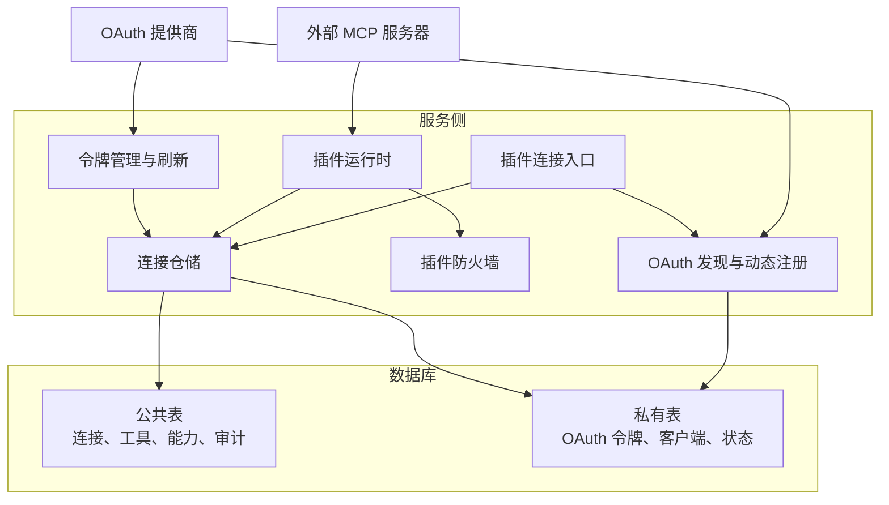
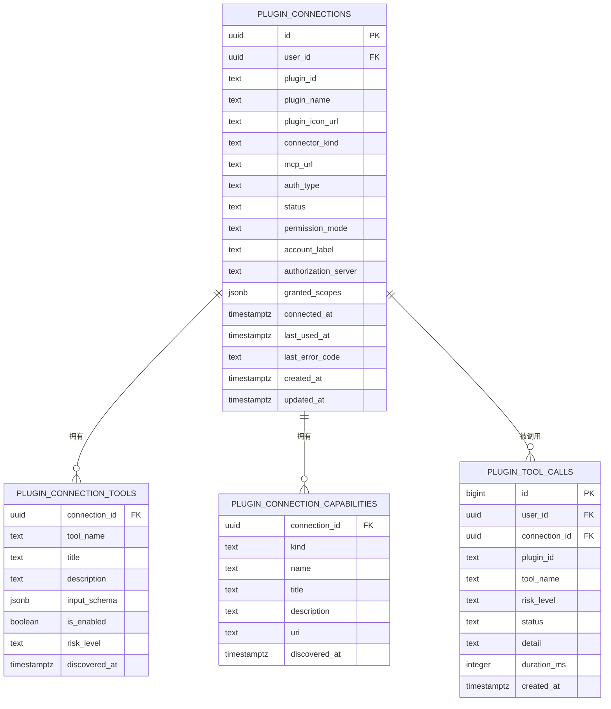
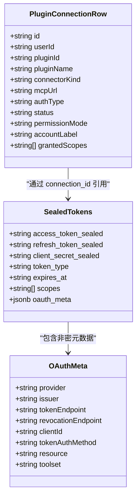
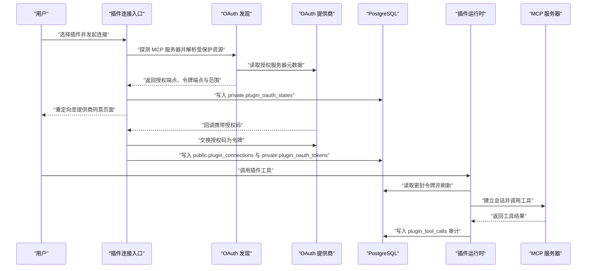
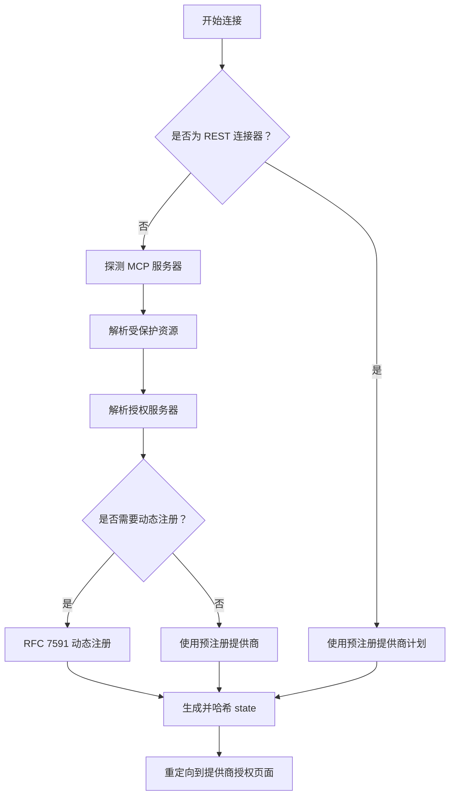
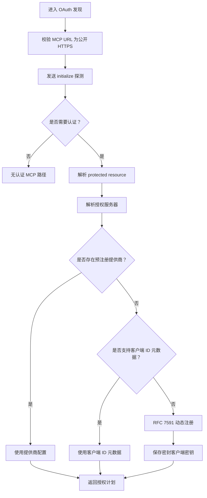
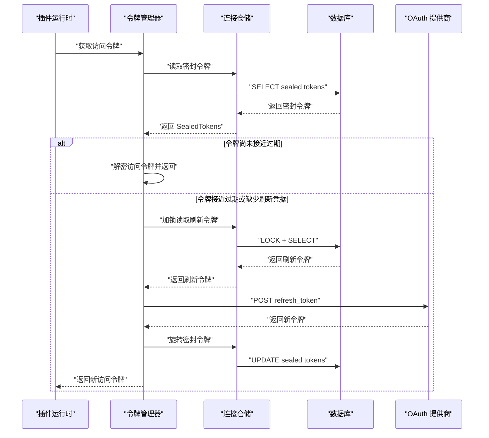
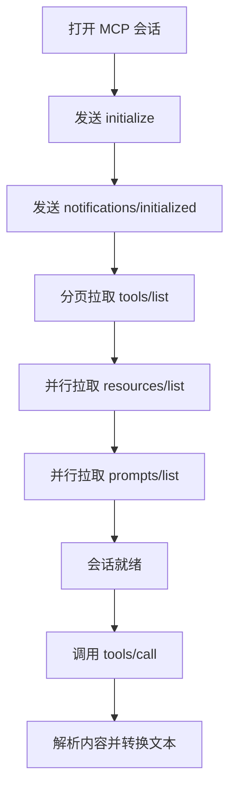
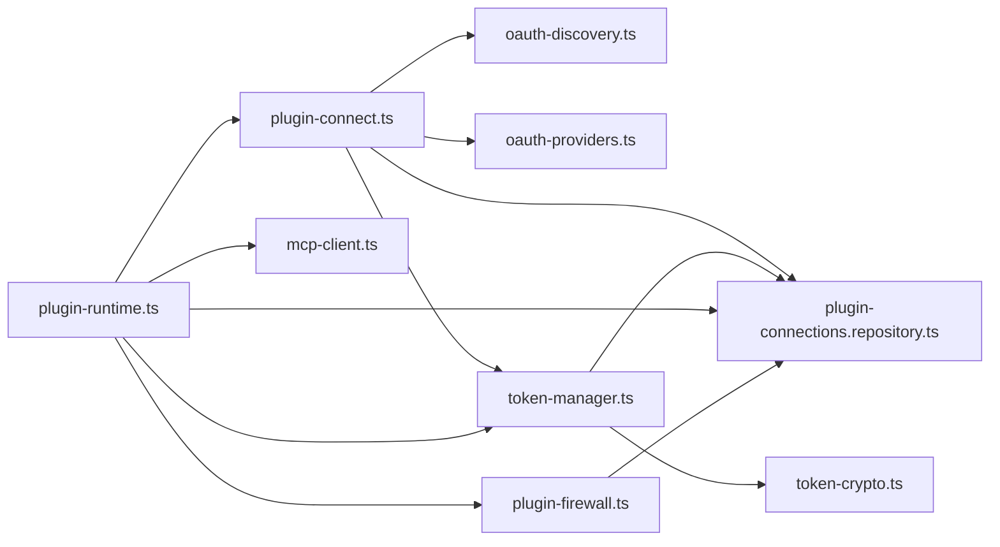
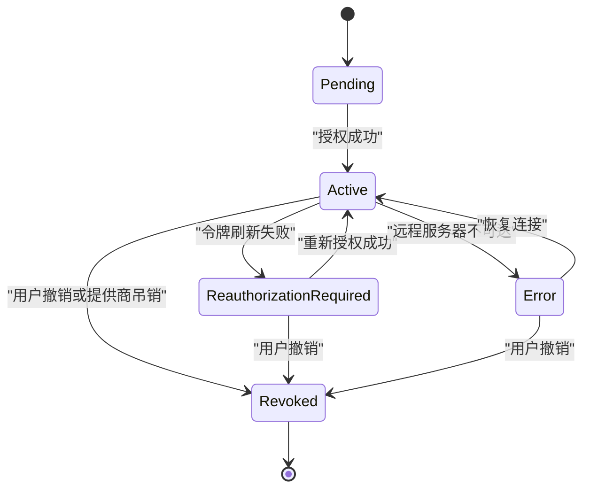

# 插件连接器模型

<cite>
**本文引用的文件**   
- [MCP 插件安装迁移](file://supabase/migrations/20260902171154_mcp_plugin_installations.sql)
- [插件收藏集合迁移](file://supabase/migrations/20260913000000_plugin_collections.sql)
- [MCP API 密钥迁移](file://supabase/migrations/20260913010000_plugin_mcp_api_keys.sql)
- [插件连接与 OAuth 令牌迁移](file://supabase/migrations/20261002173000_plugin_connections.sql)
- [原生 OAuth 授权迁移](file://supabase/migrations/20261026120000_plugin_native_oauth.sql)
- [连接器平台基础迁移](file://supabase/migrations/20260830130331_connector_platform_foundation.sql)
- [连接器索引迁移](file://supabase/migrations/20260830132700_connector_foundation_indexes.sql)
- [连接器成本与清理迁移](file://supabase/migrations/20260830134609_connector_cost_scale_guardrails.sql)
- [插件连接入口](file://src/server/plugins/plugin-connect.ts)
- [令牌管理器](file://src/server/plugins/token-manager.ts)
- [令牌加密封装](file://src/server/plugins/token-crypto.ts)
- [OAuth 提供商配置](file://src/server/plugins/oauth-providers.ts)
- [OAuth 发现与动态客户端注册](file://src/server/plugins/oauth-discovery.ts)
- [MCP 客户端](file://src/server/plugins/mcp-client.ts)
- [插件防火墙](file://src/server/plugins/plugin-firewall.ts)
- [插件运行时](file://src/server/plugins/plugin-runtime.ts)
- [插件数据集加载器](file://src/shared/lib/mcp-plugin-dataset.ts)
- [插件连接仓储](file://src/server/repositories/plugin-connections.repository.ts)
</cite>

## 目录
1. [引言](#引言)
2. [项目结构](#项目结构)
3. [核心数据模型](#核心数据模型)
4. [架构总览](#架构总览)
5. [详细组件分析](#详细组件分析)
6. [依赖关系分析](#依赖关系分析)
7. [性能与成本治理](#性能与成本治理)
8. [故障恢复与生命周期](#故障恢复与生命周期)
9. [安全策略与审计](#安全策略与审计)
10. [结论](#结论)

## 引言
本文面向插件连接器系统的数据模型与安全设计，重点解释以下主题：
- MCP 插件、连接器、工具、能力等核心实体的数据库表结构。
- 插件安装管理、连接配置、API 密钥与 OAuth 令牌的加密存储。
- 原生 OAuth 授权流程：凭证加密、状态持久化、令牌刷新与权限控制。
- 插件隔离机制、参数与输出过滤、速率限制、健康检查与审计日志。
- 插件市场数据同步、版本与依赖解析思路。
- 访问控制、行级安全策略和可观测性支持。

该文档不直接粘贴源码，而是通过“章节来源”指向具体实现位置，便于读者对照仓库代码验证。

## 项目结构
插件连接器相关代码分布在服务器端插件模块、Supabase 迁移脚本、共享类型与仓储中：
- 数据层：Supabase 迁移脚本定义公共 `public` 与私有 `private` 两类 schema，并通过 RLS 策略隔离用户数据与敏感凭证。
- 业务层：`plugin-connect.ts` 负责连接计划与 OAuth 流程；`token-manager.ts` 负责令牌获取与刷新；`oauth-discovery.ts` 负责远端 MCP 授权发现与动态客户端注册。
- 执行层：`mcp-client.ts` 实现 Streamable HTTP MCP JSON-RPC 会话；`plugin-runtime.ts` 将插件工具暴露给 Agent；`plugin-firewall.ts` 提供入站与出站安全检查。
- 数据层封装：`plugin-connections.repository.ts` 封装连接、工具、能力与审计查询。
- 市场数据：`mcp-plugin-dataset.ts` 从本地静态 JSON 构建插件索引，供前端与服务端展示。

**图表来源**
- [插件连接入口:1-200](file://src/server/plugins/plugin-connect.ts#L1-L200)
- [OAuth 发现与动态客户端注册:201-360](file://src/server/plugins/oauth-discovery.ts#L201-L360)
- [令牌管理器:1-200](file://src/server/plugins/token-manager.ts#L1-L200)
- [插件运行时:1-200](file://src/server/plugins/plugin-runtime.ts#L1-L200)
- [插件防火墙:1-167](file://src/server/plugins/plugin-firewall.ts#L1-L167)
- [插件连接仓储:1-200](file://src/server/repositories/plugin-connections.repository.ts#L1-L200)

**章节来源**
- [插件连接入口:1-200](file://src/server/plugins/plugin-connect.ts#L1-L200)
- [插件数据集加载器:1-200](file://src/shared/lib/mcp-plugin-dataset.ts#L1-L200)

## 核心数据模型
本节按职责分组说明关键表及其关系。

### 连接器与插件元数据
- `connector_catalog`：连接器目录，包含协议、认证方式、文档链接、能力清单等；新增 `mcp_url` 字段标记 MCP 画廊插件，并添加基于 `metadata.pluginId` 的唯一约束。
- `connector_tools`：连接器工具注册表，描述工具名称、标题、输入输出 Schema、HTTP 方法、风险等级、是否启用等。
- `connector_tool_permissions`：用户对某个安装实例的工具级策略，支持继承、允许、确认、拒绝。
- `connector_action_approvals`：需要人工确认的操作审批记录，带过期时间与消费状态。
- `connector_audit_events`：连接器调用审计事件，带幂等 `event_id` 与 BRIN 时间索引，用于长期归档与清理。
- `connector_health_checks`：连接器健康检查记录，带风险与健康状态。

这些表构成通用连接器平台的基础，插件连接器在此基础上扩展专用表。

**章节来源**
- [连接器平台基础迁移:1-200](file://supabase/migrations/20260830130331_connector_platform_foundation.sql#L1-L200)
- [连接器索引迁移:1-23](file://supabase/migrations/20260830132700_connector_foundation_indexes.sql#L1-L23)

### 插件安装与收藏
- `connector_installations`：用户安装记录，支持多工作区、账户标签、已授权范围、连接时间、最近使用时间和错误信息。
- `plugin_collections`：用户收藏的插件集合，主键为 `(user_id, plugin_id)`，配合 RLS 只允许所有者读写。
- `plugin_mcp_api_keys`：自托管模式下，针对网关直连的 MCP 服务器的 API 密钥，存储在 `private` schema，由 Next.js 密封后写入，Worker 不可读。

**章节来源**
- [连接器平台基础迁移:1-200](file://supabase/migrations/20260830130331_connector_platform_foundation.sql#L1-L200)
- [插件收藏集合迁移:1-39](file://supabase/migrations/20260913000000_plugin_collections.sql#L1-L39)
- [MCP API 密钥迁移:1-21](file://supabase/migrations/20260913010000_plugin_mcp_api_keys.sql#L1-L21)
- [MCP 插件安装迁移:1-52](file://supabase/migrations/20260902171154_mcp_plugin_installations.sql#L1-L52)

### 插件连接、工具与能力
- `plugin_connections`：用户到插件的连接，包含插件标识、MCP URL、认证类型、连接状态、授权服务器、授予范围、账户标签等。新增 `connector_kind`、`permission_mode`、`account_label` 以区分 MCP/REST 与读写权限。
- `plugin_connection_tools`：每个连接缓存的 MCP 工具列表，包括名称、标题、描述、输入 Schema、是否启用和风险等级。
- `plugin_connection_capabilities`：MCP 服务器暴露的资源与提示能力，按连接维度缓存。
- `plugin_tool_calls`：插件工具调用审计表，记录用户、连接、工具名、风险等级、状态、耗时等，不存储请求参数或响应内容。

**图表来源**
- [插件连接与 OAuth 令牌迁移:1-200](file://supabase/migrations/20261002173000_plugin_connections.sql#L1-L200)
- [原生 OAuth 授权迁移:1-200](file://supabase/migrations/20261026120000_plugin_native_oauth.sql#L1-L200)

**章节来源**
- [插件连接与 OAuth 令牌迁移:1-200](file://supabase/migrations/20261002173000_plugin_connections.sql#L1-L200)
- [原生 OAuth 授权迁移:1-200](file://supabase/migrations/20261026120000_plugin_native_oauth.sql#L1-L200)

### 私有凭证与令牌
- `private.plugin_oauth_tokens`：保存 AES-256-GCM 密封的访问令牌、刷新令牌、令牌类型、过期时间、范围和原始额外字段。新增 `oauth_meta` 与 `client_secret_sealed` 以支持刷新与动态客户端。
- `private.plugin_oauth_states`：原生 OAuth 待处理授权状态，保存 state 哈希、用户、插件、密封负载与过期时间，替代内存映射。
- `private.plugin_oauth_clients`：动态注册的 OAuth 客户端，按发行者 + 回调地址唯一，保存密封客户端密钥与认证方法。

**图表来源**
- [插件连接仓储:1-200](file://src/server/repositories/plugin-connections.repository.ts#L1-L200)
- [插件连接与 OAuth 令牌迁移:1-200](file://supabase/migrations/20261002173000_plugin_connections.sql#L1-L200)
- [原生 OAuth 授权迁移:1-200](file://supabase/migrations/20261026120000_plugin_native_oauth.sql#L1-L200)

**章节来源**
- [插件连接仓储:1-200](file://src/server/repositories/plugin-connections.repository.ts#L1-L200)
- [插件连接与 OAuth 令牌迁移:201-285](file://supabase/migrations/20261002173000_plugin_connections.sql#L201-L285)
- [原生 OAuth 授权迁移:1-200](file://supabase/migrations/20261026120000_plugin_native_oauth.sql#L1-L200)

## 架构总览
插件连接器系统围绕“连接”展开：先发现 MCP 服务器与授权服务器，再在第三方提供商上完成用户授权，最后把令牌密封存储并在调用时按需解密。

**图表来源**
- [插件连接入口:1-200](file://src/server/plugins/plugin-connect.ts#L1-L200)
- [OAuth 发现与动态客户端注册:1-360](file://src/server/plugins/oauth-discovery.ts#L1-L360)
- [令牌管理器:1-200](file://src/server/plugins/token-manager.ts#L1-L200)
- [插件运行时:1-200](file://src/server/plugins/plugin-runtime.ts#L1-L200)
- [插件连接与 OAuth 令牌迁移:1-200](file://supabase/migrations/20261002173000_plugin_connections.sql#L1-L200)
- [原生 OAuth 授权迁移:1-200](file://supabase/migrations/20261026120000_plugin_native_oauth.sql#L1-L200)

## 详细组件分析

### 插件连接入口与连接计划
`plugin-connect.ts` 是插件授权的统一入口，负责：
- 计算 pending authorization 计划，区分 REST 连接器与 MCP 连接器。
- 对 MCP 连接器调用 OAuth 发现，解析受保护资源与授权服务器。
- 使用预注册提供商或动态客户端注册获得 `clientId` 与可选 `clientSecret`。
- 生成随机 state 并进行 SHA-256 哈希后写入 `private.plugin_oauth_states`，设置 10 分钟过期。
- 根据提供商特性决定是否发送 RFC 8707 resource indicator。

**图表来源**
- [插件连接入口:1-200](file://src/server/plugins/plugin-connect.ts#L1-L200)
- [OAuth 发现与动态客户端注册:1-200](file://src/server/plugins/oauth-discovery.ts#L1-L200)

**章节来源**
- [插件连接入口:1-200](file://src/server/plugins/plugin-connect.ts#L1-L200)

### OAuth 发现与动态客户端注册
`oauth-discovery.ts` 实现 MCP 授权规范的关键路径：
- 强制所有外部 URL 必须为公开 HTTPS，拒绝内网地址与凭据嵌入。
- 通过 `initialize` 探测 MCP 服务器，若返回 401/403 则尝试读取 `.well-known/oauth-protected-resource`。
- 依次尝试多个候选路径发现授权服务器，校验其授权端点与令牌端点。
- 若未预注册提供商，则优先使用客户端 ID 元数据文档，否则走 RFC 7591 动态注册。
- 动态注册结果保存到 `private.plugin_oauth_clients`，客户端密钥使用 AES-256-GCM 密封。

**图表来源**
- [OAuth 发现与动态客户端注册:1-360](file://src/server/plugins/oauth-discovery.ts#L1-L360)

**章节来源**
- [OAuth 发现与动态客户端注册:1-360](file://src/server/plugins/oauth-discovery.ts#L1-L360)

### 令牌管理与刷新
`token-manager.ts` 负责：
- 向提供商令牌端点申请令牌，兼容表单编码与嵌套 `authed_user` 响应。
- 构造客户端认证头，支持 `none`、`client_secret_post`、`client_secret_basic`。
- 在访问令牌即将过期前触发刷新，避免对话中途失效。
- 刷新失败时返回重新授权原因，促使连接状态降级。
- 使用仓储层加锁读取密封令牌，防止并发刷新竞态。

**图表来源**
- [令牌管理器:1-200](file://src/server/plugins/token-manager.ts#L1-L200)
- [插件连接仓储:1-200](file://src/server/repositories/plugin-connections.repository.ts#L1-L200)

**章节来源**
- [令牌管理器:1-200](file://src/server/plugins/token-manager.ts#L1-L200)

### MCP 客户端与会话
`mcp-client.ts` 实现 Streamable HTTP MCP 客户端：
- 建立 JSON-RPC 2.0 会话，支持普通 JSON 与 SSE 帧。
- 分页拉取 `tools/list`、`resources/list`、`prompts/list`，最多 5 页。
- 将工具定义规范化为标题、描述、输入 Schema 与风险提示。
- 调用 `tools/call` 并映射 401/403/404 等状态为客户端错误码。
- 将结构化结果转换为文本，便于模型消费。

**图表来源**
- [MCP 客户端:201-428](file://src/server/plugins/mcp-client.ts#L201-L428)

**章节来源**
- [MCP 客户端:201-428](file://src/server/plugins/mcp-client.ts#L201-L428)

### 插件运行时与工具目录
`plugin-runtime.ts` 将插件能力暴露给 Agent：
- 加载用户活跃连接，并按风险等级排序，直接暴露最多 48 个工具。
- 超出限制时提供搜索与调用辅助工具。
- 根据连接权限模式过滤危险工具。
- 将工具名规范化为 `mcp__<plugin>__<tool>` 格式，保证安全命名。

**章节来源**
- [插件运行时:1-200](file://src/server/plugins/plugin-runtime.ts#L1-L200)

### 插件防火墙
`plugin-firewall.ts` 提供双向安全保护：
- 出站：限制参数大小、阻止写操作携带疑似凭据。
- 入站：移除不可见字符、HTML 注释与脚本样式、替换注入指令、脱敏密钥、截断输出。
- 速率限制：按用户统计最近一分钟调用次数，写操作更严格。
- 提供系统提示增强，提醒模型不要信任插件返回内容中的指令。

**章节来源**
- [插件防火墙:1-167](file://src/server/plugins/plugin-firewall.ts#L1-L167)

### 插件市场数据同步与版本管理
`mcp-plugin-dataset.ts` 从 `public/data/mcp-plugins.json` 加载插件数据集，并在进程内缓存：
- 构建精确匹配与标准化指纹索引，支持 slug 模糊匹配。
- 提供插件摘要、发布者、技能、命令、钩子、规则与子代理信息。
- 适用于 Marketplace 展示与前端快速渲染，避免运行时 API 依赖。

版本与依赖解析方面，仓库提供了 MCP 服务器条目与声明式字段，例如 `declaredMcpServers`、`gitUrl`、`fullRef`、`createdAt`、`updatedAt`。当前实现主要做展示与查找；实际依赖解析与版本锁定可在后续通过 `fullRef` 与 `gitUrl` 扩展。

**章节来源**
- [插件数据集加载器:1-200](file://src/shared/lib/mcp-plugin-dataset.ts#L1-L200)

## 依赖关系分析
插件连接器模块之间的耦合如下：
- `plugin-connect.ts` 依赖 `oauth-discovery.ts`、`oauth-providers.ts`、`token-manager.ts`、`plugin-connections.repository.ts`。
- `token-manager.ts` 依赖 `token-crypto.ts`、`oauth-providers.ts`、`plugin-connections.repository.ts`。
- `mcp-client.ts` 独立于其他插件模块，仅依赖网络与 JSON-RPC 协议。
- `plugin-runtime.ts` 组合 `mcp-client.ts`、`plugin-firewall.ts`、`token-manager.ts`、`plugin-connect.ts`、`plugin-connections.repository.ts`。
- `plugin-firewall.ts` 依赖数据库进行速率统计。

**图表来源**
- [插件连接入口:1-200](file://src/server/plugins/plugin-connect.ts#L1-L200)
- [令牌管理器:1-200](file://src/server/plugins/token-manager.ts#L1-L200)
- [插件运行时:1-200](file://src/server/plugins/plugin-runtime.ts#L1-L200)
- [插件防火墙:1-167](file://src/server/plugins/plugin-firewall.ts#L1-L167)
- [插件连接仓储:1-200](file://src/server/repositories/plugin-connections.repository.ts#L1-L200)

**章节来源**
- [插件连接入口:1-200](file://src/server/plugins/plugin-connect.ts#L1-L200)
- [令牌管理器:1-200](file://src/server/plugins/token-manager.ts#L1-L200)
- [插件运行时:1-200](file://src/server/plugins/plugin-runtime.ts#L1-L200)
- [插件防火墙:1-167](file://src/server/plugins/plugin-firewall.ts#L1-L167)
- [插件连接仓储:1-200](file://src/server/repositories/plugin-connections.repository.ts#L1-L200)

## 性能与成本治理
系统通过多种手段控制成本与性能：
- 审计与健康检查表使用 BRIN 索引，适合追加型时序数据。
- 定期清理函数删除过期 OAuth 事务、审批、审计与健康检查记录，每次限制批量大小，避免长事务与大 WAL 峰值。
- 自动真空参数调优，提升高写入表维护效率。
- MCP 客户端限制列表分页最大页数，避免无限拉取。
- 运行时直接工具数量限制为 48，减少模型上下文压力。
- 插件防火墙限制参数字节数与输出字符数，避免大请求与巨大响应。

**章节来源**
- [连接器成本与清理迁移:1-165](file://supabase/migrations/20260830134609_connector_cost_scale_guardrails.sql#L1-L165)
- [MCP 客户端:201-428](file://src/server/plugins/mcp-client.ts#L201-L428)
- [插件运行时:1-200](file://src/server/plugins/plugin-runtime.ts#L1-L200)
- [插件防火墙:1-167](file://src/server/plugins/plugin-firewall.ts#L1-L167)

## 故障恢复与生命周期
插件连接的生命周期包含以下状态：`pending`、`active`、`reauthorization_required`、`revoked`、`error`。

**图表来源**
- [插件连接与 OAuth 令牌迁移:1-200](file://supabase/migrations/20261002173000_plugin_connections.sql#L1-L200)
- [令牌管理器:1-200](file://src/server/plugins/token-manager.ts#L1-L200)

恢复流程要点：
- 如果刷新失败，仓储层返回 `reauthorization_required`，连接状态更新为该值。
- 下次调用时，系统再次尝试刷新；若仍失败，则要求用户重新授权。
- 旧版自托管授权连接的令牌已被清理，并标记为撤销，避免无效连接继续运行。
- 审计表记录每次调用的状态与耗时，但不存储敏感参数或结果，便于问题定位而不泄露数据。

**章节来源**
- [插件连接与 OAuth 令牌迁移:1-200](file://supabase/migrations/20261002173000_plugin_connections.sql#L1-L200)
- [原生 OAuth 授权迁移:1-200](file://supabase/migrations/20261026120000_plugin_native_oauth.sql#L1-L200)
- [令牌管理器:1-200](file://src/server/plugins/token-manager.ts#L1-L200)

## 安全策略与审计
### 凭证加密与访问控制
- 访问令牌、刷新令牌、客户端密钥均使用 AES-256-GCM 密封后落库。
- 密钥派生基于支付加密密钥或 JWT 密钥，并使用域名分隔符，避免与其他路径密钥混用。
- 私有表只对 `service_role` 开放；普通登录用户只能通过行级安全策略访问自己的连接与工具。
- PostgREST 仅暴露公共 schema，私有令牌只能通过 `security definer` 函数访问。

**章节来源**
- [令牌加密封装:1-44](file://src/server/plugins/token-crypto.ts#L1-L44)
- [插件连接与 OAuth 令牌迁移:1-200](file://supabase/migrations/20261002173000_plugin_connections.sql#L1-L200)
- [原生 OAuth 授权迁移:1-200](file://supabase/migrations/20261026120000_plugin_native_oauth.sql#L1-L200)

### 参数与输出净化
- 参数序列化后限制字节上限，写操作禁止携带疑似密码、令牌或密钥。
- 输出移除不可见字符、HTML 注释与脚本样式，替换可疑注入指令，脱敏已知密钥模式。
- 输出超过阈值时截断并标注，同时附加不可信数据警告。

**章节来源**
- [插件防火墙:1-167](file://src/server/plugins/plugin-firewall.ts#L1-L167)

### 审计与监控
- `plugin_tool_calls` 记录调用风险等级、状态与耗时，支持按用户与连接维度查询。
- 通用连接器审计表 `connector_audit_events` 支持跨连接器追踪，带幂等键与时间索引。
- 健康检查表记录连接健康状态与延迟，便于运维观察。

**章节来源**
- [原生 OAuth 授权迁移:1-200](file://supabase/migrations/20261026120000_plugin_native_oauth.sql#L1-L200)
- [连接器平台基础迁移:1-200](file://supabase/migrations/20260830130331_connector_platform_foundation.sql#L1-L200)

## 结论
插件连接器数据模型以“连接”为核心，将 MCP 插件、连接器工具、能力与审计分离到清晰的公共与私有 schema 中。安全方面采用服务端密封存储、最小权限函数、URL 白名单与输出净化；性能方面通过 BRIN 索引、批量清理与调用限制控制增长；可用性方面通过状态机、刷新重试与审计追踪支撑故障恢复。市场数据通过本地静态数据集提供服务端索引，为未来版本与依赖解析预留扩展空间。