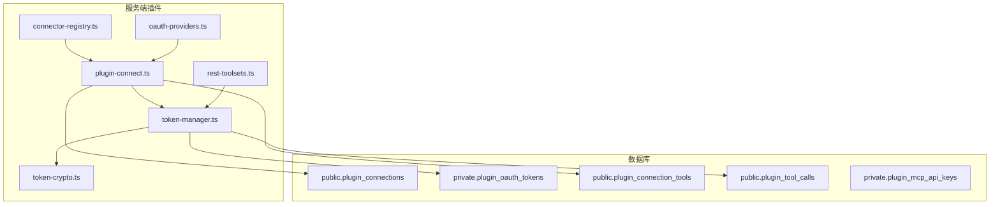
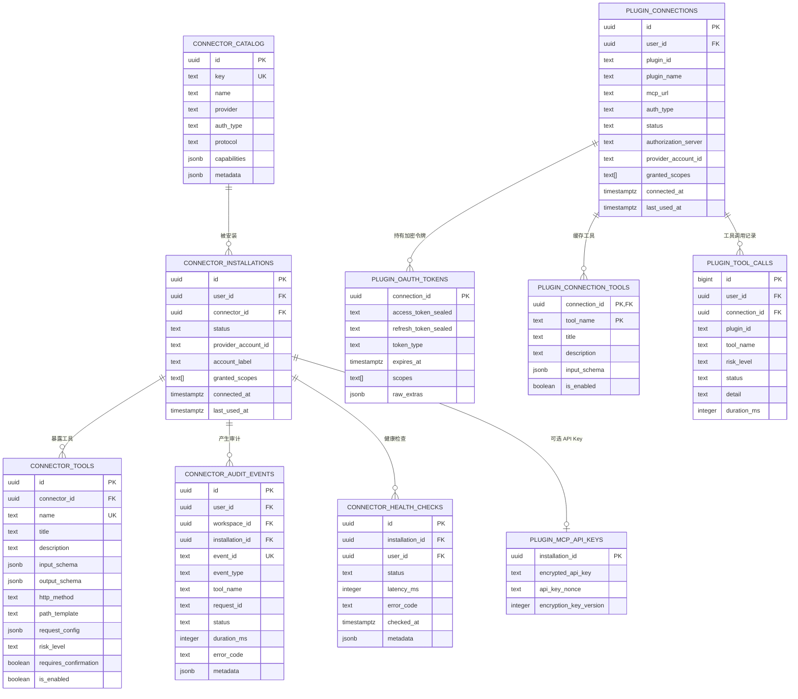
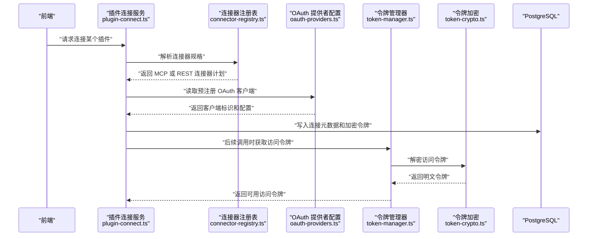
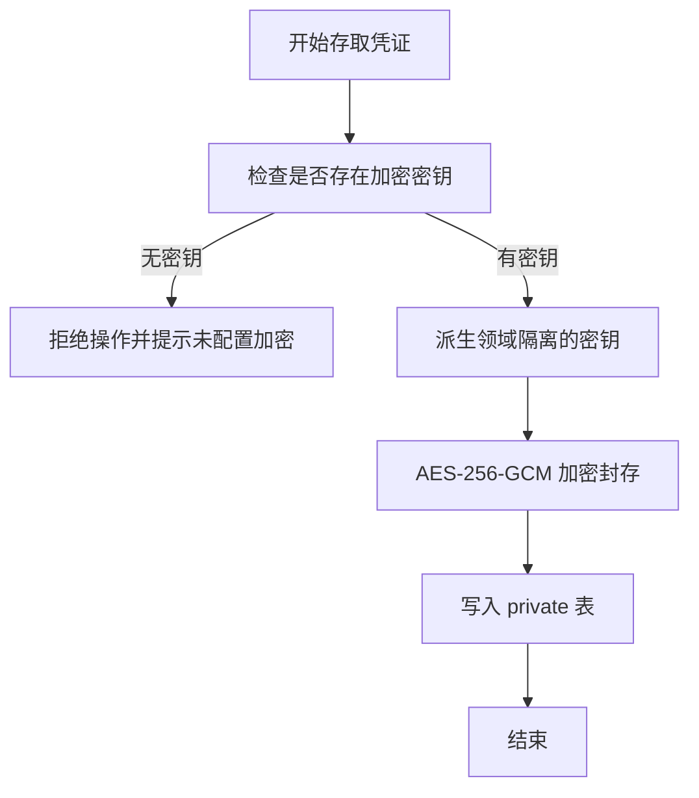
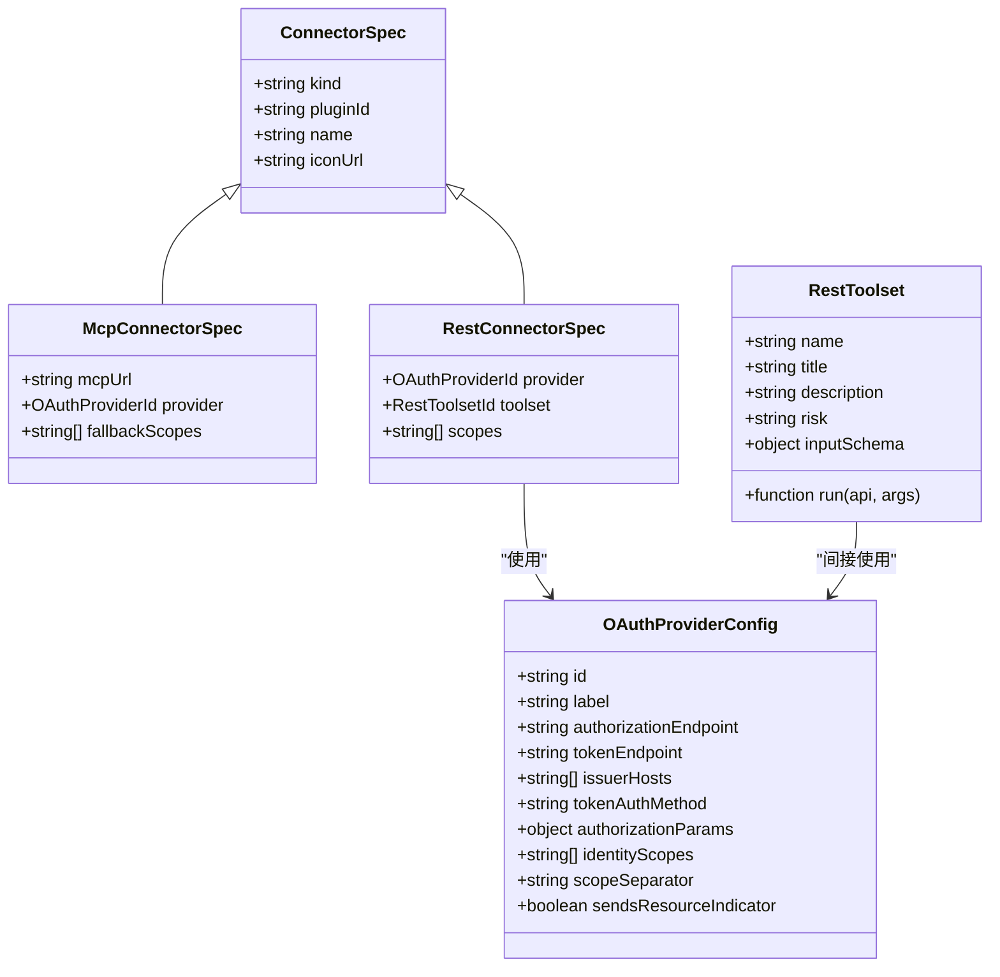
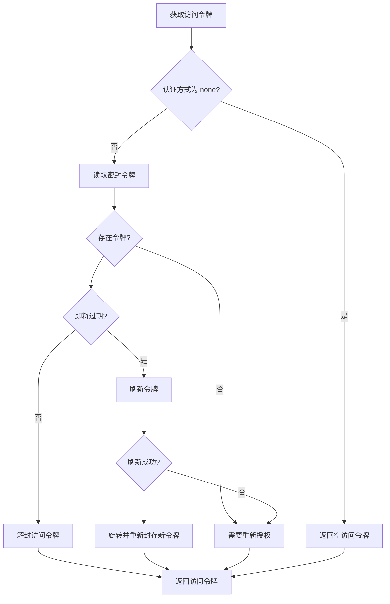
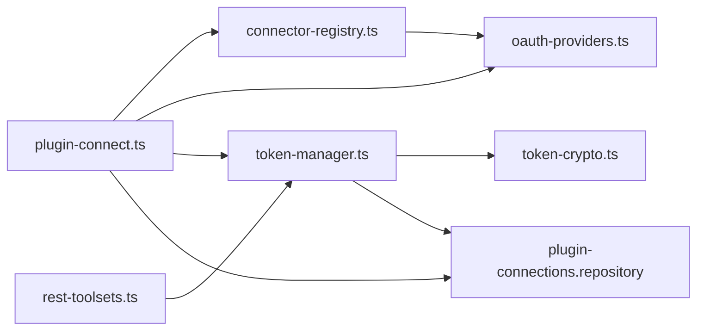

# 连接器配置模型

<cite>
**本文引用的文件**   
- [supabase/migrations/20260830130331_connector_platform_foundation.sql](file://supabase/migrations/20260830130331_connector_platform_foundation.sql)
- [supabase/migrations/20260830132700_connector_foundation_indexes.sql](file://supabase/migrations/20260830132700_connector_foundation_indexes.sql)
- [supabase/migrations/20260830134609_connector_cost_scale_guardrails.sql](file://supabase/migrations/20260830134609_connector_cost_scale_guardrails.sql)
- [supabase/migrations/20260916120000_seed_rest_connector_recipes.sql](file://supabase/migrations/20260916120000_seed_rest_connector_recipes.sql)
- [supabase/migrations/20260913010000_plugin_mcp_api_keys.sql](file://supabase/migrations/20260913010000_plugin_mcp_api_keys.sql)
- [supabase/migrations/20261002173000_plugin_connections.sql](file://supabase/migrations/20261002173000_plugin_connections.sql)
- [supabase/migrations/20261026120000_plugin_native_oauth.sql](file://supabase/migrations/20261026120000_plugin_native_oauth.sql)
- [src/server/plugins/connector-registry.ts](file://src/server/plugins/connector-registry.ts)
- [src/server/plugins/oauth-providers.ts](file://src/server/plugins/oauth-providers.ts)
- [src/server/plugins/plugin-connect.ts](file://src/server/plugins/plugin-connect.ts)
- [src/server/plugins/token-manager.ts](file://src/server/plugins/token-manager.ts)
- [src/server/plugins/token-crypto.ts](file://src/server/plugins/token-crypto.ts)
- [src/server/plugins/rest-toolsets.ts](file://src/server/plugins/rest-toolsets.ts)
</cite>

## 目录

1. [引言](#引言)
2. [项目结构定位](#项目结构定位)
3. [核心数据模型概览](#核心数据模型概览)
4. [架构总览](#架构总览)
5. [基础表与连接配置表设计](#基础表与连接配置表设计)
6. [API 密钥与凭证存储机制](#api-密钥与凭证存储机制)
7. [REST 连接器与 MCP 连接器配置模式](#rest-连接器与-mcp-连接器配置模式)
8. [性能监控、成本限制与速率限制的数据支持](#性能监控成本限制与速率限制的数据支持)
9. [连接池、超时与重试策略](#连接池超时与重试策略)
10. [健康检查、故障转移与负载均衡](#健康检查故障转移与负载均衡)
11. [调试日志、性能指标与错误追踪数据结构](#调试日志性能指标与错误追踪数据结构)
12. [依赖关系分析](#依赖关系分析)
13. [安全与运维建议](#安全与运维建议)
14. [结论](#结论)

## 引言

本文聚焦于该项目中“连接器”相关配置数据模型的完整说明。这里的“连接器”不是单一数据库表，而是由多个迁移脚本共同定义的体系：它同时覆盖旧版通用连接器平台 `public.connector_*` 和当前插件连接器 `public.plugin_*` / `private.plugin_*`。此外，REST 连接器通过内置工具集调用第三方 REST API；MCP 连接器则通过远端 MCP 服务器完成能力发现、OAuth 授权和工具调用。

需要特别注意：**代码库中没有独立的 GraphQL 连接器类型**。连接器协议枚举为 `rest`、`mcp`、`custom`，而具体第三方接口（例如 Gmail、Slack、GitHub）通过 REST 或 MCP OAuth 流程访问。因此，GraphQL 相关内容应以“现有连接器可调用外部 GraphQL API”的扩展视角理解，而非本项目已实现的核心数据模型。

## 项目结构定位

连接器数据模型主要分布在以下位置：

| 层次 | 路径 | 职责 |
|---|---|---|
| 数据库迁移 | `supabase/migrations/*_connector*.sql`、`*_plugin*.sql` | 定义连接器目录、安装记录、连接元数据、加密凭证、审计事件、健康检查等表 |
| 连接器注册 | `src/server/plugins/connector-registry.ts` | 声明每个市场插件是 MCP 连接器还是 REST 连接器 |
| OAuth 提供者 | `src/server/plugins/oauth-providers.ts` | 管理 Google、GitHub、Slack、Microsoft 的预注册客户端凭据 |
| 连接流程 | `src/server/plugins/plugin-connect.ts` | 启动 OAuth 授权、解析连接器规格、写入连接与令牌 |
| 令牌生命周期 | `src/server/plugins/token-manager.ts` | 获取访问令牌、刷新、加密封存与轮换 |
| 加密实现 | `src/server/plugins/token-crypto.ts` | AES-256-GCM 加密封装和密钥派生 |
| REST 工具集 | `src/server/plugins/rest-toolsets.ts` | 内置 REST 连接器工具，封装第三方 REST API 调用 |

**图表来源**
- [src/server/plugins/connector-registry.ts:1-202](file://src/server/plugins/connector-registry.ts#L1-L202)
- [src/server/plugins/plugin-connect.ts:1-200](file://src/server/plugins/plugin-connect.ts#L1-L200)
- [src/server/plugins/token-manager.ts:1-200](file://src/server/plugins/token-manager.ts#L1-L200)
- [src/server/plugins/token-crypto.ts:1-44](file://src/server/plugins/token-crypto.ts#L1-L44)
- [src/server/plugins/rest-toolsets.ts:1-200](file://src/server/plugins/rest-toolsets.ts#L1-L200)
- [supabase/migrations/20261002173000_plugin_connections.sql:1-200](file://supabase/migrations/20261002173000_plugin_connections.sql#L1-L200)

**章节来源**
- [src/server/plugins/connector-registry.ts:1-202](file://src/server/plugins/connector-registry.ts#L1-L202)
- [supabase/migrations/20261002173000_plugin_connections.sql:1-200](file://supabase/migrations/20261002173000_plugin_connections.sql#L1-L200)

## 核心数据模型概览

连接器数据模型可以划分为四类：

1. **连接器目录与安装层**：描述连接器种类、认证方式、启用状态和用户级安装记录。
2. **连接配置层**：描述用户级连接，包括 MCP URL、授权服务器、账户标签、作用域、状态和时间戳。
3. **凭证存储层**：包含 OAuth 访问令牌、刷新令牌、动态客户端密文、MCP API Key 等敏感信息，全部放在 `private` schema。
4. **可观测性层**：包含审计事件、健康检查、工具调用记录和动作审批记录。

**图表来源**
- [supabase/migrations/20260830130331_connector_platform_foundation.sql:1-200](file://supabase/migrations/20260830130331_connector_platform_foundation.sql#L1-L200)
- [supabase/migrations/20260830134609_connector_cost_scale_guardrails.sql:1-165](file://supabase/migrations/20260830134609_connector_cost_scale_guardrails.sql#L1-L165)
- [supabase/migrations/20260913010000_plugin_mcp_api_keys.sql:1-21](file://supabase/migrations/20260913010000_plugin_mcp_api_keys.sql#L1-L21)
- [supabase/migrations/20261002173000_plugin_connections.sql:1-200](file://supabase/migrations/20261002173000_plugin_connections.sql#L1-L200)
- [supabase/migrations/20261026120000_plugin_native_oauth.sql:1-200](file://supabase/migrations/20261026120000_plugin_native_oauth.sql#L1-L200)

**章节来源**
- [supabase/migrations/20260830130331_connector_platform_foundation.sql:1-200](file://supabase/migrations/20260830130331_connector_platform_foundation.sql#L1-L200)
- [supabase/migrations/20261002173000_plugin_connections.sql:1-200](file://supabase/migrations/20261002173000_plugin_connections.sql#L1-L200)

## 架构总览

连接器架构围绕“连接即资源、凭证不落地明文、工具即能力边界”展开：

- 用户通过市场插件选择连接器。
- 连接器分为两种形态：
  - **MCP 连接器**：远端 MCP 服务器，使用 RFC 9728 风格发现，授权发生在第三方提供商同意页面。
  - **REST 连接器**：没有可用 MCP 服务器的提供商，由应用运行内置工具集直接调用第三方 REST API。
- 所有敏感令牌在写入数据库前进行 AES-256-GCM 加密封存。
- 公开表只保存连接元数据、工具清单、审计事件和健康检查结果。
- 私有表保存加密后的 OAuth 令牌、动态客户端凭证、MCP API Key 和 OAuth 交易状态。

**图表来源**
- [src/server/plugins/plugin-connect.ts:1-200](file://src/server/plugins/plugin-connect.ts#L1-L200)
- [src/server/plugins/connector-registry.ts:1-202](file://src/server/plugins/connector-registry.ts#L1-L202)
- [src/server/plugins/oauth-providers.ts:1-215](file://src/server/plugins/oauth-providers.ts#L1-L215)
- [src/server/plugins/token-manager.ts:1-200](file://src/server/plugins/token-manager.ts#L1-L200)
- [src/server/plugins/token-crypto.ts:1-44](file://src/server/plugins/token-crypto.ts#L1-L44)

**章节来源**
- [src/server/plugins/plugin-connect.ts:1-200](file://src/server/plugins/plugin-connect.ts#L1-L200)
- [src/server/plugins/connector-registry.ts:1-202](file://src/server/plugins/connector-registry.ts#L1-L202)

## 基础表与连接配置表设计

### 连接器目录表 `public.connector_catalog`

该表用于描述连接器产品级元数据：

| 字段类别 | 字段 | 含义 |
|---|---|---|
| 身份 | `id`、`key` | 连接器唯一标识和产品键 |
| 展示 | `name`、`provider` | 人类可读名称和提供方标识 |
| 认证 | `auth_type` | 支持 `oauth`、`oauth2`、`api_key`、`mcp_oauth2`、`none` |
| 协议 | `protocol` | 支持 `rest`、`mcp`、`custom` |
| 能力 | `capabilities` | JSONB 数组，描述连接器支持的能力集合 |
| 文档 | `documentation_url` | 连接器文档链接 |
| 扩展 | `metadata` | 可存放 OAuth 端点、能力标记等扩展字段 |

约束方面，`auth_type` 和 `protocol` 都有显式枚举校验，确保连接器协议只能是 REST、MCP 或自定义。

### 连接器安装表 `public.connector_installations`

该表描述用户对某个连接器产品的安装实例：

| 字段类别 | 字段 | 含义 |
|---|---|---|
| 归属 | `user_id`、`workspace_id` | 用户与工作区维度 |
| 关联 | `connector_id` | 指向连接器目录 |
| 账户 | `provider_account_id`、`account_label` | 第三方账户标识和人工可读标签 |
| 权限 | `granted_scopes` | 用户授予的作用域列表 |
| 状态 | `status` | 支持 `pending`、`active`、`reauthorization_required`、`revoked`、`error` |
| 时间 | `connected_at`、`last_used_at`、`last_error_code`、`last_error_at` | 连接生命周期和最近错误 |

该表还定义了用户维度的唯一索引，避免同一用户重复安装同一连接器。

### 连接配置表 `public.plugin_connections`

这是当前插件连接器的核心连接配置表：

| 字段类别 | 字段 | 含义 |
|---|---|---|
| 身份 | `id`、`user_id` | 连接主键和用户外键 |
| 插件标识 | `plugin_id`、`plugin_name`、`plugin_icon_url` | 市场插件标识 |
| 远程地址 | `mcp_url` | 远端 MCP 服务器地址，必须为 HTTPS |
| 认证方式 | `auth_type` | 当前支持 `mcp_oauth2`、`oauth2`、`none` |
| 状态 | `status` | 与连接器安装状态一致的枚举 |
| 授权元数据 | `authorization_server`、`provider_account_id`、`granted_scopes` | 非敏感授权结果 |
| 时间 | `connected_at`、`last_used_at`、`last_error_code`、`last_error_at` | 连接生命周期 |
| 扩展 | `connector_kind`、`permission_mode`、`account_label` | 连接器类型为 MCP 或 REST，权限模式为只读或读写 |

注意：该表的写权限默认对普通登录用户受限，实际写入通过服务角色 RPC 完成，防止前端直接篡改连接状态。

### 连接器工具表 `public.connector_tools`

连接器产品级工具目录，用于声明 REST 或 MCP 工具：

| 字段类别 | 字段 | 含义 |
|---|---|---|
| 身份 | `id`、`connector_id` | 工具主键和连接器外键 |
| 能力 | `name`、`title`、`description` | 工具标识、标题和描述 |
| 输入输出 | `input_schema`、`output_schema` | JSON Schema 描述参数和返回结构 |
| HTTP | `http_method`、`path_template`、`request_config` | REST 工具的方法、路径模板和请求配置 |
| 风险 | `risk_level` | `read`、`write`、`destructive`、`sensitive` |
| 控制 | `requires_confirmation`、`is_enabled` | 是否需要确认和是否启用 |
| 扩展 | `metadata` | 工具扩展信息 |

### 连接工具缓存表 `public.plugin_connection_tools`

这是 MCP 连接发现后缓存的工具清单，按连接+工具名去重。它不包含敏感信息，只缓存工具名称、标题、描述、输入 Schema 和启用状态。

**章节来源**
- [supabase/migrations/20260830130331_connector_platform_foundation.sql:12-168](file://supabase/migrations/20260830130331_connector_platform_foundation.sql#L12-L168)
- [supabase/migrations/20261002173000_plugin_connections.sql:1-200](file://supabase/migrations/20261002173000_plugin_connections.sql#L1-L200)
- [supabase/migrations/20261026120000_plugin_native_oauth.sql:1-200](file://supabase/migrations/20261026120000_plugin_native_oauth.sql#L1-L200)

## API 密钥与凭证存储机制

### 加密算法

项目中的敏感凭证统一采用 **AES-256-GCM 加密封存**。关键实现位于 `token-crypto.ts`：

- 密钥来源优先使用 `PAYMENT_METHOD_ENCRYPTION_KEY`，回退到 `JWT_SECRET`。
- 密钥通过域分离派生函数生成，使插件令牌密钥与支付密钥互不可用。
- 明文令牌在写入数据库前被加密封存，格式为版本头、初始化向量、标签和密文。
- 解密失败时返回空值而不是抛出异常，避免把错误凭证误认为有效凭证。

**图表来源**
- [src/server/plugins/token-crypto.ts:1-44](file://src/server/plugins/token-crypto.ts#L1-L44)

**章节来源**
- [src/server/plugins/token-crypto.ts:1-44](file://src/server/plugins/token-crypto.ts#L1-L44)

### 密钥轮换

密钥轮换通过以下机制支持：

| 机制 | 说明 |
|---|---|
| 加密密钥版本 | `encryption_key_version` 字段记录使用的密钥版本 |
| 动态客户端密文 | `client_secret_sealed` 和 `access_token_sealed`、`refresh_token_sealed` 均独立封存 |
| 非对称密钥隔离 | 通过密钥派生函数区分不同用途密钥 |
| 解密容错 | 解密失败返回空值，便于逐步迁移旧数据 |
| 数据库侧版本字段 | `plugin_mcp_api_keys.encryption_key_version` 与 OAuth 配置版本一致 |

目前迁移脚本保留了 `encryption_key_version` 字段，但代码注释更强调“每次工具调用时按需解封”，因此实际密钥轮换应结合部署环境中的 `PAYMENT_METHOD_ENCRYPTION_KEY` 更新和已有密文的重新封装策略执行。

### 访问控制策略

敏感凭证全部位于 `private` schema，并通过以下方式保护：

| 对象 | 访问控制 |
|---|---|
| `private.plugin_oauth_tokens` | 仅 `service_role` 可读写，普通用户和匿名用户被拒绝 |
| `private.plugin_mcp_api_keys` | 仅 `service_role` 可读写 |
| `private.connector_credentials` | 仅 `service_role` 可访问 |
| `private.connector_oauth_configs` | 连接器厂商 OAuth 配置，受 RLS 和服务角色保护 |
| `private.connector_oauth_transactions` | OAuth 临时交易状态，带过期清理 |
| `private.plugin_oauth_states` | 待处理授权状态，哈希化 state，绑定用户且 10 分钟过期 |
| `private.plugin_oauth_clients` | 动态注册的 OAuth 客户端，仅限服务角色 |

公共表上的行级安全策略允许用户读取自己的连接、工具和调用记录，但写入必须通过服务角色 RPC。

**章节来源**
- [supabase/migrations/20260830130331_connector_platform_foundation.sql:169-244](file://supabase/migrations/20260830130331_connector_platform_foundation.sql#L169-L244)
- [supabase/migrations/20260913010000_plugin_mcp_api_keys.sql:1-21](file://supabase/migrations/20260913010000_plugin_mcp_api_keys.sql#L1-L21)
- [supabase/migrations/20261002173000_plugin_connections.sql:1-200](file://supabase/migrations/20261002173000_plugin_connections.sql#L1-L200)
- [supabase/migrations/20261026120000_plugin_native_oauth.sql:1-200](file://supabase/migrations/20261026120000_plugin_native_oauth.sql#L1-L200)
- [src/server/plugins/token-crypto.ts:1-44](file://src/server/plugins/token-crypto.ts#L1-L44)

## REST 连接器与 MCP 连接器配置模式

### MCP 连接器

MCP 连接器代表远端 MCP 服务器，其连接配置集中在 `plugin_connections`：

- `mcp_url` 必须为 HTTPS。
- `auth_type` 通常为 `mcp_oauth2`。
- `authorization_server` 记录第三方授权服务器。
- `provider_account_id` 记录第三方账户 ID。
- `granted_scopes` 记录用户授予的作用域。
- `connector_kind` 新增为 `mcp` 或 `rest`。
- `permission_mode` 支持 `read_only` 或 `read_write`。

MCP 连接器的能力通过 `plugin_connection_tools` 缓存，`plugin_tool_calls` 记录工具调用结果摘要，但不存储请求参数和响应内容。

### REST 连接器

REST 连接器没有独立的 `rest_connection` 表。它的配置模式是：

1. 连接器注册表中声明某插件为 `kind: rest`。
2. 指定 OAuth 提供者和内置工具集。
3. 连接器目录中使用 `protocol: rest` 和 `metadata` 描述 OAuth 端点。
4. 种子脚本为 GitHub、Slack、Notion、Gmail 等 REST 连接器预置工具。
5. 运行时通过 `rest-toolsets.ts` 将第三方 REST API 包装成工具。

**图表来源**
- [src/server/plugins/connector-registry.ts:1-202](file://src/server/plugins/connector-registry.ts#L1-L202)
- [src/server/plugins/oauth-providers.ts:1-215](file://src/server/plugins/oauth-providers.ts#L1-L215)
- [src/server/plugins/rest-toolsets.ts:1-200](file://src/server/plugins/rest-toolsets.ts#L1-L200)

**章节来源**
- [src/server/plugins/connector-registry.ts:1-202](file://src/server/plugins/connector-registry.ts#L1-L202)
- [supabase/migrations/20260916120000_seed_rest_connector_recipes.sql:1-200](file://supabase/migrations/20260916120000_seed_rest_connector_recipes.sql#L1-L200)
- [src/server/plugins/rest-toolsets.ts:1-200](file://src/server/plugins/rest-toolsets.ts#L1-L200)

### GraphQL 连接器说明

仓库中没有 `graphql` 连接器协议或专用数据模型。现有连接器协议为：

| 协议 | 支持情况 |
|---|---|
| `rest` | 原生支持，作为连接器目录协议和内置工具集的基础 |
| `mcp` | 原生支持，通过远端 MCP 服务器暴露工具 |
| `custom` | 存在协议枚举，但未在连接器注册表中发现直接使用 |
| `graphql` | 未发现专用模型；如需 GraphQL，应视为连接器调用的目标协议，而非连接器自身类型 |

**章节来源**
- [supabase/migrations/20260830130331_connector_platform_foundation.sql:12-31](file://supabase/migrations/20260830130331_connector_platform_foundation.sql#L12-L31)
- [src/server/plugins/connector-registry.ts:1-202](file://src/server/plugins/connector-registry.ts#L1-L202)

## 性能监控、成本限制与速率限制的数据支持

### 性能监控数据模型

系统通过以下表记录连接器和连接的性能相关信息：

| 表 | 性能字段 | 含义 |
|---|---|---|
| `connector_audit_events` | `duration_ms`、`created_at` | 审计事件耗时 |
| `connector_health_checks` | `latency_ms`、`checked_at` | 健康检查延迟 |
| `plugin_tool_calls` | `duration_ms`、`created_at` | 工具调用耗时 |
| `plugin_connections` | `last_used_at`、`last_error_code`、`last_error_at` | 连接最近使用时间和错误 |

健康检查和审计事件都启用了 BRIN 索引，适合追加型时间序列数据的低成本清理。

### 成本限制与清理策略

`connector_cost_scale_guardrails.sql` 实现了连接器成本维护函数：

| 数据对象 | 保留策略 |
|---|---|
| OAuth 交易状态 | 24 小时过期 |
| 动作审批 | 7 天 |
| 审计事件 | 90 天 |
| 健康检查 | 14 天 |
| Cron 作业日志 | 14 天 |

清理以批量删除方式执行，每次最多删除固定行数，避免长事务和大 WAL 峰值。

### 速率限制

当前代码库中没有专门的“连接器速率限制表”。速率限制更适合通过以下机制实现：

- 外部 OAuth 提供商的配额。
- MCP 服务器的并发和配额。
- 应用层的令牌桶或滑动窗口限流器。
- 数据库层对高频健康检查和审计事件的分区与归档。
- 未来可扩展 `plugin_connections` 或新建 `connector_rate_limits` 表，增加每连接每分钟请求数、每日预算、单次最大响应大小等字段。

**章节来源**
- [supabase/migrations/20260830134609_connector_cost_scale_guardrails.sql:1-165](file://supabase/migrations/20260830134609_connector_cost_scale_guardrails.sql#L1-L165)
- [supabase/migrations/20260830132700_connector_foundation_indexes.sql:1-23](file://supabase/migrations/20260830132700_connector_foundation_indexes.sql#L1-L23)
- [supabase/migrations/20261002173000_plugin_connections.sql:1-200](file://supabase/migrations/20261002173000_plugin_connections.sql#L1-L200)

## 连接池、超时与重试策略

### 连接池

令牌读取和刷新通过 `withTransaction` 包裹，表示使用数据库连接池执行事务。令牌刷新过程会锁定连接行的密封令牌，防止并发刷新导致竞争条件。

### 超时配置

项目中明确存在的超时如下：

| 场景 | 超时 | 说明 |
|---|---|---|
| OAuth 令牌请求 | 15 秒 | 调用第三方 token endpoint |
| 账户标签查询 | 8 秒 | 查询用户信息以显示账户标签 |
| 撤销令牌 | 8 秒 | 调用第三方撤销接口 |
| OAuth 状态过期 | 10 分钟 | 待处理授权状态有效期 |

### 重试策略

当前实现中未发现通用的指数退避重试框架。重试语义主要体现在：

- 令牌刷新失败时返回 `reauthorization_required` 或 `unavailable`。
- 账户信息查询和撤销令牌为“尽力而为”，失败不会阻断主流程。
- 审计事件携带幂等 `event_id`，保证至少一次投递语义下的幂等性。

若未来需要增强可靠性，可在 `token-manager.ts` 中增加：

- 网络错误重试次数上限。
- 指数退避间隔。
- 熔断阈值。
- 每连接失败计数和冷却时间。

**图表来源**
- [src/server/plugins/token-manager.ts:1-200](file://src/server/plugins/token-manager.ts#L1-L200)

**章节来源**
- [src/server/plugins/token-manager.ts:1-200](file://src/server/plugins/token-manager.ts#L1-L200)
- [src/server/plugins/oauth-providers.ts:1-215](file://src/server/plugins/oauth-providers.ts#L1-L215)
- [supabase/migrations/20261026120000_plugin_native_oauth.sql:1-200](file://supabase/migrations/20261026120000_plugin_native_oauth.sql#L1-L200)

## 健康检查、故障转移与负载均衡

### 健康检查

健康检查数据模型存在于旧版连接器平台：

| 字段 | 含义 |
|---|---|
| `installation_id` | 连接器安装实例 |
| `user_id` | 触发检查的用户 |
| `status` | `healthy`、`degraded`、`reauthorization_required`、`unavailable` |
| `latency_ms` | 健康检查延迟 |
| `error_code` | 错误码 |
| `checked_at` | 检查时间 |
| `metadata` | 扩展信息 |

当前插件连接器模型中未出现同名健康检查表，但 `plugin_connections` 的 `last_error_code` 和 `last_error_at` 可作为轻量连接健康状态补充。

### 故障转移

当前代码中没有自动故障转移逻辑。可能的扩展方向：

- 在同一连接器下维护多个连接实例。
- 根据 `last_error_at`、`status`、`latency_ms` 选择健康实例。
- 失败时切换到备用连接并记录切换原因。
- 对无法恢复的连接标记为 `reauthorization_required`。

### 负载均衡

当前连接器模型没有显式的负载均衡表。负载分布更多体现在：

- 每个用户一个连接实例。
- 工具调用记录按用户和连接聚合。
- 审计事件按用户、工作区和安装实例分组。

未来可为多连接实例扩展：

| 字段 | 用途 |
|---|---|
| `connection_weight` | 权重分配 |
| `max_concurrent_requests` | 并发上限 |
| `requests_per_minute` | 每分钟请求配额 |
| `failover_count` | 故障转移次数 |
| `last_failover_at` | 上次故障转移时间 |

**章节来源**
- [supabase/migrations/20260830130331_connector_platform_foundation.sql:149-168](file://supabase/migrations/20260830130331_connector_platform_foundation.sql#L149-L168)
- [supabase/migrations/20261002173000_plugin_connections.sql:1-200](file://supabase/migrations/20261002173000_plugin_connections.sql#L1-L200)

## 调试日志、性能指标与错误追踪数据结构

### 连接器审计事件

`connector_audit_events` 是连接器平台的主要审计结构：

| 字段 | 类型 | 含义 |
|---|---|---|
| `event_id` | UUID | 幂等事件标识 |
| `user_id` | UUID | 用户标识 |
| `workspace_id` | UUID | 工作区标识 |
| `installation_id` | UUID | 连接器安装标识 |
| `connector_key` | text | 连接器键 |
| `event_type` | text | 事件类型 |
| `tool_name` | text | 工具名称 |
| `request_id` | text | 请求标识 |
| `status` | text | `started`、`succeeded`、`failed`、`denied` |
| `duration_ms` | integer | 耗时毫秒 |
| `error_code` | text | 错误码 |
| `metadata` | jsonb | 扩展审计信息 |

### 插件工具调用记录

`plugin_tool_calls` 记录插件工具调用，但不存储请求参数和响应内容：

| 字段 | 类型 | 含义 |
|---|---|---|
| `id` | bigint | 自增主键 |
| `user_id` | UUID | 用户标识 |
| `connection_id` | UUID | 连接标识 |
| `plugin_id` | text | 插件标识 |
| `tool_name` | text | 工具名称 |
| `risk_level` | text | `read`、`write`、`destructive` |
| `status` | text | `ok`、`error`、`blocked` |
| `detail` | text | 简要详情 |
| `duration_ms` | integer | 耗时毫秒 |
| `created_at` | timestamptz | 创建时间 |

### 健康检查与成本维护

健康检查表记录连接质量，成本维护函数负责定期清理过期数据。两者配合可实现：

- 长期趋势观察。
- 高频连接的健康退化检测。
- 审计数据体积控制。
- 自动化运维任务调度。

**章节来源**
- [supabase/migrations/20260830130331_connector_platform_foundation.sql:125-168](file://supabase/migrations/20260830130331_connector_platform_foundation.sql#L125-L168)
- [supabase/migrations/20260830134609_connector_cost_scale_guardrails.sql:1-165](file://supabase/migrations/20260830134609_connector_cost_scale_guardrails.sql#L1-L165)
- [supabase/migrations/20261026120000_plugin_native_oauth.sql:1-200](file://supabase/migrations/20261026120000_plugin_native_oauth.sql#L1-L200)

## 依赖关系分析

连接器模块之间的依赖关系如下：

**图表来源**
- [src/server/plugins/plugin-connect.ts:1-200](file://src/server/plugins/plugin-connect.ts#L1-L200)
- [src/server/plugins/connector-registry.ts:1-202](file://src/server/plugins/connector-registry.ts#L1-L202)
- [src/server/plugins/oauth-providers.ts:1-215](file://src/server/plugins/oauth-providers.ts#L1-L215)
- [src/server/plugins/token-manager.ts:1-200](file://src/server/plugins/token-manager.ts#L1-L200)
- [src/server/plugins/token-crypto.ts:1-44](file://src/server/plugins/token-crypto.ts#L1-L44)
- [src/server/plugins/rest-toolsets.ts:1-200](file://src/server/plugins/rest-toolsets.ts#L1-L200)

耦合度方面：

- `plugin-connect.ts` 是连接流程入口，耦合较高，集中协调连接器注册、OAuth 提供者和令牌管理。
- `connector-registry.ts` 解耦了连接器类型判断，只暴露连接器规格。
- `token-manager.ts` 封装令牌刷新和存储交互，降低连接流程直接操作数据库的风险。
- `token-crypto.ts` 隔离加密实现，便于替换密钥来源和算法细节。
- `rest-toolsets.ts` 将第三方 API 封装为工具，减少业务逻辑分散。

潜在改进点：

- 将连接器注册表与 OAuth 提供者配置进一步抽象为配置驱动。
- 引入统一的遥测服务，替代直接写数据库的方式记录审计事件。
- 将 REST 工具集拆分为按提供方组织的模块，提升可测试性。

**章节来源**
- [src/server/plugins/plugin-connect.ts:1-200](file://src/server/plugins/plugin-connect.ts#L1-L200)
- [src/server/plugins/connector-registry.ts:1-202](file://src/server/plugins/connector-registry.ts#L1-L202)
- [src/server/plugins/token-manager.ts:1-200](file://src/server/plugins/token-manager.ts#L1-L200)

## 安全与运维建议

### 安全建议

| 建议 | 理由 |
|---|---|
| 始终配置 `PAYMENT_METHOD_ENCRYPTION_KEY` | 否则插件令牌加密不可用 |
| 不要在前端返回密封令牌 | 数据库注释明确要求仅在工具调用时解封 |
| 严格限制 `service_role` 权限 | 私有表和 RPC 函数只能由可信服务调用 |
| 对高风险工具启用确认机制 | 通过 `requires_confirmation` 和工具风险级别控制破坏性操作 |
| 定期轮换加密密钥 | 利用 `encryption_key_version` 和密钥派生机制迁移旧密文 |
| 不在审计事件中存储请求体和响应体 | 当前 `plugin_tool_calls` 已遵循这一原则 |

### 运维建议

| 建议 | 说明 |
|---|---|
| 定期运行连接器成本维护函数 | 控制审计、健康检查、OAuth 交易和审批记录增长 |
| 监控 `last_error_at` 和 `last_error_code` | 快速发现连接失效 |
| 监控 `duration_ms` 和 `latency_ms` | 识别慢连接和第三方 API 退化 |
| 为高并发连接器设置外部限流 | 数据库模型未内置速率限制 |
| 将健康检查与告警系统集成 | 基于 `healthy`、`degraded`、`unavailable` 状态触发通知 |
| 对审计事件表做分区或归档 | 90 天历史可能随用户规模增长而变大 |

**章节来源**
- [src/server/plugins/token-crypto.ts:1-44](file://src/server/plugins/token-crypto.ts#L1-L44)
- [supabase/migrations/20260830134609_connector_cost_scale_guardrails.sql:1-165](file://supabase/migrations/20260830134609_connector_cost_scale_guardrails.sql#L1-L165)
- [supabase/migrations/20261026120000_plugin_native_oauth.sql:1-200](file://supabase/migrations/20261026120000_plugin_native_oauth.sql#L1-L200)

## 结论

该项目的连接器配置模型是一个分层清晰、安全优先的设计：

- 公开表保存连接器目录、安装记录、连接元数据、工具清单、审计事件和健康检查。
- 私有表保存 AES-256-GCM 加密封存的 OAuth 令牌、动态客户端凭证和 MCP API Key。
- 连接器协议明确支持 `rest` 和 `mcp`，并通过注册表决定连接流程。
- REST 连接器通过内置工具集访问第三方 API，MCP 连接器通过远端 MCP 服务器暴露工具。
- 性能监控依赖审计事件、健康检查和工具调用记录，成本限制通过定时清理函数实现。
- 连接池、超时和重试目前以基础实现为主，尚未形成完整的弹性框架。
- 健康检查、故障转移和负载均衡仍有扩展空间，适合在未来以多连接实例形式演进。

如果下一步要扩展 GraphQL 连接器，推荐沿用当前模型：新增连接器协议、连接器目录条目、连接配置字段和工具 Schema，而不必为 GraphQL 单独建立一套凭证表。敏感令牌仍应通过相同加密机制存入 `private` 表，公开表只保留可观测性和访问控制所需的元数据。