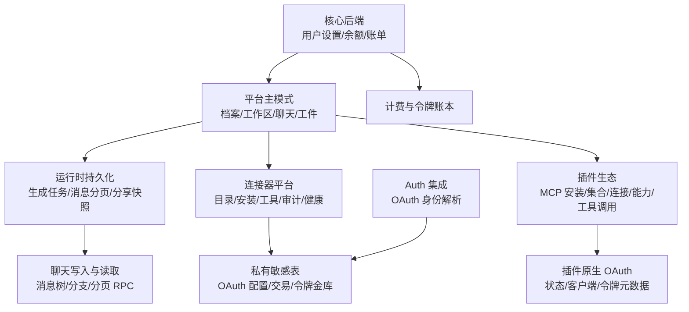
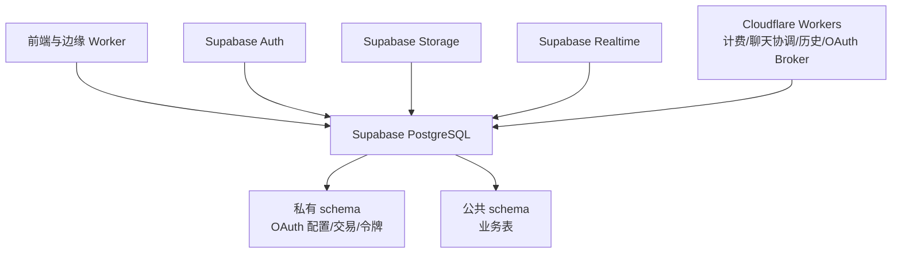
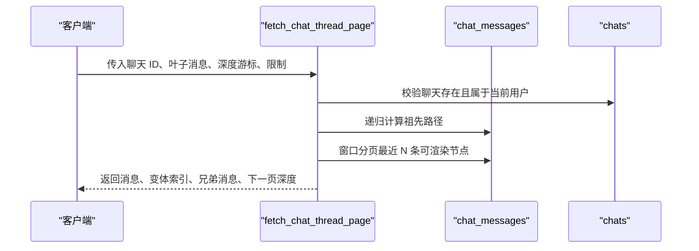
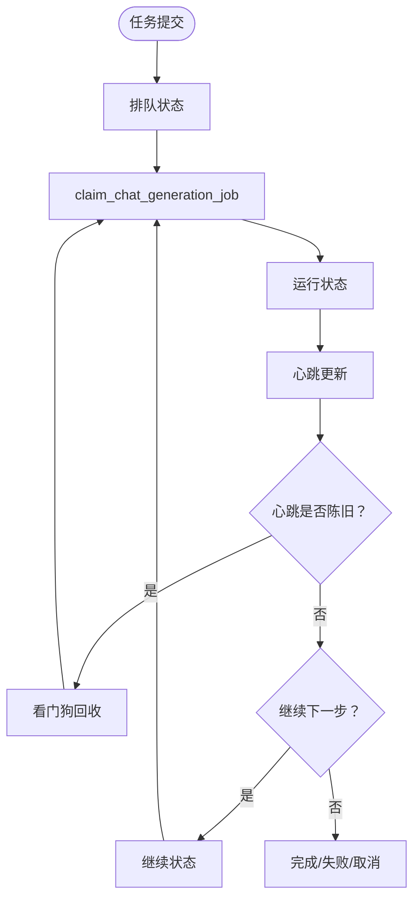
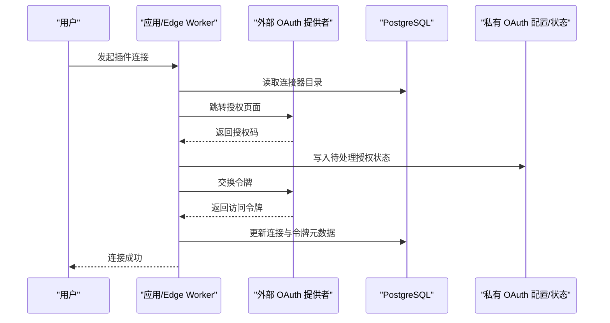
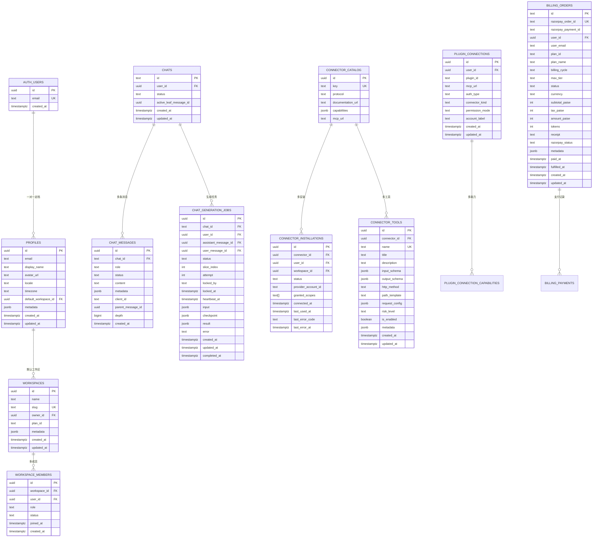
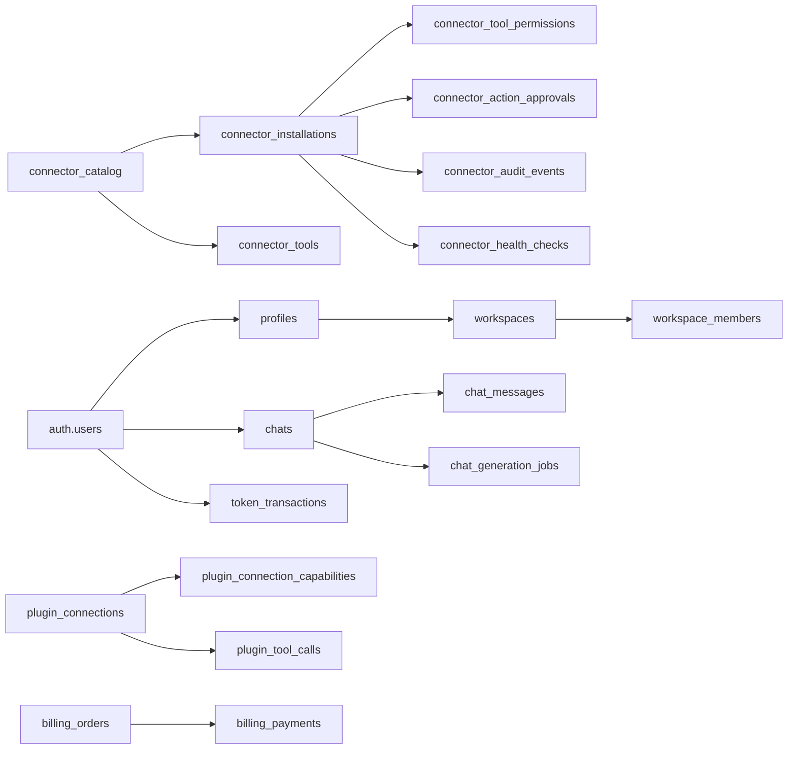
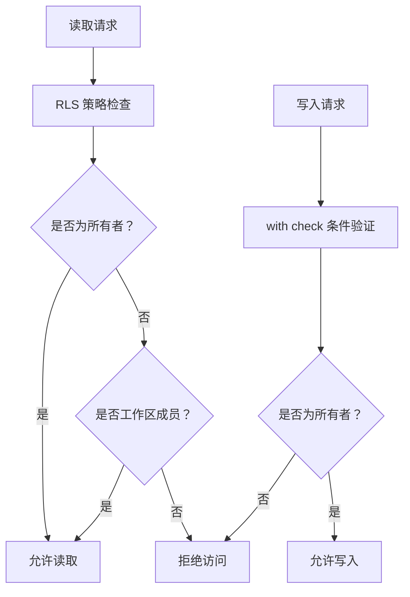
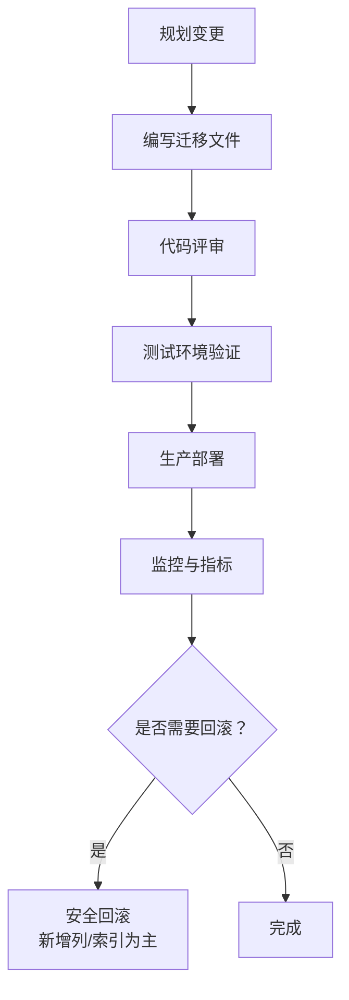

# 数据库设计

<cite>
**本文引用的文件**   
- [supabase/config.toml](file://supabase/config.toml)
- [20260506160000_core_backend.sql](file://supabase/migrations/20260506160000_core_backend.sql)
- [20260507153000_platform_schema.sql](file://supabase/migrations/20260507153000_platform_schema.sql)
- [20260507170000_platform_primitives.sql](file://supabase/migrations/20260507170000_platform_primitives.sql)
- [20260712120000_chats_id_text_custom_format.sql](file://supabase/migrations/20260712120000_chats_id_text_custom_format.sql)
- [20260830130331_connector_platform_foundation.sql](file://supabase/migrations/20260830130331_connector_platform_foundation.sql)
- [20260902171154_mcp_plugin_installations.sql](file://supabase/migrations/20260902171154_mcp_plugin_installations.sql)
- [20260913000000_plugin_collections.sql](file://supabase/migrations/20260913000000_plugin_collections.sql)
- [20260923193000_conversation_share_snapshots.sql](file://supabase/migrations/20260923193000_conversation_share_snapshots.sql)
- [20260929120000_chat_generation_jobs.sql](file://supabase/migrations/20260929120000_chat_generation_jobs.sql)
- [20261004221000_chat_branch_persistence_and_perspective.sql](file://supabase/migrations/20261004221000_chat_branch_persistence_and_perspective.sql)
- [20261009153827_durable_chat_admission_and_fencing.sql](file://supabase/migrations/20261009153827_durable_chat_admission_and_fencing.sql)
- [20261017124626_clauxen_oauth_identity_lookup.sql](file://supabase/migrations/20261017124626_clauxen_oauth_identity_lookup.sql)
- [20261026120000_plugin_native_oauth.sql](file://supabase/migrations/20261026120000_plugin_native_oauth.sql)
</cite>

## 目录
1. [引言](#引言)
2. [项目结构](#项目结构)
3. [核心数据模型](#核心数据模型)
4. [架构总览](#架构总览)
5. [详细组件分析](#详细组件分析)
6. [依赖与关系分析](#依赖与关系分析)
7. [索引与查询优化](#索引与查询优化)
8. [数据安全与 RLS 策略](#数据安全与-rls-策略)
9. [迁移、版本控制与回滚](#迁移版本控制与回滚)
10. [性能调优与缓存建议](#性能调优与缓存建议)
11. [备份恢复与运维建议](#备份恢复与运维建议)
12. [故障排查指南](#故障排查指南)
13. [结论](#结论)

## 引言
本数据库基于 Supabase PostgreSQL，承载 Clauxen 平台的核心业务实体：用户与档案、工作区协作、聊天线程与消息树、插件与连接器、订阅计费、生成任务、连接器审计与健康检查等。数据模型采用“公共业务表 + 私有敏感表”的分层设计，并通过 Row Level Security（RLS）、函数权限控制和外键约束保障多租户隔离与安全访问。

本项目使用按时间戳排序的 SQL 迁移管理数据库演进，所有关键变更均通过幂等的 `IF NOT EXISTS`、条件更新和显式约束修复实现，便于重复执行、灰度发布和回滚。

**章节来源**
- [supabase/config.toml:1-1](file://supabase/config.toml#L1-L1)
- [20260506160000_core_backend.sql:1-40](file://supabase/migrations/20260506160000_core_backend.sql#L1-L40)
- [20260507153000_platform_schema.sql:1-40](file://supabase/migrations/20260507153000_platform_schema.sql#L1-L40)

## 项目结构
数据库结构以 Supabase 迁移为中心，按功能域拆分到多个 `.sql` 文件中。整体分为以下层次：

- 基础层：扩展、触发器、用户设置与余额、令牌账本、计费订单与支付。
- 平台层：档案、工作区、成员、邀请、通知偏好、连接账户、聊天、消息、分支状态、工件、用量事件、审核事件、API Key、Webhook 等。
- 运行时层：聊天生成任务、消息分页 RPC、聊天树与视角、分享快照、后台队列、计划任务。
- 连接器与插件层：连接器目录、安装、工具注册、权限、审批、审计、健康检查；MCP 插件安装、集合、原生 OAuth、连接能力与工具调用追踪。
- 安全与集成层：私有 OAuth 配置、交易、令牌金库；Cl auxen 专属 OAuth 身份只读解析角色与函数。

**图表来源**
- [20260506160000_core_backend.sql:1-40](file://supabase/migrations/20260506160000_core_backend.sql#L1-L40)
- [20260507153000_platform_schema.sql:1-40](file://supabase/migrations/20260507153000_platform_schema.sql#L1-L40)
- [20260929120000_chat_generation_jobs.sql:1-30](file://supabase/migrations/20260929120000_chat_generation_jobs.sql#L1-L30)
- [20260830130331_connector_platform_foundation.sql:1-40](file://supabase/migrations/20260830130331_connector_platform_foundation.sql#L1-L40)
- [20261026120000_plugin_native_oauth.sql:1-40](file://supabase/migrations/20261026120000_plugin_native_oauth.sql#L1-L40)
- [20261017124626_clauxen_oauth_identity_lookup.sql:1-30](file://supabase/migrations/20261017124626_clauxen_oauth_identity_lookup.sql#L1-L30)

**章节来源**
- [supabase/config.toml:1-1](file://supabase/config.toml#L1-L1)
- [20260506160000_core_backend.sql:1-40](file://supabase/migrations/20260506160000_core_backend.sql#L1-L40)
- [20260507153000_platform_schema.sql:1-40](file://supabase/migrations/20260507153000_platform_schema.sql#L1-L40)
- [20260929120000_chat_generation_jobs.sql:1-30](file://supabase/migrations/20260929120000_chat_generation_jobs.sql#L1-L30)
- [20260830130331_connector_platform_foundation.sql:1-40](file://supabase/migrations/20260830130331_connector_platform_foundation.sql#L1-L40)
- [20261026120000_plugin_native_oauth.sql:1-40](file://supabase/migrations/20261026120000_plugin_native_oauth.sql#L1-L40)
- [20261017124626_clauxen_oauth_identity_lookup.sql:1-30](file://supabase/migrations/20261017124626_clauxen_oauth_identity_lookup.sql#L1-L30)

## 核心数据模型
本节归纳主要实体的字段定义、业务规则与生命周期。

### 用户与档案
- 用户来自 Supabase Auth，应用侧提供档案表进行展示信息扩展，并与默认工作区关联。
- 用户设置表存储 UI 偏好、语言、主题、模型选择、记忆开关、邮件通知等。
- 用户余额表维护令牌总额、已消费、剩余与账户状态，供计费与生成扣费使用。
- 令牌交易表为追加型账本，记录充值与扣费的来源、金额与模型标识。

| 实体 | 关键字段 | 业务规则 |
| --- | --- | --- |
| 档案 | 用户 ID、邮箱、显示名、头像 URL、语言、时区、默认工作区、元数据 | 与 auth.users 一对一；删除用户级联删除档案。 |
| 用户设置 | 用户 ID、邮箱、设置 JSONB | 用户维度偏好；updated_at 由触发器维护。 |
| 用户余额 | 用户 ID、总额、已消费、剩余、状态 | 余额非负；状态包含活跃、试用、暂停。 |
| 令牌交易 | 交易 ID、用户 ID、金额、类型、来源、模型 ID、元数据 | 追加型；来源受枚举约束。 |

**章节来源**
- [20260507153000_platform_schema.sql:60-120](file://supabase/migrations/20260507153000_platform_schema.sql#L60-L120)
- [20260506160000_core_backend.sql:60-160](file://supabase/migrations/20260506160000_core_backend.sql#L60-L160)

### 工作区与协作
- 工作区是多租户容器，拥有所有者、计划标识与元数据。
- 成员表维护用户在某个工作区的角色与状态，支持邀请、挂起、移除。
- 角色表与工作区设置提供可扩展权限包与预算、模型白名单、保留策略。
- 通知偏好表管理不同渠道提醒开关。

| 实体 | 关键字段 | 业务规则 |
| --- | --- | --- |
| 工作区 | ID、名称、别名、所有者、计划 ID、元数据 | 唯一别名；所有者为认证用户。 |
| 工作区成员 | 工作区 ID、用户 ID、角色、状态、加入时间 | 组合唯一；状态受检查约束。 |
| 工作区角色 | 工作区 ID、键、名称、权限 JSONB | 键在工作区内唯一。 |
| 工作区设置 | 工作区 ID、默认模型、允许模型数组、支出上限、保留天数、设置 JSONB | 一对一映射工作区。 |
| 通知偏好 | 用户 ID、各类通知开关、设置 JSONB | 用户维度通知开关。 |

**章节来源**
- [20260507153000_platform_schema.sql:120-240](file://supabase/migrations/20260507153000_platform_schema.sql#L120-L240)

### 聊天、消息与分支
- 聊天表 ID 从 UUID 迁移为文本格式，以支持长形式聊天 ID。
- 消息表维护 OpenAI 兼容的角色、状态、内容与元数据，并支持父消息引用形成消息树。
- 分支状态表用于跟踪分支历史与活跃叶子节点。
- 分享快照表在创建分享链接时冻结当前对话内容，后续新增消息不纳入快照。
- 生成任务表将长时间运行的聊天轮次拆分为切片，持久化检查点，支持看门狗回收。

| 实体 | 关键字段 | 业务规则 |
| --- | --- | --- |
| 聊天 | ID、用户 ID、状态、活跃叶子消息 ID | ID 为文本；消息与分支级联删除。 |
| 消息 | ID、聊天 ID、角色、状态、内容、元数据、客户端 ID、父消息 ID、深度 | 状态包括排队、流式、完成、失败、取消。 |
| 分支状态 | 聊天 ID、分支标识、状态 | 与聊天 ID 外键关联。 |
| 分享快照 | 聊天 ID、快照 JSONB | 快照仅保存创建分享时的消息。 |
| 生成任务 | ID、聊天 ID、用户 ID、助手消息 ID、用户消息 ID、状态、切片索引、尝试次数、锁定者、心跳、输入、检查点、结果、错误 | 每聊天仅一个活跃任务；心跳过期可被回收。 |

**章节来源**
- [20260712120000_chats_id_text_custom_format.sql:1-121](file://supabase/migrations/20260712120000_chats_id_text_custom_format.sql#L1-L121)
- [20260923193000_conversation_share_snapshots.sql:1-9](file://supabase/migrations/20260923193000_conversation_share_snapshots.sql#L1-L9)
- [20260929120000_chat_generation_jobs.sql:1-120](file://supabase/migrations/20260929120000_chat_generation_jobs.sql#L1-L120)

### 插件、连接器与 MCP
- 连接器目录表维护第三方 API/MCP 的能力、协议、文档与 MCP URL。
- 连接器安装表维护用户与可选工作区维度的安装状态、范围、授权范围、连接时间与错误信息。
- 工具注册表描述连接器暴露的工具，包括输入输出 Schema、HTTP 方法与风险等级。
- 工具权限表对每个安装的用户粒度设置继承、允许、确认或拒绝策略。
- 动作审批表支持敏感操作的临时审批流程。
- 审计事件与健康检查表记录调用结果、延迟与连通性状态。
- MCP 插件安装表增加稳定查找与 URL 约束；工具名称需符合命名规范。
- 插件集合表保存用户收藏的插件 ID，跨设备同步。
- 插件连接能力表记录 MCP 服务器暴露的资源与提示词。
- 插件工具调用表记录调用状态、风险等级与耗时，不存请求参数与响应。

| 实体 | 关键字段 | 业务规则 |
| --- | --- | --- |
| 连接器目录 | ID、密钥、协议、文档 URL、能力 JSONB、MCP URL | 协议受枚举约束；MCP URL 需 HTTPS。 |
| 连接器安装 | 连接器 ID、用户 ID、工作区 ID、状态、授权范围、连接时间 | 组合唯一索引；状态受检查约束。 |
| 连接器工具 | 连接器 ID、名称、标题、Schema、方法、路径模板、风险等级 | 名称正则校验；方法受枚举约束。 |
| 工具权限 | 安装 ID、用户 ID、工具名、策略 | 策略为继承/允许/确认/拒绝。 |
| 动作审批 | 用户 ID、安装 ID、工具名、参数哈希、状态、过期时间 | 状态机驱动；过期自动失效。 |
| 审计事件 | 用户 ID、工作区 ID、安装 ID、连接器键、事件类型、状态、耗时 | 追加审计日志。 |
| 健康检查 | 安装 ID、用户 ID、状态、延迟、检查时间 | 定期探测连接器可用性。 |
| MCP 插件安装 | 连接器目录、工具名称、MCP URL、插件 ID | 插件 ID 唯一索引；URL 正则校验。 |
| 插件集合 | 用户 ID、插件 ID、创建时间 | 用户+插件唯一；插件 ID 长度限制。 |
| 插件连接能力 | 连接 ID、种类、名称、标题、描述、URI、发现时间 | 种类为资源或提示词；名称长度限制。 |
| 插件工具调用 | 用户 ID、连接 ID、插件 ID、工具名、风险等级、状态、耗时 | 状态为 ok/error/blocked。 |

**章节来源**
- [20260830130331_connector_platform_foundation.sql:40-220](file://supabase/migrations/20260830130331_connector_platform_foundation.sql#L40-L220)
- [20260902171154_mcp_plugin_installations.sql:1-52](file://supabase/migrations/20260902171154_mcp_plugin_installations.sql#L1-L52)
- [20260913000000_plugin_collections.sql:1-39](file://supabase/migrations/20260913000000_plugin_collections.sql#L1-L39)
- [20261026120000_plugin_native_oauth.sql:120-206](file://supabase/migrations/20261026120000_plugin_native_oauth.sql#L120-L206)

### 订阅与计费
- 计费订单表记录 Razorpay 订单、计划、周期、金额、令牌数量、收据与状态。
- 计费支付表记录支付结果、来源、捕获时间与完成时间。
- Webhook 事件表是附加型审计日志，无 RLS，用于服务端处理支付回调。

| 实体 | 关键字段 | 业务规则 |
| --- | --- | --- |
| 计费订单 | 订单 ID、Razorpay 订单 ID、用户 ID、计划、周期、金额、令牌数、收据、状态 | Razorpay 订单 ID 唯一。 |
| 计费支付 | 支付 ID、订单 ID、用户 ID、金额、货币、状态、来源、捕获时间 | 支付 ID 作为幂等键。 |
| Webhook 事件 | 事件 ID、Razorpay 事件 ID、负载、处理状态 | 追加审计，无 RLS。 |

**章节来源**
- [20260506160000_core_backend.sql:160-320](file://supabase/migrations/20260506160000_core_backend.sql#L160-L320)

### 其他支撑表
- 用户安全事件表记录登录、MFA 等安全审计。
- 连接账户表记录 OAuth/第三方集成。
- 上传对象元数据表与存储桶策略配合 Supabase Storage。
- 模型用量事件与审核事件表记录推理用量与治理审计。

**章节来源**
- [20260507153000_platform_schema.sql:240-420](file://supabase/migrations/20260507153000_platform_schema.sql#L240-L420)
- [20260506160000_core_backend.sql:320-666](file://supabase/migrations/20260506160000_core_backend.sql#L320-L666)

## 架构总览
Supabase 平台中，PostgreSQL 承担主数据存储，配合 Supabase Auth、Storage、Realtime 与 Edge Workers。数据分层如下：

**图表来源**
- [20260506160000_core_backend.sql:1-40](file://supabase/migrations/20260506160000_core_backend.sql#L1-L40)
- [20260830130331_connector_platform_foundation.sql:1-40](file://supabase/migrations/20260830130331_connector_platform_foundation.sql#L1-L40)
- [20261017124626_clauxen_oauth_identity_lookup.sql:1-30](file://supabase/migrations/20261017124626_clauxen_oauth_identity_lookup.sql#L1-L30)

## 详细组件分析

### 聊天消息树与分页 RPC
聊天消息树通过父消息 ID 与深度构建分支结构，活跃叶子消息决定渲染路径。`fetch_chat_thread_page` 返回变体索引、变体总数、兄弟消息 ID 与变体元数据，使客户端能即时切换分支。

**图表来源**
- [20261004221000_chat_branch_persistence_and_perspective.sql:1-120](file://supabase/migrations/20261004221000_chat_branch_persistence_and_perspective.sql#L1-L120)

**章节来源**
- [20261004221000_chat_branch_persistence_and_perspective.sql:1-200](file://supabase/migrations/20261004221000_chat_branch_persistence_and_perspective.sql#L1-L200)

### 聊天生成任务与看门狗
聊天生成任务将长时间推理过程切分为切片，持久化输入与检查点，心跳检测防止僵尸任务。看门狗扫描陈旧心跳或长期未领取的任务，重新分配给新的 Worker。

**图表来源**
- [20260929120000_chat_generation_jobs.sql:1-182](file://supabase/migrations/20260929120000_chat_generation_jobs.sql#L1-L182)
- [20261009153827_durable_chat_admission_and_fencing.sql:1-69](file://supabase/migrations/20261009153827_durable_chat_admission_and_fencing.sql#L1-L69)

**章节来源**
- [20260929120000_chat_generation_jobs.sql:1-182](file://supabase/migrations/20260929120000_chat_generation_jobs.sql#L1-L182)
- [20261009153827_durable_chat_admission_and_fencing.sql:1-69](file://supabase/migrations/20261009153827_durable_chat_admission_and_fencing.sql#L1-L69)

### 连接器与插件 OAuth 流程
连接器平台将敏感配置与令牌存入私有 schema，公开表仅包含安全目录、安装、工具与审计信息。插件原生 OAuth 通过外部提供者同意屏幕交换真实令牌，本地不签发令牌。

**图表来源**
- [20260830130331_connector_platform_foundation.sql:220-432](file://supabase/migrations/20260830130331_connector_platform_foundation.sql#L220-L432)
- [20261026120000_plugin_native_oauth.sql:1-120](file://supabase/migrations/20261026120000_plugin_native_oauth.sql#L1-L120)

**章节来源**
- [20260830130331_connector_platform_foundation.sql:1-432](file://supabase/migrations/20260830130331_connector_platform_foundation.sql#L1-L432)
- [20261026120000_plugin_native_oauth.sql:1-206](file://supabase/migrations/20261026120000_plugin_native_oauth.sql#L1-L206)

### ER 图

**图表来源**
- [20260507153000_platform_schema.sql:60-240](file://supabase/migrations/20260507153000_platform_schema.sql#L60-L240)
- [20260712120000_chats_id_text_custom_format.sql:1-121](file://supabase/migrations/20260712120000_chats_id_text_custom_format.sql#L1-L121)
- [20260929120000_chat_generation_jobs.sql:1-120](file://supabase/migrations/20260929120000_chat_generation_jobs.sql#L1-L120)
- [20260830130331_connector_platform_foundation.sql:40-220](file://supabase/migrations/20260830130331_connector_platform_foundation.sql#L40-L220)
- [20261026120000_plugin_native_oauth.sql:120-206](file://supabase/migrations/20261026120000_plugin_native_oauth.sql#L120-L206)
- [20260506160000_core_backend.sql:160-320](file://supabase/migrations/20260506160000_core_backend.sql#L160-L320)

## 依赖与关系分析
- 用户与档案、工作区之间通过外键建立强一致性关系；工作区成员确保多租户协作边界。
- 聊天与消息、分支状态、工件、用量事件、审核事件、研究任务等通过聊天 ID 关联；聊天 ID 由 UUID 迁移为文本后，所有子表相应调整外键。
- 连接器目录与安装、工具、权限、审批、审计、健康检查构成完整连接器生命周期。
- 插件连接能力与工具调用追踪为 MCP 生态提供可观测性与权限控制。
- 计费订单与支付通过 Razorpay 标识建立可靠对账链路；令牌交易作为追加账本支撑余额变化。

**图表来源**
- [20260507153000_platform_schema.sql:120-420](file://supabase/migrations/20260507153000_platform_schema.sql#L120-L420)
- [20260830130331_connector_platform_foundation.sql:40-432](file://supabase/migrations/20260830130331_connector_platform_foundation.sql#L40-L432)
- [20261026120000_plugin_native_oauth.sql:120-206](file://supabase/migrations/20261026120000_plugin_native_oauth.sql#L120-L206)
- [20260506160000_core_backend.sql:160-320](file://supabase/migrations/20260506160000_core_backend.sql#L160-L320)

**章节来源**
- [20260507153000_platform_schema.sql:120-420](file://supabase/migrations/20260507153000_platform_schema.sql#L120-L420)
- [20260830130331_connector_platform_foundation.sql:40-432](file://supabase/migrations/20260830130331_connector_platform_foundation.sql#L40-L432)
- [20261026120000_plugin_native_oauth.sql:120-206](file://supabase/migrations/20261026120000_plugin_native_oauth.sql#L120-L206)
- [20260506160000_core_backend.sql:160-320](file://supabase/migrations/20260506160000_core_backend.sql#L160-L320)

## 索引与查询优化
- 聊天消息与任务表针对用户与时间维度建立复合索引，优化按用户历史与任务列表查询。
- 生成任务表针对聊天 ID、心跳、状态建立覆盖索引，支持看门狗快速扫描陈旧任务与并发抢占。
- 连接器安装表针对用户与状态、更新时间建立索引，加速常用查询。
- 连接器审计事件与安装表分别建立用户与安装维度索引，便于回溯。
- 插件工具调用表针对用户与连接维度建立索引，提升调用记录查询性能。
- 分享快照与消息树分支通过聊天 ID 外键与深度游标优化分页与分支导航。

| 表 | 典型索引 | 用途 |
| --- | --- | --- |
| token_transactions | 用户 ID + 创建时间倒序 | 用户令牌流水查询 |
| chat_generation_jobs | 聊天 ID + 创建时间倒序 | 聊天任务历史 |
| chat_generation_jobs | 心跳升序 + 状态过滤 | 看门狗扫描 |
| connector_installations | 用户 ID + 状态 + 更新时间倒序 | 用户连接器列表 |
| connector_audit_events | 用户 ID + 创建时间倒序 | 调用审计 |
| plugin_tool_calls | 用户 ID + 创建时间倒序 | 工具调用历史 |
| chats/messages | 聊天 ID + 深度/创建时间 | 消息树分页 |

**章节来源**
- [20260506160000_core_backend.sql:120-200](file://supabase/migrations/20260506160000_core_backend.sql#L120-L200)
- [20260929120000_chat_generation_jobs.sql:120-182](file://supabase/migrations/20260929120000_chat_generation_jobs.sql#L120-L182)
- [20260830130331_connector_platform_foundation.sql:120-220](file://supabase/migrations/20260830130331_connector_platform_foundation.sql#L120-L220)
- [20261026120000_plugin_native_oauth.sql:160-206](file://supabase/migrations/20261026120000_plugin_native_oauth.sql#L160-L206)

## 数据安全与 RLS 策略
- 公共业务表普遍启用 RLS，默认策略基于 `auth.uid()` 所有权或工作区成员资格。
- 聊天相关表通过聊天归属与消息归属策略限制读写；工具调用与消息片段通过消息链与聊天归属保护。
- 生成任务表对普通用户撤销直接访问，仅服务角色可读写；浏览器端通过边缘接口读取实时状态。
- 私有 schema 中的 OAuth 配置、交易与令牌金库对公开角色完全撤销，仅服务角色访问。
- 分享快照表对匿名访问无策略，公开读取走分享 Worker 人工审核后提供，而非 Data API。
- 辅助函数如 `current_profile_id`、`is_workspace_owner`、`is_workspace_member` 封装成员与所有者判断，供 RLS 与 RPC 复用。

**图表来源**
- [20260507170000_platform_primitives.sql:120-220](file://supabase/migrations/20260507170000_platform_primitives.sql#L120-L220)
- [20260712120000_chats_id_text_custom_format.sql:60-121](file://supabase/migrations/20260712120000_chats_id_text_custom_format.sql#L60-L121)
- [20260929120000_chat_generation_jobs.sql:150-182](file://supabase/migrations/20260929120000_chat_generation_jobs.sql#L150-L182)
- [20260923193000_conversation_share_snapshots.sql:1-9](file://supabase/migrations/20260923193000_conversation_share_snapshots.sql#L1-L9)
- [20261026120000_plugin_native_oauth.sql:40-120](file://supabase/migrations/20261026120000_plugin_native_oauth.sql#L40-L120)

**章节来源**
- [20260507170000_platform_primitives.sql:120-220](file://supabase/migrations/20260507170000_platform_primitives.sql#L120-L220)
- [20260712120000_chats_id_text_custom_format.sql:60-121](file://supabase/migrations/20260712120000_chats_id_text_custom_format.sql#L60-L121)
- [20260929120000_chat_generation_jobs.sql:150-182](file://supabase/migrations/20260929120000_chat_generation_jobs.sql#L150-L182)
- [20260923193000_conversation_share_snapshots.sql:1-9](file://supabase/migrations/20260923193000_conversation_share_snapshots.sql#L1-L9)
- [20261026120000_plugin_native_oauth.sql:40-120](file://supabase/migrations/20261026120000_plugin_native_oauth.sql#L40-L120)

## 迁移、版本控制与回滚
- 迁移文件以时间戳命名并按顺序执行，涵盖核心后端、平台主模式、平台原语、聊天 ID 文本化、连接器平台、插件安装与集合、分享快照、生成任务、聊天分支与视角、安全加固、OAuth 身份解析、插件原生 OAuth 等。
- 迁移幂等性通过 `CREATE OR REPLACE`、`IF NOT EXISTS`、`DROP POLICY IF EXISTS`、条件约束修复与动态 SQL 实现，可安全重跑。
- 回滚策略应遵循“最小破坏原则”：优先添加列与索引，避免直接删除列或主键；必要时通过新列迁移数据再废弃旧列。
- 对聊天 ID 文本化的迁移展示了如何安全修改主键类型、重建外键与 RLS 策略。
- 生成任务的看门狗与抢占逻辑通过函数与索引协同演进，体现复杂业务逻辑的迁移演进方式。

**图表来源**
- [20260712120000_chats_id_text_custom_format.sql:1-121](file://supabase/migrations/20260712120000_chats_id_text_custom_format.sql#L1-L121)
- [20260929120000_chat_generation_jobs.sql:1-182](file://supabase/migrations/20260929120000_chat_generation_jobs.sql#L1-L182)
- [20261009153827_durable_chat_admission_and_fencing.sql:1-69](file://supabase/migrations/20261009153827_durable_chat_admission_and_fencing.sql#L1-L69)

**章节来源**
- [20260712120000_chats_id_text_custom_format.sql:1-121](file://supabase/migrations/20260712120000_chats_id_text_custom_format.sql#L1-L121)
- [20260929120000_chat_generation_jobs.sql:1-182](file://supabase/migrations/20260929120000_chat_generation_jobs.sql#L1-L182)
- [20261009153827_durable_chat_admission_and_fencing.sql:1-69](file://supabase/migrations/20261009153827_durable_chat_admission_and_fencing.sql#L1-L69)

## 性能调优与缓存建议
- 使用复合索引优化高频查询，例如用户历史、任务队列、连接器安装列表、工具调用历史。
- 聊天消息分页采用深度游标与窗口分页，减少全表扫描；分支变体元数据一次性返回，降低客户端多次往返。
- 生成任务心跳与看门狗扫描通过覆盖索引与状态过滤提高稳定性与吞吐。
- 对大体积 JSONB 字段（输入、检查点、结果、元数据）结合应用层压缩与归档策略，避免热点行膨胀。
- 建议在应用层引入短期缓存（如 Cloudflare KV/Durable Object）缓存聊天实时状态，数据库仅作为持久化与最终一致性源。
- 对连接器健康检查与审计事件定期清理，避免历史数据增长影响查询性能。

[本节为通用性能建议，不直接分析具体文件]

## 备份恢复与运维建议
- 备份策略应覆盖公共 schema 与私有 schema，尤其是 OAuth 配置、令牌元数据与连接器安装。
- 增量备份结合 WAL 归档，保证恢复点到秒级精度；对追加型审计表（webhook 事件、审计事件）重点保留。
- 恢复演练应包含 RLS 策略、函数权限与服务角色授予，确保恢复后应用权限正确。
- 对敏感表（私有 OAuth、令牌金库）实施更严格的备份加密与访问控制。
- 监控数据库锁、长事务、索引膨胀与 autovacuum 状态，确保高并发下稳定性。

[本节为通用运维建议，不直接分析具体文件]

## 故障排查指南
- 聊天 ID 文本化问题：检查聊天 ID 外键与 RLS 策略是否重建；使用 `chat_id_exists` 函数校验聊天存在。
- 生成任务卡住：查看心跳是否更新；通过看门狗函数列出停滞任务；检查抢占锁与索引是否正常。
- 连接器不可用：检查健康检查表状态与错误码；确认私有 OAuth 配置与令牌元数据有效。
- 插件连接失败：检查原生 OAuth 状态表与客户端注册；确认授权服务器与回调地址。
- 计费对账异常：核对 Razorpay 订单与支付表状态；检查 webhook 事件处理结果。

**章节来源**
- [20260712120000_chats_id_text_custom_format.sql:100-121](file://supabase/migrations/20260712120000_chats_id_text_custom_format.sql#L100-L121)
- [20260929120000_chat_generation_jobs.sql:120-182](file://supabase/migrations/20260929120000_chat_generation_jobs.sql#L120-L182)
- [20261009153827_durable_chat_admission_and_fencing.sql:1-69](file://supabase/migrations/20261009153827_durable_chat_admission_and_fencing.sql#L1-L69)
- [20260830130331_connector_platform_foundation.sql:300-432](file://supabase/migrations/20260830130331_connector_platform_foundation.sql#L300-L432)
- [20261026120000_plugin_native_oauth.sql:40-120](file://supabase/migrations/20261026120000_plugin_native_oauth.sql#L40-L120)
- [20260506160000_core_backend.sql:200-320](file://supabase/migrations/20260506160000_core_backend.sql#L200-L320)

## 结论
该数据库设计围绕 Supabase PostgreSQL，构建了用户、工作区、聊天、消息、插件、连接器、计费与生成任务等核心领域的数据模型。通过 RLS、函数权限与外键约束实现安全与一致性；通过时间戳迁移与幂等操作保障演进与回滚；通过索引与分页优化支撑高并发与长时任务。未来可在应用层加强缓存与归档策略，进一步释放数据库性能，同时保持数据最终一致性与可观测性。

[本节为总结性内容，不直接分析具体文件]