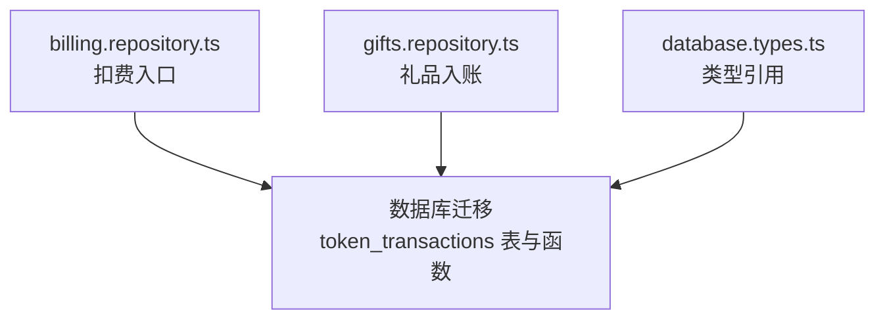
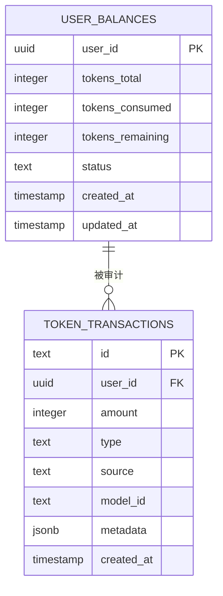
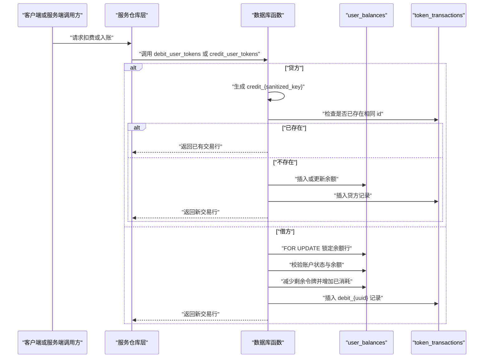
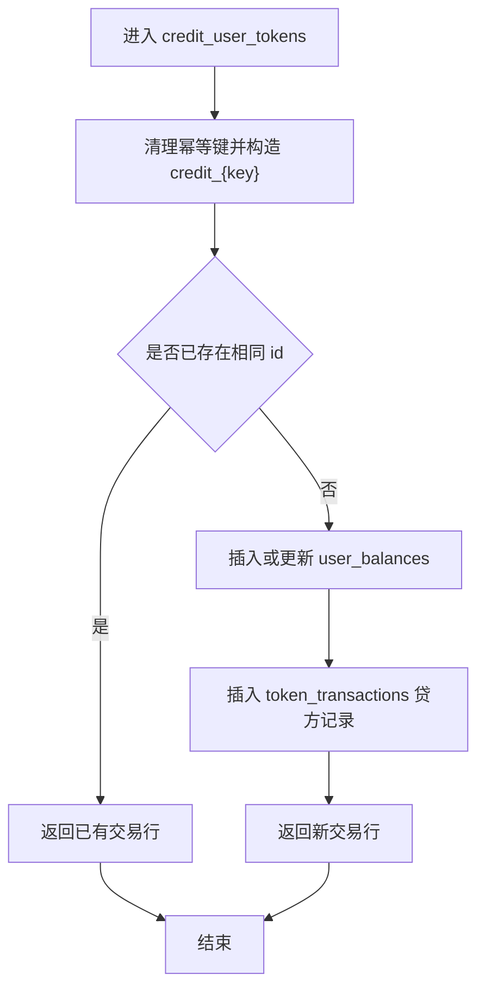
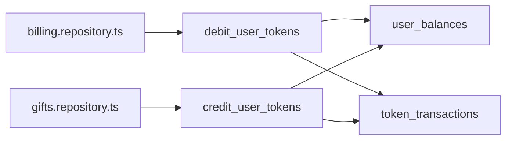
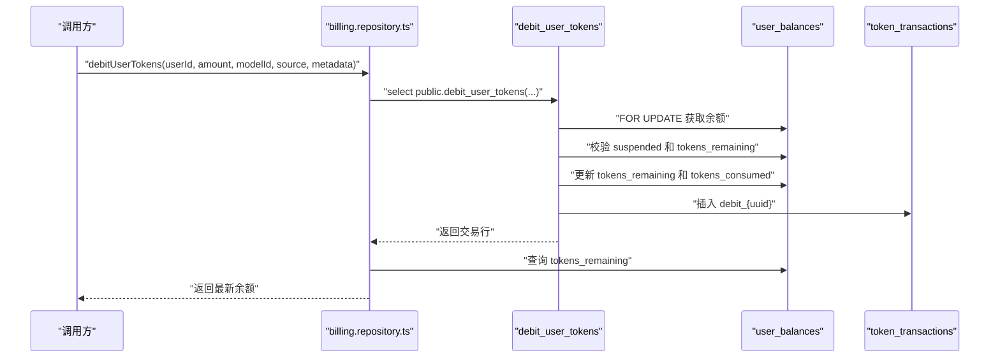
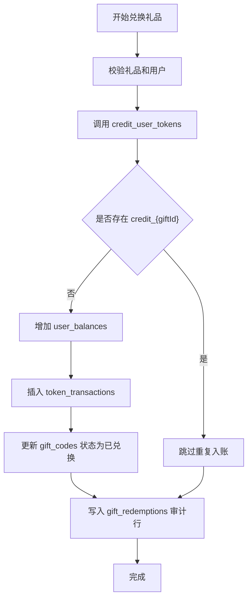

# 令牌交易系统

<cite>
**本文引用的文件**   
- [supabase/migrations/20260506160000_core_backend.sql](file://supabase/migrations/20260506160000_core_backend.sql)
- [src/server/repositories/billing.repository.ts](file://src/server/repositories/billing.repository.ts)
- [src/server/repositories/gifts.repository.ts](file://src/server/repositories/gifts.repository.ts)
- [src/shared/types/database.types.ts](file://src/shared/types/database.types.ts)
</cite>

## 目录
1. [引言](#引言)
2. [项目结构定位](#项目结构定位)
3. [核心数据模型](#核心数据模型)
4. [架构总览](#架构总览)
5. [详细组件分析](#详细组件分析)
6. [依赖关系分析](#依赖关系分析)
7. [性能与索引优化](#性能与索引优化)
8. [实际使用示例](#实际使用示例)
9. [故障排查指南](#故障排查指南)
10. [结论](#结论)

## 引言
本文件系统性地梳理令牌交易系统的追加式分类账设计。该系统以 `token_transactions` 表为核心，记录用户令牌的贷方和借方流水；通过数据库函数保证余额变更与审计记录原子性；并通过幂等键、业务来源、模型标识和元数据扩展字段支持计费对账、用量分析和财务审计。

## 项目结构定位
令牌交易相关代码分布在以下位置：
- 数据库迁移定义核心表、约束、行级安全策略及安全定义器函数。
- Node.js 服务端仓库层调用数据库函数执行扣费和查询余额。
- 礼品兑换流程调用信用函数完成赠送令牌的入账。
- 类型定义文件中包含对 `token_transactions` 的引用。

**图表来源**
- [supabase/migrations/20260506160000_core_backend.sql:110-170](file://supabase/migrations/20260506160000_core_backend.sql#L110-L170)
- [src/server/repositories/billing.repository.ts:392-420](file://src/server/repositories/billing.repository.ts#L392-L420)
- [src/server/repositories/gifts.repository.ts:362-397](file://src/server/repositories/gifts.repository.ts#L362-L397)
- [src/shared/types/database.types.ts:2584-2585](file://src/shared/types/database.types.ts#L2584-L2585)

**章节来源**
- [supabase/migrations/20260506160000_core_backend.sql:1-200](file://supabase/migrations/20260506160000_core_backend.sql#L1-L200)
- [src/server/repositories/billing.repository.ts:1-50](file://src/server/repositories/billing.repository.ts#L1-L50)
- [src/server/repositories/gifts.repository.ts:1-50](file://src/server/repositories/gifts.repository.ts#L1-L50)
- [src/shared/types/database.types.ts:2580-2590](file://src/shared/types/database.types.ts#L2580-L2590)

## 核心数据模型
`token_transactions` 是追加式分类账，不直接修改余额，而是记录每一笔令牌的增减。与其配合的是 `user_balances`，该表维护用户令牌的总量、已消费量和剩余量。

| 字段 | 类型 | 说明 |
|---|---|---|
| id | text | 主键。贷方通常采用 `credit_{key}` 格式以实现幂等；借方采用 `debit_{uuid}` 格式。 |
| user_id | uuid | 关联用户。受外键约束并级联删除。 |
| amount | integer | 令牌数量，必须大于零。 |
| type | text | 枚举值：`credit`（贷方）、`debit`（借方）。 |
| source | text | 业务来源：`purchase`（购买）、`generation`（生成）、`chat`（聊天）、`reward`（奖励）。 |
| model_id | text | 可选模型标识，主要用于借方的用量分析。 |
| metadata | jsonb | 审计和业务扩展字段，默认空对象。 |
| created_at | timestamptz | 创建时间。 |

与之配套的 `user_balances` 关键字段包括：
- `tokens_total`：累计获得的令牌数。
- `tokens_consumed`：累计消耗的令牌数。
- `tokens_remaining`：可消费余额。
- `status`：账户状态，包括 `active`、`suspended`、`trial`。

**图表来源**
- [supabase/migrations/20260506160000_core_backend.sql:70-170](file://supabase/migrations/20260506160000_core_backend.sql#L70-L170)

**章节来源**
- [supabase/migrations/20260506160000_core_backend.sql:70-170](file://supabase/migrations/20260506160000_core_backend.sql#L70-L170)

## 架构总览
令牌交易的核心控制流由两个数据库函数驱动：
- `credit_user_tokens`：幂等贷方，按去重后的幂等键生成稳定的交易标识。
- `debit_user_tokens`：非幂等借方，每次调用生成新的 `debit_{uuid}` 并锁定余额行。

**图表来源**
- [supabase/migrations/20260506160000_core_backend.sql:300-666](file://supabase/migrations/20260506160000_core_backend.sql#L300-L666)
- [src/server/repositories/billing.repository.ts:392-420](file://src/server/repositories/billing.repository.ts#L392-L420)

## 详细组件分析

### 追加式分类账设计
`token_transactions` 采用追加式分类账模式：
- 每笔交易只插入一行，不更新历史行。
- 余额从 `user_balances` 中计算和维护。
- 所有余额变更都通过数据库函数完成，避免应用层并发竞争。
- 贷方通过稳定 id 实现幂等；借方通过随机 uuid 保证每次扣费产生独立流水。

这种设计的优点是：
- 审计轨迹完整，不可篡改。
- 对账可以通过汇总借贷差值进行。
- 新增业务来源只需扩展 `source` 枚举和 `metadata`。

**章节来源**
- [supabase/migrations/20260506160000_core_backend.sql:110-170](file://supabase/migrations/20260506160000_core_backend.sql#L110-L170)
- [supabase/migrations/20260506160000_core_backend.sql:300-666](file://supabase/migrations/20260506160000_core_backend.sql#L300-L666)

### 主键幂等性设计：credit_ 与 debit_
贷方主键规则：
- 幂等键传入后会被清理非法字符，再拼接成 `credit_{sanitized_key}`。
- 若该 id 已存在，函数直接返回已有交易行，不再重复增加余额。
- 典型用途包括支付成功回调、礼品兑换重试等需要幂等的场景。

借方主键规则：
- 每次调用生成 `debit_{uuid}`。
- 函数本身不提供幂等保护；重复调用可能导致重复扣费。
- 应用层应自行实现请求去重，例如基于外部请求 id 或业务 id。

**图表来源**
- [supabase/migrations/20260506160000_core_backend.sql:300-480](file://supabase/migrations/20260506160000_core_backend.sql#L300-L480)

**章节来源**
- [supabase/migrations/20260506160000_core_backend.sql:300-480](file://supabase/migrations/20260506160000_core_backend.sql#L300-L480)

### type 字段枚举含义
`type` 表示资金流向：
- `credit`：令牌增加。常见于购买、奖励、系统发放。
- `debit`：令牌减少。常见于聊天、模型生成、功能使用。

该字段与 `source` 字段共同构成完整的审计语义：`type` 描述方向，`source` 描述业务原因。

**章节来源**
- [supabase/migrations/20260506160000_core_backend.sql:110-170](file://supabase/migrations/20260506160000_core_backend.sql#L110-L170)

### source 字段业务含义
`source` 是业务侧分类字段，当前限制为以下值：
- `purchase`：付费购买带来的令牌入账。
- `generation`：模型生成使用的令牌消耗。
- `chat`：聊天交互使用的令牌消耗。
- `reward`：奖励活动或运营发放的令牌。

在礼品兑换场景中，即使礼品属于“赠送”，其入账仍使用 `purchase`，因为底层调用 `credit_user_tokens` 时明确传入 `purchase`。这提示我们在做报表分析时应同时参考 `metadata`，而不能仅依赖 `source`。

**章节来源**
- [supabase/migrations/20260506160000_core_backend.sql:110-170](file://supabase/migrations/20260506160000_core_backend.sql#L110-L170)
- [src/server/repositories/gifts.repository.ts:362-397](file://src/server/repositories/gifts.repository.ts#L362-L397)
- [src/server/repositories/gifts.repository.ts:543-578](file://src/server/repositories/gifts.repository.ts#L543-L578)

### model_id 字段在用量分析中的作用
`model_id` 主要出现在借方交易中，用于追踪不同模型或推理渠道的令牌消耗。它不是必填字段，但推荐在调用 `debit_user_tokens` 时携带，以便后续按模型维度统计用量、成本和分析延迟。

在 Node.js 层，`debitUserTokens` 接收 `modelId` 并原样传给数据库函数，因此应用层负责决定如何生成和传递该值。

**章节来源**
- [supabase/migrations/20260506160000_core_backend.sql:110-170](file://supabase/migrations/20260506160000_core_backend.sql#L110-L170)
- [src/server/repositories/billing.repository.ts:392-420](file://src/server/repositories/billing.repository.ts#L392-L420)

### metadata JSONB 字段的扩展能力
`metadata` 是灵活的审计和业务扩展字段：
- 贷方可记录幂等键来源、订单号、计划 id、礼品 id、月份等。
- 借方可记录模型 id、会话 id、工作区 id、提供者信息等。
- 它允许在不频繁修改表结构的情况下扩展审计信息。

在礼品兑换流程中，贷方元数据包含 `giftId`、`planId`、`months`，从而将令牌入账与具体礼品兑换行为绑定。

**章节来源**
- [supabase/migrations/20260506160000_core_backend.sql:110-170](file://supabase/migrations/20260506160000_core_backend.sql#L110-L170)
- [src/server/repositories/gifts.repository.ts:362-397](file://src/server/repositories/gifts.repository.ts#L362-L397)
- [src/server/repositories/gifts.repository.ts:543-578](file://src/server/repositories/gifts.repository.ts#L543-L578)

### 行级安全与访问控制
`token_transactions` 启用了行级安全策略：
- 认证用户可以读取自己的交易记录。
- 写入通常通过 `security definer` 函数完成，绕过普通用户的行级安全限制，由服务端可信路径调用。

这意味着前端不应直接写交易表，而应通过后端接口或安全的数据库函数。

**章节来源**
- [supabase/migrations/20260506160000_core_backend.sql:200-350](file://supabase/migrations/20260506160000_core_backend.sql#L200-L350)

## 依赖关系分析
令牌交易涉及的依赖关系如下：

**图表来源**
- [src/server/repositories/billing.repository.ts:392-420](file://src/server/repositories/billing.repository.ts#L392-L420)
- [src/server/repositories/gifts.repository.ts:362-397](file://src/server/repositories/gifts.repository.ts#L362-L397)
- [supabase/migrations/20260506160000_core_backend.sql:300-666](file://supabase/migrations/20260506160000_core_backend.sql#L300-L666)

**章节来源**
- [src/server/repositories/billing.repository.ts:392-420](file://src/server/repositories/billing.repository.ts#L392-L420)
- [src/server/repositories/gifts.repository.ts:362-397](file://src/server/repositories/gifts.repository.ts#L362-L397)
- [supabase/migrations/20260506160000_core_backend.sql:300-666](file://supabase/migrations/20260506160000_core_backend.sql#L300-L666)

## 性能与索引优化
当前为 `token_transactions` 创建了复合索引：

`token_transactions_user_created_idx(user_id, created_at desc)`

该索引的优势：
- 用户维度的历史查询通常先过滤 `user_id`，再按时间倒序分页。
- `created_at desc` 可以避免额外的排序开销。
- 适合查看最近交易、时间窗口对账和用户账单页。

需要注意的风险：
- 如果未来频繁按 `source`、`type`、`model_id` 聚合，应考虑额外索引。
- 大量历史数据下，追加式分类账会持续增长，需结合分区、归档或冷存储策略。
- 借方事务中包含 `FOR UPDATE` 锁，高并发扣费场景可能成为热点。

**章节来源**
- [supabase/migrations/20260506160000_core_backend.sql:110-170](file://supabase/migrations/20260506160000_core_backend.sql#L110-L170)
- [supabase/migrations/20260506160000_core_backend.sql:480-666](file://supabase/migrations/20260506160000_core_backend.sql#L480-L666)

## 实际使用示例

### 交易记录插入：扣费
Node.js 层通过 `debitUserTokens` 调用数据库函数完成扣费：
- 传入用户 id、金额、模型 id、业务来源和元数据。
- 数据库函数内部锁定余额行，校验余额和账户状态。
- 成功后插入一条 `debit_{uuid}` 的交易记录，并更新 `user_balances`。
- 调用方随后查询 `tokens_remaining` 作为结果。

**图表来源**
- [src/server/repositories/billing.repository.ts:392-420](file://src/server/repositories/billing.repository.ts#L392-L420)
- [supabase/migrations/20260506160000_core_backend.sql:480-560](file://supabase/migrations/20260506160000_core_backend.sql#L480-L560)

**章节来源**
- [src/server/repositories/billing.repository.ts:392-420](file://src/server/repositories/billing.repository.ts#L392-L420)
- [supabase/migrations/20260506160000_core_backend.sql:480-560](file://supabase/migrations/20260506160000_core_backend.sql#L480-L560)

### 交易记录插入：入账
礼品兑换场景通过 `credit_user_tokens` 入账：
- 使用 `gift_${giftId}` 作为幂等键前缀。
- 业务来源固定为 `purchase`。
- 元数据包含礼品 id、计划 id、月份，便于后续对账。
- 成功后将礼品状态更新为已兑换，并记录兑换审计行。

**图表来源**
- [src/server/repositories/gifts.repository.ts:362-397](file://src/server/repositories/gifts.repository.ts#L362-L397)
- [src/server/repositories/gifts.repository.ts:543-578](file://src/server/repositories/gifts.repository.ts#L543-L578)
- [supabase/migrations/20260506160000_core_backend.sql:300-480](file://supabase/migrations/20260506160000_core_backend.sql#L300-L480)

**章节来源**
- [src/server/repositories/gifts.repository.ts:362-397](file://src/server/repositories/gifts.repository.ts#L362-L397)
- [src/server/repositories/gifts.repository.ts:543-578](file://src/server/repositories/gifts.repository.ts#L543-L578)
- [supabase/migrations/20260506160000_core_backend.sql:300-480](file://supabase/migrations/20260506160000_core_backend.sql#L300-L480)

### 余额对账
对账的基本思路：
- 对指定用户筛选 `token_transactions`。
- 分别汇总 `type = 'credit'` 和 `type = 'debit'` 的 `amount`。
- 用贷方总和减去借方总和，得到理论余额。
- 将该理论与 `user_balances.tokens_remaining` 比较，差异即为异常。

建议的对账维度：
- 按用户。
- 按天或按月。
- 按 `source` 区分购买、生成、聊天、奖励。
- 对借方按 `model_id` 做用量归因。

**章节来源**
- [supabase/migrations/20260506160000_core_backend.sql:70-170](file://supabase/migrations/20260506160000_core_backend.sql#L70-L170)

### 历史查询
典型历史查询包括：
- 某用户最近 N 条交易。
- 某用户在时间区间内的贷方、借方汇总。
- 按 `source` 和 `type` 分组的月度报表。
- 按 `model_id` 统计的模型用量。

由于存在 `(user_id, created_at desc)` 索引，最近历史记录查询通常可以直接走索引扫描。

**章节来源**
- [supabase/migrations/20260506160000_core_backend.sql:110-170](file://supabase/migrations/20260506160000_core_backend.sql#L110-L170)

## 故障排查指南

### 扣费失败：账户暂停
当用户账户状态为 `suspended` 时，`debit_user_tokens` 会抛出异常。排查步骤：
1. 检查 `user_balances.status`。
2. 确认业务逻辑是否在暂停期间仍尝试扣费。
3. 恢复账户状态后再重试。

**章节来源**
- [supabase/migrations/20260506160000_core_backend.sql:480-560](file://supabase/migrations/20260506160000_core_backend.sql#L480-L560)

### 扣费失败：余额不足
当 `tokens_remaining` 小于扣费金额时，数据库函数抛出余额不足异常。排查步骤：
1. 查询 `user_balances.tokens_remaining`。
2. 检查最近借方交易是否超过预期。
3. 检查是否有未处理的贷方入账。
4. 核对 `token_transactions` 的借贷汇总是否与余额一致。

**章节来源**
- [supabase/migrations/20260506160000_core_backend.sql:480-560](file://supabase/migrations/20260506160000_core_backend.sql#L480-L560)

### 重复入账问题
贷方幂等键可以防止同一幂等键重复入账，但不能防止不同幂等键重复入账。排查步骤：
1. 检查调用方是否每次都生成新的幂等键。
2. 检查 `id` 是否出现多个相似的业务事件。
3. 对于外部回调，建议使用稳定的业务 id，如订单 id 加支付 id。

**章节来源**
- [supabase/migrations/20260506160000_core_backend.sql:300-480](file://supabase/migrations/20260506160000_core_backend.sql#L300-L480)

### 重复扣费问题
借方没有数据库幂等保护，重复调用可能导致重复扣费。排查步骤：
1. 在服务端实现请求级去重。
2. 对外部回调使用幂等键，并在调用 `debit_user_tokens` 前判断是否已处理。
3. 对账时比对 `debit_{uuid}` 是否重复。

**章节来源**
- [supabase/migrations/20260506160000_core_backend.sql:480-560](file://supabase/migrations/20260506160000_core_backend.sql#L480-L560)

### 审计不完整
如果交易记录缺少关键信息，检查 `metadata` 和 `model_id` 是否由调用方正确传入。礼品兑换场景中的 `metadata` 应包含礼品和计划信息，借方场景中的 `model_id` 应包含模型标识。

**章节来源**
- [src/server/repositories/gifts.repository.ts:362-397](file://src/server/repositories/gifts.repository.ts#L362-L397)
- [src/server/repositories/billing.repository.ts:392-420](file://src/server/repositories/billing.repository.ts#L392-L420)

## 结论
令牌交易系统以 `token_transactions` 追加式分类账为核心，通过 `credit_user_tokens` 和 `debit_user_tokens` 将余额变更与审计记录解耦。主键设计在贷方提供幂等保障，在借方强调应用层去重；`type` 和 `source` 提供方向与业务语义；`model_id` 支撑模型用量分析；`metadata` 提供灵活扩展能力；`(user_id, created_at desc)` 索引优化了用户历史查询。要确保系统可靠运行，需要同时关注幂等设计、审计完整性、余额对账和索引扩展。