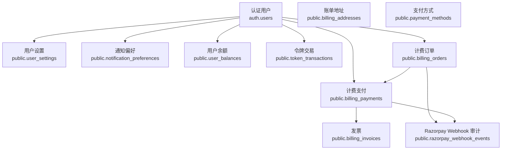
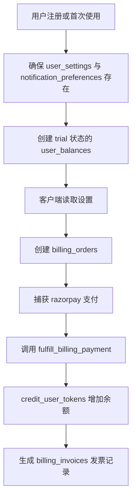
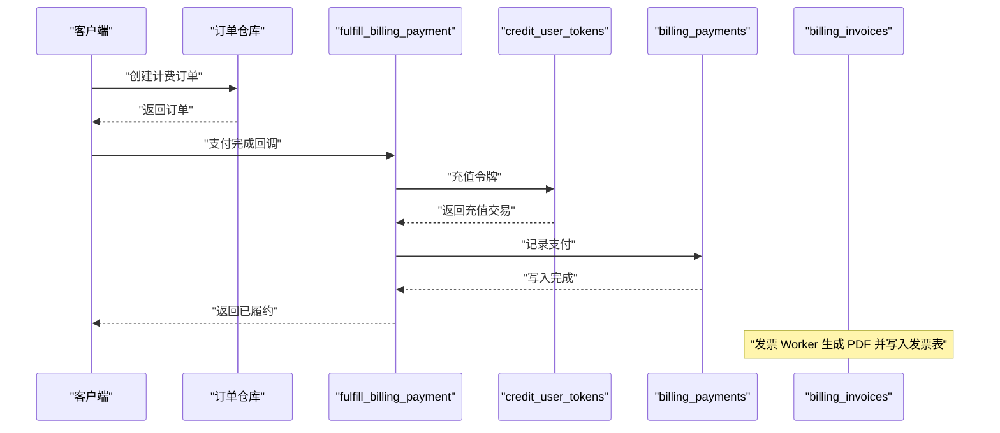
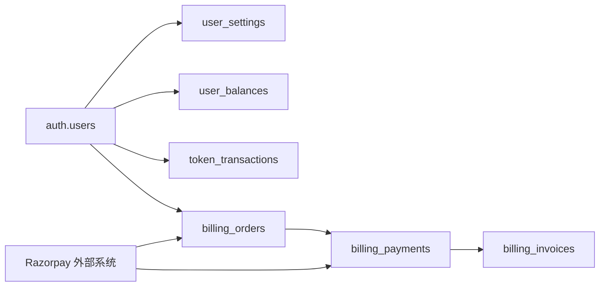

# 核心数据模型

<cite>
**本文引用的文件**   
- [core_backend.sql](file://supabase/migrations/20260506160000_core_backend.sql)
- [schema_drift_and_onboarding.sql](file://supabase/migrations/20260709100000_schema_drift_and_onboarding.sql)
- [platform_primitives.sql](file://supabase/migrations/20260507153000_platform_schema.sql)
- [billing_addresses_payment_methods.sql](file://supabase/migrations/20260725143000_billing_addresses_payment_methods.sql)
- [payment_methods_upi_and_mandate.sql](file://supabase/migrations/20260725180000_payment_methods_upi_and_mandate.sql)
- [platform_hardening.sql](file://supabase/migrations/20260806181805_platform_hardening.sql)
- [connector_platform_foundation.sql](file://supabase/migrations/20260830130331_connector_platform_foundation.sql)
- [billing_invoices.sql](file://supabase/migrations/20260910120000_billing_invoices.sql)
- [settings.repository.ts](file://src/server/repositories/settings.repository.ts)
- [billing.repository.ts](file://src/server/billing/billing.repository.ts)
</cite>

## 目录
1. [引言](#引言)
2. [项目结构](#项目结构)
3. [核心实体总览](#核心实体总览)
4. [架构与扩展表设计模式](#架构与扩展表设计模式)
5. [详细模型说明](#详细模型说明)
6. [关系映射与约束](#关系映射与约束)
7. [状态枚举与业务规则](#状态枚举与业务规则)
8. [计费、权限控制与审计支撑](#计费权限控制与审计支撑)
9. [依赖分析](#依赖分析)
10. [性能与索引](#性能与索引)
11. [查询示例](#查询示例)
12. [故障排查](#故障排查)
13. [结论](#结论)

## 引言
本文件聚焦于 Clauxen 平台中与用户、设置、余额、令牌交易、订单、支付、发票和关联计费信息相关的基础数据模型。这些模型共同支撑三类关键能力：
- 计费：购买计划、充值额度、消费扣减、发票开具。
- 权限控制：基于 `auth.users` 的用户身份扩展，结合行级安全策略限制读写范围。
- 审计：以追加型流水记录令牌增减，并记录支付回调、发票生成等事件。

数据库层主要位于 `supabase/migrations`；服务端仓库代码通过参数化 SQL 访问这些表，并通过 PostgreSQL 函数完成原子性计费操作。

## 项目结构
核心数据模型由多个迁移文件逐步构建：
- 基础用户设置、余额、令牌交易、订单、支付、Webhook 审计在早期核心迁移中定义。
- 通知偏好、项目文件、用户技能等扩展字段随后补充。
- 账单地址、支付方式、发票等计费相关实体在后续迁移中引入。
- 连接器、私有密钥等安全敏感数据进入独立 schema。



**图表来源**
- [core_backend.sql:60-200](file://supabase/migrations/20260506160000_core_backend.sql#L60-L200)
- [platform_primitives.sql:187-199](file://supabase/migrations/20260507153000_platform_schema.sql#L187-L199)
- [billing_addresses_payment_methods.sql:15-155](file://supabase/migrations/20260725143000_billing_addresses_payment_methods.sql#L15-L155)
- [billing_invoices.sql:1-58](file://supabase/migrations/20260910120000_billing_invoices.sql#L1-L58)

**章节来源**
- [core_backend.sql:1-666](file://supabase/migrations/20260506160000_core_backend.sql#L1-L666)
- [platform_primitives.sql:180-210](file://supabase/migrations/20260507153000_platform_schema.sql#L180-L210)
- [billing_addresses_payment_methods.sql:15-155](file://supabase/migrations/20260725143000_billing_addresses_payment_methods.sql#L15-L155)
- [billing_invoices.sql:1-58](file://supabase/migrations/20260910120000_billing_invoices.sql#L1-L58)

## 核心实体总览
| 实体 | 职责 | 主键 | 关键外键 | 是否受行级安全保护 |
|---|---|---|---|---|
| `user_settings` | 用户偏好、主题、语言、引导进度 | `user_id` | `auth.users.id` | 是 |
| `notification_preferences` | 邮件、产品更新、计费、安全提醒开关 | `user_id` | `auth.users.id` | 是 |
| `user_balances` | 用户令牌钱包总额、已消费、剩余、账户状态 | `user_id` | `auth.users.id` | 是 |
| `token_transactions` | 令牌充值、扣费的追加型流水 | `id` | `auth.users.id` | 是 |
| `billing_orders` | 购买计划前的订单草稿 | `id` | `auth.users.id` | 是 |
| `billing_payments` | Razorpay 支付结果与履约记录 | `id` | `billing_orders.razorpay_order_id`、`auth.users.id` | 是 |
| `razorpay_webhook_events` | Webhook 投递审计日志 | `id` | 无强外键 | 否 |
| `billing_invoices` | 发票元数据及 R2 存储位置 | `id` | `auth.users.id`、`billing_orders.id`、`billing_payments.id` | 是 |
| `billing_addresses` | 用户账单地址 | `id` | `auth.users.id` | 是 |
| `payment_methods` | 用户支付方式卡片或 UPI | `id` | `auth.users.id` | 是 |

**章节来源**
- [core_backend.sql:60-200](file://supabase/migrations/20260506160000_core_backend.sql#L60-L200)
- [platform_primitives.sql:187-199](file://supabase/migrations/20260507153000_platform_schema.sql#L187-L199)
- [billing_addresses_payment_methods.sql:15-155](file://supabase/migrations/20260725143000_billing_addresses_payment_methods.sql#L15-L155)
- [billing_invoices.sql:1-58](file://supabase/migrations/20260910120000_billing_invoices.sql#L1-L58)

## 架构与扩展表设计模式
系统采用“认证主体 + 扩展表”的设计模式：
- 所有用户相关扩展表均以 `user_id uuid references auth.users(id)` 作为主键或外键。
- 删除用户时使用 `on delete cascade`，自动清理其设置、余额、交易、订单、支付、发票、地址、支付方式等附属数据。
- 客户端只能读取自身数据；写入余额、订单履约等操作必须通过 `security definer` 函数执行，从而绕过普通用户的行级安全策略。
- JSONB 字段用于灵活配置，如用户设置、订单元数据、发票证据、Webhook 原始负载等。



**图表来源**
- [settings.repository.ts:1-116](file://src/server/repositories/settings.repository.ts#L1-L116)
- [core_backend.sql:300-666](file://supabase/migrations/20260506160000_core_backend.sql#L300-L666)
- [billing_invoices.sql:1-58](file://supabase/migrations/20260910120000_billing_invoices.sql#L1-L58)

**章节来源**
- [core_backend.sql:60-200](file://supabase/migrations/20260506160000_core_backend.sql#L60-L200)
- [core_backend.sql:300-666](file://supabase/migrations/20260506160000_core_backend.sql#L300-L666)
- [settings.repository.ts:1-116](file://src/server/repositories/settings.repository.ts#L1-L116)

## 详细模型说明

### 用户设置表 `user_settings`
- 主键：`user_id`，引用 `auth.users.id`，级联删除。
- 关键字段：
  - `email`：冗余快照字段，便于显示和查询；权威邮箱仍来自 `auth.users`。
  - `settings`：JSONB，存放 UI 主题、语言、功能开关等任意设置。
  - `onboarding_step`：引导步骤标识，例如欢迎页、姓名、角色等。
  - `onboarding_completed_at`：首次引导完成时间。
  - `created_at`、`updated_at`：时间戳，由触发器自动维护。
- 业务规则：
  - 每个用户一行，主键即用户标识。
  - 客户端可通过行级安全策略读写自己的设置。
  - 服务层可先 `ensureSettingsRows` 保证新用户有默认空设置。

**章节来源**
- [core_backend.sql:60-90](file://supabase/migrations/20260506160000_core_backend.sql#L60-L90)
- [schema_drift_and_onboarding.sql:1-20](file://supabase/migrations/20260709100000_schema_drift_and_onboarding.sql#L1-L20)
- [settings.repository.ts:1-60](file://src/server/repositories/settings.repository.ts#L1-L60)

### 通知偏好表 `notification_preferences`
- 主键：`user_id`，引用 `auth.users.id`。
- 关键字段：
  - `email_notifications`：是否接收邮件通知。
  - `product_updates`：是否接收产品更新通知。
  - `research_complete`：研究任务完成通知。
  - `billing_alerts`：计费相关告警。
  - `security_alerts`：安全告警。
  - `settings`：JSONB，扩展通知配置。
- 行为：
  - 通常与 `user_settings` 同时初始化。
  - 允许按通道精细化控制通知开关。

**章节来源**
- [platform_primitives.sql:187-199](file://supabase/migrations/20260507153000_platform_schema.sql#L187-L199)
- [settings.repository.ts:1-116](file://src/server/repositories/settings.repository.ts#L1-L116)

### 用户余额表 `user_balances`
- 主键：`user_id`，引用 `auth.users.id`，级联删除。
- 关键字段：
  - `tokens_total`：累计获得的令牌总量，含试用额度。
  - `tokens_consumed`：累计消耗令牌。
  - `tokens_remaining`：当前可用令牌，扣费时检查。
  - `status`：`active`、`trial`、`suspended`。
  - `created_at`、`updated_at`：时间戳。
- 约束：
  - 三个数值字段均要求非负。
  - 状态值受 check 约束。
- 业务规则：
  - 客户端仅能读取自身余额。
  - 余额变更只能通过 `credit_user_tokens` 和 `debit_user_tokens` 进行。
  - `suspended` 状态会阻止扣费。

**章节来源**
- [core_backend.sql:90-130](file://supabase/migrations/20260506160000_core_backend.sql#L90-L130)
- [core_backend.sql:300-450](file://supabase/migrations/20260506160000_core_backend.sql#L300-L450)

### 令牌交易表 `token_transactions`
- 主键：`id`，文本类型。
- 关键字段：
  - `user_id`：引用 `auth.users.id`，级联删除。
  - `amount`：正整数令牌数。
  - `type`：`credit` 或 `debit`。
  - `source`：`purchase`、`generation`、`chat`、`reward`。
  - `model_id`：可选，用于分析具体模型消耗。
  - `metadata`：JSONB，审计扩展字段。
  - `created_at`：入账时间。
- 约束：
  - 金额必须大于零。
  - 类型和来源受 check 约束。
- 业务规则：
  - 追加型账本，不直接修改余额，而是由服务函数同步更新 `user_balances`。
  - 充值事务 ID 常为 `credit_{去重键}`，支持幂等。
  - 扣费事务 ID 为 `debit_{随机uuid}`，重复调用可能重复扣费，需要应用层去重。

**章节来源**
- [core_backend.sql:130-170](file://supabase/migrations/20260506160000_core_backend.sql#L130-L170)
- [core_backend.sql:300-520](file://supabase/migrations/20260506160000_core_backend.sql#L300-L520)

### 计费订单表 `billing_orders`
- 主键：`id`，文本类型。
- 关键字段：
  - `razorpay_order_id`：外部支付订单号，唯一。
  - `razorpay_payment_id`：支付完成后回填。
  - `user_id`：下单用户。
  - `user_email`：订单时的邮箱快照。
  - `plan_id`、`plan_name`：计划标识与名称。
  - `billing_cycle`：`monthly` 或 `yearly`。
  - `max_tier`：最大层级，用于套餐上限。
  - `status`：`created` → `attempted` → `fulfilled` | `failed`。
  - `currency`：货币，默认 INR。
  - `subtotal_paise`、`tax_paise`、`amount_paise`：以印度分表示的金额。
  - `tokens`：支付成功后授予的令牌数量。
  - `receipt`、`razorpay_status`、`metadata`：收据、外部状态、扩展元数据。
  - `paid_at`、`fulfilled_at`、`created_at`、`updated_at`：时间戳。
- 业务规则：
  - 订单创建后等待支付。
  - 支付成功且履约完成后，状态变为 `fulfilled`，并写入支付记录和令牌充值。

**章节来源**
- [core_backend.sql:170-220](file://supabase/migrations/20260506160000_core_backend.sql#L170-L220)
- [billing.repository.ts:1-120](file://src/server/billing/billing.repository.ts#L1-L120)

### 计费支付表 `billing_payments`
- 主键：`id`，对应 Razorpay payment id。
- 关键字段：
  - `order_id`：引用 `billing_orders.razorpay_order_id`，级联删除。
  - `user_id`：支付用户。
  - `amount_paise`、`currency`：支付金额和货币。
  - `status`、`method`、`email`、`contact`：支付状态、方式、联系人信息。
  - `source`：`checkout` 或 `webhook`。
  - `captured_at`、`fulfilled_at`、`created_at`：时间戳。
- 业务规则：
  - 同一 payment id 只应履约一次。
  - 重复支付会被识别为幂等场景。

**章节来源**
- [core_backend.sql:220-260](file://supabase/migrations/20260506160000_core_backend.sql#L220-L260)

### Razorpay Webhook 审计表 `razorpay_webhook_events`
- 主键：`id`。
- 关键字段：
  - `event_id`：外部事件唯一标识。
  - `event`：事件名称。
  - `status`：`processed`、`duplicate`、`ignored`。
  - `order_id`、`payment_id`：关联订单和支付。
  - `received_at`：接收时间。
- 业务规则：
  - 追加型审计日志。
  - 没有行级安全，仅由服务端安全函数写入。

**章节来源**
- [core_backend.sql:200-220](file://supabase/migrations/20260506160000_core_backend.sql#L200-L220)

### 发票表 `billing_invoices`
- 主键：`id`，UUID。
- 关键字段：
  - `user_id`：引用 `auth.users.id`，级联删除。
  - `order_id`：引用 `billing_orders.id`，级联删除。
  - `payment_id`：引用 `billing_payments.id`，唯一，作为发票幂等键。
  - `invoice_number`：发票编号，唯一。
  - `kind`：`domestic_gst`、`export_lut`、`exempt_gstin`。
  - `currency`：INR 或 USD。
  - `subtotal_paise`、`tax_paise`、`total_paise`：发票金额。
  - `country`：国家代码。
  - `r2_key`、`r2_url`：Cloudflare R2 中的 PDF 位置和下载链接。
  - `razorpay_document_id`：Razorpay 文档标识。
  - `evidence`：税务决策证据快照。
  - `emailed_at`、`created_at`、`updated_at`：时间戳。
- 业务规则：
  - 每笔支付生成一张发票。
  - 客户端只能查看自己的发票。

**章节来源**
- [billing_invoices.sql:1-58](file://supabase/migrations/20260910120000_billing_invoices.sql#L1-L58)

### 账单地址表 `billing_addresses`
- 主键：`id`，UUID。
- 关键字段：
  - `user_id`：引用 `auth.users.id`。
  - `full_name`、`country_code`、`address_line1`、`address_line2`、`city`、`state`、`postal_code`、`phone`。
  - `is_default`：是否默认地址。
  - `created_at`、`updated_at`：时间戳。
- 约束：
  - 每个用户最多一个默认地址。
  - 字段长度和格式受 check 约束。
- 业务规则：
  - 客户可增删改自己的账单地址。
  - 默认地址在同一用户内唯一。

**章节来源**
- [billing_addresses_payment_methods.sql:15-87](file://supabase/migrations/20260725143000_billing_addresses_payment_methods.sql#L15-L87)

### 支付方式表 `payment_methods`
- 主键：`id`，UUID。
- 关键字段：
  - `user_id`：引用 `auth.users.id`。
  - `provider_ref_encrypted`：加密后的支付提供商参考值。
  - `provider_ref_fingerprint`：提供方参考指纹，唯一。
  - `network`、`brand`、`card_first4`、`card_last4`、`exp_month`、`exp_year`：卡片信息。
  - `method_type`：`card` 或 `upi`。
  - `upi_vpa`：UPI 虚拟账户。
  - `display_label`：展示标签。
  - `mandate_max_amount_paise`、`mandate_status`：授权最大金额和状态。
  - `is_default`：是否默认支付方式。
  - `razorpay_customer_id`、`last_payment_id`：Razorpay 关联信息。
  - `created_at`、`updated_at`：时间戳。
- 约束：
  - 同一用户下 `provider_ref_fingerprint` 唯一。
  - 每个用户最多一个默认支付方式。
  - UPI 与卡片展示字段互斥。
- 业务规则：
  - 支持银行卡和 UPI Autopay。
  - 敏感字段加密存储。

**章节来源**
- [billing_addresses_payment_methods.sql:92-155](file://supabase/migrations/20260725143000_billing_addresses_payment_methods.sql#L92-L155)
- [payment_methods_upi_and_mandate.sql:1-30](file://supabase/migrations/20260725180000_payment_methods_upi_and_mandate.sql#L1-L30)

## 关系映射与约束
核心关系如下：
- `user_settings`、`notification_preferences`、`user_balances`、`token_transactions`、`billing_orders`、`billing_payments`、`billing_invoices`、`billing_addresses`、`payment_methods` 都直接或间接关联 `auth.users`。
- `billing_payments.order_id` 引用 `billing_orders.razorpay_order_id`。
- `billing_invoices.order_id` 引用 `billing_orders.id`。
- `billing_invoices.payment_id` 引用 `billing_payments.id`。
- 多数外键使用 `on delete cascade`，删除用户时自动清理附属数据。
- 部分审计表如 `razorpay_webhook_events` 不强制外键，但逻辑上关联订单和支付。

```mermaid
erDiagram
  AUTH_USERS {
    uuid id PK
  }

  USER_SETTINGS {
    uuid user_id PK
    text email
    jsonb settings
    timestamptz created_at
    timestamptz updated_at
  }

  NOTIFICATION_PREFERENCES {
    uuid user_id PK
    boolean email_notifications
    boolean product_updates
    boolean research_complete
    boolean billing_alerts
    boolean security_alerts
    jsonb settings
  }

  USER_BALANCES {
    uuid user_id PK
    integer tokens_total
    integer tokens_consumed
    integer tokens_remaining
    text status
    timestamptz created_at
    timestamptz updated_at
  }

  TOKEN_TRANSACTIONS {
    text id PK
    uuid user_id FK
    integer amount
    text type
    text source
    text model_id
    jsonb metadata
    timestamptz created_at
  }

  BILLING_ORDERS {
    text id PK
    text razorpay_order_id UK
    text razorpay_payment_id
    uuid user_id FK
    text plan_id
    text plan_name
    text billing_cycle
    text max_tier
    text status
    text currency
    integer subtotal_paise
    integer tax_paise
    integer amount_paise
    integer tokens
    text receipt
    text razorpay_status
    jsonb metadata
    timestamptz paid_at
    timestamptz fulfilled_at
    timestamptz created_at
    timestamptz updated_at
  }

  BILLING_PAYMENTS {
    text id PK
    text order_id FK
    uuid user_id FK
    integer amount_paise
    text currency
    text status
    text method
    text email
    text contact
    text source
    timestamptz captured_at
    timestamptz fulfilled_at
    timestamptz created_at
  }

  BILLLING_INVOICES {
    uuid id PK
    uuid user_id FK
    text order_id FK
    text payment_id UK FK
    text invoice_number UK
    text kind
    text currency
    integer subtotal_paise
    integer tax_paise
    integer total_paise
    text country
    text r2_key
    text r2_url
    text razorpay_document_id
    jsonb evidence
    timestamptz emailed_at
    timestamptz created_at
    timestamptz updated_at
  }

  BILLING_ADDRESSES {
    uuid id PK
    uuid user_id FK
    text full_name
    text country_code
    text address_line1
    text address_line2
    text city
    text state
    text postal_code
    text phone
    boolean is_default
    timestamptz created_at
    timestamptz updated_at
  }

  PAYMENT_METHODS {
    uuid id PK
    uuid user_id FK
    text provider_ref_encrypted
    text provider_ref_fingerprint UK
    text network
    text brand
    text card_first4
    text card_last4
    int exp_month
    int exp_year
    text method_type
    text upi_vpa
    text display_label
    int mandate_max_amount_paise
    text mandate_status
    text razorpay_customer_id
    text last_payment_id
    boolean is_default
    timestamptz created_at
    timestamptz updated_at
  }

  AUTH_USERS ||--o{ USER_SETTINGS : "一对一"
  AUTH_USERS ||--o{ NOTIFICATION_PREFERENCES : "一对一"
  AUTH_USERS ||--o{ USER_BALANCES : "一对一"
  AUTH_USERS ||--o{ TOKEN_TRANSACTIONS : "一对多"
  AUTH_USERS ||--o{ BILLING_ORDERS : "一对多"
  AUTH_USERS ||--o{ BILLING_PAYMENTS : "一对多"
  AUTH_USERS ||--o{ BILLLING_INVOICES : "一对多"
  AUTH_USERS ||--o{ BILLING_ADDRESSES : "一对多"
  AUTH_USERS ||--o{ PAYMENT_METHODS : "一对多"

  BILLING_ORDERS ||--o{ BILLING_PAYMENTS : "razorpay_order_id"
  BILLING_ORDERS ||--o{ BILLLING_INVOICES : "id"
  BILLING_PAYMENTS ||--o{ BILLLING_INVOICES : "payment_id"
```

**图表来源**
- [core_backend.sql:60-260](file://supabase/migrations/20260506160000_core_backend.sql#L60-L260)
- [billing_addresses_payment_methods.sql:15-155](file://supabase/migrations/20260725143000_billing_addresses_payment_methods.sql#L15-L155)
- [billing_invoices.sql:1-58](file://supabase/migrations/20260910120000_billing_invoices.sql#L1-L58)

**章节来源**
- [core_backend.sql:60-260](file://supabase/migrations/20260506160000_core_backend.sql#L60-L260)
- [billing_addresses_payment_methods.sql:15-155](file://supabase/migrations/20260725143000_billing_addresses_payment_methods.sql#L15-L155)
- [billing_invoices.sql:1-58](file://supabase/migrations/20260910120000_billing_invoices.sql#L1-L58)

## 状态枚举与业务规则

### 用户余额状态
| 值 | 含义 | 影响 |
|---|---|---|
| `active` | 正常活跃账户 | 允许正常扣费和充值。 |
| `trial` | 试用账户 | 初始状态，试用额度通常为基础赠送。 |
| `suspended` | 被暂停账户 | 禁止继续扣费，需管理员或自动化流程恢复。 |

**章节来源**
- [core_backend.sql:90-130](file://supabase/migrations/20260506160000_core_backend.sql#L90-L130)
- [core_backend.sql:300-450](file://supabase/migrations/20260506160000_core_backend.sql#L300-L450)

### 令牌交易来源类型
| 值 | 含义 | 典型场景 |
|---|---|---|
| `purchase` | 购买充值 | 支付成功后授予令牌。 |
| `generation` | 模型生成消耗 | 后台推理或生成任务扣费。 |
| `chat` | 聊天消耗 | 对话轮次或消息消耗。 |
| `reward` | 奖励充值 | 活动奖励或补偿。 |

**章节来源**
- [core_backend.sql:130-170](file://supabase/migrations/20260506160000_core_backend.sql#L130-L170)

### 订单状态
| 值 | 含义 |
|---|---|
| `created` | 订单已创建但未支付。 |
| `attempted` | 尝试处理支付。 |
| `fulfilled` | 支付成功且已履约。 |
| `failed` | 支付失败。 |

**章节来源**
- [core_backend.sql:170-220](file://supabase/migrations/20260506160000_core_backend.sql#L170-L220)

### 支付方式与发票类型
| 字段 | 枚举值 | 含义 |
|---|---|---|
| `payment_methods.method_type` | `card`、`upi` | 银行卡或 UPI。 |
| `billing_invoices.kind` | `domestic_gst`、`export_lut`、`exempt_gstin` | 国内 GST、出口 LUT、免税 GSTIN。 |

**章节来源**
- [billing_addresses_payment_methods.sql:92-155](file://supabase/migrations/20260725143000_billing_addresses_payment_methods.sql#L92-L155)
- [billing_invoices.sql:1-58](file://supabase/migrations/20260910120000_billing_invoices.sql#L1-L58)

## 计费、权限控制与审计支撑

### 计费流程
1. 前端创建 `billing_orders`，记录计划、金额、令牌包大小。
2. 用户完成 Razorpay 支付。
3. 服务端调用 `fulfill_billing_payment`：
   - 锁定订单。
   - 检查重复支付或重复履约。
   - 调用 `credit_user_tokens` 增加余额。
   - 插入 `billing_payments`。
   - 更新订单为 `fulfilled`。
   - 可选记录 `razorpay_webhook_events`。
4. 发票 Worker 根据支付生成 PDF，写入 `billing_invoices`。



**图表来源**
- [core_backend.sql:300-666](file://supabase/migrations/20260506160000_core_backend.sql#L300-L666)
- [billing_invoices.sql:1-58](file://supabase/migrations/20260910120000_billing_invoices.sql#L1-L58)

**章节来源**
- [core_backend.sql:300-666](file://supabase/migrations/20260506160000_core_backend.sql#L300-L666)
- [billing.repository.ts:1-200](file://src/server/billing/billing.repository.ts#L1-L200)

### 权限控制
- `user_settings`：所有者可读写。
- `user_balances`、`token_transactions`、`billing_orders`、`billing_payments`：客户端可读自身数据。
- `billing_invoices`：仅允许查看自己的发票。
- `billing_addresses`、`payment_methods`：所有者可增删改查。
- 余额和履约写操作通过 `security definer` 函数执行，避免客户端直接修改财务数据。

**章节来源**
- [core_backend.sql:260-300](file://supabase/migrations/20260506160000_core_backend.sql#L260-L300)
- [billing_invoices.sql:40-58](file://supabase/migrations/20260910120000_billing_invoices.sql#L40-L58)
- [platform_hardening.sql:9-48](file://supabase/migrations/20260806181805_platform_hardening.sql#L9-L48)

### 审计机制
- `token_transactions`：追加型令牌流水，支持对账和用量分析。
- `razorpay_webhook_events`：Webhook 处理结果审计，标记已处理、重复或忽略。
- `billing_payments.provider_payload`：可附加发票 PDF key、发票编号、Razorpay 文档信息等。

**章节来源**
- [core_backend.sql:130-170](file://supabase/migrations/20260506160000_core_backend.sql#L130-L170)
- [core_backend.sql:200-220](file://supabase/migrations/20260506160000_core_backend.sql#L200-L220)
- [billing.repository.ts:120-200](file://src/server/billing/billing.repository.ts#L120-L200)

## 依赖分析
数据模型依赖链：
- 用户认证主体：`auth.users`。
- 用户扩展层：`user_settings`、`notification_preferences`。
- 计费层：`billing_orders` → `billing_payments` → `billing_invoices`。
- 资源层：`user_balances` ← `token_transactions` ← `credit_user_tokens` / `debit_user_tokens`。
- 支付基础设施：Razorpay 外部系统通过 webhook 或 checkout 回调驱动内部状态。
- 安全层：`private.connector_oauth_configs`、`private.connector_oauth_transactions` 等属于连接器平台，与计费模型解耦。



**图表来源**
- [core_backend.sql:60-260](file://supabase/migrations/20260506160000_core_backend.sql#L60-L260)
- [billing_invoices.sql:1-58](file://supabase/migrations/20260910120000_billing_invoices.sql#L1-L58)

**章节来源**
- [core_backend.sql:60-260](file://supabase/migrations/20260506160000_core_backend.sql#L60-L260)
- [billing_invoices.sql:1-58](file://supabase/migrations/20260910120000_billing_invoices.sql#L1-L58)

## 性能与索引
- `token_transactions.user_id, created_at desc`：用于按用户快速查询最近交易。
- `billing_invoices.user_id, created_at desc`：用于按用户查询最近发票。
- `billing_invoices.order_id`、`billing_invoices.invoice_number`：加速订单和发票编号检索。
- `billing_addresses.user_id`、`payment_methods.user_id`：加速用户维度查询。
- `billing_addresses` 和 `payment_methods` 的默认地址唯一索引：防止同一用户多个默认记录。
- 触发器统一维护 `updated_at`，减少应用层时间戳不一致问题。

**章节来源**
- [core_backend.sql:170-175](file://supabase/migrations/20260506160000_core_backend.sql#L170-L175)
- [billing_invoices.sql:40-58](file://supabase/migrations/20260910120000_billing_invoices.sql#L40-L58)
- [billing_addresses_payment_methods.sql:47-52](file://supabase/migrations/20260725143000_billing_addresses_payment_methods.sql#L47-L52)
- [billing_addresses_payment_methods.sql:115-120](file://supabase/migrations/20260725143000_billing_addresses_payment_methods.sql#L115-L120)

## 查询示例
以下示例为概念性查询语句，实际使用时应根据应用上下文调整列选择、条件和安全策略。

- 获取用户设置：
  - 按 `user_id` 读取 `user_settings.settings`、`theme`、`language`、`display_name`。
  - 若不存在，应先调用 `ensureSettingsRows` 创建默认行。

- 获取用户余额：
  - 从 `user_balances` 读取 `tokens_total`、`tokens_consumed`、`tokens_remaining`、`status`。
  - 若 `status = suspended`，应拒绝新增消费。

- 查询最近令牌交易：
  - 按 `user_id` 排序 `created_at desc`，分页查看最近充值和扣费。

- 查询订单详情：
  - 通过 `razorpay_order_id` 查询 `billing_orders.status`、`amount_paise`、`tokens`。

- 查询支付记录：
  - 通过 `billing_payments.id` 查询支付状态、方法、金额、来源。

- 查询发票：
  - 通过 `user_id` 或 `invoice_number` 查询发票元数据，PDF 内容从 R2 URL 获取。

**章节来源**
- [settings.repository.ts:1-116](file://src/server/repositories/settings.repository.ts#L1-L116)
- [core_backend.sql:90-170](file://supabase/migrations/20260506160000_core_backend.sql#L90-L170)
- [billing.repository.ts:1-200](file://src/server/billing/billing.repository.ts#L1-L200)
- [billing_invoices.sql:1-58](file://supabase/migrations/20260910120000_billing_invoices.sql#L1-L58)

## 故障排查
常见问题与定位思路：
- 扣费失败：
  - 检查 `user_balances.status` 是否为 `suspended`。
  - 检查 `tokens_remaining` 是否小于扣费金额。
  - 确认调用的是 `debit_user_tokens`，而非直接更新余额表。
- 重复充值：
  - 检查 `token_transactions.id` 是否已存在 `credit_{幂等键}`。
  - 确认调用方传入稳定的幂等键。
- 支付未履约：
  - 检查 `billing_orders.status` 是否仍为 `created` 或 `attempted`。
  - 检查 `billing_payments` 是否已存在相同 payment id。
  - 检查 `razorpay_webhook_events.status` 是否为 `duplicate` 或 `ignored`。
- 发票缺失：
  - 检查 `billing_payments.provider_payload` 是否包含发票 PDF key。
  - 检查 `billing_invoices.payment_id` 是否已写入。
- 默认地址或支付方式冲突：
  - 检查唯一索引是否被违反。
  - 确认更新时正确将其他记录的 `is_default` 置为 false。

**章节来源**
- [core_backend.sql:300-666](file://supabase/migrations/20260506160000_core_backend.sql#L300-L666)
- [billing_addresses_payment_methods.sql:47-52](file://supabase/migrations/20260725143000_billing_addresses_payment_methods.sql#L47-L52)
- [billing_addresses_payment_methods.sql:115-120](file://supabase/migrations/20260725143000_billing_addresses_payment_methods.sql#L115-L120)

## 结论
Clauxen 的核心数据模型围绕 `auth.users` 扩展出用户设置、通知偏好、令牌余额和交易、订单、支付、发票、账单地址和支付方式等实体。该模型通过强约束、追加型审计、幂等充值函数和行级安全策略，实现了安全的计费、清晰的权限控制和可靠的审计追踪。对于新增计费或审计需求，建议优先复用现有表结构和 `security definer` 函数，而不是直接操作余额表，以保证一致性、幂等性和安全性。