# 用户模型

<cite>
**本文引用的文件**   
- [20260507153000_platform_schema.sql](file://supabase/migrations/20260507153000_platform_schema.sql)
- [20260709100000_schema_drift_and_onboarding.sql](file://supabase/migrations/20260709100000_schema_drift_and_onboarding.sql)
- [20260710115748_onboarding_answers.sql](file://supabase/migrations/20260710115748_onboarding_answers.sql)
- [20260710150000_grandfather_existing_onboarding.sql](file://supabase/migrations/20260710150000_grandfather_existing_onboarding.sql)
- [20260712083000_onboarding_step_integrity.sql](file://supabase/migrations/20260712083000_onboarding_step_integrity.sql)
- [20261008120000_remove_onboarding.sql](file://supabase/migrations/20261008120000_remove_onboarding.sql)
- [20261011134752_public_user_profiles.sql](file://supabase/migrations/20261011134752_public_user_profiles.sql)
- [settings.repository.ts](file://src/server/repositories/settings.repository.ts)
- [app-preferences.ts](file://src/shared/lib/app-preferences.ts)
- [profile.service.ts](file://src/server/services/profile.service.ts)
</cite>

## 目录
1. [引言](#引言)
2. [项目结构与用户数据边界](#项目结构与用户数据边界)
3. [核心数据模型](#核心数据模型)
4. [架构总览](#架构总览)
5. [详细组件分析](#详细组件分析)
6. [依赖关系分析](#依赖关系分析)
7. [性能与可扩展性](#性能与可扩展性)
8. [故障排查指南](#故障排查指南)
9. [结论](#结论)

## 引言
本文围绕应用中的“用户模型”展开，重点解释以下问题：
- `user_settings` 表如何承载用户偏好、界面主题、语言、显示名称及扩展设置。
- `onboarding_step` 与 `onboarding_completed_at` 在历史引导流程中的作用，以及它们为何被移除。
- `auth.users` 扩展表 `profiles` 的设计模式，以及如何通过 `user_id` / `id` 关联到 Supabase 原生认证表。
- 用户状态管理、数据迁移策略和行级安全策略。
- 如何在服务器端查询用户偏好与公开资料，并给出可复用的查询思路与数据样例说明。

本模型的核心思想是：**身份由 Supabase 的 `auth.users` 提供，应用层使用 `public.profiles` 表达业务可见的身份，再使用 `public.user_settings` 存储用户配置与 UI 偏好。**

## 项目结构与用户数据边界
从数据库迁移和应用代码看，用户相关数据分布在三层：
1. **认证层**：Supabase 提供的 `auth.users`，包含用户标识、邮箱、原始元数据等。
2. **应用资料层**：`public.profiles`，对应每个认证用户的公开或半公开资料，如显示名称、头像、用户名、账号类型、生命周期阶段等。
3. **用户配置层**：`public.user_settings`，主要存放用户偏好、主题、语言、通知开关、结构化 JSONB 设置，以及历史引导状态字段。

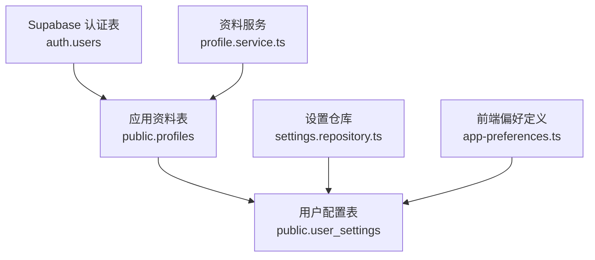

**图表来源**
- [20260507153000_platform_schema.sql:69-98](file://supabase/migrations/20260507153000_platform_schema.sql#L69-L98)
- [settings.repository.ts:1-116](file://src/server/repositories/settings.repository.ts#L1-L116)
- [profile.service.ts:1-200](file://src/server/services/profile.service.ts#L1-L200)
- [app-preferences.ts:1-392](file://src/shared/lib/app-preferences.ts#L1-L392)

**章节来源**
- [20260507153000_platform_schema.sql:64-98](file://supabase/migrations/20260507153000_platform_schema.sql#L64-L98)
- [settings.repository.ts:1-116](file://src/server/repositories/settings.repository.ts#L1-L116)
- [profile.service.ts:1-200](file://src/server/services/profile.service.ts#L1-L200)

## 核心数据模型
本节聚焦三个关键实体：`auth.users`（外部）、`profiles`、`user_settings`。

### 1. 认证表与应用资料表的关系
`profiles` 是 `auth.users` 的应用侧扩展表，主键 `id` 引用 `auth.users(id)`，形成一对一关系。它负责保存：
- 显示名称、头像 URL。
- 区域设置、时区。
- 默认工作区。
- 账号类型、生命周期阶段、获取来源、用户分群、组织角色等业务元数据。
- 后续新增的用户名、头像形状、公开可见性开关等。

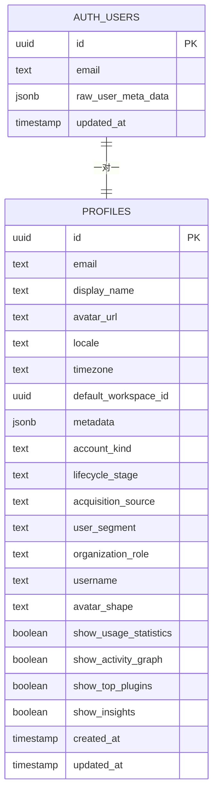

**图表来源**
- [20260507153000_platform_schema.sql:69-83](file://supabase/migrations/20260507153000_platform_schema.sql#L69-L83)
- [20260508111000_model_training_priority_governance_expansion.sql:46-53](file://supabase/migrations/20260508111000_model_training_priority_governance_expansion.sql#L46-L53)
- [20261011134752_public_user_profiles.sql:1-77](file://supabase/migrations/20261011134752_public_user_profiles.sql#L1-L77)

### 2. 用户配置表 `user_settings`
`user_settings` 以 `user_id` 为主键，直接引用 `auth.users(id)`，用于保存用户级别的配置。当前迁移中该表至少包含：
- `user_id`：外键指向 `auth.users.id`。
- `email`：反范式设计，冗余缓存认证邮箱。
- `display_name`、`avatar_url`：与 `profiles` 同步的展示信息。
- `theme`、`language`、`timezone`：界面主题、语言和时区。
- `chat_model_id`、`response_style`：对话模型与回复风格。
- `memory_enabled`、`web_search_enabled`、`artifact_auto_open`：功能开关。
- `email_notifications`、`product_updates`、`data_training_opt_in`：通知与训练偏好。
- `settings`：JSONB 扩展字段，用于存储任意 UI 偏好和业务配置。

此外，历史上还添加了：
- `onboarding_step`：记录首次运行引导步骤。
- `onboarding_completed_at`：标记首次引导完成时间。
- `onboarding_answers`：结构化保存引导答案。

这些引导字段已在较新迁移中被删除，但了解其历史对理解现有行为很重要。

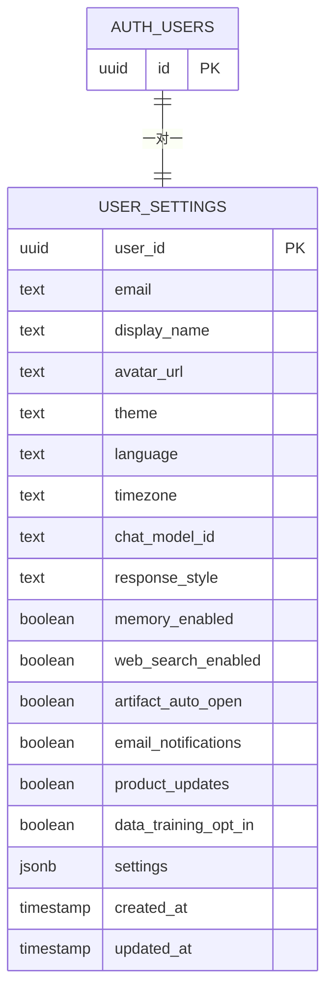

**图表来源**
- [20260507153000_platform_schema.sql:85-98](file://supabase/migrations/20260507153000_platform_schema.sql#L85-L98)
- [settings.repository.ts:1-116](file://src/server/repositories/settings.repository.ts#L1-L116)

**章节来源**
- [20260507153000_platform_schema.sql:85-98](file://supabase/migrations/20260507153000_platform_schema.sql#L85-L98)
- [settings.repository.ts:1-116](file://src/server/repositories/settings.repository.ts#L1-L116)

## 架构总览
用户数据的写入路径可以分为两类：

1. **认证后自动初始化**：当新用户通过 Supabase 认证创建时，数据库触发器或服务逻辑会同时创建 `profiles`、`user_settings`、`notification_preferences`、初始余额等记录。
2. **运行时更新**：用户在设置页面修改主题、语言、通知、头像、用户名等，由应用服务调用仓库层执行 SQL 更新。

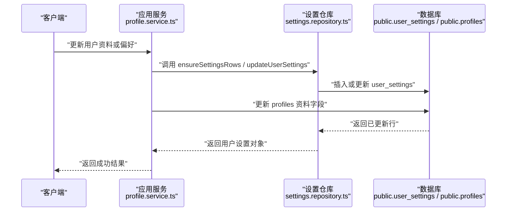

**图表来源**
- [profile.service.ts:1-200](file://src/server/services/profile.service.ts#L1-L200)
- [settings.repository.ts:1-116](file://src/server/repositories/settings.repository.ts#L1-L116)

**章节来源**
- [profile.service.ts:1-200](file://src/server/services/profile.service.ts#L1-L200)
- [settings.repository.ts:1-116](file://src/server/repositories/settings.repository.ts#L1-L116)

## 详细组件分析

### 用户设置仓库：读取、写入与空行保障
`settings.repository.ts` 定义了用户设置的 TypeScript 类型和数据库访问方法，核心职责包括：
- `ensureSettingsRows(userId, email?)`：在身份引导不可用时，确保 `user_settings` 和 `notification_preferences` 存在空行。
- `getUserSettings(userId)`：读取主题、语言、显示名称和通用设置。
- `updateUserSettings(userId, patch)`：部分更新 `settings`、`theme`、`language`。
- `getNotificationPreferences(userId)` / `updateNotificationPreferences(userId, patch)`：读写通知偏好。

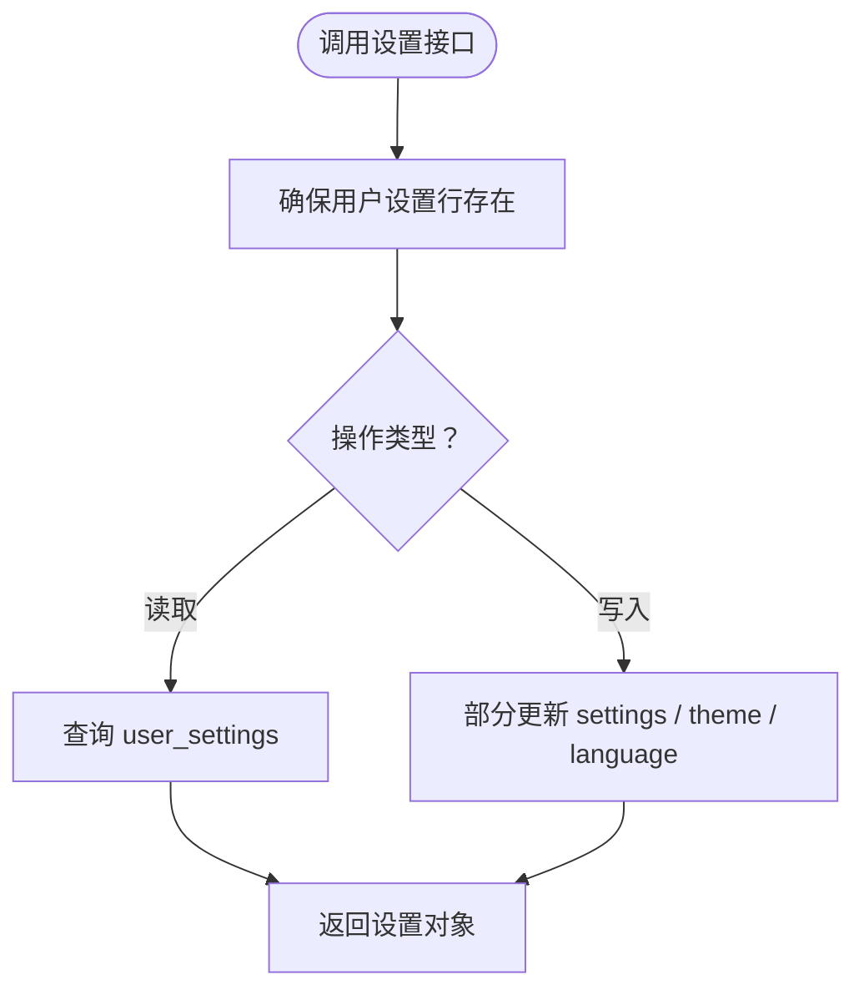

**图表来源**
- [settings.repository.ts:1-116](file://src/server/repositories/settings.repository.ts#L1-L116)

**章节来源**
- [settings.repository.ts:1-116](file://src/server/repositories/settings.repository.ts#L1-L116)

### JSONB 设置字段与 UI 偏好存储模式
`settings` 是一个 JSONB 字段，用于容纳结构化的 UI 偏好和业务配置。前端通过 `app-preferences.ts` 定义偏好键、字体选项、主题映射等，后端通过 `settings.repository.ts` 将整块 `settings` 作为 JSONB 存入数据库。

典型用法包括：
- 存储聊天字体、外观预设、动效、强调色、对比度等。
- 存储插件、工具、会话等扩展配置。
- 避免为每个小偏好增加列，从而保持表结构灵活。

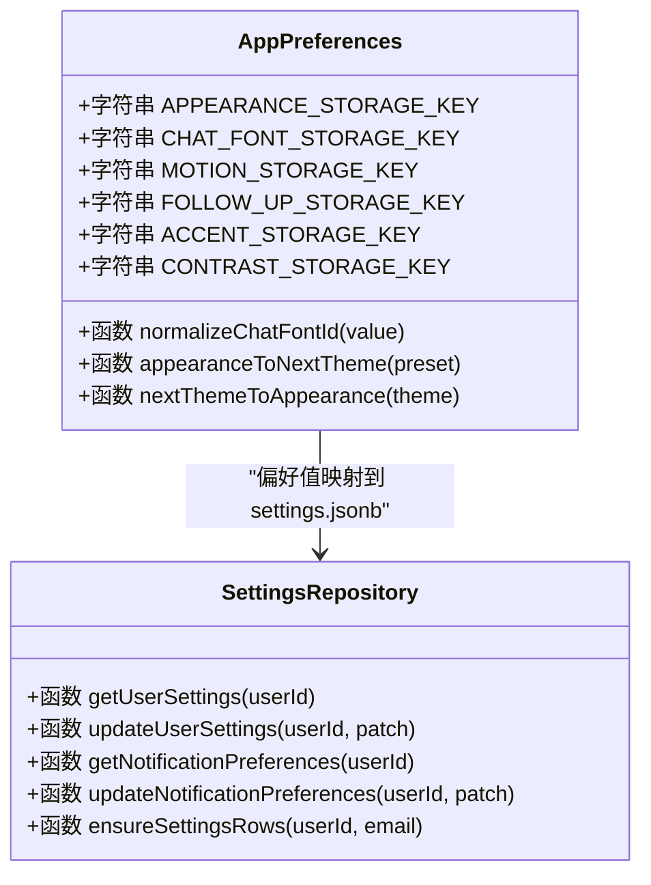

**图表来源**
- [app-preferences.ts:1-392](file://src/shared/lib/app-preferences.ts#L1-L392)
- [settings.repository.ts:1-116](file://src/server/repositories/settings.repository.ts#L1-L116)

**章节来源**
- [app-preferences.ts:1-392](file://src/shared/lib/app-preferences.ts#L1-L392)
- [settings.repository.ts:1-116](file://src/server/repositories/settings.repository.ts#L1-L116)

### 引导流程字段的历史设计与清理
#### 历史设计
最初引入引导状态时，`user_settings` 新增了：
- `onboarding_step`：文本字段，表示当前引导步骤，例如欢迎、创建账户、计划选择、桌面端提示、姓名、角色等。
- `onboarding_completed_at`：时间戳，表示首次引导完成时间。
- `onboarding_answers`：JSONB，保存结构化引导答案，如同意项、计划、姓名、角色、训练选择等。

这些字段配合约束和默认值，使引导流程可哈希化、可断点续导，并能根据已有聊天记录或个性化字段“祖父化”老用户。

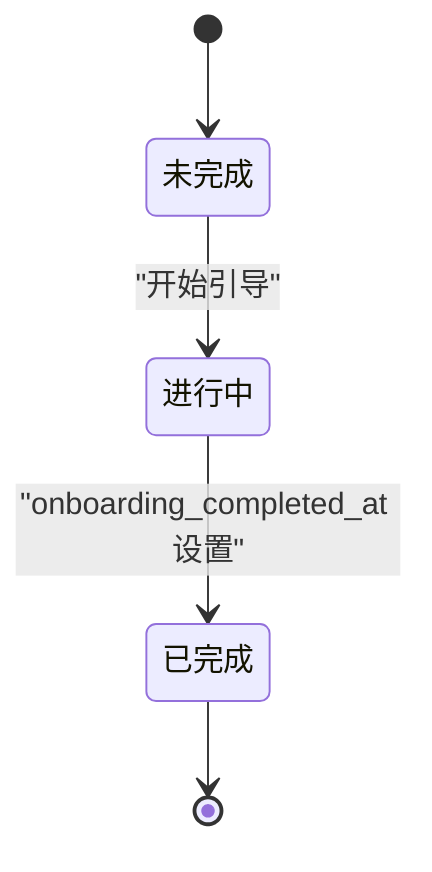

**图表来源**
- [20260709100000_schema_drift_and_onboarding.sql:1-15](file://supabase/migrations/20260709100000_schema_drift_and_onboarding.sql#L1-L15)
- [20260710115748_onboarding_answers.sql:1-6](file://supabase/migrations/20260710115748_onboarding_answers.sql#L1-L6)
- [20260712083000_onboarding_step_integrity.sql:1-37](file://supabase/migrations/20260712083000_onboarding_step_integrity.sql#L1-L37)

#### 老用户兼容策略
`grandfather_existing_onboarding` 迁移针对已在使用产品的用户，如果他们没有完成引导，会根据是否有聊天记录、是否已有显示名称或个人化职业字段，将其视为“已完成”，并将步骤归一化为合理默认值。

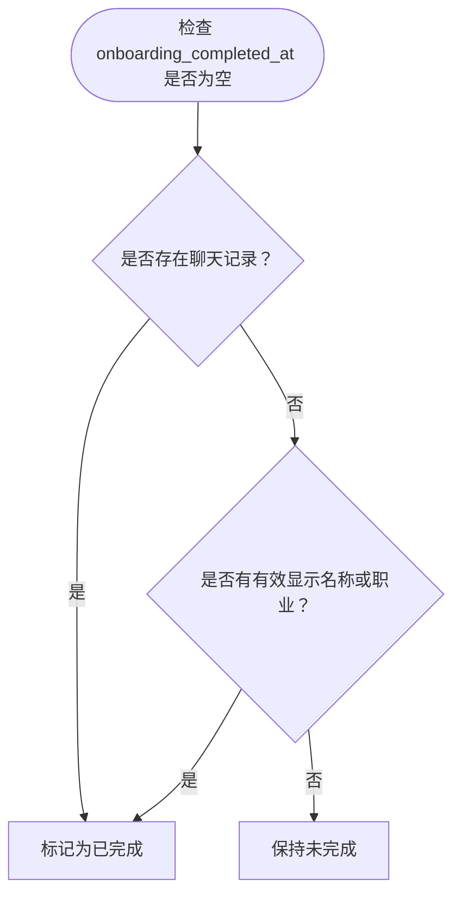

**图表来源**
- [20260710150000_grandfather_existing_onboarding.sql:1-31](file://supabase/migrations/20260710150000_grandfather_existing_onboarding.sql#L1-L31)

#### 最终清理
最新相关迁移 `20261008120000_remove_onboarding.sql` 从 `user_settings` 中移除了：
- `onboarding_step`
- `onboarding_completed_at`
- `onboarding_answers`
- 以及 `consent_evidence` 中的 `onboarding` 键。

这意味着当前数据库中不再保留这些字段；如需判断用户是否完成过旧版引导，应查看历史数据或使用其他业务状态。

**章节来源**
- [20260709100000_schema_drift_and_onboarding.sql:1-15](file://supabase/migrations/20260709100000_schema_drift_and_onboarding.sql#L1-L15)
- [20260710115748_onboarding_answers.sql:1-6](file://supabase/migrations/20260710115748_onboarding_answers.sql#L1-L6)
- [20260710150000_grandfather_existing_onboarding.sql:1-31](file://supabase/migrations/20260710150000_grandfather_existing_onboarding.sql#L1-L31)
- [20260712083000_onboarding_step_integrity.sql:1-37](file://supabase/migrations/20260712083000_onboarding_step_integrity.sql#L1-L37)
- [20261008120000_remove_onboarding.sql:1-10](file://supabase/migrations/20261008120000_remove_onboarding.sql#L1-L10)

### 认证表扩展与公开个人资料
`profiles` 表通过外键关联 `auth.users(id)`，是应用对认证身份的扩展。后续迁移逐步增加了：
- 用户名、头像形状。
- 统计与活动图可见性开关。
- 用户名格式校验、唯一索引。
- 自动分配用户名的触发器，保证新用户有可路由的用户名。

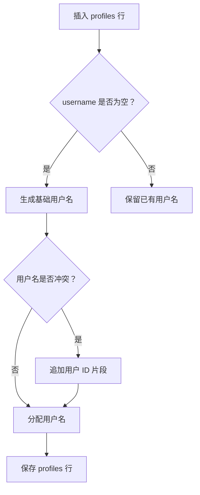

**图表来源**
- [20261011134752_public_user_profiles.sql:1-77](file://supabase/migrations/20261011134752_public_user_profiles.sql#L1-L77)

**章节来源**
- [20260507153000_platform_schema.sql:69-83](file://supabase/migrations/20260507153000_platform_schema.sql#L69-L83)
- [20261011134752_public_user_profiles.sql:1-77](file://supabase/migrations/20261011134752_public_user_profiles.sql#L1-L77)

### 用户状态管理与资料同步
`profile.service.ts` 负责将认证元数据与业务资料对齐：
- 同步显示名称和头像。
- 避免无意义更新，减少 Realtime 广播。
- 更新 `profiles` 的同时，把重要字段镜像到 `user_settings.display_name` 和 `auth.users.raw_user_meta_data`。
- 校验用户名格式、头像形状，并处理冲突错误。

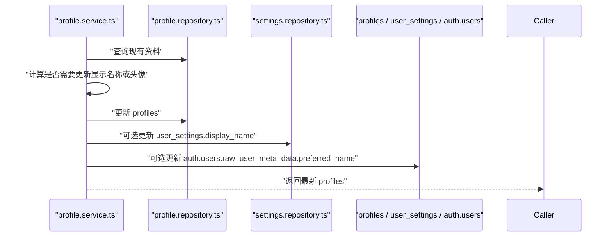

**图表来源**
- [profile.service.ts:1-200](file://src/server/services/profile.service.ts#L1-L200)

**章节来源**
- [profile.service.ts:1-200](file://src/server/services/profile.service.ts#L1-L200)

## 依赖关系分析
用户模型的依赖关系可以概括为：

- **`auth.users`**：系统级认证身份，不直接暴露完整业务资料。
- **`profiles`**：面向应用的业务身份，一对一对应 `auth.users`。
- **`user_settings`**：面向用户配置和 UI 偏好，一对一对应 `auth.users`。
- **`settings.repository.ts`**：封装对 `user_settings` 的读、写、初始化逻辑。
- **`profile.service.ts`**：协调 `profiles`、`user_settings`、`auth.users` 的数据一致性。
- **`app-preferences.ts`**：定义前端偏好模型，并与后端 JSONB 设置字段协作。

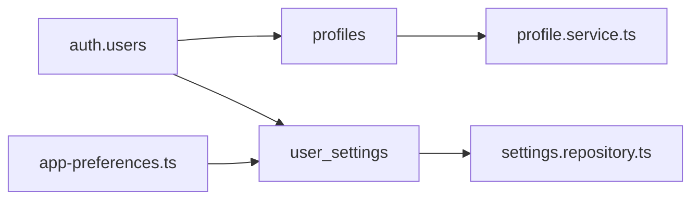

**图表来源**
- [20260507153000_platform_schema.sql:69-98](file://supabase/migrations/20260507153000_platform_schema.sql#L69-L98)
- [settings.repository.ts:1-116](file://src/server/repositories/settings.repository.ts#L1-L116)
- [profile.service.ts:1-200](file://src/server/services/profile.service.ts#L1-L200)
- [app-preferences.ts:1-392](file://src/shared/lib/app-preferences.ts#L1-L392)

**章节来源**
- [20260507153000_platform_schema.sql:69-98](file://supabase/migrations/20260507153000_platform_schema.sql#L69-L98)
- [settings.repository.ts:1-116](file://src/server/repositories/settings.repository.ts#L1-L116)
- [profile.service.ts:1-200](file://src/server/services/profile.service.ts#L1-L200)
- [app-preferences.ts:1-392](file://src/shared/lib/app-preferences.ts#L1-L392)

## 性能与可扩展性
- **JSONB 字段优势**：`settings` 允许在不频繁变更表结构的情况下扩展偏好字段，适合快速迭代 UI 配置。
- **反范式字段风险**：`user_settings.email` 是 `auth.users.email` 的反范式副本，优点是查询快，缺点是邮箱变更需要同步；需要依赖初始化逻辑保持一致。
- **最小更新策略**：`profile.service.ts` 跳过无变化更新，避免不必要的 Realtime 事件。
- **外键约束**：`user_settings.user_id` 和 `profiles.id` 都通过外键绑定到 `auth.users.id`，保证用户删除时的数据一致性。
- **扩展建议**：对于高频读取且结构稳定的偏好，可考虑拆分为独立列；对于低频、多变配置，继续放在 JSONB 中。

[本节为一般性能讨论，未直接分析具体代码片段]

## 故障排查指南

### 常见问题与定位建议
1. **用户登录后没有 `user_settings` 行**
   - 检查身份初始化逻辑是否调用了 `ensureSettingsRows`。
   - 确认 `user_settings.user_id` 是否正确指向 `auth.users.id`。
   - 参考路径：[settings.repository.ts:1-116](file://src/server/repositories/settings.repository.ts#L1-L116)。

2. **主题或语言未生效**
   - 检查 `user_settings.theme` 和 `user_settings.language` 是否被正确更新。
   - 检查前端偏好键是否与后端 JSONB 设置一致。
   - 参考路径：[settings.repository.ts:1-116](file://src/server/repositories/settings.repository.ts#L1-L116)、[app-preferences.ts:1-392](file://src/shared/lib/app-preferences.ts#L1-L392)。

3. **用户名冲突或格式错误**
   - 用户名必须匹配 3 到 32 位小写字母、数字和下划线。
   - 重复用户名会通过触发器追加 ID 片段。
   - 参考路径：[20261011134752_public_user_profiles.sql:1-77](file://supabase/migrations/20261011134752_public_user_profiles.sql#L1-L77)、[profile.service.ts:1-200](file://src/server/services/profile.service.ts#L1-L200)。

4. **旧版引导状态异常**
   - 注意 `onboarding_step`、`onboarding_completed_at`、`onboarding_answers` 已被移除。
   - 若仍看到相关字段，需检查本地数据库是否落后于生产迁移。
   - 参考路径：[20261008120000_remove_onboarding.sql:1-10](file://supabase/migrations/20261008120000_remove_onboarding.sql#L1-L10)。

**章节来源**
- [settings.repository.ts:1-116](file://src/server/repositories/settings.repository.ts#L1-L116)
- [app-preferences.ts:1-392](file://src/shared/lib/app-preferences.ts#L1-L392)
- [20261011134752_public_user_profiles.sql:1-77](file://supabase/migrations/20261011134752_public_user_profiles.sql#L1-L77)
- [profile.service.ts:1-200](file://src/server/services/profile.service.ts#L1-L200)
- [20261008120000_remove_onboarding.sql:1-10](file://supabase/migrations/20261008120000_remove_onboarding.sql#L1-L10)

## 结论
该项目的用户模型采用“认证身份与业务资料分离、配置与资料分离”的设计：
- `auth.users` 提供稳定身份。
- `profiles` 承载业务可见的用户资料，并通过外键与认证表关联。
- `user_settings` 承载用户偏好、UI 主题、语言和扩展 JSONB 设置。
- 历史引导字段曾用于首次运行体验，但最终被清理，当前应以业务现状为准。
- RLS 和触发器共同维护数据安全与一致性，仓库和服务层则封装查询与写入逻辑，降低上层复杂度。

对于使用者而言，推荐：
- 读取用户偏好时优先使用 `settings.repository.ts` 提供的接口。
- 更新 UI 偏好时使用 JSONB `settings`，保持结构清晰。
- 关注 `profiles` 与 `user_settings` 之间的显示名称和头像同步。
- 避免直接依赖已被移除的引导字段。

[本节为总结，未直接分析具体文件]