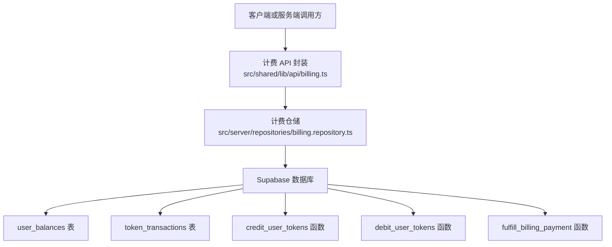
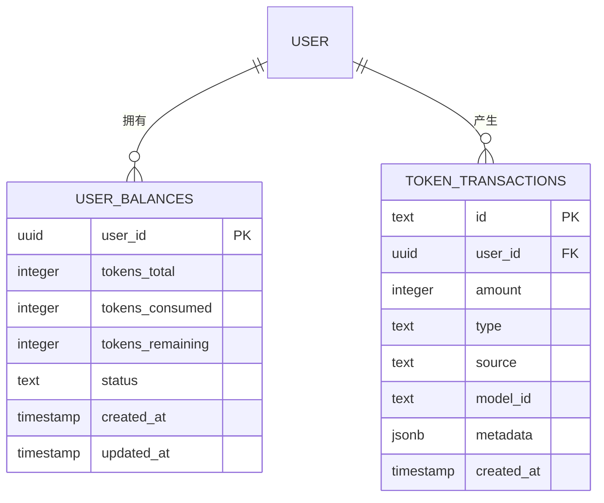
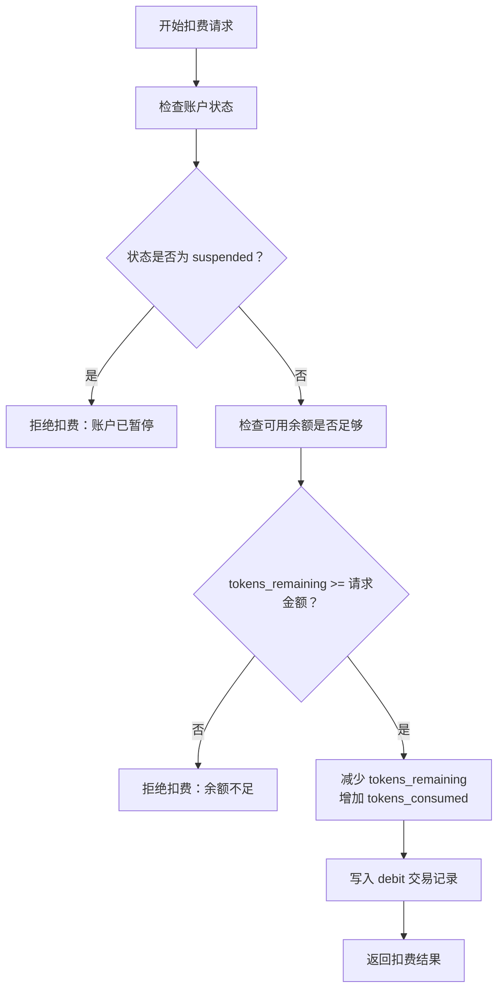
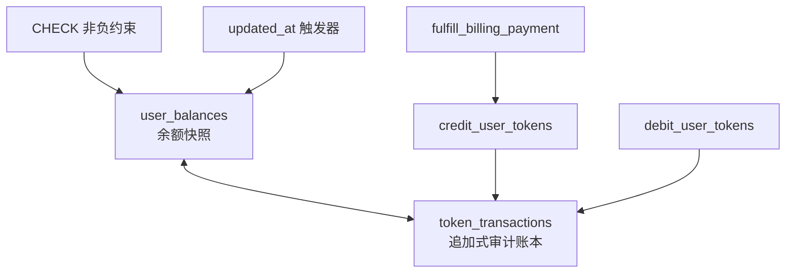
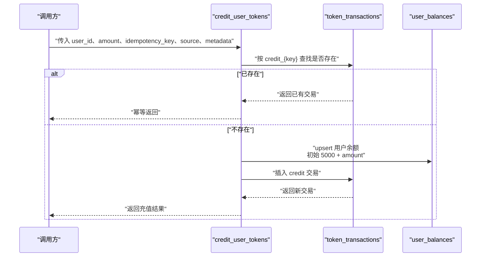
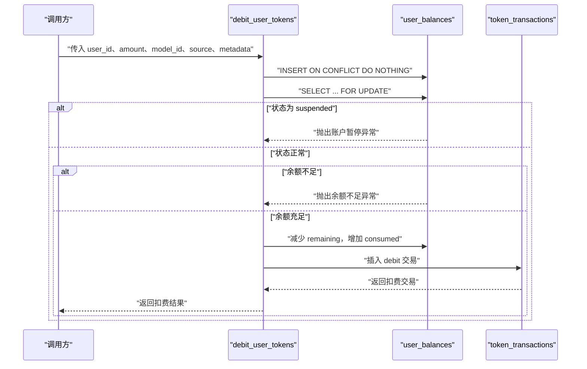
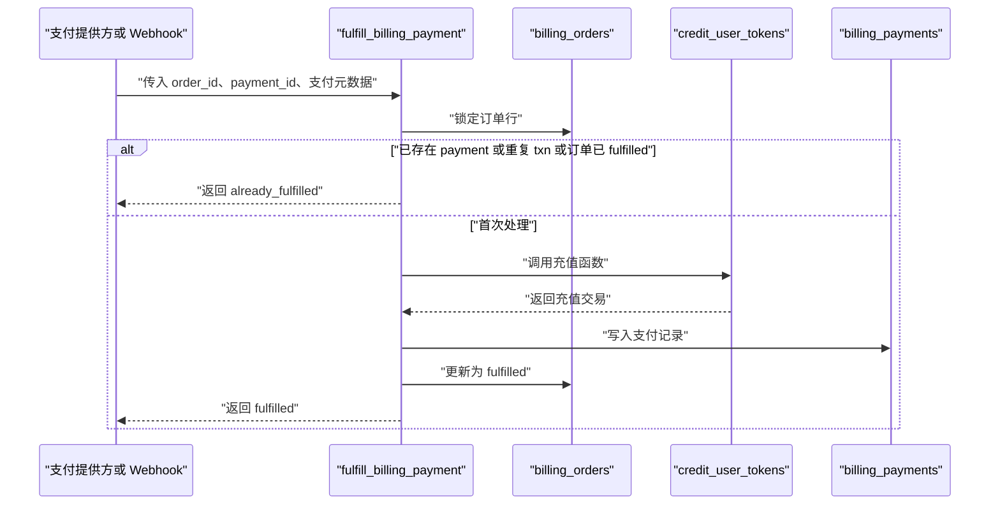
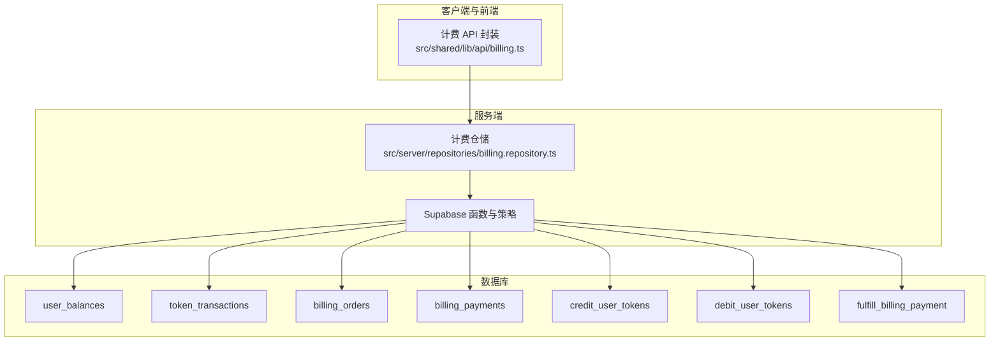

# 账户与余额

<cite>
**本文引用的文件**   
- [supabase/migrations/20260506160000_core_backend.sql](file://supabase/migrations/20260506160000_core_backend.sql)
- [src/shared/types/database.types.ts](file://src/shared/types/database.types.ts)
- [src/server/repositories/billing.repository.ts](file://src/server/repositories/billing.repository.ts)
- [src/shared/lib/api/billing.ts](file://src/shared/lib/api/billing.ts)
</cite>

## 目录
1. [引言](#引言)
2. [项目结构与定位](#项目结构与定位)
3. [核心数据模型：user_balances](#核心数据模型user_balances)
4. [状态语义与计费行为](#状态语义与计费行为)
5. [约束、触发器与审计账本](#约束触发器与审计账本)
6. [余额更新事务与原子函数](#余额更新事务与原子函数)
7. [查询、扣费校验与状态管理示例](#查询扣费校验与状态管理示例)
8. [依赖关系与架构总览](#依赖关系与架构总览)
9. [性能与一致性建议](#性能与一致性建议)
10. [故障排查指南](#故障排查指南)
11. [结论](#结论)

## 引言
本文件聚焦账户与余额子系统，围绕 `user_balances` 表及其相关数据库函数展开，说明累计充值、累计消费、可用余额三类字段的业务含义，解释 `active`、`suspended`、`trial` 三种状态对计费的影响，并文档化余额非负约束、触发器机制、事务性保证和幂等设计。同时给出面向后端的查询、扣费校验与状态管理实践路径，帮助读者在不直接阅读 SQL 的前提下理解整个余额体系。

## 项目结构与定位
余额系统位于后端基础设施层，由 Supabase 迁移脚本定义核心表与函数，并由服务端仓库及共享 API 类型参与调用或暴露。其关键位置如下：
- 数据库模式与函数：`supabase/migrations/20260506160000_core_backend.sql`
- TypeScript 数据库类型：`src/shared/types/database.types.ts`
- 服务端计费仓储：`src/server/repositories/billing.repository.ts`
- 前端/客户端计费 API 封装：`src/shared/lib/api/billing.ts`

图表来源
- [supabase/migrations/20260506160000_core_backend.sql:86-108](file://supabase/migrations/20260506160000_core_backend.sql#L86-L108)
- [supabase/migrations/20260506160000_core_backend.sql:390-449](file://supabase/migrations/20260506160000_core_backend.sql#L390-L449)
- [supabase/migrations/20260506160000_core_backend.sql:452-519](file://supabase/migrations/20260506160000_core_backend.sql#L452-L519)
- [supabase/migrations/20260506160000_core_backend.sql:520-655](file://supabase/migrations/20260506160000_core_backend.sql#L520-L655)
- [src/shared/lib/api/billing.ts:1-200](file://src/shared/lib/api/billing.ts#L1-L200)
- [src/server/repositories/billing.repository.ts:1-200](file://src/server/repositories/billing.repository.ts#L1-L200)

章节来源
- [supabase/migrations/20260506160000_core_backend.sql:1-30](file://supabase/migrations/20260506160000_core_backend.sql#L1-L30)
- [src/shared/lib/api/billing.ts:1-200](file://src/shared/lib/api/billing.ts#L1-L200)
- [src/server/repositories/billing.repository.ts:1-200](file://src/server/repositories/billing.repository.ts#L1-L200)

## 核心数据模型：user_balances
`user_balances` 是用户令牌钱包的核心表，按用户维度维护生命周期内的累计充值、累计消费与当前可用余额，并附带账户状态与时间戳。

| 字段 | 类型 | 默认值 | 业务含义 | 约束 |
|---|---:|---:|---|---|
| `user_id` | uuid | 无 | 关联认证用户的唯一标识；删除用户时级联删除余额行 | 主键，外键引用 `auth.users(id)` |
| `tokens_total` | integer | 5000 | 累计充值总量，包含初始试用额度与后续购买充值 | `>= 0` |
| `tokens_consumed` | integer | 0 | 累计消费总量，用于统计历史消耗 | `>= 0` |
| `tokens_remaining` | integer | 5000 | 可继续使用的余额；扣费时以此为准 | `>= 0` |
| `status` | text | trial | 账户状态，影响是否允许扣费 | 枚举：`active`、`suspended`、`trial` |
| `created_at` | timestamptz | now() | 记录创建时间 | 非空 |
| `updated_at` | timestamptz | now() | 记录最近更新时间 | 非空 |

关键字段之间的关系满足以下不变式：
- `tokens_total` 只增不减，反映历史充值总额。
- `tokens_consumed` 只增不减，反映历史扣费总额。
- `tokens_remaining` 表示可花费余额；当其为负数时会违反数据库 CHECK 约束。
- 新用户在首次通过 `credit_user_tokens` 入账时，会以 5000 作为试用基准，再叠加本次充值金额。

图表来源
- [supabase/migrations/20260506160000_core_backend.sql:86-108](file://supabase/migrations/20260506160000_core_backend.sql#L86-L108)
- [supabase/migrations/20260506160000_core_backend.sql:116-133](file://supabase/migrations/20260506160000_core_backend.sql#L116-L133)

章节来源
- [supabase/migrations/20260506160000_core_backend.sql:86-108](file://supabase/migrations/20260506160000_core_backend.sql#L86-L108)
- [src/shared/types/database.types.ts:1-200](file://src/shared/types/database.types.ts#L1-L200)

## 状态语义与计费行为
`status` 字段描述账户在计费系统中的生命周期阶段：

| 状态 | 含义 | 对计费行为的影响 |
|---|---|---|
| `trial` | 新用户试用账户，初始余额为 5000 | 正常允许扣费；余额不足时仍会拒绝扣费 |
| `active` | 已激活或已完成充值的活跃账户 | 正常允许扣费；余额不足时拒绝 |
| `suspended` | 被暂停的账户 | `debit_user_tokens` 明确拒绝扣费，抛出账户被暂停异常 |

注意：
- `trial` 不等于“不可扣费”。它只是表示初始试用状态，只要余额充足，扣费仍可成功。
- `suspended` 是显式的计费阻断状态，适用于风控、欠费或其他运营场景。
- 初次通过 `credit_user_tokens` 入账时，如果用户不存在则插入 `status = 'active'`；若用户已存在，则把状态重置为 `active`，这使支付成功后账户重新进入活跃状态。

图表来源
- [supabase/migrations/20260506160000_core_backend.sql:452-519](file://supabase/migrations/20260506160000_core_backend.sql#L452-L519)

章节来源
- [supabase/migrations/20260506160000_core_backend.sql:86-108](file://supabase/migrations/20260506160000_core_backend.sql#L86-L108)
- [supabase/migrations/20260506160000_core_backend.sql:452-519](file://supabase/migrations/20260506160000_core_backend.sql#L452-L519)

## 约束、触发器与审计账本
### 余额非负约束
`user_balances` 对三个核心数值字段都定义了 `check (... >= 0)` 约束：
- `tokens_total >= 0`
- `tokens_consumed >= 0`
- `tokens_remaining >= 0`

这些约束确保即使并发更新或应用层逻辑出现异常，数据库层面也不会接受负余额。任何试图将 `tokens_remaining` 设为负数的更新都会失败。

### 自动更新时间戳触发器
`user_balances` 使用通用 `set_updated_at()` 触发器，在每次行更新前将 `updated_at` 设置为当前时间。该触发器：
- 不改变业务逻辑。
- 便于审计和缓存失效判断。
- 可通过 `CREATE OR REPLACE` 安全重放迁移。

### 审计账本：token_transactions
所有余额变动都以追加式交易记录保存：
- `type` 为 `credit` 或 `debit`。
- `source` 包括 `purchase`、`generation`、`chat`、`reward`。
- 充值交易 ID 通常来自幂等键，格式为 `credit_{key}`。
- 扣费交易 ID 每次生成新的随机标识，格式为 `debit_{uuid}`。

这种“余额表 + 追加账本”的设计支持：
- 余额快速查询。
- 完整审计追溯。
- 幂等充值。
- 去重与对账。

图表来源
- [supabase/migrations/20260506160000_core_backend.sql:86-133](file://supabase/migrations/20260506160000_core_backend.sql#L86-L133)
- [supabase/migrations/20260506160000_core_backend.sql:390-519](file://supabase/migrations/20260506160000_core_backend.sql#L390-L519)

章节来源
- [supabase/migrations/20260506160000_core_backend.sql:86-133](file://supabase/migrations/20260506160000_core_backend.sql#L86-L133)
- [supabase/migrations/20260506160000_core_backend.sql:390-519](file://supabase/migrations/20260506160000_core_backend.sql#L390-L519)

## 余额更新事务与原子函数
余额更新集中在三个 `SECURITY DEFINER` 函数中，避免绕过 RLS 和约束直接修改敏感余额字段。

### credit_user_tokens：幂等充值
职责：
- 验证充值金额为正整数。
- 根据清洗后的幂等键生成交易 ID，形式为 `credit_{sanitized_key}`。
- 若相同交易 ID 已存在，直接返回已有交易记录，不重复充值。
- 若用户不存在，则插入用户余额行，初始值为 5000（试用基准）加上本次充值金额。
- 若用户已存在，则在现有 `tokens_total` 和 `tokens_remaining` 上累加本次充值额，并将状态置为 `active`。
- 写入一条 `credit` 类型的 `token_transactions` 记录。

幂等性：
- 同一幂等键不会重复增加余额。
- 适合处理支付回调重试。

图表来源
- [supabase/migrations/20260506160000_core_backend.sql:390-449](file://supabase/migrations/20260506160000_core_backend.sql#L390-L449)

章节来源
- [supabase/migrations/20260506160000_core_backend.sql:390-449](file://supabase/migrations/20260506160000_core_backend.sql#L390-L449)

### debit_user_tokens：原子扣费
职责：
- 验证扣费金额为正整数。
- 确保目标用户存在，不存在则隐式插入占位行。
- 以 `FOR UPDATE` 锁定用户余额行，防止并发扣费导致超扣。
- 若账户状态为 `suspended`，抛出账户暂停异常。
- 若 `tokens_remaining` 小于请求金额，抛出余额不足异常。
- 原子更新 `tokens_remaining` 减去金额、`tokens_consumed` 加上金额。
- 写入一条 `debit` 交易记录，ID 使用随机 UUID。

幂等性：
- 不提供数据库层幂等；重复调用可能重复扣费。
- 调用方应自行实现去重，例如基于外部订单号或业务请求 ID。

图表来源
- [supabase/migrations/20260506160000_core_backend.sql:452-519](file://supabase/migrations/20260506160000_core_backend.sql#L452-L519)

章节来源
- [supabase/migrations/20260506160000_core_backend.sql:452-519](file://supabase/migrations/20260506160000_core_backend.sql#L452-L519)

### fulfill_billing_payment：支付完成与充值合并
职责：
- 锁定对应 `billing_orders` 行。
- 检测是否已经处理过：重复支付 ID、重复充值交易 ID 或订单已标记为 `fulfilled`。
- 若已处理，返回 `already_fulfilled`，并在提供 webhook event ID 时记录重复事件。
- 否则调用 `credit_user_tokens`，以订单中的 `tokens` 为用户充值。
- 写入 `billing_payments` 记录。
- 将订单状态更新为 `fulfilled`，并填充支付相关信息和时间戳。
- 如提供 webhook event ID，记录 webhook 审计事件。

幂等性：
- 基于支付 ID、派生充值交易 ID 和订单状态共同保证幂等。
- 适合接收 Razorpay 支付回调或 Webhook 重试。

图表来源
- [supabase/migrations/20260506160000_core_backend.sql:520-655](file://supabase/migrations/20260506160000_core_backend.sql#L520-L655)

章节来源
- [supabase/migrations/20260506160000_core_backend.sql:520-655](file://supabase/migrations/20260506160000_core_backend.sql#L520-L655)

## 查询、扣费校验与状态管理示例
以下示例描述实际代码中使用余额系统的常见方式，不直接展示 SQL 内容，而是指出对应的代码路径与行为。

### 查询余额与订阅信息
客户端通过计费 API 获取订阅信息和余额摘要，响应中包含：
- `subscription`：订阅计划、状态、周期等信息。
- `balance`：`tokens_remaining`、`tokens_total`、`status`。
- `plans`：可用计费计划列表。

参考路径：
- [src/shared/lib/api/billing.ts:1-200](file://src/shared/lib/api/billing.ts#L1-L200)

用途：
- 前端展示剩余令牌、累计充值与账户状态。
- 控制 UI 是否允许发起需要余额的生成或聊天操作。

### 后台查询计费订单与支付记录
服务端仓储模块提供按订单 ID、Razorpay 订单 ID、UPI QR ID 等条件查询 `billing_orders` 和 `billing_payments` 的方法，并支持合并元数据。

参考路径：
- [src/server/repositories/billing.repository.ts:1-200](file://src/server/repositories/billing.repository.ts#L1-L200)

用途：
- 支付回调处理。
- 发票与对账。
- 根据订单查询用户与金额信息，以便调用 `fulfill_billing_payment`。

### 扣费前的应用层校验
在服务端调用 `debit_user_tokens` 之前，建议先进行参数校验，例如：
- 确认请求金额为正整数。
- 确认用户已登录且属于当前租户。
- 对高风险接口做防重入与限流。

参考路径：
- [src/server/repositories/billing.repository.ts:1-200](file://src/server/repositories/billing.repository.ts#L1-L200)

数据库层还会再次校验金额是否为正数，并检查余额是否足够以及账户是否被暂停。因此，应用层校验与数据库层校验应同时保留，前者用于快速失败与友好错误提示，后者用于最终一致性保障。

### 状态管理实践
- 新用户注册后，可在首次充值时让 `credit_user_tokens` 将状态置为 `active`。
- 支付完成后，`fulfill_billing_payment` 会通过 `credit_user_tokens` 重置为 `active`。
- 运营侧如需暂停计费，可直接将 `status` 更新为 `suspended`；下次扣费将被拒绝。
- 不建议频繁手动修改 `tokens_remaining`，应优先通过 `credit_user_tokens` 和 `debit_user_tokens` 保持余额与账本一致。

## 依赖关系与架构总览
余额系统依赖多个组件协同工作：

图表来源
- [src/shared/lib/api/billing.ts:1-200](file://src/shared/lib/api/billing.ts#L1-L200)
- [src/server/repositories/billing.repository.ts:1-200](file://src/server/repositories/billing.repository.ts#L1-L200)
- [supabase/migrations/20260506160000_core_backend.sql:86-655](file://supabase/migrations/20260506160000_core_backend.sql#L86-L655)

章节来源
- [src/shared/lib/api/billing.ts:1-200](file://src/shared/lib/api/billing.ts#L1-L200)
- [src/server/repositories/billing.repository.ts:1-200](file://src/server/repositories/billing.repository.ts#L1-L200)
- [supabase/migrations/20260506160000_core_backend.sql:86-655](file://supabase/migrations/20260506160000_core_backend.sql#L86-L655)

## 性能与一致性建议
- 优先使用数据库函数进行余额变更，避免应用层直接拼接 UPDATE 语句。
- 对高频充值场景使用幂等键，避免支付回调重试造成重复充值。
- 对高频扣费场景，调用方应实现请求级去重，因为 `debit_user_tokens` 本身不具备幂等性。
- 利用 `token_transactions` 做异步对账和异常恢复，而不是直接修复 `user_balances`。
- 关注 `tokens_remaining` 接近零时的用户体验，可在应用层提前提示，而非等到数据库抛出余额不足异常。
- 合理设置索引与查询范围，尤其是按 `user_id` 和 `created_at` 查询交易记录。

[本节为通用性能建议，未直接分析具体文件]

## 故障排查指南
### 扣费失败：账户已暂停
现象：
- 扣费函数抛出账户暂停异常。

排查步骤：
1. 检查 `user_balances.status` 是否为 `suspended`。
2. 确认是否有运营侧手动暂停账户。
3. 若需恢复，应先确认原因，再将状态改为 `active`。

相关逻辑位置：
- [supabase/migrations/20260506160000_core_backend.sql:452-519](file://supabase/migrations/20260506160000_core_backend.sql#L452-L519)

### 扣费失败：余额不足
现象：
- 扣费函数抛出余额不足异常。

排查步骤：
1. 查询 `tokens_remaining` 是否小于请求金额。
2. 检查是否存在未完成的充值流程。
3. 核对 `token_transactions` 中是否有对应充值记录。
4. 若充值确实发生但余额未更新，检查 `credit_user_tokens` 是否因幂等键冲突返回了旧交易。

相关逻辑位置：
- [supabase/migrations/20260506160000_core_backend.sql:452-519](file://supabase/migrations/20260506160000_core_backend.sql#L452-L519)
- [supabase/migrations/20260506160000_core_backend.sql:390-449](file://supabase/migrations/20260506160000_core_backend.sql#L390-L449)

### 支付完成但未充值
现象：
- 支付记录存在，但用户余额未增加。

排查步骤：
1. 检查 `billing_orders.status` 是否为 `fulfilled`。
2. 检查 `billing_payments` 是否已写入。
3. 检查 `token_transactions` 是否存在 `credit_billing_{order}_{payment}` 形式的充值交易。
4. 若三者缺失，可能是支付回调尚未到达或处理失败。

相关逻辑位置：
- [supabase/migrations/20260506160000_core_backend.sql:520-655](file://supabase/migrations/20260506160000_core_backend.sql#L520-L655)

### 余额出现负数
现象：
- `tokens_remaining` 为负数。

排查步骤：
1. 检查是否存在绕过函数的直接 UPDATE。
2. 检查是否有人尝试插入或更新 `user_balances` 绕过 CHECK 约束。
3. 核查 `debit_user_tokens` 是否被重复调用，导致应用层未去重。
4. 从 `token_transactions` 重建余额，确认差异点。

相关逻辑位置：
- [supabase/migrations/20260506160000_core_backend.sql:86-108](file://supabase/migrations/20260506160000_core_backend.sql#L86-L108)
- [supabase/migrations/20260506160000_core_backend.sql:452-519](file://supabase/migrations/20260506160000_core_backend.sql#L452-L519)

章节来源
- [supabase/migrations/20260506160000_core_backend.sql:86-108](file://supabase/migrations/20260506160000_core_backend.sql#L86-L108)
- [supabase/migrations/20260506160000_core_backend.sql:390-655](file://supabase/migrations/20260506160000_core_backend.sql#L390-L655)

## 结论
账户与余额系统以 `user_balances` 为核心，结合追加式 `token_transactions` 账本与三个数据库函数，实现了安全的充值、扣费与支付完成流程。其关键设计要点包括：
- 用 `tokens_total`、`tokens_consumed`、`tokens_remaining` 清晰区分累计充值、累计消费与可用余额。
- 用 `status` 表达账户生命周期，其中 `suspended` 阻断扣费，`trial` 与 `active` 允许扣费。
- 用 CHECK 约束保证余额非负，用触发器维护更新时间戳。
- 用 `SECURITY DEFINER` 函数统一余额变更入口，并通过行锁和事务保证一致性。
- 用幂等键保护充值，用应用层去重保护扣费，用支付 ID 与订单状态保护支付完成流程。

在实际开发中，应始终通过数据库函数修改余额，结合审计账本进行对账与排障，并保持前端显示、后端校验与数据库约束的一致性。