# 索引与性能策略

<cite>
**本文引用的文件**
- [supabase/migrations/20260712180000_chat_messages_keyset_pagination.sql](file://supabase/migrations/20260712180000_chat_messages_keyset_pagination.sql)
- [supabase/migrations/20261002183000_fix_thread_page_paging_direction_and_perf.sql](file://supabase/migrations/20261002183000_fix_thread_page_paging_direction_and_perf.sql)
- [supabase/migrations/20260929120000_chat_generation_jobs.sql](file://supabase/migrations/20260929120000_chat_generation_jobs.sql)
- [supabase/migrations/20261004110000_chat_generation_jobs_covering_indexes.sql](file://supabase/migrations/20261004110000_chat_generation_jobs_covering_indexes.sql)
- [supabase/migrations/20260725083000_scheduled_tasks.sql](file://supabase/migrations/20260725083000_scheduled_tasks.sql)
- [supabase/migrations/20261010032958_scheduled_task_reconciliation_indexes.sql](file://supabase/migrations/20261010032958_scheduled_task_reconciliation_indexes.sql)
- [supabase/migrations/20260731112000_chat_runtime_security_indexes.sql](file://supabase/migrations/20260731112000_chat_runtime_security_indexes.sql)
- [supabase/migrations/20260508100000_supabase_extreme_performance_hardening.sql](file://supabase/migrations/20260508100000_supabase_extreme_performance_hardening.sql)
- [supabase/migrations/20260508104000_oauth_fk_covering_indexes.sql](file://supabase/migrations/20260508104000_oauth_fk_covering_indexes.sql)
- [supabase/migrations/20260508108000_conservative_unused_index_cleanup.sql](file://supabase/migrations/20260508108000_conservative_unused_index_cleanup.sql)
- [src/server/repositories/messages.repository.ts](file://src/server/repositories/messages.repository.ts)
- [src/server/repositories/generation-jobs.repository.ts](file://src/server/repositories/generation-jobs.repository.ts)
- [src/server/repositories/scheduled-tasks.repository.ts](file://src/server/repositories/scheduled-tasks.repository.ts)
- [src/server/chat/durable-generation.ts](file://src/server/chat/durable-generation.ts)
</cite>

## 目录
1. [引言](#引言)
2. [项目结构中的数据库相关位置](#项目结构中的数据库相关位置)
3. [核心数据模型与查询路径](#核心数据模型与查询路径)
4. [架构总览](#架构总览)
5. [关键索引设计](#关键索引设计)
6. [详细组件分析](#详细组件分析)
7. [依赖关系分析](#依赖关系分析)
8. [并发控制、锁机制与死锁预防](#并发控制锁机制与死锁预防)
9. [分区表与大表优化](#分区表与大表优化)
10. [缓存策略](#缓存策略)
11. [查询性能优化方法](#查询性能优化方法)
12. [监控指标与容量规划](#监控指标与容量规划)
13. [常见问题诊断与解决方案](#常见问题诊断与解决方案)
14. [结论](#结论)

## 引言
本文聚焦本仓库中数据库层的索引设计与性能策略，围绕三类高频路径展开：聊天消息分页、后台生成任务调度、定时任务对账。文档同时覆盖复合索引选择、部分索引使用、唯一约束、排他性锁、慢查询分析、索引维护、大表优化和容量规划实践。目标是让非专业读者也能理解“哪些查询需要哪些索引”“为什么这样设计”，以及“如何验证和优化”。

## 项目结构中的数据库相关位置
本项目采用多阶段数据库迁移与 Node/Cloudflare 应用层协同的模式：
- 数据库 schema、索引、函数、权限、统计与维护逻辑集中在 `supabase/migrations` 目录。
- 后端仓库层通过 `src/server/repositories` 调用 SQL 或存储过程。
- 长时生成任务由服务端协调器、外部队列和 Cloudflare Worker 共同驱动，持久化状态落库。
- 定时任务调度由独立 Worker 与数据库中的计划表配合完成。

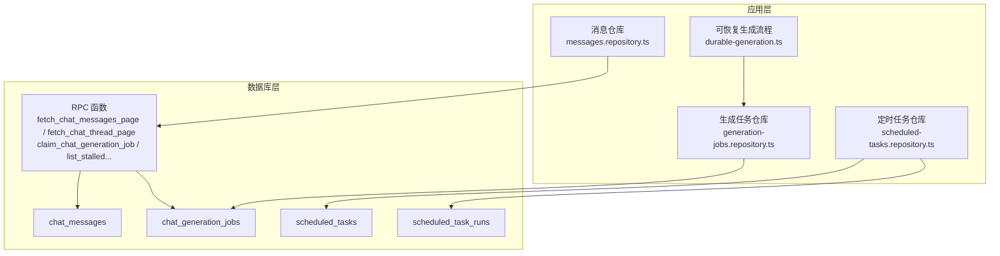

**图表来源**
- [src/server/repositories/messages.repository.ts:1-200](file://src/server/repositories/messages.repository.ts#L1-L200)
- [src/server/repositories/generation-jobs.repository.ts:1-200](file://src/server/repositories/generation-jobs.repository.ts#L1-L200)
- [src/server/repositories/scheduled-tasks.repository.ts:1-200](file://src/server/repositories/scheduled-tasks.repository.ts#L1-L200)
- [src/server/chat/durable-generation.ts:1-200](file://src/server/chat/durable-generation.ts#L1-L200)
- [supabase/migrations/20260712180000_chat_messages_keyset_pagination.sql:1-117](file://supabase/migrations/20260712180000_chat_messages_keyset_pagination.sql#L1-L117)
- [supabase/migrations/20260929120000_chat_generation_jobs.sql:1-182](file://supabase/migrations/20260929120000_chat_generation_jobs.sql#L1-L182)
- [supabase/migrations/20260725083000_scheduled_tasks.sql:1-115](file://supabase/migrations/20260725083000_scheduled_tasks.sql#L1-L115)

**章节来源**
- [src/server/repositories/messages.repository.ts:1-200](file://src/server/repositories/messages.repository.ts#L1-L200)
- [src/server/repositories/generation-jobs.repository.ts:1-200](file://src/server/repositories/generation-jobs.repository.ts#L1-L200)
- [src/server/repositories/scheduled-tasks.repository.ts:1-200](file://src/server/repositories/scheduled-tasks.repository.ts#L1-L200)
- [src/server/chat/durable-generation.ts:1-200](file://src/server/chat/durable-generation.ts#L1-L200)

## 核心数据模型与查询路径
### 聊天消息与线程树
- 聊天消息表用于存储用户、助手和系统消息，支持流式状态、JSONB 元数据和分支树结构。
- 两个关键 RPC 函数负责高效分页：
  - `fetch_chat_messages_page`：按时间倒序拉取历史消息，返回 `has_more`。
  - `fetch_chat_thread_page`：沿活动叶子节点回溯祖先路径，支持深度游标分页，并计算兄弟变体序号。

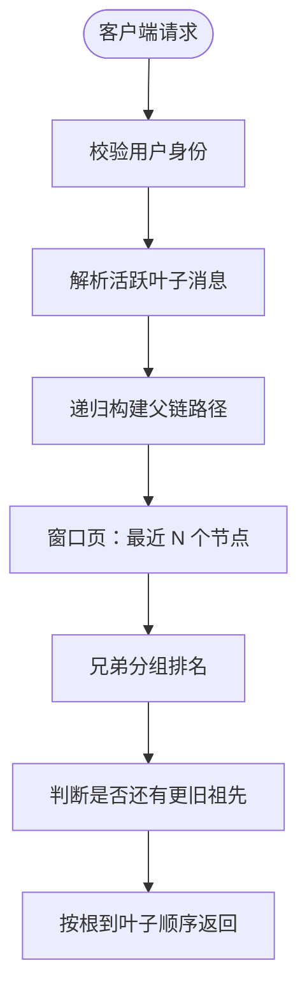

**图表来源**
- [supabase/migrations/20261002183000_fix_thread_page_paging_direction_and_perf.sql:1-200](file://supabase/migrations/20261002183000_fix_thread_page_paging_direction_and_perf.sql#L1-L200)
- [src/server/repositories/messages.repository.ts:1-200](file://src/server/repositories/messages.repository.ts#L1-L200)

**章节来源**
- [supabase/migrations/20260712180000_chat_messages_keyset_pagination.sql:1-117](file://supabase/migrations/20260712180000_chat_messages_keyset_pagination.sql#L1-L117)
- [supabase/migrations/20261002183000_fix_thread_page_paging_direction_and_perf.sql:1-200](file://supabase/migrations/20261002183000_fix_thread_page_paging_direction_and_perf.sql#L1-L200)
- [src/server/repositories/messages.repository.ts:1-200](file://src/server/repositories/messages.repository.ts#L1-L200)

### 生成任务表
- `chat_generation_jobs` 是长时间生成任务的持久化状态机，支持切片重试、心跳检测、看门狗回收。
- 唯一索引保证每个聊天同一时刻只有一个活跃任务；部分索引服务于看门狗扫描和状态查询。

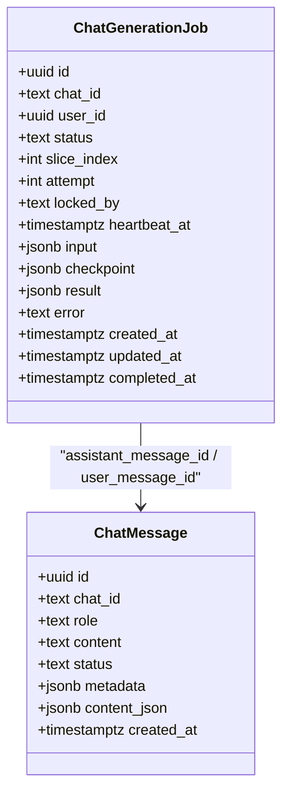

**图表来源**
- [supabase/migrations/20260929120000_chat_generation_jobs.sql:1-182](file://supabase/migrations/20260929120000_chat_generation_jobs.sql#L1-L182)
- [supabase/migrations/20261004110000_chat_generation_jobs_covering_indexes.sql:1-10](file://supabase/migrations/20261004110000_chat_generation_jobs_covering_indexes.sql#L1-L10)

**章节来源**
- [supabase/migrations/20260929120000_chat_generation_jobs.sql:1-182](file://supabase/migrations/20260929120000_chat_generation_jobs.sql#L1-L182)
- [supabase/migrations/20261004110000_chat_generation_jobs_covering_indexes.sql:1-10](file://supabase/migrations/20261004110000_chat_generation_jobs_covering_indexes.sql#L1-L10)
- [src/server/repositories/generation-jobs.repository.ts:1-200](file://src/server/repositories/generation-jobs.repository.ts#L1-L200)

### 定时任务与执行记录
- `scheduled_tasks` 定义用户级自动化任务、频率、下次运行时间和状态。
- `scheduled_task_runs` 记录每次尝试运行的结果、错误信息和元数据。
- 调度侧关注“待运行任务”和“已完成的待通知任务”，并通过部分索引避免全表扫描。

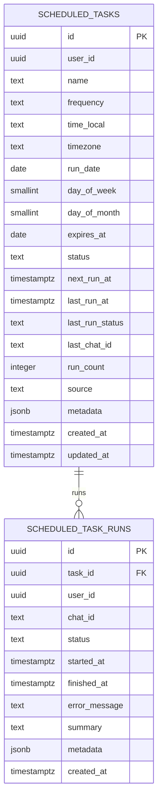

**图表来源**
- [supabase/migrations/20260725083000_scheduled_tasks.sql:1-115](file://supabase/migrations/20260725083000_scheduled_tasks.sql#L1-L115)
- [supabase/migrations/20261010032958_scheduled_task_reconciliation_indexes.sql:1-9](file://supabase/migrations/20261010032958_scheduled_task_reconciliation_indexes.sql#L1-L9)

**章节来源**
- [supabase/migrations/20260725083000_scheduled_tasks.sql:1-115](file://supabase/migrations/20260725083000_scheduled_tasks.sql#L1-L115)
- [supabase/migrations/20261010032958_scheduled_task_reconciliation_indexes.sql:1-9](file://supabase/migrations/20261010032958_scheduled_task_reconciliation_indexes.sql#L1-L9)
- [src/server/repositories/scheduled-tasks.repository.ts:1-200](file://src/server/repositories/scheduled-tasks.repository.ts#L1-L200)

## 架构总览
下图展示从客户端到数据库的关键路径，以及索引与锁在其中的作用点。

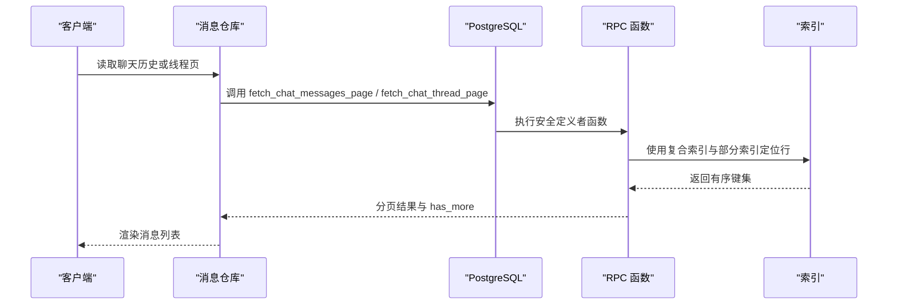

**图表来源**
- [src/server/repositories/messages.repository.ts:1-200](file://src/server/repositories/messages.repository.ts#L1-L200)
- [supabase/migrations/20260712180000_chat_messages_keyset_pagination.sql:1-117](file://supabase/migrations/20260712180000_chat_messages_keyset_pagination.sql#L1-L117)
- [supabase/migrations/20261002183000_fix_thread_page_paging_direction_and_perf.sql:1-200](file://supabase/migrations/20261002183000_fix_thread_page_paging_direction_and_perf.sql#L1-L200)

## 关键索引设计
### 聊天消息分页索引
- 复合索引 `(chat_id, created_at desc, id desc)` 且排除 `cancelled` 状态，匹配历史消息的键控分页。
- 该索引与 `fetch_chat_messages_page` 的 `(created_at, id)` 组合游标一致，避免全表排序。
- 对实时流式消息还保留一个活动状态索引，加速流式写入后的快速发现。

| 索引名 | 列族 | 选择性 | 用途 | 复杂度影响 |
|---|---|---|---|---|
| `chat_messages_chat_created_id_desc_idx` | `chat_id, created_at desc, id desc` | 高（聊天维度） | 历史消息键控分页 | O(log N) 定位起始点，O(K) 扫描 K 条 |
| `chat_messages_active_stream_idx` | `chat_id, created_at desc, id desc` | 高（活动子集） | 流式/失败消息快速访问 | 减少全表扫描 |

**章节来源**
- [supabase/migrations/20260712180000_chat_messages_keyset_pagination.sql:1-117](file://supabase/migrations/20260712180000_chat_messages_keyset_pagination.sql#L1-L117)
- [supabase/migrations/20260508100000_supabase_extreme_performance_hardening.sql:200-642](file://supabase/migrations/20260508100000_supabase_extreme_performance_hardening.sql#L200-L642)

### 生成任务覆盖索引
- 主唯一索引 `(chat_id)` 带条件 `status in ('queued','running','continuing')`，确保每聊天的活跃任务互斥。
- 看门狗扫描索引 `(heartbeat_at asc)` 带相同条件，按心跳最老优先回收停滞任务。
- 辅助查询索引 `(chat_id, created_at desc)` 与 `(user_id, created_at desc)` 支持聊天/用户维度的任务历史浏览。
- 覆盖索引针对外键字段 `assistant_message_id`、`user_message_id` 的非空值，避免删除级联时的顺序扫描。

| 索引类型 | 索引定义要点 | 适用查询 | 设计理由 |
|---|---|---|---|
| 唯一部分索引 | `(chat_id) where status in active states` | 插入/更新活跃任务 | 防止并发重复提交 |
| 部分扫描索引 | `(heartbeat_at asc) where active` | 看门狗查找停滞任务 | 最小化扫描范围 |
| 普通复合索引 | `(chat_id, created_at desc)` / `(user_id, created_at desc)` | 聊天/用户任务历史 | 直接命中排序 |
| 覆盖索引 | `(assistant_message_id)` / `(user_message_id)` 非空 | 级联 set null / 外键检查 | 避免回表顺序扫描 |

**章节来源**
- [supabase/migrations/20260929120000_chat_generation_jobs.sql:1-182](file://supabase/migrations/20260929120000_chat_generation_jobs.sql#L1-L182)
- [supabase/migrations/20261004110000_chat_generation_jobs_covering_indexes.sql:1-10](file://supabase/migrations/20261004110000_chat_generation_jobs_covering_indexes.sql#L1-L10)

### 定时任务对账索引
- `scheduled_tasks` 提供用户维度和下次运行时间的索引，分别用于 UI 列表和调度扫描。
- `scheduled_task_runs` 提供任务执行历史和已完成任务的通知对账索引，避免每分钟对账时扫描全部历史。

| 表 | 索引 | 筛选条件 | 目标查询 |
|---|---|---|---|
| `scheduled_tasks` | `(user_id, status, updated_at desc)` | 用户维度列表 | 用户任务管理界面 |
| `scheduled_tasks` | `(next_run_at asc) where status='active' and next_run_at is not null` | 下次运行时间 | 调度器拉取即将到期任务 |
| `scheduled_task_runs` | `(task_id, started_at desc)` | 任务维度历史 | 任务执行历史 |
| `scheduled_task_runs` | `(user_id, started_at desc)` | 用户维度历史 | 用户执行历史 |
| `scheduled_task_runs` | `(finished_at) where status in success/failed/skipped and notification_pending=true` | 已完成待通知 | 通知对账 |
| `scheduled_task_runs` | `(started_at, chat_id) where status='running'` | 正在运行 | 对账与清理 |

**章节来源**
- [supabase/migrations/20260725083000_scheduled_tasks.sql:1-115](file://supabase/migrations/20260725083000_scheduled_tasks.sql#L1-L115)
- [supabase/migrations/20261010032958_scheduled_task_reconciliation_indexes.sql:1-9](file://supabase/migrations/20261010032958_scheduled_task_reconciliation_indexes.sql#L1-L9)

### 其他热点索引与全文检索
- 热路径还包括聊天列表、工作区成员、账单订单、订阅、礼品码、速率限制等索引，均遵循“过滤列在前、排序列在后”的原则。
- 全文检索使用生成的 `content_search` tsvector 列与 GIN 索引，避免每次查询都进行文本处理。
- BRIN 索引用于追加型时序表的范围扫描，例如按创建时间做保留清理或报表聚合。

**章节来源**
- [supabase/migrations/20260508100000_supabase_extreme_performance_hardening.sql:200-642](file://supabase/migrations/20260508100000_supabase_extreme_performance_hardening.sql#L200-L642)

## 详细组件分析
### 聊天消息键控分页
- 输入参数包括聊天 ID、可选用户 ID、游标 `(created_at, id)` 和页面大小。
- 函数先校验聊天归属与状态，再按 `(created_at desc, id desc)` 拉取一页，并从最新一行计算是否有更早行存在。
- 输出按 `(created_at asc, id asc)` 返回，使前端按时间正序渲染。

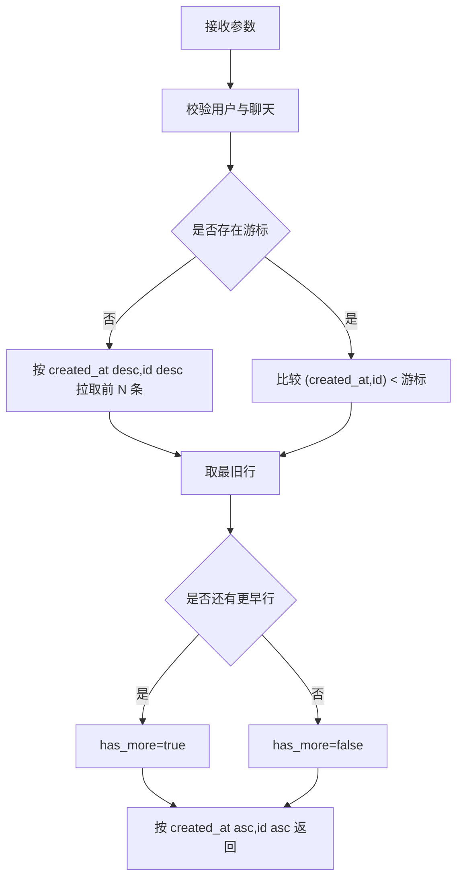

**图表来源**
- [supabase/migrations/20260712180000_chat_messages_keyset_pagination.sql:1-117](file://supabase/migrations/20260712180000_chat_messages_keyset_pagination.sql#L1-L117)

**章节来源**
- [supabase/migrations/20260712180000_chat_messages_keyset_pagination.sql:1-117](file://supabase/migrations/20260712180000_chat_messages_keyset_pagination.sql#L1-L117)
- [src/server/repositories/messages.repository.ts:1-200](file://src/server/repositories/messages.repository.ts#L1-L200)

### 线程树分页与深度游标
- 先解析当前活跃叶子消息，若未显式传入则回退到聊天存储的叶子或最新消息。
- 递归向上构建父链，得到每条节点的 depth。
- 窗口页选取 depth 递增的前 N 条，即离叶子最近的 N 个祖先。
- 对返回节点所在的父消息分组，计算兄弟变体序号和总数，避免对整张表排名。
- `has_more` 判断是否存在 depth 大于本页最大 depth 的行。

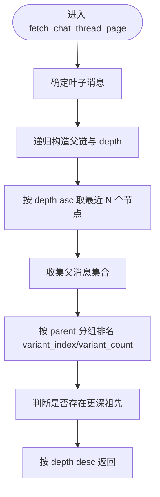

**图表来源**
- [supabase/migrations/20261002183000_fix_thread_page_paging_direction_and_perf.sql:1-200](file://supabase/migrations/20261002183000_fix_thread_page_paging_direction_and_perf.sql#L1-L200)

**章节来源**
- [supabase/migrations/20261002183000_fix_thread_page_paging_direction_and_perf.sql:1-200](file://supabase/migrations/20261002183000_fix_thread_page_paging_direction_and_perf.sql#L1-L200)
- [src/server/repositories/messages.repository.ts:1-200](file://src/server/repositories/messages.repository.ts#L1-L200)

### 生成任务原子认领与看门狗
- `claim_chat_generation_job` 使用 `for update skip locked` 实现无等待竞争，只允许合法状态变更。
- 仅当任务是 `queued`、`continuing`，或 `running` 且心跳过旧时才允许抢占。
- 成功后将状态改为 `running`，写入 worker 标识、锁时间、心跳和重试次数。
- `list_stalled_chat_generation_jobs` 按心跳升序返回停滞任务，供看门狗回收。

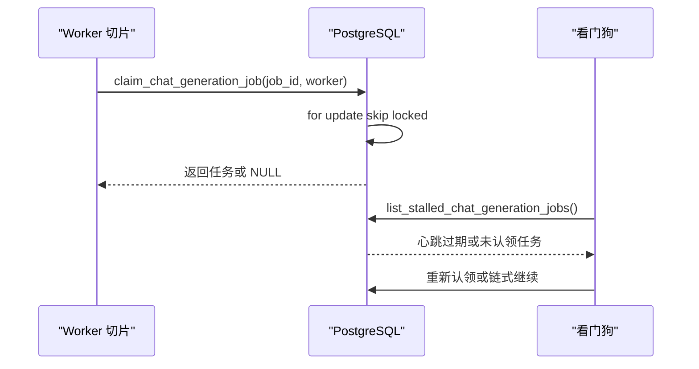

**图表来源**
- [supabase/migrations/20260929120000_chat_generation_jobs.sql:1-182](file://supabase/migrations/20260929120000_chat_generation_jobs.sql#L1-L182)

**章节来源**
- [supabase/migrations/20260929120000_chat_generation_jobs.sql:1-182](file://supabase/migrations/20260929120000_chat_generation_jobs.sql#L1-L182)
- [src/server/repositories/generation-jobs.repository.ts:1-200](file://src/server/repositories/generation-jobs.repository.ts#L1-L200)
- [src/server/chat/durable-generation.ts:1-200](file://src/server/chat/durable-generation.ts#L1-L200)

### 定时任务调度与对账
- 创建任务时校验用户活跃任务数量上限，并使用事务保护 profile 与计数。
- 调度器基于 `next_run_at` 部分索引拉取即将到期的活跃任务。
- 对账侧根据 `finished_at` 和 `notification_pending` 标记通知已完成但未通知的任务。
- 对 `started_at, chat_id` 的部分索引用于发现仍在运行的执行记录，便于异常清理。

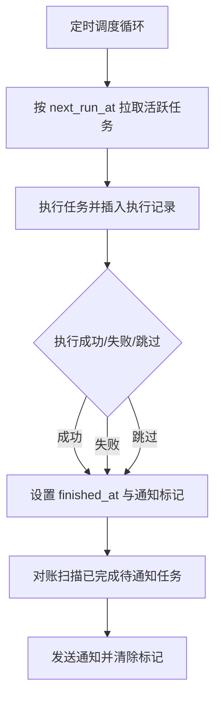

**图表来源**
- [supabase/migrations/20260725083000_scheduled_tasks.sql:1-115](file://supabase/migrations/20260725083000_scheduled_tasks.sql#L1-L115)
- [supabase/migrations/20261010032958_scheduled_task_reconciliation_indexes.sql:1-9](file://supabase/migrations/20261010032958_scheduled_task_reconciliation_indexes.sql#L1-L9)

**章节来源**
- [src/server/repositories/scheduled-tasks.repository.ts:1-200](file://src/server/repositories/scheduled-tasks.repository.ts#L1-L200)
- [supabase/migrations/20260725083000_scheduled_tasks.sql:1-115](file://supabase/migrations/20260725083000_scheduled_tasks.sql#L1-L115)
- [supabase/migrations/20261010032958_scheduled_task_reconciliation_indexes.sql:1-9](file://supabase/migrations/20261010032958_scheduled_task_reconciliation_indexes.sql#L1-L9)

## 依赖关系分析
### 查询对索引的依赖
- 聊天历史与线程页依赖复合索引和函数内游标语义。
- 生成任务依赖唯一部分索引、心跳部分索引和外键覆盖索引。
- 定时任务依赖用户维度索引、下次运行时间部分索引和执行记录对账索引。
- 运行时安全索引补充了外键缺失导致的性能问题。

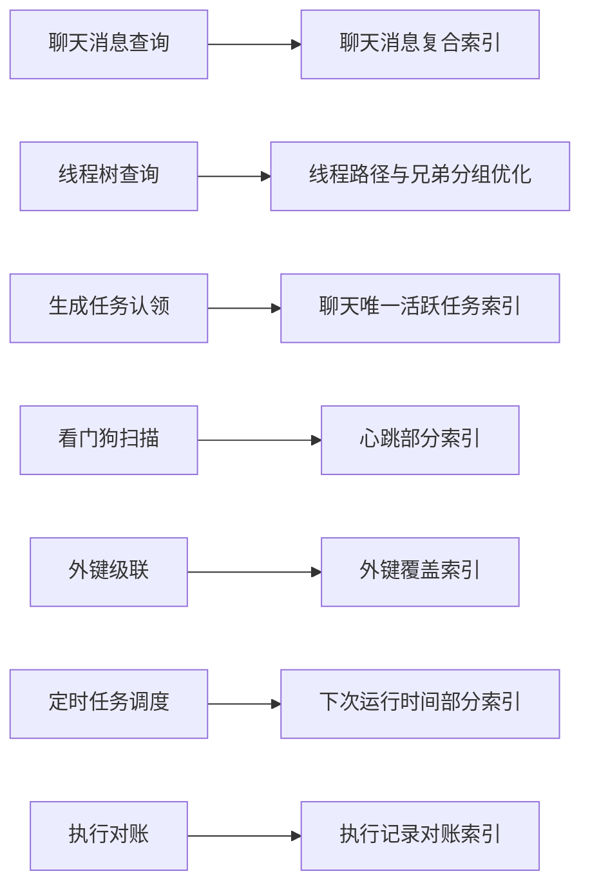

**图表来源**
- [supabase/migrations/20260712180000_chat_messages_keyset_pagination.sql:1-117](file://supabase/migrations/20260712180000_chat_messages_keyset_pagination.sql#L1-L117)
- [supabase/migrations/20261002183000_fix_thread_page_paging_direction_and_perf.sql:1-200](file://supabase/migrations/20261002183000_fix_thread_page_paging_direction_and_perf.sql#L1-L200)
- [supabase/migrations/20260929120000_chat_generation_jobs.sql:1-182](file://supabase/migrations/20260929120000_chat_generation_jobs.sql#L1-L182)
- [supabase/migrations/20261004110000_chat_generation_jobs_covering_indexes.sql:1-10](file://supabase/migrations/20261004110000_chat_generation_jobs_covering_indexes.sql#L1-L10)
- [supabase/migrations/20260725083000_scheduled_tasks.sql:1-115](file://supabase/migrations/20260725083000_scheduled_tasks.sql#L1-L115)
- [supabase/migrations/20261010032958_scheduled_task_reconciliation_indexes.sql:1-9](file://supabase/migrations/20261010032958_scheduled_task_reconciliation_indexes.sql#L1-L9)

**章节来源**
- [supabase/migrations/20260731112000_chat_runtime_security_indexes.sql:1-32](file://supabase/migrations/20260731112000_chat_runtime_security_indexes.sql#L1-L32)
- [supabase/migrations/20260508104000_oauth_fk_covering_indexes.sql:1-24](file://supabase/migrations/20260508104000_oauth_fk_covering_indexes.sql#L1-L24)

## 并发控制、锁机制与死锁预防
### 并发控制策略
- 生成任务通过唯一部分索引限制每聊天的活跃任务数，从数据库层面阻止重复提交。
- 任务认领使用 `for update skip locked`，多个 worker 竞争时只有第一个成功，其余立即返回空，避免阻塞。
- 心跳超时后允许抢占，保障故障切片被回收。

### 锁机制
- 行级排他锁在认领过程中短暂持有，但事务很短，减少锁持有时间。
- 角色级别设置了 `statement_timeout`、`lock_timeout` 和 `idle_in_transaction_session_timeout`，防止长事务拖住自动清理。

### 死锁预防
- 避免在长事务中进行多表复杂更新；所有关键操作拆分为短事务或单语句函数。
- 使用乐观竞争而非悲观等待，减少锁环形成概率。
- 对外部动作未知结果的场景，代码层会停止执行，避免半副作用引发状态不一致。

**章节来源**
- [supabase/migrations/20260929120000_chat_generation_jobs.sql:1-182](file://supabase/migrations/20260929120000_chat_generation_jobs.sql#L1-L182)
- [supabase/migrations/20260508100000_supabase_extreme_performance_hardening.sql:200-642](file://supabase/migrations/20260508100000_supabase_extreme_performance_hardening.sql#L200-L642)
- [src/server/chat/durable-generation.ts:1-200](file://src/server/chat/durable-generation.ts#L1-L200)

## 分区表与大表优化
### 分区表现状
- 当前仓库未使用 PostgreSQL 原生分区表。大表优化主要通过以下手段实现：
  - 部分索引缩小热点扫描范围。
  - BRIN 索引降低时序表范围扫描成本。
  - 自动清理与归档逻辑（如速率限制清理、旧礼品码过期、模型用量汇总）。
  - 严格的角色超时限制，防止长查询长期占用资源。

### 大表优化建议
- 对持续增长的日志表和审计表，可按时间范围考虑未来引入分区表。
- 在未引入分区前，继续使用部分索引、BRIN 索引和定期清理函数。
- 对超大型表新增索引时，应评估在生产环境使用并发索引创建策略，以降低在线部署风险。

**章节来源**
- [supabase/migrations/20260508100000_supabase_extreme_performance_hardening.sql:200-642](file://supabase/migrations/20260508100000_supabase_extreme_performance_hardening.sql#L200-L642)

## 缓存策略
### 数据库层缓存
- 通过 `pg_prewarm` 预热热点索引，减少冷启动 IO。
- 自动清理与 `ANALYZE` 提升统计信息质量，帮助规划器选择正确索引。

### 应用层缓存
- 生成任务的实时轨迹优先保存在 Cloudflare Durable Object，数据库作为持久化真相源。
- 前端滚动锚点和聊天加载逻辑通过游标分页，避免重复加载历史。

**章节来源**
- [supabase/migrations/20260508100000_supabase_extreme_performance_hardening.sql:200-642](file://supabase/migrations/20260508100000_supabase_extreme_performance_hardening.sql#L200-L642)
- [supabase/migrations/20260929120000_chat_generation_jobs.sql:1-182](file://supabase/migrations/20260929120000_chat_generation_jobs.sql#L1-L182)

## 查询性能优化方法
### EXPLAIN ANALYZE 分析
- 对聊天历史、线程页、任务认领和对账查询使用 `EXPLAIN ANALYZE` 观察实际执行计划。
- 重点关注是否使用了预期索引、是否出现顺序扫描、嵌套循环代价和实际行数。

### 慢查询识别
- 使用 `private.slow_query_report` 视图查看累计耗时最高的查询样本。
- 结合 `private.table_health_report` 查看死元组比例、最近 vacuum/analyze 时间。

### 索引维护策略
- 定期运行维护函数清理过期速率限制、过期礼品码、汇总模型用量。
- 维护函数会预热热点索引并对关键表执行 `ANALYZE`。
- 保守清理未使用的索引，避免索引膨胀写放大。

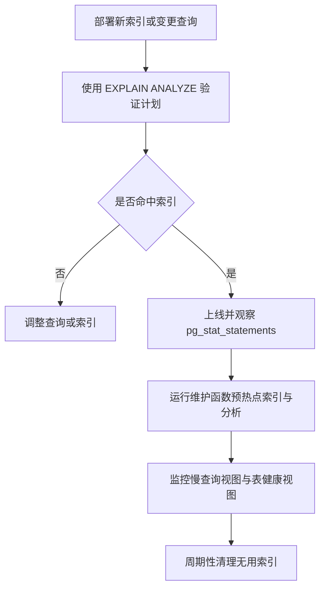

**图表来源**
- [supabase/migrations/20260508100000_supabase_extreme_performance_hardening.sql:200-642](file://supabase/migrations/20260508100000_supabase_extreme_performance_hardening.sql#L200-L642)
- [supabase/migrations/20260508108000_conservative_unused_index_cleanup.sql:1-47](file://supabase/migrations/20260508108000_conservative_unused_index_cleanup.sql#L1-L47)

**章节来源**
- [supabase/migrations/20260508100000_supabase_extreme_performance_hardening.sql:200-642](file://supabase/migrations/20260508100000_supabase_extreme_performance_hardening.sql#L200-L642)
- [supabase/migrations/20260508108000_conservative_unused_index_cleanup.sql:1-47](file://supabase/migrations/20260508108000_conservative_unused_index_cleanup.sql#L1-L47)

## 监控指标与容量规划
### 监控指标
- 慢查询平均耗时、最大耗时、总耗时与样本查询。
- 表活行数、死行数、死元组百分比、最近 vacuum/analyze 时间。
- 索引命中率可通过查询计划与 pg_stat_user_tables 辅助判断。
- 生成任务的心跳延迟、认领失败率、看门狗回收次数。
- 定时任务执行成功率、迟到执行数量和通知延迟。

### 基准测试方法
- 对聊天历史分页与线程页分页构造不同大小的聊天会话，测量首字节时间与端到端加载时间。
- 对生成任务认领模拟多 worker 竞争，验证无等待竞争与心跳回收行为。
- 对定时任务对账构造大量已完成待通知记录，验证部分索引对每分钟扫描的影响。

### 容量规划最佳实践
- 根据聊天消息增长速率评估 BRIN 索引与历史归档策略。
- 根据生成任务并发量评估心跳间隔、看门狗扫描频率和锁超时。
- 根据定时任务规模评估执行记录保留周期和通知批处理批量大小。

**章节来源**
- [supabase/migrations/20260508100000_supabase_extreme_performance_hardening.sql:200-642](file://supabase/migrations/20260508100000_supabase_extreme_performance_hardening.sql#L200-L642)
- [src/server/chat/durable-generation.ts:1-200](file://src/server/chat/durable-generation.ts#L1-L200)
- [src/server/repositories/scheduled-tasks.repository.ts:1-200](file://src/server/repositories/scheduled-tasks.repository.ts#L1-L200)

## 常见问题诊断与解决方案
### 聊天历史无法加载更多
- 现象：首次加载后 `has_more` 始终为 false。
- 原因：线程分页方向修复前的 bug 导致窗口页选择了错误的端点，且 `has_more` 条件反向。
- 解决：使用修复后的 `fetch_chat_thread_page`，确保按深度游标向后加载。

**章节来源**
- [supabase/migrations/20261002183000_fix_thread_page_paging_direction_and_perf.sql:1-200](file://supabase/migrations/20261002183000_fix_thread_page_paging_direction_and_perf.sql#L1-L200)

### 生成任务卡住或重复
- 现象：worker 崩溃后任务不继续，或多实例重复处理。
- 原因：心跳未更新或唯一约束未生效。
- 解决：确认看门狗扫描索引有效，检查心跳间隔和 stale 阈值；验证唯一部分索引是否正确。

**章节来源**
- [supabase/migrations/20260929120000_chat_generation_jobs.sql:1-182](file://supabase/migrations/20260929120000_chat_generation_jobs.sql#L1-L182)

### 定时任务对账缓慢
- 现象：每分钟对账扫描执行记录时全表扫描。
- 原因：缺少针对已完成待通知或部分运行记录的索引。
- 解决：使用 `notification_pending` 部分索引和 `started_at, chat_id` 运行期索引。

**章节来源**
- [supabase/migrations/20261010032958_scheduled_task_reconciliation_indexes.sql:1-9](file://supabase/migrations/20261010032958_scheduled_task_reconciliation_indexes.sql#L1-L9)

### 外键删除导致顺序扫描
- 现象：删除消息时生成任务表级联 set null 很慢。
- 原因：外键列无索引。
- 解决：为非空的外键列添加覆盖索引。

**章节来源**
- [supabase/migrations/20261004110000_chat_generation_jobs_covering_indexes.sql:1-10](file://supabase/migrations/20261004110000_chat_generation_jobs_covering_indexes.sql#L1-L10)

## 结论
本项目的索引与性能策略以“按查询模式设计索引”为核心：聊天历史使用复合键控索引，线程树使用递归路径与兄弟分组优化，生成任务用唯一部分索引加心跳部分索引保障并发安全，定时任务用部分索引隔离待运行与已完成工作。配合角色超时、自动清理、BRIN 索引、PG 预热和维护函数，系统在低计算资源下仍保持稳定的 OLTP 表现。未来若数据规模进一步增长，应优先考虑分区表、冷热分层和更精细的缓存策略，同时坚持“先验证计划、再上线、再监控”的性能工程流程。