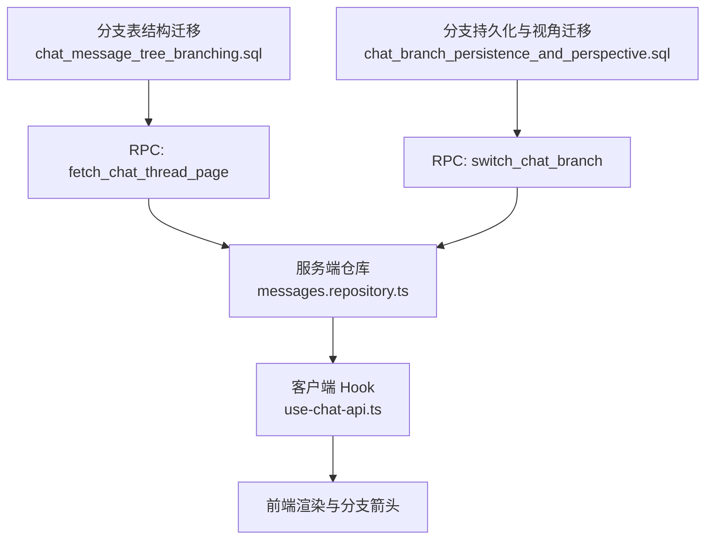
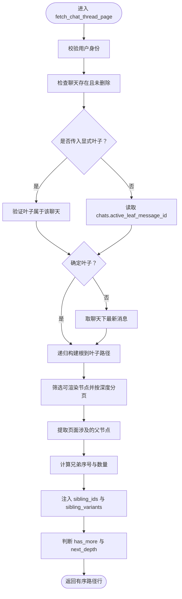
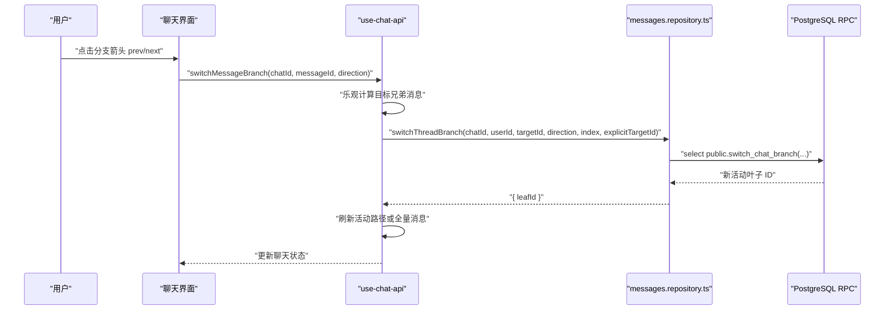
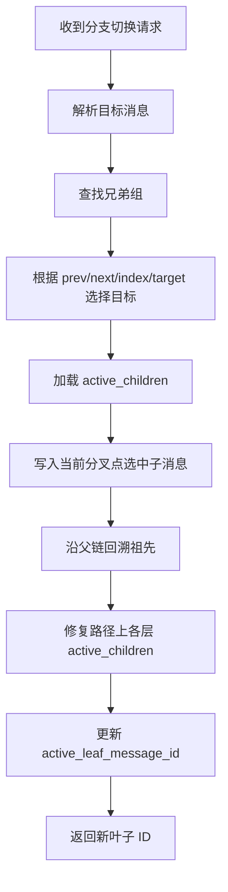
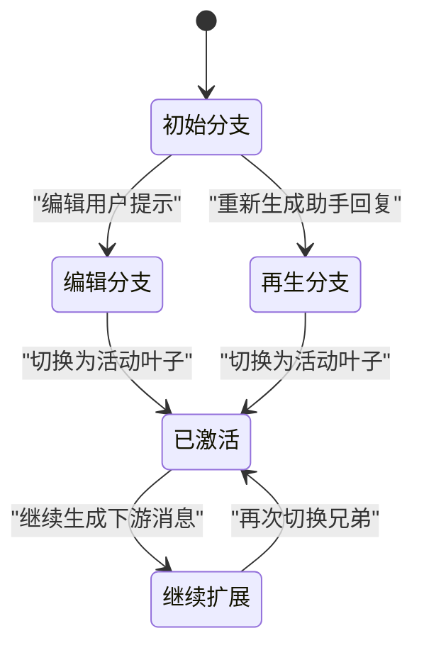
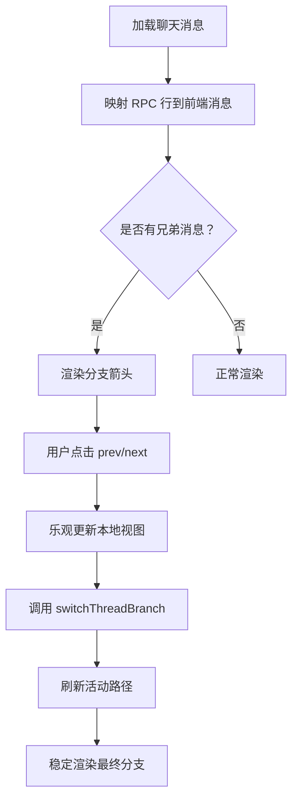
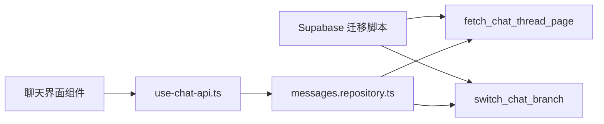

# 分支管理

<cite>
**本文引用的文件**   
- [20260930220000_chat_message_tree_branching.sql](file://supabase/migrations/20260930220000_chat_message_tree_branching.sql)
- [20261001070000_fix_chat_thread_page_rpc_depth_ambiguity.sql](file://supabase/migrations/20261001070000_fix_chat_thread_page_rpc_depth_ambiguity.sql)
- [20261001080000_fix_message_chain_turn_order.sql](file://supabase/migrations/20261001080000_fix_message_chain_turn_order.sql)
- [20261002183000_fix_thread_page_paging_direction_and_perf.sql](file://supabase/migrations/20261002183000_fix_thread_page_paging_direction_and_perf.sql)
- [20261004221000_chat_branch_persistence_and_perspective.sql](file://supabase/migrations/20261004221000_chat_branch_persistence_and_perspective.sql)
- [20261009154709_fix_thread_history_nested_windows.sql](file://supabase/migrations/20261009154709_fix_thread_history_nested_windows.sql)
- [messages.repository.ts](file://src/server/repositories/messages.repository.ts)
- [use-chat-api.ts](file://src/client/hooks/use-chat-api.ts)
</cite>

## 目录
1. [引言](#引言)
2. [项目结构中的分支相关位置](#项目结构中的分支相关位置)
3. [消息树与分支核心概念](#消息树与分支核心概念)
4. [数据模型与持久化结构](#数据模型与持久化结构)
5. [递归查询 fetch_chat_thread_page](#递归查询-fetch_chat_thread_page)
6. [变体索引与变体数量](#变体索引与变体数量)
7. [分支切换机制](#分支切换机制)
8. [完整业务流程](#完整业务流程)
9. [前端渲染与可视化集成](#前端渲染与可视化集成)
10. [依赖关系分析](#依赖关系分析)
11. [性能特征与优化建议](#性能特征与优化建议)
12. [故障排查指南](#故障排查指南)
13. [结论](#结论)

## 引言
本文面向分支管理这一功能域，系统解释聊天消息如何从“线性历史”演进为“可分支的消息树”，以及客户端如何以活动叶子节点为中心加载、导航和渲染多个变体。重点包括：

- 消息树的父消息引用、兄弟节点关系、活动叶子节点。
- `fetch_chat_thread_page` RPC 的递归路径计算、深度游标、分页方向、`variant_index` 与 `variant_count`。
- 分支切换机制：`prev` / `next` / `index` / `target` 四种定位方式、`perspective` 记忆、`active_children` 维护。
- 分支持久化策略：数据库层面的分支一致性、活跃子节点映射、RPC 权限与回滚约束。
- 分支创建、切换、合并（通过兄弟变体与根到叶子路径重建）的业务流程。
- 分支可视化的数据结构及前端集成要点。

## 项目结构中的分支相关位置
分支能力贯穿迁移脚本、服务端仓库和客户端 Hook：

**图表来源**
- [20260930220000_chat_message_tree_branching.sql:1-120](file://supabase/migrations/20260930220000_chat_message_tree_branching.sql#L1-L120)
- [20261004221000_chat_branch_persistence_and_perspective.sql:233-383](file://supabase/migrations/20261004221000_chat_branch_persistence_and_perspective.sql#L233-L383)
- [messages.repository.ts:1-200](file://src/server/repositories/messages.repository.ts#L1-L200)
- [use-chat-api.ts:190-280](file://src/client/hooks/use-chat-api.ts#L190-L280)

**章节来源**
- [20260930220000_chat_message_tree_branching.sql:1-120](file://supabase/migrations/20260930220000_chat_message_tree_branching.sql#L1-L120)
- [20261004221000_chat_branch_persistence_and_perspective.sql:233-383](file://supabase/migrations/20261004221000_chat_branch_persistence_and_perspective.sql#L233-L383)
- [messages.repository.ts:1-200](file://src/server/repositories/messages.repository.ts#L1-L200)
- [use-chat-api.ts:190-280](file://src/client/hooks/use-chat-api.ts#L190-L280)

## 消息树与分支核心概念
分支架构把每条消息看作图中的一个节点，并通过父子关系形成一棵树：

| 概念 | 含义 | 作用 |
|---|---|---|
| 父消息引用 | `parent_message_id` | 将消息连成树；编辑用户提示或重新生成助手回复时插入兄弟节点，而不是修改原行。 |
| 兄弟节点 | 共享同一 `parent_message_id` 的一组消息 | 构成一个“变体组”，用于分支箭头和左右切换。 |
| 活动叶子节点 | `chats.active_leaf_message_id` | 当前可见分支的终点；RPC 以此作为递归起点向上回溯根。 |
| 深度 | 从活动叶子到祖先节点的跳数 | `depth=0` 表示活动路径上离叶子最近的节点，越大越靠近根。 |
| 视角 | `chats.metadata->'active_children'` | 记录每个分叉点当前选中的子消息，实现跨设备一致的分支选择。 |
| 活动路径 | 从根到活动叶子的可渲染路径 | `fetch_chat_thread_page` 返回这条路径上的节点，并附带兄弟信息。 |

在旧数据迁移中，空 `parent_message_id` 的行被按聊天、时间戳和角色顺序回填为链式树；同时把每个聊天的最新消息回填为活动叶子，从而让旧聊天也能进入分支体系。

**章节来源**
- [20260930220000_chat_message_tree_branching.sql:1-80](file://supabase/migrations/20260930220000_chat_message_tree_branching.sql#L1-L80)
- [20261001080000_fix_message_chain_turn_order.sql:1-58](file://supabase/migrations/20261001080000_fix_message_chain_turn_order.sql#L1-L58)

## 数据模型与持久化结构
分支相关的数据结构分布在数据库表和 RPC 返回结果中：

### 数据库层关键字段
| 表 | 字段 | 类型 | 说明 |
|---|---|---|---|
| `chat_messages` | `parent_message_id` | UUID 可空 | 指向父消息；根消息为空。 |
| `chat_messages` | `role` | 文本 | 区分用户与助手消息，影响同时间戳下的排序。 |
| `chat_messages` | `status` | 文本 | 过滤取消或无效消息。 |
| `chat_messages` | `content` / `content_json` | 文本与 JSONB | 正文与结构化内容。 |
| `chat_messages` | `client_id` | 文本可空 | 客户端临时 ID，用于乐观写入与重放。 |
| `chats` | `active_leaf_message_id` | UUID 可空 | 活动分支终点。 |
| `chats` | `metadata->'active_children'` | JSONB | 按父消息键存储当前选中子消息。 |

### RPC 返回层关键字段
`fetch_chat_thread_page` 返回的消息行扩展了以下字段：

| 字段 | 类型 | 语义 |
|---|---|---|
| `id` | UUID | 消息标识。 |
| `chat_id` | 文本 | 所属聊天。 |
| `role` | 文本 | 消息角色。 |
| `content` | 文本 | 正文。 |
| `status` | 文本 | 状态。 |
| `metadata` | JSONB | 包含 `sibling_ids` 与 `sibling_variants`。 |
| `content_json` | JSONB | 结构化内容。 |
| `created_at` | 时间戳 | 创建时间。 |
| `client_id` | 文本可空 | 客户端 ID。 |
| `parent_message_id` | UUID 可空 | 父消息。 |
| `depth` | 大整数 | 距离活动叶子的深度。 |
| `variant_index` | 整数 | 兄弟组内从零开始的序号。 |
| `variant_count` | 整数 | 兄弟组总数。 |
| `has_more` | 布尔值 | 是否还有更老的祖先。 |
| `next_depth` | 大整数可空 | 下一页深度游标。 |

服务端仓库还暴露了 `ThreadMessageRow`，其中 `sibling_ids` 与 `sibling_variants` 是从 `metadata` 解析出来的可选字段，便于前端直接消费。

**章节来源**
- [20260930220000_chat_message_tree_branching.sql:80-200](file://supabase/migrations/20260930220000_chat_message_tree_branching.sql#L80-L200)
- [20261009154709_fix_thread_history_nested_windows.sql:1-159](file://supabase/migrations/20261009154709_fix_thread_history_nested_windows.sql#L1-L159)
- [messages.repository.ts:1-60](file://src/server/repositories/messages.repository.ts#L1-L60)
- [messages.repository.ts:120-150](file://src/server/repositories/messages.repository.ts#L120-L150)

## 递归查询 fetch_chat_thread_page
`fetch_chat_thread_page` 是分支加载的核心 SQL 函数。它接收聊天 ID、用户 ID、显式叶子 ID、深度游标和页大小，返回活动分支路径上的一段节点。

### 参数与契约
| 参数 | 默认值 | 含义 |
|---|---|---|
| `p_chat_id` | 无 | 聊天标识。 |
| `p_user_id` | `null` | 鉴权用户；未认证时报错。 |
| `p_leaf` | `null` | 显式指定叶子；否则使用 `active_leaf_message_id` 或最新消息。 |
| `p_depth_cursor` | `null` | 上一页最大深度；下一页必须严格大于该值。 |
| `p_limit` | `500` | 每页节点数，上限 500。 |

返回值包括消息字段、`depth`、`variant_index`、`variant_count`、`has_more` 和 `next_depth`。

### 执行流程

**图表来源**
- [20261002183000_fix_thread_page_paging_direction_and_perf.sql:1-207](file://supabase/migrations/20261002183000_fix_thread_page_paging_direction_and_perf.sql#L1-L207)
- [20261009154709_fix_thread_history_nested_windows.sql:1-159](file://supabase/migrations/20261009154709_fix_thread_history_nested_windows.sql#L1-L159)

### 深度游标与分页方向
- 深度定义：`depth=0` 表示活动路径上离叶子最近的节点，越大越靠近根。
- 第一页：不传 `p_depth_cursor`，返回最近的活动路径节点。
- 后续页：传入上一页的最大 `depth`，只返回深度严格大于该值的更老祖先。
- 输出顺序：按 `depth` 降序输出，即从根到叶子的时间正序。
- `has_more`：只要活动路径中存在比本页最深节点更深的可渲染祖先，就为真。
- `next_depth`：本页最深层的深度，供客户端继续请求。

### 递归路径构造
递归 CTE 从选定叶子开始，沿 `parent_message_id` 向上追溯，直到根。每一层增加 `depth`，从而把树路径扁平化为带深度的线性序列。

### 兄弟分组与窗口聚合
兄弟分组基于 `parent_message_id`，按 `created_at` 和 `id` 排序。早期版本对整张聊天表做窗口排名，后来优化为只处理页面涉及的父节点，减少扫描范围。最终还会向 `metadata` 注入：

- `sibling_ids`：兄弟消息 ID 数组。
- `sibling_variants`：兄弟消息的结构化片段，包含 ID、序号和内容摘要。

这些字段让客户端无需再次查询就能渲染分支箭头。

**章节来源**
- [20260930220000_chat_message_tree_branching.sql:80-200](file://supabase/migrations/20260930220000_chat_message_tree_branching.sql#L80-L200)
- [20261001070000_fix_chat_thread_page_rpc_depth_ambiguity.sql:1-159](file://supabase/migrations/20261001070000_fix_chat_thread_page_rpc_depth_ambiguity.sql#L1-L159)
- [20261002183000_fix_thread_page_paging_direction_and_perf.sql:1-207](file://supabase/migrations/20261002183000_fix_thread_page_paging_direction_and_perf.sql#L1-L207)
- [20261009154709_fix_thread_history_nested_windows.sql:1-159](file://supabase/migrations/20261009154709_fix_thread_history_nested_windows.sql#L1-L159)

## 变体索引与变体数量
`variant_index` 和 `variant_count` 描述某条消息在其兄弟组中的位置：

| 指标 | 计算方式 | 用途 |
|---|---|---|
| `variant_index` | 兄弟组按时间戳和 ID 排序后的从零起序号 | 分支箭头、prev/next 导航、目标索引定位。 |
| `variant_count` | 兄弟组大小 | 前端判断是否需要显示分支箭头。 |

后端在最新迁移中使用先排名再聚合的两步结构，避免 PostgreSQL 不允许嵌套窗口函数的限制：

1. `ranked_siblings`：按 `parent_message_id` 分区，计算 `variant_index` 与 `variant_count`。
2. `siblings`：在同一分区窗口上聚合 `sibling_ids` 与 `sibling_variants`。

当某条消息没有兄弟分组时，`variant_index` 默认为 `0`，`variant_count` 默认为 `1`。

**章节来源**
- [20261009154709_fix_thread_history_nested_windows.sql:70-159](file://supabase/migrations/20261009154709_fix_thread_history_nested_windows.sql#L70-L159)
- [messages.repository.ts:1-60](file://src/server/repositories/messages.repository.ts#L1-L60)

## 分支切换机制
分支切换由 `switch_chat_branch` RPC 和服务端仓库共同完成。

### 客户端调用入口
`use-chat-api.ts` 暴露 `switchMessageBranch`，其职责包括：

- 防止流式生成期间切换分支。
- 使用本地缓存的兄弟信息做即时乐观更新。
- 调用服务端 `switchThreadBranch`。
- 刷新活动路径并替换聊天状态。

**图表来源**
- [use-chat-api.ts:3580-3640](file://src/client/hooks/use-chat-api.ts#L3580-L3640)
- [messages.repository.ts:150-210](file://src/server/repositories/messages.repository.ts#L150-L210)
- [20261004221000_chat_branch_persistence_and_perspective.sql:238-383](file://supabase/migrations/20261004221000_chat_branch_persistence_and_perspective.sql#L238-L383)

### 四种导航方式
`switch_chat_branch` 支持以下目标定位：

| 方式 | 参数 | 行为 |
|---|---|---|
| `prev` | `direction='prev'` | 切换到前一个兄弟。 |
| `next` | `direction='next'` | 切换到后一个兄弟。 |
| `index` | `targetIndex` | 切换到兄弟组中从零开始的指定索引。 |
| `target` | `targetMessageId` | 直接切换到指定消息。 |

如果传入的是客户端临时 ID，服务端会先查 `client_id` 转换为持久化 UUID。

### perspective 记忆与 active_children
每次切换成功后，RPC 会：

1. 读取 `chats.metadata->'active_children'`。
2. 以目标消息的 `parent_message_id` 为键，存入目标消息 ID。
3. 沿新活动叶子向上回溯，把路径上每个分叉点的当前子节点写回 `active_children`。
4. 更新 `chats.active_leaf_message_id`。

这样，即使换设备、刷新页面或重新连接实时通道，分支选择也能保持一致。

**图表来源**
- [20261004221000_chat_branch_persistence_and_perspective.sql:238-383](file://supabase/migrations/20261004221000_chat_branch_persistence_and_perspective.sql#L238-L383)

**章节来源**
- [use-chat-api.ts:3580-3640](file://src/client/hooks/use-chat-api.ts#L3580-L3640)
- [messages.repository.ts:150-210](file://src/server/repositories/messages.repository.ts#L150-L210)
- [20261004221000_chat_branch_persistence_and_perspective.sql:233-431](file://supabase/migrations/20261004221000_chat_branch_persistence_and_perspective.sql#L233-L431)

## 完整业务流程

### 分支创建
分支创建不是直接修改已有消息，而是插入新的兄弟节点：

- **编辑用户提示**：原用户消息保持不变，新用户提示成为其兄弟。
- **重新生成助手回复**：原助手回复保持不变，新回复成为其兄弟。
- 新消息的 `parent_message_id` 指向对应分叉点，例如原用户消息或原始助手消息。
- 插入完成后，RPC 会重新计算活动路径，使新分支成为可见分支。

服务端仓库定义了 `TurnFork`，区分 `edit` 与 `regenerate`，并允许为需要保留对话轮次关系的再生成操作携带 `turnId`。

### 分支切换
分支切换分为客户端乐观阶段与服务端确认阶段：

1. 客户端根据兄弟数组立即计算目标消息。
2. 若分支发生变化，则先更新本地聊天状态。
3. 调用 `switchThreadBranch`，让数据库更新活动叶子和 `active_children`。
4. 根据返回结果刷新活动路径，保证多设备一致。

### 分支“合并”
代码中没有传统意义上的“合并提交”。分支合并的实际语义是：

- 所有兄弟消息都保留在数据库中。
- 活动叶子决定哪条路径是当前可见分支。
- 切换活动叶子等于“展示另一个分支”，而原分支不会丢失。
- 后续继续在该分支上生成时，会以当前叶子为锚点继续扩展树。

因此，“合并”应理解为“以某个兄弟分支为基准继续追加消息”，而不是物理合并两棵子树。

**章节来源**
- [messages.repository.ts:1-120](file://src/server/repositories/messages.repository.ts#L1-L120)
- [messages.repository.ts:150-210](file://src/server/repositories/messages.repository.ts#L150-L210)
- [20260930220000_chat_message_tree_branching.sql:1-80](file://supabase/migrations/20260930220000_chat_message_tree_branching.sql#L1-L80)

## 前端渲染与可视化集成
前端不需要自己维护分支状态，而是消费后端返回的树位置信息：

### 消息映射字段
`mapApiMessage` 将 RPC 行映射为前端消息对象，关键映射包括：

| 后端字段 | 前端字段 | 说明 |
|---|---|---|
| `parent_message_id` | `parentId` | 父消息 ID。 |
| `variant_index` | `variantIndex` | 兄弟组内序号。 |
| `variant_count` | `variantCount` | 兄弟组总数。 |
| `sibling_ids` | `siblingIds` | 兄弟消息 ID 列表。 |
| `sibling_variants` | `siblingVariants` | 兄弟消息预览。 |

### 分支箭头渲染
前端应根据以下条件决定是否渲染分支箭头：

- `variantCount > 1`。
- 消息有明确的 `parentId`。
- 存在 `siblingIds` 或 `siblingVariants`。

当用户点击分支箭头时，调用 `switchMessageBranch`，传入当前消息 ID 和方向。

### 深度游标与懒加载
客户端应跟踪 `depthCursor`：

- 首次加载不传游标。
- 如果响应中 `has_more` 为真，则以本页最大 `depth` 作为下一页游标。
- 渲染顺序应为根到叶子，保持用户提示在前、助手回复在后。

**图表来源**
- [use-chat-api.ts:190-280](file://src/client/hooks/use-chat-api.ts#L190-L280)
- [use-chat-api.ts:3580-3640](file://src/client/hooks/use-chat-api.ts#L3580-L3640)
- [messages.repository.ts:120-150](file://src/server/repositories/messages.repository.ts#L120-L150)

**章节来源**
- [use-chat-api.ts:190-280](file://src/client/hooks/use-chat-api.ts#L190-L280)
- [use-chat-api.ts:3580-3640](file://src/client/hooks/use-chat-api.ts#L3580-L3640)
- [messages.repository.ts:120-150](file://src/server/repositories/messages.repository.ts#L120-L150)

## 依赖关系分析
分支相关模块之间的依赖如下：

**图表来源**
- [20260930220000_chat_message_tree_branching.sql:80-200](file://supabase/migrations/20260930220000_chat_message_tree_branching.sql#L80-L200)
- [20261004221000_chat_branch_persistence_and_perspective.sql:238-383](file://supabase/migrations/20261004221000_chat_branch_persistence_and_perspective.sql#L238-L383)
- [messages.repository.ts:1-210](file://src/server/repositories/messages.repository.ts#L1-L210)
- [use-chat-api.ts:190-280](file://src/client/hooks/use-chat-api.ts#L190-L280)

**章节来源**
- [messages.repository.ts:1-210](file://src/server/repositories/messages.repository.ts#L1-L210)
- [use-chat-api.ts:190-280](file://src/client/hooks/use-chat-api.ts#L190-L280)

## 性能特征与优化建议
当前实现已经经历多次迁移优化，主要改进包括：

| 问题 | 修复方案 | 效果 |
|---|---|---|
| 分页方向错误 | 修正 `window_page` 深度筛选和输出排序 | 活动路径能正确加载更多祖先。 |
| `has_more` 永远为假 | 比较活动路径中是否存在比本页更深节点 | 分页终止条件正确。 |
| 整表兄弟排名开销大 | 仅对页面涉及的父节点做兄弟排名 | 降低窗口函数扫描范围。 |
| 嵌套窗口函数报错 | 拆分为 `ranked_siblings` 与 `siblings` | 兼容 PostgreSQL 窗口函数限制。 |
| 深度字段歧义 | 使用限定列名 `window_page.depth` | 避免 `42702 ambiguous column` 错误。 |
| 同事务消息顺序颠倒 | 按角色和用户优先于助手排序 | 用户消息始终在其助手回复之前。 |
| 活动叶子指向用户提示 | 在同时间戳下优先选择助手回复 | 答案不会被遗漏。 |

建议继续关注的优化点：

- 监控 `chat_messages.chat_id + parent_message_id + created_at + id` 索引命中率。
- 对超长历史聊天评估 `path` 递归深度成本。
- 避免频繁切换分支时重复拉取全量消息；优先复用 `listThreadPage` 返回的活动路径。
- 对 `sibling_variants` 的内容长度做上限控制，防止超大分支预览拖慢 JSON 传输。

[本节为通用性能讨论，不直接分析具体代码行]

## 故障排查指南

| 现象 | 可能原因 | 排查建议 |
|---|---|---|
| 聊天历史无法完全加载 | 深度游标或分页方向异常 | 检查 `has_more` 是否为真、`next_depth` 是否递增。 |
| 用户消息出现在助手回复之后 | 历史回补或事务时间戳排序异常 | 确认 `message_chain_turn_order` 迁移已应用。 |
| 分支箭头不存在 | `variant_count=1` 或兄弟信息缺失 | 检查 RPC 返回的 `variant_count` 与 `sibling_variants`。 |
| 切换分支后分支状态不一致 | `active_children` 未更新或客户端缓存未刷新 | 检查 `switch_chat_branch` 返回的新叶子并强制刷新活动路径。 |
| RPC 报“聊天不存在” | 聊天已被删除、用户无权访问或叶子不属于该聊天 | 检查聊天权限、`user_id` 和 `chat_id`。 |
| RPC 报“消息不存在” | 目标消息 ID 无效或未找到 | 检查客户端临时 ID 是否能解析为持久化 UUID。 |
| 页面报“意外错误” | 深度字段歧义或 SQL 语法问题 | 确认已应用最新的 `fetch_chat_thread_page` 迁移。 |

**章节来源**
- [20261001070000_fix_chat_thread_page_rpc_depth_ambiguity.sql:1-159](file://supabase/migrations/20261001070000_fix_chat_thread_page_rpc_depth_ambiguity.sql#L1-L159)
- [20261001080000_fix_message_chain_turn_order.sql:1-58](file://supabase/migrations/20261001080000_fix_message_chain_turn_order.sql#L1-L58)
- [20261002183000_fix_thread_page_paging_direction_and_perf.sql:1-207](file://supabase/migrations/20261002183000_fix_thread_page_paging_direction_and_perf.sql#L1-L207)
- [20261009154709_fix_thread_history_nested_windows.sql:1-159](file://supabase/migrations/20261009154709_fix_thread_history_nested_windows.sql#L1-L159)
- [messages.repository.ts:95-150](file://src/server/repositories/messages.repository.ts#L95-L150)

## 结论
分支管理的核心在于把聊天历史从“单链表”升级为“可导航的消息树”：

- 服务器权威地维护 `parent_message_id`、`active_leaf_message_id` 和 `active_children`。
- `fetch_chat_thread_page` 提供稳定的深度分页、兄弟信息和活动路径。
- `switch_chat_branch` 提供 `prev`、`next`、`index`、`target` 四种切换方式，并把分支选择持久化为视角。
- 客户端通过 `variant_index`、`variant_count`、`sibling_ids` 和 `sibling_variants` 渲染分支箭头，并在切换后以活动路径为准进行稳定渲染。
- 分支创建采用兄弟插入而非原地修改，确保历史可审计、可恢复、可跨设备同步。

这套设计让分支不再是客户端临时叠加态，而是数据库中的真实结构，同时仍保持前端渲染简单、交互即时、多端一致。

[本节为总结性内容，不直接分析具体代码行]