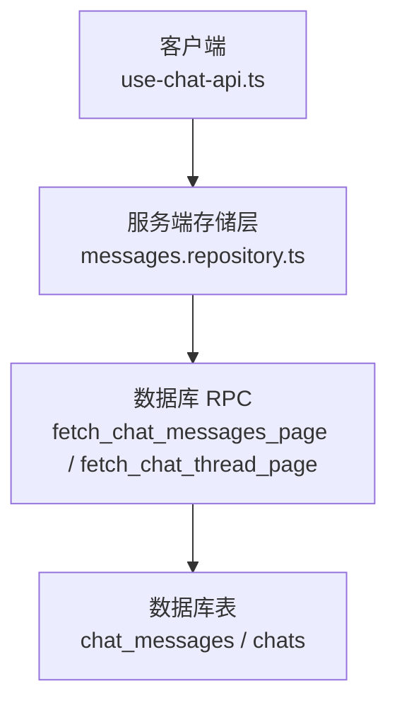
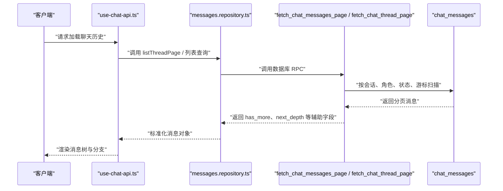
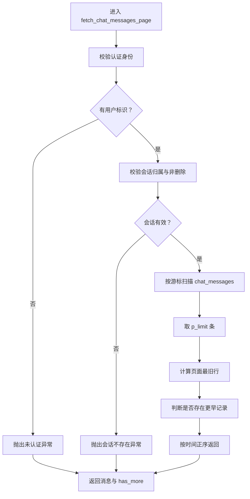
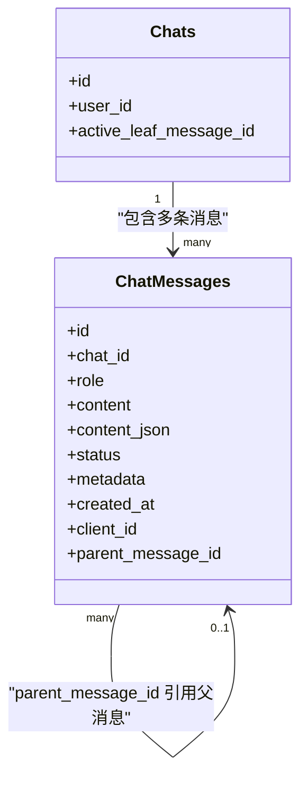
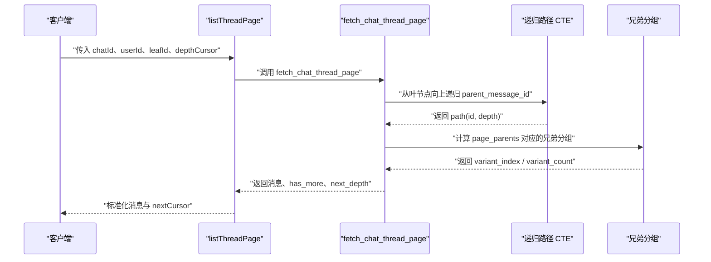
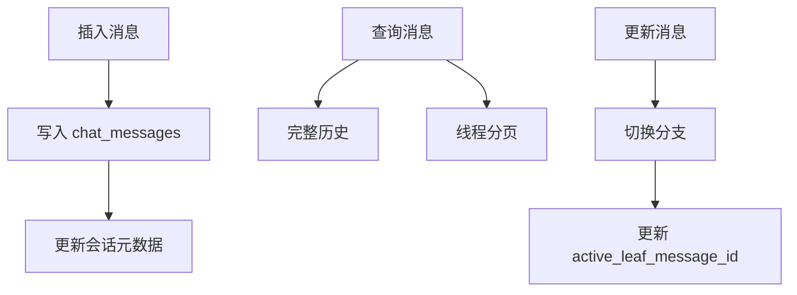
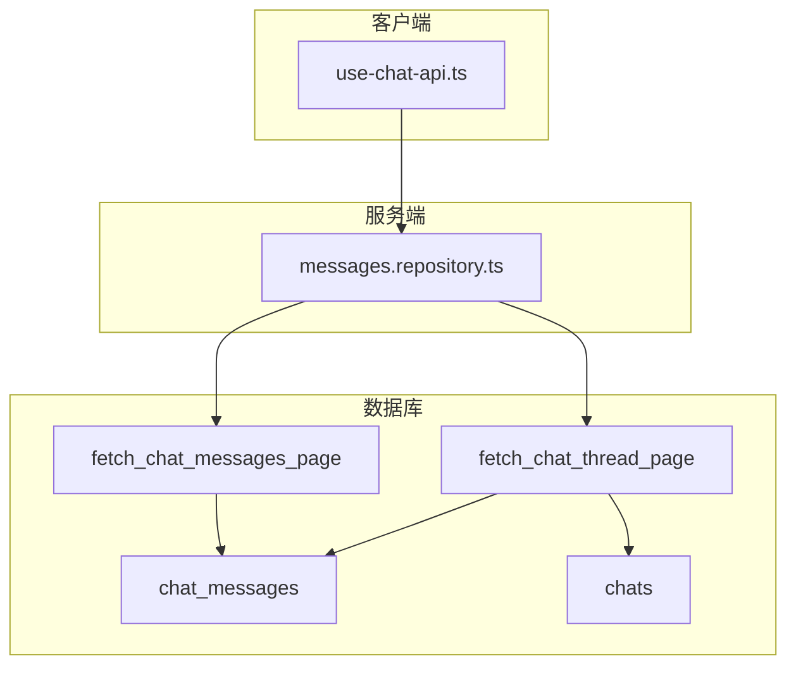

# 消息系统

<cite>
**本文引用的文件**
- [20260712180000_chat_messages_keyset_pagination.sql](file://supabase/migrations/20260712180000_chat_messages_keyset_pagination.sql)
- [20260930220000_chat_message_tree_branching.sql](file://supabase/migrations/20260930220000_chat_message_tree_branching.sql)
- [20261004221000_chat_branch_persistence_and_perspective.sql](file://supabase/migrations/20261004221000_chat_branch_persistence_and_perspective.sql)
- [20261002183000_fix_thread_page_paging_direction_and_perf.sql](file://supabase/migrations/20261002183000_fix_thread_page_paging_direction_and_perf.sql)
- [20261001080000_fix_message_chain_turn_order.sql](file://supabase/migrations/20261001080000_fix_message_chain_turn_order.sql)
- [20261001070000_fix_chat_thread_page_rpc_depth_ambiguity.sql](file://supabase/migrations/20261001070000_fix_chat_thread_page_rpc_depth_ambiguity.sql)
- [messages.repository.ts](file://src/server/repositories/messages.repository.ts)
- [use-chat-api.ts](file://src/client/hooks/use-chat-api.ts)
</cite>

## 目录
1. [引言](#引言)
2. [项目结构定位](#项目结构定位)
3. [核心数据模型](#核心数据模型)
4. [架构总览](#架构总览)
5. [详细组件分析](#详细组件分析)
6. [依赖关系分析](#依赖关系分析)
7. [性能与索引设计](#性能与索引设计)
8. [最佳实践](#最佳实践)
9. [故障排查](#故障排查)
10. [结论](#结论)

## 引言
本文件围绕消息系统的数据库层、服务端存储层和客户端消费链路展开，重点解释 `chat_messages` 表的结构设计、角色分类、状态管理、内容存储、键集分页机制、消息树结构与分支机制，以及 `fetch_chat_messages_page` 等关键过程对象的实现细节。文档面向后端工程师、数据库维护者和前端集成人员，既提供概念性说明，也给出可直接追溯的代码与迁移路径。

## 项目结构定位
消息系统涉及以下关键位置：
- 数据库迁移位于 `supabase/migrations/`，负责定义 `chat_messages` 表、索引、RPC 函数、消息树和分支能力。
- 服务端存储层位于 `src/server/repositories/messages.repository.ts`，封装消息查询、线程页加载和分支切换逻辑。
- 客户端入口位于 `src/client/hooks/use-chat-api.ts`，负责消息流式渲染、状态收敛、分支交互和持久化。

**图示来源**
- [messages.repository.ts:1-1440](file://src/server/repositories/messages.repository.ts#L1-L1440)
- [use-chat-api.ts:1-3707](file://src/client/hooks/use-chat-api.ts#L1-L3707)

**章节来源**
- [messages.repository.ts:1-1440](file://src/server/repositories/messages.repository.ts#L1-L1440)
- [use-chat-api.ts:1-3707](file://src/client/hooks/use-chat-api.ts#L1-L3707)

## 核心数据模型
### chat_messages 表的核心字段语义
根据代码引用和迁移注释，`chat_messages` 是聊天消息的持久化实体，关键字段如下：

| 字段 | 类型 | 语义 | 使用场景 |
|---|---|---|---|
| `id` | UUID | 消息主键 | 全局唯一标识，用于父链、兄弟节点和 RPC 返回 |
| `chat_id` | 文本 | 所属会话 | 过滤同一条对话的消息 |
| `user_id` | UUID | 消息所有者 | 权限校验时与 `chats.user_id` 对齐 |
| `role` | 文本 | 消息角色 | 支持 `user`、`assistant`、`system`；扩展位预留 `tool`、`meta` |
| `content` | 文本 | 人类可读正文 | 展示、搜索、历史快照 |
| `status` | 文本 | 消息状态 | `complete`、`streaming`、`failed`、`cancelled`；查询通常排除 `cancelled` |
| `metadata` | JSONB | 轻量结构化元数据 | 工具调用结果、思考摘要、追踪信息 |
| `content_json` | JSONB | 结构化内容载体 | 富文本、步骤、附件、Agent 轨迹等非纯文本结构 |
| `created_at` | 带时区时间戳 | 创建时间 | 排序、键集游标、回退链构建 |
| `client_id` | 文本 | 客户端临时或业务 ID | 乐观更新、分支解析、跨设备同步 |
| `parent_message_id` | UUID（可空） | 树父指针 | 消息树根到叶路径、分支变体 |

**章节来源**
- [messages.repository.ts:1-60](file://src/server/repositories/messages.repository.ts#L1-L60)
- [20260712180000_chat_messages_keyset_pagination.sql:1-117](file://supabase/migrations/20260712180000_chat_messages_keyset_pagination.sql#L1-L117)
- [20260930220000_chat_message_tree_branching.sql:1-299](file://supabase/migrations/20260930220000_chat_message_tree_branching.sql#L1-L299)

### 角色分类
当前明确使用的角色包括：
- `user`：用户输入。
- `assistant`：助手回复。
- `system`：系统提示或平台消息。

代码中角色字段类型为字符串，并留有扩展空间。若未来引入工具执行或元数据消息，可使用 `tool`、`meta`，但应通过服务层校验防止非法值污染历史。

**章节来源**
- [messages.repository.ts:1-60](file://src/server/repositories/messages.repository.ts#L1-L60)

### 状态管理
消息状态表达生成生命周期：
- `streaming`：正在流式写入。
- `complete`：生成完成。
- `failed`：生成失败。
- `cancelled`：被取消；这类消息在多数查询中被排除，避免干扰可见线程。

**章节来源**
- [messages.repository.ts:1-60](file://src/server/repositories/messages.repository.ts#L1-L60)
- [20260712180000_chat_messages_keyset_pagination.sql:1-117](file://supabase/migrations/20260712180000_chat_messages_keyset_pagination.sql#L1-L117)

### 内容存储：`content` 与 `content_json`
- `content`：适合纯文本展示、全文搜索和简单快照。
- `content_json`：适合复杂结构，例如 Agent 思考步骤、工具输出、附件列表、渲染指令等。

两者可以并存：
- 快速展示优先使用 `content`。
- 需要结构化数据时使用 `content_json`。
- 查询结果通常会用 `coalesce(content, '')` 保证非空展示。
- 备份、训练导出或归档可能同时保留两份内容。

**章节来源**
- [messages.repository.ts:1-60](file://src/server/repositories/messages.repository.ts#L1-L60)
- [20260712180000_chat_messages_keyset_pagination.sql:1-117](file://supabase/migrations/20260712180000_chat_messages_keyset_pagination.sql#L1-L117)

## 架构总览
消息系统采用“数据库过程对象 + 服务端存储层 + 客户端消费”的分层架构：
- 数据库层通过 SQL 函数提供幂等、安全、高性能的数据访问接口。
- 服务端存储层负责参数校验、权限映射、错误转换和业务聚合。
- 客户端负责流式事件合并、乐观 UI、分支交互和设备缓存。

**图示来源**
- [messages.repository.ts:60-200](file://src/server/repositories/messages.repository.ts#L60-L200)
- [20260712180000_chat_messages_keyset_pagination.sql:20-117](file://supabase/migrations/20260712180000_chat_messages_keyset_pagination.sql#L20-L117)
- [20261002183000_fix_thread_page_paging_direction_and_perf.sql:1-207](file://supabase/migrations/20261002183000_fix_thread_page_paging_direction_and_perf.sql#L1-L207)

**章节来源**
- [messages.repository.ts:1-1440](file://src/server/repositories/messages.repository.ts#L1-L1440)
- [use-chat-api.ts:1-3707](file://src/client/hooks/use-chat-api.ts#L1-L3707)

## 详细组件分析

### 键集分页：`fetch_chat_messages_page`
该过程对象为历史消息提供基于复合游标的键集分页，核心目标是稳定、高效地翻页，而不是偏移量分页。

#### 参数与返回
- 输入参数：
  - `p_chat_id`：目标会话。
  - `p_user_id`：可选用户标识，缺省时使用认证上下文。
  - `p_cursor_created_at`：上次页面最旧消息的创建时间。
  - `p_cursor_id`：上次页面最旧消息的 ID。
  - `p_limit`：每页大小，内部限制在合理区间。
- 返回字段：
  - 消息基础字段：`id`、`chat_id`、`role`、`content`、`status`、`metadata`、`content_json`、`created_at`。
  - `has_more`：是否还有更早的消息。

#### 权限验证
- 未认证时抛出未认证异常。
- 查询前校验会话存在且属于当前用户，且会话未被删除。

#### 分页逻辑
- 使用条件 `(created_at, id) < (cursor_created_at, cursor_id)` 比较复合游标。
- 扫描顺序为 `created_at DESC, id DESC`，便于向后翻页。
- 返回结果再按 `created_at ASC, id ASC` 排序，使客户端看到时间正序。
- `has_more` 通过检查是否存在比当前页面最旧行更旧的记录得出。

#### 优化点
- 复合索引 `chat_messages_chat_created_id_desc_idx` 覆盖 `chat_id`、`created_at DESC`、`id DESC`，并仅包含非 `cancelled` 消息。
- `replica identity full` 支持实时更新的完整变更负载，利于流式状态补丁。
- 权限由 `security definer` 和所有权校验共同保障。

**图示来源**
- [20260712180000_chat_messages_keyset_pagination.sql:20-117](file://supabase/migrations/20260712180000_chat_messages_keyset_pagination.sql#L20-L117)

**章节来源**
- [20260712180000_chat_messages_keyset_pagination.sql:1-117](file://supabase/migrations/20260712180000_chat_messages_keyset_pagination.sql#L1-L117)

### 消息树与分支：`parent_message_id` 与活跃叶节点
消息树将每条消息视为节点，通过 `parent_message_id` 形成父子链。会话的可见线程是一条从根到活跃叶的路径，`chats.active_leaf_message_id` 指向当前分支末端。

#### 树构建规则
- 历史回填时，每个消息的父节点是同一会话中的前一条消息。
- 在同一条事务内，用户消息先于助手回复，因此回填时考虑 `role` 顺序，避免助手回复被排在用户消息之前。
- 新分支操作（编辑用户消息、重新生成助手回复）会插入兄弟节点，而不是修改原消息。

#### 活跃叶节点
- `chats.active_leaf_message_id` 表示当前可见分支的末尾。
- 初始回填选择每个会话最新且处于对话末尾的消息作为叶节点。
- 分支切换会更新该指针，从而让不同设备加载时渲染相同分支。

**图示来源**
- [20260930220000_chat_message_tree_branching.sql:1-299](file://supabase/migrations/20260930220000_chat_message_tree_branching.sql#L1-L299)
- [20261001080000_fix_message_chain_turn_order.sql:1-58](file://supabase/migrations/20261001080000_fix_message_chain_turn_order.sql#L1-L58)

**章节来源**
- [20260930220000_chat_message_tree_branching.sql:1-299](file://supabase/migrations/20260930220000_chat_message_tree_branching.sql#L1-L299)
- [20261001080000_fix_message_chain_turn_order.sql:1-58](file://supabase/migrations/20261001080000_fix_message_chain_turn_order.sql#L1-L58)

### 线程页加载：`fetch_chat_thread_page`
该过程对象按深度分页加载当前活跃分支路径，支持兄弟变体计数和分支箭头渲染。

#### 深度分页约定
- `depth=0`：活跃叶节点。
- 更大的 `depth`：更老的祖先节点。
- 第一次加载返回最近 N 个节点，后续页面加载严格更深的祖先。

#### 分支信息
- `variant_index`：兄弟变体的从零开始索引。
- `variant_count`：兄弟变体总数。
- 后期版本还会注入 `sibling_ids` 和 `sibling_variants`，让客户端无需再次查询即可切换分支。

#### 性能优化
- 早期实现曾对整张表做兄弟分组窗口排名，导致每次读取都扫描大量行。
- 修复后只针对当前页面涉及的父节点计算兄弟分组，显著减少窗口计算开销。
- 索引 `chat_messages_chat_parent_idx` 加速兄弟查找和分支切换。

**图示来源**
- [20261002183000_fix_thread_page_paging_direction_and_perf.sql:1-207](file://supabase/migrations/20261002183000_fix_thread_page_paging_direction_and_perf.sql#L1-L207)
- [20261004221000_chat_branch_persistence_and_perspective.sql:1-431](file://supabase/migrations/20261004221000_chat_branch_persistence_and_perspective.sql#L1-L431)
- [messages.repository.ts:60-200](file://src/server/repositories/messages.repository.ts#L60-L200)

**章节来源**
- [20261002183000_fix_thread_page_paging_direction_and_perf.sql:1-207](file://supabase/migrations/20261002183000_fix_thread_page_paging_direction_and_perf.sql#L1-L207)
- [20261004221000_chat_branch_persistence_and_perspective.sql:1-431](file://supabase/migrations/20261004221000_chat_branch_persistence_and_perspective.sql#L1-L431)
- [messages.repository.ts:60-200](file://src/server/repositories/messages.repository.ts#L60-L200)

### 服务端消息仓库：插入、查询与更新
`messages.repository.ts` 定义了消息行类型、线程消息增强类型、线程分页结果、分叉类型和服务端方法。

#### 插入
- 插入走 `append_chat_message` 或其他服务端写入流程，将 `role`、`content`、`content_json`、`parent_message_id`、`client_id` 等字段持久化。
- 插入后可能更新会话标题、活跃叶节点或相关统计。

#### 查询
- `listMessagesForChat` 提供完整历史，用于归档或训练导出。
- `listThreadPage` 调用 `fetch_chat_thread_page`，并按深度分页组装结果。
- 返回结果包含 `sibling_ids` 和 `sibling_variants`，供分支 UI 使用。

#### 更新
- 分支切换通过 `switch_chat_branch` 更新 `chats.active_leaf_message_id` 和相关元数据。
- 流式消息的状态和内容补丁通过实时复制和客户端 reducer 收敛。

**图示来源**
- [messages.repository.ts:1-1440](file://src/server/repositories/messages.repository.ts#L1-L1440)

**章节来源**
- [messages.repository.ts:1-1440](file://src/server/repositories/messages.repository.ts#L1-L1440)

### 客户端消息消费：流式渲染与分支交互
`use-chat-api.ts` 承担消息流事件处理、消息映射、分支辅助方法和设备缓存持久化。

#### 消息映射
- 将 API 返回的行转换为客户端 `Message` 对象。
- 从 `metadata` 中提取研究计划、思考内容、耗时等结构化字段。
- 合并附件、清理不安全内容、应用流式增量。

#### 分支交互
- 编辑用户消息、重试助手回复、切换分支等操作通过分支辅助函数协调。
- 客户端维护乐观 ID 与持久化 ID 的映射，确保分支切换正确落库。

#### 持久化
- 本地设备缓存与会话同步结合，提高冷启动速度。
- 后台任务将内存中的聊天状态写回持久层。

**章节来源**
- [use-chat-api.ts:1-3707](file://src/client/hooks/use-chat-api.ts#L1-L3707)

## 依赖关系分析
消息系统的依赖关系可以概括为：
- 客户端依赖服务端 API 和 Supabase 实时通道。
- 服务端依赖数据库 RPC 和连接池。
- 数据库 RPC 依赖 `chat_messages`、`chats` 表和索引。
- 分支能力依赖递归 CTE、窗口函数和父指针。

**图示来源**
- [messages.repository.ts:1-1440](file://src/server/repositories/messages.repository.ts#L1-L1440)
- [20260712180000_chat_messages_keyset_pagination.sql:20-117](file://supabase/migrations/20260712180000_chat_messages_keyset_pagination.sql#L20-L117)
- [20261002183000_fix_thread_page_paging_direction_and_perf.sql:1-207](file://supabase/migrations/20261002183000_fix_thread_page_paging_direction_and_perf.sql#L1-L207)

**章节来源**
- [messages.repository.ts:1-1440](file://src/server/repositories/messages.repository.ts#L1-L1440)
- [20260712180000_chat_messages_keyset_pagination.sql:1-117](file://supabase/migrations/20260712180000_chat_messages_keyset_pagination.sql#L1-L117)
- [20261002183000_fix_thread_page_paging_direction_and_perf.sql:1-207](file://supabase/migrations/20261002183000_fix_thread_page_paging_direction_and_perf.sql#L1-L207)

## 性能与索引设计
### 关键索引
- `chat_messages_chat_created_id_desc_idx`：`(chat_id, created_at DESC, id DESC)`，用于键集分页和历史扫描，并过滤 `status != 'cancelled'`。
- `chat_messages_chat_parent_idx`：`(chat_id, parent_message_id, created_at, id)`，用于兄弟分组、分支查找和分支切换。
- `chats_active_leaf_message_id_idx`：加速活跃叶节点读取。

### 复杂度与优化
- 键集分页的时间复杂度主要取决于每页大小和索引扫描效率，避免了偏移量分页的大表全扫。
- 线程页加载使用递归 CTE 计算路径，并通过深度游标控制加载范围。
- 兄弟分组从全表窗口排名缩小到当前页面父节点集合，显著降低窗口计算成本。
- `replica identity full` 支持实时更新，减少额外查询以获取状态补丁。

**章节来源**
- [20260712180000_chat_messages_keyset_pagination.sql:1-117](file://supabase/migrations/20260712180000_chat_messages_keyset_pagination.sql#L1-L117)
- [20260930220000_chat_message_tree_branching.sql:1-299](file://supabase/migrations/20260930220000_chat_message_tree_branching.sql#L1-L299)
- [20261002183000_fix_thread_page_paging_direction_and_perf.sql:1-207](file://supabase/migrations/20261002183000_fix_thread_page_paging_direction_and_perf.sql#L1-L207)

## 最佳实践
### 消息插入
- 始终通过服务端写入，不要直接暴露 `chat_messages` 写权限给客户端。
- 插入时设置正确的 `role`、`content`、`content_json`、`parent_message_id`。
- 使用 `client_id` 标记乐观消息，并在落库后映射到持久化 `id`。
- 对于编辑和重新生成，插入兄弟节点而不是修改原消息。

### 消息查询
- 历史加载优先使用 `fetch_chat_messages_page` 的键集分页。
- 线程加载使用 `fetch_chat_thread_page`，并根据 `depth` 游标继续加载祖先。
- 避免直接使用 `OFFSET` 进行大偏移翻页。
- 过滤 `status != 'cancelled'`，除非需要查看已取消消息。

### 消息更新
- 流式更新通过状态和内容的增量补丁，避免整行重写。
- 分支切换通过 `switch_chat_branch` 更新活跃叶节点。
- 更新后保持 `content` 与 `content_json` 的一致性，必要时回填 `content`。

### 内容存储
- 纯文本展示使用 `content`。
- 富结构数据使用 `content_json`，例如 Agent 步骤、工具输出、附件。
- 归档、训练和数据迁移应同时保留两份内容，以便不同用途复用。

**章节来源**
- [messages.repository.ts:1-1440](file://src/server/repositories/messages.repository.ts#L1-L1440)
- [20260712180000_chat_messages_keyset_pagination.sql:20-117](file://supabase/migrations/20260712180000_chat_messages_keyset_pagination.sql#L20-L117)
- [20261002183000_fix_thread_page_paging_direction_and_perf.sql:1-207](file://supabase/migrations/20261002183000_fix_thread_page_paging_direction_and_perf.sql#L1-L207)

## 故障排查
### 常见问题
- **未认证错误**：调用 `fetch_chat_messages_page` 或 `fetch_chat_thread_page` 时未携带有效身份。
- **会话不存在**：`chat_id` 不属于当前用户，或会话已被删除。
- **线程无法加载更多**：`fetch_chat_thread_page` 曾因分页方向错误导致 `has_more` 永远为假，现已修复。
- **消息顺序错乱**：同事务内 `created_at` 相同的情况下，助手回复可能排在用户消息之后，已由回填修复。
- **RPC 歧义列错误**：`depth` 变量与列名冲突，已通过修复过程对象解决。

### 排查建议
- 检查调用者是否为 `authenticated` 或 `service_role`。
- 确认 `chat_id` 与 `user_id` 匹配，且会话状态不是 `deleted`。
- 检查 `status` 是否为 `cancelled`，避免误判为空历史。
- 检查 `parent_message_id` 是否形成环或断链，必要时重新运行回填。
- 监控 `fetch_chat_thread_page` 的 `has_more` 和 `next_depth`，确认分页游标是否正确传递。

**章节来源**
- [20260712180000_chat_messages_keyset_pagination.sql:20-117](file://supabase/migrations/20260712180000_chat_messages_keyset_pagination.sql#L20-L117)
- [20261001070000_fix_chat_thread_page_rpc_depth_ambiguity.sql:1-159](file://supabase/migrations/20261001070000_fix_chat_thread_page_rpc_depth_ambiguity.sql#L1-L159)
- [20261001080000_fix_message_chain_turn_order.sql:1-58](file://supabase/migrations/20261001080000_fix_message_chain_turn_order.sql#L1-L58)
- [20261002183000_fix_thread_page_paging_direction_and_perf.sql:1-207](file://supabase/migrations/20261002183000_fix_thread_page_paging_direction_and_perf.sql#L1-L207)

## 结论
消息系统以 `chat_messages` 为核心，通过角色、状态、内容和树结构字段支撑完整的聊天历史、流式生成和分支交互。键集分页解决了大表历史加载的性能问题，消息树和活跃叶节点保证了多分支场景下的确定性渲染。服务端存储层封装了权限、错误和分页细节，客户端则专注于流式渲染、分支操作和设备缓存。整体设计在可扩展性、性能和可维护性之间取得了平衡，但仍需持续关注索引健康、JSONB 体积增长和分支数量对查询成本的影响。