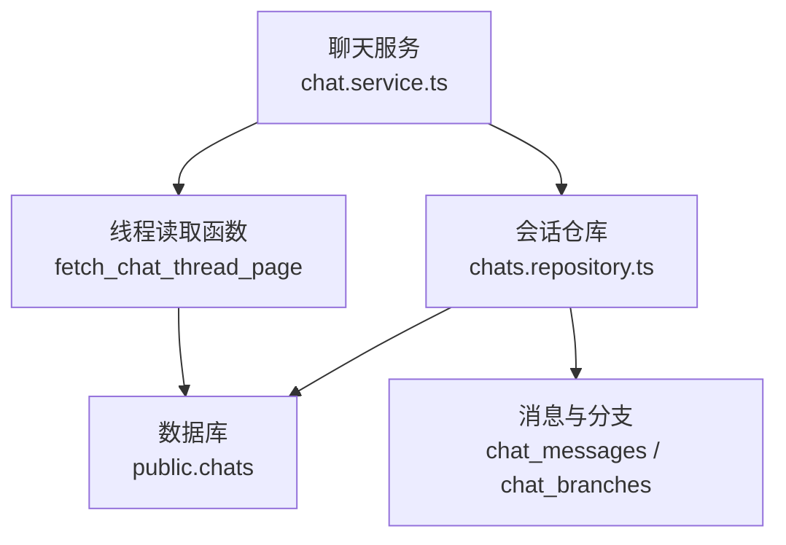
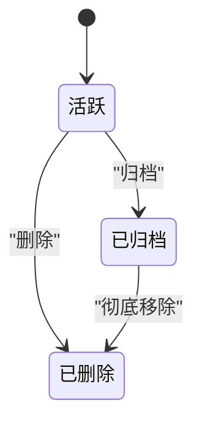
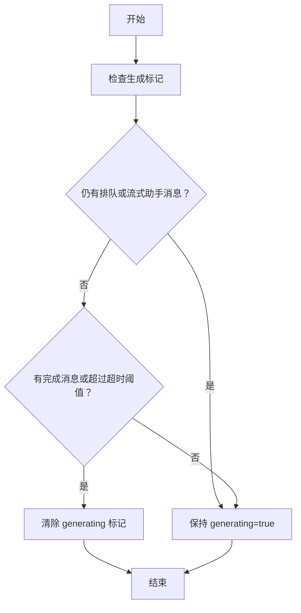
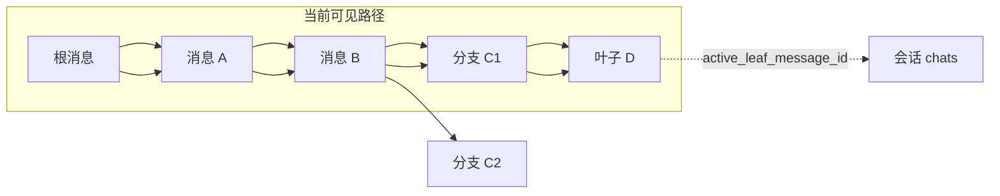
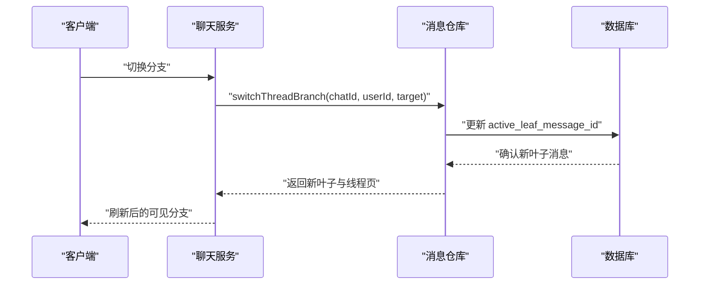
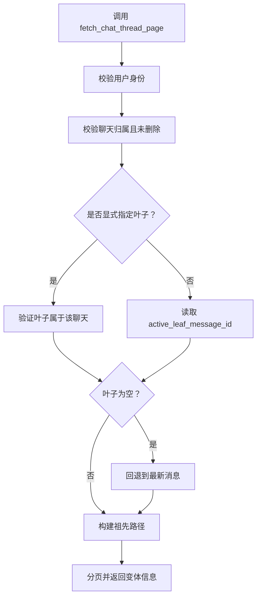
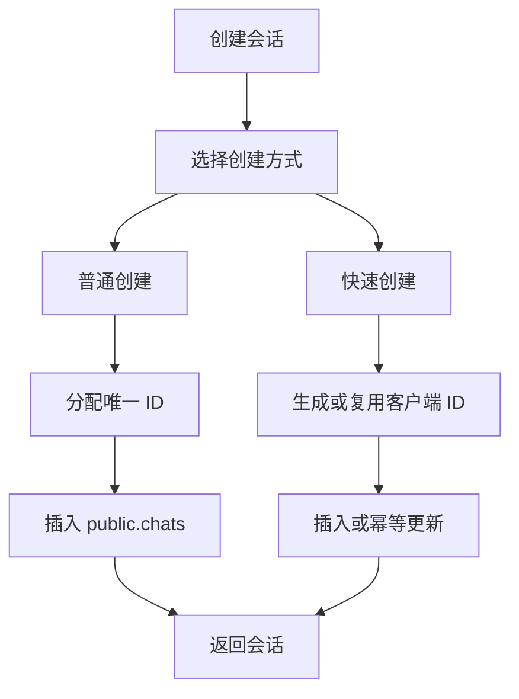
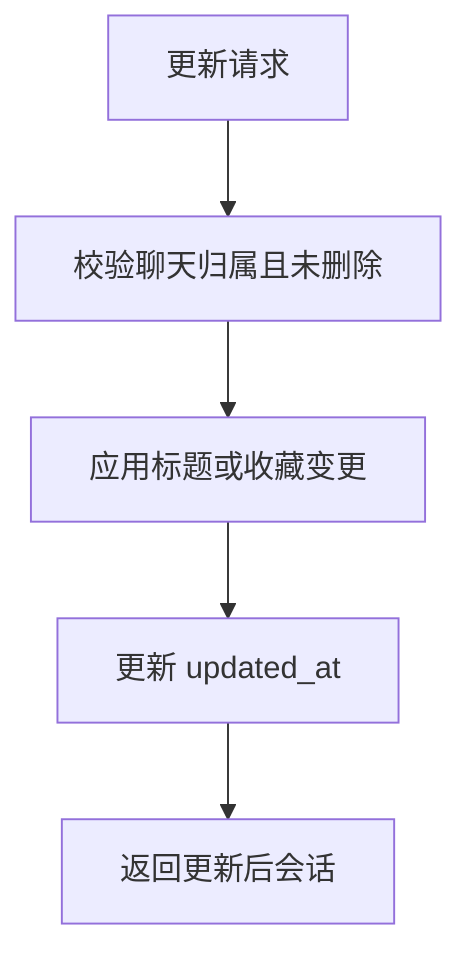
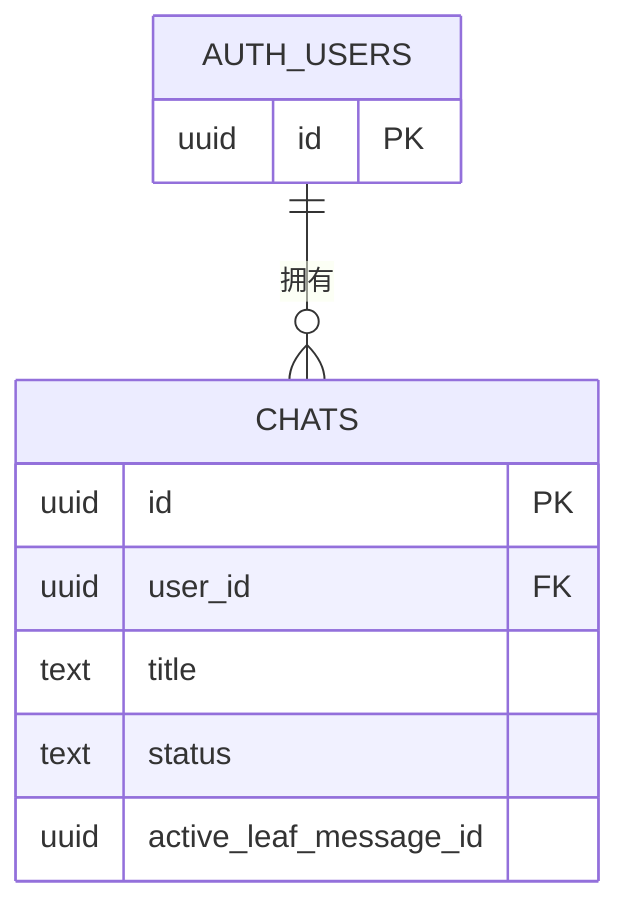
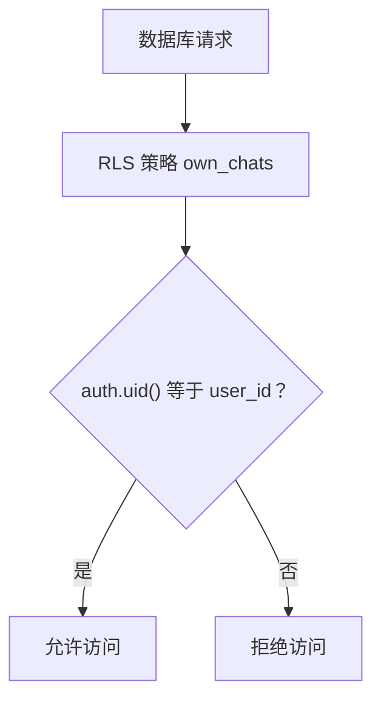

# 聊天会话实体

<cite>
**本文引用的文件**   
- [platform_schema.sql](file://supabase/migrations/20260507153000_platform_schema.sql)
- [chat_message_tree_branching.sql](file://supabase/migrations/20260930220000_chat_message_tree_branching.sql)
- [chat_branch_persistence_and_perspective.sql](file://supabase/migrations/20261004221000_chat_branch_persistence_and_perspective.sql)
- [chats.repository.ts](file://src/server/repositories/chats.repository.ts)
- [chat.service.ts](file://src/server/services/chat.service.ts)
</cite>

## 目录
1. [引言](#引言)
2. [项目结构中的定位](#项目结构中的定位)
3. [核心数据模型与字段设计](#核心数据模型与字段设计)
4. [聊天状态流转机制](#聊天状态流转机制)
5. [active_leaf_message_id 与分支聊天](#active_leaf_message_id-与分支聊天)
6. [会话生命周期管理](#会话生命周期管理)
7. [用户关系与安全策略](#用户关系与安全策略)
8. [查询优化、索引设计与性能考虑](#查询优化索引设计与性能考虑)
9. [常见 SQL 查询与使用模式](#常见-sql-查询与使用模式)
10. [故障排查指南](#故障排查指南)
11. [结论](#结论)

## 引言
本文围绕 `public.chats` 表及其在应用中的完整生命周期展开，重点解释以下目标：
- `id`、`user_id`、`title`、`status`、`active_leaf_message_id` 等关键字段的设计意图。
- 聊天会话的可用状态集合及实际使用方式，特别是活跃、归档、删除状态。
- `active_leaf_message_id` 如何在分支消息树中维护“当前可见路径”。
- 会话创建、更新、软删除和归档的实际流程。
- 基于用户的 RLS 安全约束。
- 侧边栏列表、标题搜索、生成中标记清理、分页线程读取等性能相关实现。
- 面向开发者的典型 SQL 查询和使用模式。

## 项目结构中的定位
聊天会话是平台的核心领域实体之一，位于 Supabase 迁移定义的应用主 Schema 中，并通过服务端仓库和服务层被调用：
- 数据库建模：由 `supabase/migrations/20260507153000_platform_schema.sql` 定义 `public.chats` 表。
- 分支能力：由 `supabase/migrations/20260930220000_chat_message_tree_branching.sql` 引入 `active_leaf_message_id`、消息父指针、线程页函数。
- 分支持久化与视角同步：由 `supabase/migrations/20261004221000_chat_branch_persistence_and_perspective.sql` 增强线程读取和变体信息。
- 应用层访问：由 `src/server/repositories/chats.repository.ts` 提供会话读写、搜索、生成中标记处理。
- 高层业务编排：由 `src/server/services/chat.service.ts` 组合会话、消息、转录、生成任务等能力。

**图表来源**
- [platform_schema.sql:245-263](file://supabase/migrations/20260507153000_platform_schema.sql#L245-L263)
- [chat_message_tree_branching.sql:38-41](file://supabase/migrations/20260930220000_chat_message_tree_branching.sql#L38-L41)
- [chats.repository.ts:119-167](file://src/server/repositories/chats.repository.ts#L119-L167)
- [chat.service.ts:202-268](file://src/server/services/chat.service.ts#L202-L268)

**章节来源**
- [platform_schema.sql:245-263](file://supabase/migrations/20260507153000_platform_schema.sql#L245-L263)
- [chats.repository.ts:1-323](file://src/server/repositories/chats.repository.ts#L1-L323)
- [chat.service.ts:202-268](file://src/server/services/chat.service.ts#L202-L268)

## 核心数据模型与字段设计
`public.chats` 是聊天会话的主表，代表一个用户维度的对话线程。其核心字段如下：

| 字段 | 类型 | 是否必填 | 默认值 | 含义与设计要点 |
|---|---|---:|---|---|
| `id` | `uuid` | 是 | `gen_random_uuid()` | 会话主键；应用层也可传入稳定 ID，用于幂等创建或重试场景。 |
| `user_id` | `uuid` | 是 | 无 | 所属用户；外键指向 `auth.users(id)`，并级联删除。 |
| `workspace_id` | `uuid` | 否 | 可空 | 企业工作区关联；可空表示个人会话。 |
| `project_id` | `uuid` | 否 | 可空 | 项目关联；删除项目时置空。 |
| `title` | `text` | 是 | `'New chat'` | 会话标题；支持客户端初始值和后端自动命名。 |
| `status` | `text` | 是 | `'active'` | 会话生命周期状态，受检查约束。 |
| `model_id` | `text` | 否 | 可空 | 最近选择的推理模型标识。 |
| `system_prompt` | `text` | 否 | 可空 | 会话级系统提示词。 |
| `web_search_enabled` | `boolean` | 是 | `false` | 是否启用网页搜索。 |
| `adaptive_thinking_enabled` | `boolean` | 是 | `false` | 是否启用自适应思考能力。 |
| `response_style` | `text` | 否 | 可空 | 响应风格配置。 |
| `starred` | `boolean` | 是 | `false` | 是否收藏。 |
| `archived_at` | `timestamptz` | 否 | 可空 | 归档时间戳。 |
| `metadata` | `jsonb` | 是 | `'{}'` | 扩展元数据，包括生成中标记、后台状态等。 |
| `created_at` | `timestamptz` | 是 | `now()` | 创建时间。 |
| `updated_at` | `timestamptz` | 是 | `now()` | 更新时间，由触发器维护。 |
| `active_leaf_message_id` | `uuid` | 否 | 可空 | 当前可见分支路径的消息叶子节点，支撑分支聊天。 |

### 字段设计说明
- `id` 是主键，但应用层存在两套创建路径：普通插入和快速插入。快速插入会尝试复用客户端生成的 ID，并在冲突时回退更新 `updated_at`，以降低并发重试开销。
- `status` 在数据库层面只允许 `active`、`archived`、`deleted`。代码中出现的 `creating`、`idle`、`deleting` 更多出现在前端或上层业务语义中，并不属于数据库检查约束定义的合法状态集合。
- `metadata` 承载运行时状态，例如 `generating` 和 `generating_at`，用于表示会话是否正在生成回复以及超时保护。
- `active_leaf_message_id` 是分支聊天的关键指针，指向当前可见消息树的末端消息。

**章节来源**
- [platform_schema.sql:245-263](file://supabase/migrations/20260507153000_platform_schema.sql#L245-L263)
- [chats.repository.ts:119-167](file://src/server/repositories/chats.repository.ts#L119-L167)
- [chats.repository.ts:170-267](file://src/server/repositories/chats.repository.ts#L170-L267)

## 聊天状态流转机制
### 数据库状态集合
数据库层对 `status` 使用检查约束，合法值为：
- `active`：正常活跃会话。
- `archived`：用户主动归档，保留数据但不在常规侧边栏列表中显示。
- `deleted`：软删除，不再参与正常查询。

**图表来源**
- [platform_schema.sql:245-263](file://supabase/migrations/20260507153000_platform_schema.sql#L245-L263)

### 运行期标记与业务状态
除了 `status`，会话还通过 `metadata` 表达运行期状态：
- `metadata.generating`：布尔标记，表示会话正在生成回复。
- `metadata.generating_at`：UTC 时间字符串，用于检测长时间挂起的生成任务。
- 应用层会通过后台清理逻辑把已结束但仍残留 `generating` 标记的会话重置为完成态。

**图表来源**
- [chats.repository.ts:192-247](file://src/server/repositories/chats.repository.ts#L192-L247)

### 重要澄清：不存在的数据库状态
- 文档中常提到的 `creating`、`idle`、`deleting` 并不是 `public.chats.status` 的有效枚举值。
- 正确理解应为：
  - 创建阶段：应用层可能暂时认为会话处于创建中，但最终落库状态通常是 `active`。
  - 空闲阶段：会话完成后进入 `active`，而不是单独的 `idle`。
  - 删除阶段：最终落库状态是 `deleted`，而非 `deleting`。

**章节来源**
- [platform_schema.sql:245-263](file://supabase/migrations/20260507153000_platform_schema.sql#L245-L263)
- [chats.repository.ts:192-267](file://src/server/repositories/chats.repository.ts#L192-L267)

## active_leaf_message_id 与分支聊天
### 为什么需要 `active_leaf_message_id`
在分支聊天中，同一父消息下可以有多个子消息（例如重新生成、编辑后重发）。`active_leaf_message_id` 用于记录“当前用户正在查看的那条分支路径”的末端消息，从而保证：
- 刷新页面后仍能渲染正确的可见分支。
- 跨设备同步时，不同设备可以拥有各自的活跃分支视角。
- 客户端不需要维护复杂的分支覆盖逻辑，只需按叶子节点向上回溯祖先路径。

**图表来源**
- [chat_message_tree_branching.sql:38-41](file://supabase/migrations/20260930220000_chat_message_tree_branching.sql#L38-L41)
- [chat_message_tree_branching.sql:43-54](file://supabase/migrations/20260930220000_chat_message_tree_branching.sql#L43-L54)

### 分支切换流程
当用户在 UI 中切换到另一个兄弟消息时，系统会：
1. 验证目标消息属于同一聊天。
2. 将 `chats.active_leaf_message_id` 指向目标消息。
3. 返回以新叶子为终点的线程页面，包含祖先路径和兄弟变体信息。

**图表来源**
- [chat.service.ts:1847-1864](file://src/server/services/chat.service.ts#L1847-L1864)
- [chat_message_tree_branching.sql:38-41](file://supabase/migrations/20260930220000_chat_message_tree_branching.sql#L38-L41)

### 线程读取函数
`fetch_chat_thread_page` 是服务器端权威函数，负责：
- 校验聊天归属。
- 解析叶子节点：优先显式传入叶子，否则回退到 `active_leaf_message_id`，再回退到最新消息。
- 递归回溯祖先路径。
- 计算变体序号、变体总数、兄弟消息 ID 和变体摘要。
- 支持深度游标分页。

**图表来源**
- [chat_message_tree_branching.sql:56-120](file://supabase/migrations/20260930220000_chat_message_tree_branching.sql#L56-L120)
- [chat_branch_persistence_and_perspective.sql:1-120](file://supabase/migrations/20261004221000_chat_branch_persistence_and_perspective.sql#L1-L120)

**章节来源**
- [chat_message_tree_branching.sql:38-54](file://supabase/migrations/20260930220000_chat_message_tree_branching.sql#L38-L54)
- [chat_message_tree_branching.sql:56-120](file://supabase/migrations/20260930220000_chat_message_tree_branching.sql#L56-L120)
- [chat_branch_persistence_and_perspective.sql:1-120](file://supabase/migrations/20261004221000_chat_branch_persistence_and_perspective.sql#L1-L120)
- [chat.service.ts:202-268](file://src/server/services/chat.service.ts#L202-L268)

## 会话生命周期管理
### 创建流程
应用层提供两种创建方式：

| 方法 | 特点 | 适用场景 |
|---|---|---|
| `createChat` | 先分配唯一 ID，再插入会话 | 通用创建，依赖 `chat_id_exists` 校验。 |
| `createChatFast` | 直接使用客户端生成的 ID，带冲突重试和幂等更新 | 高并发重试、网络抖动恢复。 |

**图表来源**
- [chats.repository.ts:21-32](file://src/server/repositories/chats.repository.ts#L21-L32)
- [chats.repository.ts:119-167](file://src/server/repositories/chats.repository.ts#L119-L167)

### 更新流程
会话更新主要涉及：
- 修改标题。
- 切换收藏状态。
- 更新 `updated_at`。
- 过滤已删除会话。

**图表来源**
- [chats.repository.ts:269-287](file://src/server/repositories/chats.repository.ts#L269-L287)

### 归档流程
归档是用户主动行为，不会真正删除数据：
- 状态变为 `archived`。
- 设置 `archived_at`。
- 普通侧边栏查询排除已归档会话。

**章节来源**
- [chats.repository.ts:119-167](file://src/server/repositories/chats.repository.ts#L119-L167)
- [chats.repository.ts:269-303](file://src/server/repositories/chats.repository.ts#L269-L303)

### 删除流程
删除是软删除：
- 状态变为 `deleted`。
- 普通查询排除 `deleted`。
- 特殊接口仍可读取已删除会话，用于归档快照或恢复。

**章节来源**
- [chats.repository.ts:290-303](file://src/server/repositories/chats.repository.ts#L290-L303)

## 用户关系与安全策略
### 用户关系约束
- `user_id` 外键指向 `auth.users(id)`，并设置 `on delete cascade`。
- 删除用户时，其聊天会话也会级联删除。
- 应用层所有会话写入都绑定当前用户 ID，避免越权。

**图表来源**
- [platform_schema.sql:245-263](file://supabase/migrations/20260507153000_platform_schema.sql#L245-L263)

### RLS 安全策略
`public.chats` 启用了行级安全策略：
- 策略名称：`own_chats`。
- 作用范围：对所有认证用户生效。
- 条件：`auth.uid() = user_id`。
- 效果：用户只能操作自己的会话，无法读取或修改其他用户的会话。

**图表来源**
- [platform_schema.sql:977-982](file://supabase/migrations/20260507153000_platform_schema.sql#L977-L982)

**章节来源**
- [platform_schema.sql:245-263](file://supabase/migrations/20260507153000_platform_schema.sql#L245-L263)
- [platform_schema.sql:977-982](file://supabase/migrations/20260507153000_platform_schema.sql#L977-L982)

## 查询优化、索引设计与性能考虑
### 现有查询特征
- 侧边栏列表按 `updated_at desc` 排序，限制默认 50 条，最大 100 条。
- 标题搜索使用 `ilike` 模糊匹配，并对 `%`、`_`、`\` 做转义。
- 生成中标记通过 `metadata` 判断，并结合 `generating_at` 时间戳进行超时清理。
- 活跃分支读取依赖 `fetch_chat_thread_page` 函数，避免客户端维护分支状态。

### 建议的索引设计
虽然代码未显式为 `chats.user_id`、`chats.status`、`chats.updated_at` 添加复合索引，但从查询模式看，以下索引通常能显著改善性能：

| 查询场景 | 建议索引 | 原因 |
|---|---|---|
| 侧边栏列表 | `(user_id, status, updated_at DESC)` | 过滤非删除会话并按更新时间倒序。 |
| 标题搜索 | `(user_id, status, updated_at DESC)` + GIN 全文索引 | 模糊搜索成本高，全文检索更合适。 |
| 单条会话读取 | 主键 `id` 已足够 | 主键查找成本极低。 |
| 生成中标记清理 | `(user_id, status, metadata)` | 按用户和状态扫描并更新 JSONB。 |
| 活跃叶子读取 | 已有 `active_leaf_message_id` 部分索引 | 仅对非空叶子建立索引，减少索引体积。 |

### 性能注意事项
- 避免在高频路径中使用低效的 `LIKE '%...%'`；如需全文搜索，建议结合 PostgreSQL 全文检索。
- `metadata` 频繁更新会影响行锁和 WAL 量，应控制更新频率。
- 分支聊天读取走递归 CTE，过深历史会增加计算成本，应通过深度游标分页控制。
- 软删除数据长期增长，需配合归档清理或物理删除策略。

**章节来源**
- [chats.repository.ts:35-96](file://src/server/repositories/chats.repository.ts#L35-L96)
- [chats.repository.ts:192-267](file://src/server/repositories/chats.repository.ts#L192-L267)
- [chat_message_tree_branching.sql:43-54](file://supabase/migrations/20260930220000_chat_message_tree_branching.sql#L43-L54)

## 常见 SQL 查询与使用模式
以下为面向数据库层的典型查询模式说明。为避免泄露具体 SQL 内容，这里给出结构化描述。

### 列出用户最近会话
- 过滤条件：`user_id` 等于当前用户，`status != 'deleted'`。
- 排序：`updated_at DESC`。
- 限制：默认 50，最大 100。
- 输出字段：`id`、`user_id`、`workspace_id`、`title`、`status`、`model_id`、`starred`、`created_at`、`updated_at`，以及根据 `metadata` 计算的 `generating`。

### 搜索用户会话标题
- 过滤条件：`user_id`、`status != 'deleted'`、`title ILIKE '%query%'`。
- 转义：对 `%`、`_`、`\` 进行转义。
- 排序：`updated_at DESC`。
- 限制：默认 40，最大 100。

### 获取单个会话
- 过滤条件：`id` 和 `user_id` 精确匹配，且 `status != 'deleted'`。
- 用途：会话详情页、分享前校验、导出入口。

### 获取包含已删除会话的快照
- 过滤条件：`id` 和 `user_id` 精确匹配，不过滤 `status`。
- 用途：归档快照、恢复、审计。

### 创建会话
- 输入：`userId`、可选 `title`、可选 `workspaceId`、可选 `projectId`。
- 行为：若未传 ID，则分配唯一 ID；快速路径支持冲突重试和幂等更新。

### 更新会话
- 支持字段：`title`、`starred`。
- 行为：空值跳过更新，始终更新 `updated_at`。

### 归档会话
- 行为：状态改为 `archived`，设置 `archived_at`，过滤已删除会话。

### 删除会话
- 行为：状态改为 `deleted`，过滤非所有者时更新 0 行。

### 查询生成中标记会话
- 条件：`status != 'deleted'`，且满足以下条件之一：
  - 存在队列中、运行中或继续中的生成任务。
  - `metadata.generating = true` 且 `generating_at` 未超过 45 分钟。

**章节来源**
- [chats.repository.ts:35-96](file://src/server/repositories/chats.repository.ts#L35-L96)
- [chats.repository.ts:99-167](file://src/server/repositories/chats.repository.ts#L99-L167)
- [chats.repository.ts:269-303](file://src/server/repositories/chats.repository.ts#L269-L303)
- [chats.repository.ts:250-267](file://src/server/repositories/chats.repository.ts#L250-L267)

## 故障排查指南
### 问题：侧边栏一直显示“生成中”
**可能原因**
- 助手消息仍停留在 `queued` 或 `streaming` 状态。
- `metadata.generating` 未随会话完成而清除。
- `generating_at` 时间戳过长，导致超时保护未触发。

**排查步骤**
1. 检查对应会话的 `metadata.generating` 是否为 `true`。
2. 检查是否存在状态为 `queued` 或 `streaming` 的助手消息。
3. 检查 `metadata.generating_at` 是否超过合理时间窗口。
4. 调用结算逻辑，让系统自动清理残留标记。

**相关实现位置**
- [chats.repository.ts:170-247](file://src/server/repositories/chats.repository.ts#L170-L247)
- [chats.repository.ts:250-267](file://src/server/repositories/chats.repository.ts#L250-L267)

### 问题：切换分支后页面没有变化
**可能原因**
- `active_leaf_message_id` 未被更新为目标消息。
- 客户端仍使用旧叶子参数读取线程。
- 目标消息不属于当前聊天。

**排查步骤**
1. 确认 `chats.active_leaf_message_id` 是否指向目标消息。
2. 确认线程读取函数是否使用新的叶子或深度游标。
3. 确认目标消息的 `chat_id` 与当前会话一致。

**相关实现位置**
- [chat_message_tree_branching.sql:38-54](file://supabase/migrations/20260930220000_chat_message_tree_branching.sql#L38-L54)
- [chat.service.ts:1847-1864](file://src/server/services/chat.service.ts#L1847-L1864)

### 问题：用户能看到其他用户的会话
**可能原因**
- 直接绕过 RLS 调用存储过程或函数。
- 应用层未传递 `user_id`，完全依赖 RLS。
- 使用了超管角色或内部接口未遵循所有权校验。

**排查步骤**
1. 检查查询是否包含 `user_id` 过滤。
2. 检查 RLS 策略是否生效。
3. 检查是否通过 `security definer` 函数绕过权限。

**相关实现位置**
- [platform_schema.sql:977-982](file://supabase/migrations/20260507153000_platform_schema.sql#L977-L982)
- [chat_message_tree_branching.sql:56-75](file://supabase/migrations/20260930220000_chat_message_tree_branching.sql#L56-L75)

**章节来源**
- [chats.repository.ts:170-267](file://src/server/repositories/chats.repository.ts#L170-L267)
- [chat_message_tree_branching.sql:38-75](file://supabase/migrations/20260930220000_chat_message_tree_branching.sql#L38-L75)
- [platform_schema.sql:977-982](file://supabase/migrations/20260507153000_platform_schema.sql#L977-L982)

## 结论
`public.chats` 是一个以用户为中心、状态明确、可扩展性强的聊天会话实体。它通过：
- 明确的 `status` 枚举管理生命周期。
- `metadata` 承载运行期生成状态。
- `active_leaf_message_id` 维护分支聊天的可见路径。
- RLS 策略保障数据安全。
- 仓库与服务层封装创建、更新、归档、删除、搜索和线程读取逻辑。

对于后续演进，建议重点关注：
- 为常用查询增加合适的复合索引。
- 将标题搜索迁移到全文检索以提升性能。
- 定期清理归档和软删除数据。
- 严格控制 `metadata` 的写入频率。
- 在分支聊天中持续优化深度游标和兄弟变体加载成本。