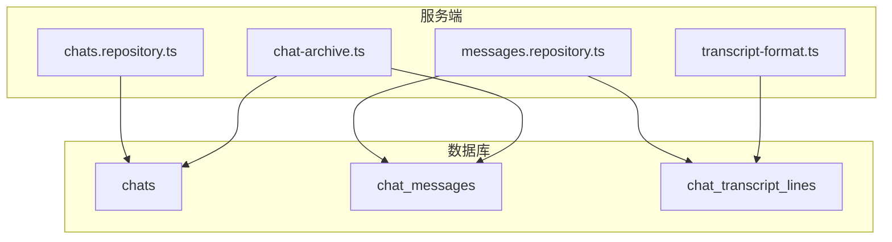
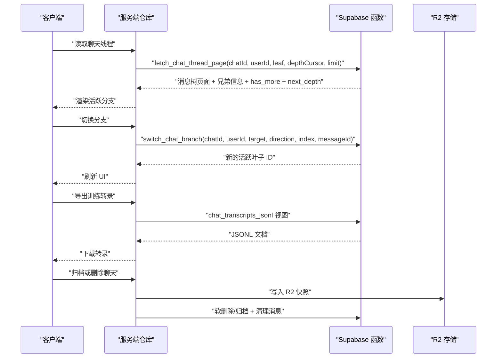
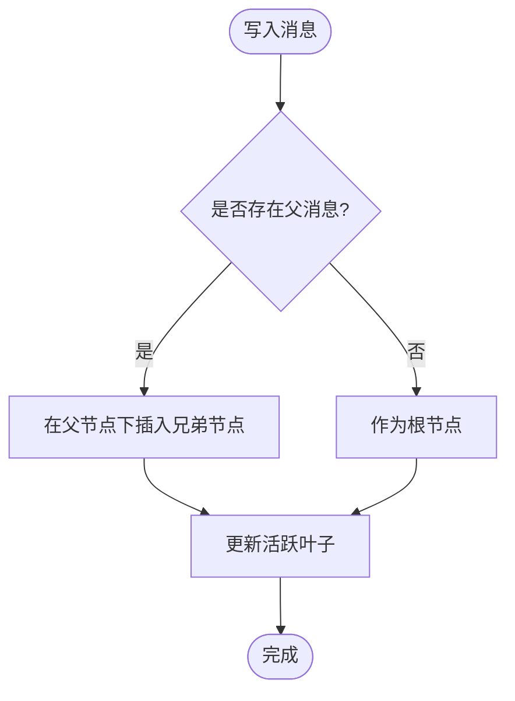
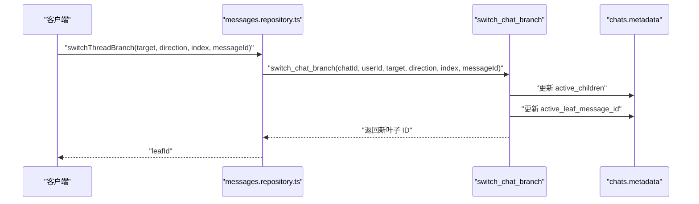
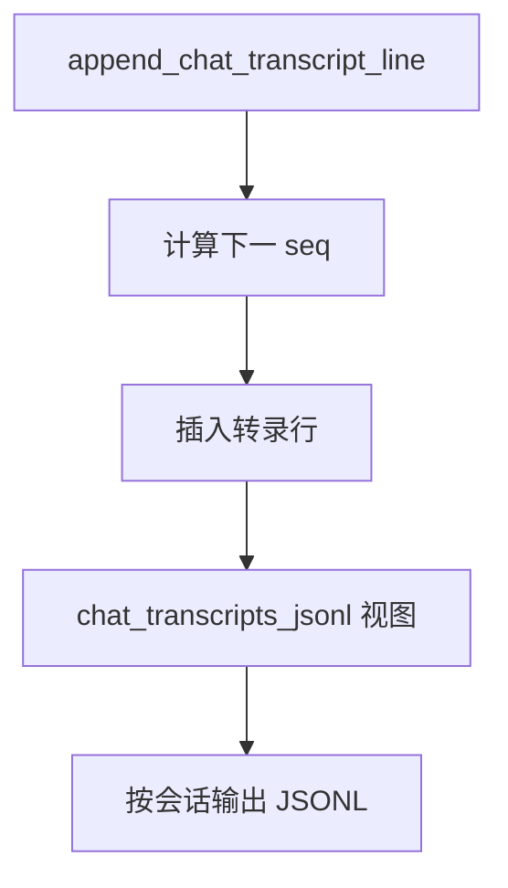
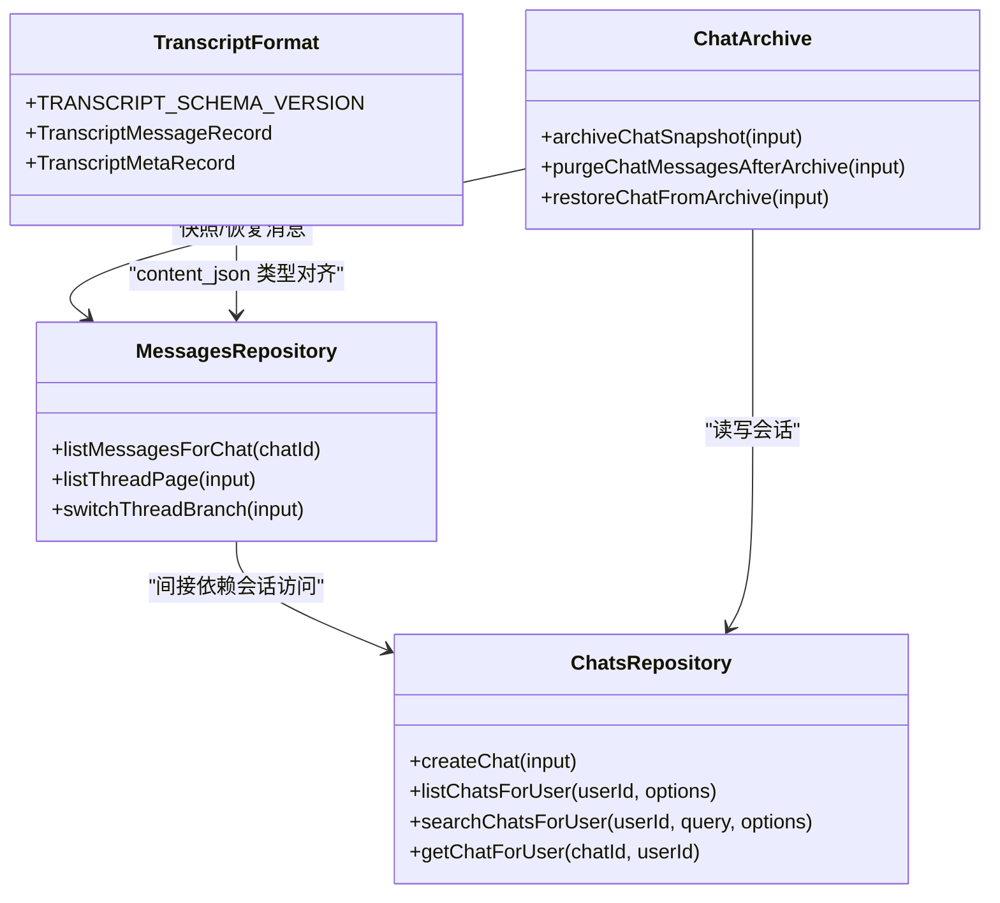
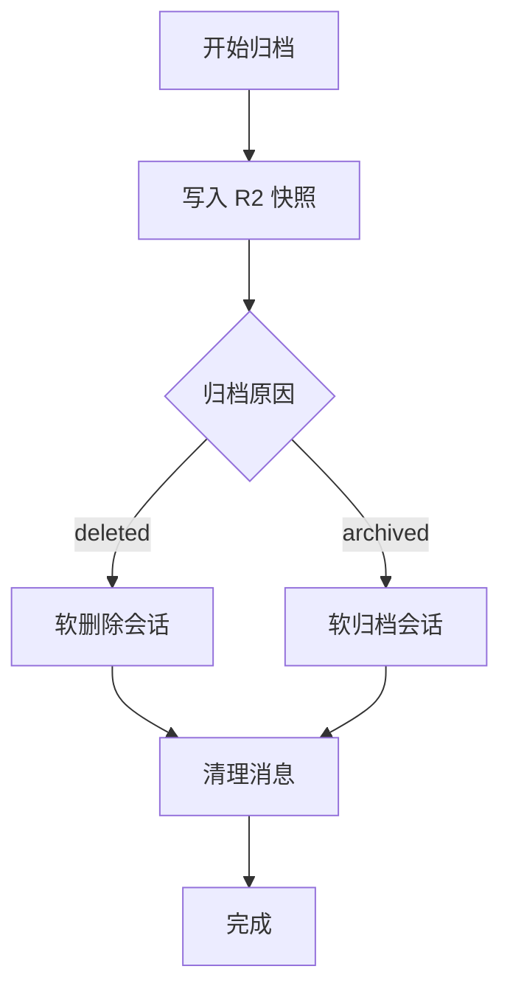

# 聊天数据模型

<cite>
**本文引用的文件**   
- [20260712153000_chat_transcript_jsonl.sql](file://supabase/migrations/20260712153000_chat_transcript_jsonl.sql)
- [20260712180000_chat_messages_keyset_pagination.sql](file://supabase/migrations/20260712180000_chat_messages_keyset_pagination.sql)
- [20260716210421_chat_turn_integrity_and_history_hardening.sql](file://supabase/migrations/20260716210421_chat_turn_integrity_and_history_hardening.sql)
- [20260930220000_chat_message_tree_branching.sql](file://supabase/migrations/20260930220000_chat_message_tree分支.sql)
- [20261004221000_chat_branch_persistence_and_perspective.sql](file://supabase/migrations/20261004221000_chat_branch_persistence_and_perspective.sql)
- [20261009154709_fix_thread_history_nested_windows.sql](file://supabase/migrations/20261009154709_fix_thread_history_nested_windows.sql)
- [messages.repository.ts](file://src/server/repositories/messages.repository.ts)
- [chats.repository.ts](file://src/server/repositories/chats.repository.ts)
- [chat-archive.ts](file://src/server/chat/chat-archive.ts)
- [transcript-format.ts](file://src/server/training/transcript-format.ts)
</cite>

## 目录
1. [引言](#引言)
2. [项目结构](#项目结构)
3. [核心实体与表结构](#核心实体与表结构)
4. [架构总览](#架构总览)
5. [详细组件分析](#详细组件分析)
6. [依赖关系分析](#依赖关系分析)
7. [性能与分页优化](#性能与分页优化)
8. [状态流转与消息角色](#状态流转与消息角色)
9. [导入导出与迁移流程](#导入导出与迁移流程)
10. [故障排查指南](#故障排查指南)
11. [结论](#结论)

## 引言
本文面向聊天系统的数据层，系统性说明会话、消息、转录、分支树、视角记忆、分页查询以及归档恢复等设计。重点覆盖以下目标：
- 解释 `chats`、`chat_messages`、`chat_transcript_lines` 的核心职责与字段语义。
- 说明 JSONL 转录格式、消息树父子与兄弟节点、活跃叶子与视角切换。
- 梳理 keyset pagination、覆盖索引、函数级权限与 RLS 策略。
- 给出聊天导入、导出、归档、恢复及训练数据抽取的完整流程。
- 为后续扩展（分区、物化视图、增量同步）提供约束与优化建议。

## 项目结构
聊天数据模型贯穿数据库迁移、服务端仓库、存储归档和训练格式模块：
- 数据库迁移位于 `supabase/migrations`，定义表结构、函数、索引和 RLS。
- 服务端仓库位于 `src/server/repositories`，封装 SQL RPC 调用与结果映射。
- 归档逻辑位于 `src/server/chat/chat-archive.ts`，负责 R2 快照与恢复。
- 转录格式位于 `src/server/training/transcript-format.ts`，定义结构化 JSONL 类型。

**图表来源**
- [messages.repository.ts:1-120](file://src/server/repositories/messages.repository.ts#L1-L120)
- [chats.repository.ts:1-120](file://src/server/repositories/chats.repository.ts#L1-L120)
- [chat-archive.ts:1-173](file://src/server/chat/chat-archive.ts#L1-L173)
- [transcript-format.ts:1-120](file://src/server/training/transcript-format.ts#L1-L120)

**章节来源**
- [messages.repository.ts:1-120](file://src/server/repositories/messages.repository.ts#L1-L120)
- [chats.repository.ts:1-120](file://src/server/repositories/chats.repository.ts#L1-L120)
- [chat-archive.ts:1-173](file://src/server/chat/chat-archive.ts#L1-L173)
- [transcript-format.ts:1-120](file://src/server/training/transcript-format.ts#L1-L120)

## 核心实体与表结构
### chats：会话元数据与活跃分支锚点
- 主键为文本型会话标识，用于应用层可读且可分片。
- 关键字段包括用户标识、工作区标识、标题、状态、模型标识、星标、时间戳、元数据。
- 新增 `active_leaf_message_id`，指向当前可见分支路径上的最新叶子消息。
- 新增 `metadata.active_children`，记录每个父节点下“活跃子节点”的持久化视角。

| 字段 | 类型 | 含义 | 备注 |
| --- | --- | --- | --- |
| id | text | 会话标识 | 业务生成，非自增 |
| user_id | uuid | 所属用户 | RLS 校验 |
| workspace_id | text/null | 企业工作区 | 可选 |
| title | text | 会话标题 | 支持模糊搜索 |
| status | text | 会话状态 | deleted 时不可见 |
| model_id | text/null | 最近使用的推理模型 | 可选 |
| starred | boolean | 是否收藏 | 列表排序辅助 |
| created_at | timestamptz | 创建时间 | |
| updated_at | timestamptz | 更新时间 | 列表排序依据 |
| metadata | jsonb | 扩展字段 | generating、active_children 等 |
| active_leaf_message_id | uuid/null | 活跃分支叶子 | 外键指向 chat_messages |

**章节来源**
- [20260930220000_chat_message_tree_branching.sql:1-80](file://supabase/migrations/20260930220000_chat_message_tree_branching.sql#L1-L80)
- [20261004221000_chat_branch_persistence_and_perspective.sql:200-431](file://supabase/migrations/20261004221000_chat_branch_persistence_and_perspective.sql#L200-L431)
- [chats.repository.ts:1-200](file://src/server/repositories/chats.repository.ts#L1-L200)

### chat_messages：消息节点与树结构
- 每条消息是树中的一个节点，通过 `parent_message_id` 形成父子关系。
- 根节点 parent 为空；同一父节点下的多条消息构成兄弟变体，用于编辑提示词或重新生成回答。
- 关键字段包括角色、内容、状态、客户端幂等键、结构化负载、时间戳。

| 字段 | 类型 | 含义 | 备注 |
| --- | --- | --- | --- |
| id | uuid | 消息标识 | UUID v4，不保证时间有序 |
| chat_id | text | 所属会话 | 外键 |
| role | text | 消息角色 | user / assistant / system / tool / meta |
| content | text/null | 序列化内容 | 兼容旧格式 |
| status | text | 消息状态 | complete / streaming / failed / cancelled |
| metadata | jsonb | 扩展字段 | 包含 sibling_ids、sibling_variants |
| content_json | jsonb/null | 结构化负载 | 训练与回放优先使用 |
| created_at | timestamptz | 创建时间 | 分页与排序 |
| client_id | text/null | 客户端幂等键 | 唯一索引过滤 |
| parent_message_id | uuid/null | 父消息 | 树结构 |

**章节来源**
- [20260930220000_chat_message_tree_branching.sql:1-120](file://supabase/migrations/20260930220000_chat_message_tree_branching.sql#L1-L120)
- [messages.repository.ts:1-80](file://src/server/repositories/messages.repository.ts#L1-L80)

### chat_transcript_lines：JSONL 转录行
- 每行代表一条转录对象，按 `seq` 严格递增。
- 支持两种记录类型：消息记录与 turn_ended 元记录。
- 提供原子追加函数和整批替换函数，并暴露聚合视图供训练导出。

| 字段 | 类型 | 含义 | 备注 |
| --- | --- | --- | --- |
| id | bigint | 行标识 | 自增 |
| chat_id | text | 所属会话 | 外键 |
| user_id | uuid | 所属用户 | RLS |
| message_id | uuid/null | 关联消息 | 删除消息时置空 |
| seq | integer | 顺序号 | 会话内唯一 |
| role | text | 转录角色 | user / assistant / system / tool / meta |
| record | jsonb | 转录对象 | Cursor/OpenAI Responses 风格 |
| schema_version | text | 转录版本 | 默认演进 |
| training_eligible | boolean | 是否允许训练 | 隐私与合规控制 |
| created_at | timestamptz | 写入时间 | 索引 |

**章节来源**
- [20260712153000_chat_transcript_jsonl.sql:1-168](file://supabase/migrations/20260712153000_chat_transcript_jsonl.sql#L1-L168)

## 架构总览
聊天数据层围绕三个层次组织：
- 会话层：chats 维护用户、状态、活跃叶子和视角。
- 消息层：chat_messages 承载树形对话，支持分支、兄弟变体和分页。
- 转录层：chat_transcript_lines 保存可导出的 JSONL 流，支持训练和审计。

**图表来源**
- [messages.repository.ts:80-200](file://src/server/repositories/messages.repository.ts#L80-L200)
- [20261004221000_chat_branch_persistence_and_perspective.sql:200-431](file://supabase/migrations/20261004221000_chat_branch_persistence_and_perspective.sql#L200-L431)
- [20260712153000_chat_transcript_jsonl.sql:120-168](file://supabase/migrations/20260712153000_chat_transcript_jsonl.sql#L120-L168)
- [chat-archive.ts:1-173](file://src/server/chat/chat-archive.ts#L1-L173)

## 详细组件分析

### 消息树与分支持久化
消息树以 `parent_message_id` 构建祖先链，并通过 `active_leaf_message_id` 锁定可见路径。每次编辑或重生成不会修改原消息，而是插入兄弟节点，使历史不可变、可回溯。

**图表来源**
- [20260930220000_chat_message_tree_branching.sql:1-120](file://supabase/migrations/20260930220000_chat_message_tree_branching.sql#L1-L120)

关键实现要点：
- 对历史数据执行一次性回填，将 null parent 的消息链接到前序消息。
- 活跃叶子回退策略：显式传入叶子 → 会话存储的叶子 → 同会话最新消息。
- 分支切换函数返回新的活跃叶子，并维护 `metadata.active_children`。

**章节来源**
- [20260930220000_chat_message_tree_branching.sql:1-200](file://supabase/migrations/20260930220000_chat_message_tree_branching.sql#L1-L200)
- [20261004221000_chat_branch_persistence_and_perspective.sql:200-431](file://supabase/migrations/20261004221000_chat_branch_persistence_and_perspective.sql#L200-L431)
- [messages.repository.ts:80-200](file://src/server/repositories/messages.repository.ts#L80-L200)

### 视角切换与兄弟导航
`switch_chat_branch` 支持多种定位方式：
- 直接指定目标消息。
- 通过方向 prev/next 在当前兄弟序列中移动。
- 通过 0-based index 定位兄弟。
- 通过显式目标消息 ID 精准切换。

切换后，函数会沿父链向上推导下一个活跃子节点，最多迭代 500 层，确保跨设备同步后的视角一致。

**图表来源**
- [messages.repository.ts:120-200](file://src/server/repositories/messages.repository.ts#L120-L200)
- [20261004221000_chat_branch_persistence_and_perspective.sql:200-431](file://supabase/migrations/20261004221000_chat_branch_persistence_and_perspective.sql#L200-L431)

**章节来源**
- [messages.repository.ts:120-200](file://src/server/repositories/messages.repository.ts#L120-L200)
- [20261004221000_chat_branch_persistence_and_perspective.sql:200-431](file://supabase/migrations/20261004221000_chat_branch_persistence_and_perspective.sql#L200-L431)

### 转录 JSONL 与训练导出
转录行采用逐行追加模式，seq 由函数原子计算。导出通过聚合视图拼接 JSONL 字符串，便于 COPY 或批量下载。

**图表来源**
- [20260712153000_chat_transcript_jsonl.sql:60-168](file://supabase/migrations/20260712153000_chat_transcript_jsonl.sql#L60-L168)

**章节来源**
- [20260712153000_chat_transcript_jsonl.sql:1-168](file://supabase/migrations/20260712153000_chat_transcript_jsonl.sql#L1-L168)
- [transcript-format.ts:1-120](file://src/server/training/transcript-format.ts#L1-L120)

### 历史窗口与嵌套窗口修复
早期分支查询存在递归深度与窗口函数嵌套问题，后续迁移修正了：
- 先对兄弟进行排名，再聚合 sibling_ids 与 sibling_variants。
- 使用 window 别名避免嵌套窗口函数非法语法。
- 明确 has_more 基于更深祖先是否存在，next_depth 用于分页。

**章节来源**
- [20261009154709_fix_thread_history_nested_windows.sql:1-159](file://supabase/migrations/20261009154709_fix_thread_history_nested_windows.sql#L1-L159)

## 依赖关系分析

**图表来源**
- [messages.repository.ts:1-200](file://src/server/repositories/messages.repository.ts#L1-L200)
- [chats.repository.ts:1-200](file://src/server/repositories/chats.repository.ts#L1-L200)
- [chat-archive.ts:1-173](file://src/server/chat/chat-archive.ts#L1-L173)
- [transcript-format.ts:1-120](file://src/server/training/transcript-format.ts#L1-L120)

**章节来源**
- [messages.repository.ts:1-200](file://src/server/repositories/messages.repository.ts#L1-L200)
- [chats.repository.ts:1-200](file://src/server/repositories/chats.repository.ts#L1-L200)
- [chat-archive.ts:1-173](file://src/server/chat/chat-archive.ts#L1-L173)
- [transcript-format.ts:1-120](file://src/server/training/transcript-format.ts#L1-L120)

## 性能与分页优化

### Keyset Pagination
消息历史使用复合游标 `(created_at, id)` 进行 keyset pagination，避免 offset 导致的扫描放大。

- 索引：`chat_messages.chat_id, created_at desc, id desc`，仅包含非取消消息。
- 函数 `fetch_chat_messages_page` 返回 has_more，客户端据此继续翻页。
- 限制范围：limit 被钳制到 20-500，防止大页。

**章节来源**
- [20260712180000_chat_messages_keyset_pagination.sql:1-117](file://supabase/migrations/20260712180000_chat_messages_keyset_pagination.sql#L1-L117)
- [20260716210421_chat_turn_integrity_and_history_hardening.sql:1-126](file://supabase/migrations/20260716210421_chat_turn_integrity_and_history_hardening.sql#L1-L126)

### 线程分页与深度游标
线程分页使用递归 CTE 从活跃叶子向祖先回溯，并以 depth 作为分页游标：
- 首次请求返回最近 N 个节点，按深度升序。
- 后续请求使用 `depth_cursor` 获取更深层祖先。
- 返回 next_depth 与 has_more，客户端决定是否需要继续加载。

**章节来源**
- [20260930220000_chat_message_tree_branching.sql:120-200](file://supabase/migrations/20260930220000_chat_message_tree_branching.sql#L120-L200)
- [20261004221000_chat_branch_persistence_and_perspective.sql:1-200](file://supabase/migrations/20261004221000_chat_branch_persistence_and_perspective.sql#L1-L200)
- [20261009154709_fix_thread_history_nested_windows.sql:1-159](file://supabase/migrations/20261009154709_fix_thread_history_nested_windows.sql#L1-L159)

### 覆盖索引与选择性索引
- 转录训练导出使用部分索引 `training_eligible = true`，减少无关行扫描。
- 消息分页索引仅包含非取消消息，缩小索引体积。
- 会话活跃叶子索引仅在非空时生效，避免无意义条目。

**章节来源**
- [20260712153000_chat_transcript_jsonl.sql:1-60](file://supabase/migrations/20260712153000_chat_transcript_jsonl.sql#L1-L60)
- [20260712180000_chat_messages_keyset_pagination.sql:1-30](file://supabase/migrations/20260712180000_chat_messages_keyset_pagination.sql#L1-L30)
- [20260930220000_chat_message_tree_branching.sql:60-120](file://supabase/migrations/20260930220000_chat_message_tree_branching.sql#L60-L120)

### 分区策略评估
当前未见到按时间或用户的显式分区表。若未来出现大规模增长，建议：
- 对 `chat_transcript_lines` 按 `user_id` 或 `created_at` 分区，提升训练导出效率。
- 对 `chat_messages` 按 `chat_id` 哈希分区或按 `created_at` 范围分区，配合 RLS 提升隔离性。
- 保留现有选择性索引，避免因分区键变化导致覆盖失效。

[本节为通用性能建议，不直接分析具体文件]

## 状态流转与消息角色

### 消息角色分类
- user：用户输入。
- assistant：模型回复。
- system：系统指令。
- tool：工具调用或工具结果。
- meta：内部元事件，如 turn_ended。

转录记录区分 `TranscriptMessageRecord` 与 `TranscriptMetaRecord`，其中 meta 记录携带 turn 结束状态 success/error/cancelled。

**章节来源**
- [20260712153000_chat_transcript_jsonl.sql:1-40](file://supabase/migrations/20260712153000_chat_transcript_jsonl.sql#L1-L40)
- [transcript-format.ts:120-200](file://src/server/training/transcript-format.ts#L120-L200)

### 消息状态流转
消息状态通常经历：
- streaming：开始生成。
- complete：生成成功。
- failed：生成失败。
- cancelled：用户停止或系统取消。

`fetch_chat_messages_page` 排除 cancelled 消息；线程查询也会过滤已取消但内容为空的行，保证 UI 一致性。

**章节来源**
- [20260712180000_chat_messages_keyset_pagination.sql:30-117](file://supabase/migrations/20260712180000_chat_messages_keyset_pagination.sql#L30-L117)
- [20261009154709_fix_thread_history_nested_windows.sql:80-159](file://supabase/migrations/20261009154709_fix_thread_history_nested_windows.sql#L80-L159)

### 幂等性与事务安全
- `client_id` 提供客户端幂等键，防止重试重复写入。
- `append_chat_transcript_line` 通过会话行锁与最大 seq 计算保证顺序。
- 转录批量替换函数 `replace_chat_transcript_lines` 在持有会话行锁后清空并重写，适合分支树规范化后重建。

**章节来源**
- [20260716210421_chat_turn_integrity_and_history_hardening.sql:1-40](file://supabase/migrations/20260716210421_chat_turn_integrity_and_history_hardening.sql#L1-L40)
- [20260712153000_chat_transcript_jsonl.sql:60-120](file://supabase/migrations/20260712153000_chat_transcript_jsonl.sql#L60-L120)

## 导入导出与迁移流程

### 训练转录导出
- 使用 `chat_transcripts_jsonl` 视图按会话聚合 JSONL。
- 每条会话输出一行 JSONL，由 `string_agg(record::text, '\n' order by seq)` 拼接。
- 训练导出需考虑 `training_eligible` 字段，过滤不允许训练的记录。

**章节来源**
- [20260712153000_chat_transcript_jsonl.sql:120-168](file://supabase/migrations/20260712153000_chat_transcript_jsonl.sql#L120-L168)
- [transcript-format.ts:1-120](file://src/server/training/transcript-format.ts#L1-R120)

### 聊天归档与恢复
归档流程：
1. 写入 R2 快照，包含会话行与消息列表。
2. 根据原因选择 deleted/archived 前缀。
3. 成功后软删除或软归档聊天，并清理消息。

恢复流程：
1. 从 R2 读取快照。
2. 校验会话 ID 与用户。
3. 用快照消息重建消息表。
4. 恢复会话状态。

**图表来源**
- [chat-archive.ts:1-173](file://src/server/chat/chat-archive.ts#L1-L173)

**章节来源**
- [chat-archive.ts:1-173](file://src/server/chat/chat-archive.ts#L1-L173)

### 数据迁移注意事项
- 转录 schema_version 存在多个版本，读取时需兼容旧值。
- 分支迁移需要回填 parent_message_id 与 active_leaf_message_id。
- 线程分页函数多次演进，注意函数授权与参数兼容性。
- 客户端幂等键需在迁移中建立唯一索引，并处理 NULL 场景。

**章节来源**
- [20260712153000_chat_transcript_jsonl.sql:1-40](file://supabase/migrations/20260712153000_chat_transcript_jsonl.sql#L1-L40)
- [20260930220000_chat_message_tree_branching.sql:1-80](file://supabase/migrations/20260930220000_chat_message_tree_branching.sql#L1-L80)
- [20260716210421_chat_turn_integrity_and_history_hardening.sql:1-40](file://supabase/migrations/20260716210421_chat_turn_integrity_and_history_hardening.sql#L1-L40)

## 故障排查指南
- 聊天不存在：RPC 抛出 “chat not found”，仓库层可能映射为 404。
- 消息不存在：分支切换时若目标消息不在该会话或已被取消且无内容，会报错。
- 分页异常：确认 cursor 是否同时传入 created_at 与 id；检查 has_more 与 next_depth。
- 转录缺失：检查 `append_chat_transcript_line` 是否调用成功，seq 是否连续。
- 归档失败：R2 未配置时会降级为软操作；恢复失败会回退到仅恢复会话。

**章节来源**
- [messages.repository.ts:80-120](file://src/server/repositories/messages.repository.ts#L80-L120)
- [20261004221000_chat_branch_persistence_and_perspective.sql:200-350](file://supabase/migrations/20261004221000_chat_branch_persistence_and_perspective.sql#L200-L350)
- [chat-archive.ts:100-173](file://src/server/chat/chat-archive.ts#L100-L173)

## 结论
聊天数据模型通过会话元数据、消息树与 JSONL 转录三要素，实现了高可靠、高性能、可回溯的对话存储。keyset pagination、选择性索引与函数级权限保障了查询效率与安全边界；分支与视角机制让编辑、重生成和多端同步具备一致体验；归档与转录导出则支撑生命周期管理与训练需求。未来可在分区、物化视图与增量同步方面进一步扩展，但需保持现有 RLS、幂等与顺序约束不变。