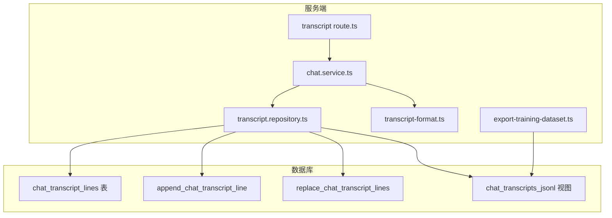
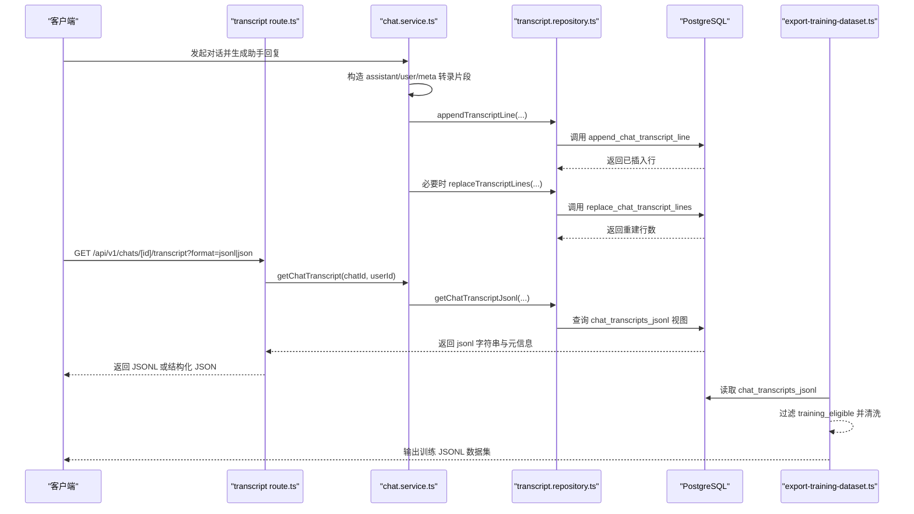
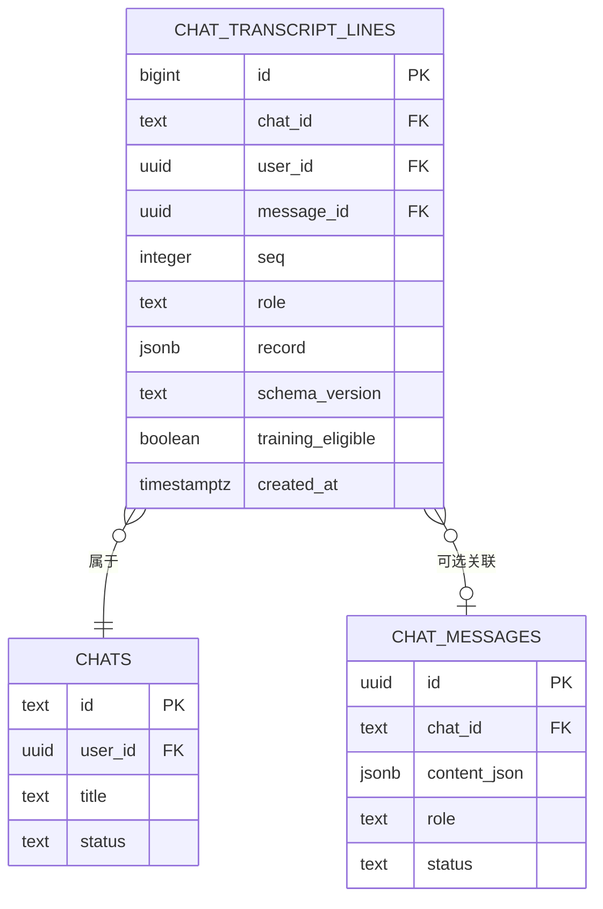
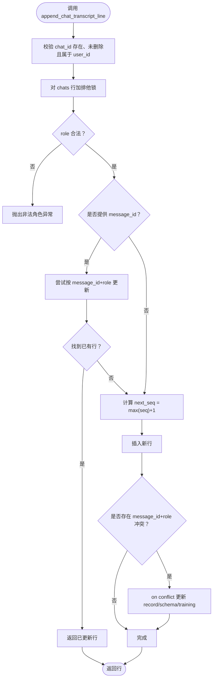
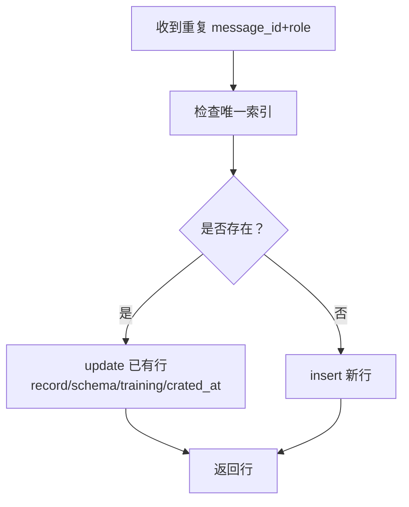
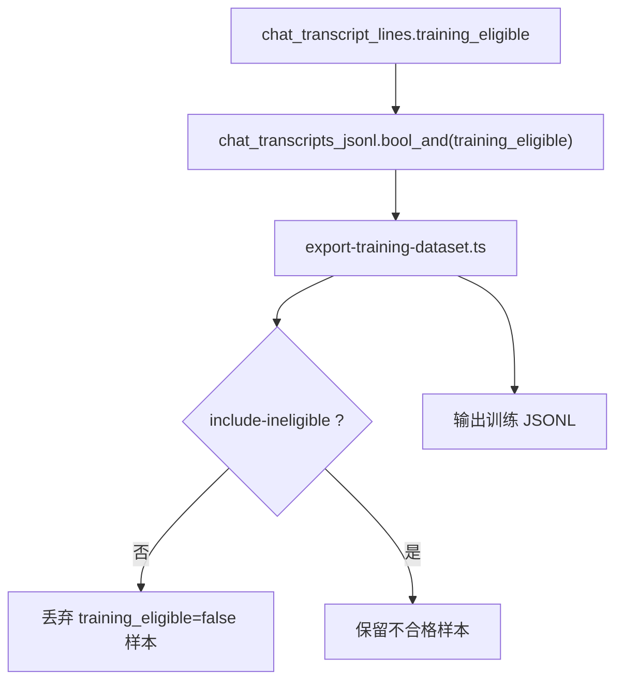
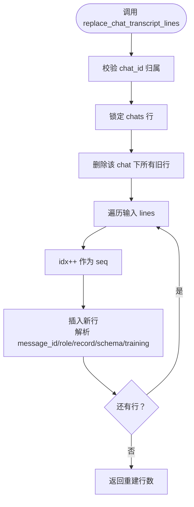
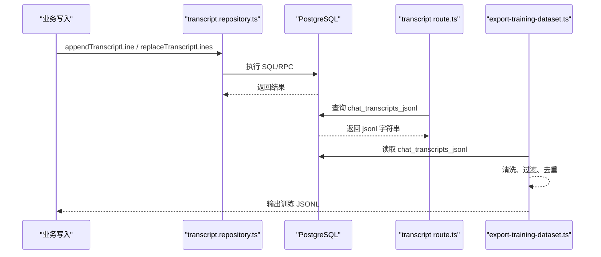
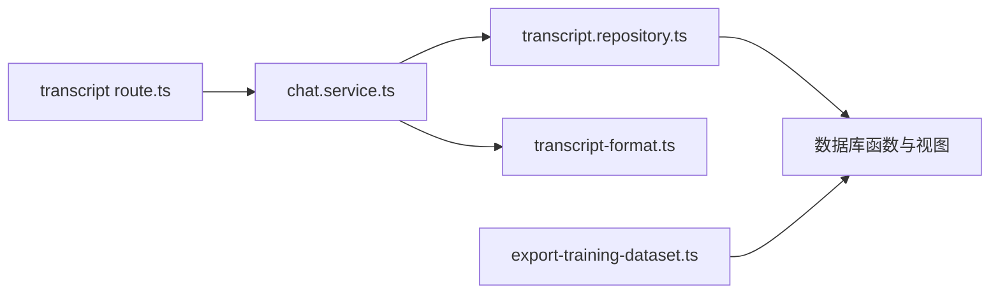
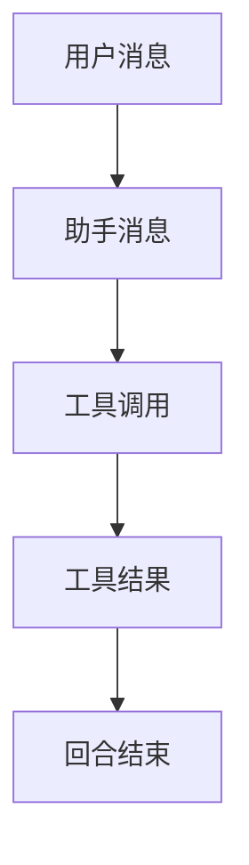

# 转录存储

<cite>
**本文引用的文件**   
- [chat_transcript_jsonl.sql](file://supabase/migrations/20260712153000_chat_transcript_jsonl.sql)
- [chat_turn_atomic_transcripts.sql](file://supabase/migrations/20260731110000_chat_turn_atomic_transcripts.sql)
- [backfill_complete_chat_transcripts.sql](file://supabase/migrations/20260731111000_backfill_complete_chat_transcripts.sql)
- [transcript.repository.ts](file://src/server/repositories/transcript.repository.ts)
- [chat.service.ts](file://src/server/services/chat.service.ts)
- [transcript-format.ts](file://src/server/training/transcript-format.ts)
- [route.ts](file://src/app/api/v1/chats/[chatId]/transcript/route.ts)
- [export-training-dataset.ts](file://scripts/export-training-dataset.ts)
</cite>

## 目录
1. [简介](#简介)
2. [项目结构](#项目结构)
3. [核心组件](#核心组件)
4. [架构总览](#架构总览)
5. [详细组件分析](#详细组件分析)
6. [依赖关系分析](#依赖关系分析)
7. [性能与并发特性](#性能与并发特性)
8. [导入导出、备份与恢复](#导入导出备份与恢复)
9. [故障排查](#故障排查)
10. [结论](#结论)
11. [附录：Cursor-style JSONL 规范与示例](#附录cursor-style-jsonl-规范与示例)

## 简介
本文件系统化文档化聊天转录的持久化方案。系统以 `chat_transcript_lines` 表为核心，采用 Cursor-style JSONL 格式按顺序追加每行转录记录；通过数据库函数提供原子追加和分支重建能力；并通过训练可导出视图与脚本完成幂等训练数据抽取。文档重点包括：
- JSONL 行记录的标准化结构
- `append_chat_transcript_line` 的序列号生成与并发安全
- `message_id + role` 唯一约束与重复处理逻辑
- `training_eligible` 字段及训练过滤机制
- `replace_chat_transcript_line` 在分支同步时的重构建流程
- 导入、导出、备份、恢复完整路径
- Cursor-style JSONL 规范定义与示例

## 项目结构
转录相关代码横跨迁移脚本、数据库函数、服务层、仓库层、API 路由与训练导出脚本：

**图表来源**
- [transcript.repository.ts:1-94](file://src/server/repositories/transcript.repository.ts#L1-L94)
- [chat.service.ts:84-100](file://src/server/services/chat.service.ts#L84-L100)
- [route.ts:1-75](file://src/app/api/v1/chats/[chatId]/transcript/route.ts#L1-L75)
- [transcript-format.ts:1-449](file://src/server/training/transcript-format.ts#L1-L449)
- [chat_transcript_jsonl.sql:1-168](file://supabase/migrations/20260712153000_chat_transcript_jsonl.sql#L1-L168)
- [chat_turn_atomic_transcripts.sql:1-160](file://supabase/migrations/20260731110000_chat_turn_atomic_transcripts.sql#L1-L160)
- [export-training-dataset.ts:1-200](file://scripts/export-training-dataset.ts#L1-L200)

**章节来源**
- [transcript.repository.ts:1-94](file://src/server/repositories/transcript.repository.ts#L1-L94)
- [chat_transcript_jsonl.sql:1-168](file://supabase/migrations/20260712153000_chat_transcript_jsonl.sql#L1-L168)
- [chat_turn_atomic_transcripts.sql:1-160](file://supabase/migrations/20260731110000_chat_turn_atomic_transcripts.sql#L1-L160)

## 核心组件
- **chat_transcript_lines 表**：按 chat 维度追加 JSONL 行的持久化表，包含角色、消息关联、序列号、训练标记与元数据。
- **append_chat_transcript_line 函数**：数据库端原子追加函数，负责会话权限校验、行级锁、seq 计算与插入或幂等更新。
- **replace_chat_transcript_lines 函数**：整条会话行重建函数，用于分支树稳定后重写 transcript。
- **chat_transcripts_jsonl 视图**：聚合每个会话的 JSONL 文本，便于训练导出与调试。
- **transcript repository**：Node 侧封装 append/replace/list/jsonl 查询。
- **transcript format**：定义 Cursor-style JSONL 类型、构造器与序列化方法。
- **transcript API**：暴露按会话导出 JSONL 或结构化 JSON 的接口。
- **training export script**：从聚合视图导出训练数据集，应用治理过滤与清洗。

**章节来源**
- [chat_transcript_jsonl.sql:1-168](file://supabase/migrations/20260712153000_chat_transcript_jsonl.sql#L1-L168)
- [transcript.repository.ts:1-94](file://src/server/repositories/transcript.repository.ts#L1-L94)
- [transcript-format.ts:1-449](file://src/server/training/transcript-format.ts#L1-L449)
- [route.ts:1-75](file://src/app/api/v1/chats/[chatId]/transcript/route.ts#L1-L75)
- [export-training-dataset.ts:1-200](file://scripts/export-training-dataset.ts#L1-L200)

## 架构总览
下图展示一次用户对话到转录落库与导出的端到端调用链：

**图表来源**
- [chat.service.ts:84-100](file://src/server/services/chat.service.ts#L84-L100)
- [chat.service.ts:1881-1890](file://src/server/services/chat.service.ts#L1881-L1890)
- [transcript.repository.ts:1-94](file://src/server/repositories/transcript.repository.ts#L1-L94)
- [route.ts:1-75](file://src/app/api/v1/chats/[chatId]/transcript/route.ts#L1-L75)
- [export-training-dataset.ts:1-200](file://scripts/export-training-dataset.ts#L1-L200)

## 详细组件分析

### chat_transcript_lines 表与 JSONL 行设计
- 表职责：为每个会话保存一行一个 JSONB 对象，按 seq 严格排序形成 Cursor-style JSONL。
- 关键字段：
  - chat_id：所属会话
  - user_id：会话所有者
  - message_id：可选的消息主键，用于幂等更新
  - seq：会话内自增序号
  - role：限制为 user、assistant、system、tool、meta
  - record：JSONB 承载的 Cursor-style 记录
  - schema_version：转录格式版本
  - training_eligible：是否允许进入公司训练导出
  - created_at：创建时间
- 索引：
  - (chat_id, seq)：会话有序读取
  - (user_id, created_at desc)：用户历史访问
  - 部分索引 training_eligible=true 上按 created_at 降序，优化训练导出
- RLS：仅允许 user_id 匹配当前用户

**图表来源**
- [chat_transcript_jsonl.sql:1-60](file://supabase/migrations/20260712153000_chat_transcript_jsonl.sql#L1-L60)

**章节来源**
- [chat_transcript_jsonl.sql:1-60](file://supabase/migrations/20260712153000_chat_transcript_jsonl.sql#L1-L60)

### append_chat_transcript_line 的原子追加与序列号生成
该函数是写入转录的核心入口，保证：
- 会话存在且未删除且属于当前用户
- 对 chats 行加排他锁，避免并发竞态
- 计算下一个 seq：基于同 chat 下现有最大 seq + 1
- 如果传入 message_id 且 role 非空：
  - 优先尝试根据 message_id+role 做幂等更新
  - 若已存在则直接返回该行，不新增 seq
  - 若不存在则走新增逻辑
- 新增时插入一行并返回
- 当 message_id 不为空时，后续版本还使用 on conflict 保证幂等

**图表来源**
- [chat_transcript_jsonl.sql:61-120](file://supabase/migrations/20260712153000_chat_transcript_jsonl.sql#L61-L120)
- [chat_turn_atomic_transcripts.sql:60-160](file://supabase/migrations/20260731110000_chat_turn_atomic_transcripts.sql#L60-L160)

**章节来源**
- [chat_transcript_jsonl.sql:61-120](file://supabase/migrations/20260712153000_chat_transcript_jsonl.sql#L61-L120)
- [chat_turn_atomic_transcripts.sql:60-160](file://supabase/migrations/20260731110000_chat_turn_atomic_transcripts.sql#L60-L160)

### 幂等性设计与重复处理逻辑
- 唯一约束：对 message_id 非空的行建立 (message_id, role) 唯一索引。
- 首次出现：插入新行。
- 重复出现：
  - 优先尝试 update 命中已有行
  - 否则通过 on conflict 更新 record、schema_version、training_eligible，并更新时间戳
  - 保留最早 chronologically 的位置（seq 与 id 最小），但覆盖最新 payload
- 回补清理：迁移中先对已有重复组进行更新 keeper 行，再删除多余行，确保最终一致性。

**图表来源**
- [chat_turn_atomic_transcripts.sql:1-59](file://supabase/migrations/20260731110000_chat_turn_atomic_transcripts.sql#L1-L59)
- [chat_turn_atomic_transcripts.sql:60-160](file://supabase/migrations/20260731110000_chat_turn_atomic_transcripts.sql#L60-L160)

**章节来源**
- [chat_turn_atomic_transcripts.sql:1-59](file://supabase/migrations/20260731110000_chat_turn_atomic_transcripts.sql#L1-L59)
- [chat_turn_atomic_transcripts.sql:60-160](file://supabase/migrations/20260731110000_chat_turn_atomic_transcripts.sql#L60-L160)

### training_eligible 字段与训练导出过滤
- 字段含义：标记单行是否允许参与公司训练数据导出。默认 true。
- 会话级聚合：视图中的 training_eligible 由会话所有行的 bool_and 得出；只要有一行 false，整个会话导出即为 false。
- 导出脚本：默认排除 training_eligible=false 的行，除非显式开启 include-ineligible；同时支持 require-consent 治理门控。
- 回补策略：历史重建时继承会话原有 opt-out 状态。

**图表来源**
- [chat_transcript_jsonl.sql:130-168](file://supabase/migrations/20260712153000_chat_transcript_jsonl.sql#L130-L168)
- [export-training-dataset.ts:1-200](file://scripts/export-training-dataset.ts#L1-L200)

**章节来源**
- [chat_transcript_jsonl.sql:130-168](file://supabase/migrations/20260712153000_chat_transcript_jsonl.sql#L130-L168)
- [export-training-dataset.ts:1-200](file://scripts/export-training-dataset.ts#L1-L200)

### replace_chat_transcript_lines 的分支同步重构建
当分支树变为规范顺序时，系统用该函数整批重建某会话的所有转录行：
- 校验会话所有权与状态
- 锁定 chats 行
- 删除该 chat 下全部旧行
- 按输入数组顺序逐行插入，自动分配 seq=1..N
- 兼容每条 line 中的 message_id、role、record、schema_version、training_eligible 字段
- 返回重建行数

**图表来源**
- [chat_transcript_jsonl.sql:121-168](file://supabase/migrations/20260712153000_chat_transcript_jsonl.sql#L121-L168)

**章节来源**
- [chat_transcript_jsonl.sql:121-168](file://supabase/migrations/20260712153000_chat_transcript_jsonl.sql#L121-L168)
- [transcript.repository.ts:33-62](file://src/server/repositories/transcript.repository.ts#L33-L62)

### 转录数据的导入、导出、备份与恢复
- 写入：
  - Node 侧通过 `appendTranscriptLine` 调用数据库函数追加行
  - 批量重建通过 `replaceTranscriptLines` 调用数据库函数
- 导出：
  - API 路由 `/api/v1/chats/[chatId]/transcript` 支持 format=jsonl 或 json
  - JSONL 模式返回纯 JSONL 文本；JSON 模式解析 JSONL 并返回 messages/events 等结构
  - 训练导出脚本从 `chat_transcripts_jsonl` 视图抽取会话级 JSONL，再做清洗与去重
- 备份恢复：
  - 由于每行是独立 JSONB，可按 chat_id 全量删除并用 replace 重建
  - 也可复制 JSONL 字符串并按行拆分后逐个 append

**图表来源**
- [transcript.repository.ts:1-94](file://src/server/repositories/transcript.repository.ts#L1-L94)
- [route.ts:1-75](file://src/app/api/v1/chats/[chatId]/transcript/route.ts#L1-L75)
- [export-training-dataset.ts:1-200](file://scripts/export-training-dataset.ts#L1-L200)

**章节来源**
- [transcript.repository.ts:1-94](file://src/server/repositories/transcript.repository.ts#L1-L94)
- [route.ts:1-75](file://src/app/api/v1/chats/[chatId]/transcript/route.ts#L1-L75)
- [export-training-dataset.ts:1-200](file://scripts/export-training-dataset.ts#L1-L200)

## 依赖关系分析
- 服务层 `chat.service.ts` 负责组装转录片段，调用仓库层写入；同时在导出流程中读取聚合视图。
- 仓库层 `transcript.repository.ts` 封装数据库 RPC 与查询，统一使用 `TRANSCRIPT_SCHEMA_VERSION`。
- 类型定义集中在 `transcript-format.ts`，被服务层、API 层与导出脚本共享。
- 迁移脚本提供表结构、函数、视图与幂等约束，是整个系统的权威来源。

**图表来源**
- [chat.service.ts:84-100](file://src/server/services/chat.service.ts#L84-L100)
- [transcript.repository.ts:1-94](file://src/server/repositories/transcript.repository.ts#L1-L94)
- [transcript-format.ts:1-449](file://src/server/training/transcript-format.ts#L1-L449)
- [route.ts:1-75](file://src/app/api/v1/chats/[chatId]/transcript/route.ts#L1-L75)
- [export-training-dataset.ts:1-200](file://scripts/export-training-dataset.ts#L1-L200)

**章节来源**
- [chat.service.ts:84-100](file://src/server/services/chat.service.ts#L84-L100)
- [transcript.repository.ts:1-94](file://src/server/repositories/transcript.repository.ts#L1-L94)
- [transcript-format.ts:1-449](file://src/server/training/transcript-format.ts#L1-L449)
- [route.ts:1-75](file://src/app/api/v1/chats/[chatId]/transcript/route.ts#L1-L75)
- [export-training-dataset.ts:1-200](file://scripts/export-training-dataset.ts#L1-L200)

## 性能与并发特性
- 追加复杂度：
  - 计算 next_seq 需要扫描同 chat 的最大 seq，时间复杂度 O(n)，其中 n 为该会话已有行数；可通过 (chat_id, seq) 索引加速
  - 插入为 O(1)
- 并发安全：
  - 通过对 chats 行加排他锁避免并发写入竞争
  - 唯一索引 (message_id, role) 防止重复逻辑行产生
- 训练导出优化：
  - 部分索引只针对 training_eligible=true 的行，减少导出扫描范围
- 重建代价：
  - replace 会删除旧行并重新插入，适合分支稳定后的批量重建，不适合高频写入场景

[本节为通用性能讨论]

## 故障排查
- 会话不存在或非本人：
  - 触发“会话不存在或不属于用户”异常
  - 检查会话状态是否为 deleted
- 非法角色：
  - role 不在 user、assistant、system、tool、meta 时报错
- 重复写入：
  - 若 message_id+role 已存在，应走幂等更新而非新增 seq
  - 检查唯一索引是否生效
- 训练导出为空：
  - 检查会话级 training_eligible 是否为 false
  - 检查导出脚本参数是否启用了 include-ineligible
- JSONL 解析失败：
  - API 的 JSON 模式会跳过无法解析的行
  - 建议优先使用 JSONL 模式下载原始数据

**章节来源**
- [chat_transcript_jsonl.sql:61-120](file://supabase/migrations/20260712153000_chat_transcript_jsonl.sql#L61-L120)
- [chat_turn_atomic_transcripts.sql:60-160](file://supabase/migrations/20260731110000_chat_turn_atomic_transcripts.sql#L60-L160)
- [route.ts:1-75](file://src/app/api/v1/chats/[chatId]/transcript/route.ts#L1-L75)

## 结论
转录子系统以数据库函数为中心，将 Cursor-style JSONL 行持久化为顺序稳定的 JSONB 序列。通过会话行级锁、序列号计算与唯一索引共同实现高并发下的原子追加与幂等更新；通过视图与导出脚本实现训练数据的安全抽取。分支重建函数为复杂分支合并提供了可靠的重建原语。整体设计兼顾写入效率、幂等性与训练可用性。

[本节为总结性内容]

## 附录：Cursor-style JSONL 规范与示例

### 行级别字段
- schema_version：转录格式版本，默认值为常量
- role：user、assistant、system、tool、meta
- message.content：当 role 为消息类时，包含一组 content part
- agent_ui：可选，携带 UI 时间线与工具调用元数据
- type/status：当 role 为 meta 时，type 固定为 turn_ended，status 为 success/error/cancelled

### 典型行类型
- 用户消息：role=user，content 为文本块
- 助手消息：role=assistant，content 可含 thinking、narration、tool_use、最终回答
- 工具结果：role=user，content 为 tool_result 块
- 回合结束：role=meta，type=turn_ended，status 描述本轮结局

**图表来源**
- [transcript-format.ts:1-200](file://src/server/training/transcript-format.ts#L1-L200)
- [transcript-format.ts:200-449](file://src/server/training/transcript-format.ts#L200-L449)

### 示例数据说明
以下示例描述 JSONL 各行的语义结构，不直接粘贴具体值：
- 第 1 行：用户消息，role=user，message.content 包含一段文本
- 第 2 行：助手消息，role=assistant，message.content 包含思考块、工具调用块与回答文本
- 第 3 行：工具结果，role=user，message.content 包含 tool_result 块
- 第 4 行：回合结束，role=meta，type=turn_ended，status=success

实际运行时，每一行都是完整的 JSON 对象，多个行之间以换行分隔，构成一个会话的 JSONL 文档。训练导出脚本会把这些行聚合成会话级样本，并根据 training_eligible 决定是否纳入训练集。

**章节来源**
- [transcript-format.ts:1-449](file://src/server/training/transcript-format.ts#L1-L449)
- [route.ts:1-75](file://src/app/api/v1/chats/[chatId]/transcript/route.ts#L1-L75)
- [export-training-dataset.ts:1-200](file://scripts/export-training-dataset.ts#L1-L200)