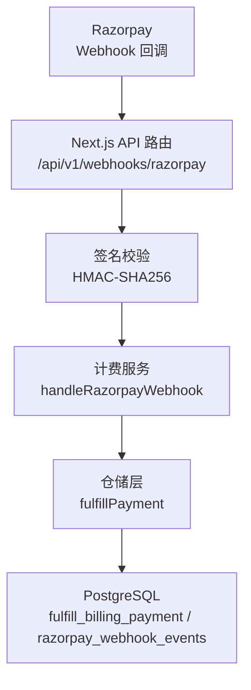
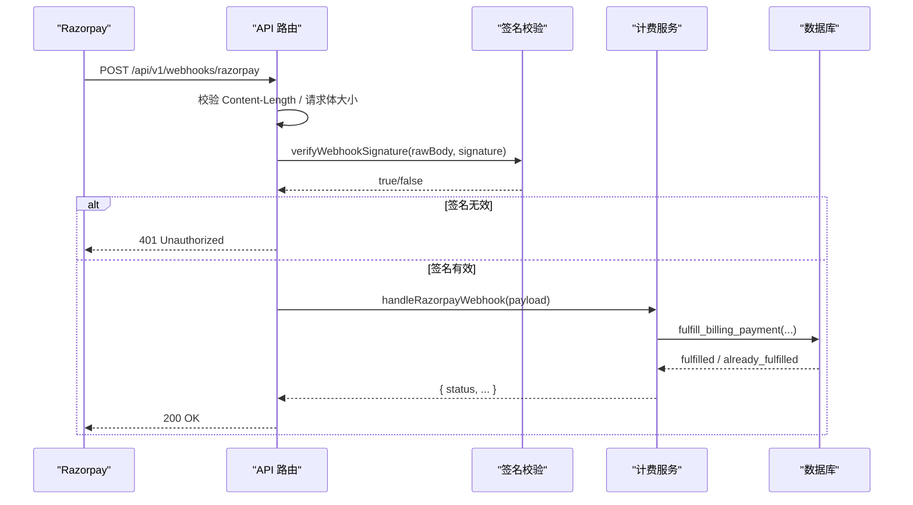
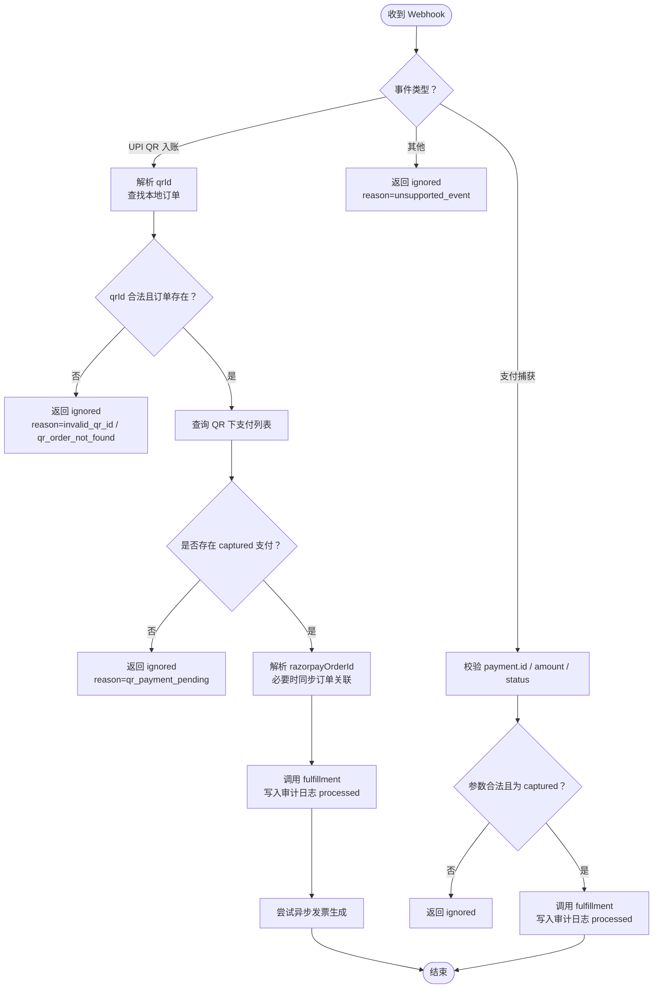
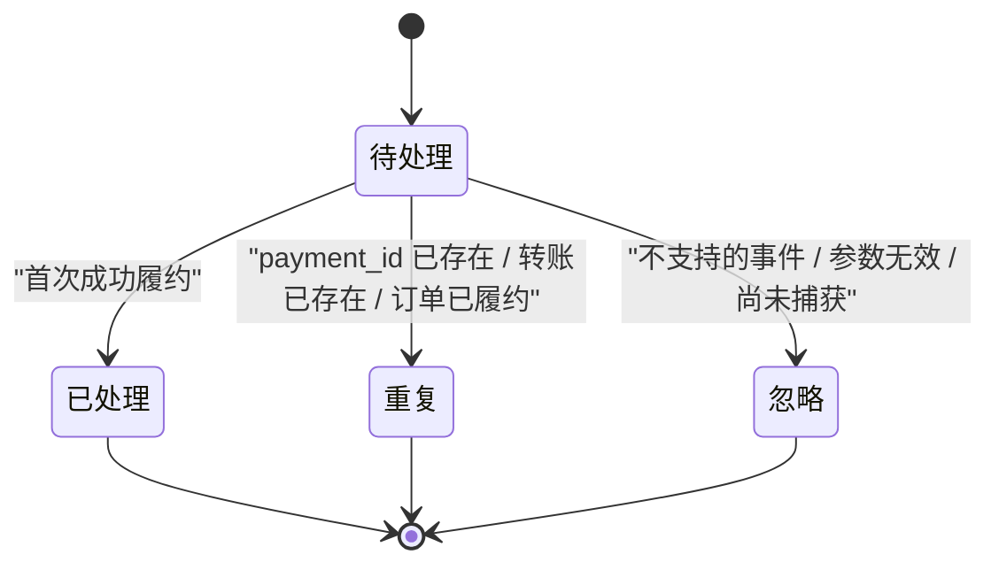
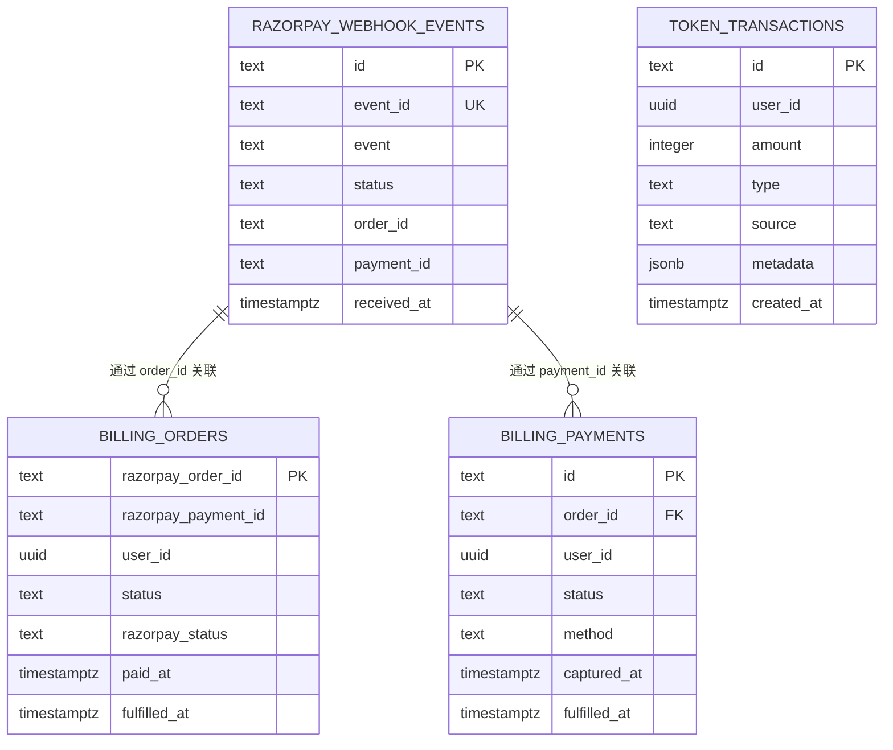
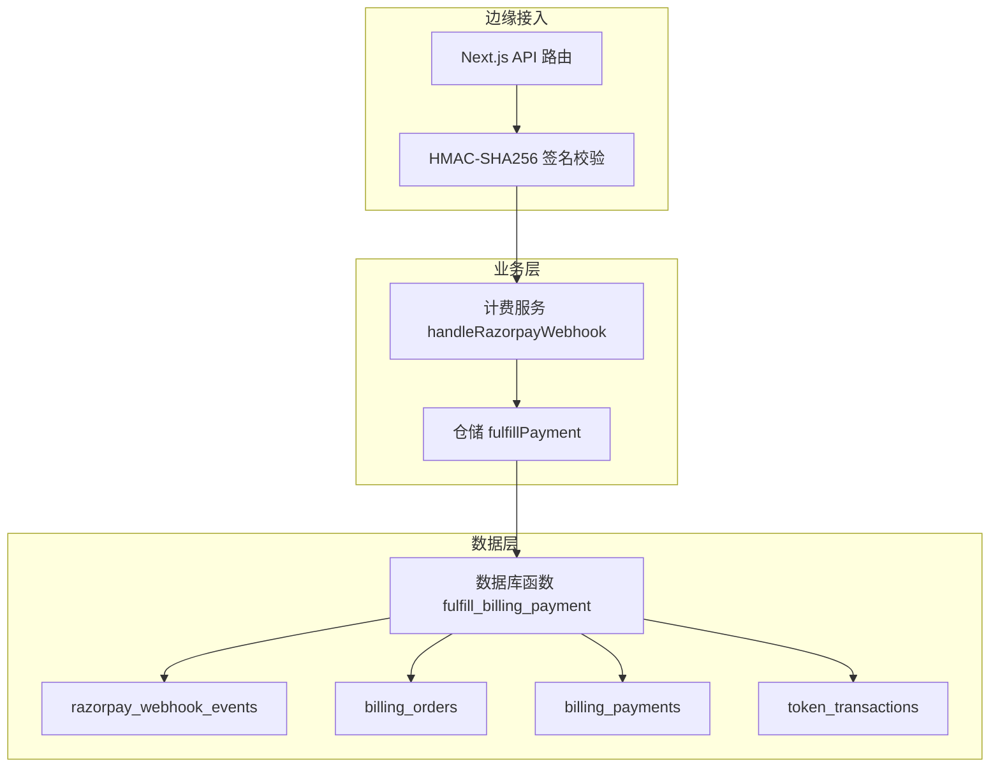
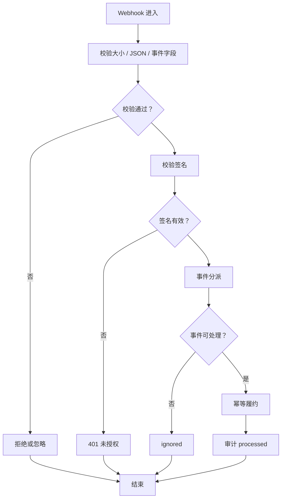
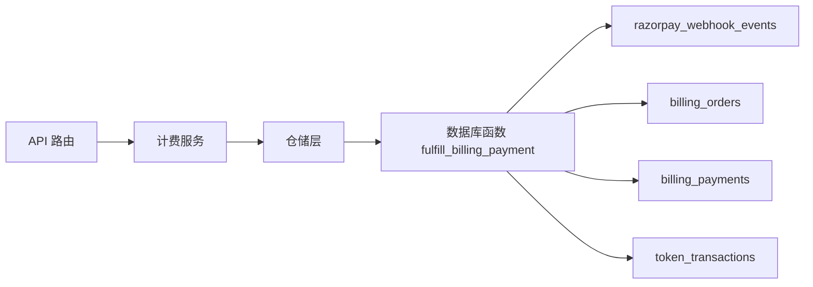

# Webhook 审计日志

<cite>
**本文引用的文件**   
- [supabase/migrations/20260506160000_core_backend.sql](file://supabase/migrations/20260506160000_core_backend.sql)
- [src/app/api/v1/webhooks/razorpay/route.ts](file://src/app/api/v1/webhooks/razorpay/route.ts)
- [src/server/billing/razorpay.ts](file://src/server/billing/razorpay.ts)
- [src/server/services/billing.service.ts](file://src/server/services/billing.service.ts)
- [src/server/repositories/billing.repository.ts](file://src/server/repositories/billing.repository.ts)
</cite>

## 目录
1. [引言](#引言)
2. [项目结构](#项目结构)
3. [核心组件](#核心组件)
4. [架构总览](#架构总览)
5. [详细组件分析](#详细组件分析)
6. [依赖关系分析](#依赖关系分析)
7. [性能与并发特性](#性能与并发特性)
8. [监控与告警方案](#监控与告警方案)
9. [故障排查指南](#故障排查指南)
10. [结论](#结论)

## 引言
本文围绕 Razorpay Webhook 的审计日志数据模型展开，重点解释 `razorpay_webhook_events` 表的结构、Webhook 安全验证与处理流程、事件分类、幂等设计、失败重试策略、人工干预入口以及与业务订单/支付表的关联关系。文档同时给出面向运维的监控指标与告警建议，帮助在保留完整审计记录的同时保障高并发场景下的可靠性与可观测性。

## 项目结构
Webhook 审计日志相关代码横跨数据库迁移、Next.js API 路由、Razorpay 工具层以及计费服务层：
- 数据库迁移定义审计表与幂等履约函数。
- Next.js API 路由负责接收 Razorpay 回调、校验签名并调用计费服务。
- Razorpay 工具层提供 HMAC-SHA256 签名校验与 Razorpay API 调用。
- 计费服务层解析事件、选择处理分支，并最终通过仓储层调用数据库函数完成幂等履约和审计落盘。

**图示来源**
- [src/app/api/v1/webhooks/razorpay/route.ts:1-70](file://src/app/api/v1/webhooks/razorpay/route.ts#L1-L70)
- [src/server/billing/razorpay.ts:473-487](file://src/server/billing/razorpay.ts#L473-L487)
- [src/server/services/billing.service.ts:877-980](file://src/server/services/billing.service.ts#L877-L980)
- [src/server/repositories/billing.repository.ts:473-507](file://src/server/repositories/billing.repository.ts#L473-L507)
- [supabase/migrations/20260506160000_core_backend.sql:519-629](file://supabase/migrations/20260506160000_core_backend.sql#L519-L629)

**章节来源**
- [src/app/api/v1/webhooks/razorpay/route.ts:1-70](file://src/app/api/v1/webhooks/razorpay/route.ts#L1-L70)
- [supabase/migrations/20260506160000_core_backend.sql:198-211](file://supabase/migrations/20260506160000_core_backend.sql#L198-L211)

## 核心组件
本节聚焦 Webhook 审计日志的数据模型、状态语义、安全校验、事件处理主流程与幂等机制。

### 审计日志表 `razorpay_webhook_events`
该表是 Webhook 投递审计的唯一权威记录源，具有以下特征：
- 无行级安全限制（RLS），仅允许服务端安全角色写入。
- 追加写模式：同一 `id` 或 `event_id` 重复写入会被忽略，天然防重。
- 审计字段包括事件标识、事件类型、处理结果、业务上下文与接收时间。

| 字段 | 类型 | 约束 | 含义 |
|---|---|---|---|
| `id` | text | 主键 | 审计行稳定标识；通常与 `event_id` 相同 |
| `event_id` | text | 唯一 | Razorpay 原始事件 ID，用于去重 |
| `event` | text | 非空 | Razorpay 事件名称，如支付成功、UPI QR 入账等 |
| `status` | text | 枚举：`processed`、`duplicate`、`ignored` | 处理结果 |
| `order_id` | text | 可空 | 业务侧订单号（`billing_orders.razorpay_order_id`） |
| `payment_id` | text | 可空 | Razorpay 支付 ID（`billing_payments.id`） |
| `received_at` | timestamptz | 默认当前时间 | 审计记录写入时间 |

设计要点：
- `status = processed`：事件被正常消费并完成幂等履约。
- `status = duplicate`：事件已被消费过（重复 payment_id、已有 token 转账或订单已履约）。
- `status = ignored`：事件未进入数据库履约路径，由应用层直接返回“忽略”，例如不支持的事件类型、无效参数、尚未捕获的 UPI QR 支付。

**章节来源**
- [supabase/migrations/20260506160000_core_backend.sql:198-211](file://supabase/migrations/20260506160000_core_backend.sql#L198-L211)

### 签名验证与安全
Webhook 入口对 Razorpay 回调进行严格安全检查：
- 请求体大小限制：超过阈值直接拒绝，防止超大负载。
- 必填头检查：缺少 `x-razorpay-signature` 时视为非法。
- HMAC-SHA256 校验：使用服务器端配置的 webhook 密钥对原始请求体计算摘要，并与响应头中的签名比较。
- 时序安全比较：使用恒定时间比较函数，避免侧信道攻击。

**图示来源**
- [src/app/api/v1/webhooks/razorpay/route.ts:1-70](file://src/app/api/v1/webhooks/razorpay/route.ts#L1-L70)
- [src/server/billing/razorpay.ts:473-487](file://src/server/billing/razorpay.ts#L473-L487)
- [supabase/migrations/20260506160000_core_backend.sql:519-629](file://supabase/migrations/20260506160000_core_backend.sql#L519-L629)

**章节来源**
- [src/app/api/v1/webhooks/razorpay/route.ts:1-70](file://src/app/api/v1/webhooks/razorpay/route.ts#L1-L70)
- [src/server/billing/razorpay.ts:473-487](file://src/server/billing/razorpay.ts#L473-L487)

### 事件分类与处理逻辑
当前实现主要处理两类 Razorpay 事件：
1. **UPI QR 入账事件**
   - 从事件中解析 UPI QR ID，查找本地订单。
   - 查询 Razorpay 该 QR 下的支付，筛选已捕获支付。
   - 若支付对象中 `order_id` 为空或与本地不一致，则同步修正订单关联。
   - 调用履约函数完成幂等入账，并尝试异步生成发票。
2. **支付捕获事件**
   - 校验支付 ID、金额、状态是否为捕获。
   - 支持 UPI QR V2 场景中 `order_id` 为空的情况，按业务规则解析订单关联。
   - 调用履约函数完成幂等入账。

其他事件统一返回“忽略”，不写入审计日志，也不执行履约。

**图示来源**
- [src/server/services/billing.service.ts:877-980](file://src/server/services/billing.service.ts#L877-L980)

**章节来源**
- [src/server/services/billing.service.ts:877-980](file://src/server/services/billing.service.ts#L877-L980)

### 幂等与状态管理
审计日志的状态由数据库履约函数决定：
- 若 payment_id 已存在、对应 token 转账已存在、或订单已标记为履约，则判定为重复事件。
- 重复事件不会再次发放权益，而是写入 `status = duplicate` 的审计记录。
- 正常履约成功后写入 `status = processed`。
- 未在数据库路径处理的事件由应用层直接返回 `ignored`，不写入审计表。

**图示来源**
- [supabase/migrations/20260506160000_core_backend.sql:519-629](file://supabase/migrations/20260506160000_core_backend.sql#L519-L629)
- [src/server/services/billing.service.ts:877-980](file://src/server/services/billing.service.ts#L877-L980)

**章节来源**
- [supabase/migrations/20260506160000_core_backend.sql:519-629](file://supabase/migrations/20260506160000_core_backend.sql#L519-L629)
- [src/server/services/billing.service.ts:877-980](file://src/server/services/billing.service.ts#L877-L980)

### 与其他表的关联
审计日志通过以下字段建立业务上下文关联：
- `order_id` → `billing_orders.razorpay_order_id`
- `payment_id` → `billing_payments.id`

此外，履约过程还会影响以下表：
- `billing_orders`：订单状态更新为 `fulfilled`，并记录 Razorpay 支付状态与时间。
- `billing_payments`：记录单次支付元数据、来源、捕获时间与履约时间。
- `token_transactions`：以稳定交易 ID 记录用户令牌入账，保证幂等。

**图示来源**
- [supabase/migrations/20260506160000_core_backend.sql:198-211](file://supabase/migrations/20260506160000_core_backend.sql#L198-L211)
- [supabase/migrations/20260506160000_core_backend.sql:519-629](file://supabase/migrations/20260506160000_core_backend.sql#L519-L629)

**章节来源**
- [supabase/migrations/20260506160000_core_backend.sql:198-211](file://supabase/migrations/20260506160000_core_backend.sql#L198-L211)
- [supabase/migrations/20260506160000_core_backend.sql:519-629](file://supabase/migrations/20260506160000_core_backend.sql#L519-L629)

## 架构总览
Webhook 审计日志整体架构遵循“前端轻、后端安全、数据库幂等”的原则：
- 外部只暴露最小化 API 路由，承担请求接入、参数校验与签名验证职责。
- 业务逻辑集中在计费服务层，按事件类型分派处理。
- 数据库层通过 `security definer` 函数集中处理幂等、并发锁、权益发放与审计落盘。

**图示来源**
- [src/app/api/v1/webhooks/razorpay/route.ts:1-70](file://src/app/api/v1/webhooks/razorpay/route.ts#L1-L70)
- [src/server/billing/razorpay.ts:473-487](file://src/server/billing/razorpay.ts#L473-L487)
- [src/server/services/billing.service.ts:877-980](file://src/server/services/billing.service.ts#L877-L980)
- [src/server/repositories/billing.repository.ts:473-507](file://src/server/repositories/billing.repository.ts#L473-L507)
- [supabase/migrations/20260506160000_core_backend.sql:519-629](file://supabase/migrations/20260506160000_core_backend.sql#L519-L629)

## 详细组件分析

### 审计日志设计原则
- 无 RLS 追加写：审计表不对外暴露读写权限，只允许服务端安全角色写入，避免客户端绕过业务逻辑直接篡改审计记录。
- 幂等优先：通过 `id`/`event_id` 唯一约束与 `on conflict do nothing` 确保重复事件不会破坏一致性。
- 最小审计面：审计记录不存储 Razorpay 原始 payload 全文，而是保留事件名、状态、业务 ID 与接收时间；原始负载在入口处校验后立即释放，降低存储成本与泄露风险。
- 可追溯关联：通过 `order_id`、`payment_id` 与订单、支付表关联，便于对账与回溯。
- 审计与业务分离：审计记录反映“事件是否被处理”，而实际权益变更由数据库函数保证原子性与幂等。

**章节来源**
- [supabase/migrations/20260506160000_core_backend.sql:15-27](file://supabase/migrations/20260506160000_core_backend.sql#L15-L27)
- [supabase/migrations/20260506160000_core_backend.sql:198-211](file://supabase/migrations/20260506160000_core_backend.sql#L198-L211)
- [supabase/migrations/20260506160000_core_backend.sql:519-629](file://supabase/migrations/20260506160000_core_backend.sql#L519-L629)

### 签名验证与防重放
- 输入校验：缺少签名头、请求体过大、JSON 格式错误都会直接拒绝。
- 算法：HMAC-SHA256，密钥来自服务端环境变量。
- 比较方式：恒定时间比较，避免时序攻击。
- 防重放：虽然本实现未显式缓存 `event_id` 或时间窗口，但数据库层通过幂等履约与审计去重保证了最终一致性；若需更强防重放能力，可在边缘层增加短时间窗口去重。

**章节来源**
- [src/app/api/v1/webhooks/razorpay/route.ts:1-70](file://src/app/api/v1/webhooks/razorpay/route.ts#L1-L70)
- [src/server/billing/razorpay.ts:473-487](file://src/server/billing/razorpay.ts#L473-L487)

### 错误处理与重试机制
- 当前 Webhook 处理器没有内置指数退避重试队列。
- 对不可恢复错误（签名无效、payload 无效、事件不支持、参数无效），直接返回明确状态码或 `ignored`。
- 对可重试错误（下游依赖异常、数据库写入失败），应由调用方或平台重试机制保证最终送达；由于数据库层具备幂等性，重复执行不会造成重复计费。
- 对于 UPI QR 入账，如果尚未捕获支付，会返回 `ignored`；当后续支付完成后，Razorpay 可能再次推送事件，从而自然完成补偿。

**图示来源**
- [src/app/api/v1/webhooks/razorpay/route.ts:1-70](file://src/app/api/v1/webhooks/razorpay/route.ts#L1-L70)
- [src/server/services/billing.service.ts:877-980](file://src/server/services/billing.service.ts#L877-L980)

**章节来源**
- [src/app/api/v1/webhooks/razorpay/route.ts:1-70](file://src/app/api/v1/webhooks/razorpay/route.ts#L1-L70)
- [src/server/services/billing.service.ts:877-980](file://src/server/services/billing.service.ts#L877-L980)

### 人工干预接口
目前仓库中未定义专门的“人工重试 Webhook”API。人工干预可通过以下方式实现：
- 基于 `razorpay_webhook_events` 查询 `status = ignored` 或长时间未处理的记录。
- 结合 `order_id`、`payment_id` 重新触发履约逻辑，或由运维直接调用数据库函数完成补录。
- 如需标准化人工干预流程，建议新增受鉴权保护的内部 API，输入 `webhook_event_id` 或 `payment_id`，并在操作前记录审计操作日志。

**章节来源**
- [supabase/migrations/20260506160000_core_backend.sql:198-211](file://supabase/migrations/20260506160000_core_backend.sql#L198-L211)
- [supabase/migrations/20260506160000_core_backend.sql:519-629](file://supabase/migrations/20260506160000_core_backend.sql#L519-L629)

## 依赖关系分析
Webhook 审计链路依赖多个模块：
- API 路由依赖 HTTP 响应封装与 AppError。
- 计费服务依赖仓储层获取订单、调用 Razorpay API、触发发票生成。
- 仓储层依赖数据库函数完成核心幂等逻辑。
- 数据库函数依赖用户令牌入账函数、订单与支付表。

**图示来源**
- [src/app/api/v1/webhooks/razorpay/route.ts:1-70](file://src/app/api/v1/webhooks/razorpay/route.ts#L1-L70)
- [src/server/services/billing.service.ts:877-980](file://src/server/services/billing.service.ts#L877-L980)
- [src/server/repositories/billing.repository.ts:473-507](file://src/server/repositories/billing.repository.ts#L473-L507)
- [supabase/migrations/20260506160000_core_backend.sql:519-629](file://supabase/migrations/20260506160000_core_backend.sql#L519-L629)

**章节来源**
- [src/app/api/v1/webhooks/razorpay/route.ts:1-70](file://src/app/api/v1/webhooks/razorpay/route.ts#L1-L70)
- [src/server/services/billing.service.ts:877-980](file://src/server/services/billing.service.ts#L877-L980)
- [src/server/repositories/billing.repository.ts:473-507](file://src/server/repositories/billing.repository.ts#L473-L507)
- [supabase/migrations/20260506160000_core_backend.sql:519-629](file://supabase/migrations/20260506160000_core_backend.sql#L519-L629)

## 性能与并发特性
- 追加写审计表：无 RLS、无复杂触发器，适合高频写入。
- 幂等保护：数据库层对重复 payment_id、重复 token 转账、重复订单履约进行短路，避免重复计费。
- 行级锁：履约函数对订单使用 `for update`，保证并发下只有一个处理路径生效。
- 审计记录去重：`id`/`event_id` 唯一约束配合 `on conflict do nothing`，避免重复审计。
- 可扩展性：未来可考虑分区表或归档策略，按时间切分历史审计数据。

注意：当前 `razorpay_webhook_events` 未包含显式索引（除主键与唯一键外），查询量大时可考虑按 `received_at` 或 `status` 创建辅助索引，以优化监控与排障查询。

**章节来源**
- [supabase/migrations/20260506160000_core_backend.sql:198-211](file://supabase/migrations/20260506160000_core_backend.sql#L198-L211)
- [supabase/migrations/20260506160000_core_backend.sql:519-629](file://supabase/migrations/20260506160000_core_backend.sql#L519-L629)

## 监控与告警方案
建议建立以下监控维度：

| 指标 | 计算方式 | 用途 | 告警建议 |
|---|---|---|---|
| Webhook 成功率 | `processed / (processed + duplicate + ignored)` | 衡量事件有效性 | 低于阈值时告警 |
| 重复率 | `duplicate / total` | 检测上游重发频率 | 突增时告警 |
| 忽略率 | `ignored / total` | 发现无效事件或上游变更 | 持续升高时告警 |
| 延迟分布 | `now() - received_at` | 评估审计写入延迟 | P95/P99 超阈值告警 |
| 失败事件数 | 按 `status = ignored` 统计 | 人工干预入口 | 按小时累计告警 |
| 签名失败次数 | 路由层 401 计数 | 安全事件 | 立即告警 |
| 履约失败次数 | 数据库异常或上层错误计数 | 系统稳定性 | 立即告警 |

推荐看板：
- 近 1 小时/24 小时 `processed`、`duplicate`、`ignored` 趋势图。
- 按 `event` 维度拆分的事件分布。
- 按 `status` 维度的审计日志分布。
- 签名失败与请求体过大错误的实时计数。
- 长尾延迟直方图。

数据来源：
- 审计表 `razorpay_webhook_events` 用于统计处理结果与延迟。
- API 路由日志用于统计签名失败、请求体过大、JSON 解析失败等边界错误。

**章节来源**
- [src/app/api/v1/webhooks/razorpay/route.ts:1-70](file://src/app/api/v1/webhooks/razorpay/route.ts#L1-L70)
- [supabase/migrations/20260506160000_core_backend.sql:198-211](file://supabase/migrations/20260506160000_core_backend.sql#L198-L211)

## 故障排查指南
常见问题与定位步骤：

1. **Webhook 返回 401 未授权**
   - 检查 `x-razorpay-signature` 是否存在。
   - 核对 webhook 密钥配置是否与 Razorpay 后台一致。
   - 确认原始请求体未被代理层修改。

2. **审计记录大量 `ignored`**
   - 检查事件类型是否仍为支持的 `payment.captured` 或 UPI QR 入账事件。
   - 检查支付金额、支付 ID、订单 ID 是否合法。
   - 对于 UPI QR，确认支付是否已处于 `captured` 状态。

3. **审计记录大量 `duplicate`**
   - 属于预期行为，说明 Razorpay 或上游重试了已处理事件。
   - 核对对应 `payment_id` 是否已在 `billing_payments` 中存在。
   - 核对订单是否已标记为 `fulfilled`。

4. **订单未履约但审计为 `processed`**
   - 检查数据库函数是否执行成功。
   - 核对 `billing_orders`、`billing_payments`、`token_transactions` 是否同步更新。
   - 检查是否有外部因素导致订单状态回滚或清理。

5. **需要人工重试**
   - 根据 `razorpay_webhook_events` 中的 `order_id`、`payment_id` 定位问题。
   - 若无专用重试 API，可由运维在安全环境中调用数据库履约函数补录。
   - 建议在实现内部重试接口后，将人工干预操作纳入独立审计。

**章节来源**
- [src/app/api/v1/webhooks/razorpay/route.ts:1-70](file://src/app/api/v1/webhooks/razorpay/route.ts#L1-L70)
- [src/server/services/billing.service.ts:877-980](file://src/server/services/billing.service.ts#L877-L980)
- [supabase/migrations/20260506160000_core_backend.sql:198-211](file://supabase/migrations/20260506160000_core_backend.sql#L198-L211)
- [supabase/migrations/20260506160000_core_backend.sql:519-629](file://supabase/migrations/20260506160000_core_backend.sql#L519-L629)

## 结论
`razorpay_webhook_events` 作为 Webhook 审计日志的核心表，采用无 RLS、追加写、幂等去重的设计，既满足高并发场景下的可靠写入，又为对账、排障与监控提供了稳定基础。Webhook 入口通过严格的签名校验与参数校验保障安全，计费服务按事件类型分派处理，数据库函数集中保证幂等与一致性。当前实现未内置显式重试队列，但借助幂等机制与上游重发能力实现了最终一致性。未来可在审计查询、分区归档、人工重试 API 与更细粒度的监控告警方面继续增强。