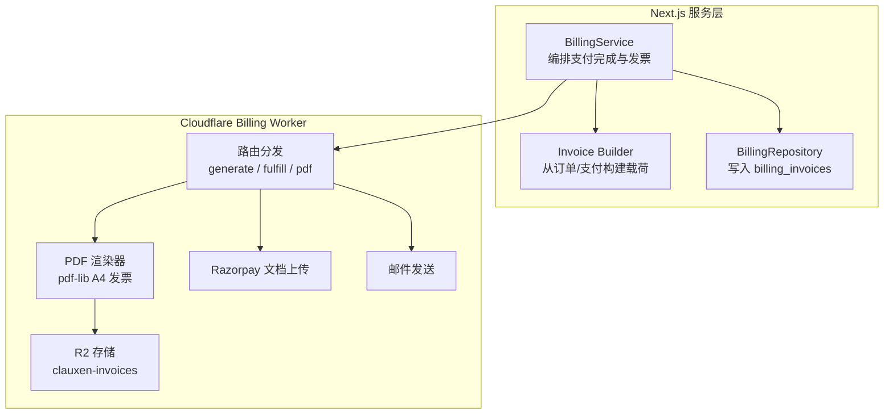
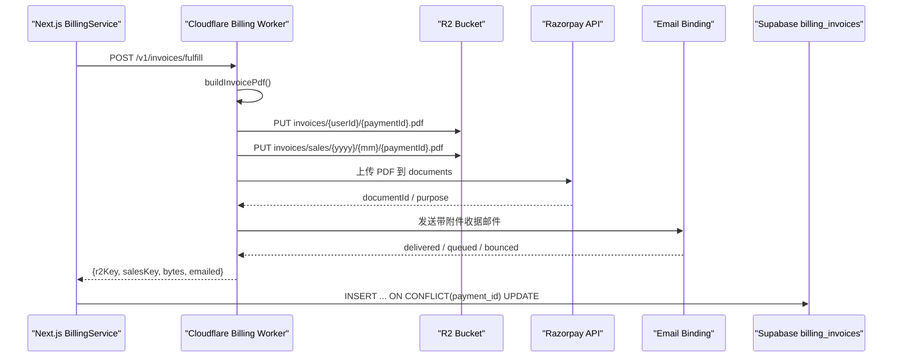
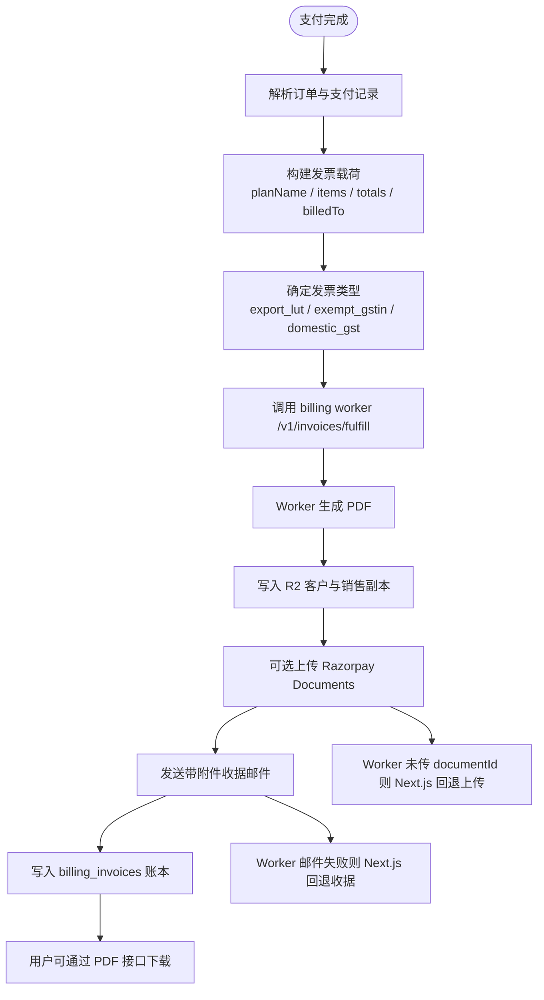
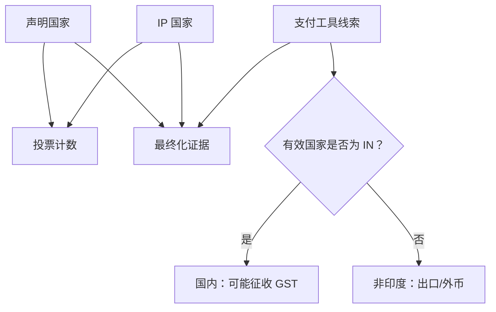
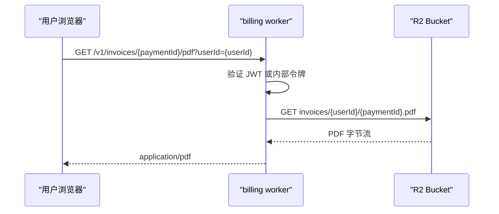
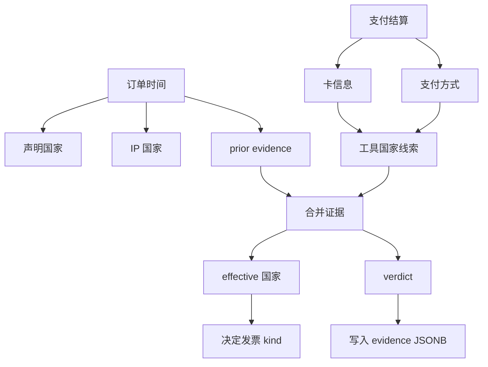
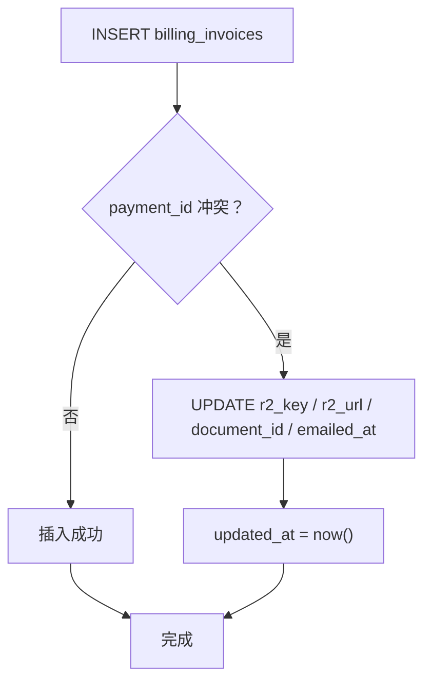

# 发票管理模型

<cite>
**本文引用的文件**
- [supabase/migrations/20260910120000_billing_invoices.sql](file://supabase/migrations/20260910120000_billing_invoices.sql)
- [src/server/billing/invoice.ts](file://src/server/billing/invoice.ts)
- [src/server/billing/billing-worker.ts](file://src/server/billing/billing-worker.ts)
- [src/server/services/billing.service.ts](file://src/server/services/billing.service.ts)
- [src/server/repositories/billing.repository.ts](file://src/server/repositories/billing.repository.ts)
- [workers/billing/src/index.ts](file://workers/billing/src/index.ts)
- [workers/billing/src/invoice-pdf.ts](file://workers/billing/src/invoice-pdf.ts)
- [workers/billing/src/types.ts](file://workers/billing/src/types.ts)
- [src/server/billing/razorpay-invoice-upload.ts](file://src/server/billing/razorpay-invoice-upload.ts)
- [workers/billing/src/razorpay-invoice-upload.ts](file://workers/billing/src/razorpay-invoice-upload.ts)
- [src/server/billing/checkout-location.ts](file://src/server/billing/checkout-location.ts)
- [src/shared/lib/checkout-currency.ts](file://src/shared/lib/checkout-currency.ts)
</cite>

## 目录
1. [简介](#简介)
2. [项目结构与职责划分](#项目结构与职责划分)
3. [核心数据模型：billing_invoices](#核心数据模型billing_invoices)
4. [架构总览](#架构总览)
5. [发票生成与生命周期流程](#发票生成与生命周期流程)
6. [GST 税务逻辑与三种发票类型](#gst-税务逻辑与三种发票类型)
7. [R2 存储集成与下载链路](#r2-存储集成与下载链路)
8. [证据快照机制](#证据快照机制)
9. [发票编号策略与幂等性](#发票编号策略与幂等性)
10. [查询优化与索引设计](#查询优化与索引设计)
11. [错误处理与容错路径](#错误处理与容错路径)
12. [性能特征与建议](#性能特征与建议)
13. [故障排查指南](#故障排查指南)
14. [结论](#结论)

## 简介
本文件聚焦 Clauxen 平台中的发票管理数据模型与完整业务流程。系统以 Supabase 的 `billing_invoices` 表作为发票账本，使用 Cloudflare Workers 的 billing worker 在边缘侧生成 PDF、写入 R2 对象存储、可选上传 Razorpay Documents，并通过邮件发送带附件的发票收据。发票金额统一以“paise”（印度货币最小单位）存储，避免浮点误差；税务决策通过声明国家、IP 国家和支付工具证据进行裁决，最终形成可审计的证据快照。

## 项目结构与职责划分
- Supabase 迁移负责创建 `billing_invoices` 表、字段约束、行级安全策略和查询索引。
- Next.js 服务端负责订单解析、发票载荷构造、调用 billing worker、落库并回退发送邮件。
- Cloudflare billing worker 负责 PDF 渲染、R2 写入、Razorpay 文档上传、邮件发送和用户下载接口。
- 位置与税务逻辑集中在 checkout-location 与 checkout-currency 中，决定发票 kind、币种和 country。

**图表来源**
- [src/server/services/billing.service.ts:1480-1620](file://src/server/services/billing.service.ts#L1480-L1620)
- [src/server/billing/invoice.ts:1-200](file://src/server/billing/invoice.ts#L1-L200)
- [workers/billing/src/index.ts:450-652](file://workers/billing/src/index.ts#L450-L652)
- [workers/billing/src/invoice-pdf.ts:1-200](file://workers/billing/src/invoice-pdf.ts#L1-L200)
- [src/server/repositories/billing.repository.ts:520-610](file://src/server/repositories/billing.repository.ts#L520-L610)

**章节来源**
- [src/server/services/billing.service.ts:1480-1620](file://src/server/services/billing.service.ts#L1480-L1620)
- [workers/billing/src/index.ts:1-200](file://workers/billing/src/index.ts#L1-L200)

## 核心数据模型：billing_invoices
`billing_invoices` 是已付款发票的持久化账本，每一笔成功支付对应一条记录。关键语义如下：

| 字段 | 类型 | 必填 | 默认值 | 含义与规则 |
|---|---|---:|---:|---|
| id | uuid | 是 | 随机 UUID | 主键 |
| user_id | uuid | 是 | — | 关联 `auth.users`，删除用户时级联删除 |
| order_id | text | 是 | — | 关联 `public.billing_orders.id` |
| payment_id | text | 是 | — | 唯一键；Razorpay 支付 ID，也是幂等键 |
| invoice_number | text | 是 | — | 唯一发票编号，由支付 ID 或订单号派生 |
| kind | text | 是 | domestic_gst | 枚举：domestic_gst、export_lut、exempt_gstin |
| currency | text | 是 | INR | 枚举：INR、USD |
| subtotal_paise | integer | 是 | — | 不含税子总额，必须 ≥ 0 |
| tax_paise | integer | 是 | — | 税额，必须 ≥ 0 |
| total_paise | integer | 是 | — | 总金额，必须 > 0 |
| country | text | 是 | IN | ISO-2 国家代码，来自税务裁决的有效国家 |
| r2_key | text | 是 | — | R2 中客户副本的对象键 |
| r2_url | text | 是 | — | 可直接下载的发票 PDF URL |
| razorpay_document_id | text | 否 | null | Razorpay 文档 ID（若上传成功） |
| evidence | jsonb | 是 | {} | 税务决策证据快照 |
| emailed_at | timestamptz | 否 | null | 发票收据邮件发送时间 |
| created_at | timestamptz | 是 | now() | 记录创建时间 |
| updated_at | timestamptz | 是 | now() | 自动更新触发器维护 |

约束与权限要点：
- `payment_id` 为全局唯一，保证每笔支付只有一条发票。
- `invoice_number` 唯一，防止重复编号。
- `kind` 限制为三种发票类型。
- `currency` 限制为 INR 或 USD。
- 金额字段强制非负或正数，避免无效账单。
- 启用行级安全策略，仅允许用户读取自己的发票。
- 提供 `user_id + created_at desc`、`order_id`、`invoice_number` 三个索引，分别支撑用户发票列表、按订单查询和按编号查找。

**章节来源**
- [supabase/migrations/20260910120000_billing_invoices.sql:1-58](file://supabase/migrations/20260910120000_billing_invoices.sql#L1-L58)
- [src/server/repositories/billing.repository.ts:520-610](file://src/server/repositories/billing.repository.ts#L520-L610)

## 架构总览
发票相关系统分为三层：

1. **业务编排层（Next.js）**  
   - 从已完成的 Razorpay 支付与订单中提取金额、币种、订阅周期、开票抬头等信息。
   - 根据结算后支付信息补全位置证据，确定发票 kind。
   - 调用 billing worker 生成 PDF 并可选附带邮件。
   - 将 R2 key、URL、Razorpay document ID、证据快照写入 `billing_invoices`。

2. **边缘执行层（Cloudflare billing worker）**  
   - 内部接口 `/v1/invoices/generate` 仅生成 PDF 与存储，不发送邮件。
   - 内部接口 `/v1/invoices/fulfill` 生成 PDF、写 R2、尝试上传 Razorpay、发送邮件。
   - 内部接口 `/v1/email/send` 发送普通计费通知。
   - 用户接口 `/v1/invoices/:paymentId/pdf` 返回受保护的 PDF 字节流。

3. **外部依赖层**  
   - Cloudflare R2：存放两份对象——客户副本与销售归档副本。
   - Razorpay：可选上传 PDF 到 Payment Documents 或 OPGSP export invoice 目的。
   - 邮件绑定：Worker 内嵌式邮件 API，支持 HTML、文本与 PDF 附件。

**图表来源**
- [workers/billing/src/index.ts:450-652](file://workers/billing/src/index.ts#L450-L652)
- [workers/billing/src/invoice-pdf.ts:1-200](file://workers/billing/src/invoice-pdf.ts#L1-L200)
- [src/server/services/billing.service.ts:1480-1620](file://src/server/services/billing.service.ts#L1480-L1620)
- [src/server/repositories/billing.repository.ts:520-610](file://src/server/repositories/billing.repository.ts#L520-L610)

**章节来源**
- [workers/billing/src/index.ts:1-200](file://workers/billing/src/index.ts#L1-L200)
- [src/server/services/billing.service.ts:1480-1620](file://src/server/services/billing.service.ts#L1480-L1620)

## 发票生成与生命周期流程
发票生命周期从支付完成开始，到数据库落库、邮件发送、用户下载结束。

关键阶段说明：

| 阶段 | 主要动作 | 失败回退 |
|---|---|---|
| 解析订单与支付 | 从 Razorpay 与订单表获取计划、金额、币种、支付状态 | 找不到订单或支付直接返回失败 |
| 构建载荷 | 计算 `invoiceNumber`、`issuedAt`、`nextBillingAt`、`items`、`subtotalPaise`、`taxPaise`、`totalPaise` | 载荷校验失败返回 400 |
| 确定发票类型 | 依据币种、GSTIN、税务证据选择 kind | 默认 domestic_gst |
| 调用 fulfill | Worker 生成 PDF、写 R2、上传 Razorpay、发邮件 | Worker 不可用或无配置时跳过 |
| 落库 | `INSERT ... ON CONFLICT(payment_id)` 幂等写入 | 日志警告但不阻断支付激活 |
| 回退邮件 | 如果 Worker 未发送邮件，Next.js 发送不含 PDF 的收据 | 邮件失败仅警告 |
| 回退上传 | 如果 Worker 未返回 `razorpayDocumentId`，Next.js 拉取 PDF 再上传 | 上传失败仅警告 |

**章节来源**
- [src/server/services/billing.service.ts:1480-1620](file://src/server/services/billing.service.ts#L1480-L1620)
- [workers/billing/src/index.ts:450-652](file://workers/billing/src/index.ts#L450-L652)
- [src/server/billing/billing-worker.ts:1-200](file://src/server/billing/billing-worker.ts#L1-L200)

## GST 税务逻辑与三种发票类型
### 发票类型
| kind | 适用场景 | 税务行为 | PDF 表现 |
|---|---|---|---|
| domestic_gst | 国内消费，通常含税 | 征收 18% GST | 显示发行方 GSTIN |
| export_lut | 出口供应，零税率 LUT | 不征收 IGST | 标题为 EXPORT INVOICE，打印 LUT 声明 |
| exempt_gstin | 持有有效 GSTIN 的客户 | 结账时免 GST | 显示购买方 GSTIN |

### 类型判定规则
- 如果币种不是 INR，则视为出口场景，使用 `export_lut`。
- 如果币种是 INR，但订单税额为 0 且结算元数据中存在 GSTIN，则使用 `exempt_gstin`。
- 其他情况使用 `domestic_gst`。

### 税额计算规则
- 所有金额以 paise 存储，避免浮点误差。
- `subtotal_paise` 为税前子项金额。
- `tax_paise` 为税费金额。
- `total_paise` 为最终应付金额。
- 发票载荷中，单个 item 可以携带独立 `unitAmountPaise`、`taxPaise`、`amountPaise`；汇总后再生成 PDF 与账本行。
- 对于国内 GST 发票，默认标签为 “IGST (18%)”，国际发票标签简化为 “Tax”。

### 位置证据对税务的影响
位置证据决定 effective 国家，进而影响币种、是否征收 GST、以及发票 kind。

**图表来源**
- [src/server/billing/checkout-location.ts:64-91](file://src/server/billing/checkout-location.ts#L64-L91)
- [src/server/billing/checkout-location.ts:148-193](file://src/server/billing/checkout-location.ts#L148-L193)
- [src/shared/lib/checkout-currency.ts:34-44](file://src/shared/lib/checkout-currency.ts#L34-L44)

**章节来源**
- [src/server/services/billing.service.ts:1453-1471](file://src/server/services/billing.service.ts#L1453-L1471)
- [src/server/billing/checkout-location.ts:64-91](file://src/server/billing/checkout-location.ts#L64-L91)
- [src/server/billing/checkout-location.ts:148-193](file://src/server/billing/checkout-location.ts#L148-L193)
- [src/shared/lib/checkout-currency.ts:34-44](file://src/shared/lib/checkout-currency.ts#L34-L44)
- [workers/billing/src/invoice-pdf.ts:100-125](file://workers/billing/src/invoice-pdf.ts#L100-L125)

## R2 存储集成与下载链路
### 文件密钥管理
billing worker 会为同一份 PDF 写入两个对象：
- 客户副本：`invoices/${userId}/${paymentId}.pdf`
- 销售归档副本：`invoices/sales/${yyyy}/${mm}/${paymentId}.pdf`

两者内容相同，但自定义元数据不同：销售副本额外包含 `audience: "sales"`。

### 下载 URL 与下载接口
- 落库时保存 `r2_key` 和 `r2_url`，供前端展示发票记录与下载入口。
- 用户下载接口 `/v1/invoices/:paymentId/pdf` 会根据当前 JWT 的 `sub` 或查询参数 `userId` 拼接固定前缀，从 R2 读取原始 PDF 字节流返回。
- 该接口要求：
  - 内部请求可直接访问。
  - 用户请求必须携带 Supabase JWT。
  - 必须提供 `userId`。
  - 如果对象不存在，返回 404。

### 凭证过期处理
当前实现中，PDF 下载走的是 Worker 直接读取 R2 对象体，而不是生成预签名下载链接。因此：
- 不需要处理短期预签名凭证过期问题。
- 风险在于 R2 访问凭据与 Worker 环境配置的有效性。
- 如果需要更严格的下载控制，应改为生成短效预签名 URL，并将 URL 过期时间与访问次数限制写入 `r2_url` 元数据。

**图表来源**
- [workers/billing/src/index.ts:590-652](file://workers/billing/src/index.ts#L590-L652)
- [workers/billing/src/index.ts:230-270](file://workers/billing/src/index.ts#L230-L270)

**章节来源**
- [workers/billing/src/index.ts:230-270](file://workers/billing/src/index.ts#L230-L270)
- [workers/billing/src/index.ts:450-652](file://workers/billing/src/index.ts#L450-L652)

## 证据快照机制
`evidence` 字段记录税务决策的位置证据快照，用于审计与复核。它包含以下维度：

| 证据字段 | 含义 |
|---|---|
| declared | 用户声明的计费国家 |
| ip | IP 解析出的国家 |
| instrument | 支付工具线索：IN、FOREIGN 或 UNKNOWN |
| effective | 最终生效国家 |
| verdict | match、mismatch 或 unverified |
| decidedAt | 证据决策时间 |

### 证据生成过程
1. 订单创建时，基于声明国家与 IP 做保守判断：只要任一信号指向印度，就认为可能是印度场景。
2. 支付完成后，补充支付工具信息：卡网络、发卡机构、是否国际卡、银行、UPI 等。
3. 通过 `finalizeLocationEvidence` 合并 prior 证据与新工具线索，得到 final evidence。
4. 将 final evidence 写入订单 metadata，并在发票落库时复制到 `billing_invoices.evidence`。

**图表来源**
- [src/server/billing/checkout-location.ts:64-91](file://src/server/billing/checkout-location.ts#L64-L91)
- [src/server/billing/checkout-location.ts:148-193](file://src/server/billing/checkout-location.ts#L148-L193)
- [src/server/services/billing.service.ts:1380-1480](file://src/server/services/billing.service.ts#L1380-L1480)

**章节来源**
- [src/server/billing/checkout-location.ts:64-91](file://src/server/billing/checkout-location.ts#L64-L91)
- [src/server/billing/checkout-location.ts:148-193](file://src/server/billing/checkout-location.ts#L148-L193)
- [src/server/services/billing.service.ts:1380-1480](file://src/server/services/billing.service.ts#L1380-L1480)
- [src/server/repositories/billing.repository.ts:520-610](file://src/server/repositories/billing.repository.ts#L520-L610)

## 发票编号策略与幂等性
### 发票编号生成
发票编号由支付 ID 或订单号派生：
- 去除非字母数字字符。
- 转为大写。
- 取末尾最多 12 个字符。
- 加上前缀 `INV-`。

这种策略保证编号稳定、可读、与支付关联，但不应把它当作严格递增序列号。

### 幂等性保证
幂等性以 `payment_id` 为核心：
- `billing_invoices.payment_id` 有唯一约束。
- 插入语句使用 `ON CONFLICT(payment_id) DO UPDATE`。
- 冲突时更新 `r2_key`、`r2_url`、`razorpay_document_id`、`emailed_at`，并刷新 `updated_at`。
- 这意味着即使多次触发同一支付的发票生成，也不会产生重复发票行。

**图表来源**
- [src/server/billing/invoice.ts:24-33](file://src/server/billing/invoice.ts#L24-L33)
- [src/server/repositories/billing.repository.ts:520-570](file://src/server/repositories/billing.repository.ts#L520-L570)

**章节来源**
- [src/server/billing/invoice.ts:24-33](file://src/server/billing/invoice.ts#L24-L33)
- [src/server/repositories/billing.repository.ts:520-570](file://src/server/repositories/billing.repository.ts#L520-L570)

## 查询优化与索引设计
现有索引围绕三类高频查询设计：

| 索引 | 列组合 | 用途 |
|---|---|---|
| `billing_invoices_user_created_idx` | `user_id`, `created_at desc` | 用户发票列表分页 |
| `billing_invoices_order_idx` | `order_id` | 按订单查发票 |
| `billing_invoices_number_idx` | `invoice_number` | 按发票编号快速查找 |

此外，`payment_id` 是唯一索引，同时承担幂等约束和按支付查发票的性能保障。

建议扩展方向：
- 如果经常按 `kind` 或 `currency` 统计，可增加复合索引，例如 `(kind, created_at)`。
- 如果按 `razorpay_document_id` 反向查询，可为其建立索引。
- 如果频繁过滤 `emailed_at IS NULL`，可考虑部分索引或覆盖索引。
- 历史归档时可考虑按年分区，尤其是 R2 销售归档已按年月组织。

**章节来源**
- [supabase/migrations/20260910120000_billing_invoices.sql:40-58](file://supabase/migrations/20260910120000_billing_invoices.sql#L40-L58)
- [src/server/repositories/billing.repository.ts:588-610](file://src/server/repositories/billing.repository.ts#L588-L610)

## 错误处理与容错路径
系统在每个外部依赖处都有降级策略：

| 组件 | 失败场景 | 处理策略 |
|---|---|---|
| billing worker | 未配置或不可用 | 跳过 PDF 生成，返回空结果，继续回退收据邮件 |
| R2 写入 | 写入失败 | Worker 返回错误，Next.js 不持久化发票行 |
| Razorpay 文档上传 | 密钥缺失或 API 拒绝 | 记录 warning，继续落库；Next.js 尝试回退上传 |
| 邮件发送 | 收件人被拒绝或发送失败 | Worker 标记 `emailError`，Next.js 回退发送不含 PDF 的收据 |
| PDF 下载 | 对象不存在 | 返回 404 |
| 用户鉴权 | 缺少 JWT 或 userId | 返回 401 或 400 |

Razorpay 文档上传采用多目标尝试：
1. 优先尝试 `opgsp_export_invoice`。
2. 其次尝试 `invoice`。
3. 最后尝试 payment documents 路径。
4. 成功后将 document ID 写入 Razorpay payment notes，便于后台追踪。

**章节来源**
- [src/server/billing/billing-worker.ts:1-200](file://src/server/billing/billing-worker.ts#L1-L200)
- [src/server/billing/razorpay-invoice-upload.ts:1-139](file://src/server/billing/razorpay-invoice-upload.ts#L1-L139)
- [workers/billing/src/razorpay-invoice-upload.ts:1-142](file://workers/billing/src/razorpay-invoice-upload.ts#L1-L142)
- [workers/billing/src/index.ts:450-652](file://workers/billing/src/index.ts#L450-L652)
- [src/server/services/billing.service.ts:1480-1620](file://src/server/services/billing.service.ts#L1480-L1620)

## 性能特征与建议
- 金额使用整数 paise，避免浮点运算开销和精度问题。
- PDF 渲染在 Cloudflare Worker 中进行，避免浏览器端渲染大型发票。
- R2 写入使用并发 `Promise.all` 同时写入客户与销售副本，减少整体延迟。
- 发票落库使用单次 SQL 完成插入与幂等更新，减少往返。
- 邮件发送失败不会阻塞发票生成，提高支付完成体验的可用性。

建议优化：
- 对频繁报表查询增加覆盖索引，减少 JSONB 反序列化成本。
- 对 `evidence` 中的关键字段如 `effective`、`verdict` 建立表达式索引，以便快速统计国内外发票比例。
- 如果 R2 下载量增长明显，可引入 CDN 缓存层或预签名 URL，降低 Worker 直接读 R2 的压力。
- 对邮件发送增加重试队列，避免偶发邮件服务抖动导致收据丢失。

[本节为通用性能讨论，不直接分析具体代码片段]

## 故障排查指南
常见问题定位步骤：

1. **没有发票记录**
   - 检查 `billing_invoices.payment_id` 是否插入成功。
   - 检查 `billing_invoices.order_id` 是否关联正确订单。
   - 确认 `r2_key` 与 `r2_url` 是否存在。

2. **PDF 无法下载**
   - 确认 `/v1/invoices/{paymentId}/pdf` 是否传入正确 `userId`。
   - 确认 R2 中是否存在 `invoices/{userId}/{paymentId}.pdf`。
   - 检查 billing worker 是否返回 404。

3. **发票类型不正确**
   - 检查订单币种是否为 INR。
   - 检查 `metadata.tax.label` 与 `metadata.billingDetails.gstin`。
   - 检查 `locationEvidence.effective` 是否为 IN。

4. **Razorpay 文档缺失**
   - 检查 worker 是否配置 `RAZORPAY_KEY_ID` 与 `RAZORPAY_KEY_SECRET`。
   - 检查 `razorpay_document_id` 与 `razorpay_document_purpose`。
   - 查看 Next.js 回退上传日志。

5. **发票编号重复**
   - 理论上不应重复，因为 `invoice_number` 唯一。
   - 如果重复，检查是否手动修改过数据库或使用异常支付 ID。

**章节来源**
- [supabase/migrations/20260910120000_billing_invoices.sql:1-58](file://supabase/migrations/20260910120000_billing_invoices.sql#L1-L58)
- [src/server/repositories/billing.repository.ts:520-610](file://src/server/repositories/billing.repository.ts#L520-L610)
- [workers/billing/src/index.ts:450-652](file://workers/billing/src/index.ts#L450-L652)

## 结论
`billing_invoices` 表是 Clauxen 发票系统的权威账本，它以支付幂等键为基础，结合位置证据与 GST 规则，将金额、币种、发票类型、R2 文件引用与税务证据整合到一条结构化记录中。Cloudflare billing worker 承担了 PDF 生成、R2 存储、Razorpay 文档上传和邮件发送等边缘任务，而 Next.js 服务层负责业务编排、回退容错和数据落库。该设计在保证税务合规性的同时，提供了清晰的审计证据链、稳定的幂等行为和可扩展的查询索引基础。未来可根据报表需求扩展证据索引、改进预签名下载策略，并增强邮件重试能力。