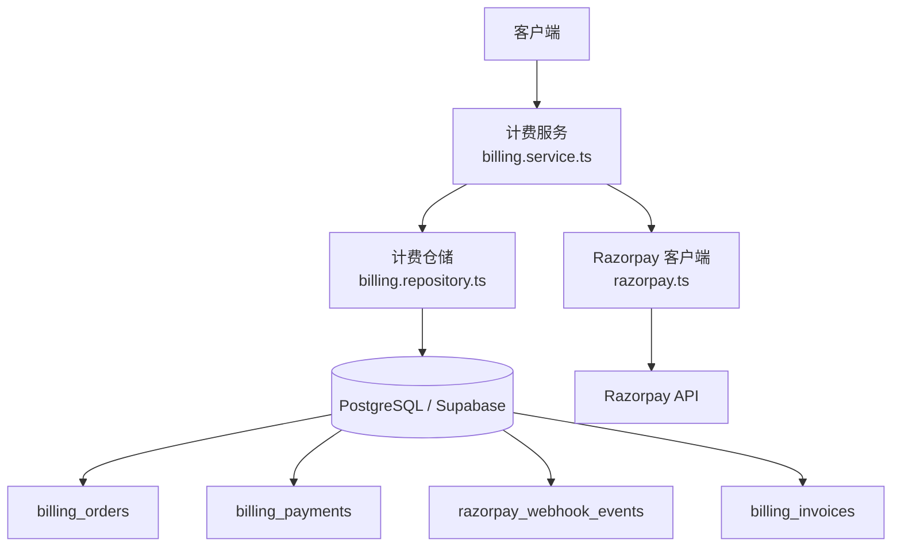
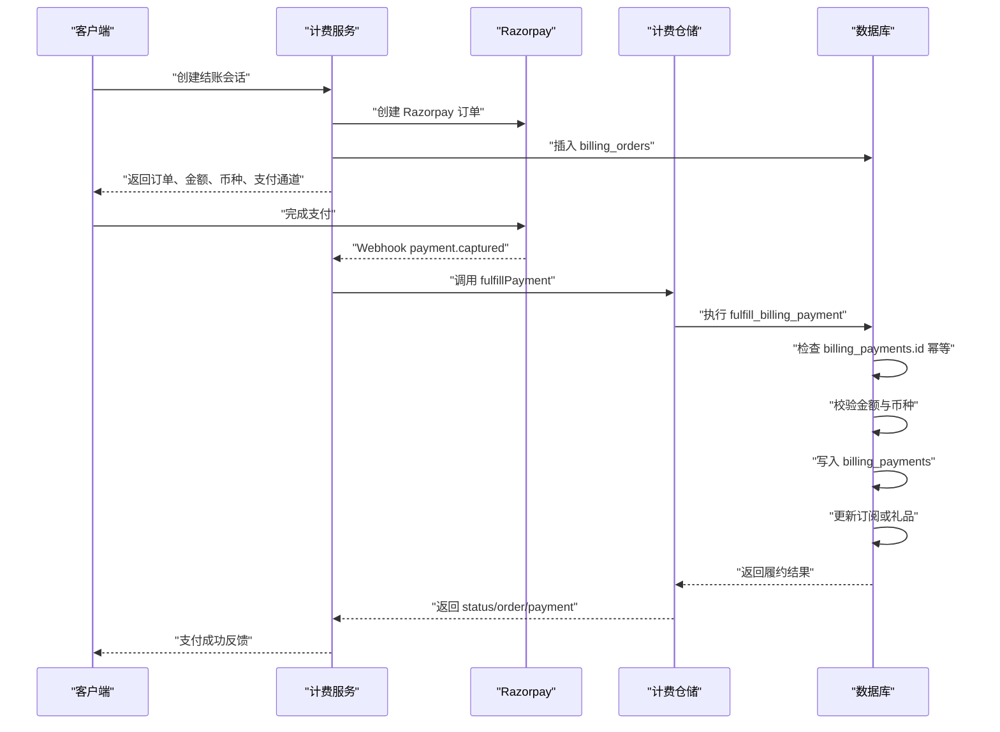
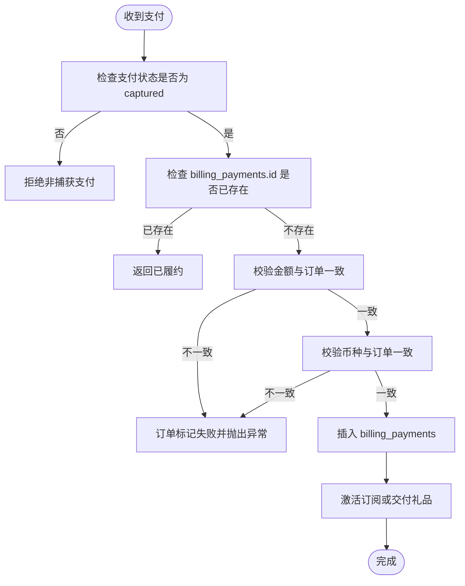
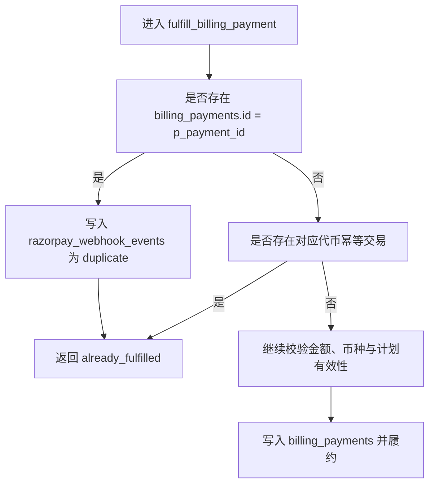
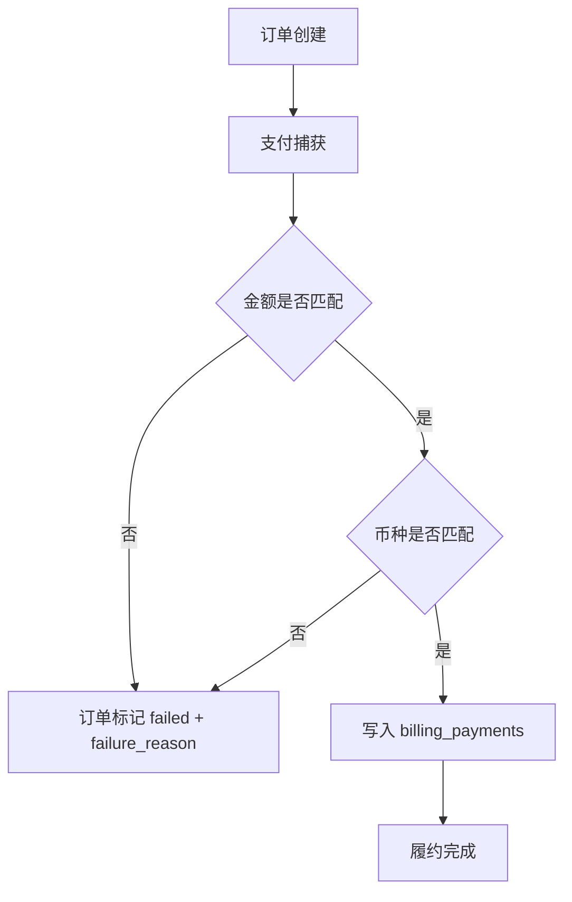
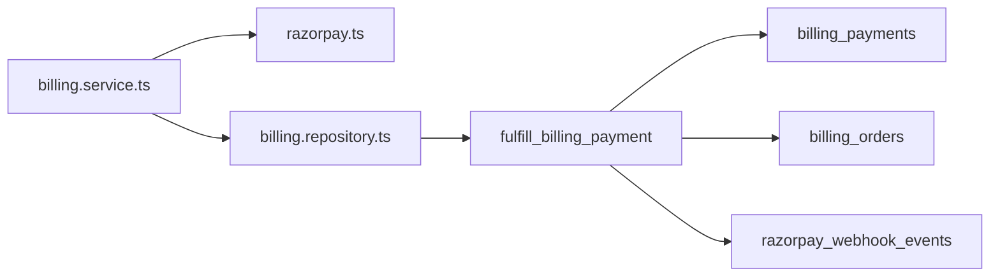

# 支付处理模型

<cite>
**本文引用的文件**   
- [core_backend.sql](file://supabase/migrations/20260506160000_core_backend.sql)
- [billing_gifts_hardening.sql](file://supabase/migrations/20260507183000_billing_gifts_hardening.sql)
- [gift_claim_flow.sql](file://supabase/migrations/20260730120000_gift_claim_flow.sql)
- [performance_advisor_fk_indexes.sql](file://supabase/migrations/20260507204000_performance_advisor_fk_indexes.sql)
- [billing_invoices.sql](file://supabase/migrations/20260910120000_billing_invoices.sql)
- [user_storage_addons.sql](file://supabase/migrations/20260927183000_user_storage_addons.sql)
- [razorpay.ts](file://src/server/billing/razorpay.ts)
- [checkout-session.ts](file://src/server/billing/checkout-session.ts)
- [billing.service.ts](file://src/server/services/billing.service.ts)
- [billing.repository.ts](file://src/server/repositories/billing.repository.ts)
</cite>

## 目录
1. [简介](#简介)
2. [项目结构](#项目结构)
3. [核心数据模型](#核心数据模型)
4. [架构总览](#架构总览)
5. [详细组件分析](#详细组件分析)
6. [依赖关系分析](#依赖关系分析)
7. [性能与索引特性](#性能与索引特性)
8. [故障排查指南](#故障排查指南)
9. [结论](#结论)

## 简介
本文聚焦支付处理数据模型，围绕 `billing_payments` 表及其相关订单、订阅、发票和审计事件进行完整建模说明。文档解释 Razorpay 支付标识如何成为幂等键，支付状态机如何从创建、捕获到履约演进，支付来源 `checkout` 与 `webhook` 的区分方式，以及金额、币种和用户信息在安全与对账方面的设计。文末给出端到端数据流图，覆盖客户端发起、Razorpay 回调与服务端幂等处理路径。

## 项目结构
支付相关代码分布在数据库迁移、后端服务、网关封装和仓储层：
- 数据库层：`supabase/migrations` 中的核心计费迁移定义 `billing_orders`、`billing_payments`、`razorpay_webhook_events`、`billing_invoices` 等表及幂等函数。
- 网关层：`src/server/billing/razorpay.ts` 封装 Razorpay REST、签名校验、订单与支付查询、UPI QR/Payment Link 能力。
- 业务层：`src/server/services/billing.service.ts` 编排结账会话、UPI 支付、轮询、Webhook 处理、发票生成和礼品交付。
- 仓储层：`src/server/repositories/billing.repository.ts` 提供订单、支付、发票等 SQL 访问接口，其中 `fulfillPayment` 调用数据库侧幂等函数。
- 结算工具：`src/server/billing/checkout-session.ts` 负责 Razorpay Checkout 会话令牌签发与校验。



**图表来源** 
- [billing.service.ts:200-650](file://src/server/services/billing.service.ts#L200-L650)
- [razorpay.ts:201-550](file://src/server/billing/razorpay.ts#L201-L550)
- [billing.repository.ts:460-626](file://src/server/repositories/billing.repository.ts#L460-L626)
- [core_backend.sql:170-211](file://supabase/migrations/20260506160000_core_backend.sql#L170-L211)

**章节来源**
- [billing.service.ts:200-650](file://src/server/services/billing.service.ts#L200-L650)
- [razorpay.ts:201-550](file://src/server/billing/razorpay.ts#L201-L550)
- [billing.repository.ts:460-626](file://src/server/repositories/billing.repository.ts#L460-L626)
- [core_backend.sql:170-211](file://supabase/migrations/20260506160000_core_backend.sql#L170-L211)

## 核心数据模型
本节重点说明 `billing_payments` 表结构、字段含义与约束，并关联 `billing_orders`、`razorpay_webhook_events`、`billing_invoices`。

### billing_payments 表字段说明
| 字段 | 类型 | 是否可空 | 默认值 | 含义与设计要点 |
| --- | --- | ---: | --- | --- |
| `id` | `text` | 否 | 无 | Razorpay 支付标识；主键，也是幂等键。 |
| `order_id` | `text` | 否 | 无 | 外键指向 `billing_orders.razorpay_order_id`，将支付与订单绑定。 |
| `user_id` | `uuid` | 否 | 无 | 外键指向 `auth.users(id)`，用于用户维度查询与级联删除。 |
| `amount_paise` | `integer` | 否 | 无 | 支付金额，单位为货币最小单位（如 INR paise），必须大于零。 |
| `currency` | `text` | 否 | `INR` | 币种，通常为 ISO 编码；服务端按订单币种校验。 |
| `status` | `text` | 否 | 无 | 支付状态；当前实现主要记录已捕获支付，后续扩展可用于失败或退款分支。 |
| `method` | `text` | 是 | 无 | 支付方式，例如卡、UPI、钱包等；来自 Razorpay 返回。 |
| `email` | `text` | 是 | 无 | 用户邮箱，便于对账和票据展示；不用于鉴权。 |
| `contact` | `text` | 是 | 无 | 联系方式，常用于 UPI 场景；不用于鉴权。 |
| `source` | `text` | 否 | 无 | 支付来源，检查约束限定为 `checkout` 或 `webhook`。 |
| `captured_at` | `timestamptz` | 是 | 无 | 捕获时间，表示支付被 Razorpay 实际扣款的时间点。 |
| `fulfilled_at` | `timestamptz` | 否 | `now()` | 履约时间，由数据库函数写入，表示支付完成业务权益发放。 |
| `created_at` | `timestamptz` | 否 | `now()` | 记录创建时间。 |

上述字段来源于数据库迁移中 `billing_payments` 的建表语句及注释。

**章节来源**
- [core_backend.sql:175-195](file://supabase/migrations/20260506160000_core_backend.sql#L175-L195)

### 与订单的关系
`billing_payments.order_id` 引用 `billing_orders.razorpay_order_id`，并使用 `on delete cascade`。这意味着：
- 当某订单被删除时，其对应的支付记录也会被级联删除。
- 该外键确保每笔支付都对应一个存在的 Razorpay 订单。
- `billing_orders` 同时拥有 `razorpay_payment_id` 字段，用于将订单与最近一次成功支付关联，但幂等逻辑以 `billing_payments.id` 为准。

**章节来源**
- [core_backend.sql:140-165](file://supabase/migrations/20260506160000_core_backend.sql#L140-L165)
- [core_backend.sql:175-180](file://supabase/migrations/20260506160000_core_backend.sql#L175-L180)

### 支付来源枚举
`billing_payments.source` 使用检查约束限制为两个值：
- `checkout`：由前端结账流程主动确认支付后触发履约。
- `webhook`：由 Razorpay 异步事件驱动触发履约。

该设计明确区分“客户端回调”和“服务端事件”两条入账路径，避免重复处理同一支付。

**章节来源**
- [core_backend.sql:175-195](file://supabase/migrations/20260506160000_core_backend.sql#L175-L195)
- [billing_gifts_hardening.sql:324-393](file://supabase/migrations/20260507183000_billing_gifts_hardening.sql#L324-L393)

### 用户信息安全考虑
- `email` 和 `contact` 仅作为对账、票据和渠道辅助信息存储，不参与身份验证。
- `user_id` 通过外键约束与认证系统用户表关联，便于权限控制和级联清理。
- Razorpay 卡号等敏感字段不在本表存储；卡片信息仅在调用 Razorpay 接口时按需获取，且代码注释强调不持久化 PAN。

**章节来源**
- [core_backend.sql:175-195](file://supabase/migrations/20260506160000_core_backend.sql#L175-L195)
- [razorpay.ts:260-310](file://src/server/billing/razorpay.ts#L260-L310)

## 架构总览
支付处理涉及三个关键阶段：创建订单与支付通道、支付捕获、幂等履约。



**图表来源**
- [billing.service.ts:200-650](file://src/server/services/billing.service.ts#L200-L650)
- [billing.repository.ts:473-520](file://src/server/repositories/billing.repository.ts#L473-L520)
- [core_backend.sql:520-623](file://supabase/migrations/20260506160000_core_backend.sql#L520-L623)

## 详细组件分析

### 支付状态机
当前实现中，`billing_payments.status` 主要用于记录已捕获支付，并在履约过程中保持业务一致性。结合订单表和函数逻辑，可以理解为以下状态演进：
- 订单创建：`billing_orders` 处于创建或尝试状态，尚未有成功支付记录。
- 支付捕获：Razorpay 返回 `payment.captured` 或通过结账确认支付。
- 支付记录：`billing_payments` 插入一条记录，`captured_at` 记录捕获时间。
- 履约完成：函数检查幂等后，写入 `fulfilled_at`，并激活订阅或交付礼品。
- 异常分支：金额或币种不匹配时，订单标记失败，支付不会正常履约。



**图表来源**
- [gift_claim_flow.sql:18-100](file://supabase/migrations/20260730120000_gift_claim_flow.sql#L18-L100)
- [billing_gifts_hardening.sql:324-393](file://supabase/migrations/20260507183000_billing_gifts_hardening.sql#L324-L393)

**章节来源**
- [gift_claim_flow.sql:18-100](file://supabase/migrations/20260730120000_gift_claim_flow.sql#L18-L100)
- [billing_gifts_hardening.sql:324-393](file://supabase/migrations/20260507183000_billing_gifts_hardening.sql#L324-L393)

### 幂等性保证机制
幂等性通过 `billing_payments.id` 作为唯一键实现：
- 数据库层函数在执行前检查 `billing_payments` 中是否已有相同 `id`。
- 如果已存在，则直接返回“已履约”，不再重复发放权益。
- 同时还会检查代币流水表中的幂等交易标识，避免并发下出现重复记账。
- 对于 webhook 事件，若检测到重复，会写入 `razorpay_webhook_events` 审计表并标记为 `duplicate`。



**图表来源**
- [gift_claim_flow.sql:80-100](file://supabase/migrations/20260730120000_gift_claim_flow.sql#L80-L100)
- [core_backend.sql:575-623](file://supabase/migrations/20260506160000_core_backend.sql#L575-L623)

**章节来源**
- [gift_claim_flow.sql:80-100](file://supabase/migrations/20260730120000_gift_claim_flow.sql#L80-L100)
- [core_backend.sql:575-623](file://supabase/migrations/20260506160000_core_backend.sql#L575-L623)

### 支付与订单的外键约束与级联删除
- `billing_payments.order_id` 引用 `billing_orders.razorpay_order_id`，并设置 `on delete cascade`。
- 这意味着删除订单时会同步删除该订单下的所有支付记录，保持数据一致性。
- 该设计适合短期审计与对账，但在需要长期保留支付历史时应谨慎评估删除策略。

**章节来源**
- [core_backend.sql:175-180](file://supabase/migrations/20260506160000_core_backend.sql#L175-L180)

### 支付方式与币种支持
- 支付方式来自 Razorpay 返回的 `method` 字段，常见包括卡、UPI、钱包等；本表不做枚举约束，而是记录第三方来源。
- 币种使用 `currency` 字段，默认 `INR`；服务层在结账时对币种进行校验，例如 UPI 仅支持印度卢比。
- 金额统一使用整数最小单位存储，避免浮点误差。

**章节来源**
- [core_backend.sql:175-195](file://supabase/migrations/20260506160000_core_backend.sql#L175-L195)
- [billing.service.ts:200-350](file://src/server/services/billing.service.ts#L200-L350)
- [razorpay.ts:260-310](file://src/server/billing/razorpay.ts#L260-L310)

### 支付对账数据结构
除 `billing_payments` 外，系统还通过以下结构支持对账：
- `billing_orders`：订单主记录，包含计划、金额、币种、收据、Razorpay 状态等。
- `razorpay_webhook_events`：Webhook 接收审计表，记录事件 ID、事件名称、处理状态、订单与支付标识。
- `billing_invoices`：发票记录，通过 `payment_id` 唯一关联支付，支持幂等插入与更新。
- `storage_purchases`：存储增值购买表，通过 `razorpay_payment_id` 关联支付，支持可选外键条件索引。

```mermaid
erDiagram
  BILLING_ORDERS {
    text id PK
    text razorpay_order_id UK
    uuid user_id FK
    text razorpay_payment_id
    integer amount_paise
    text currency
    text razorpay_status
    jsonb metadata
    timestamptz paid_at
    timestamptz fulfilled_at
  }

  BILLING_PAYMENTS {
    text id PK
    text order_id FK
    uuid user_id FK
    integer amount_paise
    text currency
    text status
    text method
    text email
    text contact
    text source
    timestamptz captured_at
    timestamptz fulfilled_at
    timestamptz created_at
  }

  RAZORPAY_WEBHOOK_EVENTS {
    text id PK
    text event_id UK
    text event
    text status
    text order_id
    text payment_id
    timestamptz received_at
  }

  BILLING_INVOICES {
    text id PK
    text payment_id UK FK
    text invoice_number
    text kind
    integer subtotal_paise
    integer tax_paise
    integer total_paise
    text country
    text r2_key
    text r2_url
    timestamptz emailed_at
  }

  STORAGE_PURCHASES {
    text razorpay_payment_id
    text status
    text razorpay_order_id
    text razorpay_payment_id_ref
    timestamptz created_at
  }

  BILLING_ORDERS ||--o{ BILLING_PAYMENTS : "order_id -> razorpay_order_id"
  BILLING_PAYMENTS ||--o{ BILLING_INVOICES : "payment_id"
  RAZORPAY_WEBHOOK_EVENTS ||--o{ BILLING_PAYMENTS : "payment_id"
  STORAGE_PURCHASES }o--|| BILLING_PAYMENTS : "razorpay_payment_id (可选)"
```

**图表来源**
- [core_backend.sql:140-211](file://supabase/migrations/20260506160000_core_backend.sql#L140-L211)
- [billing_invoices.sql:1-20](file://supabase/migrations/20260910120000_billing_invoices.sql#L1-L20)
- [user_storage_addons.sql:20-50](file://supabase/migrations/20260927183000_user_storage_addons.sql#L20-L50)

**章节来源**
- [core_backend.sql:140-211](file://supabase/migrations/20260506160000_core_backend.sql#L140-L211)
- [billing_invoices.sql:1-20](file://supabase/migrations/20260910120000_billing_invoices.sql#L1-L20)
- [user_storage_addons.sql:20-50](file://supabase/migrations/20260927183000_user_storage_addons.sql#L20-L50)

### 退款处理的现有设计与建议
当前仓库证据未直接体现退款表或退款状态流转。现有幂等函数主要处理“捕获即履约”的主流程，并未包含退款分支。建议未来扩展时新增如下结构：
- `refunds` 表：记录退款单号、原支付 `id`、退款金额、币种、状态、原因、处理时间。
- 幂等键：使用 Razorpay 退款标识或内部退款单号作为唯一键。
- 状态机：`initiated` → `processing` → `settled` / `failed`。
- 对账联动：退款成功后反向调整用户余额、订阅周期或礼品有效期。

由于该部分属于建议性扩展，未在现有代码中找到具体实现，因此不添加具体代码引用。

### 异常支付的数据结构设计
当前实现中，异常主要通过以下机制表达：
- 订单状态：`billing_orders.status` 可标记为 `failed`，并附带 `failure_reason`，例如金额不匹配或币种不匹配。
- 支付状态：`billing_payments.status` 目前主要用于捕获支付，未来可扩展为失败、撤销等状态。
- Webhook 审计：`razorpay_webhook_events.status` 可记录 `processed`、`duplicate`、`ignored`，帮助定位重复或忽略的事件。



**图表来源**
- [gift_claim_flow.sql:60-75](file://supabase/migrations/20260730120000_gift_claim_flow.sql#L60-L75)

**章节来源**
- [core_backend.sql:140-165](file://supabase/migrations/20260506160000_core_backend.sql#L140-L165)
- [gift_claim_flow.sql:60-75](file://supabase/migrations/20260730120000_gift_claim_flow.sql#L60-L75)

## 依赖关系分析



**图表来源**
- [billing.service.ts:200-650](file://src/server/services/billing.service.ts#L200-L650)
- [billing.repository.ts:473-520](file://src/server/repositories/billing.repository.ts#L473-L520)
- [core_backend.sql:520-623](file://supabase/migrations/20260506160000_core_backend.sql#L520-L623)

**章节来源**
- [billing.service.ts:200-650](file://src/server/services/billing.service.ts#L200-L650)
- [billing.repository.ts:473-520](file://src/server/repositories/billing.repository.ts#L473-L520)
- [core_backend.sql:520-623](file://supabase/migrations/20260506160000_core_backend.sql#L520-L623)

## 性能与索引特性
- `billing_payments` 在外键列上建有索引，提升按订单、用户和工作区查找的性能。
- `razorpay_webhook_events` 在状态和时间戳上有复合索引，有利于审计查询与去重检测。
- 支付表启用行级安全，并通过 replica identity full 增强变更追踪。
- 表填充因子设置为 95%，减少更新时的页分裂概率。

**章节来源**
- [performance_advisor_fk_indexes.sql:56-60](file://supabase/migrations/20260507204000_performance_advisor_fk_indexes.sql#L56-L60)
- [core_backend.sql:198-211](file://supabase/migrations/20260506160000_core_backend.sql#L198-L211)
- [core_backend.sql:295-330](file://supabase/migrations/20260506160000_core_backend.sql#L295-L330)

## 故障排查指南
- **重复 Webhook 导致重复入账**：检查 `razorpay_webhook_events.status` 是否为 `duplicate`，确认 `fulfill_billing_payment` 已通过 `billing_payments.id` 幂等跳过。
- **金额不匹配**：查看订单 `amount_paise` 与支付金额是否一致；函数会在不一致时将订单标记为失败。
- **币种不匹配**：检查订单币种与支付币种是否一致；不一致时同样会标记订单失败。
- **支付未捕获**：确认 Razorpay 返回状态为 `captured`，只有捕获状态才会触发履约。
- **发票未生成**：检查 `billing_invoices.payment_id` 是否已存在；发票插入使用 `on conflict` 幂等更新。

**章节来源**
- [gift_claim_flow.sql:60-100](file://supabase/migrations/20260730120000_gift_claim_flow.sql#L60-L100)
- [billing_repository.ts:473-520](file://src/server/repositories/billing.repository.ts#L473-L520)
- [core_backend.sql:575-623](file://supabase/migrations/20260506160000_core_backend.sql#L575-L623)

## 结论
`billing_payments` 以 Razorpay 支付标识作为主键和幂等键，配合 `order_id` 外键与 `source` 枚举，形成清晰的支付记录与来源区分。支付状态机围绕“捕获即履约”展开，金额与币种校验保障财务一致性，Webhook 审计表提供事件追踪能力。当前实现未包含退款流程，建议在未来扩展退款表与状态机。整体设计通过数据库层函数集中处理幂等与事务，降低应用层复杂度，同时通过索引与约束提升性能和数据完整性。