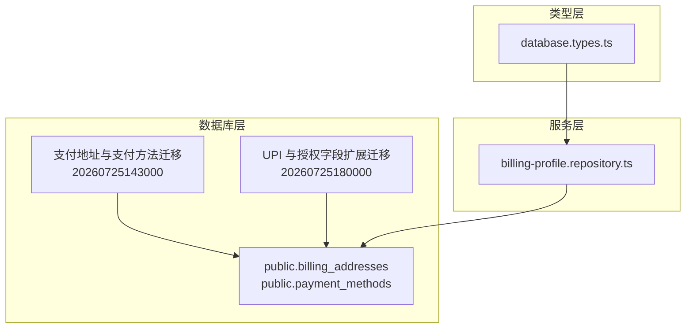
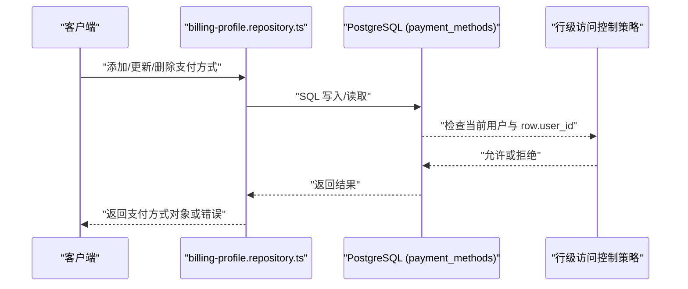
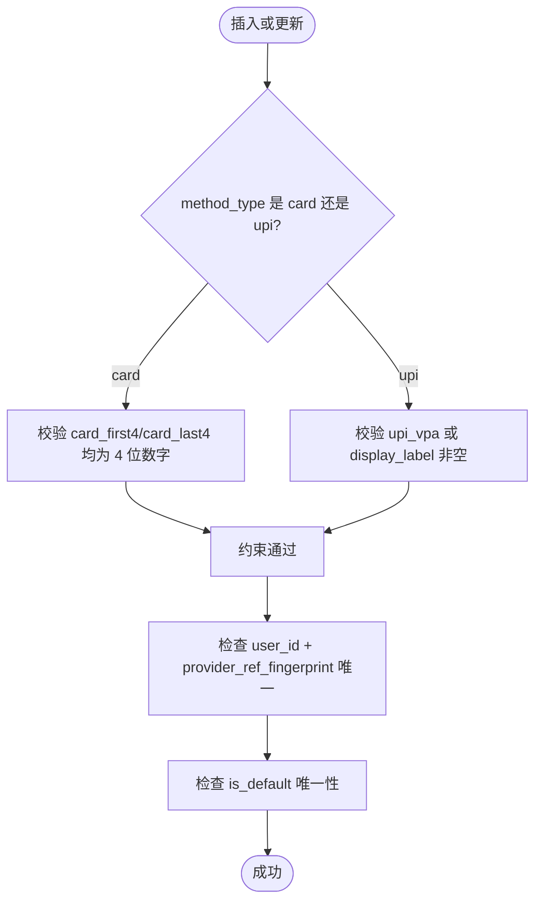
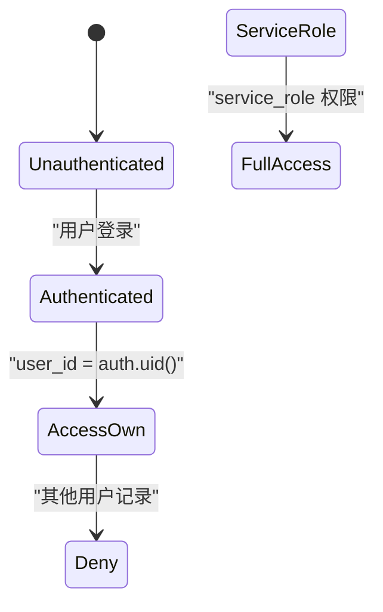
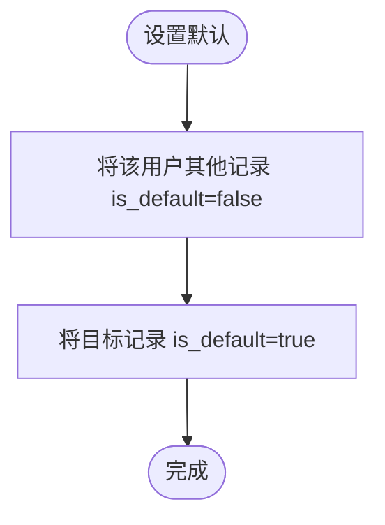
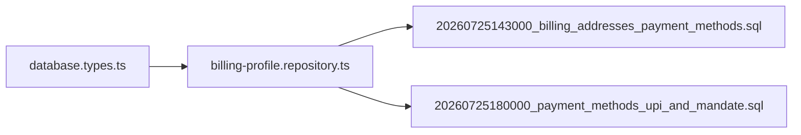

# 支付方式管理

<cite>
**本文引用的文件**   
- [20260725143000_billing_addresses_payment_methods.sql](file://supabase/migrations/20260725143000_billing_addresses_payment_methods.sql)
- [20260725180000_payment_methods_upi_and_mandate.sql](file://supabase/migrations/20260725180000_payment_methods_upi_and_mandate.sql)
- [database.types.ts](file://src/shared/types/database.types.ts)
- [billing-profile.repository.ts](file://src/server/repositories/billing-profile.repository.ts)
</cite>

## 目录
1. [引言](#引言)
2. [项目结构定位](#项目结构定位)
3. [核心数据模型](#核心数据模型)
4. [系统架构总览](#系统架构总览)
5. [详细组件分析](#详细组件分析)
6. [依赖关系分析](#依赖关系分析)
7. [性能与索引优化](#性能与索引优化)
8. [安全与合规设计](#安全与合规设计)
9. [业务流程与一致性保证](#业务流程与一致性保证)
10. [故障排查指南](#故障排查指南)
11. [结论](#结论)

## 引言
本文面向支付方式管理的数据模型与实现，重点解释 `payment_methods` 表结构、PCI 合规设计、UPI Autopay 与卡授权指令支持、加密存储与指纹去重、默认支付方式管理、行级访问控制策略，以及添加、更新、删除支付方式的完整业务流和数据一致性保障。读者无需深入数据库细节即可理解整体设计意图；开发者可结合“章节来源”快速定位源码。

## 项目结构定位
支付方式相关能力由以下两部分组成：
- 数据库迁移定义：位于 `supabase/migrations`，负责创建和演进 `billing_addresses`、`payment_methods` 表及 RLS 策略、约束和索引。
- 服务端仓储层：位于 `src/server/repositories/billing-profile.repository.ts`，提供查询、新增、更新、设置默认、删除支付方式的函数，并封装事务执行。
- 类型定义：位于 `src/shared/types/database.types.ts`，生成数据库 Row/Insert/Update 的 TypeScript 类型，用于前端和服务端类型安全交互。

**图表来源**
- [20260725143000_billing_addresses_payment_methods.sql:1-162](file://supabase/migrations/20260725143000_billing_addresses_payment_methods.sql#L1-L162)
- [20260725180000_payment_methods_upi_and_mandate.sql:1-31](file://supabase/migrations/20260725180000_payment_methods_upi_and_mandate.sql#L1-L31)
- [billing-profile.repository.ts:20-41](file://src/server/repositories/billing-profile.repository.ts#L20-L41)
- [database.types.ts:4339-4399](file://src/shared/types/database.types.ts#L4339-L4399)

**章节来源**
- [20260725143000_billing_addresses_payment_methods.sql:1-162](file://supabase/migrations/20260725143000_billing_addresses_payment_methods.sql#L1-L162)
- [20260725180000_payment_methods_upi_and_mandate.sql:1-31](file://supabase/migrations/20260725180000_payment_methods_upi_and_mandate.sql#L1-L31)
- [billing-profile.repository.ts:20-41](file://src/server/repositories/billing-profile.repository.ts#L20-L41)
- [database.types.ts:4339-4399](file://src/shared/types/database.types.ts#L4339-L4399)

## 核心数据模型
### payment_methods 表字段说明
| 字段 | 类型与约束 | 含义与用途 |
|---|---|---|
| id | uuid, 主键 | 支付方式记录标识 |
| user_id | uuid, 非空, 外键到 auth.users | 所属用户 |
| provider_ref_encrypted | text, 非空 | Razorpay 卡片或令牌引用密文（AES-GCM base64），不存完整 PAN |
| provider_ref_fingerprint | text, 非空 | 提供方引用指纹，用于同一用户下同一支付方式的去重 |
| network | text, 非空, 枚举校验 | 卡组织网络，如 visa/mastercard/amex/rupay/jcb/discover/unknown |
| brand | text, 非空, 默认空串 | 发卡品牌展示信息 |
| card_first4 | text, 可为空 | 仅显示前 4 位数字，严格正则校验 |
| card_last4 | text, 可为空 | 仅显示后 4 位数字，严格正则校验 |
| exp_month | smallint, 可为空 | 有效期月份，1-12 |
| exp_year | smallint, 可为空 | 有效期年份，2020-2100 |
| is_default | boolean, 非空, 默认 false | 是否为用户默认支付方式 |
| razorpay_customer_id | text, 可为空 | Razorpay 客户标识 |
| last_payment_id | text, 可为空 | 最近一次支付标识 |
| method_type | text, 非空, 默认 'card' | 支付方式类型：card 或 upi |
| upi_vpa | text, 可为空 | UPI 自动扣款 VPA |
| display_label | text, 可为空 | 面向用户的展示标签 |
| mandate_max_amount_paise | integer, 可为空 | 授权金额上限，单位 paise |
| mandate_status | text, 可为空 | 授权状态，用于跟踪 UPI Autopay 或卡授权生命周期 |
| created_at / updated_at | timestamptz, 非空 | 审计时间戳 |

### PCI 合规关键点
- 不存储完整 PAN。仅允许存储前 4 位和后 4 位数字，且通过正则强约束。
- provider_ref_encrypted 使用 AES-GCM 加密 Razorpay 引用，密文以 base64 文本存储。
- 通过 provider_ref_fingerprint 在用户维度进行唯一性约束，避免重复记录。

**章节来源**
- [20260725143000_billing_addresses_payment_methods.sql:64-137](file://supabase/migrations/20260725143000_billing_addresses_payment_methods.sql#L64-L137)
- [20260725180000_payment_methods_upi_and_mandate.sql:1-31](file://supabase/migrations/20260725180000_payment_methods_upi_and_mandate.sql#L1-L31)
- [database.types.ts:4339-4399](file://src/shared/types/database.types.ts#L4339-L4399)

## 系统架构总览
支付方式管理的数据流从服务端仓储层出发，通过 SQL 操作数据库中的 `payment_methods` 表。RLS 策略确保认证用户只能访问自己的记录；service_role 拥有全部权限以便内部服务调用。

**图表来源**
- [billing-profile.repository.ts:115-294](file://src/server/repositories/billing-profile.repository.ts#L115-L294)
- [20260725143000_billing_addresses_payment_methods.sql:138-162](file://supabase/migrations/20260725143000_billing_addresses_payment_methods.sql#L138-L162)

**章节来源**
- [billing-profile.repository.ts:115-294](file://src/server/repositories/billing-profile.repository.ts#L115-L294)
- [20260725143000_billing_addresses_payment_methods.sql:138-162](file://supabase/migrations/20260725143000_billing_addresses_payment_methods.sql#L138-L162)

## 详细组件分析
### 表结构与约束
- 主键与外键：id 为主键；user_id 外键关联 auth.users，并在用户删除时级联删除。
- 唯一性与默认值：
  - 用户维度唯一指纹：unique(user_id, provider_ref_fingerprint)。
  - 用户维度唯一默认：unique index on (user_id) where is_default。
- 数据完整性约束：
  - network 枚举校验。
  - card_first4/card_last4 四位数正则校验，且对 UPI 类型允许为空。
  - exp_month 1-12，exp_year 2020-2100。
  - UPI 与卡的展示字段互斥约束：若 method_type=card，则必须存在 card_first4 和 card_last4；若 method_type=upi，则 upi_vpa 或 display_label 至少有一个非空。

**图表来源**
- [20260725143000_billing_addresses_payment_methods.sql:64-137](file://supabase/migrations/20260725143000_billing_addresses_payment_methods.sql#L64-L137)
- [20260725180000_payment_methods_upi_and_mandate.sql:1-31](file://supabase/migrations/20260725180000_payment_methods_upi_and_mandate.sql#L1-L31)

**章节来源**
- [20260725143000_billing_addresses_payment_methods.sql:64-137](file://supabase/migrations/20260725143000_billing_addresses_payment_methods.sql#L64-L137)
- [20260725180000_payment_methods_upi_and_mandate.sql:1-31](file://supabase/migrations/20260725180000_payment_methods_upi_and_mandate.sql#L1-L31)

### 行级访问控制与安全角色
- 启用 RLS：对 billing_addresses 与 payment_methods 启用行级访问控制。
- 认证用户策略：authenticated 角色可对自身 user_id 的记录执行 select/insert/update/delete。
- service_role 权限：授予所有权限，供内部服务直接访问敏感数据。

**图表来源**
- [20260725143000_billing_addresses_payment_methods.sql:138-162](file://supabase/migrations/20260725143000_billing_addresses_payment_methods.sql#L138-L162)

**章节来源**
- [20260725143000_billing_addresses_payment_methods.sql:138-162](file://supabase/migrations/20260725143000_billing_addresses_payment_methods.sql#L138-L162)

### 加密存储与指纹去重
- provider_ref_encrypted：存储 Razorpay 的卡片或令牌引用密文，采用 AES-GCM 算法并以 base64 文本保存。应用层需负责密钥管理与加解密逻辑。
- provider_ref_fingerprint：用于在同一用户下识别相同支付方式，避免重复存储。唯一约束保证每个用户不会有两个相同指纹的支付方式。
- 建议：将 fingerprint 计算逻辑稳定化（例如基于 Razorpay 引用+版本号或哈希），以确保幂等更新。

**章节来源**
- [20260725143000_billing_addresses_payment_methods.sql:64-137](file://supabase/migrations/20260725143000_billing_addresses_payment_methods.sql#L64-L137)
- [billing-profile.repository.ts:132-241](file://src/server/repositories/billing-profile.repository.ts#L132-L241)

### UPI Autopay 与卡授权指令支持
- method_type：区分 card 与 upi。
- upi_vpa：存储 UPI 自动扣款的 VPA。
- display_label：为 UPI 提供用户可读标签，便于选择与展示。
- mandate_max_amount_paise：授权金额上限，单位为 paise，适合 UPI Autopay 或卡授权场景。
- mandate_status：跟踪授权状态，如待授权、已授权、失败、撤销等。
- 字段约束：当 method_type=upi 时，允许 card_first4/card_last4 为空，但要求 upi_vpa 或 display_label 至少有一个非空。

**章节来源**
- [20260725180000_payment_methods_upi_and_mandate.sql:1-31](file://supabase/migrations/20260725180000_payment_methods_upi_and_mandate.sql#L1-L31)
- [database.types.ts:4339-4399](file://src/shared/types/database.types.ts#L4339-L4399)

### 默认支付方式管理
- is_default：布尔字段表示是否为默认支付方式。
- 唯一性：通过部分唯一索引保证每个用户只有一个默认支付方式。
- 仓储逻辑：
  - upsertPaymentMethod：如果 makeDefault=true 或未显式禁止，会先将该用户所有支付方式置为非默认，再更新或插入目标记录。
  - setDefaultPaymentMethod：先清空用户其他记录的默认标记，再将目标记录设为默认。
  - deletePaymentMethod：若删除的是默认记录，则将最近创建的另一个记录设为默认，保持用户始终有一个默认支付方式。

**图表来源**
- [billing-profile.repository.ts:132-241](file://src/server/repositories/billing-profile.repository.ts#L132-L241)
- [billing-profile.repository.ts:243-294](file://src/server/repositories/billing-profile.repository.ts#L243-L294)

**章节来源**
- [billing-profile.repository.ts:132-241](file://src/server/repositories/billing-profile.repository.ts#L132-L241)
- [billing-profile.repository.ts:243-294](file://src/server/repositories/billing-profile.repository.ts#L243-L294)

## 依赖关系分析
- 仓储层依赖数据库迁移定义的表结构，包括字段、约束、索引与 RLS 策略。
- 类型层导出 database.types.ts 的 Row/Insert/Update 类型，服务于仓储层与服务端 API 的类型安全。
- 仓储层通过 withTransaction 封装事务，保证多步更新的原子性。

**图表来源**
- [database.types.ts:4339-4399](file://src/shared/types/database.types.ts#L4339-L4399)
- [billing-profile.repository.ts:20-41](file://src/server/repositories/billing-profile.repository.ts#L20-L41)
- [20260725143000_billing_addresses_payment_methods.sql:1-162](file://supabase/migrations/20260725143000_billing_addresses_payment_methods.sql#L1-L162)
- [20260725180000_payment_methods_upi_and_mandate.sql:1-31](file://supabase/migrations/20260725180000_payment_methods_upi_and_mandate.sql#L1-L31)

**章节来源**
- [database.types.ts:4339-4399](file://src/shared/types/database.types.ts#L4339-L4399)
- [billing-profile.repository.ts:20-41](file://src/server/repositories/billing-profile.repository.ts#L20-L41)

## 性能与索引优化
- 用户维度查询：payment_methods_user_id_idx 加速按 user_id 查询。
- 默认方式查询：payment_methods_one_default_per_user 部分唯一索引加速 is_default=true 的查询。
- 去重与更新：unique(user_id, provider_ref_fingerprint) 提升去重判断效率。
- 更新时间触发器：updated_at 由触发器维护，避免应用层遗漏。

建议：
- 针对频繁按 mandate_status 筛选的场景，可考虑建立相应索引。
- 对 display_label 或 upi_vpa 的高频过滤条件评估是否需要额外索引。
- 监控大表下的全表扫描与锁竞争，必要时拆分历史归档。

**章节来源**
- [20260725143000_billing_addresses_payment_methods.sql:92-113](file://supabase/migrations/20260725143000_billing_addresses_payment_methods.sql#L92-L113)

## 安全与合规设计
### PCI 合规
- 禁止存储完整 PAN。
- 仅存储前 4 位与后 4 位数字，并通过正则强约束。
- provider_ref_encrypted 使用 AES-GCM 密文存储 Razorpay 引用，避免明文敏感数据落地。

### RLS 与权限
- 认证用户只能访问自己的记录。
- service_role 具有全部权限，用于内部服务与后台任务。
- 建议在应用层进一步校验输入合法性，防止恶意构造绕过业务规则。

**章节来源**
- [20260725143000_billing_addresses_payment_methods.sql:64-162](file://supabase/migrations/20260725143000_billing_addresses_payment_methods.sql#L64-L162)

## 业务流程与一致性保证
### 添加支付方式
- 步骤：
  1. 验证输入：method_type、network、display 字段满足约束。
  2. 计算 provider_ref_fingerprint，确保用户维度唯一。
  3. 调用 upsertPaymentMethod：若存在相同指纹则更新，否则插入新记录。
  4. 根据 makeDefault 决定是否重置其他默认记录。
- 一致性：
  - 使用事务包裹更新/插入操作。
  - 约束层保证数据完整性。

**章节来源**
- [billing-profile.repository.ts:132-241](file://src/server/repositories/billing-profile.repository.ts#L132-L241)
- [20260725180000_payment_methods_upi_and_mandate.sql:1-31](file://supabase/migrations/20260725180000_payment_methods_upi_and_mandate.sql#L1-L31)

### 更新支付方式
- 支持增量更新：provider_ref_encrypted、network、brand、card_first4、card_last4、exp_month、exp_year、razorpay_customer_id、last_payment_id、method_type、upi_vpa、display_label、mandate_max_amount_paise、mandate_status。
- 可选刷新默认：makeDefault=true 时重置其他默认记录。
- 一致性：
  - 通过 withTransaction 保证原子性。
  - updated_at 由触发器自动更新。

**章节来源**
- [billing-profile.repository.ts:132-241](file://src/server/repositories/billing-profile.repository.ts#L132-L241)

### 删除支付方式
- 步骤：
  1. 校验记录归属：确保删除的是当前用户的记录。
  2. 若删除的是默认记录，将最近创建的另一个记录设为默认。
  3. 返回被删除记录。
- 一致性：
  - 事务内完成归属校验与默认回退。
  - 约束层保证最多一个默认记录。

**章节来源**
- [billing-profile.repository.ts:267-294](file://src/server/repositories/billing-profile.repository.ts#L267-L294)

### 设置默认支付方式
- 步骤：
  1. 校验记录归属。
  2. 清空用户其他记录的默认标记。
  3. 将目标记录设为默认。
- 一致性：
  - 事务保证原子性。
  - 部分唯一索引确保全局唯一默认。

**章节来源**
- [billing-profile.repository.ts:243-265](file://src/server/repositories/billing-profile.repository.ts#L243-L265)

## 故障排查指南
- 常见错误：
  - “支付方式不存在”：删除或设置默认时报 404，通常因 user_id 不匹配或记录已被删除。
  - 约束违反：network 不在允许列表、card_first4/card_last4 不是四位数字、UPI 缺少必要展示字段。
  - 唯一冲突：同一用户存在相同 provider_ref_fingerprint。
- 排查建议：
  - 确认输入参数符合类型与约束定义。
  - 检查 provider_ref_fingerprint 的计算逻辑是否稳定。
  - 查看 RLS 是否正确限制用户访问范围。
  - 审计 updated_at 与 is_default 的状态一致性。

**章节来源**
- [billing-profile.repository.ts:243-294](file://src/server/repositories/billing-profile.repository.ts#L243-L294)
- [20260725143000_billing_addresses_payment_methods.sql:64-162](file://supabase/migrations/20260725143000_billing_addresses_payment_methods.sql#L64-L162)
- [20260725180000_payment_methods_upi_and_mandate.sql:1-31](file://supabase/migrations/20260725180000_payment_methods_upi_and_mandate.sql#L1-L31)

## 结论
支付方式管理通过严格的数据库约束、RLS 行级访问控制、AES-GCM 加密存储与指纹去重机制，实现了 PCI 合规与数据安全。UPI Autopay 与卡授权指令的支持通过 method_type、upi_vpa、display_label、mandate_max_amount_paise、mandate_status 字段得到统一建模。仓储层以事务封装增删改查，确保数据一致性与用户体验。建议持续监控索引使用情况与授权状态流转，完善审计与告警体系，进一步提升系统的可靠性与安全性。