# 计费支付模型

<cite>
**本文引用的文件**   
- [核心数据库迁移](file://supabase/migrations/20260506160000_core_backend.sql)
- [地址与支付方式迁移](file://supabase/migrations/20260725143000_billing_addresses_payment_methods.sql)
- [UPI 与授权指令迁移](file://supabase/migrations/20260725180000_payment_methods_upi_and_mandate.sql)
- [发票表迁移](file://supabase/migrations/20260910120000_billing_invoices.sql)
- [Razorpay 集成实现](file://src/server/billing/razorpay.ts)
- [计费服务](file://src/server/services/billing.service.ts)
- [计费仓储](file://src/server/repositories/billing.repository.ts)
- [发票构建逻辑](file://src/server/billing/invoice.ts)
- [结账会话工具](file://src/server/billing/checkout-session.ts)
- [Razorpay Webhook 路由](file://src/app/api/v1/webhooks/razorpay/route.ts)
- [Razorpay 回调路由](file://src/app/api/v1/billing/orders/razorpay-callback/route.ts)
- [订单校验路由](file://src/app/api/v1/billing/orders/verify/route.ts)
</cite>

## 目录
1. [引言](#引言)
2. [项目结构](#项目结构)
3. [核心数据模型](#核心数据模型)
4. [系统架构总览](#系统架构总览)
5. [详细组件分析](#详细组件分析)
6. [依赖关系分析](#依赖关系分析)
7. [性能与索引](#性能与索引)
8. [安全与一致性](#安全与一致性)
9. [故障排查指南](#故障排查指南)
10. [结论](#结论)

## 引言
本文档聚焦计费与支付子系统的数据模型和 Razorpay 集成，重点解释以下方面：
- 订单、支付、发票、地址、支付方式、Webhook 审计等底层表结构。
- Razorpay 创建订单、UPI 二维码、支付链接、签名校验、回调与 Webhook 处理的数据流。
- 订单状态机、幂等性保证、对账机制、退款能力边界。
- UPI 支付、授权指令、地址管理的设计约束。
- 计费事件追踪、用量统计、账单计算在现有数据结构中的支撑方式。
- 支付安全、数据一致性与事务处理的实现要点。

本说明同时兼顾非技术读者：先给出高层流程，再逐步深入到字段、约束、索引和错误处理。

## 项目结构
计费支付相关代码分布在以下层次：
- Supabase 迁移定义数据库表、约束、行级安全策略和索引。
- Next.js API 路由负责浏览器或外部网关请求入口。
- `src/server/billing` 包含 Razorpay 集成、发票构建、位置税务、货币转换、结算工作区调用等。
- `src/server/services/billing.service.ts` 是业务编排中心。
- `src/server/repositories/billing.repository.ts` 提供订单、支付、元数据合并等仓储操作。
- `workers/billing` 负责发票 PDF 生成与 R2 存储（文档中仅引用其类型与调用点）。

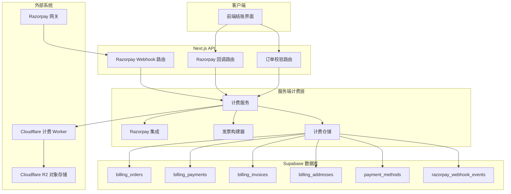

图表来源
- [计费服务:1-200](file://src/server/services/billing.service.ts#L1-L200)
- [Razorpay 集成实现:1-200](file://src/server/billing/razorpay.ts#L1-L200)
- [发票构建逻辑:1-200](file://src/server/billing/invoice.ts#L1-L200)
- [计费仓储:1-220](file://src/server/repositories/billing.repository.ts#L1-L220)

章节来源
- [Razorpay 集成实现:1-200](file://src/server/billing/razorpay.ts#L1-L200)
- [计费服务:1-200](file://src/server/services/billing.service.ts#L1-L200)
- [发票构建逻辑:1-200](file://src/server/billing/invoice.ts#L1-L200)
- [计费仓储:1-220](file://src/server/repositories/billing.repository.ts#L1-L220)

## 核心数据模型

### 订单表 `billing_orders`
`billing_orders` 是计费的主体记录，承载用户、订阅计划、金额、Razorpay 关联标识、状态和时间戳。关键字段包括：
- `id`：内部订单主键。
- `razorpay_order_id`：Razorpay 订单号，唯一且被支付记录引用。
- `razorpay_payment_id`：可选的支付标识，用于已支付订单。
- `user_id`、`user_email`：归属用户。
- `plan_id`、`plan_name`、`billing_cycle`、`max_tier`：订阅产品与周期信息。
- `currency`、`subtotal_paise`、`tax_paise`、`amount_paise`：以最小单位表示的金额，避免浮点误差。
- `tokens`：支付成功后授予用户的 token 数量。
- `receipt`：Razorpay 收据编号。
- `razorpay_status`：Razorpay 侧订单状态快照。
- `metadata`：扩展元数据，支持 UPI QR ID、税费证据、开票信息等。
- `paid_at`、`fulfilled_at`、`created_at`、`updated_at`：时间线字段。
- `status`：本地订单状态，约束为 `created`、`attempted`、`fulfilled`、`failed`。

该表注释明确：订单在 Razorpay 支付前创建；通过履约接口完成；状态从创建到尝试再到成功或失败。

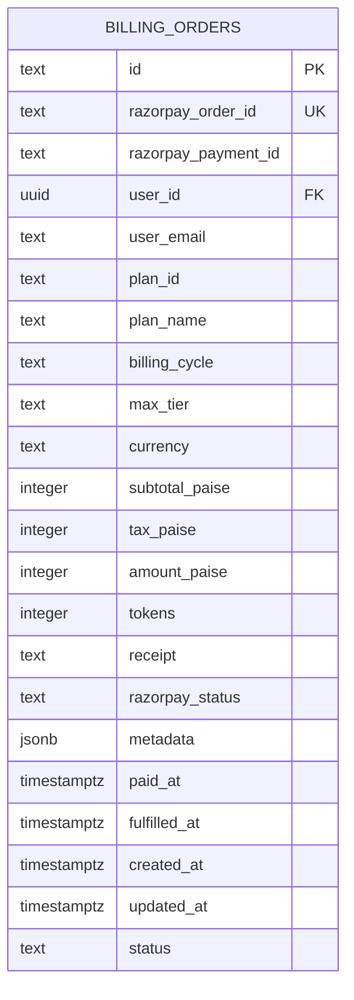

图表来源
- [核心数据库迁移:137-174](file://supabase/migrations/20260506160000_core_backend.sql#L137-L174)

章节来源
- [核心数据库迁移:137-174](file://supabase/migrations/20260506160000_core_backend.sql#L137-L174)

### 支付表 `billing_payments`
`billing_payments` 记录 Razorpay 侧实际扣款结果，主要字段包括：
- `id`：支付主键，通常对应 Razorpay 支付 ID，作为幂等键。
- `order_id`：外键指向 `billing_orders.razorpay_order_id`。
- `user_id`、`email`、`contact`：支付主体信息。
- `amount_paise`、`currency`：支付金额与币种。
- `status`：支付状态。
- `method`：支付方式，如卡、UPI、网银等。
- `source`：来源，区分 `checkout`（客户端回调）与 `webhook`（服务器事件）。
- `captured_at`、`fulfilled_at`、`created_at`：支付与履约时间线。
- 仓储层还查询 `provider_payload`，用于附加发票、Razorpay 文档等信息。

该表注释强调：每笔已捕获支付一行；重复支付 ID 会短路履约，从而实现幂等。

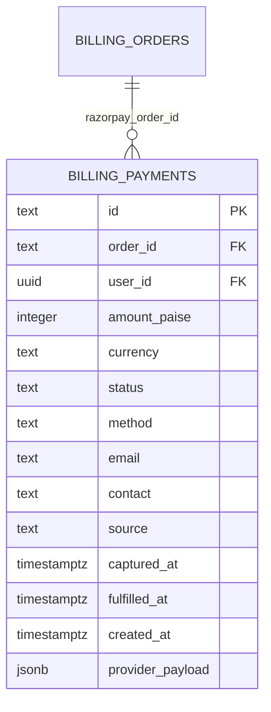

图表来源
- [核心数据库迁移:175-197](file://supabase/migrations/20260506160000_core_backend.sql#L175-L197)
- [计费仓储:140-220](file://src/server/repositories/billing.repository.ts#L140-L220)

章节来源
- [核心数据库迁移:175-197](file://supabase/migrations/20260506160000_core_backend.sql#L175-L197)
- [计费仓储:140-220](file://src/server/repositories/billing.repository.ts#L140-L220)

### Webhook 审计表 `razorpay_webhook_events`
`razorpay_webhook_events` 是 append-only 审计日志，不启用行级安全，仅由安全的履约过程写入。字段包括：
- `id`：审计事件主键。
- `event_id`：Razorpay 事件 ID，唯一。
- `event`：事件类型。
- `status`：处理结果，约束为 `processed`、`duplicate`、`ignored`。
- `order_id`、`payment_id`：关联的订单与支付。
- `received_at`：接收时间。

该表用于追踪 Razorpay 事件是否被正确处理、重复或忽略，便于对账与排障。

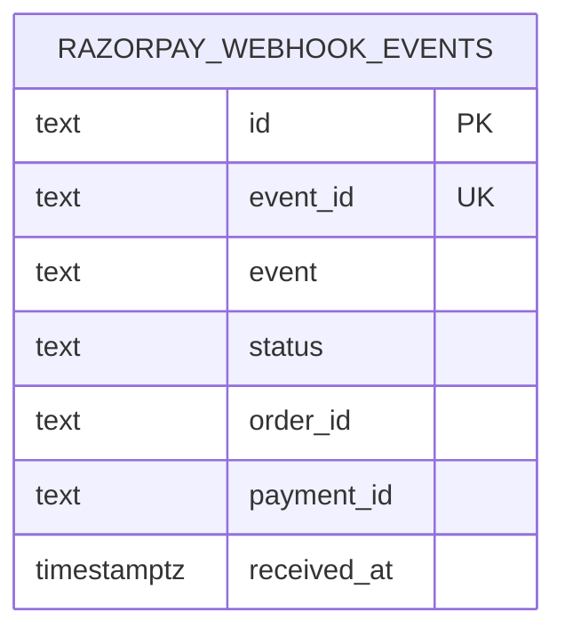

图表来源
- [核心数据库迁移:198-215](file://supabase/migrations/20260506160000_core_backend.sql#L198-L215)

章节来源
- [核心数据库迁移:198-215](file://supabase/migrations/20260506160000_core_backend.sql#L198-L215)

### 发票表 `billing_invoices`
`billing_invoices` 记录每张已支付订单对应的发票，PDF 存储在 Cloudflare R2，表中保存键与下载 URL。关键字段包括：
- `id`：发票主键。
- `user_id`：用户。
- `order_id`：外键指向 `billing_orders.id`。
- `payment_id`：外键指向 `billing_payments.id`，唯一，作为“每笔支付一张发票”的幂等键。
- `invoice_number`：发票编号，唯一。
- `kind`：发票类型，支持国内 GST、出口 LUT、豁免 GSTIN。
- `currency`：INR 或 USD。
- `subtotal_paise`、`tax_paise`、`total_paise`：发票金额明细。
- `country`、`r2_key`、`r2_url`、`razorpay_document_id`、`evidence`：发票凭证与税务证据。
- `emailed_at`、`created_at`、`updated_at`。

发票构建器根据已履约订单与支付生成 PDF 所需载荷，并基于支付 ID 与订单 ID 生成发票编号。

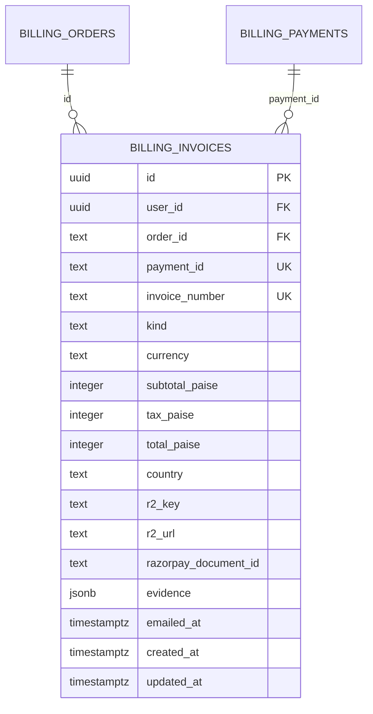

图表来源
- [发票表迁移:1-58](file://supabase/migrations/20260910120000_billing_invoices.sql#L1-L58)
- [发票构建逻辑:1-200](file://src/server/billing/invoice.ts#L1-L200)

章节来源
- [发票表迁移:1-58](file://supabase/migrations/20260910120000_billing_invoices.sql#L1-L58)
- [发票构建逻辑:1-200](file://src/server/billing/invoice.ts#L1-L200)

### 地址表 `billing_addresses`
`billing_addresses` 持久化用户计费地址，每个用户可有一个默认地址。字段包括：
- `id`、`user_id`。
- `full_name`、`country_code`、`address_line1`、`address_line2`、`city`、`state`、`postal_code`、`phone`。
- `is_default`：默认标记，配合唯一索引确保每个用户最多一个默认地址。
- 校验约束限制国家代码长度、姓名长度、地址行长度、城市州码长度、邮编长度。
- 启用行级安全，只允许用户访问自己的地址。

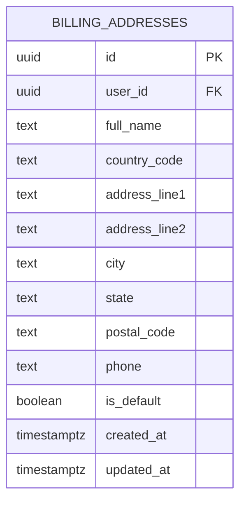

图表来源
- [地址与支付方式迁移:1-162](file://supabase/migrations/20260725143000_billing_addresses_payment_methods.sql#L1-L162)

章节来源
- [地址与支付方式迁移:1-162](file://supabase/migrations/20260725143000_billing_addresses_payment_methods.sql#L1-L162)

### 支付方式表 `payment_methods`
`payment_methods` 存储令牌化的卡或 UPI 支付方式，不保存完整卡号。关键字段包括：
- `id`、`user_id`。
- `provider_ref_encrypted`：加密的 Razorpay 卡 ID 或令牌引用。
- `provider_ref_fingerprint`：提供方引用指纹，结合用户 ID 唯一。
- `network`、`brand`：卡网络与品牌。
- `card_first4`、`card_last4`：仅展示用掩码数字。
- `exp_month`、`exp_year`：过期月份与年份。
- `is_default`：默认支付方式。
- `razorpay_customer_id`：Razorpay 客户标识。
- `last_payment_id`：最近一次支付 ID。
- `method_type`：`card` 或 `upi`。
- `upi_vpa`、`display_label`：UPI 虚拟账户与显示标签。
- `mandate_max_amount_paise`、`mandate_status`：UPI 授权指令上限金额与状态。

约束保证卡类支付方式必须有首尾四位；UPI 支付方式必须具有 VPA 或显示标签。

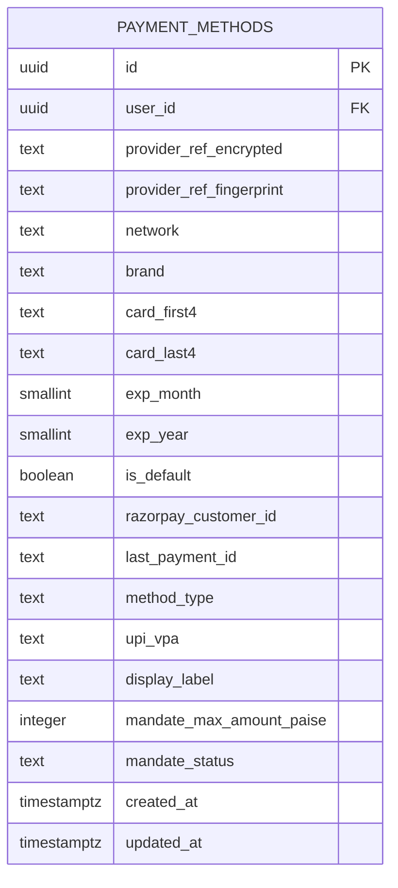

图表来源
- [地址与支付方式迁移:100-162](file://supabase/migrations/20260725143000_billing_addresses_payment_methods.sql#L100-L162)
- [UPI 与授权指令迁移:1-31](file://supabase/migrations/20260725180000_payment_methods_upi_and_mandate.sql#L1-L31)

章节来源
- [地址与支付方式迁移:100-162](file://supabase/migrations/20260725143000_billing_addresses_payment_methods.sql#L100-L162)
- [UPI 与授权指令迁移:1-31](file://supabase/migrations/20260725180000_payment_methods_upi_and_mandate.sql#L1-L31)

## 系统架构总览
计费支付整体流程分为三条主线：
1. 结账创建与 Razorpay 下单。
2. 支付完成后的签名校验与订单履约。
3. Webhook 异步事件处理、发票生成与附件归档。

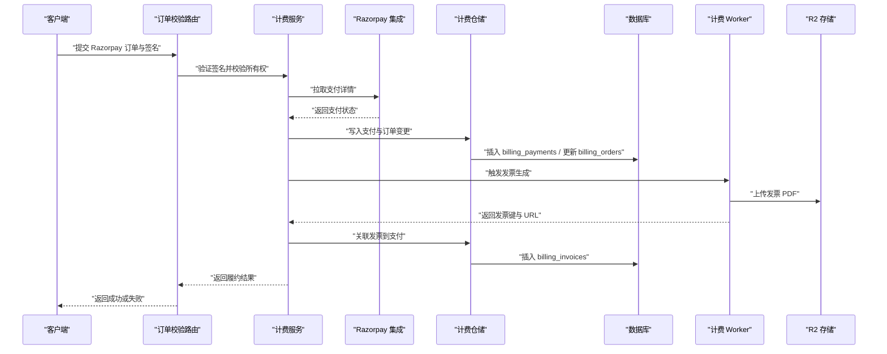

图表来源
- [订单校验路由:1-90](file://src/app/api/v1/billing/orders/verify/route.ts#L1-L90)
- [计费服务:1-200](file://src/server/services/billing.service.ts#L1-L200)
- [Razorpay 集成实现:1-200](file://src/server/billing/razorpay.ts#L1-L200)
- [计费仓储:140-220](file://src/server/repositories/billing.repository.ts#L140-L220)

## 详细组件分析

### 订单状态机
订单状态字段 `status` 受数据库约束，合法值为：
- `created`：订单已创建但未尝试支付。
- `attempted`：已发起支付尝试。
- `fulfilled`：支付成功并完成履约。
- `failed`：支付失败。

状态转移由计费服务与仓储在支付成功或失败时驱动。订单上的 `razorpay_status` 保留第三方支付平台状态快照，而 `razorpay_payment_id` 用于关联已捕获支付。

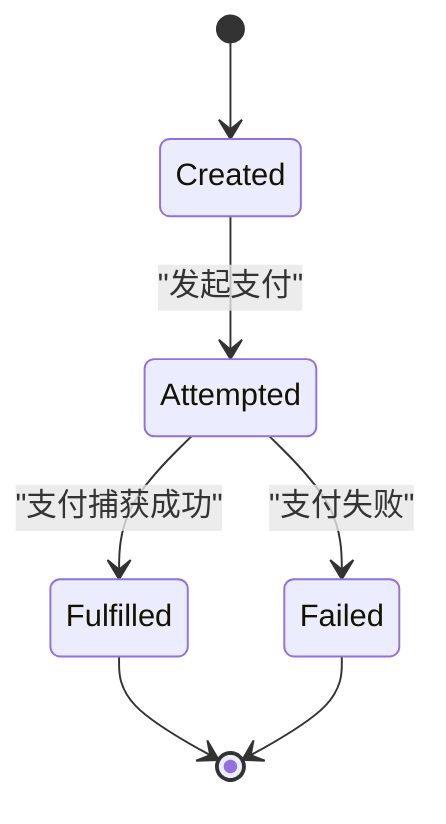

图表来源
- [核心数据库迁移:137-174](file://supabase/migrations/20260506160000_core_backend.sql#L137-L174)

章节来源
- [核心数据库迁移:137-174](file://supabase/migrations/20260506160000_core_backend.sql#L137-L174)

### Razorpay 集成与 UPI 支付
Razorpay 集成模块负责：
- 判断是否配置 Razorpay（优先使用 Cloudflare 计费 Worker，回退到环境变量）。
- 构造 Authorization 头。
- 统一封装 Razorpay REST 调用，优先走 Worker 路径，失败时按策略回退或直接调用。
- 支持的 Razorpay 端点映射包括订单创建、UPI 二维码、客户令牌、支付创建、OTP 提交与重发、支付查询与卡片信息、QR 关闭等。
- 提供 HMAC 安全比较函数，避免时序攻击。

UPI 支付通过 QR 或支付链接进行，计费仓储通过订单元数据中的 `upiQrId` 查找订单，从而将外部支付结果映射到内部订单。

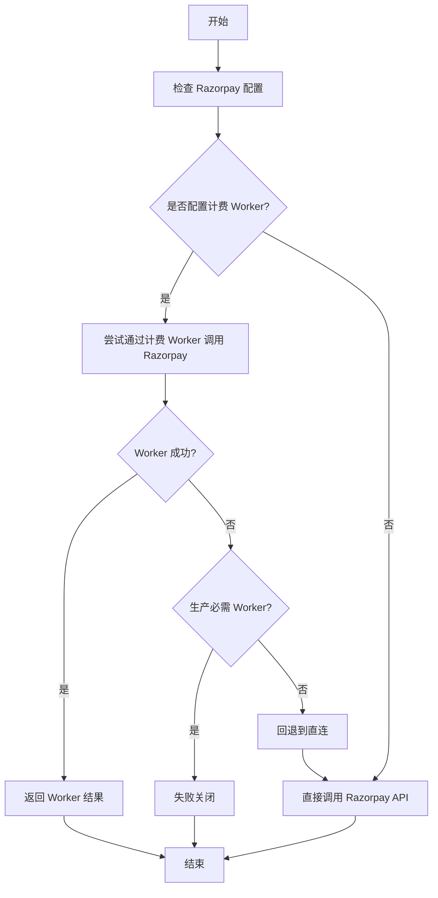

图表来源
- [Razorpay 集成实现:1-200](file://src/server/billing/razorpay.ts#L1-L200)
- [计费仓储:60-120](file://src/server/repositories/billing.repository.ts#L60-L120)

章节来源
- [Razorpay 集成实现:1-200](file://src/server/billing/razorpay.ts#L1-L200)
- [计费仓储:60-120](file://src/server/repositories/billing.repository.ts#L60-L120)

### 支付签名校验与回调
两种支付确认路径：
- 浏览器回调：Razorpay Custom Checkout 完成后 POST 到 `/api/v1/billing/orders/razorpay-callback`，校验身份后调用计费服务验证签名并履约。
- 服务端校验：`/api/v1/billing/orders/verify` 接收 JSON 参数，校验 Razorpay 订单号、支付号与签名，检查订单归属，然后调用计费服务。

两者均严格校验 Razorpay ID 格式与签名格式，防止注入与越权。

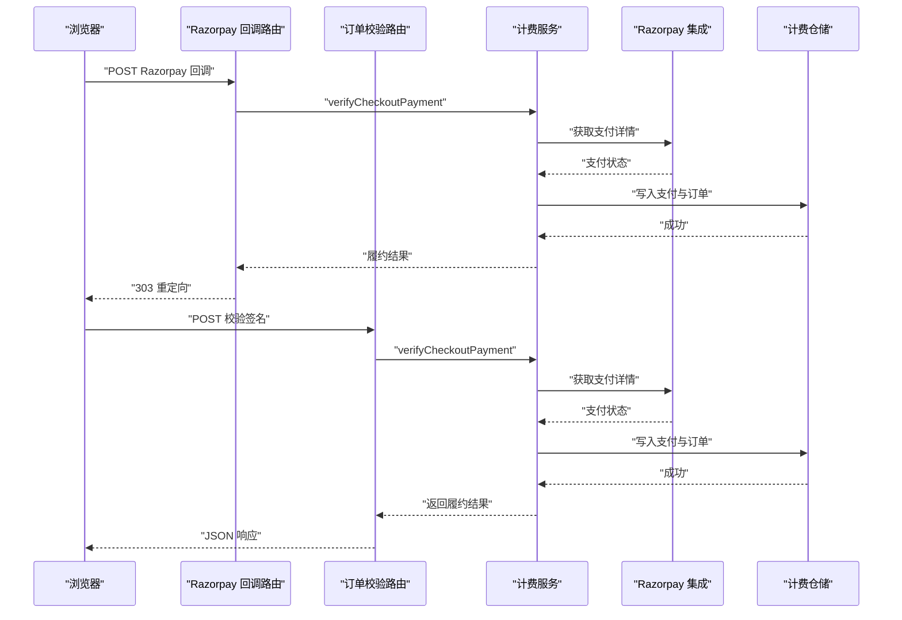

图表来源
- [Razorpay 回调路由:1-111](file://src/app/api/v1/billing/orders/razorpay-callback/route.ts#L1-L111)
- [订单校验路由:1-90](file://src/app/api/v1/billing/orders/verify/route.ts#L1-L90)
- [计费服务:1-200](file://src/server/services/billing.service.ts#L1-L200)

章节来源
- [Razorpay 回调路由:1-111](file://src/app/api/v1/billing/orders/razorpay-callback/route.ts#L1-L111)
- [订单校验路由:1-90](file://src/app/api/v1/billing/orders/verify/route.ts#L1-L90)

### Webhook 事件处理与幂等性
Razorpay Webhook 入口：
- 限制请求体大小，防止拒绝服务。
- 校验 `x-razorpay-signature`，签名无效返回未授权。
- 解析事件载荷，调用计费服务处理。
- 计费服务负责幂等写入 `razorpay_webhook_events`，并驱动订单与支付状态同步。

幂等性关键点：
- `razorpay_webhook_events.event_id` 唯一，避免重复处理同一事件。
- `billing_payments.id` 作为支付幂等键，重复支付 ID 短路履约。
- `billing_invoices.payment_id` 唯一，确保每笔支付只生成一张发票。

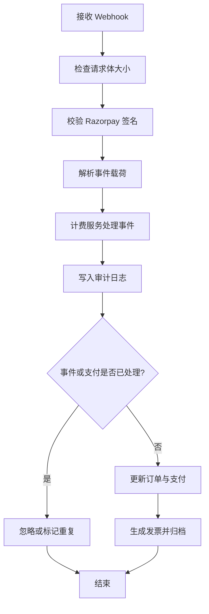

图表来源
- [Razorpay Webhook 路由:1-70](file://src/app/api/v1/webhooks/razorpay/route.ts#L1-L70)
- [核心数据库迁移:198-215](file://supabase/migrations/20260506160000_core_backend.sql#L198-L215)
- [发票表迁移:1-58](file://supabase/migrations/20260910120000_billing_invoices.sql#L1-L58)

章节来源
- [Razorpay Webhook 路由:1-70](file://src/app/api/v1/webhooks/razorpay/route.ts#L1-L70)
- [核心数据库迁移:198-215](file://supabase/migrations/20260506160000_core_backend.sql#L198-L215)
- [发票表迁移:1-58](file://supabase/migrations/20260910120000_billing_invoices.sql#L1-L58)

### 发票生成与税务证据
发票构建器从已履约订单与支付中提取：
- 发票编号、支付 ID、订单 ID、用户 ID、发行时间、下次计费时间。
- 币种、状态、购买方名称与邮箱、地址与 GSTIN。
- 订阅项、座位明细、子总额、税费、总金额。
- 支付方式与 Razorpay 支付 ID。

发票类型为国内 GST、出口 LUT 或豁免 GSTIN，并在 `billing_invoices.evidence` 中保留位置证据快照，用于税务决策审计。

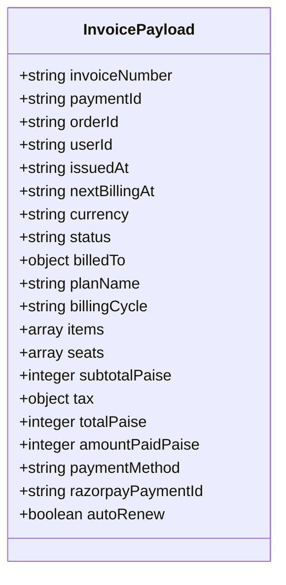

图表来源
- [发票构建逻辑:1-200](file://src/server/billing/invoice.ts#L1-L200)
- [发票表迁移:1-58](file://supabase/migrations/20260910120000_billing_invoices.sql#L1-L58)

章节来源
- [发票构建逻辑:1-200](file://src/server/billing/invoice.ts#L1-L200)
- [发票表迁移:1-58](file://supabase/migrations/20260910120000_billing_invoices.sql#L1-L58)

### 结账会话与金额防护
结账会话工具生成带签名的会话令牌，包含用户 ID、计划、周期、币种、国家、座位信息等，有效期 6 小时。会话校验区分“无效”与“过期”，并在需要时重新签发。

计费服务对 checkout 子总额设置最大限额，防止篡改或异常金额进入支付流程。

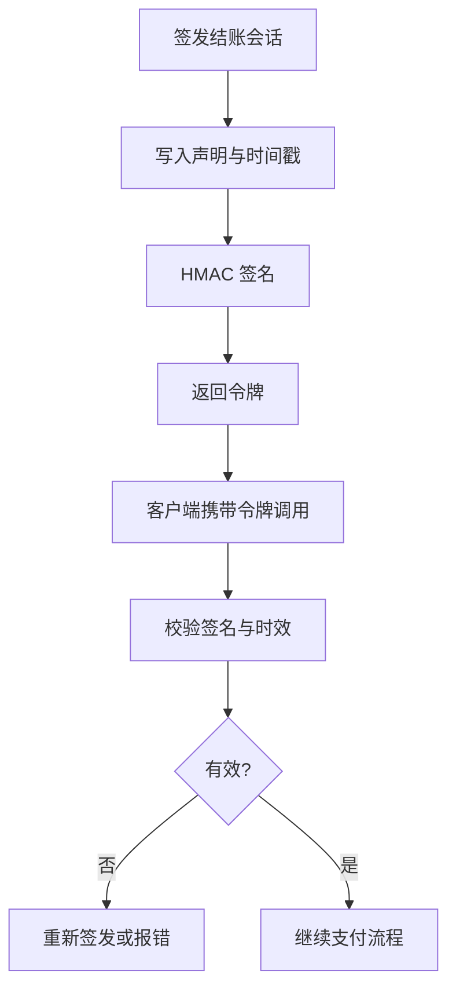

图表来源
- [结账会话工具:1-200](file://src/server/billing/checkout-session.ts#L1-L200)
- [计费服务:1-200](file://src/server/services/billing.service.ts#L1-L200)

章节来源
- [结账会话工具:1-200](file://src/server/billing/checkout-session.ts#L1-L200)
- [计费服务:1-200](file://src/server/services/billing.service.ts#L1-L200)

### 退款处理的数据结构现状
当前数据模型中未发现显式的退款表或退款状态字段。支付与订单表主要描述创建、尝试、成功、失败以及支付捕获时间。因此：
- 退款不是现有数据模型的内置功能。
- 如需支持退款，应在 `billing_payments` 上增加退款金额、退款状态、退款 ID 等字段，或在独立 `refunds` 表中建模。
- 现有 `razorpay_webhook_events.status` 可用于审计第三方退款事件，但尚无专用退款领域模型。

章节来源
- [核心数据库迁移:137-215](file://supabase/migrations/20260506160000_core_backend.sql#L137-L215)

## 依赖关系分析
计费支付的关键依赖如下：
- API 路由依赖会话与会话校验，确保用户身份与订单归属。
- 计费服务依赖 Razorpay 集成、发票构建器、仓储与计费 Worker。
- 仓储依赖数据库连接池，执行参数化 SQL。
- 发票 PDF 由 Cloudflare 计费 Worker 生成并上传至 R2。
- Webhook 审计表无行级安全，仅由安全定义的履约流程写入。

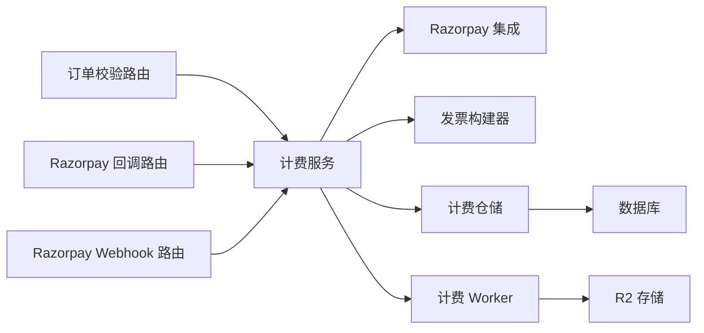

图表来源
- [订单校验路由:1-90](file://src/app/api/v1/billing/orders/verify/route.ts#L1-L90)
- [Razorpay 回调路由:1-111](file://src/app/api/v1/billing/orders/razorpay-callback/route.ts#L1-L111)
- [Razorpay Webhook 路由:1-70](file://src/app/api/v1/webhooks/razorpay/route.ts#L1-L70)
- [计费服务:1-200](file://src/server/services/billing.service.ts#L1-L200)
- [计费仓储:1-220](file://src/server/repositories/billing.repository.ts#L1-L220)

章节来源
- [订单校验路由:1-90](file://src/app/api/v1/billing/orders/verify/route.ts#L1-L90)
- [Razorpay 回调路由:1-111](file://src/app/api/v1/billing/orders/razorpay-callback/route.ts#L1-L111)
- [Razorpay Webhook 路由:1-70](file://src/app/api/v1/webhooks/razorpay/route.ts#L1-L70)
- [计费服务:1-200](file://src/server/services/billing.service.ts#L1-L200)
- [计费仓储:1-220](file://src/server/repositories/billing.repository.ts#L1-L220)

## 性能与索引
关键索引设计：
- `billing_addresses`：按用户 ID 建索引，默认地址唯一索引。
- `payment_methods`：按用户 ID 建索引，默认支付方式唯一索引，提供方引用指纹唯一。
- `billing_invoices`：用户 ID 与创建时间倒序索引、订单 ID 索引、发票编号索引。
- `razorpay_webhook_events`：按状态、接收时间与 ID 建复合索引，提升对账查询效率。

这些索引支持高频查询场景：
- 用户查看发票列表。
- 通过 Razorpay 订单号或支付号快速定位记录。
- Webhook 审计批量处理与重试。

章节来源
- [地址与支付方式迁移:1-162](file://supabase/migrations/20260725143000_billing_addresses_payment_methods.sql#L1-L162)
- [发票表迁移:1-58](file://supabase/migrations/20260910120000_billing_invoices.sql#L1-L58)
- [核心数据库迁移:211-212](file://supabase/migrations/20260508100000_supabase_extreme_performance_hardening.sql#L211-L212)

## 安全与一致性
支付安全关键点：
- Razorpay 签名校验：HMAC 比较使用安全比较函数，避免时序攻击。
- Webhook 签名校验：入口校验 `x-razorpay-signature`，非法签名直接拒绝。
- 结账会话签名：使用 HMAC 签名并校验有效期，防止篡改与过期滥用。
- PCI 安全：支付方式表不存储完整 PAN，只存加密引用与首尾四位。
- 行级安全：地址与支付方式表对用户数据隔离；Webhook 审计表无 RLS，但仅限安全流程写入。
- 输入校验：订单号、支付号、签名格式正则校验；金额正整数与非负校验；URL 返回路径白名单校验。
- 审计与幂等：Webhook 事件唯一、支付 ID 幂等、发票支付 ID 唯一。

数据一致性建议：
- 将订单状态更新、支付写入、发票生成放在数据库事务或可靠的序列操作中。
- 对重复事件与重复支付采用“先查后写”或唯一约束短路。
- 对发票生成失败进行补偿与重试，并通过审计表记录失败原因。

章节来源
- [Razorpay 集成实现:1-200](file://src/server/billing/razorpay.ts#L1-L200)
- [Razorpay Webhook 路由:1-70](file://src/app/api/v1/webhooks/razorpay/route.ts#L1-L70)
- [结账会话工具:1-200](file://src/server/billing/checkout-session.ts#L1-L200)
- [地址与支付方式迁移:1-162](file://supabase/migrations/20260725143000_billing_addresses_payment_methods.sql#L1-L162)
- [核心数据库迁移:198-215](file://supabase/migrations/20260506160000_core_backend.sql#L198-L215)

## 故障排查指南
常见问题与定位步骤：
- Webhook 签名无效：检查入口是否读取 `x-razorpay-signature`，并使用相同密钥与算法计算 HMAC。
- 重复事件导致状态不一致：检查 `razorpay_webhook_events.event_id` 是否唯一，确认处理逻辑是否短路重复。
- 支付重复入账：检查 `billing_payments.id` 唯一约束与短路逻辑。
- 发票重复生成：检查 `billing_invoices.payment_id` 唯一约束。
- 订单归属错误：校验路由需确认 `razorpay_order_id` 所属用户与当前会话一致。
- UPI 支付无法关联订单：检查订单元数据中是否存在 `upiQrId`，仓储是否能按该 ID 查询到订单。
- 发票 PDF 缺失：检查计费 Worker 是否成功上传 R2，并更新 `billing_invoices.r2_key` 与 `r2_url`。

章节来源
- [Razorpay Webhook 路由:1-70](file://src/app/api/v1/webhooks/razorpay/route.ts#L1-L70)
- [订单校验路由:1-90](file://src/app/api/v1/billing/orders/verify/route.ts#L1-L90)
- [计费仓储:60-220](file://src/server/repositories/billing.repository.ts#L60-L220)
- [发票表迁移:1-58](file://supabase/migrations/20260910120000_billing_invoices.sql#L1-L58)

## 结论
该计费支付模型围绕 Razorpay 集成构建了清晰的订单、支付、发票与审计数据基础：
- `billing_orders` 定义订单生命周期与状态机。
- `billing_payments` 记录支付结果并提供幂等保障。
- `razorpay_webhook_events` 提供事件审计与对账支撑。
- `billing_invoices` 将支付与发票绑定，PDF 存储在 R2。
- `billing_addresses` 与 `payment_methods` 分别解决计费地址与令牌化支付方式的安全存储。
- UPI 与授权指令通过支付方式扩展字段与订单元数据协同表达。
- 签名校验、会话保护、行级安全与唯一约束共同构成支付安全与一致性基础。

若后续需要扩展退款、分期、多币种汇率对冲、用量计量与按量计费，可在现有模型基础上引入退款表、用量事件表与账单计算表，并保持幂等、审计与安全原则。