# 订单管理模型

<cite>
**本文引用的文件**   
- [核心后端迁移](file://supabase/migrations/20260506160000_core_backend.sql)
- [计费与礼物加固迁移](file://supabase/migrations/20260507183000_billing_gifts_hardening.sql)
- [性能加固与索引迁移](file://supabase/migrations/20260508100000_supabase_extreme_performance_hardening.sql)
- [礼物购买生产迁移](file://supabase/migrations/20260930000000_gift_checkout_production.sql)
- [Razorpay 集成层](file://src/server/billing/razorpay.ts)
- [创建订单接口](file://src/app/api/v1/billing/orders/route.ts)
- [Razorpay 回调接口](file://src/app/api/v1/billing/orders/razorpay-callback/route.ts)
- [支付校验接口](file://src/app/api/v1/billing/orders/verify/route.ts)
- [计费服务](file://src/server/services/billing.service.ts)
- [计费仓库](file://src/server/repositories/billing.repository.ts)
</cite>

## 目录

1. [引言](#引言)
2. [项目结构与职责边界](#项目结构与职责边界)
3. [数据模型总览](#数据模型总览)
4. [字段设计意图](#字段设计意图)
5. [订单生命周期与状态机](#订单生命周期与状态机)
6. [幂等性与并发安全](#幂等性与并发安全)
7. [金额、税费与货币支持](#金额税费与货币支持)
8. [与 Razorpay Order API 的映射关系](#与-razorpay-order-api-的映射关系)
9. [订单创建、支付回调与履约完成的数据流](#订单创建支付回调与履约完成的数据流)
10. [查询优化与索引设计](#查询优化与索引设计)
11. [行级安全策略](#行级安全策略)
12. [错误处理与故障恢复](#错误处理与故障恢复)
13. [重试策略与超时处理](#重试策略与超时处理)
14. [架构总图](#架构总图)
15. [结论与建议](#结论与建议)

## 引言

本文件面向计费系统的数据库与业务实现，重点解释 `billing_orders` 表的设计意图、订单状态机、幂等性机制、Razorpay 映射关系、金额与税费计算、货币支持（INR/USD）、查询优化、索引结构、行级安全策略，以及“创建订单 → 支付回调 → 履约完成”的完整数据流。

从系统角度看，`billing_orders` 不是单纯的“付款记录”，而是**结账前创建的结算订单**：它描述用户要购买的计划、订阅周期、应扣金额、税费、赠送 token 数量以及与 Razorpay 的外部订单关联。真正的支付捕获结果由 `billing_payments` 承载，而订单本身通过 `fulfilled_at`、`razorpay_payment_id`、`razorpay_status` 和状态字段反映最终履约结果。

**章节来源**
- [核心后端迁移:137-172](file://supabase/migrations/20260506160000_core_backend.sql#L137-L172)

## 项目结构与职责边界

| 层级 | 主要文件 | 职责 |
|---|---|---|
| 数据库层 | `supabase/migrations/20260506160000_core_backend.sql` | 定义 `billing_orders`、`billing_payments`、触发器、RLS、`fulfill_billing_payment` |
| 数据库层 | `supabase/migrations/20260507183000_billing_gifts_hardening.sql` | 扩展 `order_kind`、`idempotency_key`、审计事件与唯一索引 |
| 数据库层 | `supabase/migrations/20260508100000_supabase_extreme_performance_hardening.sql` | 创建分区式部分索引、设置 fillfactor、维护统计信息 |
| 数据库层 | `supabase/migrations/20260930000000_gift_checkout_production.sql` | 允许礼物订单 `tokens=0` 并增加非负约束 |
| 网关集成层 | `src/server/billing/razorpay.ts` | Razorpay REST 调用、签名验证、Worker 转发、金额格式转换 |
| HTTP 入口层 | `src/app/api/v1/billing/orders/route.ts` | 创建订单、价格校验、位置判定、返回 Razorpay 参数 |
| HTTP 入口层 | `src/app/api/v1/billing/orders/razorpay-callback/route.ts` | 网银跳转回调、身份校验、签名校验、跳转回前端 |
| HTTP 入口层 | `src/app/api/v1/billing/orders/verify/route.ts` | 卡片/Express Pay 支付校验、所有权检查、调用履约逻辑 |
| 业务层 | `src/server/services/billing.service.ts` | 结账会话、订单创建、Webhook、签名校验、自动捕获、发票与礼物交付 |
| 数据访问层 | `src/server/repositories/billing.repository.ts` | 按 Razorpay ID、UPI QR ID、内部 ID 查询订单，合并 metadata，执行履约写入 |

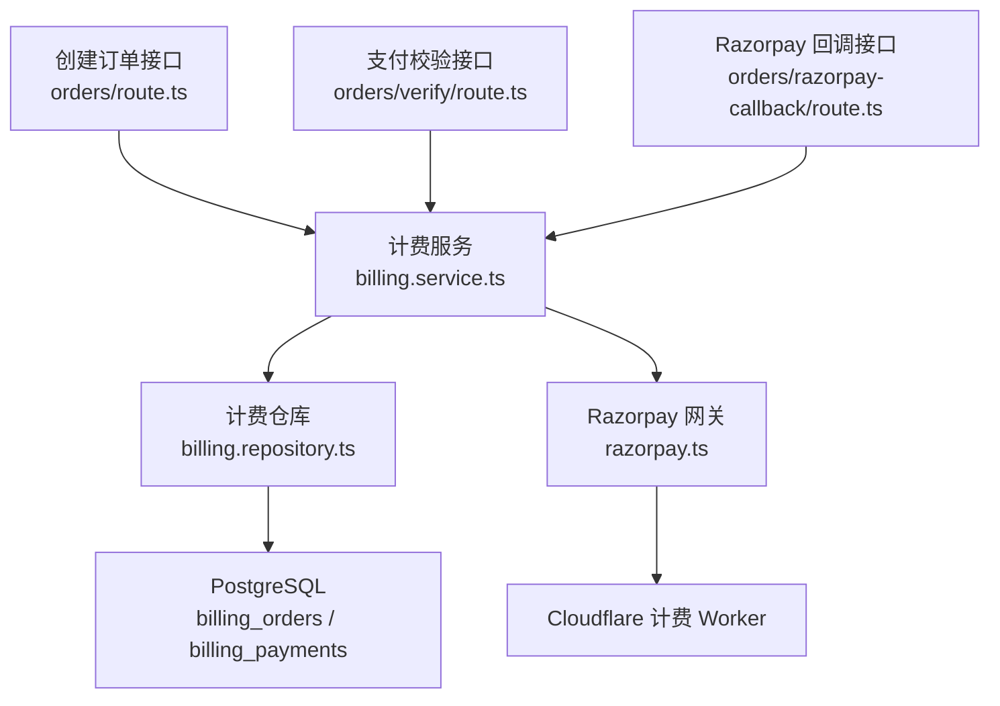

**图表来源**
- [创建订单接口:1-172](file://src/app/api/v1/billing/orders/route.ts#L1-L172)
- [支付校验接口:1-90](file://src/app/api/v1/billing/orders/verify/route.ts#L1-L90)
- [Razorpay 回调接口:1-111](file://src/app/api/v1/billing/orders/razorpay-callback/route.ts#L1-L111)
- [计费服务:748-950](file://src/server/services/billing.service.ts#L748-L950)
- [计费仓库:1-200](file://src/server/repositories/billing.repository.ts#L1-L200)

**章节来源**
- [创建订单接口:1-172](file://src/app/api/v1/billing/orders/route.ts#L1-L172)
- [支付校验接口:1-90](file://src/app/api/v1/billing/orders/verify/route.ts#L1-L90)
- [Razorpay 回调接口:1-111](file://src/app/api/v1/billing/orders/razorpay-callback/route.ts#L1-L111)
- [计费服务:748-950](file://src/server/services/billing.service.ts#L748-L950)
- [计费仓库:1-200](file://src/server/repositories/billing.repository.ts#L1-L200)

## 数据模型总览

`billing_orders` 的核心语义是：**用户在结账流程中确认的计费订单**。它不等同于某一次 Razorpay 支付，但通常与一个 Razorpay Order 绑定；当支付成功时，再写入 `billing_payments` 并将订单标记为已履约。

| 类别 | 字段 | 类型 | 是否必填 | 默认值或约束 | 设计含义 |
|---|---|---|---:|---|---|
| 主键 | `id` | text | 是 | 无 | 内部订单标识符，由应用生成 |
| 外部关联 | `razorpay_order_id` | text | 是 | 唯一 | 与 Razorpay Order API 的唯一映射键 |
| 外部关联 | `razorpay_payment_id` | text | 否 | 空 | 支付成功后填充，对应 `billing_payments.id` |
| 用户 | `user_id` | uuid | 是 | 外键到 `auth.users` | 订单归属用户 |
| 用户信息 | `user_email` | text | 否 | 空 | 下单时保存的用户邮箱快照 |
| 计划 | `plan_id` | text | 是 | 非空 | 购买计划的内部 ID |
| 计划名称 | `plan_name` | text | 是 | 非空 | 下单时计划名称快照，避免后续计划改名影响历史 |
| 周期 | `billing_cycle` | text | 是 | `'monthly'` 或 `'yearly'` | 月度或年度订阅 |
| 版本上限 | `max_tier` | text | 否 | 空 | 计划版本上限，用于 Express Pay 或组织版定价 |
| 状态 | `status` | text | 是 | `'created'` | 订单生命周期状态 |
| 货币 | `currency` | text | 是 | `'INR'` | 账单记账货币 |
| 小计 | `subtotal_paise` | integer | 是 | `> 0` | 税前金额，单位为 INR paise 或 USD cents |
| 税费 | `tax_paise` | integer | 是 | `≥ 0` | GST 或其他税费 |
| 总金额 | `amount_paise` | integer | 是 | `> 0` | 税前加税后总金额 |
| Token | `tokens` | integer | 是 | `> 0` | 履约后发放给用户的 token 包；礼物订单可放宽为 `≥ 0` |
| 收据 | `receipt` | text | 是 | 非空 | 内部收据编号，也用作 Razorpay receipt |
| 外部状态 | `razorpay_status` | text | 是 | 非空 | Razorpay 侧订单或支付状态快照 |
| 元数据 | `metadata` | jsonb | 是 | `{}` | 账单详情、位置证据、税费标签、渠道、UPI QR ID、座位拆分等 |
| 时间戳 | `paid_at` | timestamptz | 否 | 空 | 支付入账时间 |
| 时间戳 | `fulfilled_at` | timestamptz | 否 | 空 | 履约完成时间 |
| 时间戳 | `created_at` | timestamptz | 是 | `now()` | 订单创建时间 |
| 时间戳 | `updated_at` | timestamptz | 是 | `now()` | 最后更新时间，由触发器维护 |

此外，后续迁移引入了以下扩展字段：

| 字段 | 用途 |
|---|---|
| `order_kind` | 区分普通订阅、礼物购买等订单类型 |
| `gift_id` | 礼物订单关联的礼物 ID |
| `workspace_id` | 工作区维度关联 |
| `idempotency_key` | 幂等键，配合唯一索引防止重复履约 |

**章节来源**
- [核心后端迁移:137-172](file://supabase/migrations/20260506160000_core_backend.sql#L137-L172)
- [计费与礼物加固迁移:62-68](file://supabase/migrations/20260507183000_billing_gifts_hardening.sql#L62-L68)
- [计费与礼物加固迁移:112-151](file://supabase/migrations/20260507183000_billing_gifts_hardening.sql#L112-L151)
- [计费与礼物加固迁移:170-176](file://supabase/migrations/20260507183000_billing_gifts_hardening.sql#L170-L176)
- [计费与礼物加固迁移:345-380](file://supabase/migrations/20260507183000_billing_gifts_hardening.sql#L345-L380)
- [计费与礼物加固迁移:517-522](file://supabase/migrations/20260507183000_billing_gifts_hardening.sql#L517-L522)
- [礼物购买生产迁移:4-59](file://supabase/migrations/20260930000000_gift_checkout_production.sql#L4-L59)

## 字段设计意图

### `razorpay_order_id` 与 `razorpay_payment_id`

`razorpay_order_id` 是订单与 Razorpay 订单的锚点。所有外部支付回调、查询、履约都优先通过这个字段定位本地订单。`razorpay_payment_id` 则在支付成功后写入，表示该订单对应的 Razorpay Payment。

这种设计允许一个订单存在多个支付尝试，但最终只有一个成功的 `razorpay_payment_id`。失败或取消的支付不会覆盖已成功履约的记录。

### `status` 状态机

状态机定义为：

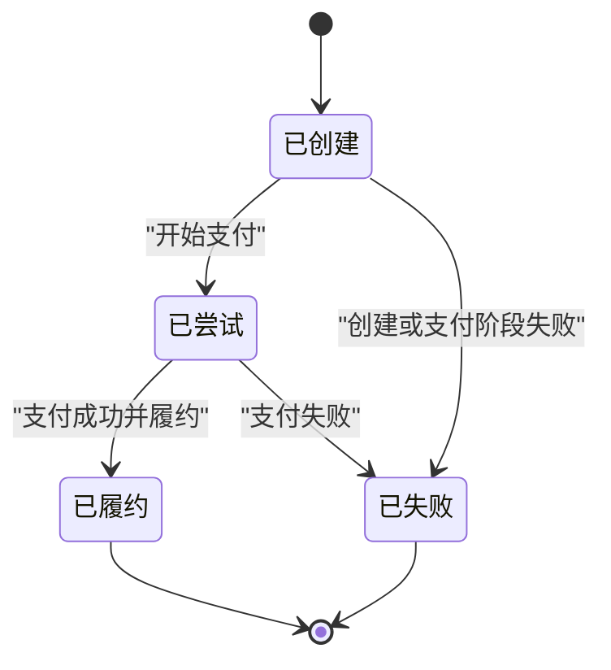

| 状态 | 含义 | 典型转换 |
|---|---|---|
| `created` | 订单已创建，尚未进入支付流程 | 初始状态 |
| `attempted` | 已开始支付，等待支付结果 | 用户打开 Razorpay 收银台、发起 UPI QR、提交表单 |
| `fulfilled` | 支付已捕获并完成履约 | 校验签名、匹配金额、写入 `billing_payments`、发放 token |
| `failed` | 支付失败或无法继续 | 签名无效、金额不一致、支付未捕获、权限校验失败 |

注释明确说明状态流转为：`created → attempted → fulfilled | failed`，并且履约时会设置 `paid_at` 与 `fulfilled_at`。

### `plan_id` 与 `plan_name`

`plan_id` 用于业务逻辑查询计划配置；`plan_name` 是下单时的名称快照。这样即使计划后续改名，历史订单仍可显示当时购买时的名称。

### `billing_cycle`

取值被限制为 `monthly` 或 `yearly`。它决定订阅周期、年付折扣、发票期间等下游逻辑。

### `max_tier`

用于表达计划版本上限，常见于组织版、企业版或 Express Pay 场景中的最大可用套餐层级。它为同一 `plan_id` 提供细粒度定价能力。

### `amount_paise`、`subtotal_paise`、`tax_paise`

三个金额字段构成清晰的会计关系：

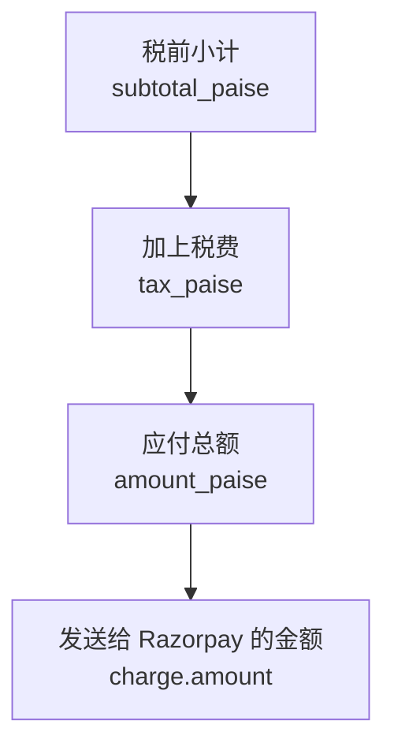

- `subtotal_paise` 是基础计划费用。
- `tax_paise` 是根据计费国家、GSTIN 和货币计算的税费。
- `amount_paise` 是用户侧应付总额。
- 实际发给 Razorpay 的金额可能因货币换算而不同，例如 INR 使用 paise，USD 使用 cents。

**图表来源**
- [计费服务:748-950](file://src/server/services/billing.service.ts#L748-L950)
- [计费服务:1120-1350](file://src/server/services/billing.service.ts#L1120-L1350)

**章节来源**
- [核心后端迁移:137-172](file://supabase/migrations/20260506160000_core_backend.sql#L137-L172)
- [计费服务:748-950](file://src/server/services/billing.service.ts#L748-L950)

## 订单生命周期与状态机

订单的生命周期分为四个关键阶段：

1. **创建订单**  
   客户端携带 `checkoutSessionId` 请求创建订单。服务端校验会话、计划、用户身份、位置、税费和金额，然后创建 Razorpay Order，并插入 `billing_orders`。此时状态为 `created`。

2. **尝试支付**  
   前端根据返回的 Razorpay 参数发起支付。服务端通常将状态更新为 `attempted`，表示支付通道已被调用。

3. **履约完成**  
   支付回调或主动校验接口完成签名验证、金额校验、货币校验、支付状态检查后，调用履约逻辑：写入 `billing_payments`、发放 token、设置 `razorpay_payment_id`、`razorpay_status`、`paid_at`、`fulfilled_at`，并将状态改为 `fulfilled`。

4. **失败**  
   如果签名无效、支付不属于当前订单、金额不一致、支付未捕获、用户无权操作，则订单保持或转为 `failed`。

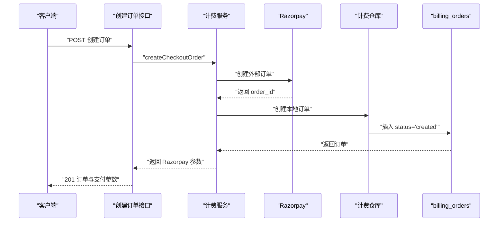

**图表来源**
- [创建订单接口:1-172](file://src/app/api/v1/billing/orders/route.ts#L1-L172)
- [计费服务:748-950](file://src/server/services/billing.service.ts#L748-L950)
- [计费仓库:1-200](file://src/server/repositories/billing.repository.ts#L1-L200)

**章节来源**
- [核心后端迁移:137-172](file://supabase/migrations/20260506160000_core_backend.sql#L137-L172)
- [创建订单接口:1-172](file://src/app/api/v1/billing/orders/route.ts#L1-L172)
- [计费服务:748-950](file://src/server/services/billing.service.ts#L748-L950)

## 幂等性与并发安全

幂等性在本系统中通过多层机制保证：

| 层级 | 机制 | 作用 |
|---|---|---|
| 应用层 | 校验 Razorpay 支付 ID、订单 ID、签名 | 拒绝伪造或过期回调 |
| 应用层 | 校验支付属于当前订单、金额与货币一致 | 防止跨订单篡改 |
| 数据库层 | `razorpay_order_id` 唯一约束 | 防止重复外部订单映射 |
| 数据库层 | `billing_orders.user_id + idempotency_key` 唯一索引 | 对带幂等键的订单创建做去重 |
| 数据库层 | `fulfill_billing_payment` 先锁行再判断 | 防止并发重复履约 |
| 数据库层 | 检查 `billing_payments` 是否存在、token 交易 ID 是否存在、订单是否已履约 | 多重幂等短路 |

`fulfill_billing_payment` 的实现顺序是：

1. 用 `SELECT ... FOR UPDATE` 锁定订单行。
2. 构造事务级 token credit 事务 ID。
3. 如果支付已存在、token 交易已存在或订单已是 `fulfilled`，直接返回 `already_fulfilled`。
4. 否则发放 token、写入 `billing_payments`、更新订单状态。

这保证了即使 Razorpay 重复推送 webhook，或前端重复提交 verify，也不会重复发放 token 或重复写入支付记录。

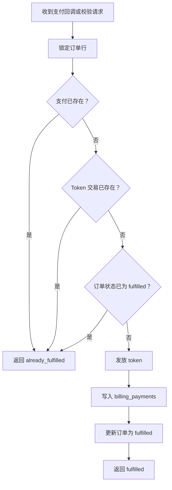

**图表来源**
- [核心后端迁移:520-666](file://supabase/migrations/20260506160000_core_backend.sql#L520-L666)
- [计费与礼物加固迁移:388-404](file://supabase/migrations/20260507183000_billing_gifts_hardening.sql#L388-L404)

**章节来源**
- [核心后端迁移:520-666](file://supabase/migrations/20260506160000_core_backend.sql#L520-L666)
- [计费与礼物加固迁移:170-176](file://supabase/migrations/20260507183000_billing_gifts_hardening.sql#L170-L176)
- [计费与礼物加固迁移:388-404](file://supabase/migrations/20260507183000_billing_gifts_hardening.sql#L388-L404)

## 金额、税费与货币支持

### 金额单位

系统使用整数金额以避免浮点误差：

- INR：单位为 paise，1 INR = 100 paise。
- USD：单位为 cents，1 USD = 100 cents。
- Razorpay 金额字段称为 `amountMinor`，由 `toRazorpayChargeAmount` 转换为目标货币的最小单位。

### 税费逻辑

税费计算依赖三个输入：

1. `subtotal_paise`：计划小计。
2. `billingDetails`：包含国家代码、GSTIN 等。
3. `effectiveCountry`：经 IP 地址、会话声明国家和客户端声明国家综合判定的有效国家。

规则摘要：

- 印度 → INR + GST。
- 其他国家 → USD，通常为零税率。
- 税费标签可能为 “Tax (18% GST)” 或为空。
- `gstExempt` 标记是否免征 GST。

### 货币支持

| 区域 | 货币 | 说明 |
|---|---|---|
| 印度 | INR | 支持 UPI、银行卡、网银等支付方式 |
| 非印度 | USD | 通常零税，使用国际卡或 Razorpay 支持的国际化支付方式 |

UPL 仅支持 INR；其他货币走通用 Razorpay 支付流程。

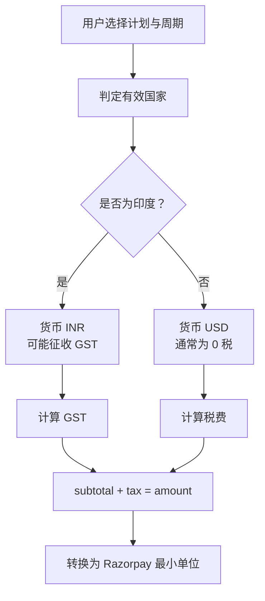

**图表来源**
- [创建订单接口:1-172](file://src/app/api/v1/billing/orders/route.ts#L1-L172)
- [计费服务:748-950](file://src/server/services/billing.service.ts#L748-L950)

**章节来源**
- [计费服务:748-950](file://src/server/services/billing.service.ts#L748-L950)
- [创建订单接口:1-172](file://src/app/api/v1/billing/orders/route.ts#L1-L172)

## 与 Razorpay Order API 的映射关系

| 本地字段 | Razorpay 映射 | 说明 |
|---|---|---|
| `razorpay_order_id` | Order `id` | 外部订单 ID，作为本地主外键锚点 |
| `razorpay_payment_id` | Payment `id` | 支付成功后回填 |
| `razorpay_status` | Order/Payment `status` | 状态快照，便于报表和排查 |
| `amount_paise` | 内部记账金额 | 不一定等于 Razorpay `amount`，因为可能存在货币换算 |
| `currency` | Razorpay `currency` | 与订单创建时使用的货币一致 |
| `receipt` | Razorpay `receipt` | 内部收据编号，也可用于发票关联 |
| `metadata` | Razorpay Order/Payment `notes` | 存储 plan_id、user_id、gstin、location 等证据 |

Razorpay 调用路径有两种：

1. **Cloudflare Billing Worker**：生产环境首选，密钥保存在 Cloudflare，Vercel 不持有密钥。
2. **Vercel 直连 Razorpay**：开发环境或未配置 Worker 时回退。

Worker 路由映射包括 `/v1/orders`、`/v1/payments/*`、`/v1/customers/*`、QR 相关端点等。

**章节来源**
- [Razorpay 集成层:1-200](file://src/server/billing/razorpay.ts#L1-L200)
- [计费服务:748-950](file://src/server/services/billing.service.ts#L748-L950)

## 订单创建、支付回调与履约完成的数据流

### 创建订单

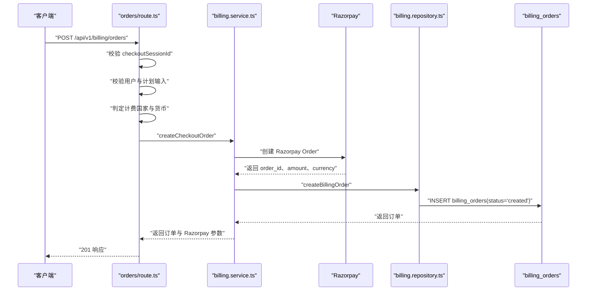

**图表来源**
- [创建订单接口:1-172](file://src/app/api/v1/billing/orders/route.ts#L1-L172)
- [计费服务:748-950](file://src/server/services/billing.service.ts#L748-L950)
- [计费仓库:1-200](file://src/server/repositories/billing.repository.ts#L1-L200)

### Razorpay 网银回调

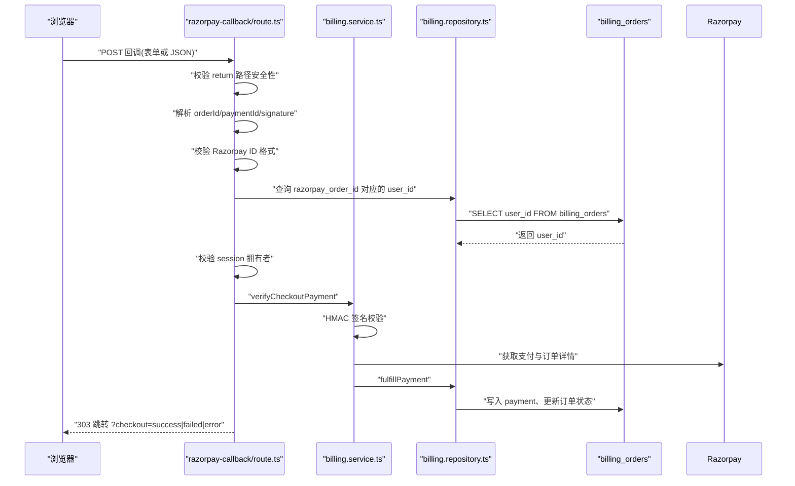

**图表来源**
- [Razorpay 回调接口:1-111](file://src/app/api/v1/billing/orders/razorpay-callback/route.ts#L1-L111)
- [计费服务:1120-1350](file://src/server/services/billing.service.ts#L1120-L1350)

### 支付校验与履约

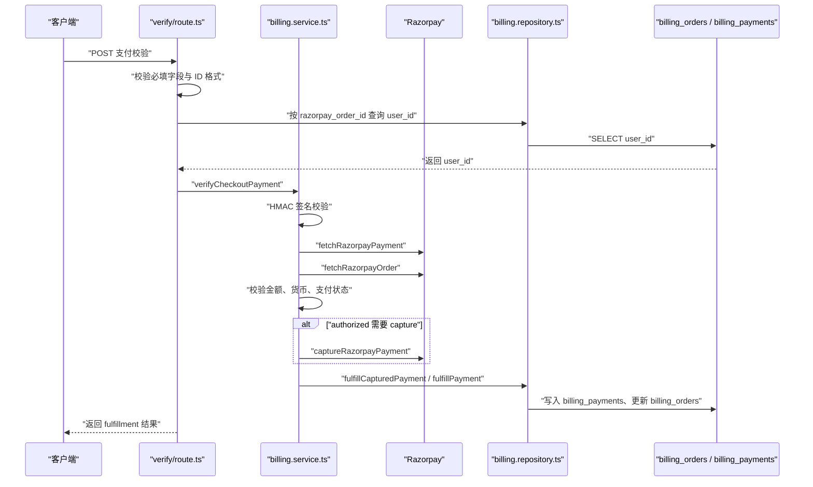

**图表来源**
- [支付校验接口:1-90](file://src/app/api/v1/billing/orders/verify/route.ts#L1-L90)
- [计费服务:1120-1350](file://src/server/services/billing.service.ts#L1120-L1350)
- [核心后端迁移:520-666](file://supabase/migrations/20260506160000_core_backend.sql#L520-L666)

**章节来源**
- [Razorpay 回调接口:1-111](file://src/app/api/v1/billing/orders/razorpay-callback/route.ts#L1-L111)
- [支付校验接口:1-90](file://src/app/api/v1/billing/orders/verify/route.ts#L1-L90)
- [计费服务:1120-1350](file://src/server/services/billing.service.ts#L1120-L1350)

## 查询优化与索引设计

### 主键与唯一索引

| 索引 | 列 | 目的 |
|---|---|---|
| 主键 | `id` | 内部订单快速查找 |
| 唯一索引 | `razorpay_order_id` | 防止重复外部订单映射 |
| 唯一条件索引 | `user_id + idempotency_key` | 对带幂等键的订单创建做去重 |

### 常用查询索引

| 索引名 | 列 | 过滤条件 | 用途 |
|---|---|---|---|
| `billing_orders_user_status_idx` | `user_id, status, created_at desc` | 多状态扫描 | 用户订单列表 |
| `billing_orders_open_user_created_idx` | `user_id, created_at desc, razorpay_order_id` | `status in ('created', 'attempted', 'failed')` | 开放订单列表 |
| `billing_orders_fulfilled_user_created_idx` | `user_id, created_at desc, razorpay_order_id` | `status = 'fulfilled'` | 已履约订单列表 |
| `billing_orders_workspace_id_fk_idx` | `workspace_id` | 工作区关联 | 工作区维度查询 |

### 表级优化

- `fillfactor = 90`：为频繁更新的 `updated_at`、`razorpay_payment_id`、`razorpay_status`、`status` 保留页内空间，减少写放大。
- `replica identity full`：确保变更流能拿到完整旧值与新值。
- 定期 `ANALYZE`：提升 PostgreSQL 查询规划质量。

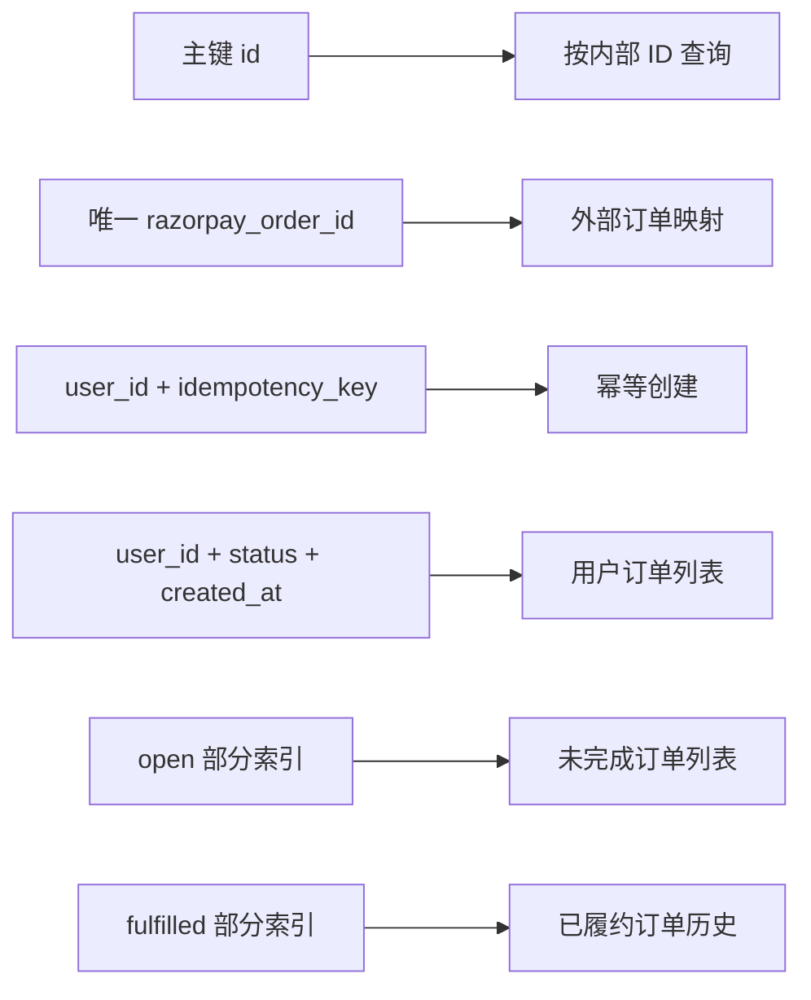

**图表来源**
- [计费与礼物加固迁移:170-176](file://supabase/migrations/20260507183000_billing_gifts_hardening.sql#L170-L176)
- [性能加固与索引迁移:215-221](file://supabase/migrations/20260508100000_supabase_extreme_performance_hardening.sql#L215-L221)

**章节来源**
- [计费与礼物加固迁移:170-176](file://supabase/migrations/20260507183000_billing_gifts_hardening.sql#L170-L176)
- [性能加固与索引迁移:215-221](file://supabase/migrations/20260508100000_supabase_extreme_performance_hardening.sql#L215-L221)

## 行级安全策略

`billing_orders` 启用了行级安全。基础策略允许认证用户读取自己的订单：

- 策略名称示例：`Users can read own billing orders`
- 条件：`user_id = auth.uid()`
- 角色：`authenticated`

这意味着：

1. 匿名用户不能直接通过 Supabase 客户端读取 `billing_orders`。
2. 认证用户只能看到自己拥有的订单。
3. 对外暴露的 API 仍需再做一层 ownership 校验，因为 Webhook 或服务端函数可能以更高权限运行。

在支付校验接口中，服务端额外执行：

```text
select user_id from public.billing_orders where razorpay_order_id = $1 limit 1
```

并校验返回的 `user_id` 是否与当前 session 一致，从而防御 IDOR 攻击。

**章节来源**
- [核心后端迁移:293-324](file://supabase/migrations/20260506160000_core_backend.sql#L293-L324)
- [支付校验接口:1-90](file://src/app/api/v1/billing/orders/verify/route.ts#L1-L90)
- [Razorpay 回调接口:1-111](file://src/app/api/v1/billing/orders/razorpay-callback/route.ts#L1-L111)

## 错误处理与故障恢复

### 输入校验错误

| 错误类型 | 触发条件 | 处理方式 |
|---|---|---|
| 缺少 `checkoutSessionId` | 创建订单请求缺少会话 ID | 返回 400 |
| 会话不匹配 | 会话所属用户与当前登录用户不一致 | 返回 403 |
| 计划不存在 | `planId` 查不到计划 | 返回 404 |
| 未知计划 | `PLAN_TOKEN_GRANTS` 中没有该计划 | 返回 400 |
| 金额非法 | 金额为非正整数或超过上限 | 返回 400 |
| Razorpay ID 格式非法 | `order_*`、`pay_*`、签名长度不符 | 返回 400 |
| 订单不属于当前用户 | ownership 校验失败 | 返回 404 |

### 支付校验错误

| 错误 | 含义 | 处理 |
|---|---|---|
| `invalid_signature` | HMAC 签名校验失败 | 拒绝履约 |
| `payment_order_mismatch` | Payment 不属于该 Order | 拒绝履约 |
| `amount_mismatch` | 支付金额与 Order 金额不一致 | 拒绝履约 |
| `currency_mismatch` | 货币不一致 | 拒绝履约 |
| `payment_not_captured` | 支付状态不是 captured | 拒绝履约 |

### 回调错误

Razorpay 回调接口对异常采取保守策略：

- 没有 session → 跳转到登录。
- 缺少 paymentId 或存在 errorDescription → 返回 `?checkout=failed`。
- ID 格式或签名格式非法 → 返回 `?checkout=error`。
- 其他异常 → 记录日志并返回 `?checkout=error`。

### 非阻塞副作用

发票生成、地理位置证据最终化、卡片存档等副作用采用“最佳努力”模式：失败时记录警告日志，不阻断主支付链路。

**章节来源**
- [支付校验接口:1-90](file://src/app/api/v1/billing/orders/verify/route.ts#L1-L90)
- [Razorpay 回调接口:1-111](file://src/app/api/v1/billing/orders/razorpay-callback/route.ts#L1-L111)
- [计费服务:1120-1350](file://src/server/services/billing.service.ts#L1120-L1350)

## 重试策略与超时处理

### 重试策略

系统对幂等性有强依赖，因此重试应基于“结果幂等”而非“请求幂等”：

1. **Razorpay webhook 重复推送**  
   由 `fulfill_billing_payment` 的 `already_fulfilled` 短路保护。

2. **前端重复提交 verify**  
   由支付 ID、token 交易 ID、订单状态三重检查保护。

3. **Worker 不可用**  
   若 Cloudflare Billing Worker 缺失密钥或返回 503，且 Vercel 配置了 Razorpay 密钥，则回退到直连 Razorpay。

4. **capture 竞态**  
   如果 capture 失败，服务会重新拉取支付状态；若仍不是 captured，则返回 `payment_not_captured`。

### 超时与降级

- Razorpay 调用失败统一包装为 `AppError`，并附带业务码如 `billing_unavailable`、`razorpay_error`。
- 生产环境中如果强制要求 Worker，Worker 异常不会被静默忽略。
- UPI QR 不可用时，系统可降级为 UPI 支付链接。
- 发票生成失败不会阻止订单履约。

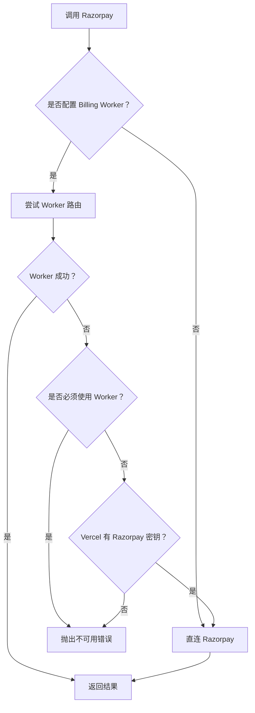

**图表来源**
- [Razorpay 集成层:1-200](file://src/server/billing/razorpay.ts#L1-L200)
- [计费服务:1120-1350](file://src/server/services/billing.service.ts#L1120-L1350)

**章节来源**
- [Razorpay 集成层:1-200](file://src/server/billing/razorpay.ts#L1-L200)
- [计费服务:748-950](file://src/server/services/billing.service.ts#L748-L950)
- [计费服务:1120-1350](file://src/server/services/billing.service.ts#L1120-L1350)

## 架构总图

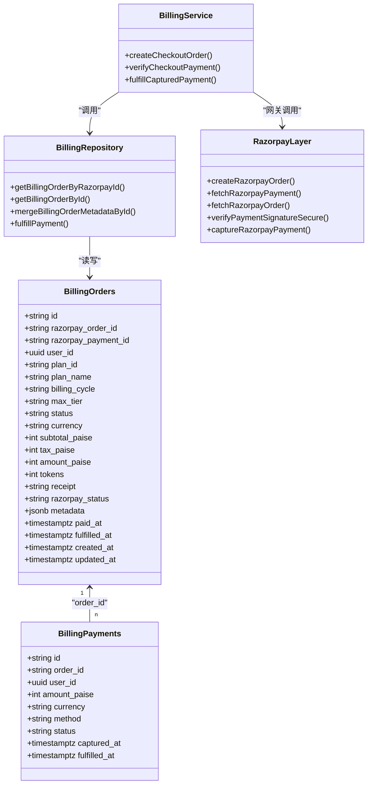

**图表来源**
- [核心后端迁移:137-187](file://supabase/migrations/20260506160000_core_backend.sql#L137-L187)
- [计费仓库:1-200](file://src/server/repositories/billing.repository.ts#L1-L200)
- [计费服务:748-950](file://src/server/services/billing.service.ts#L748-L950)
- [Razorpay 集成层:1-200](file://src/server/billing/razorpay.ts#L1-L200)

## 结论与建议

`billing_orders` 是一个围绕 Razorpay 外部订单构建的内部结算实体。它的关键价值在于：

1. **明确的订单生命周期**：`created → attempted → fulfilled | failed`。
2. **严格的幂等性**：数据库锁行、支付 ID 去重、token 交易 ID 去重、订单状态短路。
3. **清晰的价格模型**：`subtotal_paise + tax_paise = amount_paise`，并与 Razorpay 的最小单位金额分离。
4. **可靠的货币与税费支持**：INR 支持 GST，其他地区支持 USD 零税。
5. **安全的回调与校验**：HMAC 签名、ownership 校验、ID 格式校验。
6. **良好的查询与索引设计**：针对开放订单、已履约订单、用户维度的分区式部分索引。

未来改进建议：

- 显式补充 `order_kind`、`workspace_id`、`idempotency_key` 等字段的文档枚举值与使用规范。
- 对 `status` 的 `attempted` 与 `failed` 转换添加更细粒度的原因字段，便于财务对账。
- 对 `metadata` 中的敏感字段（如 billing details）增加访问审计。
- 对长期处于 `attempted` 状态的订单增加清理或告警任务。
- 将发票生成、邮件发送等副作用进一步纳入可观测性与重试队列。