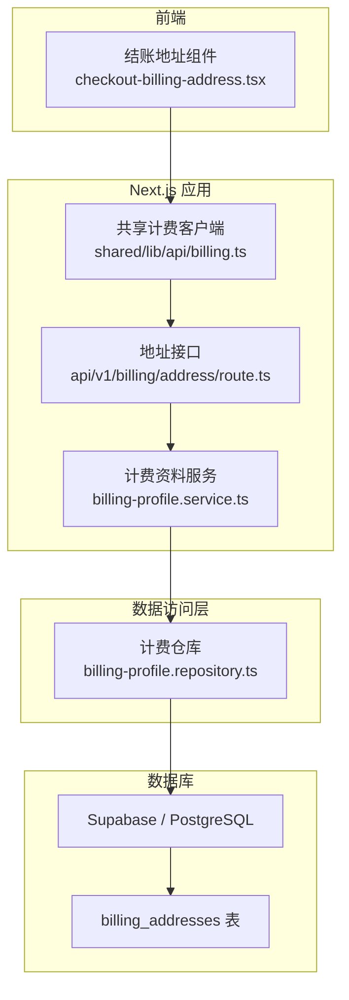
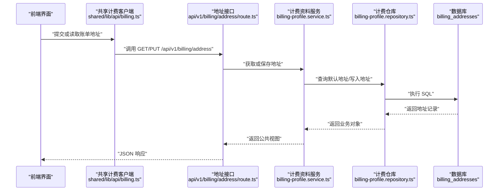
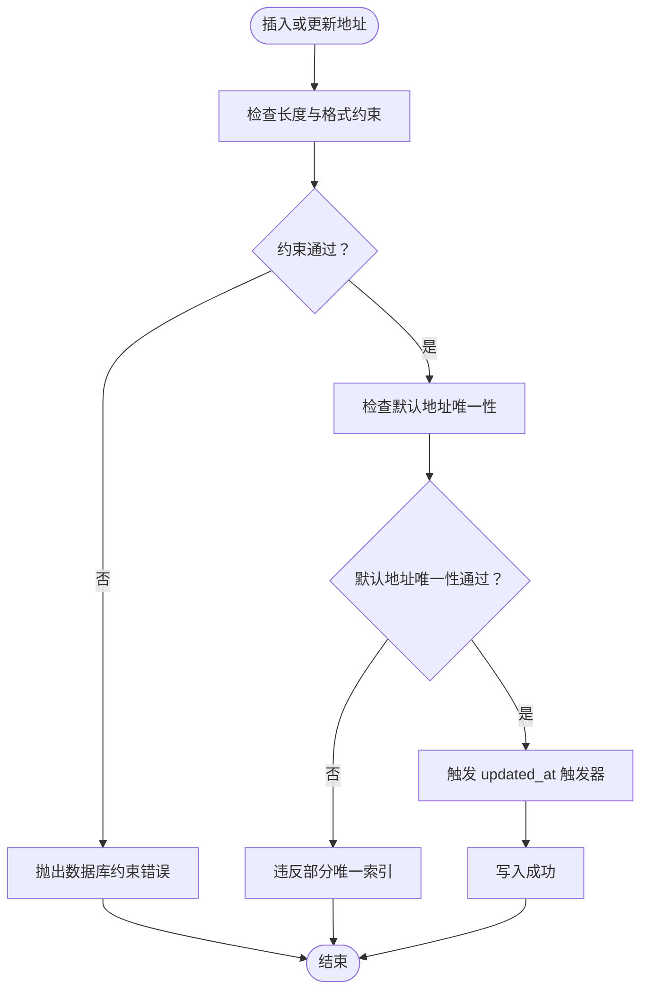
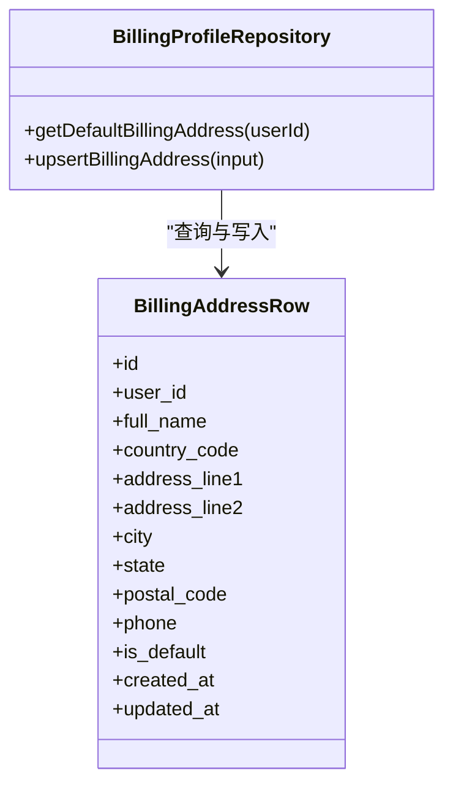
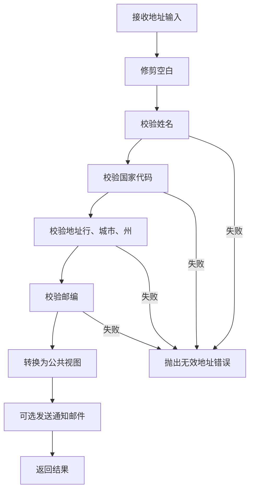
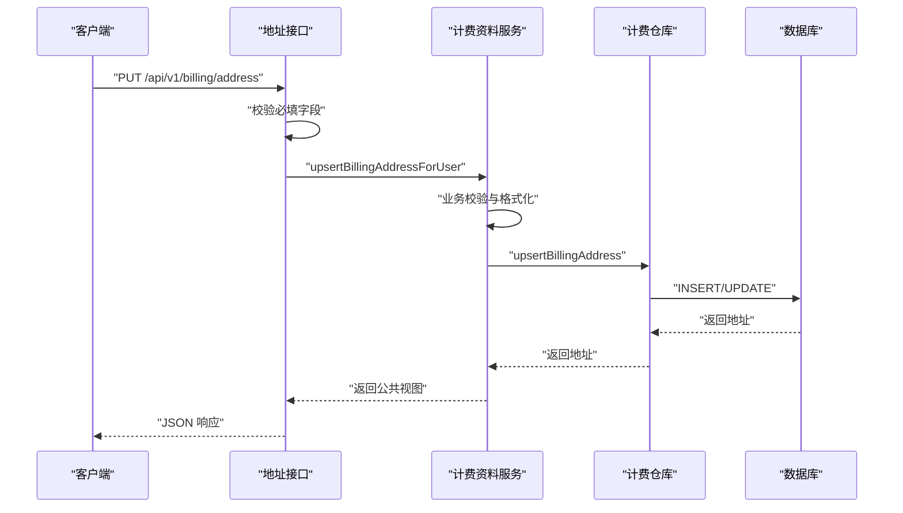
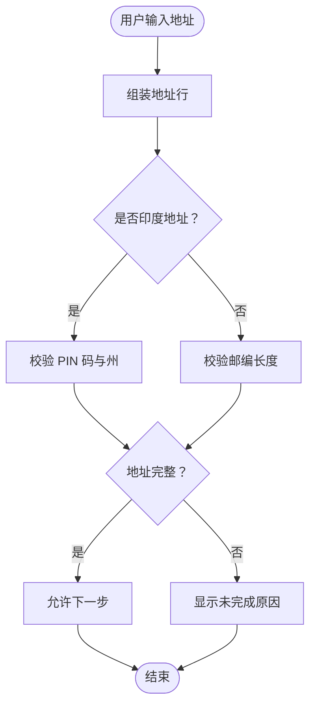
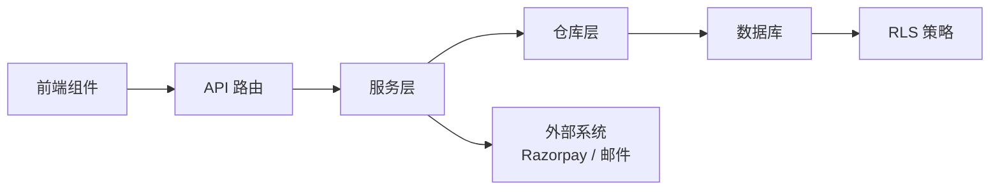

# 账单地址管理

<cite>
**本文引用的文件**   
- [supabase/migrations/20260725143000_billing_addresses_payment_methods.sql](file://supabase/migrations/20260725143000_billing_addresses_payment_methods.sql)
- [supabase/migrations/20260806181805_platform_hardening.sql](file://supabase/migrations/20260806181805_platform_hardening.sql)
- [src/server/repositories/billing-profile.repository.ts](file://src/server/repositories/billing-profile.repository.ts)
- [src/server/services/billing-profile.service.ts](file://src/server/services/billing-profile.service.ts)
- [src/app/api/v1/billing/address/route.ts](file://src/app/api/v1/billing/address/route.ts)
- [src/client/components/checkout-billing-address.tsx](file://src/client/components/checkout-billing-address.tsx)
- [src/shared/lib/api/billing.ts](file://src/shared/lib/api/billing.ts)
</cite>

## 目录
1. [简介](#简介)
2. [项目结构](#项目结构)
3. [核心数据模型](#核心数据模型)
4. [架构总览](#架构总览)
5. [详细组件分析](#详细组件分析)
6. [依赖关系分析](#依赖关系分析)
7. [性能与约束](#性能与约束)
8. [故障排查指南](#故障排查指南)
9. [结论](#结论)

## 简介
本文档围绕账单地址管理的数据模型与服务流程展开，重点解释 `billing_addresses` 表的设计、字段语义、校验规则、默认地址机制、RLS 安全策略、服务角色权限、更新触发器以及从前端到数据库的完整数据流。文档同时说明当前代码对国际地址的支持边界：虽然表结构具备通用字段，但服务端逻辑目前仅支持印度地址，并包含面向结账界面的地址校验和展示逻辑。

## 项目结构
账单地址相关代码分布在以下位置：
- 数据库迁移定义表结构、约束、索引、触发器和 RLS 策略。
- Next.js API 路由暴露 GET/PUT 接口。
- 服务层负责业务验证、公共视图转换和通知。
- 仓库层直接操作数据库。
- 前端组件负责结账时地址输入、完整性校验和格式化。

**图表来源**
- [src/client/components/checkout-billing-address.tsx:1-259](file://src/client/components/checkout-billing-address.tsx#L1-L259)
- [src/shared/lib/api/billing.ts:1-431](file://src/shared/lib/api/billing.ts#L1-L431)
- [src/app/api/v1/billing/address/route.ts:1-63](file://src/app/api/v1/billing/address/route.ts#L1-L63)
- [src/server/services/billing-profile.service.ts:1-200](file://src/server/services/billing-profile.service.ts#L1-L200)
- [src/server/repositories/billing-profile.repository.ts:1-200](file://src/server/repositories/billing-profile.repository.ts#L1-L200)
- [supabase/migrations/20260725143000_billing_addresses_payment_methods.sql:1-162](file://supabase/migrations/20260725143000_billing_addresses_payment_methods.sql#L1-L162)

**章节来源**
- [src/client/components/checkout-billing-address.tsx:1-259](file://src/client/components/checkout-billing-address.tsx#L1-L259)
- [src/app/api/v1/billing/address/route.ts:1-63](file://src/app/api/v1/billing/address/route.ts#L1-L63)

## 核心数据模型
`billing_addresses` 表用于持久化用户账单地址，核心字段如下：

| 字段 | 类型 | 必填 | 默认值 | 约束与含义 |
|---|---|---:|---|---|
| `id` | UUID | 是 | `gen_random_uuid()` | 主键，唯一标识一条地址记录 |
| `user_id` | UUID | 是 | 无 | 关联认证用户；删除用户时级联删除地址 |
| `full_name` | TEXT | 是 | 无 | 姓名，受长度约束 2-120 |
| `country_code` | TEXT | 是 | `'IN'` | 国家代码，必须为两位字符 |
| `address_line1` | TEXT | 是 | 无 | 地址第一行，长度 3-200 |
| `address_line2` | TEXT | 否 | `''` | 地址第二行，常用于公寓或补充信息 |
| `city` | TEXT | 是 | 无 | 城市，长度 2-100 |
| `state` | TEXT | 是 | 无 | 州或地区，长度 2-100 |
| `postal_code` | TEXT | 是 | 无 | 邮编，长度 4-16 |
| `phone` | TEXT | 否 | 无 | 可选电话 |
| `is_default` | BOOLEAN | 是 | `true` | 是否为默认地址 |
| `created_at` | TIMESTAMPTZ | 是 | `now()` | 创建时间 |
| `updated_at` | TIMESTAMPTZ | 是 | `now()` | 更新时间，由触发器自动维护 |

### 字段设计要点
- **用户隔离**：通过 `user_id` 将地址归属到具体用户，结合外键级联删除保证数据一致性。
- **国际地址格式支持**：`country_code` 使用两位文本字段，配合 `char_length(country_code) = 2` 约束；其他字段采用通用字符串，可承载多语言地址内容。
- **长度约束**：
  - 姓名：2-120
  - 地址第一行：3-200
  - 城市：2-100
  - 州：2-100
  - 邮编：4-16
- **默认地址**：`is_default` 控制默认地址，配合部分唯一索引确保每个用户最多一个默认地址。
- **时间戳**：`created_at`、`updated_at` 提供审计与排序能力。

**章节来源**
- [supabase/migrations/20260725143000_billing_addresses_payment_methods.sql:12-63](file://supabase/migrations/20260725143000_billing_addresses_payment_methods.sql#L12-L63)

## 架构总览
账单地址的数据流贯穿前端、API 路由、服务层、仓库层和数据库：

**图表来源**
- [src/shared/lib/api/billing.ts:1-431](file://src/shared/lib/api/billing.ts#L1-L431)
- [src/app/api/v1/billing/address/route.ts:1-63](file://src/app/api/v1/billing/address/route.ts#L1-L63)
- [src/server/services/billing-profile.service.ts:1-200](file://src/server/services/billing-profile.service.ts#L1-L200)
- [src/server/repositories/billing-profile.repository.ts:1-200](file://src/server/repositories/billing-profile.repository.ts#L1-L200)

## 详细组件分析

### 数据库层：表结构、约束、索引、触发器与安全策略
#### 表结构与约束
- 表名：`public.billing_addresses`
- 主键：`id`
- 外键：`user_id` 引用 `auth.users(id)`，删除用户时级联删除地址
- 检查约束：
  - `billing_addresses_country_len`：国家代码长度为 2
  - `billing_addresses_name_len`：姓名长度为 2-120
  - `billing_addresses_line1_len`：地址第一行长度为 3-200
  - `billing_addresses_city_len`：城市长度为 2-100
  - `billing_addresses_state_len`：州长度为 2-100
  - `billing_addresses_postal_len`：邮编长度为 4-16

#### 索引
- 部分唯一索引：`billing_addresses_one_default_per_user(user_id WHERE is_default)`，保证每个用户只有一个默认地址
- 普通索引：`billing_addresses_user_id_idx(user_id)`，优化按用户查询

#### 触发器
- `billing_addresses_set_updated_at`：在更新前自动设置 `updated_at` 为当前时间

#### RLS 安全策略
- 启用行级安全
- `select_own`、`insert_own`、`update_own`、`delete_own` 四个策略均限制为已认证用户，并通过 `user_id = (select auth.uid())` 确保只能访问自身数据
- 生产环境硬加固策略将 `auth.uid()` 调用封装为子查询，提高大规模扫描下的评估效率
- 授权：
  - 已认证用户拥有 `SELECT/INSERT/UPDATE/DELETE`
  - `service_role` 拥有全部权限

**图表来源**
- [supabase/migrations/20260725143000_billing_addresses_payment_methods.sql:12-100](file://supabase/migrations/20260725143000_billing_addresses_payment_methods.sql#L12-L100)
- [supabase/migrations/20260806181805_platform_hardening.sql:1-63](file://supabase/migrations/20260806181805_platform_hardening.sql#L1-L63)

**章节来源**
- [supabase/migrations/20260725143000_billing_addresses_payment_methods.sql:12-100](file://supabase/migrations/20260725143000_billing_addresses_payment_methods.sql#L12-L100)
- [supabase/migrations/20260806181805_platform_hardening.sql:1-63](file://supabase/migrations/20260806181805_platform_hardening.sql#L1-L63)

### 仓库层：默认地址查询与写入
仓库层负责直接数据库操作：
- `getDefaultBillingAddress(userId)`：按用户查询默认地址，优先返回 `is_default=true`，其次按 `updated_at` 倒序
- `upsertBillingAddress(input)`：若已有默认地址则更新该记录并将 `is_default=true`；否则插入新记录

关键行为：
- 更新现有默认地址时不会新增多条默认记录，避免违反部分唯一索引
- 未找到默认地址时执行插入，初始 `is_default=true`

**图表来源**
- [src/server/repositories/billing-profile.repository.ts:1-120](file://src/server/repositories/billing-profile.repository.ts#L1-L120)

**章节来源**
- [src/server/repositories/billing-profile.repository.ts:1-120](file://src/server/repositories/billing-profile.repository.ts#L1-L120)

### 服务层：业务验证、公共视图与通知
服务层承担更严格的业务规则：
- 姓名正则校验：允许字母、数字、空格及常见标点，长度 2-120
- 国家代码强制为印度：非印度地址被拒绝
- 地址行、城市、州最小长度校验
- 印度邮编必须为 6 位数字
- 将数据库行转换为公共视图对象，生成摘要地址字符串
- 保存成功后可选择发送计费通知邮件

**图表来源**
- [src/server/services/billing-profile.service.ts:1-200](file://src/server/services/billing-profile.service.ts#L1-L200)

**章节来源**
- [src/server/services/billing-profile.service.ts:1-200](file://src/server/services/billing-profile.service.ts#L1-L200)

### API 路由：GET 与 PUT 接口
- GET `/api/v1/billing/address`：返回当前用户的默认账单地址
- PUT `/api/v1/billing/address`：接收地址表单字段，进行基础非空校验后调用服务层保存

请求体关键字段：
- `fullName`
- `countryCode`（未提供时使用 `'IN'`）
- `addressLine1`
- `addressLine2`
- `city`
- `state`
- `postalCode`
- `phone`
- `notify`（是否发送通知，默认开启）

**图表来源**
- [src/app/api/v1/billing/address/route.ts:1-63](file://src/app/api/v1/billing/address/route.ts#L1-L63)
- [src/server/services/billing-profile.service.ts:1-200](file://src/server/services/billing-profile.service.ts#L1-L200)
- [src/server/repositories/billing-profile.repository.ts:1-120](file://src/server/repositories/billing-profile.repository.ts#L1-L120)

**章节来源**
- [src/app/api/v1/billing/address/route.ts:1-63](file://src/app/api/v1/billing/address/route.ts#L1-L63)

### 前端：结账地址输入与校验
前端组件负责：
- 组装地址行字符串
- 判断是否为印度地址
- 计算地址完整性状态
- 提供用户友好的未完成原因提示
- 针对印度地址进行 PIN 码与州选择交互
- 国际化显示国家名称

关键逻辑：
- 印度地址要求：PIN 码 6 位数字、州至少 2 字符
- 非印度地址要求：邮编至少 3 字符
- 国家代码必须为两位大写字符
- 名称与地址行有最小长度要求

**图表来源**
- [src/client/components/checkout-billing-address.tsx:1-259](file://src/client/components/checkout-billing-address.tsx#L1-L259)

**章节来源**
- [src/client/components/checkout-billing-address.tsx:1-259](file://src/client/components/checkout-billing-address.tsx#L1-L259)

## 依赖关系分析
各模块之间的依赖如下：
- 前端组件依赖共享计费客户端与本地国际化配置
- API 路由依赖会话认证与计费资料服务
- 服务层依赖仓库层、加密工具、Razorpay 集成与邮件通知
- 仓库层依赖数据库连接池与错误处理
- 数据库层依赖 Supabase 认证系统与触发函数

**图表来源**
- [src/client/components/checkout-billing-address.tsx:1-259](file://src/client/components/checkout-billing-address.tsx#L1-L259)
- [src/app/api/v1/billing/address/route.ts:1-63](file://src/app/api/v1/billing/address/route.ts#L1-L63)
- [src/server/services/billing-profile.service.ts:1-200](file://src/server/services/billing-profile.service.ts#L1-L200)
- [src/server/repositories/billing-profile.repository.ts:1-120](file://src/server/repositories/billing-profile.repository.ts#L1-L120)
- [supabase/migrations/20260725143000_billing_addresses_payment_methods.sql:64-162](file://supabase/migrations/20260725143000_billing_addresses_payment_methods.sql#L64-L162)

**章节来源**
- [src/server/services/billing-profile.service.ts:1-200](file://src/server/services/billing-profile.service.ts#L1-L200)
- [supabase/migrations/20260725143000_billing_addresses_payment_methods.sql:64-162](file://supabase/migrations/20260725143000_billing_addresses_payment_methods.sql#L64-L162)

## 性能与约束
- **部分唯一索引**：`billing_addresses_one_default_per_user` 保证每个用户只有一个默认地址，避免重复默认记录
- **用户索引**：`billing_addresses_user_id_idx` 加速按用户查询
- **RLS 优化**：生产环境策略使用 `(select auth.uid())` 子查询减少每行评估开销
- **触发器**：`updated_at` 自动更新便于排序与审计
- **约束前置**：数据库层面长度与格式约束作为最终防线，即使上层校验遗漏也能阻止非法数据入库

注意事项：
- 如果业务需要扩展至其他国家，需同步调整服务层国家代码校验与前端校验规则
- 对于高并发写入，建议在上层做幂等保护，避免重复 upsert 造成不必要更新

**章节来源**
- [supabase/migrations/20260725143000_billing_addresses_payment_methods.sql:64-100](file://supabase/migrations/20260725143000_billing_addresses_payment_methods.sql#L64-L100)
- [supabase/migrations/20260806181805_platform_hardening.sql:1-63](file://supabase/migrations/20260806181805_platform_hardening.sql#L1-L63)

## 故障排查指南
常见问题与定位方法：
- **姓名无效**：检查服务层姓名正则与长度约束
- **不支持的国家**：当前仅支持印度，非印度国家会返回无效地址错误
- **地址行过短**：检查地址第一行最小长度
- **城市或州为空**：检查城市与州最小长度
- **邮编无效**：印度邮编必须为 6 位数字，其他场景至少 3 字符
- **默认地址冲突**：检查部分唯一索引是否被违反
- **RLS 访问失败**：确认用户已认证且 `user_id` 匹配
- **updated_at 未更新**：检查触发器是否存在并被正确执行

建议步骤：
1. 查看 API 路由返回的错误码与消息
2. 检查服务层抛出的业务错误
3. 检查数据库约束错误
4. 检查 RLS 策略与用户会话
5. 检查触发器定义与执行日志

**章节来源**
- [src/app/api/v1/billing/address/route.ts:20-63](file://src/app/api/v1/billing/address/route.ts#L20-L63)
- [src/server/services/billing-profile.service.ts:20-120](file://src/server/services/billing-profile.service.ts#L20-L120)
- [supabase/migrations/20260725143000_billing_addresses_payment_methods.sql:12-100](file://supabase/migrations/20260725143000_billing_addresses_payment_methods.sql#L12-L100)

## 结论
`billing_addresses` 表通过严格的字段约束、部分唯一索引、RLS 策略与触发器实现了安全的默认地址管理与数据完整性保障。当前服务端逻辑聚焦于印度地址，前端组件也相应提供了针对印度的校验与交互体验。若未来需要支持更多国家，应同步扩展服务层校验、前端校验与国际化资源，并确保数据库层约束仍能满足新的业务规则。整体架构清晰分层，职责明确，适合进一步扩展支付方法、发票与结算相关功能。