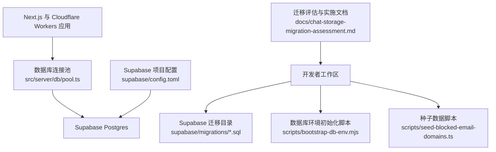
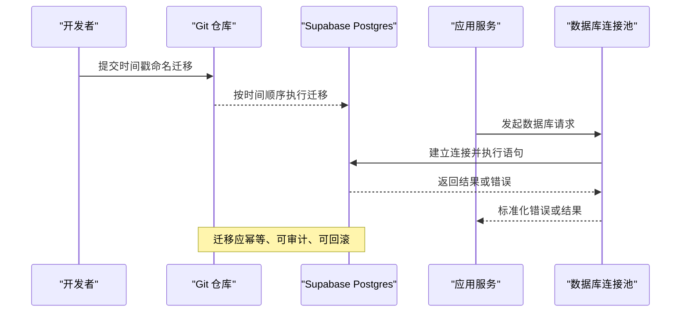
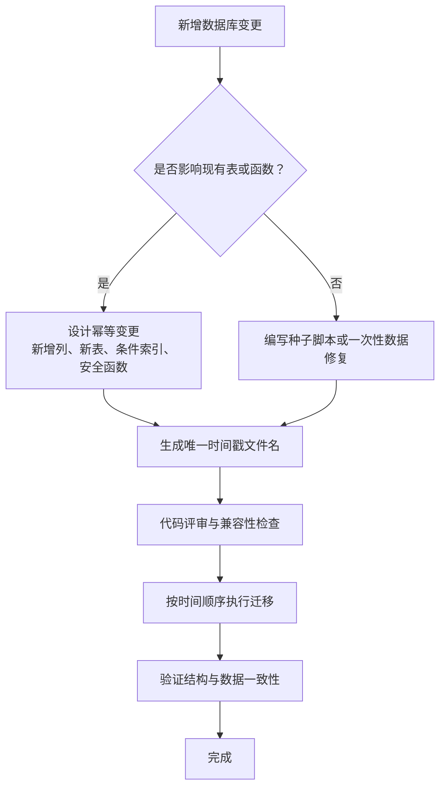
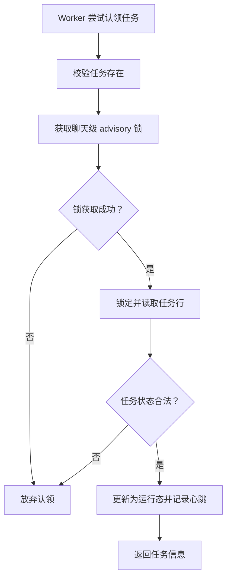
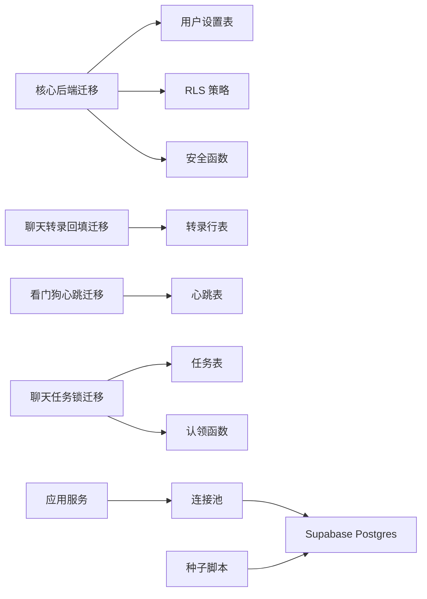

# 迁移与版本控制

<cite>
**本文引用的文件**   
- [supabase/config.toml](file://supabase/config.toml)
- [supabase/migrations/20260506160000_core_backend.sql](file://supabase/migrations/20260506160000_core_backend.sql)
- [supabase/migrations/20260731111000_backfill_complete_chat_transcripts.sql](file://supabase/migrations/20260731111000_backfill_complete_chat_transcripts.sql)
- [supabase/migrations/20260929140000_watchdog_heartbeats.sql](file://supabase/migrations/20260929140000_watchdog_heartbeats.sql)
- [supabase/migrations/20261009153827_durable_chat_admission_and_fencing.sql](file://supabase/migrations/20261009153827_durable_chat_admission_and_fencing.sql)
- [scripts/bootstrap-db-env.mjs](file://scripts/bootstrap-db-env.mjs)
- [scripts/seed-blocked-email-domains.ts](file://scripts/seed-blocked-email-domains.ts)
- [src/server/db/pool.ts](file://src/server/db/pool.ts)
- [docs/chat-storage-migration-assessment.md](file://docs/chat-storage-migration-assessment.md)
</cite>

## 目录
1. [引言](#引言)
2. [项目结构](#项目结构)
3. [核心组件](#核心组件)
4. [架构总览](#架构总览)
5. [详细组件分析](#详细组件分析)
6. [依赖关系分析](#依赖关系分析)
7. [性能考量](#性能考量)
8. [故障排除指南](#故障排除指南)
9. [结论](#结论)
10. [附录](#附录)

## 引言
本文面向迁移与版本控制，聚焦 Supabase 数据库迁移在 Clauxen 项目中的实践。仓库采用基于时间戳的 SQL 迁移目录组织数据库变更，并配合应用层连接池、脚本和运维文档形成完整的发布、回滚与一致性保障方案。文档重点包括：
- 时间戳命名规范、迁移顺序控制与幂等性要求
- 向后兼容策略、数据回填与回滚机制
- 生产部署流程、环境差异与密钥管理
- 原子操作、增量更新、数据校验最佳实践
- 测试、预发布验证与灰度发布建议
- 灾难恢复、备份与一致性保证
- 常见迁移问题排查

## 项目结构
迁移相关代码主要位于以下位置：
- `supabase/config.toml`：声明当前 Supabase 项目标识
- `supabase/migrations/*.sql`：按时间戳命名的 SQL 迁移文件
- `scripts/bootstrap-db-env.mjs`：构建前统一数据库连接地址
- `scripts/seed-blocked-email-domains.ts`：使用服务角色密钥向数据库写入种子数据
- `src/server/db/pool.ts`：数据库连接池、超时、重试与事务封装
- `docs/chat-storage-migration-assessment.md`：存储迁移评估与实施步骤

图表来源
- [supabase/config.toml:1-1](file://supabase/config.toml#L1-L1)
- [supabase/migrations/20260506160000_core_backend.sql:1-80](file://supabase/migrations/20260506160000_core_backend.sql#L1-L80)
- [scripts/bootstrap-db-env.mjs:1-11](file://scripts/bootstrap-db-env.mjs#L1-L11)
- [scripts/seed-blocked-email-domains.ts:1-80](file://scripts/seed-blocked-email-domains.ts#L1-L80)
- [src/server/db/pool.ts:1-200](file://src/server/db/pool.ts#L1-L200)
- [docs/chat-storage-migration-assessment.md:1-67](file://docs/chat-storage-migration-assessment.md#L1-L67)

章节来源
- [supabase/config.toml:1-1](file://supabase/config.toml#L1-L1)
- [scripts/bootstrap-db-env.mjs:1-11](file://scripts/bootstrap-db-env.mjs#L1-L11)
- [src/server/db/pool.ts:1-200](file://src/server/db/pool.ts#L1-L200)

## 核心组件
- 时间戳命名迁移：每个迁移文件以 `YYYYMMDDHHMMSS_主题.sql` 命名，确保排序稳定且可追溯。
- 幂等迁移设计：迁移普遍使用 `IF NOT EXISTS`、`CREATE OR REPLACE`、条件删除与冲突处理，允许重复执行而不破坏状态。
- 应用侧数据库访问：通过连接池封装查询、事务、超时、重试与错误映射，适配 Vercel 与 Hyperdrive 两种运行环境。
- 数据种子与外部数据注入：通过 Node 脚本和服务角色密钥批量写入或更新表，避免直接在生产控制台手工操作。
- 迁移评估与实施文档：对复杂数据迁移提供目标选择、实施序列、并发与回滚策略。

章节来源
- [supabase/migrations/20260506160000_core_backend.sql:1-80](file://supabase/migrations/20260506160000_core_backend.sql#L1-L80)
- [src/server/db/pool.ts:1-200](file://src/server/db/pool.ts#L1-L200)
- [scripts/seed-blocked-email-domains.ts:1-80](file://scripts/seed-blocked-email-domains.ts#L1-L80)
- [docs/chat-storage-migration-assessment.md:1-67](file://docs/chat-storage-migration-assessment.md#L1-L67)

## 架构总览
迁移与版本控制由“版本化 SQL 迁移 + 应用连接层 + 辅助脚本 + 运维文档”组成。Supabase 负责数据库与身份体系；应用通过 Next.js 与 Cloudflare Workers 调用数据库；脚本用于初始化环境与批量数据；文档记录迁移约束与实施流程。

图表来源
- [supabase/migrations/20260506160000_core_backend.sql:1-80](file://supabase/migrations/20260506160000_core_backend.sql#L1-L80)
- [src/server/db/pool.ts:1-200](file://src/server/db/pool.ts#L1-L200)

## 详细组件分析

### 时间戳命名规范与执行顺序
- 命名格式：`YYYYMMDDHHMMSS_简短主题.sql`，例如核心后端、聊天转录回填、看门狗心跳、聊天任务锁与认领等。
- 执行顺序：文件名字典序即为迁移执行顺序，因此时间戳必须严格递增，同一分钟内的多个变更可通过秒级后缀区分。
- 语义分组：主题部分表达变更范围，如平台基础、账单加固、聊天可靠性、插件 OAuth 等。

图表来源
- [supabase/migrations/20260506160000_core_backend.sql:1-80](file://supabase/migrations/20260506160000_core_backend.sql#L1-L80)
- [supabase/migrations/20260731111000_backfill_complete_chat_transcripts.sql:1-80](file://supabase/migrations/20260731111000_backfill_complete_chat_transcripts.sql#L1-L80)
- [supabase/migrations/20260929140000_watchdog_heartbeats.sql:1-17](file://supabase/migrations/20260929140000_watchdog_heartbeats.sql#L1-L17)
- [supabase/migrations/20261009153827_durable_chat_admission_and_fencing.sql:1-69](file://supabase/migrations/20261009153827_durable_chat_admission_and_fencing.sql#L1-L69)

章节来源
- [supabase/migrations/20260506160000_core_backend.sql:1-80](file://supabase/migrations/20260506160000_core_backend.sql#L1-L80)
- [supabase/migrations/20261009153827_durable_chat_admission_and_fencing.sql:1-69](file://supabase/migrations/20261009153827_durable_chat_admission_and_fencing.sql#L1-L69)

### 幂等性与向后兼容
- 幂等设计：
  - 扩展与触发器使用 `CREATE OR REPLACE`，避免重复创建失败。
  - 表、索引、策略使用 `IF NOT EXISTS` 或先删除再重建。
  - 函数权限使用显式拒绝公共角色，仅授予服务角色。
- 向后兼容：
  - 新增字段时保留旧字段或兼容读取逻辑。
  - 重构索引时先创建新索引，再替换或删除旧索引。
  - 对历史数据回填拆分为独立迁移，与业务变更解耦。

示例模式引用路径：
- 核心后端迁移中说明重跑安全性与幂等约定。
- 聊天转录回填迁移先清理派生表，再重建结构化记录。
- 看门狗心跳表创建后启用行级安全并限制访问。
- 聊天任务队列通过唯一索引与函数实现独占与心跳检测。

章节来源
- [supabase/migrations/20260506160000_core_backend.sql:1-80](file://supabase/migrations/20260506160000_core_backend.sql#L1-L80)
- [supabase/migrations/20260731111000_backfill_complete_chat_transcripts.sql:1-80](file://supabase/migrations/20260731111000_backfill_complete_chat_transcripts.sql#L1-L80)
- [supabase/migrations/20260929140000_watchdog_heartbeats.sql:1-17](file://supabase/migrations/20260929140000_watchdog_heartbeats.sql#L1-L17)
- [supabase/migrations/20261009153827_durable_chat_admission_and_fencing.sql:1-69](file://supabase/migrations/20261009153827_durable_chat_admission_and_fencing.sql#L1-L69)

### 数据回填与增量更新
- 回填迁移将已有结构化消息重建为 JSONL 转录行，同时保留训练资格标记。
- 回填过程分阶段：
  1. 计算需要重建的聊天集合及训练标志。
  2. 删除旧转录行，避免重复。
  3. 从消息表聚合角色、内容与工具结果。
  4. 插入新的转录记录。
- 增量更新原则：
  - 只修改必要字段，避免全表重写。
  - 使用临时表隔离中间状态。
  - 分批或带条件的更新减少锁竞争。

章节来源
- [supabase/migrations/20260731111000_backfill_complete_chat_transcripts.sql:1-80](file://supabase/migrations/20260731111000_backfill_complete_chat_transcripts.sql#L1-L80)

### 原子操作与并发控制
- 聊天生成任务通过唯一索引限制每会话同时运行的任务数。
- 通过 `pg_try_advisory_xact_lock` 实现跨连接串行化，防止多个 Worker 抢占同一聊天。
- 心跳字段检测长时间运行的任务，支持自动回收卡住的任务。
- 认领函数在服务角色下执行，对外部角色拒绝执行权限，增强安全性。

图表来源
- [supabase/migrations/20261009153827_durable_chat_admission_and_fencing.sql:1-69](file://supabase/migrations/20261009153827_durable_chat_admission_and_fencing.sql#L1-L69)

章节来源
- [supabase/migrations/20261009153827_durable_chat_admission_and_fencing.sql:1-69](file://supabase/migrations/20261009153827_durable_chat_admission_and_fencing.sql#L1-L69)

### 数据回滚策略
- 轻量回滚：对纯结构变更，可使用逆向迁移，但需保证与原迁移互不破坏。
- 数据回滚：
  - 优先通过独立回填或修正迁移覆盖错误数据。
  - 对大规模回填，应在预发布环境验证后再执行。
- 不可逆回滚：
  - 删除列或大表前应先下线读取路径。
  - 回滚涉及业务逻辑时需同步回滚应用代码。
- 参考迁移评估文档中的回滚建议：保留源数据导出清单，在验证完成后移除旧服务或旧数据。

章节来源
- [docs/chat-storage-migration-assessment.md:1-67](file://docs/chat-storage-migration-assessment.md#L1-L67)

### 生产环境部署流程
推荐流程：
1. 在分支中新增时间戳命名迁移，并确保幂等。
2. 本地或预发布环境执行迁移。
3. 运行数据校验脚本，确认行数、哈希、空值与索引健康。
4. 部署应用代码，确保新旧版本可同时读写。
5. 执行数据回填或增量更新迁移。
6. 监控错误率、延迟与数据库锁等待。
7. 确认无异常后，逐步下线旧逻辑。

章节来源
- [docs/chat-storage-migration-assessment.md:1-67](file://docs/chat-storage-migration-assessment.md#L1-L67)

### 环境管理与配置差异
- 项目标识：`supabase/config.toml` 指定当前 Supabase 项目 ID。
- 数据库 URL：
  - `scripts/bootstrap-db-env.mjs` 在构建前统一 `DATABASE_URL`，优先使用非连接池 URL。
  - `src/server/db/pool.ts` 根据运行环境选择直连、Supavisor 连接池或 Cloudflare Hyperdrive。
- 连接参数：
  - Vercel 环境下规范化连接字符串，强制使用 IPv4 事务连接池端口。
  - 设置连接超时、空闲超时与查询超时，避免服务器端隔离体挂起。
- 环境变量：
  - 通过环境变量区分开发、预发布与生产数据库。
  - 敏感连接信息不应硬编码到迁移文件中。

章节来源
- [supabase/config.toml:1-1](file://supabase/config.toml#L1-L1)
- [scripts/bootstrap-db-env.mjs:1-11](file://scripts/bootstrap-db-env.mjs#L1-L11)
- [src/server/db/pool.ts:1-200](file://src/server/db/pool.ts#L1-L200)

### Secrets 管理策略
- 数据库连接地址由环境变量注入，不在迁移中暴露。
- 种子脚本通过 `SUPABASE_URL` 与服务角色密钥连接数据库。
- 生产密钥应通过 CI/CD 或云平台 Secret 管理注入，避免进入 Git。
- 服务角色密钥权限较高，应限制使用范围，仅在可信脚本中使用。

章节来源
- [scripts/seed-blocked-email-domains.ts:1-80](file://scripts/seed-blocked-email-domains.ts#L1-L80)
- [scripts/bootstrap-db-env.mjs:1-11](file://scripts/bootstrap-db-env.mjs#L1-L11)

### 迁移测试与预发布验证
- 单元测试与集成测试应覆盖关键数据库路径，尤其是事务、索引与函数。
- 预发布环境应具备与生产一致的 schema、索引与安全策略。
- 数据迁移前执行：
  - 行数统计
  - 空值与非法值扫描
  - 外键完整性检查
  - 索引选择性分析
- 回放生产流量或构造代表性负载，验证延迟与锁竞争。

章节来源
- [docs/chat-storage-migration-assessment.md:1-67](file://docs/chat-storage-migration-assessment.md#L1-L67)

### 灰度发布建议
- 先部署应用代码，保持新老逻辑兼容。
- 小比例用户开启新功能，观察错误率与数据库指标。
- 对数据迁移采用增量方式，避免一次性全量锁表。
- 若出现异常，优先关闭功能开关，再决定是否回滚数据。

[本节为概念性指导，不直接分析具体文件]

### 灾难恢复、数据备份与一致性保证
- 备份策略：
  - 定期全量备份与增量 WAL 备份。
  - 回填前保留快照，便于快速恢复。
- 一致性保证：
  - 使用事务包裹多步变更。
  - 使用唯一索引与 advisory 锁避免重复写入。
  - 心跳与看门狗检测长事务与卡住任务。
- 恢复步骤：
  1. 停止写入或切换到只读。
  2. 恢复到最近一致快照。
  3. 重新执行必要迁移。
  4. 验证数据一致性后恢复写入。

章节来源
- [supabase/migrations/20260929140000_watchdog_heartbeats.sql:1-17](file://supabase/migrations/20260929140000_watchdog_heartbeats.sql#L1-L17)
- [supabase/migrations/20261009153827_durable_chat_admission_and_fencing.sql:1-69](file://supabase/migrations/20261009153827_durable_chat_admission_and_fencing.sql#L1-L69)

## 依赖关系分析
迁移与应用之间的依赖主要体现在连接层与权限模型：
- 迁移定义表、索引、函数与 RLS 策略。
- 应用通过连接池访问数据库，复用连接、处理超时与错误。
- 种子脚本通过 Supabase 客户端库写入数据，依赖服务角色密钥。

图表来源
- [supabase/migrations/20260506160000_core_backend.sql:1-80](file://supabase/migrations/20260506160000_core_backend.sql#L1-L80)
- [supabase/migrations/20260731111000_backfill_complete_chat_transcripts.sql:1-80](file://supabase/migrations/20260731111000_backfill_complete_chat_transcripts.sql#L1-L80)
- [supabase/migrations/20260929140000_watchdog_heartbeats.sql:1-17](file://supabase/migrations/20260929140000_watchdog_heartbeats.sql#L1-L17)
- [supabase/migrations/20261009153827_durable_chat_admission_and_fencing.sql:1-69](file://supabase/migrations/20261009153827_durable_chat_admission_and_fencing.sql#L1-L69)
- [scripts/seed-blocked-email-domains.ts:1-80](file://scripts/seed-blocked-email-domains.ts#L1-L80)
- [src/server/db/pool.ts:1-200](file://src/server/db/pool.ts#L1-L200)

章节来源
- [src/server/db/pool.ts:1-200](file://src/server/db/pool.ts#L1-L200)
- [scripts/seed-blocked-email-domains.ts:1-80](file://scripts/seed-blocked-email-domains.ts#L1-L80)

## 性能考量
- 连接池大小：
  - Vercel Fluid Compute 单实例并发高，使用 Supavisor 事务池，每实例少量连接更安全。
  - Hyperdrive 场景下，连接由 Worker 生命周期管理，避免跨请求复用。
- 超时与重试：
  - 连接获取失败时指数退避重试。
  - 查询超时保护长事务与锁竞争。
- 索引设计：
  - 新增覆盖索引前先评估写入成本。
  - 条件索引缩小活跃数据范围。
- 回填优化：
  - 使用临时表与聚合查询减少多次扫描。
  - 分批写入降低锁持有时间。

章节来源
- [src/server/db/pool.ts:1-200](file://src/server/db/pool.ts#L1-L200)
- [supabase/migrations/20260731111000_backfill_complete_chat_transcripts.sql:1-80](file://supabase/migrations/20260731111000_backfill_complete_chat_transcripts.sql#L1-L80)
- [supabase/migrations/20261009153827_durable_chat_admission_and_fencing.sql:1-69](file://supabase/migrations/20261009153827_durable_chat_admission_and_fencing.sql#L1-L69)

## 故障排除指南
常见问题与定位方法：
- 数据库连接失败：
  - 检查环境变量是否包含有效数据库 URL。
  - 确认 Vercel 连接字符串被规范化为 Supabase 事务池地址。
  - 查看连接超时与空闲超时配置。
- 查询超时或锁等待：
  - 检查是否有长事务或未释放的连接。
  - 查看看门狗心跳表是否持续更新。
  - 分析聊天任务认领函数是否因并发抢占失败。
- 迁移重复执行报错：
  - 确认迁移是否具备幂等性。
  - 检查是否存在未处理的已存在对象。
- 种子数据未写入：
  - 检查服务角色密钥与数据库 URL 是否正确。
  - 确认网络可达与权限足够。

章节来源
- [scripts/bootstrap-db-env.mjs:1-11](file://scripts/bootstrap-db-env.mjs#L1-L11)
- [src/server/db/pool.ts:1-200](file://src/server/db/pool.ts#L1-L200)
- [supabase/migrations/20260929140000_watchdog_heartbeats.sql:1-17](file://supabase/migrations/20260929140000_watchdog_heartbeats.sql#L1-L17)
- [supabase/migrations/20261009153827_durable_chat_admission_and_fencing.sql:1-69](file://supabase/migrations/20261009153827_durable_chat_admission_and_fencing.sql#L1-L69)
- [scripts/seed-blocked-email-domains.ts:1-80](file://scripts/seed-blocked-email-domains.ts#L1-L80)

## 结论
Clauxen 的迁移与版本控制围绕时间戳命名、幂等 SQL、连接池抽象与辅助脚本展开。核心优势在于：
- 迁移顺序明确、可审计、可重复执行。
- 应用连接层屏蔽不同运行环境的差异。
- 数据回填与并发控制分离，便于灰度与回滚。
- 文档化迁移评估与实施步骤，降低复杂迁移风险。

建议继续强化：
- 自动化迁移测试与数据校验流水线。
- 更细粒度的灰度与功能开关。
- 明确的回滚演练与灾难恢复演练。
- 对大型回填增加进度表与可观测性指标。

[本节为总结性内容，不直接分析具体文件]

## 附录
- 推荐迁移模板：
  - 新增表：`IF NOT EXISTS` + 注释 + RLS + 初始索引。
  - 新增列：默认值 + 可选回填 + 旧代码兼容。
  - 新增函数：`CREATE OR REPLACE` + 最小权限 + 服务角色执行。
  - 回填：临时表 + 条件更新 + 分批提交。
- 发布检查清单：
  - 迁移文件命名唯一且有序。
  - 所有变更幂等。
  - 环境变量与密钥正确注入。
  - 预发布环境验证通过。
  - 数据校验脚本通过。
  - 监控告警就绪。

[本节为通用建议，不直接分析具体文件]