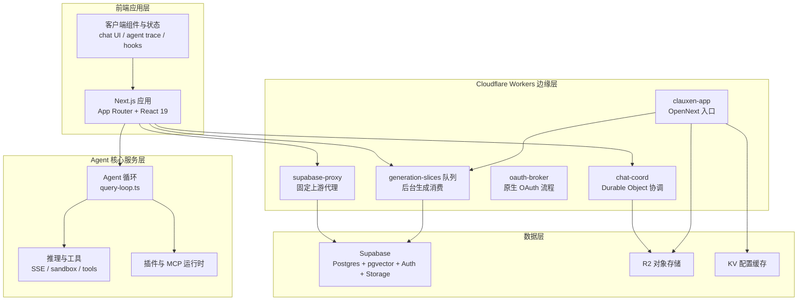
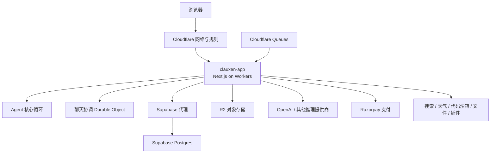
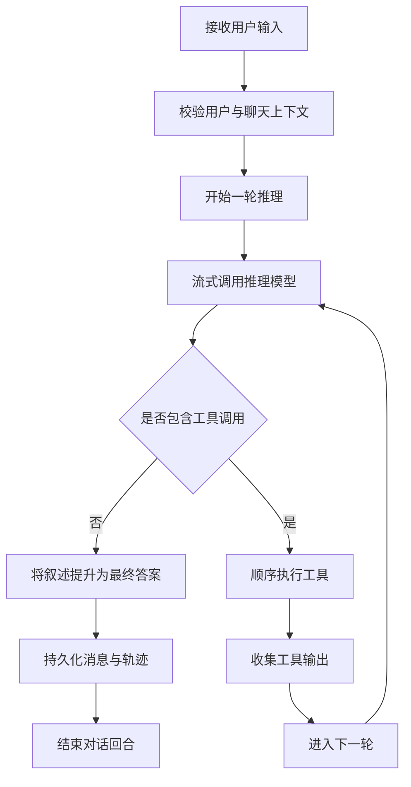
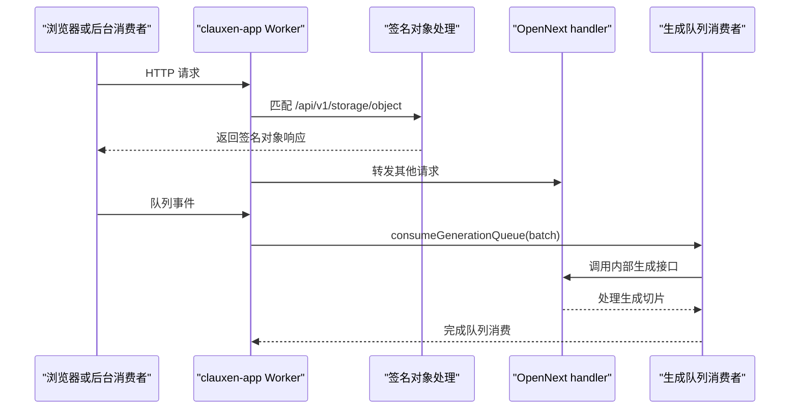
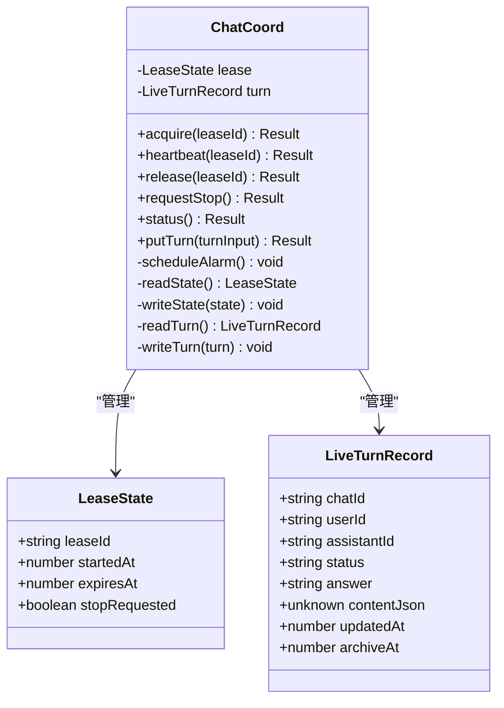
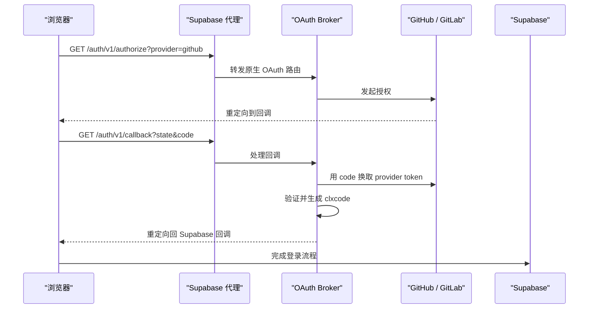
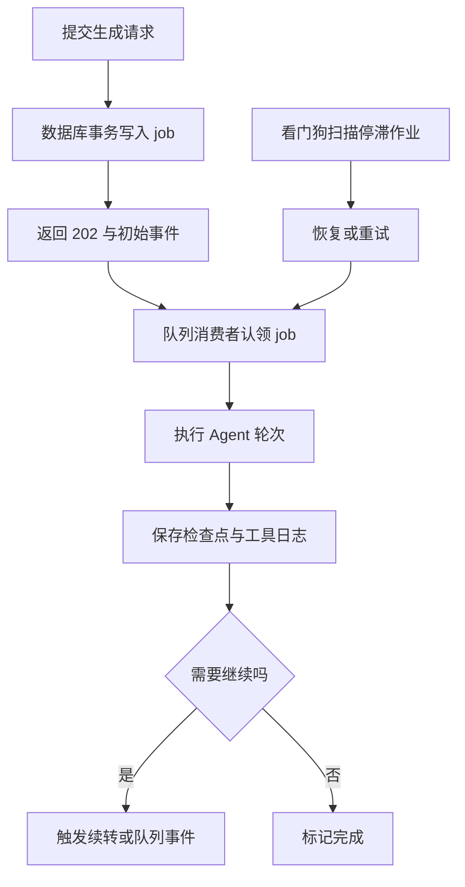
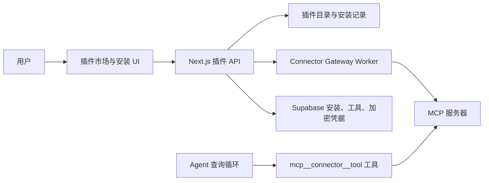
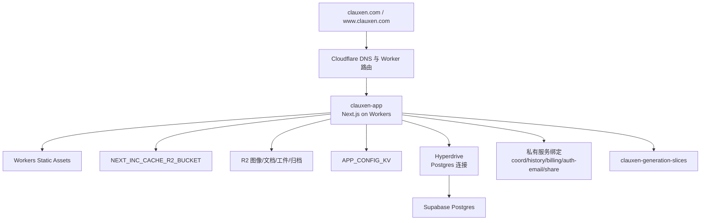
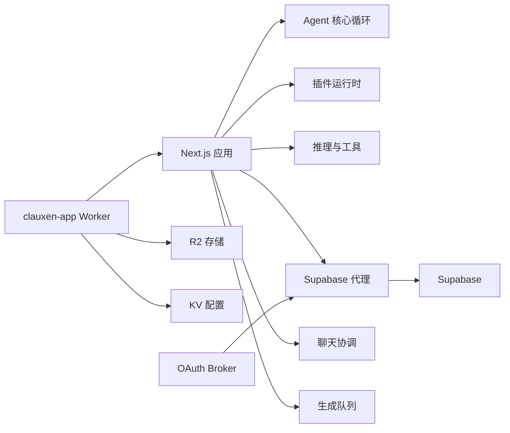

# 架构总览

<cite>
**本文引用的文件**   
- [README.md](file://README.md)
- [package.json](file://package.json)
- [wrangler.jsonc](file://wrangler.jsonc)
- [next.config.ts](file://next.config.ts)
- [cloudflare-worker.ts](file://cloudflare-worker.ts)
- [vercel.json](file://vercel.json)
- [docker-compose.yml](file://docker-compose.yml)
- [apphosting.yaml](file://apphosting.yaml)
- [docs/cloudflare-app-migration.md](file://docs/cloudflare-app-migration.md)
- [docs/cloudflare-chat-storage-architecture.md](file://docs/cloudflare-chat-storage-architecture.md)
- [docs/background-execution.md](file://docs/background-execution.md)
- [docs/plugins-self-hosted.md](file://docs/plugins-self-hosted.md)
- [src/server/agent-core/runtime/query-loop.ts](file://src/server/agent-core/runtime/query-loop.ts)
- [workers/chat-coord/src/index.ts](file://workers/chat-coord/src/index.ts)
- [workers/supabase-proxy/src/index.ts](file://workers/supabase-proxy/src/index.ts)
- [workers/oauth-broker/src/broker.ts](file://workers/oauth-broker/src/broker.ts)
- [supabase/migrations/20261009153827_durable_chat_admission_and_fencing.sql](file://supabase/migrations/20261009153827_durable_chat_admission_and_fencing.sql)
</cite>

## 目录
1. [引言](#引言)
2. [项目结构](#项目结构)
3. [核心组件](#核心组件)
4. [架构总览](#架构总览)
5. [详细组件分析](#详细组件分析)
6. [依赖关系分析](#依赖关系分析)
7. [性能考量](#性能考量)
8. [故障排查指南](#故障排查指南)
9. [结论](#结论)

## 引言
Clauxen Web App 是一个基于 Next.js、React 和 Supabase 的全栈 AI 聊天平台，同时运行在 Vercel 与 Cloudflare Workers 之上。系统提供流式回答、思考阶段、工具调用、项目与深度研究、定时任务、计费、以及由多个 Cloudflare Worker 组成的边缘服务集群。其整体设计以“前端应用层 + Agent 核心服务层 + Cloudflare Workers 边缘计算层 + Supabase 数据层”的分层模式为主，并通过微服务化 Worker、事件驱动队列、插件化 MCP 连接器，实现可扩展、可演进且相对解耦的架构。

本架构文档面向不同技术背景的读者，从高层系统上下文开始，逐步深入到 Agent 循环、边缘 Worker、Supabase 持久化、部署拓扑与安全策略，并给出依赖图、时序图和流程图。

## 项目结构
仓库采用按职责划分的目录组织方式：
- `src/app`：Next.js App Router 路由、页面与 API 处理逻辑。
- `src/client`：浏览器端 React 组件、Hooks、Zustand 状态、Web Worker 等。
- `src/server`：服务端 Agent 核心、推理、插件、认证、计费、存储、沙箱、训练等后端逻辑。
- `src/shared`：前后端共享的类型、库与工具。
- `src/ui`：UI 设置与外壳组件。
- `supabase/migrations`：Postgres 迁移，覆盖聊天、计费、插件、自动化队列等。
- `workers`：Cloudflare Worker 子服务，包括聊天协调、历史、计费、OAuth、R2 网关、调度等。
- `scripts`：构建、部署、环境同步、运维脚本。
- `docs`：架构决策、部署说明、背景执行与插件设计文档。

**图表来源**  
- [README.md:1-89](file://README.md#L1-L89)  
- [wrangler.jsonc:1-117](file://wrangler.jsonc#L1-L117)  
- [cloudflare-worker.ts:1-22](file://cloudflare-worker.ts#L1-L22)  
- [docs/cloudflare-app-migration.md:1-124](file://docs/cloudflare-app-migration.md#L1-L124)

**章节来源**  
- [README.md:1-89](file://README.md#L1-L89)

## 核心组件
系统的关键组件包括：
- **Next.js 前端应用**：负责用户界面、会话状态、Agent Trace 渲染、计费结算页、营销页与 API 路由。
- **Agent 核心循环**：围绕 OpenAI Responses API 实现自主轮询，将思考、叙述、工具调用统一映射为扁平 AgentTrace，并在最终轮次将文本提升为持久答案。
- **Cloudflare Workers 应用入口**：通过 OpenNext 将 Next.js 应用部署到 Workers，同时挂载 R2、KV、Hyperdrive、队列与服务绑定。
- **聊天协调 Durable Object**：按聊天粒度持有租约、心跳、停止请求与临时轮次状态，用于多实例安全协作。
- **Supabase 代理与 OAuth Broker**：代理 Supabase 请求、限制认证速率、统一转发 WebSocket，并将 GitHub/GitLab 原生 OAuth 流程集中到 Clauxen 控制面。
- **后台生成队列**：将长时间推理任务拆分为切片，通过 Cloudflare Queues 异步消费，配合数据库中的 job 表完成幂等提交、续转与看门狗恢复。
- **插件平台**：自托管 MCP 与 REST 连接器，支持 Catalog、安装、OAuth、API Key、工具发现、审批与审计。

**章节来源**  
- [README.md:1-89](file://README.md#L1-L89)  
- [package.json:1-185](file://package.json#L1-L185)  
- [docs/plugins-self-hosted.md:1-200](file://docs/plugins-self-hosted.md#L1-L200)

## 架构总览
### 系统上下文图
系统上下文强调外部依赖与边界：浏览器访问 clauxen.com，流量经 Cloudflare 到达 clauxen-app；内部业务调用 Supabase、第三方模型提供商、Razorpay、AssemblyAI、Exa、Novita 沙箱等。

**图表来源**  
- [wrangler.jsonc:1-117](file://wrangler.jsonc#L1-L117)  
- [cloudflare-worker.ts:1-22](file://cloudflare-worker.ts#L1-L22)  
- [docs/cloudflare-app-migration.md:1-124](file://docs/cloudflare-app-migration.md#L1-L124)

### 分层职责
| 层级 | 主要职责 | 关键实现位置 |
|---|---|---|
| 前端应用层 | 用户界面、AgentTrace 渲染、会话生命周期、计费与营销页面 | `src/app`、`src/client` |
| Agent 核心服务层 | 自主推理循环、工具注册与执行、MCP 插件集成、流式协议 | `src/server/agent-core`、`src/server/inference`、`src/server/plugins` |
| Cloudflare Workers 边缘层 | 应用入口、静态资源、队列消费者、聊天协调、Supabase 代理、OAuth Broker | `cloudflare-worker.ts`、`workers/*` |
| Supabase 数据层 | 用户、聊天、消息、计费、插件、任务、权限与扩展索引 | `supabase/migrations` |

**章节来源**  
- [README.md:1-89](file://README.md#L1-L89)  
- [wrangler.jsonc:1-117](file://wrangler.jsonc#L1-L117)

## 详细组件分析

### Agent 核心循环与流式协议
Agent 核心循环是系统的推理中枢。它按轮次调用 OpenAI Responses API，将每个轮次的“思考 → 叙述 → 工具调用”转换为统一的扁平步骤序列。最终没有工具调用的轮次会把叙述文本提升为持久答案，而不是把答案移动到别处。

**图表来源**  
- [src/server/agent-core/runtime/query-loop.ts:1-260](file://src/server/agent-core/runtime/query-loop.ts#L1-L260)  
- [README.md:1-89](file://README.md#L1-L89)

该组件的设计优势包括：
- **可观测性**：每个 assistant turn 携带有序步骤列表，便于调试与追踪。
- **安全性**：工具参数使用 Zod 模式校验，并提供自愈修复能力。
- **可组合性**：内置工具与 MCP 插件工具在查询循环中统一暴露给模型。
- **用户体验**：叙述文本作为面向用户的进度描述，与内部思考内容分离。

**章节来源**  
- [src/server/agent-core/runtime/query-loop.ts:1-260](file://src/server/agent-core/runtime/query-loop.ts#L1-L260)  
- [README.md:1-89](file://README.md#L1-L89)

### Cloudflare Workers 应用入口
`cloudflare-worker.ts` 是 OpenNext 构建后的 Workers 入口。它拦截 `/api/v1/storage/object` 签名对象访问，其余请求交给生成的 handler；同时定义 queue 处理器，消费 `clauxen-generation-slices` 队列，并把队列事件转发到 Next.js 内部生成接口。

**图表来源**  
- [cloudflare-worker.ts:1-22](file://cloudflare-worker.ts#L1-L22)  
- [wrangler.jsonc:1-117](file://wrangler.jsonc#L1-L117)

**章节来源**  
- [cloudflare-worker.ts:1-22](file://cloudflare-worker.ts#L1-L22)  
- [wrangler.jsonc:1-117](file://wrangler.jsonc#L1-L117)

### 聊天协调 Durable Object
聊天协调服务以每个聊天为单位维护租约与临时轮次状态，避免多个 Worker 实例并发写入同一聊天。它提供获取租约、心跳续期、释放租约、请求停止、查询状态与写入轮次的能力。

**图表来源**  
- [workers/chat-coord/src/index.ts:1-200](file://workers/chat-coord/src/index.ts#L1-L200)

**章节来源**  
- [workers/chat-coord/src/index.ts:1-200](file://workers/chat-coord/src/index.ts#L1-L200)

### Supabase 代理与 OAuth Broker
Supabase 代理固定上游地址，仅允许受支持的 v1 路径与方法，删除可能伪造的转发头，并对认证路径做速率限制。OAuth Broker 接管 GitHub/GitLab 的原生 OAuth 流程，使用受控回调、PKCE、短期 token 与 flow store，减少敏感凭证暴露面。

**图表来源**  
- [workers/supabase-proxy/src/index.ts:1-76](file://workers/supabase-proxy/src/index.ts#L1-L76)  
- [workers/oauth-broker/src/broker.ts:1-113](file://workers/oauth-broker/src/broker.ts#L1-L113)

**章节来源**  
- [workers/supabase-proxy/src/index.ts:1-76](file://workers/supabase-proxy/src/index.ts#L1-L76)  
- [workers/oauth-broker/src/broker.ts:1-113](file://workers/oauth-broker/src/broker.ts#L1-L113)

### 后台生成与持久化作业
后台生成采用“提交即持久化”的策略：接受请求后写入 job 表，返回 202 与初始事件；后台消费者原子认领最旧的可用 job，保存轮次检查点、工具日志与模型结果，必要时触发续转。看门狗每分钟扫描停滞作业并恢复。

**图表来源**  
- [docs/background-execution.md:1-38](file://docs/background-execution.md#L1-L38)  
- [supabase/migrations/20261009153827_durable_chat_admission_and_fencing.sql:1-69](file://supabase/migrations/20261009153827_durable_chat_admission_and_fencing.sql#L1-L69)

**章节来源**  
- [docs/background-execution.md:1-38](file://docs/background-execution.md#L1-L38)  
- [supabase/migrations/20261009153827_durable_chat_admission_and_fencing.sql:1-69](file://supabase/migrations/20261009153827_durable_chat_admission_and_fencing.sql#L1-L69)

### 插件化 MCP 平台
插件平台自托管 MCP 与 REST 连接器，不依赖 Nango、Pipedream 等第三方桥接。Catalog 作为公开可搜索清单，安装流程根据是否有 OAuth metadata 决定走无认证、API Key 或完整 OAuth；工具在 Agent 查询循环中以命名空间形式注入，并受到审批、输出长度限制与审计保护。

**图表来源**  
- [docs/plugins-self-hosted.md:1-200](file://docs/plugins-self-hosted.md#L1-L200)  
- [src/server/agent-core/runtime/query-loop.ts:1-260](file://src/server/agent-core/runtime/query-loop.ts#L1-L260)

**章节来源**  
- [docs/plugins-self-hosted.md:1-200](file://docs/plugins-self-hosted.md#L1-L200)  
- [src/server/agent-core/runtime/query-loop.ts:1-260](file://src/server/agent-core/runtime/query-loop.ts#L1-L260)

### 部署拓扑
当前生产主入口已切换到 Cloudflare Workers，Vercel 仍保留作为回退路径。Workers 应用使用 OpenNext，静态资产由 Workers Static Assets 提供；R2 用于增量缓存、图像、文档、技能、工件与归档；KV 存放公开模型目录与功能开关；Hyperdrive 连接现有 Postgres。

**图表来源**  
- [wrangler.jsonc:1-117](file://wrangler.jsonc#L1-L117)  
- [docs/cloudflare-app-migration.md:1-124](file://docs/cloudflare-app-migration.md#L1-L124)

**章节来源**  
- [docs/cloudflare-app-migration.md:1-124](file://docs/cloudflare-app-migration.md#L1-L124)  
- [wrangler.jsonc:1-117](file://wrangler.jsonc#L1-L117)

## 依赖关系分析
### 组件耦合关系
- 前端应用对 Agent 核心、插件运行时、推理层有强依赖。
- Workers 应用入口对 OpenNext handler、R2、KV、队列、服务绑定有强依赖。
- Supabase 代理与 OAuth Broker 形成松耦合的认证增强层，但仍依赖 Supabase 上游。
- 后台生成与聊天协调通过数据库与 Durable Object 解耦，降低进程崩溃影响。
- 插件平台既可直接调用 MCP 服务器，也可通过 Connector Gateway Worker 中转。

**图表来源**  
- [cloudflare-worker.ts:1-22](file://cloudflare-worker.ts#L1-L22)  
- [workers/supabase-proxy/src/index.ts:1-76](file://workers/supabase-proxy/src/index.ts#L1-L76)  
- [workers/oauth-broker/src/broker.ts:1-113](file://workers/oauth-broker/src/broker.ts#L1-L113)  
- [wrangler.jsonc:1-117](file://wrangler.jsonc#L1-L117)

**章节来源**  
- [cloudflare-worker.ts:1-22](file://cloudflare-worker.ts#L1-L22)  
- [wrangler.jsonc:1-117](file://wrangler.jsonc#L1-L117)

### 外部依赖与集成点
- **推理提供商**：OpenAI Responses API 为主，同时预留 Exa、AssemblyAI、Novita 等工具链。
- **支付**：Razorpay 通过 Next.js 与 Cloudflare 环境变量接入。
- **存储**：Supabase Storage 与 R2 并存，R2 在 Workers 侧承担更多静态与对象存储职责。
- **实时通信**：Supabase Realtime、AssemblyAI WebSocket、自定义 SSE 流式协议。
- **边缘能力**：Cloudflare Images、KV、Queues、Durable Objects、Hyperdrive、Service Bindings。

**章节来源**  
- [package.json:1-185](file://package.json#L1-L185)  
- [next.config.ts:1-200](file://next.config.ts#L1-L200)

## 性能考量
### 前端与构建优化
- Next.js 启用严格模式、禁用 poweredBy 头、移除 console，并优化包导入。
- 图片格式支持 AVIF 与 WebP，最小缓存 TTL 较长。
- 大型服务端依赖被声明为 serverExternalPackages，避免进入客户端包体。

**章节来源**  
- [next.config.ts:1-200](file://next.config.ts#L1-L200)  
- [package.json:1-185](file://package.json#L1-L185)

### 边缘与队列吞吐
- Workers 应用设置 30 秒 CPU 上限、5% 日志采样、最多 8 个并发生成消费者，并配置死信队列。
- 生成队列批量大小与超时较小，适合分片长任务；看门狗与心跳机制防止僵尸作业堆积。
- 本地开发使用 Docker Compose 启动 PostgreSQL 与 Redis，配合 BullMQ 进行本地后台任务测试。

**章节来源**  
- [wrangler.jsonc:1-117](file://wrangler.jsonc#L1-L117)  
- [docs/cloudflare-app-migration.md:1-124](file://docs/cloudflare-app-migration.md#L1-L124)  
- [docker-compose.yml:1-34](file://docker-compose.yml#L1-L34)

### 数据层容量规划
- 聊天存储架构文档指出 D1 单库 10GB 硬上限，建议保留冗余空间并按聊天元数据规模规划。
- 长对话不应每次加载全部历史，而应分页读取最新片段，并结合摘要窗口控制上下文大小。
- R2 对象存储适合不可变转录与附件，但需考虑操作次数与压缩策略。

**章节来源**  
- [docs/cloudflare-chat-storage-architecture.md:1-109](file://docs/cloudflare-chat-storage-architecture.md#L1-L109)

## 故障排查指南
### 认证与 OAuth
- 若出现“Too many authentication requests”，说明 Supabase 代理触发了认证速率限制。
- 若原生 OAuth 回调失败，检查 OAuth Broker 的 state、cookie、code_verifier 与 flow store。
- 若代理返回 502，通常表示上游 Supabase 不可达或请求被拒绝。

**章节来源**  
- [workers/supabase-proxy/src/index.ts:1-76](file://workers/supabase-proxy/src/index.ts#L1-L76)  
- [workers/oauth-broker/src/broker.ts:1-113](file://workers/oauth-broker/src/broker.ts#L1-L113)

### 后台生成与看门狗
- 如果生成未继续，检查 job 状态、唯一索引、心跳时间戳与 claim 函数返回值。
- 如果聊天被阻塞，检查聊天级唯一约束与 advisory lock 是否生效。
- 如果看门狗未恢复，确认 cron 触发、内部令牌与延续 Worker 可达性。

**章节来源**  
- [supabase/migrations/20261009153827_durable_chat_admission_and_fencing.sql:1-69](file://supabase/migrations/20261009153827_durable_chat_admission_and_fencing.sql#L1-L69)  
- [docs/background-execution.md:1-38](file://docs/background-execution.md#L1-L38)

### 部署与环境
- 如果 OpenNext 构建失败，确保使用 `npm run cf:build` 而非直接 `npm run build`。
- 如果环境变量缺失，区分前端编译变量 `NEXT_PUBLIC_*` 与 Workers 机密。
- 如果需要回退到 Vercel，参考文档中的 DNS 回滚步骤与旧调度器开关。

**章节来源**  
- [docs/cloudflare-app-migration.md:1-124](file://docs/cloudflare-app-migration.md#L1-L124)

## 结论
Clauxen Web App 的架构以 Next.js 前端与 Agent 核心为核心，以 Cloudflare Workers 边缘服务为扩展面，以 Supabase 数据层为持久化基础。微服务化的 Worker 群使认证、聊天协调、历史、计费、OAuth、调度与对象访问各自独立；事件驱动的队列让长时间推理具备容错与恢复能力；插件化 MCP 平台则在不引入第三方连接器云的前提下，扩展了外部工具生态。

技术选型上，Next.js 提供成熟的 SSR/SSG 与 App Router 体验，Supabase 提供快速可用的数据库与认证体系，Cloudflare Workers 提供低延迟边缘执行与丰富绑定能力。权衡在于：Workers 编程模型与传统 Node 环境存在差异，迁移需要 OpenNext、类型生成与绑定适配；Supabase 的 RLS 与 Hyperdrive 在迁移到 D1/R2 方案时需要明确边界；后台生成与聊天协调需要在可靠性与成本之间持续度量。

未来演进可关注：
- 将聊天存储逐步迁移至 Cloudflare-only 方案时，保持 Supabase 兼容层直至完全切换。
- 对 Agent 工具与插件调用增加更细粒度的配额、审计与沙箱隔离。
- 对长对话、向量检索与全文检索建立分层索引策略。
- 对 Workers 冷启动、队列吞吐与外部模型限流建立可观测指标与自动扩缩容策略。