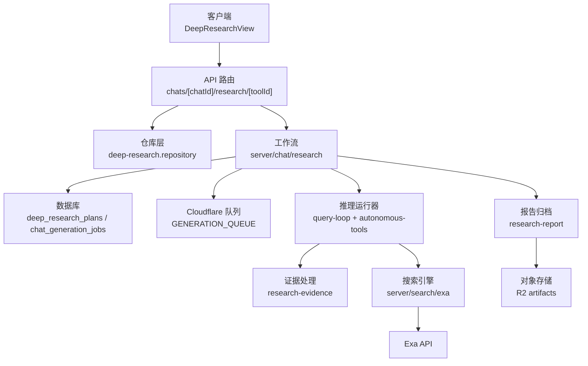
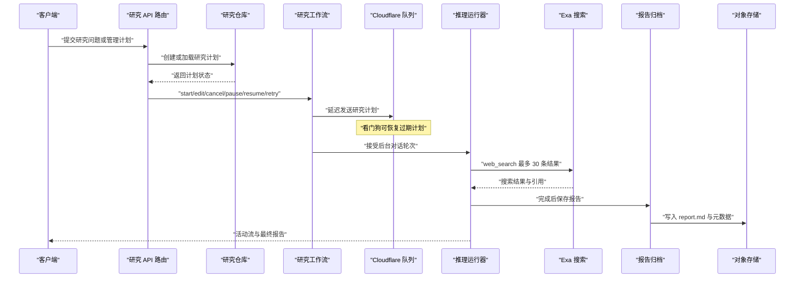
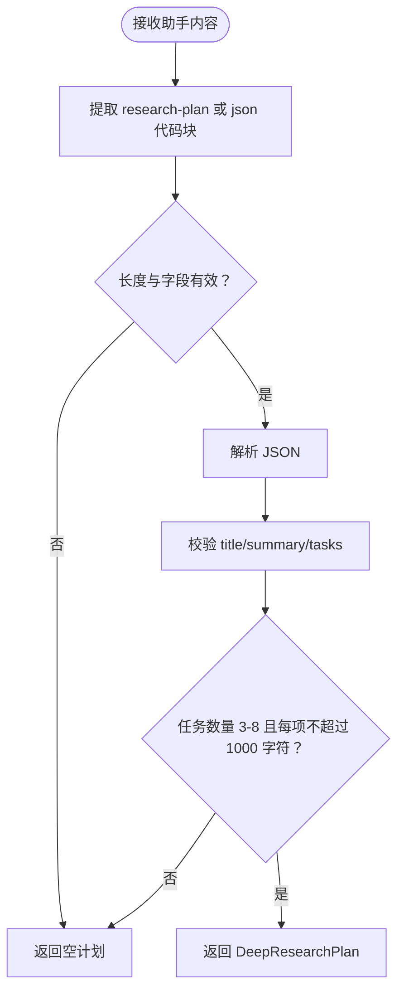
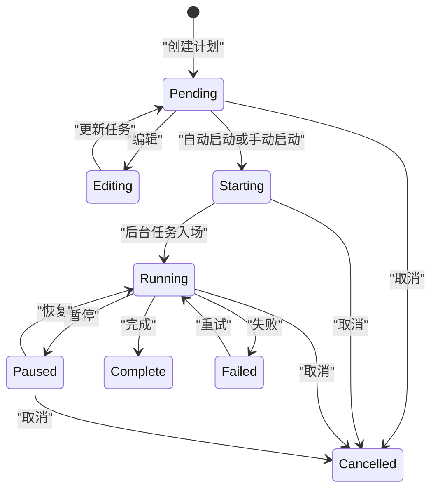
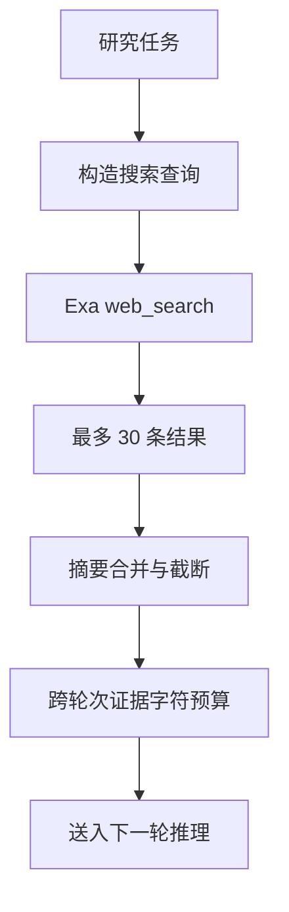
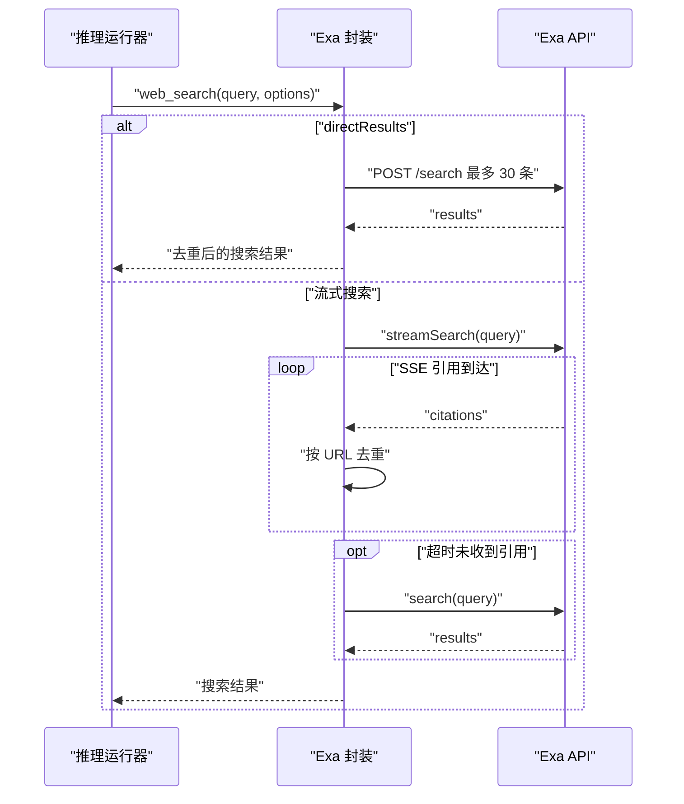
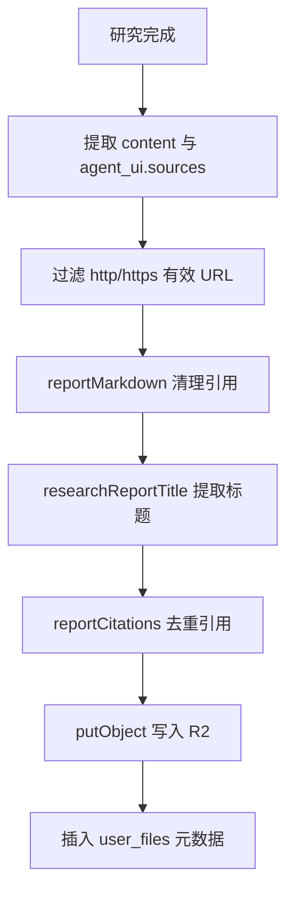
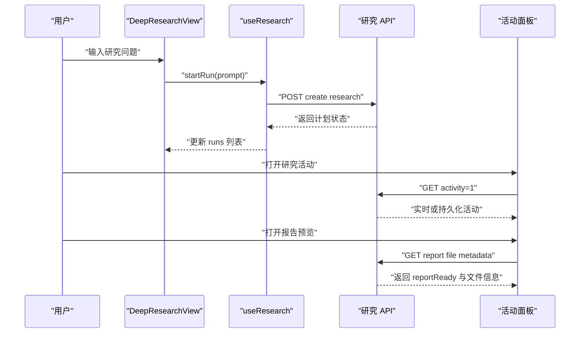
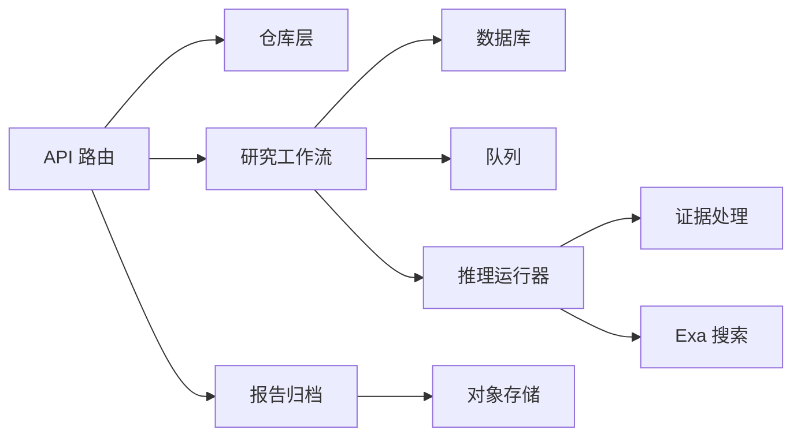

# 深度研究

<cite>
**本文引用的文件**   
- [docs/deep-research.md](file://docs/deep-research.md)
- [src/shared/lib/deep-research.ts](file://src/shared/lib/deep-research.ts)
- [src/server/chat/research.ts](file://src/server/chat/research.ts)
- [src/server/chat/research-report.ts](file://src/server/chat/research-report.ts)
- [src/server/repositories/deep-research.repository.ts](file://src/server/repositories/deep-research.repository.ts)
- [src/shared/lib/research-state.ts](file://src/shared/lib/research-state.ts)
- [src/server/search/exa.ts](file://src/server/search/exa.ts)
- [src/server/inference/research-evidence.ts](file://src/server/inference/research-evidence.ts)
- [src/shared/lib/research-report.ts](file://src/shared/lib/research-report.ts)
- [tests/durable-research.test.ts](file://tests/durable-research.test.ts)
- [src/app/api/v1/chats/[chatId]/research/[toolId]/route.ts](file://src/app/api/v1/chats/[chatId]/research/[toolId]/route.ts)
- [src/client/components/deep-research-view.tsx](file://src/client/components/deep-research-view.tsx)
</cite>

## 目录
1. [引言](#引言)
2. [项目结构](#项目结构)
3. [核心组件](#核心组件)
4. [架构总览](#架构总览)
5. [详细组件分析](#详细组件分析)
6. [依赖关系分析](#依赖关系分析)
7. [性能与调优](#性能与调优)
8. [故障排查指南](#故障排查指南)
9. [结论](#结论)

## 引言
深度研究是一个面向复杂问题的持久化、可中断、可恢复的研究执行系统。它从用户输入或助手生成的研究计划出发，创建任务清单，通过 Exa 搜索引擎并行获取证据，再由推理引擎进行多轮交叉验证，最终生成带引用的研究报告。系统在 Cloudflare 队列和数据库之间协调，支持启动、暂停、恢复、重试、取消等状态机操作，并通过活动面板实时展示执行过程。

## 项目结构
围绕“深度研究”的代码主要分布在以下层次：
- 共享类型与解析逻辑：研究计划解析、显示前缀、任务计数、失败消息、搜索上限等。
- 服务端工作流：研究调度、状态迁移、结果归档、报告导出。
- 数据访问层：研究计划、任务状态、来源 URL、搜索次数、助手消息 ID。
- 搜索与证据层：Exa 集成、搜索结果去重、证据摘要预算、可重试错误分类。
- 客户端界面：研究入口页面、计划卡片、活动面板、报告预览与导出。

**图表来源**
- [src/app/api/v1/chats/[chatId]/research/[toolId]/route.ts:1-94](file://src/app/api/v1/chats/[chatId]/research/[toolId]/route.ts#L1-L94)
- [src/server/chat/research.ts:1-204](file://src/server/chat/research.ts#L1-L204)
- [src/server/repositories/deep-research.repository.ts:1-93](file://src/server/repositories/deep-research.repository.ts#L1-L93)
- [src/server/search/exa.ts:1-238](file://src/server/search/exa.ts#L1-L238)
- [src/server/inference/research-evidence.ts:1-105](file://src/server/inference/research-evidence.ts#L1-L105)
- [src/server/chat/research-report.ts:1-108](file://src/server/chat/research-report.ts#L1-L108)

**章节来源**
- [docs/deep-research.md:1-39](file://docs/deep-research.md#L1-L39)

## 核心组件
- 研究计划模型与解析：将助手的 Markdown JSON 代码块转换为严格校验的计划对象，并兼容历史文本计划。
- 研究状态模型：定义计划状态、任务状态、来源统计、搜索次数、助手消息标识和错误信息。
- 研究工作流控制器：负责创建、启动、编辑、暂停、恢复、重试、取消、恢复过期计划以及活动结算。
- 研究仓库层：封装 SQL 查询，提供按聊天/工具 ID 查询、创建、更新任务状态、来源去重计数等能力。
- Exa 搜索引擎封装：统一搜索请求构建、流式引用返回、非流式回退、URL 内容抓取和配置检测。
- 证据处理模块：限制搜索结果条目数量、摘要长度、跨多轮对话的证据字符预算，并识别可重试错误。
- 报告生成与归档：从完成的研究消息中提取 Markdown、标题、引用列表，写入对象存储并记录元数据。
- 客户端视图与交互：研究入口、建议问题、最近研究列表、活动面板、报告预览与导出。

**章节来源**
- [src/shared/lib/deep-research.ts:1-90](file://src/shared/lib/deep-research.ts#L1-L90)
- [src/shared/lib/research-state.ts:1-72](file://src/shared/lib/research-state.ts#L1-L72)
- [src/server/chat/research.ts:1-204](file://src/server/chat/research.ts#L1-L204)
- [src/server/repositories/deep-research.repository.ts:1-93](file://src/server/repositories/deep-research.repository.ts#L1-L93)
- [src/server/search/exa.ts:1-238](file://src/server/search/exa.ts#L1-L238)
- [src/server/inference/research-evidence.ts:1-105](file://src/server/inference/research-evidence.ts#L1-L105)
- [src/server/chat/research-report.ts:1-108](file://src/server/chat/research-report.ts#L1-L108)
- [src/client/components/deep-research-view.tsx:1-200](file://src/client/components/deep-research-view.tsx#L1-L200)

## 架构总览
深度研究的整体流程遵循“计划持久化 → 队列延迟调度 → 后台任务入场 → 多轮推理与工具调用 → 证据收集 → 报告归档 → 前端监控与导出”的模式。关键设计点包括：
- 使用原子状态迁移和稳定键避免重复创建研究任务。
- 通过 Cloudflare 队列实现延迟启动，并由看门狗扫描过期计划作为容错路径。
- 使用助手专属 continuation 通道，不合成用户提示，保持会话语义清晰。
- 在推理过程中启用 provider thinking，允许更多推理轮次和执行切片。
- 将来源 URL 去重计数与搜索调用次数分离，前者表示不同网页数，后者表示搜索 API 调用次数。
- 报告以 Markdown 形式写入私有对象存储，前端只读取摘要和引用元数据。

**图表来源**
- [src/app/api/v1/chats/[chatId]/research/[toolId]/route.ts:1-94](file://src/app/api/v1/chats/[chatId]/research/[toolId]/route.ts#L1-L94)
- [src/server/chat/research.ts:1-204](file://src/server/chat/research.ts#L1-L204)
- [src/server/search/exa.ts:1-238](file://src/server/search/exa.ts#L1-L238)
- [src/server/chat/research-report.ts:1-108](file://src/server/chat/research-report.ts#L1-L108)

## 详细组件分析

### 研究计划创建与解析
研究计划由助手输出，客户端或服务端需要将其从 Markdown JSON 代码块中解析为结构化对象。解析器对标题、摘要、任务数量和长度进行严格校验；若解析失败则返回空值，保证只有完整有效的计划才进入交互渲染。同时提供兼容函数，用于从历史消息中恢复旧版文本计划，并在显式动作下迁移到持久化计划表。

**图表来源**
- [src/shared/lib/deep-research.ts:1-90](file://src/shared/lib/deep-research.ts#L1-L90)

**章节来源**
- [src/shared/lib/deep-research.ts:1-90](file://src/shared/lib/deep-research.ts#L1-L90)
- [src/app/api/v1/chats/[chatId]/research/[toolId]/route.ts:1-94](file://src/app/api/v1/chats/[chatId]/research/[toolId]/route.ts#L1-L94)

### 研究任务状态机与生命周期
研究计划的状态包括 pending、editing、starting、running、paused、complete、failed、cancelled。状态转换通过原子 SQL 更新实现，确保并发启动、手动启动、定时器启动不会重复创建作业。每个状态还关联聊天生成作业、任务状态数组、自动启动时间、来源 URL 集合和助手消息 ID。

**图表来源**
- [src/server/chat/research.ts:1-204](file://src/server/chat/research.ts#L1-L204)
- [src/shared/lib/research-state.ts:1-72](file://src/shared/lib/research-state.ts#L1-L72)
- [src/server/repositories/deep-research.repository.ts:1-93](file://src/server/repositories/deep-research.repository.ts#L1-L93)

**章节来源**
- [src/server/chat/research.ts:1-204](file://src/server/chat/research.ts#L1-L204)
- [src/shared/lib/research-state.ts:1-72](file://src/shared/lib/research-state.ts#L1-L72)
- [src/server/repositories/deep-research.repository.ts:1-93](file://src/server/repositories/deep-research.repository.ts#L1-L93)

### 并行搜索机制与证据收集策略
研究执行时，系统会为每个任务发起多个角度的搜索。单次 web_search 最多返回 30 条结果，每条结果的 snippet 与 highlights 被合并为摘要，并按固定上限截断。所有搜索结果在进入下一轮模型之前会被标准化，避免重复片段占用上下文。证据摘要在整个研究对话中存在共享字符预算，超过预算时会按比例缩小各条结果的摘要，但保留 URL 与工具调用/结果配对关系。

**图表来源**
- [src/server/inference/research-evidence.ts:1-105](file://src/server/inference/research-evidence.ts#L1-L105)
- [src/server/search/exa.ts:1-238](file://src/server/search/exa.ts#L1-L238)

**章节来源**
- [src/server/inference/research-evidence.ts:1-105](file://src/server/inference/research-evidence.ts#L1-L105)
- [src/server/search/exa.ts:1-238](file://src/server/search/exa.ts#L1-L238)
- [tests/durable-research.test.ts:1-200](file://tests/durable-research.test.ts#L1-L200)

### 与 Exa 搜索引擎的集成
Exa 集成提供两种模式：
- 直接结果模式：直接调用 Exa `/search`，请求最多 30 条结果，返回 source previews，不包含等待合成的答案。
- 流式搜索模式：通过 `streamSearch` 逐步收到引用，同时维护 URL 去重映射，超时后回退到阻塞式搜索。

此外还提供按 URL 批量抓取内容的接口，最大文本长度默认 8000 字符，优先使用 text 字段，否则使用 highlights 拼接。Exa 配置通过环境变量注入，未配置时服务会拒绝搜索。

**图表来源**
- [src/server/search/exa.ts:1-238](file://src/server/search/exa.ts#L1-L238)

**章节来源**
- [src/server/search/exa.ts:1-238](file://src/server/search/exa.ts#L1-L238)

### 搜索结果去重与排序算法
去重发生在两个层面：
- URL 级别去重：`researchSourceUrls` 使用 URL 对象解析协议、主机名与路径，忽略 hash 片段，排除非法 URL，返回唯一页面集合。该集合用于统计“不同网页数”。
- 搜索结果内部去重：Exa 流式模式下用 Map 维护已见 URL；非流式模式下由上层调用方去重。

排序方面，Exa 使用 `type: "auto"` 平衡质量与延迟，可通过 `userLocation` 偏向本地区域。系统没有在后端对搜索结果做额外评分排序，而是依赖 Exa 自身的排名。

**章节来源**
- [src/shared/lib/research-state.ts:1-72](file://src/shared/lib/research-state.ts#L1-L72)
- [src/server/search/exa.ts:1-238](file://src/server/search/exa.ts#L1-L238)

### 研究报告的结构与格式化输出
完成的研究会以普通助手消息保存，随后归档为 Markdown 报告。报告生成过程：
- 从完成消息内容与 JSON 元数据中提取 sources。
- 将引用标记替换为真实 URL。
- 提取一级标题作为报告标题，若不存在则回退到计划标题。
- 去重提取报告中实际使用的链接，过滤无效协议。
- 写入 R2 对象存储，key 为用户与 plan ID 的稳定路径。
- 在 `user_files` 中记录文件名、大小、哈希、标题、引用列表与耗时。

**图表来源**
- [src/server/chat/research-report.ts:1-108](file://src/server/chat/research-report.ts#L1-L108)
- [src/shared/lib/research-report.ts:1-74](file://src/shared/lib/research-report.ts#L1-L74)

**章节来源**
- [src/server/chat/research-report.ts:1-108](file://src/server/chat/research-report.ts#L1-L108)
- [src/shared/lib/research-report.ts:1-74](file://src/shared/lib/research-report.ts#L1-L74)

### 用户界面交互流程与状态管理
客户端深研入口页提供输入框、建议问题和最近研究列表。用户提交问题时，先校验登录态与非空内容，再调用后端创建研究任务。研究运行时，右侧活动面板拉取实时活动，若无实时活动则回退到持久化的助手转录。已完成研究的消息旁显示报告预览卡片，打开后可查看 Markdown、来源与导出选项。

**图表来源**
- [src/client/components/deep-research-view.tsx:1-200](file://src/client/components/deep-research-view.tsx#L1-L200)
- [src/app/api/v1/chats/[chatId]/research/[toolId]/route.ts:1-94](file://src/app/api/v1/chats/[chatId]/research/[toolId]/route.ts#L1-L94)

**章节来源**
- [src/client/components/deep-research-view.tsx:1-200](file://src/client/components/deep-research-view.tsx#L1-L200)
- [src/app/api/v1/chats/[chatId]/research/[toolId]/route.ts:1-94](file://src/app/api/v1/chats/[chatId]/research/[toolId]/route.ts#L1-L94)

## 依赖关系分析
深度研究的关键依赖如下：
- API 路由依赖会话认证、聊天权限、仓库层、研究工作流、报告归档和实时活动读取。
- 研究工作流依赖数据库连接池、聊天服务、Cloudflare 上下文、错误类、仓库层和持久化生成触发器。
- 仓库层依赖数据库连接池和公共状态转换函数。
- Exa 搜索依赖环境变量中的 API Key 与外部 API。
- 证据处理依赖 OpenAI 输入项类型与推理对话结构。
- 报告归档依赖对象存储与消息/作业表。

**图表来源**
- [src/app/api/v1/chats/[chatId]/research/[toolId]/route.ts:1-94](file://src/app/api/v1/chats/[chatId]/research/[toolId]/route.ts#L1-L94)
- [src/server/chat/research.ts:1-204](file://src/server/chat/research.ts#L1-L204)
- [src/server/repositories/deep-research.repository.ts:1-93](file://src/server/repositories/deep-research.repository.ts#L1-L93)
- [src/server/search/exa.ts:1-238](file://src/server/search/exa.ts#L1-L238)
- [src/server/inference/research-evidence.ts:1-105](file://src/server/inference/research-evidence.ts#L1-L105)
- [src/server/chat/research-report.ts:1-108](file://src/server/chat/research-report.ts#L1-L108)

**章节来源**
- [src/app/api/v1/chats/[chatId]/research/[toolId]/route.ts:1-94](file://src/app/api/v1/chats/[chatId]/research/[toolId]/route.ts#L1-L94)
- [src/server/chat/research.ts:1-204](file://src/server/chat/research.ts#L1-L204)
- [src/server/repositories/deep-research.repository.ts:1-93](file://src/server/repositories/deep-research.repository.ts#L1-L93)
- [src/server/search/exa.ts:1-238](file://src/server/search/exa.ts#L1-L238)
- [src/server/inference/research-evidence.ts:1-105](file://src/server/inference/research-evidence.ts#L1-L105)
- [src/server/chat/research-report.ts:1-108](file://src/server/chat/research-report.ts#L1-L108)

## 性能与调优
- 搜索参数：普通聊天保留 10 条结果；深度研究支持 1 到 30 条，默认 30。过大值会增加模型上下文压力。
- 证据预算：搜索摘要最大 1800 字符，全文抓取最大 8000 字符；整段研究对话的证据字符预算为 140000 字符，超出时按比例压缩。
- 推理边界：每次运行限制 96 轮模型调用，最多 48 个执行切片，约 3.6 小时上限。
- 超时控制：Exa 流式搜索超时 22 秒，回退搜索超时 12 秒；研究内模型静默超时 120 秒。
- 并发与去重：URL 去重降低重复网页造成的冗余；source_count 与 search_count 分开统计，便于观察真实覆盖范围与 API 调用成本。
- 缓存与存储：报告写入 R2，前端不重复下载完整报告，仅展示预览与引用列表；导出在浏览器侧完成，不向外部转换服务发送内容。

优化建议：
- 对于宽泛主题，适当减少 web_search.num_results，以降低证据预算压力。
- 对长链研究，分阶段保存 checkpoint，避免一次性累积过多证据。
- 使用 `userLocation` 提高搜索结果相关性，减少无关网页带来的噪声。
- 监控 search_count 与 source_count 差异，若差异过大说明存在大量重复 URL 或低质量结果。

**章节来源**
- [docs/deep-research.md:1-39](file://docs/deep-research.md#L1-L39)
- [src/shared/lib/research-state.ts:1-72](file://src/shared/lib/research-state.ts#L1-L72)
- [src/server/inference/research-evidence.ts:1-105](file://src/server/inference/research-evidence.ts#L1-L105)
- [src/server/search/exa.ts:1-238](file://src/server/search/exa.ts#L1-L238)

## 故障排查指南
常见问题与定位方式：
- 计划无法启动：检查计划是否处于 pending 或 editing，确认 auto_start_at 是否到期，或手动调用 start。
- 启动后无活动：检查后台作业是否被取消或暂停；查看 assistant_message_id 是否存在，活动接口是否返回 live turn。
- 搜索结果为空：确认 Exa API Key 已配置；检查 directResults 与 streamSearch 是否都失败；查看日志中的搜索错误。
- 证据不足或上下文超限：检查证据预算是否被压缩；尝试减少搜索结果数量或缩短历史记录。
- 报告未生成：检查研究状态是否为 complete，assistant_message_id 是否存在；查看 R2 对象是否写入成功。
- 重试失败：确认失败原因不是凭据错误；临时错误如 429、5xx、timeout 会被视为可重试。

安全与可见性：
- 公开状态使用用户友好错误消息，不暴露 provider 诊断细节。
- 原始失败信息保存在私有作业诊断与遥测中。
- 凭据存储在 Worker secrets，浏览器请求必须经过所有者认证。

**章节来源**
- [src/shared/lib/research-state.ts:1-72](file://src/shared/lib/research-state.ts#L1-L72)
- [tests/durable-research.test.ts:201-280](file://tests/durable-research.test.ts#L201-L280)
- [docs/deep-research.md:1-39](file://docs/deep-research.md#L1-L39)

## 结论
深度研究通过严格的计划解析、稳定的状态机、并行搜索、证据预算与报告归档，构建了一个可中断、可恢复、可审计的研究执行系统。它与 Exa 搜索引擎协作，兼顾速度与证据质量；通过 Cloudflare 队列和数据库持久化，保证长时间运行的可靠性；通过客户端活动面板与报告预览，提供直观的用户体验。生产部署时应关注搜索参数、证据预算、Exa 配置和对象存储权限，并根据业务场景调整研究轮次与结果数量。