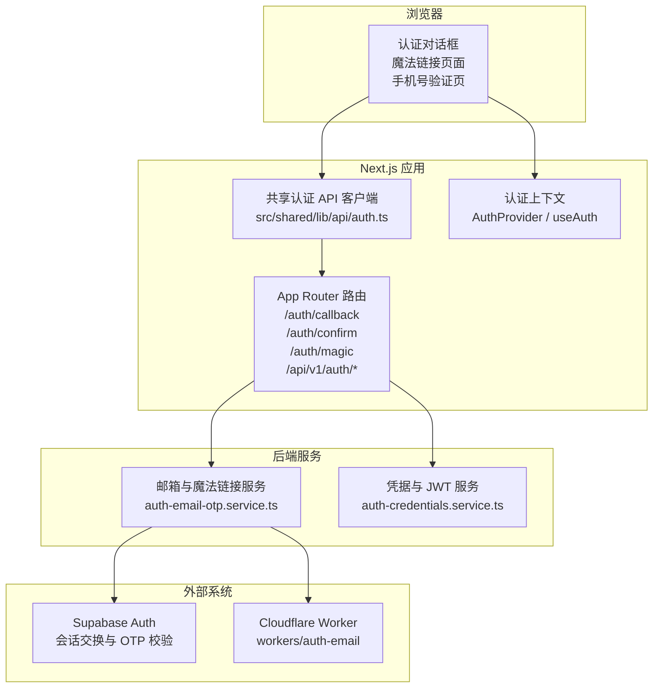
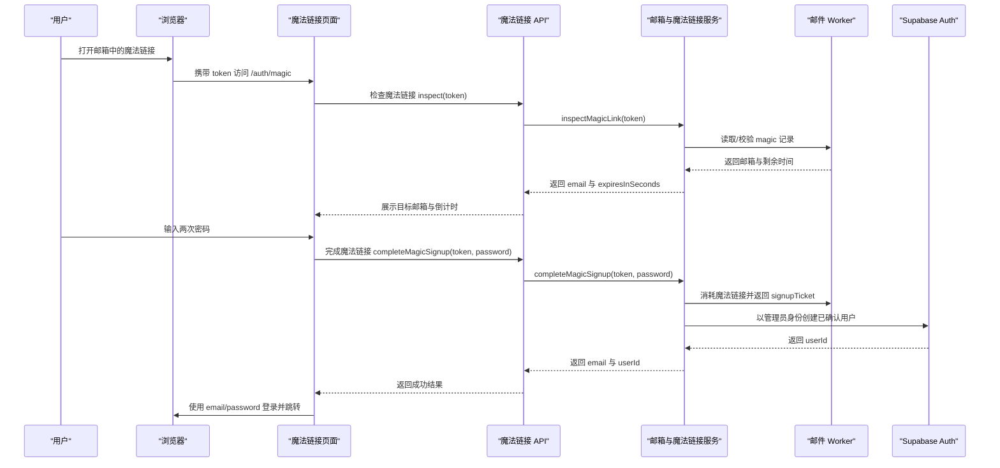
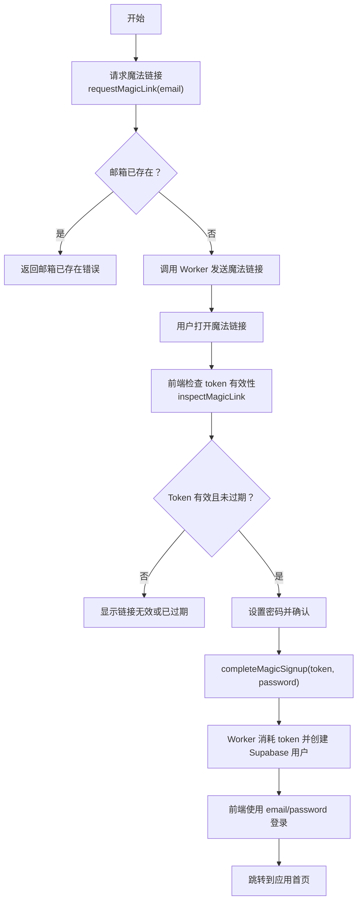
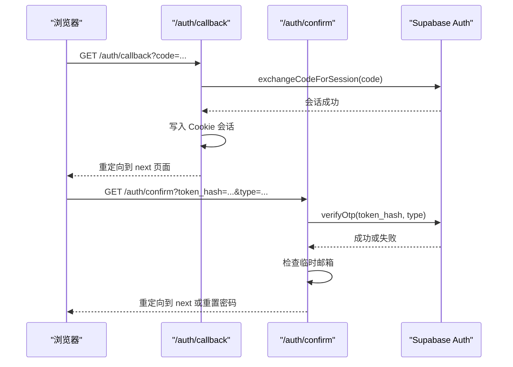
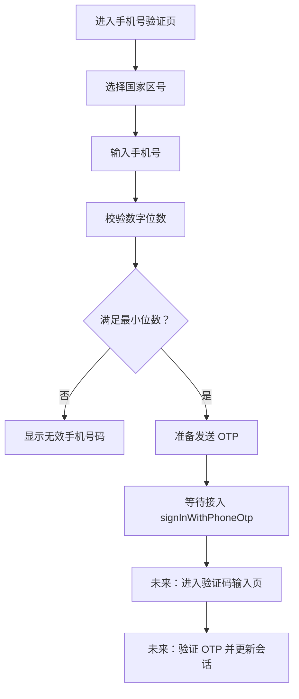
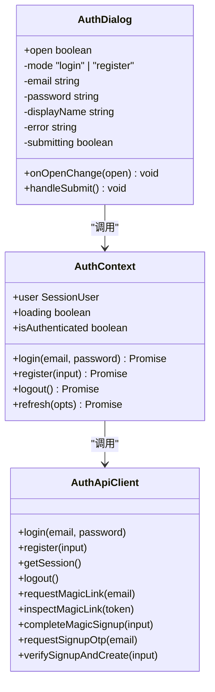
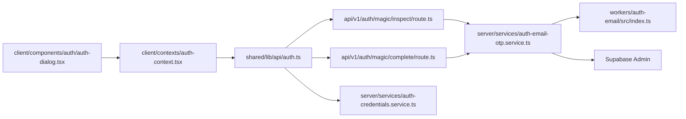

# 魔法链接认证

<cite>
**本文引用的文件 **
- [src/app/auth/magic/page.tsx](file://src/app/auth/magic/page.tsx)
- [src/app/auth/callback/route.ts](file://src/app/auth/callback/route.ts)
- [src/app/auth/confirm/route.ts](file://src/app/auth/confirm/route.ts)
- [src/app/login/page.tsx](file://src/app/login/page.tsx)
- [src/app/signup/page.tsx](file://src/app/signup/page.tsx)
- [src/app/verify-phone/page.tsx](file://src/app/verify-phone/page.tsx)
- [src/app/api/v1/auth/magic/inspect/route.ts](file://src/app/api/v1/auth/magic/inspect/route.ts)
- [src/app/api/v1/auth/magic/complete/route.ts](file://src/app/api/v1/auth/magic/complete/route.ts)
- [src/shared/lib/api/auth.ts](file://src/shared/lib/api/auth.ts)
- [src/client/hooks/use-auth.ts](file://src/client/hooks/use-auth.ts)
- [src/client/contexts/auth-context.tsx](file://src/client/contexts/auth-context.tsx)
- [src/client/components/auth/auth-dialog.tsx](file://src/client/components/auth/auth-dialog.tsx)
- [src/client/components/auth/verify-phone-page.tsx](file://src/client/components/auth/verify-phone-page.tsx)
- [src/server/services/auth-email-otp.service.ts](file://src/server/services/auth-email-otp.service.ts)
- [src/server/services/auth-credentials.service.ts](file://src/server/services/auth-credentials.service.ts)
- [workers/auth-email/src/index.ts](file://workers/auth-email/src/index.ts)
- [docs/auth/oauth-callbacks.md](file://docs/auth/oauth-callbacks.md)
</cite>

## 目录
1. [简介](#简介)
2. [项目结构](#项目结构)
3. [核心组件](#核心组件)
4. [架构总览](#架构总览)
5. [详细组件分析](#详细组件分析)
6. [依赖关系分析](#依赖关系分析)
7. [性能与可用性](#性能与可用性)
8. [故障排查指南](#故障排查指南)
9. [结论](#结论)

## 简介
本文件面向 Magic Links 认证系统，覆盖以下能力：
- 基于 Supabase 的无密码登录：邮箱魔法链接发送、链接校验、用户会话建立。
- 手机号 OTP 验证流程：验证码发送、校验、账户注册与登录状态管理。
- 前端认证对话框：表单处理、错误提示、用户引导。
- 安全设计：防重放、令牌时效、一次性票据、临时邮箱拦截、会话超时处理。
- 集成方式、配置项与常见问题解决方案。

该系统的认证路径分为两类：
- 邮箱魔法链接：适用于新用户注册，通过一次性链接完成身份确认并设置密码。
- 手机号 OTP：用于辅助手机号验证，当前页面已就绪，发送与校验逻辑预留接口。

## 项目结构
认证相关代码分布在 Next.js App Router 路由、共享 API 客户端、前端上下文与组件、服务端业务服务以及独立的 Cloudflare Workers 中。

**图表来源**
- [src/app/auth/callback/route.ts:1-87](file://src/app/auth/callback/route.ts#L1-L87)
- [src/app/auth/confirm/route.ts:1-81](file://src/app/auth/confirm/route.ts#L1-L81)
- [src/app/api/v1/auth/magic/inspect/route.ts:1-23](file://src/app/api/v1/auth/magic/inspect/route.ts#L1-L23)
- [src/app/api/v1/auth/magic/complete/route.ts:1-35](file://src/app/api/v1/auth/magic/complete/route.ts#L1-L35)
- [src/shared/lib/api/auth.ts:1-176](file://src/shared/lib/api/auth.ts#L1-L176)
- [src/client/contexts/auth-context.tsx:1-200](file://src/client/contexts/auth-context.tsx#L1-L200)
- [src/server/services/auth-email-otp.service.ts:1-477](file://src/server/services/auth-email-otp.service.ts#L1-L477)
- [workers/auth-email/src/index.ts:1-200](file://workers/auth-email/src/index.ts#L1-L200)

**章节来源**
- [src/app/auth/callback/route.ts:1-87](file://src/app/auth/callback/route.ts#L1-L87)
- [src/app/auth/confirm/route.ts:1-81](file://src/app/auth/confirm/route.ts#L1-L81)
- [src/app/api/v1/auth/magic/inspect/route.ts:1-23](file://src/app/api/v1/auth/magic/inspect/route.ts#L1-L23)
- [src/app/api/v1/auth/magic/complete/rroute.ts:1-35](file://src/app/api/v1/auth/magic/complete/route.ts#L1-L35)
- [src/shared/lib/api/auth.ts:1-176](file://src/shared/lib/api/auth.ts#L1-L176)
- [src/client/contexts/auth-context.tsx:1-200](file://src/client/contexts/auth-context.tsx#L1-L200)
- [src/server/services/auth-email-otp.service.ts:1-477](file://src/server/services/auth-email-otp.service.ts#L1-L477)
- [workers/auth-email/src/index.ts:1-200](file://workers/auth-email/src/index.ts#L1-L200)

## 核心组件
- 认证 API 客户端：封装登录、注册、会话获取、邮箱状态检查、短信 OTP、魔法链接请求、检查与完成等调用。
- 认证上下文：统一维护用户会话、加载状态、OAuth、魔法链接、手机号 OTP、重置密码和登出方法。
- 服务端邮箱与魔法链接服务：负责邮箱形状校验、临时邮箱拦截、验证码或魔法链接请求、一次性票据创建、账号创建。
- 认证回调路由：处理 Supabase OAuth 回调和通用 OTP 确认，写入 Cookie 会话。
- 魔法链接页面：解析 token、检查有效期、引导新用户设置密码并完成注册。
- 手机号验证页面：选择国家区号、输入手机号、计算 E.164 号码，当前为待接入发送与校验的阶段。
- Cloudflare Worker：实现 OTP 与魔法链接的发送、校验、冷却控制、KV 存储与安全鉴权。

**章节来源**
- [src/shared/lib/api/auth.ts:1-176](file://src/shared/lib/api/auth.ts#L1-L176)
- [src/client/contexts/auth-context.tsx:1-200](file://src/client/contexts/auth-context.tsx#L1-L200)
- [src/server/services/auth-email-otp.service.ts:1-477](file://src/server/services/auth-email-otp.service.ts#L1-L477)
- [src/app/auth/callback/route.ts:1-87](file://src/app/auth/callback/route.ts#L1-L87)
- [src/app/auth/magic/page.tsx:1-200](file://src/app/auth/magic/page.tsx#L1-L200)
- [src/client/components/auth/verify-phone-page.tsx:1-178](file://src/client/components/auth/verify-phone-page.tsx#L1-L178)
- [workers/auth-email/src/index.ts:1-200](file://workers/auth-email/src/index.ts#L1-L200)

## 架构总览
Magic Links 认证的核心数据流如下：

**图表来源**
- [src/app/auth/magic/page.tsx:1-200](file://src/app/auth/magic/page.tsx#L1-L200)
- [src/app/api/v1/auth/magic/inspect/route.ts:1-23](file://src/app/api/v1/auth/magic/inspect/route.ts#L1-L23)
- [src/app/api/v1/auth/magic/complete/route.ts:1-35](file://src/app/api/v1/auth/magic/complete/route.ts#L1-L35)
- [src/server/services/auth-email-otp.service.ts:200-477](file://src/server/services/auth-email-otp.service.ts#L200-L477)
- [workers/auth-email/src/index.ts:1-200](file://workers/auth-email/src/index.ts#L1-L200)

## 详细组件分析

### 邮箱魔法链接注册流程
魔法链接流程用于“新用户注册”。系统不会让现有用户直接通过魔法链接登录，而是要求现有用户使用邮箱密码登录；魔法链接仅用于首次创建并确认账户。

关键步骤：
1. 前端发起 `requestMagicLink`，服务端校验邮箱不为空且不是临时邮箱，再判断邮箱是否已存在。
2. 若邮箱不存在，服务端调用 Worker 发送邮件，或在开发模式下生成本地调试链接。
3. 用户点击链接进入 `/auth/magic?token=...`，前端调用 `inspectMagicLink` 查看邮箱和有效期，但不消耗 token。
4. 用户设置密码后，前端调用 `completeMagicSignup`。
5. Worker 消费魔法链接，返回一次性 signupTicket 与邮箱。
6. 服务端调用 Supabase Admin 创建已确认用户，并写入 profile。
7. 前端使用返回的 email/password 执行常规登录，建立应用会话。

**图表来源**
- [src/shared/lib/api/auth.ts:110-176](file://src/shared/lib/api/auth.ts#L110-L176)
- [src/server/services/auth-email-otp.service.ts:260-477](file://src/server/services/auth-email-otp.service.ts#L260-L477)
- [src/app/api/v1/auth/magic/inspect/route.ts:1-23](file://src/app/api/v1/auth/magic/inspect/route.ts#L1-L23)
- [src/app/api/v1/auth/magic/complete/route.ts:1-35](file://src/app/api/v1/auth/magic/complete/route.ts#L1-L35)
- [src/app/auth/magic/page.tsx:1-200](file://src/app/auth/magic/page.tsx#L1-L200)

**章节来源**
- [src/shared/lib/api/auth.ts:110-176](file://src/shared/lib/api/auth.ts#L110-L176)
- [src/server/services/auth-email-otp.service.ts:260-477](file://src/server/services/auth-email-otp.service.ts#L260-L477)
- [src/app/api/v1/auth/magic/inspect/route.ts:1-23](file://src/app/api/v1/auth/magic/inspect/route.ts#L1-L23)
- [src/app/api/v1/auth/magic/complete/route.ts:1-35](file://src/app/api/v1/auth/magic/complete/route.ts#L1-L35)
- [src/app/auth/magic/page.tsx:1-200](file://src/app/auth/magic/page.tsx#L1-L200)

### Supabase 回调与通用 OTP 确认
Supabase 提供两类回调入口：
- `/auth/callback`：处理社交 OAuth 回调或 PKCE code exchange。
- `/auth/confirm`：处理通用 OTP 确认，包括注册、恢复、邮箱变更等。

在 `/auth/callback` 中：
- 如果请求携带 `code`，则调用 `exchangeCodeForSession`。
- 如果携带 `token_hash` 与 `type`，则调用 `verifyOtp`。
- 成功后写入 Supabase Session Cookie，并根据环境设置 `sameSite=lax` 与生产环境的 `secure=true`。
- 对临时邮箱进行拦截：检测到 disposable email 时主动登出并重定向到登录页。

在 `/auth/confirm` 中：
- 校验 `token_hash` 与 `type`。
- 调用 Supabase 的 `verifyOtp`。
- 如果是恢复流程，重定向到重置密码页面。
- 否则根据 `next` 参数安全跳转，默认回 `/new`。

**图表来源**
- [src/app/auth/callback/route.ts:1-87](file://src/app/auth/callback/route.ts#L1-L87)
- [src/app/auth/confirm/route.ts:1-81](file://src/app/auth/confirm/route.ts#L1-L81)

**章节来源**
- [src/app/auth/callback/route.ts:1-87](file://src/app/auth/callback/route.ts#L1-L87)
- [src/app/auth/confirm/route.ts:1-81](file://src/app/auth/confirm/route.ts#L1-L81)

### 手机号 OTP 验证流程
手机号验证页面位于 `/verify-phone`，主要职责是：
- 选择国家区号。
- 输入手机号。
- 将号码转换为 E.164 格式。
- 启用继续按钮前校验至少包含最小位数。

当前实现中，提交逻辑仍保留 TODO，尚未真正调用 `signInWithPhoneOtp` 或后续验证码页面。因此，手机号 OTP 目前处于“前端界面就绪、后端流程待接入”的状态。

**图表来源**
- [src/app/verify-phone/page.tsx:1-16](file://src/app/verify-phone/page.tsx#L1-L16)
- [src/client/components/auth/verify-phone-page.tsx:1-178](file://src/client/components/auth/verify-phone-page.tsx#L1-L178)
- [src/client/contexts/auth-context.tsx:1-200](file://src/client/contexts/auth-context.tsx#L1-L200)

**章节来源**
- [src/app/verify-phone/page.tsx:1-16](file://src/app/verify-phone/page.tsx#L1-L16)
- [src/client/components/auth/verify-phone-page.tsx:1-178](file://src/client/components/auth/verify-phone-page.tsx#L1-L178)
- [src/client/contexts/auth-context.tsx:1-200](file://src/client/contexts/auth-context.tsx#L1-L200)

### 前端认证对话框与会话状态
认证对话框提供传统邮箱密码登录与注册切换，并通过 `useAuth` 共享全局会话。

- `login` 调用后端 `/api/v1/auth/login`，由凭证服务校验密码哈希并签发 JWT。
- `register` 调用后端 `/api/v1/auth/register`，先哈希密码，再插入 `auth.users`，并创建用户档案。
- `useAuth` 通过 `getSession` 刷新会话，兼容 Supabase 本地会话与服务端会话不一致的场景。
- 当出现账户删除、安全挑战或网络异常时，上下文会尝试保留或清理本地会话，避免误清已登录用户。

**图表来源**
- [src/client/components/auth/auth-dialog.tsx:1-124](file://src/client/components/auth/auth-dialog.tsx#L1-L124)
- [src/client/hooks/use-auth.ts:1-7](file://src/client/hooks/use-auth.ts#L1-L7)
- [src/client/contexts/auth-context.tsx:1-200](file://src/client/contexts/auth-context.tsx#L1-L200)
- [src/shared/lib/api/auth.ts:1-176](file://src/shared/lib/api/auth.ts#L1-L176)
- [src/server/services/auth-credentials.service.ts:1-91](file://src/server/services/auth-credentials.service.ts#L1-L91)

**章节来源**
- [src/client/components/auth/auth-dialog.tsx:1-124](file://src/client/components/auth/auth-dialog.tsx#L1-L124)
- [src/client/hooks/use-auth.ts:1-7](file://src/client/hooks/use-auth.ts#L1-L7)
- [src/client/contexts/auth-context.tsx:1-200](file://src/client/contexts/auth-context.tsx#L1-L200)
- [src/shared/lib/api/auth.ts:1-176](file://src/shared/lib/api/auth.ts#L1-L176)
- [src/server/services/auth-credentials.service.ts:1-91](file://src/server/services/auth-credentials.service.ts#L1-L91)

### 魔法链接页面交互
魔法链接页面承担三个责任：
1. 从 URL 中取出 `token`，若缺失则提示重新申请。
2. 调用 `inspectMagicLink` 获取邮箱与剩余有效期，并启动秒级倒计时。
3. 用户输入两次密码后调用 `completeMagicSignup`，成功后用 email/password 登录并跳转到 `/new`。

错误处理包括：
- Token 缺失。
- 链接无效或过期。
- 密码长度不足。
- 两次密码不一致。
- 创建账户失败。

**章节来源**
- [src/app/auth/magic/page.tsx:1-200](file://src/app/auth/magic/page.tsx#L1-L200)
- [src/shared/lib/api/auth.ts:130-176](file://src/shared/lib/api/auth.ts#L130-L176)

### 登录与注册页面重定向
当前项目的独立登录页 `/login` 已被简化为重定向路由：
- 它将旧书签和第三方错误链接统一到 `/new?auth=1&redirectTo=...`。
- `/signup` 同样被统一为 `/login`，由前端根据邮箱是否存在决定走登录还是注册。

这意味着新用户的邮箱魔法链接、手机号 OTP、邮箱密码登录都集中在同一个认证入口体验下。

**章节来源**
- [src/app/login/page.tsx:1-20](file://src/app/login/page.tsx#L1-L20)
- [src/app/signup/page.tsx:1-30](file://src/app/signup/page.tsx#L1-L30)

## 依赖关系分析

**图表来源**
- [src/shared/lib/api/auth.ts:1-176](file://src/shared/lib/api/auth.ts#L1-L176)
- [src/app/api/v1/auth/magic/inspect/route.ts:1-23](file://src/app/api/v1/auth/magic/inspect/route.ts#L1-L23)
- [src/app/api/v1/auth/magic/complete/route.ts:1-35](file://src/app/api/v1/auth/magic/complete/route.ts#L1-L35)
- [src/server/services/auth-email-otp.service.ts:1-477](file://src/server/services/auth-email-otp.service.ts#L1-L477)
- [workers/auth-email/src/index.ts:1-200](file://workers/auth-email/src/index.ts#L1-L200)
- [src/server/services/auth-credentials.service.ts:1-91](file://src/server/services/auth-credentials.service.ts#L1-L91)
- [src/client/contexts/auth-context.tsx:1-200](file://src/client/contexts/auth-context.tsx#L1-L200)
- [src/client/components/auth/auth-dialog.tsx:1-124](file://src/client/components/auth/auth-dialog.tsx#L1-L124)

**章节来源**
- [src/shared/lib/api/auth.ts:1-176](file://src/shared/lib/api/auth.ts#L1-L176)
- [src/server/services/auth-email-otp.service.ts:1-477](file://src/server/services/auth-email-otp.service.ts#L1-L477)
- [workers/auth-email/src/index.ts:1-200](file://workers/auth-email/src/index.ts#L1-L200)
- [src/server/services/auth-credentials.service.ts:1-91](file://src/server/services/auth-credentials.service.ts#L1-L91)

## 性能与可用性
- 魔法链接检查不消耗 token：`inspectMagicLink` 只读，真正消耗发生在 `completeMagicSignup`。这降低重复点击导致的副作用。
- 一次性令牌与票据：Worker 和 Node 服务均使用一次性机制，例如 OTP 验证成功后删除记录，魔法链接消费后删除，signupTicket 也仅使用一次。
- 冷却限制：Worker 支持 OTP 与魔法链接的重发冷却时间，防止短时间内大量请求。
- 重试保护：OTP 本地实现包含最大尝试次数，超过后清除记录并拒绝验证。
- 会话 Cookie 安全：生产环境使用 `secure` Cookie，非生产环境保持可调试行为；`sameSite=lax` 适配常见跨站跳转场景。
- 临时邮箱拦截：回调与确认路由都会检查用户邮箱是否为临时邮箱，若是则主动登出并提示。
- 开发模式降级：当 Worker 未配置但开启开发绕过时，Node 服务使用内存 Map 模拟 OTP、魔法链接与票据，便于本地测试。

[本节为通用优化建议总结，不直接分析具体代码行]

## 故障排查指南

### 魔法链接无效或已过期
可能原因：
- 链接缺少 token。
- token 长度不足。
- token 已过期。
- 魔法链接已在 Worker 或本地内存中被消费。

排查要点：
- 确认 `/auth/magic` 页面的 token 是否正确传入。
- 检查 `inspectMagicLink` 与 `completeMagicSignup` 的错误码。
- 开发模式下检查控制台输出的调试链接。

**章节来源**
- [src/app/auth/magic/page.tsx:1-200](file://src/app/auth/magic/page.tsx#L1-L200)
- [src/server/services/auth-email-otp.service.ts:330-477](file://src/server/services/auth-email-otp.service.ts#L330-L477)

### 邮箱已被占用
魔法链接仅用于新用户。若邮箱已存在于 Supabase 或 profile 中，服务端会返回邮箱已存在错误。

处理建议：
- 新用户继续使用魔法链接注册。
- 已有用户改用邮箱密码登录。

**章节来源**
- [src/server/services/auth-email-otp.service.ts:280-320](file://src/server/services/auth-email-otp.service.ts#L280-L320)

### 验证码错误或尝试过多
可能原因：
- 输入的不是 6 位数字。
- 验证码已过期。
- 尝试次数达到上限。

处理建议：
- 清理非数字字符并截断到 6 位。
- 重新请求验证码。
- 检查 Worker 或开发模式的本地 OTP 存储。

**章节来源**
- [src/server/services/auth-email-otp.service.ts:200-260](file://src/server/services/auth-email-otp.service.ts#L200-L260)

### 回调登录后仍提示会话过期
可能原因：
- Supabase 的 PKCE code verifier 找不到对应会话。
- 浏览器 Cookie 未正确写入。
- 重定向地址不安全或被篡改。

处理建议：
- 检查 `/auth/callback` 是否收到 `code` 或 `token_hash+type`。
- 确认 `next` 参数以 `/` 开头且不包含 `//`。
- 检查生产环境下 Cookie 的 `secure` 与 `sameSite` 配置。

**章节来源**
- [src/app/auth/callback/route.ts:1-87](file://src/app/auth/callback/route.ts#L1-L87)

### 手机号 OTP 无法发送
当前手机号验证页面尚未接入真实发送逻辑，属于已知待办。

处理建议：
- 如需端到端测试，优先完成邮箱魔法链接流程。
- 接入 `signInWithPhoneOtp` 与验证码校验流程后再测试手机号 OTP。

**章节来源**
- [src/client/components/auth/verify-phone-page.tsx:1-178](file://src/client/components/auth/verify-phone-page.tsx#L1-L178)

### 社交 OAuth 回调配置问题
Supabase 的 Provider 回调与应用回调不同：
- Provider 回调应指向 Supabase 的 canonical callback。
- 应用回调需要添加到 Supabase 的 URL 配置中。
- Google One Tap 需要正确的 JavaScript origin 与客户端 ID。

**章节来源**
- [docs/auth/oauth-callbacks.md:1-71](file://docs/auth/oauth-callbacks.md#L1-L71)

## 结论
Magic Links 认证在本项目中形成了清晰的分层：
- 前端负责用户引导、表单校验与错误提示。
- Next.js 路由负责接收外部回调、写入会话 Cookie 并做基础安全校验。
- 服务端服务负责业务规则、临时邮箱拦截、一次性票据与账号创建。
- Cloudflare Worker 负责验证码与魔法链接的存储、发送、冷却与消费。
- Supabase 作为身份与会话基础设施，提供 OAuth、OTP 与用户管理。

对于后续演进，建议优先完善手机号 OTP 的发送与校验对接，并将手机号绑定纳入统一的会话与用户资料管理；同时持续强化重放防护、速率限制与审计日志。

[本节为总结性内容，不直接分析具体代码行]