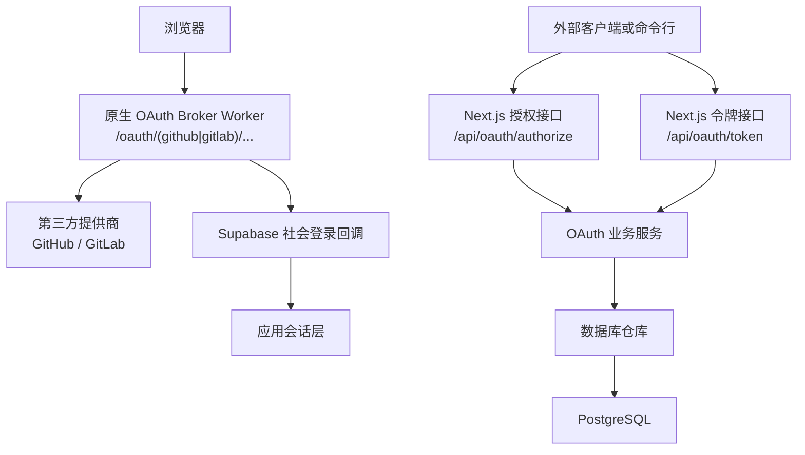
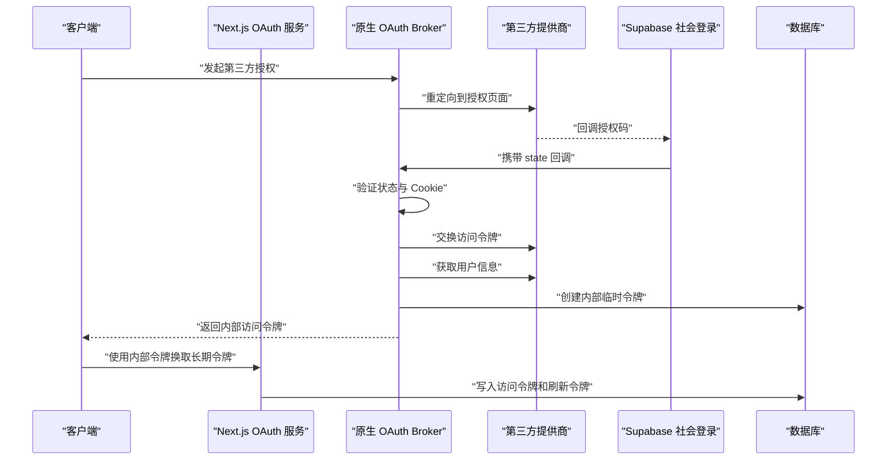
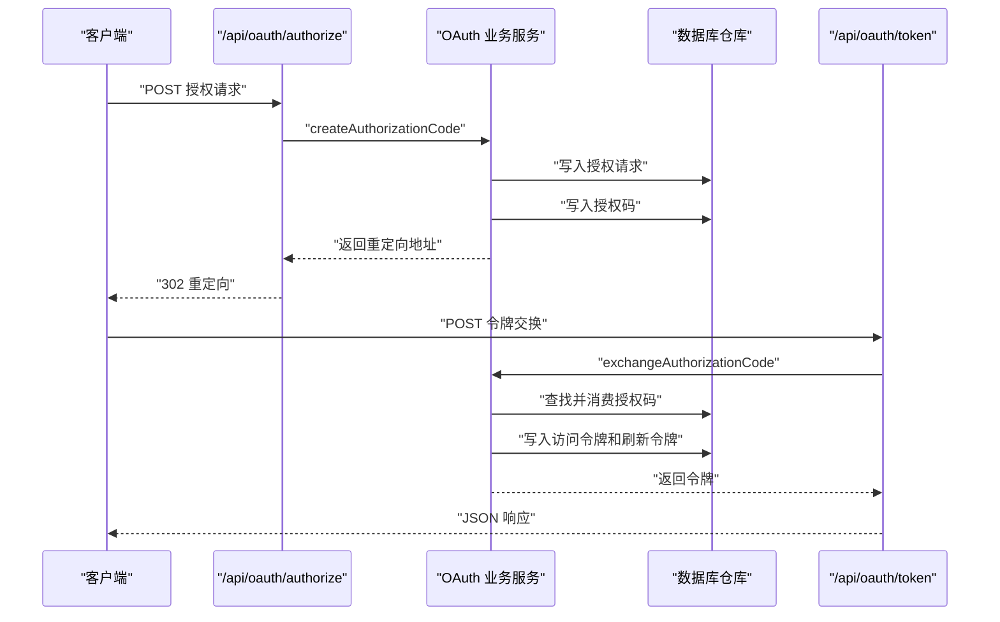
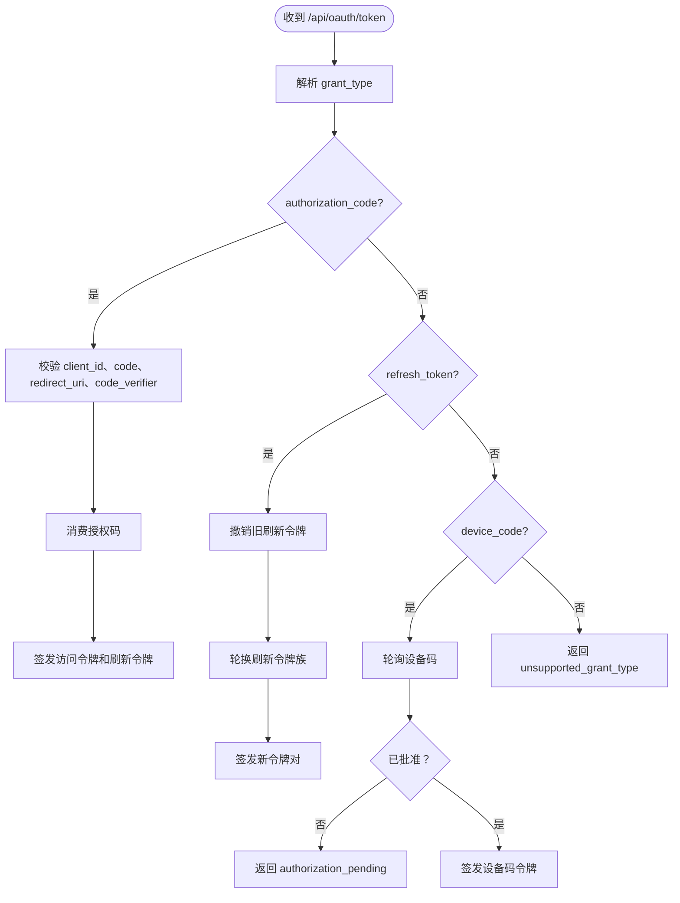
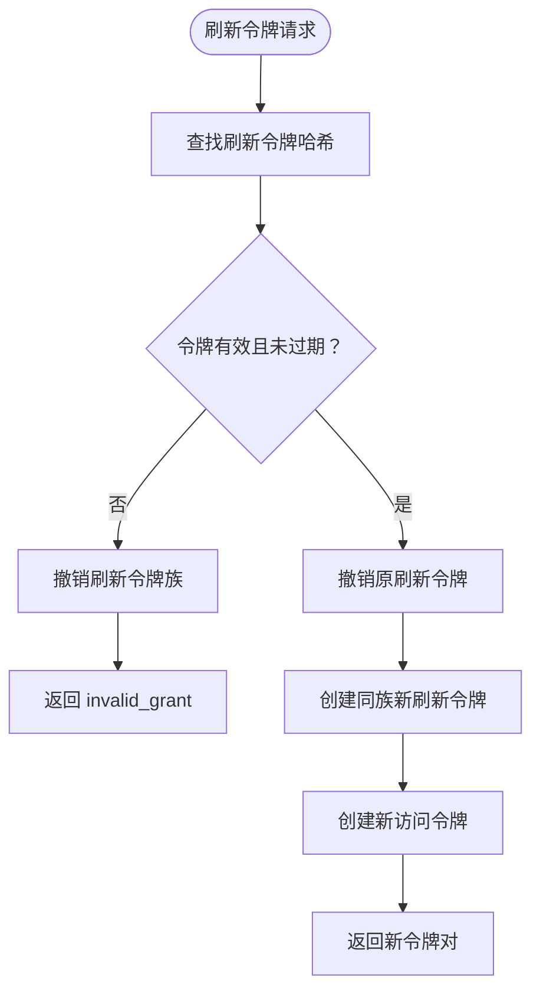
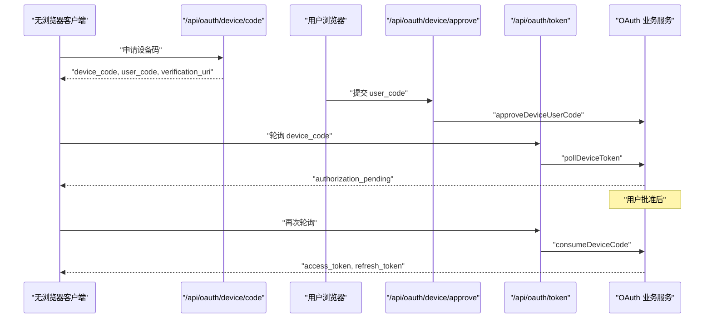
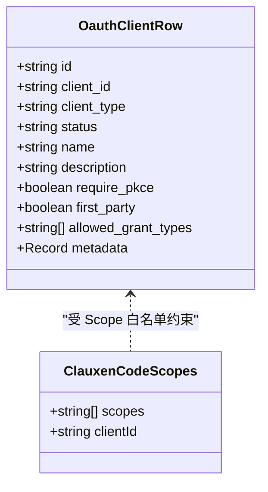
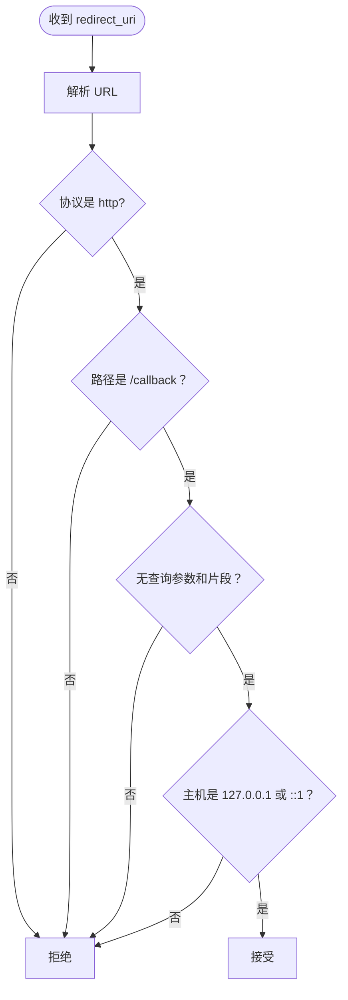
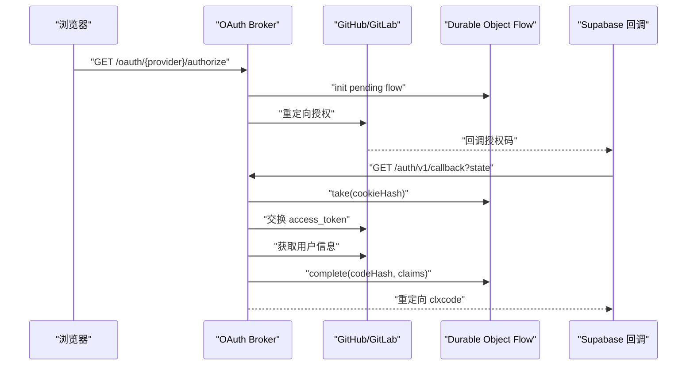
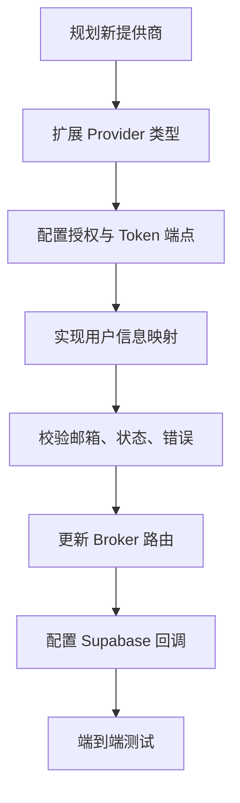

# OAuth 第三方集成

<cite>
**本文引用的文件**   
- [src/server/oauth/constants.ts](file://src/server/oauth/constants.ts)
- [src/server/oauth/crypto.ts](file://src/server/oauth/crypto.ts)
- [src/server/oauth/redirect.ts](file://src/server/oauth/redirect.ts)
- [src/server/oauth/repository.ts](file://src/server/oauth/repository.ts)
- [src/server/oauth/service.ts](file://src/server/oauth/service.ts)
- [src/app/api/oauth/authorize/route.ts](file://src/app/api/oauth/authorize/route.ts)
- [src/app/api/oauth/token/route.ts](file://src/app/api/oauth/token/route.ts)
- [src/app/api/oauth/device/code/route.ts](file://src/app/api/oauth/device/code/route.ts)
- [src/app/api/oauth/device/approve/route.ts](file://src/app/api/oauth/device/approve/route.ts)
- [src/app/api/oauth/revoke/route.ts](file://src/app/api/oauth/revoke/route.ts)
- [workers/oauth-broker/src/providers.ts](file://workers/oauth-broker/src/providers.ts)
- [workers/oauth-broker/src/broker.ts](file://workers/oauth-broker/src/broker.ts)
- [workers/oauth-broker/src/flow.ts](file://workers/oauth-broker/src/flow.ts)
- [workers/oauth-broker/src/protocol.ts](file://workers/oauth-broker/src/protocol.ts)
- [docs/auth/oauth-callbacks.md](file://docs/auth/oauth-callbacks.md)
</cite>

## 目录

1. [简介](#简介)
2. [项目结构与职责划分](#项目结构与职责划分)
3. [支持的第三方提供商与整体架构](#支持的第三方提供商与整体架构)
4. [OAuth 2.0 授权码流程与 PKCE](#oauth-20-授权码流程与-pkce)
5. [令牌交换、刷新与设备码流程](#令牌交换刷新与设备码流程)
6. [客户端注册、Scope 与权限控制](#客户端注册scope-与权限控制)
7. [加密工具、重定向地址校验与安全策略](#加密工具重定向地址校验与安全策略)
8. [回调处理与 Supabase 集成](#回调处理与-supabase-集成)
9. [错误处理与调试指南](#错误处理与调试指南)
10. [性能特征与优化建议](#性能特征与优化建议)
11. [扩展新第三方提供商的指南](#扩展新第三方提供商的指南)
12. [结论](#结论)

## 简介

本项目实现了一套面向命令行客户端和浏览器环境的 OAuth 2.0 身份体系，并在此基础上通过独立的 Worker 完成 GitHub、GitLab 等第三方提供商的原生 OAuth 登录。核心能力包括：

- 支持 OAuth 2.0 授权码模式。
- 强制使用 PKCE 的 `S256` 扩展，防止授权码拦截。
- 提供标准的令牌交换、刷新令牌轮换和设备码授权流程。
- 将原生第三方登录结果映射为内部可消费的访问令牌和刷新令牌。
- 使用数据库持久化授权请求、授权码、访问令牌、刷新令牌、设备码及审计事件。
- 对 CLI 环境启用环回地址安全校验。
- 通过 Supabase 的社会登录回调路由到应用端会话。

该文档从系统架构、代码组件、数据流、安全机制、错误处理和扩展方式六个维度说明这套集成方案，既适合后端开发者理解实现细节，也适合集成方理解如何调用和扩展。

## 项目结构与职责划分

本项目的 OAuth 相关代码分为两个主要部分：

| 区域 | 职责 | 关键文件 |
|---|---|---|
| Next.js 服务端 OAuth 服务 | 定义常量、加密工具、重定向校验、仓库访问和业务逻辑；暴露 `/api/oauth/*` 接口 | [src/server/oauth/constants.ts](file://src/server/oauth/constants.ts)、[src/server/oauth/crypto.ts](file://src/server/oauth/crypto.ts)、[src/server/oauth/redirect.ts](file://src/server/oauth/redirect.ts)、[src/server/oauth/repository.ts](file://src/server/oauth/repository.ts)、[src/server/oauth/service.ts](file://src/server/oauth/service.ts) |
| Next.js API 路由 | 接收外部调用、解析参数、转发到业务层 | [src/app/api/oauth/authorize/route.ts](file://src/app/api/oauth/authorize/route.ts)、[src/app/api/oauth/token/route.ts](file://src/app/api/oauth/token/route.ts)、[src/app/api/oauth/device/code/route.ts](file://src/app/api/oauth/device/code/route.ts)、[src/app/api/oauth/device/approve/route.ts](file://src/app/api/oauth/device/approve/route.ts)、[src/app/api/oauth/revoke/rune.ts](file://src/app/api/oauth/revoke/route.ts) |
| Cloudflare Worker 原生 OAuth Broker | 代理 GitHub/GitLab 授权、交换令牌、获取用户信息，并将结果转为内部临时令牌 | [workers/oauth-broker/src/broker.ts](file://workers/oauth-broker/src/broker.ts)、[workers/oauth-broker/src/providers.ts](file://workers/oauth-broker/src/providers.ts)、[workers/oauth-broker/src/flow.ts](file://workers/oauth-broker/src/flow.ts)、[workers/oauth-broker/src/protocol.ts](file://workers/oauth-broker/src/protocol.ts) |
| Supabase 社会登录文档 | 说明 Supabase 回调地址、自定义域名兼容、应用回调配置和 Google One Tap | [docs/auth/oauth-callbacks.md](file://docs/auth/oauth-callbacks.md) |

**图表来源**
- [src/app/api/oauth/authorize/route.ts:1-92](file://src/app/api/oauth/authorize/route.ts#L1-L92)
- [src/app/api/oauth/token/route.ts:1-108](file://src/app/api/oauth/token/route.ts#L1-L108)
- [workers/oauth-broker/src/broker.ts:1-113](file://workers/oauth-broker/src/broker.ts#L1-L113)
- [workers/oauth-broker/src/providers.ts:1-37](file://workers/oauth-broker/src/providers.ts#L1-L37)

**章节来源**
- [src/server/oauth/constants.ts:1-29](file://src/server/oauth/constants.ts#L1-L29)
- [src/server/oauth/service.ts:1-457](file://src/server/oauth/service.ts#L1-L457)
- [workers/oauth-broker/src/broker.ts:1-113](file://workers/oauth-broker/src/broker.ts#L1-L113)
- [docs/auth/oauth-callbacks.md:1-71](file://docs/auth/oauth-callbacks.md#L1-L71)

## 支持的第三方提供商与整体架构

### 当前支持的第三方提供商

根据原生 OAuth Broker 的实现，当前明确支持的第三方提供商是：

| 提供商 | 授权地址 | Token 地址 | 用户信息地址 | 默认 Scope |
|---|---|---|---|---|
| GitHub | `https://github.com/login/oauth/authorize` | `https://github.com/login/oauth/access_token` | `https://api.github.com/user` | `user:email` |
| GitLab | `https://gitlab.com/oauth/authorize` | `https://gitlab.com/oauth/token` | `https://api.gitlab.com/api/v4/user` | `read_user` |

Broker 中通过枚举类型限定 Provider 值，新增提供商需要同时修改协议类型、授权 URL、Token URL、用户信息获取逻辑和邮件提取逻辑。

### 架构角色

| 角色 | 说明 |
|---|---|
| 客户端 | 发起授权、交换令牌、刷新令牌或轮询设备码 |
| Next.js OAuth 服务 | 实现内部 OAuth 服务器语义，管理授权码、访问令牌、刷新令牌和设备码 |
| Broker Worker | 封装 GitHub/GitLab 原生 OAuth，生成内部临时 `clxcode` 和 `clxtoken` |
| Supabase | 承载社会登录回调，把第三方登录结果转回应用会话 |
| PostgreSQL | 持久化 OAuth 实体、审计事件和设备码状态 |

**图表来源**
- [workers/oauth-broker/src/broker.ts:1-113](file://workers/oauth-broker/src/broker.ts#L1-L113)
- [workers/oauth-broker/src/providers.ts:1-37](file://workers/oauth-broker/src/providers.ts#L1-L37)
- [src/server/oauth/service.ts:1-457](file://src/server/oauth/service.ts#L1-L457)

**章节来源**
- [workers/oauth-broker/src/providers.ts:1-37](file://workers/oauth-broker/src/providers.ts#L1-L37)
- [workers/oauth-broker/src/protocol.ts:1-65](file://workers/oauth-broker/src/protocol.ts#L1-L65)
- [docs/auth/oauth-callbacks.md:1-71](file://docs/auth/oauth-callbacks.md#L1-L71)

## OAuth 2.0 授权码流程与 PKCE

### 标准授权码 + PKCE 流程

CLI 和本地开发场景主要通过 `/api/oauth/authorize` 和 `/api/oauth/token` 实现完整的授权码流程，并要求使用 PKCE。

核心步骤如下：

1. 客户端生成随机 `state`。
2. 客户端生成 `code_verifier`。
3. 客户端计算 `code_challenge = SHA256(code_verifier)` 并进行 base64url 编码。
4. 客户端调用 `/api/oauth/authorize`，提交 `client_id`、`redirect_uri`、`response_type=code`、`state`、`code_challenge`、`code_challenge_method=S256` 和可选 `scope`。
5. 服务端校验客户端、重定向地址、PKCE 方法、授权码有效期。
6. 服务端生成不可预测的授权码，写入数据库，并重定向到客户端回调地址，附带 `code` 和 `state`。
7. 客户端收到回调后，调用 `/api/oauth/token`，提交 `grant_type=authorization_code`、`code`、`redirect_uri`、`code_verifier`。
8. 服务端校验授权码是否有效、未过期、未被消费，且 `code_verifier` 匹配 `code_challenge`。
9. 服务端生成访问令牌和刷新令牌，返回给客户端。

**图表来源**
- [src/app/api/oauth/authorize/route.ts:1-92](file://src/app/api/oauth/authorize/route.ts#L1-L92)
- [src/server/oauth/service.ts:1-200](file://src/server/oauth/service.ts#L1-L200)
- [src/app/api/oauth/token/route.ts:1-108](file://src/app/api/oauth/token/route.ts#L1-L108)

### PKCE S256 校验

PKCE 在本项目中采用 `S256` 方法，而不是明文挑战。服务端存储的是 `code_challenge`，交换令牌时要求客户端提供原始 `code_verifier`，并通过恒定时间比较验证哈希是否一致。

关键点：

- `code_challenge` 必须存在且长度至少为 43。
- `code_challenge_method` 必须为 `S256`。
- 校验失败会返回 `invalid_request` 或 `invalid_grant`。
- 校验函数使用安全比较，避免因字符串差异导致的时序攻击风险。

**章节来源**
- [src/server/oauth/crypto.ts:1-43](file://src/server/oauth/crypto.ts#L1-L43)
- [src/server/oauth/service.ts:120-200](file://src/server/oauth/service.ts#L120-L200)
- [src/app/api/oauth/authorize/route.ts:1-92](file://src/app/api/oauth/authorize/route.ts#L1-L92)

## 令牌交换、刷新与设备码流程

### 令牌交换

令牌交换由 `/api/oauth/token` 处理，支持三种 grant type：

| Grant Type | 用途 | 关键参数 | 行为 |
|---|---|---|---|
| `authorization_code` | 用授权码换访问令牌和刷新令牌 | `code`、`redirect_uri`、`code_verifier` | 校验客户端、授权码、重定向地址、PKCE |
| `refresh_token` | 刷新访问令牌 | `refresh_token` | 校验客户端、刷新令牌、轮换旧令牌 |
| `urn:ietf:params:oauth:grant-type:device_code` | 轮询设备码授权结果 | `device_code` | 返回待批准或最终令牌 |

**图表来源**
- [src/app/api/oauth/token/route.ts:1-108](file://src/app/api/oauth/token/route.ts#L1-L108)
- [src/server/oauth/service.ts:200-457](file://src/server/oauth/service.ts#L200-L457)

### 刷新令牌

刷新令牌流程具有以下安全特性：

- 刷新令牌哈希存入数据库，不直接存储明文。
- 每次刷新都会撤销旧刷新令牌。
- 如果检测到刷新令牌被重用，会撤销整个刷新令牌族，防止离线泄露后的批量滥用。
- 刷新令牌默认有效期为 90 天，访问令牌默认有效期为 1 小时。

**图表来源**
- [src/server/oauth/service.ts:230-320](file://src/server/oauth/service.ts#L230-L320)
- [src/server/oauth/repository.ts:200-320](file://src/server/oauth/repository.ts#L200-L320)

### 设备码流程

设备码流程用于没有浏览器或无法直接打开回调地址的设备，例如终端、CI 或无头环境。

流程如下：

1. 客户端调用 `/api/oauth/device/code` 获取 `device_code`、`user_code`、`verification_uri` 和轮询间隔。
2. 用户在浏览器中打开验证 URI，登录后提交 `user_code`。
3. 客户端按间隔轮询 `/api/oauth/token`，传入 `device_code`。
4. 若用户尚未批准，返回 `authorization_pending`。
5. 用户批准后，轮询返回访问令牌和刷新令牌。
6. 设备码只能消费一次。

**图表来源**
- [src/app/api/oauth/device/code/route.ts:1-49](file://src/app/api/oauth/device/code/route.ts#L1-L49)
- [src/app/api/oauth/device/approve/route.ts:1-47](file://src/app/api/oauth/device/approve/route.ts#L1-L47)
- [src/server/oauth/service.ts:320-457](file://src/server/oauth/service.ts#L320-L457)

**章节来源**
- [src/app/api/oauth/token/route.ts:1-108](file://src/app/api/oauth/token/route.ts#L1-L108)
- [src/server/oauth/service.ts:200-457](file://src/server/oauth/service.ts#L200-L457)
- [src/server/oauth/repository.ts:200-446](file://src/server/oauth/repository.ts#L200-L446)

## 客户端注册、Scope 与权限控制

### 客户端模型

数据库中的 OAuth 客户端记录包含以下关键字段：

| 字段 | 含义 |
|---|---|
| `id` | 内部主键 |
| `client_id` | 对外暴露的客户端标识 |
| `client_type` | 客户端类型 |
| `status` | 客户端状态，仅 `active` 可用 |
| `name` | 客户端名称 |
| `description` | 客户端描述 |
| `require_pkce` | 是否强制 PKCE |
| `first_party` | 是否第一方客户端 |
| `allowed_grant_types` | 允许的授权类型数组 |
| `metadata` | 扩展元数据 |

### 内置客户端与 Scope

当前内置客户端 ID 为 `clauxen-code`，其允许使用的 Scope 列表包括：

- `openid`
- `profile`
- `offline_access`
- `code:inference`
- `code:profile`
- 以及若干兼容旧版 CLI 运行时的历史 Scope，如 `user:inference`、`user:profile`、`user:sessions:code`、`user:mcp_servers`、`user:file_upload`、`org:create_api_key`

当客户端未显式传递 `scope` 时，服务会回退到内置 Scope 列表；同时始终添加 `openid` 和 `code:inference`，以保证 CLI 可用性。

### 权限控制要点

- 客户端必须处于 `active` 状态。
- 客户端必须声明允许对应 grant type。
- CLI 专用授权只允许 `clauxen-code` 客户端。
- Scope 必须是白名单内的值，非法 Scope 会触发 `invalid_scope`。
- 授权成功后会写入用户对该客户端的同意授权记录。

**图表来源**
- [src/server/oauth/repository.ts:1-30](file://src/server/oauth/repository.ts#L1-L30)
- [src/server/oauth/constants.ts:1-29](file://src/server/oauth/constants.ts#L1-L29)

**章节来源**
- [src/server/oauth/constants.ts:1-29](file://src/server/oauth/constants.ts#L1-L29)
- [src/server/oauth/repository.ts:1-30](file://src/server/oauth/repository.ts#L1-L30)
- [src/server/oauth/service.ts:40-120](file://src/server/oauth/service.ts#L40-L120)

## 加密工具、重定向地址校验与安全策略

### 加密工具函数

| 函数 | 输入 | 输出 | 用途 |
|---|---|---|---|
| `hashToken` | 原始令牌字符串 | SHA-256 十六进制哈希 | 安全存储令牌 |
| `generateOpaqueToken` | 前缀、字节数 | 带前缀的 base64url 随机令牌 | 生成授权码、访问令牌、刷新令牌、设备码 |
| `generateUserCode` | 无 | `XXXX-XXXX` 风格用户码 | 设备码流程的人读码 |
| `verifyPkceS256` | `code_verifier`、`code_challenge` | 布尔值 | PKCE S256 校验 |
| `safeEqualHex` | 两个十六进制字符串 | 布尔值 | 恒定时间比较 |

所有敏感令牌都以哈希形式入库，只有客户端持有明文。令牌前缀用于快速区分访问令牌和刷新令牌：

| 令牌类型 | 前缀 |
|---|---|
| 访问令牌 | `cla_at_` |
| 刷新令牌 | `cla_rt_` |
| 授权码 | `cla_ac_` |
| 设备码 | `cla_dc_` |

### 环回地址安全检查

CLI 的重定向地址必须满足以下条件：

- 协议为 `http:`。
- 路径为 `/callback`。
- 不包含查询参数或片段。
- 主机名是 `127.0.0.1`、`::1` 或 `[::1]`。
- 端口可以是任意临时端口，也可以是省略端口的标记 URI。

这个设计符合 RFC 8252 对本地回环地址回调的限制，避免把授权码发送到任意公网地址。

**图表来源**
- [src/server/oauth/redirect.ts:1-28](file://src/server/oauth/redirect.ts#L1-L28)

### 安全策略总结

| 安全措施 | 实现位置 | 目的 |
|---|---|---|
| 令牌哈希存储 | `crypto.ts`、`repository.ts` | 防止数据库泄露导致令牌泄露 |
| PKCE S256 | `service.ts`、`crypto.ts` | 防止授权码被中间人截获 |
| 环回地址校验 | `redirect.ts`、`service.ts` | 限制 CLI 回调到本地回环地址 |
| 恒定时间比较 | `crypto.ts` | 防止时序侧信道攻击 |
| 一次性授权码 | `repository.ts` | 防止授权码重放 |
| 刷新令牌轮换 | `service.ts` | 缩短令牌生命周期并降低泄露影响 |
| 刷新令牌族撤销 | `repository.ts` | 检测重用并撤销所有相关刷新令牌 |
| 审计事件写入 | `repository.ts` | 记录授权、令牌签发和设备审批 |

**章节来源**
- [src/server/oauth/crypto.ts:1-43](file://src/server/oauth/crypto.ts#L1-L43)
- [src/server/oauth/redirect.ts:1-28](file://src/server/oauth/redirect.ts#L1-L28)
- [src/server/oauth/repository.ts:1-446](file://src/server/oauth/repository.ts#L1-L446)
- [src/server/oauth/service.ts:1-457](file://src/server/oauth/service.ts#L1-L457)

## 回调处理与 Supabase 集成

### Supabase 社会登录回调

项目使用 Supabase 作为社会登录的主要入口。第三方提供商（Google、GitHub、GitLab、X 等）的回调地址指向 Supabase 的 canonical 回调路径。应用侧再把这些回调转换为浏览器会话。

关键说明：

- 第三方提供商回调地址是 Supabase 项目回调地址。
- 应用侧回调地址需要配置在 Supabase 认证设置的 URL 配置中。
- 自定义域名可用于迁移兼容性，但不代表独立服务故障转移。
- GitHub OAuth Apps 只接受一个回调地址，因此必须使用 Supabase 项目回调。

### 原生第三方登录回调

原生 OAuth Broker 负责 GitHub 和 GitLab 的完整流程：

1. 浏览器被重定向到提供商授权页面。
2. 提供商回调到 Broker 的 `/auth/v1/callback`。
3. Broker 校验 `state`、Cookie、Flow 状态。
4. Broker 用授权码向提供商交换访问令牌。
5. Broker 获取用户信息并验证邮箱。
6. Broker 将用户声明保存到 Durable Object 中。
7. Broker 生成内部临时 `clxcode` 并回调 Supabase。
8. Supabase 继续走应用会话流程。

**图表来源**
- [workers/oauth-broker/src/broker.ts:1-113](file://workers/oauth-broker/src/broker.ts#L1-L113)
- [workers/oauth-broker/src/flow.ts:1-43](file://workers/oauth-broker/src/flow.ts#L1-L43)
- [workers/oauth-broker/src/providers.ts:1-37](file://workers/oauth-broker/src/providers.ts#L1-L37)
- [docs/auth/oauth-callbacks.md:1-71](file://docs/auth/oauth-callbacks.md#L1-L71)

### 回调安全性

Broker 对回调做了多层校验：

- 检查请求 origin。
- 校验 URL 查询参数唯一性。
- 校验 `state` 前缀和格式。
- 校验 Cookie 中保存的随机值。
- 校验 Flow 状态机阶段。
- 校验授权码、verifier 和 provider 一致性。
- 校验用户邮箱格式和长度。

**章节来源**
- [docs/auth/oauth-callbacks.md:1-71](file://docs/auth/oauth-callbacks.md#L1-L71)
- [workers/oauth-broker/src/broker.ts:1-113](file://workers/oauth-broker/src/broker.ts#L1-L113)
- [workers/oauth-broker/src/flow.ts:1-43](file://workers/oauth-broker/src/flow.ts#L1-L43)
- [workers/oauth-broker/src/protocol.ts:1-65](file://workers/oauth-broker/src/protocol.ts#L1-L65)

## 错误处理与调试指南

### OAuth 错误分类

服务端使用统一的 `OauthError` 表示 OAuth 语义错误，API 路由将其转换为 JSON 响应。常见错误包括：

| 错误码 | 含义 | 常见原因 |
|---|---|---|
| `login_required` | 需要登录 | 未通过会话校验 |
| `invalid_request` | 请求参数无效 | 缺少必填字段、重定向地址非法、PKCE 方法错误 |
| `invalid_client` | 客户端无效 | 客户端不存在、非活跃、凭证错误 |
| `unauthorized_client` | 客户端无权使用该授权类型 | grant type 未声明或不是 CLI 客户端 |
| `invalid_scope` | Scope 不支持 | 请求了白名单外的 scope |
| `invalid_grant` | 授权无效 | 授权码过期、重复使用、PKCE 不匹配、刷新令牌无效 |
| `expired_token` | 令牌过期 | 设备码或刷新令牌过期 |
| `access_denied` | 用户拒绝 | 用户取消授权或第三方登录失败 |
| `server_error` | 内部错误 | 未捕获异常或依赖服务异常 |

### 调试技巧

| 问题 | 排查方向 |
|---|---|
| 授权码无法交换 | 检查 `code_challenge_method` 是否为 `S256`，确认 `code_verifier` 与 `code_challenge` 匹配 |
| 重定向地址报错 | 确认 CLI 回调是 `http://127.0.0.1:端口/callback` 或 `http://[::1]:端口/callback` |
| 刷新令牌失效 | 检查是否发生令牌重用，系统可能已撤销整个刷新令牌族 |
| 设备码一直 pending | 确认用户已在浏览器中打开验证 URI 并提交 `user_code` |
| 第三方登录失败 | 查看 Broker 日志中的 `clauxen_oauth_callback_failed`，检查 provider exchange 阶段 |
| Supabase 回调异常 | 核对应用回调地址是否注册到 Supabase URL 配置 |

### 审计与可观测性

服务会写入 `oauth_events` 表，记录授权码发放、令牌签发、令牌刷新、设备审批等事件。审计写入失败不会阻断认证流程，这是有意设计，避免审计延迟或失败影响登录可用性。

**章节来源**
- [src/app/api/oauth/authorize/route.ts:1-92](file://src/app/api/oauth/authorize/route.ts#L1-L92)
- [src/app/api/oauth/token/route.ts:1-108](file://src/app/api/oauth/token/route.ts#L1-L108)
- [src/app/api/oauth/device/approve/route.ts:1-47](file://src/app/api/oauth/device/approve/route.ts#L1-L47)
- [workers/oauth-broker/src/broker.ts:1-113](file://workers/oauth-broker/src/broker.ts#L1-L113)
- [src/server/oauth/repository.ts:400-446](file://src/server/oauth/repository.ts#L400-L446)

## 性能特征与优化建议

### 当前性能特征

| 组件 | 特征 |
|---|---|
| Next.js OAuth 服务 | Node.js 运行时，动态路由，每次请求执行数据库操作 |
| Broker Worker | Cloudflare Workers，使用 Durable Object 维护登录状态 |
| 令牌存储 | 基于哈希的数据库查找，避免明文令牌扫描 |
| 刷新令牌 | 每次刷新撤销旧令牌，增加写放大但提升安全性 |
| 审计事件 | 异步容忍失败，不影响主流程 |
| 第三方调用 | Broker 使用 15 秒超时和负载限制保护上游提供商 |

### 优化建议

| 方向 | 建议 |
|---|---|
| 令牌缓存 | 对于高频鉴权场景，可对短期访问令牌做内存或分布式缓存，但需严格绑定用户、客户端和 scope |
| 数据库索引 | 确保 `oauth_authorization_codes.code_hash`、`oauth_access_tokens.token_hash`、`oauth_refresh_tokens.token_hash`、`oauth_device_codes.device_code_hash`、`oauth_device_codes.user_code_hash` 有合适索引 |
| 批量撤销 | 刷新令牌族撤销已实现，建议在高并发撤销场景下评估事务隔离级别和锁竞争 |
| 第三方超时 | Broker 已设置 fetch 超时和负载上限，新增提供商时应保持一致 |
| 日志采样 | 高频鉴权日志建议采样，避免 I/O 成为瓶颈 |
| 审计降级 | 审计写入失败已被忽略，生产环境应监控写入队列积压 |
| 连接池 | Next.js 数据库连接池应合理配置，避免高并发授权请求阻塞 |

**章节来源**
- [src/server/oauth/repository.ts:1-446](file://src/server/oauth/repository.ts#L1-L446)
- [workers/oauth-broker/src/providers.ts:1-37](file://workers/oauth-broker/src/providers.ts#L1-L37)
- [workers/oauth-broker/src/flow.ts:1-43](file://workers/oauth-broker/src/flow.ts#L1-L43)

## 扩展新第三方提供商的指南

### 扩展目标

如果要新增 Microsoft、Apple、Twitter/X 或其他 OAuth 提供商，通常需要修改以下位置：

1. **Broker 提供商枚举**：新增 provider 类型。
2. **授权 URL 和 Token URL**：新增对应提供商的端点。
3. **用户信息获取逻辑**：不同提供商的用户信息结构不同。
4. **邮箱提取规则**：GitHub、GitLab、Microsoft、Apple 等邮箱字段和验证语义不同。
5. **Scope 配置**：不同提供商需要的最小 Scope 不同。
6. **Supabase 回调配置**：如需通过 Supabase 社会登录，需要在 Supabase 控制台注册提供商和应用回调。

### 最小改动清单

| 步骤 | 文件 | 说明 |
|---|---|---|
| 新增 provider 类型 | [workers/oauth-broker/src/protocol.ts](file://workers/oauth-broker/src/protocol.ts) | 扩展 Provider 联合类型 |
| 新增授权构建逻辑 | [workers/oauth-broker/src/providers.ts](file://workers/oauth-broker/src/providers.ts) | 添加 Microsoft 或 Apple 的授权 URL |
| 新增令牌交换逻辑 | [workers/oauth-broker/src/providers.ts](file://workers/oauth-broker/src/providers.ts) | 添加 token endpoint 和错误处理 |
| 新增用户信息获取 | [workers/oauth-broker/src/providers.ts](file://workers/oauth-broker/src/providers.ts) | 映射 email、name、picture 等字段 |
| 更新 Broker 路由 | [workers/oauth-broker/src/broker.ts](file://workers/oauth-broker/src/broker.ts) | 放行新的 provider 路由 |
| 配置 Supabase | [docs/auth/oauth-callbacks.md](file://docs/auth/oauth-callbacks.md) | 注册回调地址和客户端 ID |

### 注意事项

- 不要直接在客户端保存提供商 secret。
- 不要在回调地址中传递敏感数据。
- 不要绕过 PKCE 校验。
- 不要信任第三方返回的 `email_verified` 而不做基本格式校验。
- 不要复用已消耗的授权码。
- 不要在生产环境关闭刷新令牌轮换。
- 新增提供商后，应编写端到端测试覆盖授权、回调、令牌交换和用户信息查询。

**图表来源**
- [workers/oauth-broker/src/protocol.ts:1-65](file://workers/oauth-broker/src/protocol.ts#L1-L65)
- [workers/oauth-broker/src/providers.ts:1-37](file://workers/oauth-broker/src/providers.ts#L1-L37)
- [workers/oauth-broker/src/broker.ts:1-113](file://workers/oauth-broker/src/broker.ts#L1-L113)
- [docs/auth/oauth-callbacks.md:1-71](file://docs/auth/oauth-callbacks.md#L1-L71)

**章节来源**
- [workers/oauth-broker/src/protocol.ts:1-65](file://workers/oauth-broker/src/protocol.ts#L1-L65)
- [workers/oauth-broker/src/providers.ts:1-37](file://workers/oauth-broker/src/providers.ts#L1-L37)
- [workers/oauth-broker/src/broker.ts:1-113](file://workers/oauth-broker/src/broker.ts#L1-L113)
- [docs/auth/oauth-callbacks.md:1-71](file://docs/auth/oauth-callbacks.md#L1-L71)

## 结论

本项目的 OAuth 第三方集成采用双层架构：Next.js 服务实现内部 OAuth 服务器语义，Cloudflare Worker 封装 GitHub/GitLab 原生登录。它通过强制 PKCE、令牌哈希存储、一次性授权码、刷新令牌轮换和设备码授权，构建了相对完整的安全边界。

对于集成方来说，最重要的是：

- 始终使用 PKCE `S256`。
- 正确配置环回重定向地址。
- 只请求必要的 Scope。
- 妥善保存刷新令牌并在泄露时撤销。
- 使用设备码流程适配无浏览器环境。
- 在新增第三方提供商时同步更新 Broker、Supabase 回调和安全校验。

这套设计在安全性和可扩展性之间取得平衡，适合作为命令行工具、插件系统和多提供商登录的统一身份入口。