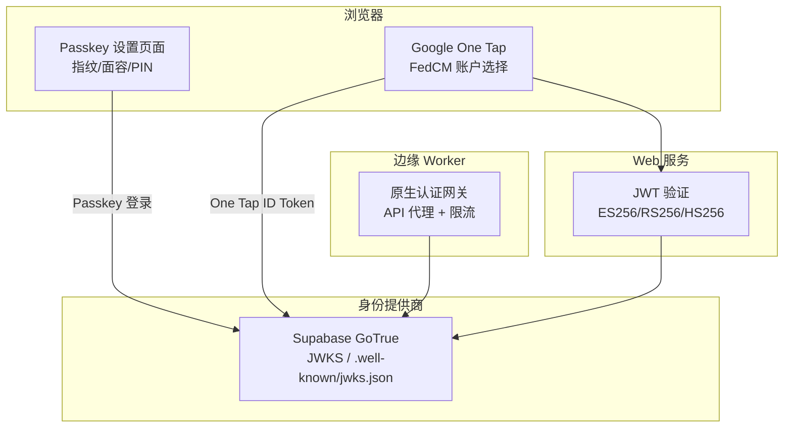
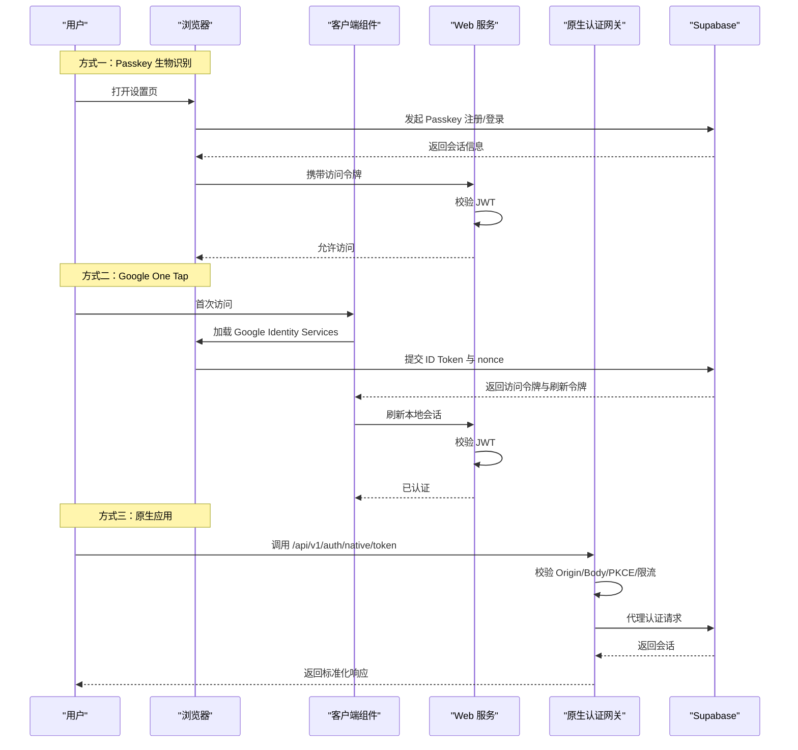
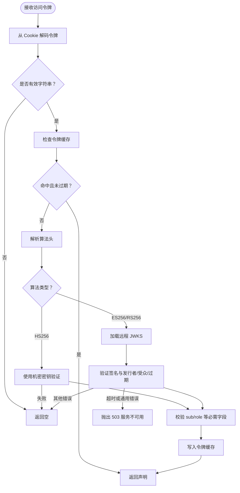
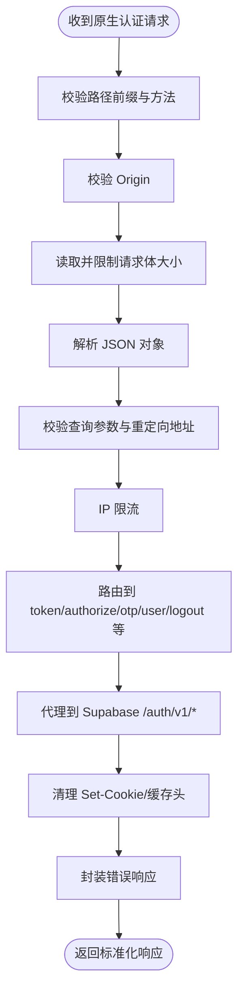
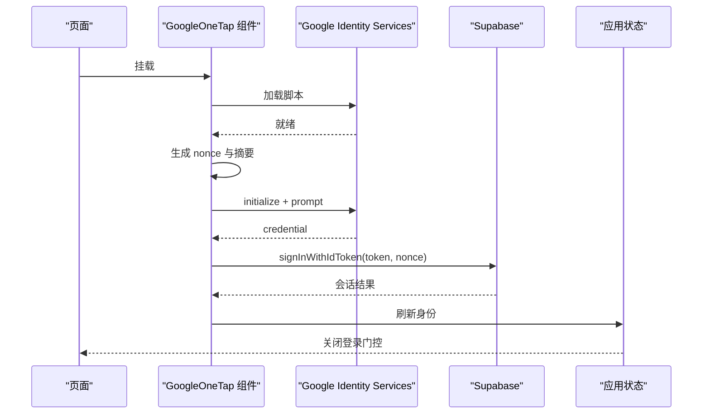
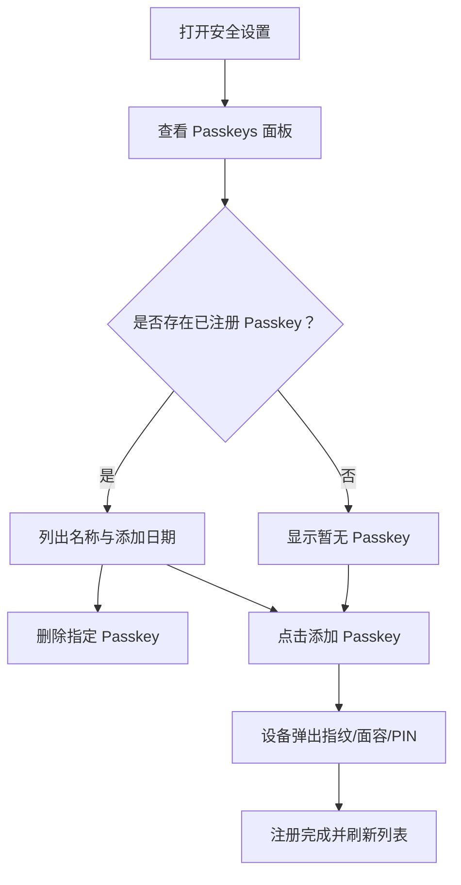
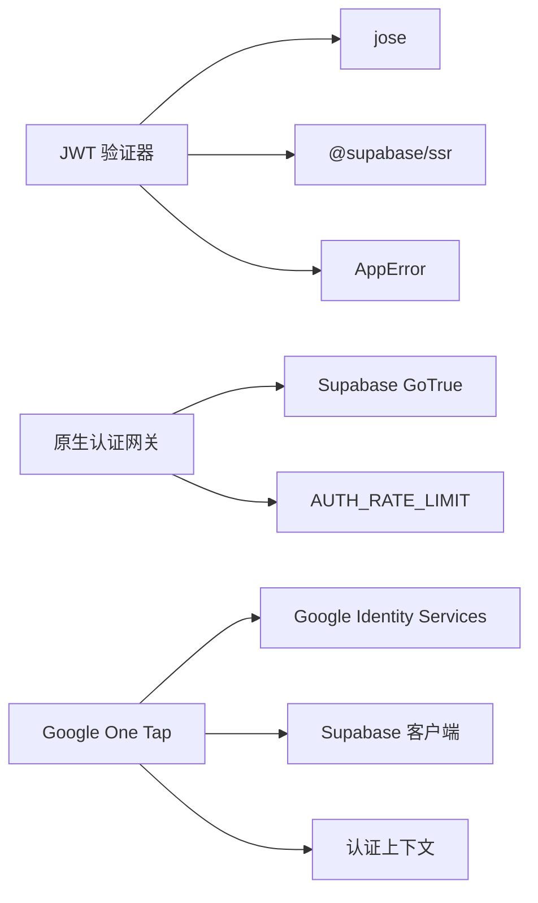

# WebAuthn 生物识别

<cite>
**本文引用的文件**   
- [src/server/auth/jwt.ts](file://src/server/auth/jwt.ts)
- [workers/native-auth/src/gateway.ts](file://workers/native-auth/src/gateway.ts)
- [workers/native-auth/src/index.ts](file://workers/native-auth/src/index.ts)
- [workers/native-auth/gateway.test.ts](file://workers/native-auth/gateway.test.ts)
- [src/client/components/auth/google-one-tap.tsx](file://src/client/components/auth/google-one-tap.tsx)
- [tests/google-one-tap.test.mjs](file://tests/google-one-tap.test.mjs)
- [docs/auth/oauth-callbacks.md](file://docs/auth/oauth-callbacks.md)
</cite>

## 目录
1. [引言](#引言)
2. [项目结构](#项目结构)
3. [核心组件](#核心组件)
4. [架构总览](#架构总览)
5. [详细组件分析](#详细组件分析)
6. [依赖关系分析](#依赖关系分析)
7. [性能考虑](#性能考虑)
8. [故障排查指南](#故障排查指南)
9. [结论](#结论)
10. [附录：集成与安全清单](#附录集成与安全清单)

## 引言
本文件围绕仓库中“基于硬件安全模块的生物特征认证”展开，聚焦以下能力：
- WebAuthn/Passkey：通过指纹、面部识别或设备 PIN 完成无密码登录。
- Google One Tap：在浏览器中使用 FedCM 与 Google Identity Services 自动提示访客快速登录。
- 原生应用认证网关：为移动端 SDK 提供受控的 Supabase Auth 代理接口。
- JWT 令牌验证与管理：以 ES256 为主、兼容 RS256 和 HS256，使用 JWKS 缓存、密钥轮换、内存令牌缓存。
- 安全最佳实践、降级策略与兼容性处理。
- 客户端与服务端配置说明，以及端到端安全检查清单。

需要明确的是：仓库中没有独立的 WebAuthn 服务端实现；Passkey 由浏览器与后端身份提供商（Supabase）协作完成，前端负责 UI 引导与状态管理。Google One Tap 与原生认证网关则分别覆盖 Web 访客体验与移动端 SDK 接入。

## 项目结构
与 WebAuthn 生物识别相关的代码分布在三层：
- 服务端 JWT 验证层：解析并校验 Supabase 签发的访问令牌。
- 原生认证网关 Worker：限制、校验并代理移动端请求到 Supabase。
- 客户端交互层：Google One Tap 提示、Passkey 设置页 UI 文案与流程。

**图表来源**
- [src/server/auth/jwt.ts:1-60](file://src/server/auth/jwt.ts#L1-L60)
- [workers/native-auth/src/gateway.ts:1-40](file://workers/native-auth/src/gateway.ts#L1-L40)
- [src/client/components/auth/google-one-tap.tsx:1-40](file://src/client/components/auth/google-one-tap.tsx#L1-L40)

**章节来源**
- [src/server/auth/jwt.ts:1-60](file://src/server/auth/jwt.ts#L1-L60)
- [workers/native-auth/src/gateway.ts:1-40](file://workers/native-auth/src/gateway.ts#L1-L40)
- [src/client/components/auth/google-one-tap.tsx:1-40](file://src/client/components/auth/google-one-tap.tsx#L1-L40)

## 核心组件
- **JWT 验证器**：从 Cookie 读取 Supabase 访问令牌，按算法分支验证签名，支持 ES256、RS256、HS256，并通过 JWKS 远程获取公钥，内置缓存与令牌缓存。
- **原生认证网关**：限定 `/api/v1/auth/native/*` 路径，校验 Origin、Content-Type、Body 大小、查询参数、PKCE、grant_type，再代理到 Supabase `/auth/v1/*`。
- **Google One Tap 组件**：动态加载 Google Identity Services，生成 nonce，调用 `signInWithIdToken`，刷新本地会话。
- **Passkey 设置界面**：展示“安全密钥与 Passkey”，引导用户添加指纹、面容或硬件密钥。

**章节来源**
- [src/server/auth/jwt.ts:1-60](file://src/server/auth/jwt.ts#L1-L60)
- [workers/native-auth/src/gateway.ts:1-40](file://workers/native-auth/src/gateway.ts#L1-L40)
- [src/client/components/auth/google-one-tap.tsx:1-40](file://src/client/components/auth/google-one-tap.tsx#L1-L40)
- [src/ui/settings/security-settings.tsx:35-147](file://src/ui/settings/security-settings.tsx#L35-L147)

## 架构总览
系统采用“前端信任最小化 + 身份提供商集中签发”的模式：
- 所有访问令牌由 Supabase 签发，服务端只验证签名与声明。
- 原生应用必须经过认证网关，不能绕过限流或直接访问上游。
- Web 访客可通过 Google One Tap 获得短期凭据，再由 Supabase 换取会话。
- Passkey 由浏览器与身份提供商共同实现，服务端不持有私钥。

**图表来源**
- [src/server/auth/jwt.ts:60-231](file://src/server/auth/jwt.ts#L60-L231)
- [workers/native-auth/src/gateway.ts:40-166](file://workers/native-auth/src/gateway.ts#L40-L166)
- [src/client/components/auth/google-one-tap.tsx:40-161](file://src/client/components/auth/google-one-tap.tsx#L40-L161)

## 详细组件分析

### JWT 令牌验证与缓存
JWT 验证器承担以下职责：
- 从分块 Cookie 中解码 Supabase 访问令牌。
- 根据 `alg` 选择 HS256、ES256 或 RS256 验证路径。
- 使用 `createRemoteJWKSet` 拉取 `.well-known/jwks.json`，并将公共 JSON 键放入 `jwksCache`。
- 对未知 `kid` 触发重新拉取，实现密钥轮换。
- 将成功验证的 claims 放入内存 Map，最多保留 1000 项，TTL 不超过令牌过期时间或 60 秒。
- 对网络超时、JWKS 错误进行区分处理：部分错误返回 503，其余无效令牌返回 null。

**图表来源**
- [src/server/auth/jwt.ts:60-231](file://src/server/auth/jwt.ts#L60-L231)

关键实现要点：
- JWKS 缓存使用 `jwksCache`，`cacheMaxAge`、`cooldownDuration`、`timeoutDuration` 控制远端拉取频率与超时。
- 访问令牌缓存最大 1000 条，避免内存无限增长。
- 发行者接受项目专用 URL 与标准 `supabase` 值，增强部署灵活性。
- 登出或删除账号时清理相关 claims 缓存。

**章节来源**
- [src/server/auth/jwt.ts:1-60](file://src/server/auth/jwt.ts#L1-L60)
- [src/server/auth/jwt.ts:60-231](file://src/server/auth/jwt.ts#L60-L231)

### 原生应用认证网关
原生认证网关作为移动端 SDK 的唯一入口，核心逻辑如下：
- 仅接受 `/api/v1/auth/native/` 前缀，白名单方法包括 token、authorize、otp、verify、recover、logout、user。
- 严格校验 Origin，仅允许两个受信任域名。
- 限制请求体大小与响应体大小，防止拒绝服务。
- 对每个 IP 做粗略限流，结合 Supabase 自身账户与 OTP 限制。
- 对 OAuth authorize 强制 PKCE，固定回调地址，禁止外部回调。
- 对 Google id_token 交换要求 provider、id_token、nonce 存在且长度合法。
- 将受信任的 Authorization 透传至上游，但从不转发 Cookie。
- 上游异常、HTML 挑战、敏感信息一律被封装为统一错误对象。

**图表来源**
- [workers/native-auth/src/gateway.ts:1-166](file://workers/native-auth/src/gateway.ts#L1-L166)

测试用例进一步确认：
- Google id_token 交换保持 nonce，并返回 Supabase 会话格式。
- refresh_token 透传而不创建新身份。
- 非法 provider、缺失或过短 nonce 在接触上游前即被拒绝。
- 不支持 grant_type、重复查询参数、错误 Content-Type、超大 body 均被拦截。
- 未携带 Bearer 的 user/logout 被拒绝。
- 上游 HTML 挑战不会泄露私有信息。

**章节来源**
- [workers/native-auth/src/gateway.ts:1-166](file://workers/native-auth/src/gateway.ts#L1-L166)
- [workers/native-auth/gateway.test.ts:1-150](file://workers/native-auth/gateway.test.ts#L1-L150)

### Google One Tap 集成
Google One Tap 组件负责：
- 按需加载 Google Identity Services 脚本，支持重试与卸载。
- 仅在未登录、未处于应用内登录门控、非首次 mount 后重复触发。
- 生成随机 32 字节 nonce，计算 SHA-256 摘要传给 Google，原始 nonce 传给 Supabase。
- 调用 `signInWithIdToken`，成功后刷新本地会话，关闭登录门控。
- 尊重浏览器 FedCM 行为，UI 与冷却期由浏览器与 Google 控制。

**图表来源**
- [src/client/components/auth/google-one-tap.tsx:40-161](file://src/client/components/auth/google-one-tap.tsx#L40-L161)
- [tests/google-one-tap.test.mjs:1-200](file://tests/google-one-tap.test.mjs#L1-L200)

文档说明还强调：
- 使用 `NEXT_PUBLIC_GOOGLE_CLIENT_ID`，回退到现有 Web 客户端。
- 需要在 Supabase 与 Google Cloud 中注册正确的 JavaScript origins 与回调地址。
- CSP 与权限需允许 GIS 脚本与 FedCM 凭据获取。
- 端到端测试需要真实 Google 账号与浏览器环境。

**章节来源**
- [src/client/components/auth/google-one-tap.tsx:1-161](file://src/client/components/auth/google-one-tap.tsx#L1-L161)
- [tests/google-one-tap.test.mjs:1-200](file://tests/google-one-tap.test.mjs#L1-L200)
- [docs/auth/oauth-callbacks.md:1-71](file://docs/auth/oauth-callbacks.md#L1-L71)

### Passkey 与生物识别 UI
Passkey 设置页面提供：
- “安全密钥与 Passkey”标题与描述，说明指纹、面容、硬件密钥均可用于登录。
- 已添加 Passkey 列表，显示名称与添加时间。
- 删除按钮，移除某个 Passkey。
- 添加按钮，进入设备生物识别流程。
- 浏览器不支持时的错误提示。

该 UI 并不直接实现 WebAuthn 协议，而是引导用户通过浏览器与身份提供商完成 Passkey 注册与登录。

**图表来源**
- [src/ui/settings/security-settings.tsx:35-194](file://src/ui/settings/security-settings.tsx#L35-L194)

**章节来源**
- [src/ui/settings/security-settings.tsx:35-194](file://src/ui/settings/security-settings.tsx#L35-L194)

## 依赖关系分析
- JWT 验证器依赖：
  - jose：`jwtVerify`、`decodeProtectedHeader`、`createRemoteJWKSet`、`jwksCache`。
  - @supabase/ssr：Cookie 分块合并与 base64URL 解码。
  - 应用错误类与 Supabase URL 工具。
- 原生认证网关依赖：
  - 环境变量：`SUPABASE_URL`、`SUPABASE_PUBLISHABLE_KEY`、`AUTH_RATE_LIMIT`。
  - 上游 Supabase GoTrue：`/auth/v1/*`。
- Google One Tap 依赖：
  - Google Identity Services 脚本。
  - Supabase 客户端 `signInWithIdToken`。
  - 应用认证上下文与登录门控上下文。

**图表来源**
- [src/server/auth/jwt.ts:1-20](file://src/server/auth/jwt.ts#L1-L20)
- [workers/native-auth/src/gateway.ts:120-166](file://workers/native-auth/src/gateway.ts#L120-L166)
- [src/client/components/auth/google-one-tap.tsx:1-40](file://src/client/components/auth/google-one-tap.tsx#L1-L40)

**章节来源**
- [src/server/auth/jwt.ts:1-20](file://src/server/auth/jwt.ts#L1-L20)
- [workers/native-auth/src/gateway.ts:120-166](file://workers/native-auth/src/gateway.ts#L120-L166)
- [src/client/components/auth/google-one-tap.tsx:1-40](file://src/client/components/auth/google-one-tap.tsx#L1-L40)

## 性能考虑
- JWKS 缓存：公共 JSON 键保存在隔离级内存中，减少重复网络请求；未知 `kid` 才触发重新拉取。
- 令牌缓存：相同访问令牌的 claims 可在短时间内复用，降低重复解密与签名校验开销。
- 原生网关限流：基于 CF-Connecting-IP 的粗略限流，配合 Supabase 账户级限制，避免暴力攻击。
- 请求体限制：网关限制请求与响应体大小，防止大 payload 造成资源耗尽。
- 脚本懒加载：Google One Tap 仅在必要时加载 GIS 脚本，并在卸载时移除事件监听。

[本节为通用指导，不涉及具体代码行]

## 故障排查指南
- JWT 验证返回 503：
  - 可能原因：JWKS 超时、远程密钥服务不可用、网络错误。
  - 处理建议：等待重试，检查 Supabase 健康状态与网络连通性。
- JWT 验证返回空：
  - 可能原因：令牌过期、发行者不匹配、算法不受支持、声明不完整。
  - 处理建议：让客户端刷新会话，检查 Supabase 配置与部署域。
- 原生网关返回 400/405/413/415：
  - 可能原因：路径或方法不正确、Content-Type 不是 JSON、body 过大、查询参数重复、PKCE 不合法。
  - 处理建议：核对 SDK 请求、启用调试日志、遵循网关白名单。
- 原生网关返回 429：
  - 可能原因：同一 IP 请求过于频繁。
  - 处理建议：增加重试间隔，检查客户端重试策略。
- Google One Tap 不提示：
  - 可能原因：浏览器不支持、用户已登录、应用登录门控打开、GIS 脚本加载失败、Google 账号状态或冷却期阻止。
  - 处理建议：检查 CSP、Origin、clientId、Supabase Provider 配置，运行单元测试验证生命周期。

**章节来源**
- [src/server/auth/jwt.ts:60-231](file://src/server/auth/jwt.ts#L60-L231)
- [workers/native-auth/src/gateway.ts:40-166](file://workers/native-auth/src/gateway.ts#L40-L166)
- [workers/native-auth/gateway.test.ts:1-150](file://workers/native-auth/gateway.test.ts#L1-L150)
- [tests/google-one-tap.test.mjs:1-200](file://tests/google-one-tap.test.mjs#L1-L200)
- [docs/auth/oauth-callbacks.md:1-71](file://docs/auth/oauth-callbacks.md#L1-L71)

## 结论
本项目将生物特征认证拆分为三个可独立演进的部分：
- Passkey：依赖浏览器与身份提供商，前端负责用户体验。
- Google One Tap：为 Web 访客提供低摩擦登录，同时保持 nonce 绑定与会话安全。
- 原生认证网关：为移动 SDK 提供安全、可控的 Supabase 代理。
- JWT 验证：以 ES256 为核心，兼顾 RS256 与 HS256，结合 JWKS 缓存与令牌缓存提升性能与安全性。

这种设计避免了在服务端持有生物特征私钥，降低了密钥管理风险；同时通过严格的输入校验、限流与错误封装，提升了抗攻击能力与可观测性。

[本节为总结，不涉及具体代码行]

## 附录：集成与安全清单

### 客户端集成示例要点
- Passkey：
  - 在安全设置页提供添加与删除操作。
  - 使用浏览器原生生物识别弹窗，不自行处理密码或私钥。
  - 将 Passkey 注册与登录委托给 Supabase。
- Google One Tap：
  - 确保已注入 `window.google.accounts.id`。
  - 配置 `NEXT_PUBLIC_GOOGLE_CLIENT_ID`。
  - 生成随机 nonce，传递摘要给 Google，原始值给 Supabase。
  - 成功后刷新本地会话，关闭登录门控。
- 原生 SDK：
  - 所有认证请求走 `/api/v1/auth/native/*`。
  - 使用 PKCE，回调地址固定为 `com.clauxen.mobile://auth-callback`。
  - 使用 Bearer 令牌访问 user/logout 等受保护端点。

**章节来源**
- [src/ui/settings/security-settings.tsx:35-194](file://src/ui/settings/security-settings.tsx#L35-L194)
- [src/client/components/auth/google-one-tap.tsx:40-161](file://src/client/components/auth/google-one-tap.tsx#L40-L161)
- [workers/native-auth/src/gateway.ts:40-120](file://workers/native-auth/src/gateway.ts#L40-L120)

### 服务端配置要点
- Supabase：
  - 启用 ES256 或 RS256 签名，发布 JWKS。
  - 配置 Social Provider 回调与应用回调地址。
  - 在 Google Cloud 与 Supabase 中注册正确 JavaScript origins。
- 环境变量：
  - `SUPABASE_URL`：必须是 HTTPS、根路径、无用户信息。
  - `SUPABASE_PUBLISHABLE_KEY`：用于网关代理。
  - `AUTH_RATE_LIMIT`：提供 `limit` 函数。
  - `SUPABASE_JWT_SECRET`：可选，用于 HS256 场景。
- CSP 与权限：
  - 允许 Google Identity Services 脚本、样式、iframe 与凭据获取。

**章节来源**
- [docs/auth/oauth-callbacks.md:1-71](file://docs/auth/oauth-callbacks.md#L1-L71)
- [workers/native-auth/src/gateway.ts:100-166](file://workers/native-auth/src/gateway.ts#L100-L166)
- [src/server/auth/jwt.ts:1-60](file://src/server/auth/jwt.ts#L1-L60)

### 安全检查清单
- 生物特征私钥不在服务端存储。
- Passkey 与 One Tap 均由浏览器或身份提供商执行。
- 所有访问令牌由 Supabase 签发，服务端仅验证。
- JWKS 使用远程缓存，支持密钥轮换。
- 令牌缓存有上限与 TTL，避免内存泄漏。
- 原生网关限制 Origin、Content-Type、Body 大小、查询参数与回调地址。
- 所有敏感头与 Cookie 不被转发。
- 错误响应不包含内部异常、凭证或上游配置。
- 限流与超时保护上游服务。
- 单元测试覆盖主要边界条件与失败路径。

**章节来源**
- [workers/native-auth/gateway.test.ts:1-150](file://workers/native-auth/gateway.test.ts#L1-L150)
- [tests/google-one-tap.test.mjs:1-200](file://tests/google-one-tap.test.mjs#L1-L200)
- [src/server/auth/jwt.ts:60-231](file://src/server/auth/jwt.ts#L60-L231)