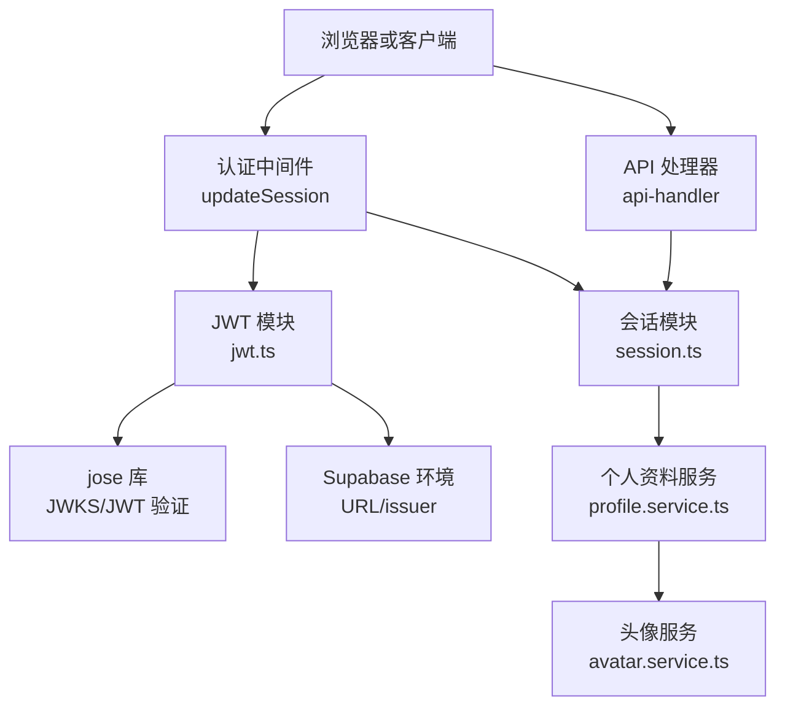
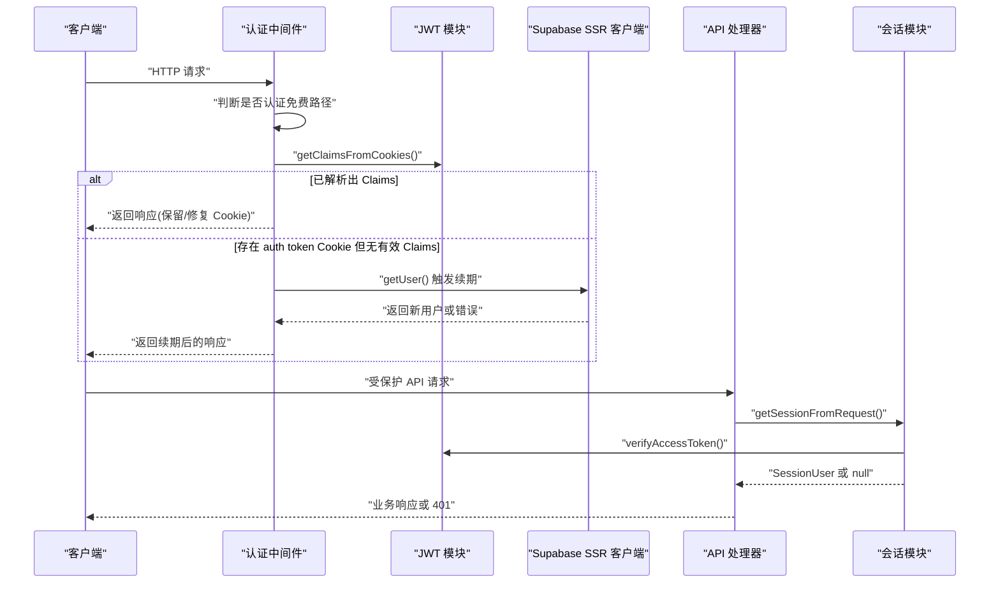
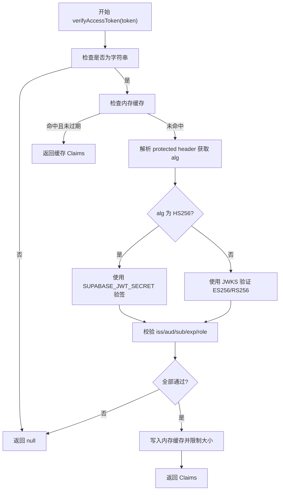
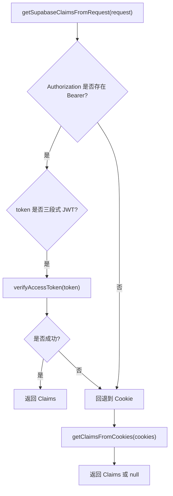
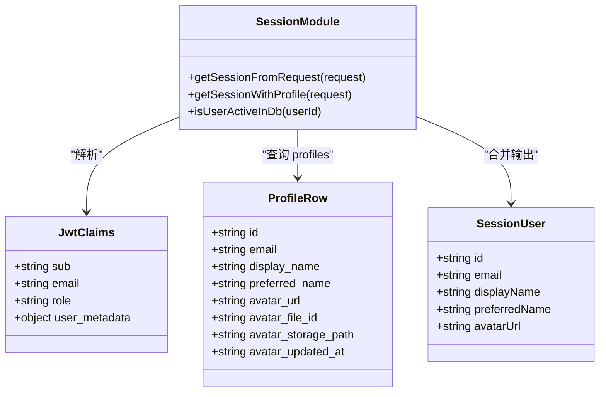
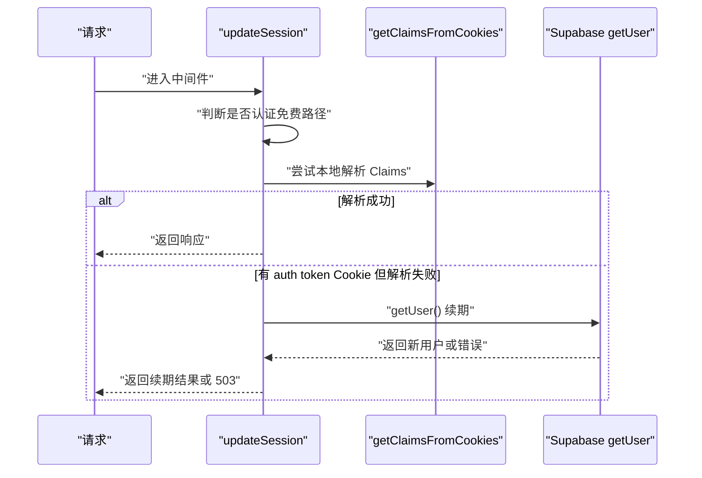
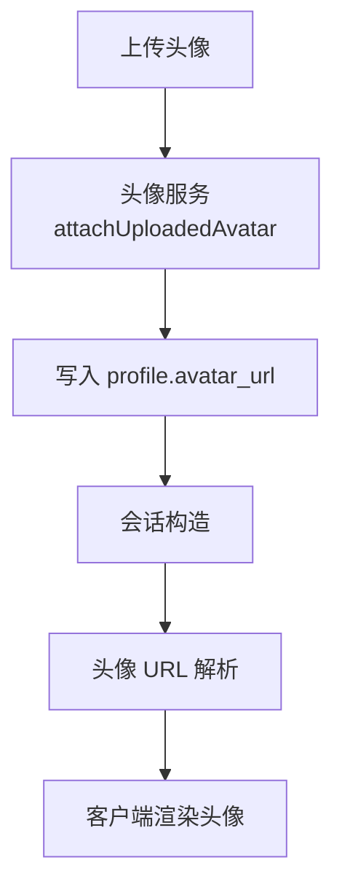
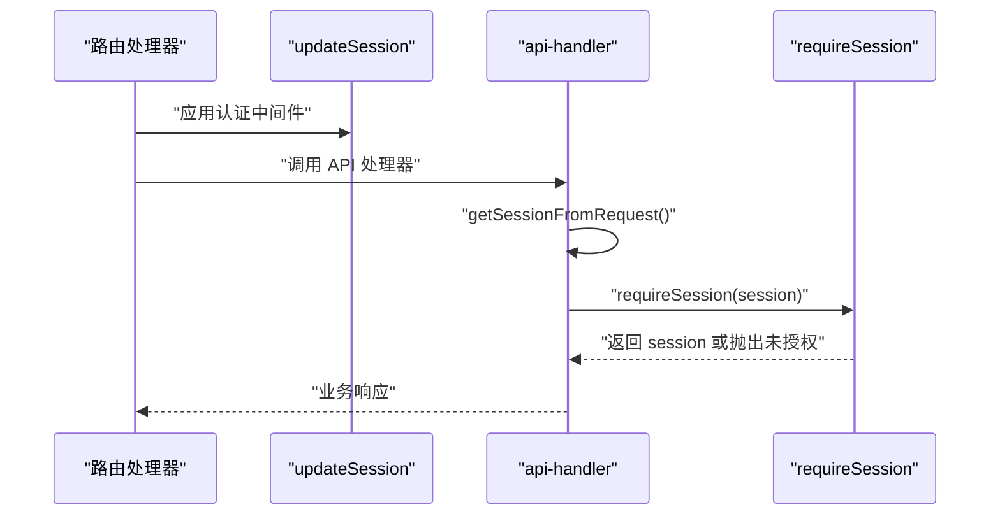
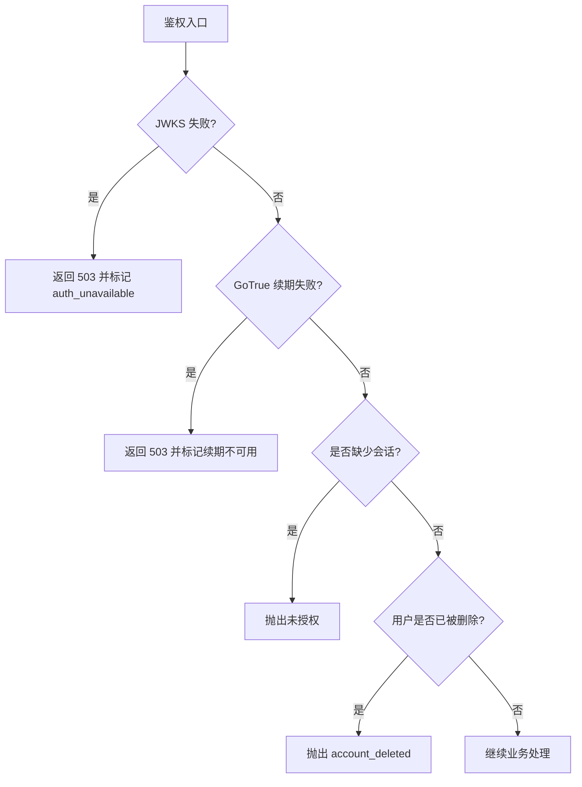
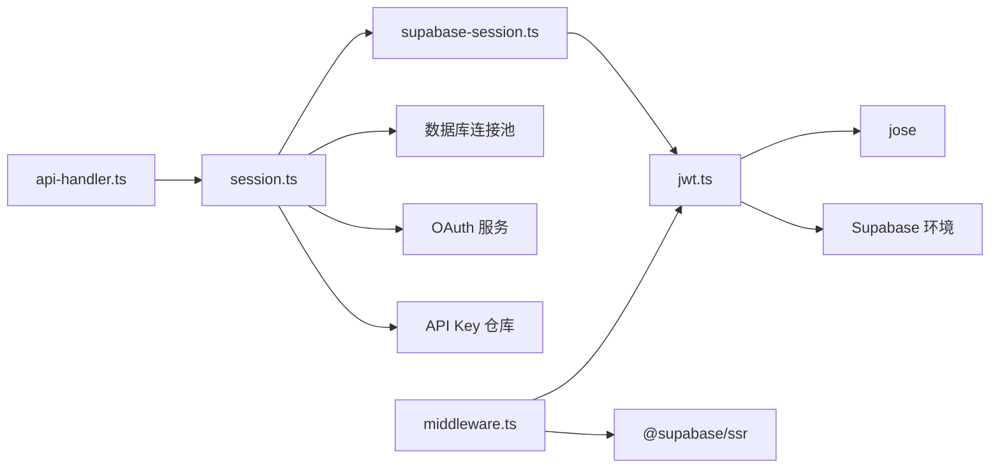

# 会话管理

<cite>
**本文引用的文件**   
- [src/server/auth/jwt.ts](file://src/server/auth/jwt.ts)
- [src/server/auth/supabase-session.ts](file://src/server/auth/supabase-session.ts)
- [src/server/auth/session.ts](file://src/server/auth/session.ts)
- [src/server/auth/require-session.ts](file://src/server/auth/require-session.ts)
- [src/shared/utils/supabase/middleware.ts](file://src/shared/utils/supabase/middleware.ts)
- [src/server/http/api-handler.ts](file://src/server/http/api-handler.ts)
- [src/server/services/profile.service.ts](file://src/server/services/profile.service.ts)
- [src/server/services/avatar.service.ts](file://src/server/services/avatar.service.ts)
- [tests/auth-session.test.mjs](file://tests/auth-session.test.mjs)
</cite>

## 目录
1. [引言](#引言)
2. [项目结构](#项目结构)
3. [核心组件](#核心组件)
4. [架构总览](#架构总览)
5. [详细组件分析](#详细组件分析)
6. [依赖关系分析](#依赖关系分析)
7. [性能考虑](#性能考虑)
8. [故障排查指南](#故障排查指南)
9. [结论](#结论)

## 引言
本文件系统性地文档化当前代码库中的会话管理方案。重点覆盖：
- 会话生命周期：创建、更新、销毁与续期。
- 用户信息提取：从 Supabase JWT 与数据库 profile 中组装会话用户。
- 头像处理：上传、存储、客户端解析与缓存键生成。
- JWT 访问令牌验证：本地验签、Claims 解析、角色与权限提取。
- 会话存储策略：浏览器 cookie、服务端内存缓存、并发请求隔离。
- 中间件与错误处理：代理续期、可重试的 JWKS 失败、未授权响应。
- 性能监控建议：缓存命中率、外部依赖超时、鉴权耗时指标。

该实现以“浏览器持有刷新令牌并负责续期，服务端只做本地 JWT 校验”为核心设计，避免在服务端发起频繁 GoTrue 刷新调用。

## 项目结构
与会话相关的代码主要分布在以下模块：
- `src/server/auth`：JWT 验签、Supabase Claims 读取、会话构造与扩展。
- `src/shared/utils/supabase/middleware.ts`：Next.js 代理中间件，负责认证路径白名单、Cookie 修复、GoTrue 续期。
- `src/server/http/api-handler.ts`：API 路由入口，统一获取会话并包装错误。
- `src/server/services/profile.service.ts`、`src/server/services/avatar.service.ts`：个人资料与头像服务。
- `tests/auth-session.test.mjs`：端到端行为测试，覆盖断言、续期、JWKS 恢复与 Cookie 行为。

**图表来源**
- [src/shared/utils/supabase/middleware.ts:1-200](file://src/shared/utils/supabase/middleware.ts#L1-L200)
- [src/server/auth/jwt.ts:1-231](file://src/server/auth/jwt.ts#L1-L231)
- [src/server/auth/session.ts:1-231](file://src/server/auth/session.ts#L1-L231)
- [src/server/http/api-handler.ts:1-60](file://src/server/http/api-handler.ts#L1-L60)
- [src/server/services/profile.service.ts:1-140](file://src/server/services/profile.service.ts#L1-L140)
- [src/server/services/avatar.service.ts:1-47](file://src/server/services/avatar.service.ts#L1-L47)

**章节来源**
- [src/shared/utils/supabase/middleware.ts:1-200](file://src/shared/utils/supabase/middleware.ts#L1-L200)
- [src/server/auth/jwt.ts:1-231](file://src/server/auth/jwt.ts#L1-L231)
- [src/server/auth/session.ts:1-231](file://src/server/auth/session.ts#L1-L231)
- [src/server/http/api-handler.ts:1-60](file://src/server/http/api-handler.ts#L1-L60)

## 核心组件
- JWT 模块：负责读取 Cookie 中的 access_token、本地验证签名、解析 Claims、维护内存缓存。
- Supabase Claims 读取：优先从 Authorization Bearer 头读取三段的 Supabase JWT，否则回退到 Cookie。
- 会话模块：构造 `SessionUser`，合并数据库 profile 与 JWT metadata，提供活动用户缓存。
- 会话中间件：维护认证免费路径、代理续期、修复 HttpOnly Cookie、设置缓存控制头。
- API 处理器：统一获取会话、抛出未授权错误、捕获业务异常并转换为标准响应。
- 个人资料与头像服务：提供资料查询、更新、头像上传与 URL 解析。

**章节来源**
- [src/server/auth/jwt.ts:1-231](file://src/server/auth/jwt.ts#L1-L231)
- [src/server/auth/supabase-session.ts:1-34](file://src/server/auth/supabase-session.ts#L1-L34)
- [src/server/auth/session.ts:1-231](file://src/server/auth/session.ts#L1-L231)
- [src/shared/utils/supabase/middleware.ts:1-200](file://src/shared/utils/supabase/middleware.ts#L1-L200)
- [src/server/http/api-handler.ts:1-60](file://src/server/http/api-handler.ts#L1-L60)
- [src/server/services/profile.service.ts:1-140](file://src/server/services/profile.service.ts#L1-L140)
- [src/server/services/avatar.service.ts:1-47](file://src/server/services/avatar.service.ts#L1-L47)

## 架构总览
整体流程分为两条主线：
1. 页面/SSR 请求：由中间件决定是否放行、是否需要续期、如何修复 Cookie。
2. API 请求：由 API 处理器统一获取会话，再进入具体业务逻辑。

**图表来源**
- [src/shared/utils/supabase/middleware.ts:70-180](file://src/shared/utils/supabase/middleware.ts#L70-L180)
- [src/server/auth/jwt.ts:100-231](file://src/server/auth/jwt.ts#L100-L231)
- [src/server/auth/session.ts:140-231](file://src/server/auth/session.ts#L140-L231)
- [src/server/http/api-handler.ts:1-60](file://src/server/http/api-handler.ts#L1-L60)

## 详细组件分析

### JWT 访问令牌验证与 Claims 解析
职责：
- 从 Cookie 或 Authorization 头中获取 access_token。
- 支持 HS256（对称密钥）与 ES256/RS256（非对称 JWKS）。
- 校验 audience、issuer、requiredClaims、exp。
- 将成功解析的 Claims 放入进程内内存缓存，降低重复验证开销。
- 对 JWKS 拉取失败进行可重试的错误分类。

关键行为：
- `readAccessTokenFromCookies`：处理 @supabase/ssr 的 chunked base64 编码 Cookie。
- `verifyAccessToken`：按算法选择 HS256 或 JWKS 验证；对网络错误抛出 `auth_unavailable`。
- `getClaimsFromCookies`：封装 Cookie 读取与验证。
- `clearTokenClaimsCache`：登出或账号删除时清理指定用户或全部 Claims 缓存。

**图表来源**
- [src/server/auth/jwt.ts:60-231](file://src/server/auth/jwt.ts#L60-L231)

**章节来源**
- [src/server/auth/jwt.ts:1-231](file://src/server/auth/jwt.ts#L1-L231)
- [tests/auth-session.test.mjs:1-200](file://tests/auth-session.test.mjs#L1-L200)

### Supabase Claims 读取层
职责：
- 优先从 Authorization Bearer 头读取三段式 Supabase JWT。
- 若不存在，则从 Cookie 读取 access_token 并解析 Claims。
- 对外暴露 `getSupabaseClaimsFromRequest` 和 `getSupabaseUserIdFromRequest`。

特点：
- 不直接访问数据库，仅做轻量头部与 Cookie 解析。
- 将复杂鉴权细节下沉至 `jwt.ts`。

**图表来源**
- [src/server/auth/supabase-session.ts:1-34](file://src/server/auth/supabase-session.ts#L1-L34)
- [src/server/auth/jwt.ts:201-231](file://src/server/auth/jwt.ts#L201-L231)

**章节来源**
- [src/server/auth/supabase-session.ts:1-34](file://src/server/auth/supabase-session.ts#L1-L34)
- [src/server/auth/jwt.ts:201-231](file://src/server/auth/jwt.ts#L201-L231)

### 会话构造与用户信息提取
职责：
- 从多种来源构建 `SessionUser`：Supabase JWT、OAuth access_token、用户 API Key、开发 Cookie。
- 合并数据库 profile 中的 display_name、preferred_name、avatar_url。
- 提供 `isUserActiveInDb` 与缓存，确保被删除的用户无法继续使用会话。

构造优先级：
1. Supabase JWT：快速、零网络。
2. Bearer OAuth token 或用户 API Key：需要数据库查找。
3. 开发模式下的 dev cookie：仅限本地调试。

用户活跃性：
- 每次会话构造会校验 `auth.users` 是否存在对应 id。
- 使用短期内存缓存减少高频查询压力。

**图表来源**
- [src/server/auth/session.ts:1-231](file://src/server/auth/session.ts#L1-L231)

**章节来源**
- [src/server/auth/session.ts:1-231](file://src/server/auth/session.ts#L1-L231)

### 会话中间件：创建、更新、销毁与续期
职责：
- 定义认证免费路径与访客预览路径。
- 在 Next.js 代理中间件中调用 Supabase SSR 客户端，完成：
  - 本地 Claims 解析。
  - 必要时调用 GoTrue 续期。
  - 修复旧版 HttpOnly Cookie，使其可被前端 SDK 读取。
  - 设置 `Cache-Control: private, no-store`。
- 对 JWKS 不可用或 GoTrue 超时/限流等场景返回 503 并附带重试提示。

续期策略：
- 如果本地 Claims 可用，不再调用 GoTrue。
- 如果存在 auth token Cookie 但本地解析失败，才调用 `getUser()` 一次。
- 续期成功后，通过 `setAll` 持久化旋转后的 Cookie。

**图表来源**
- [src/shared/utils/supabase/middleware.ts:70-200](file://src/shared/utils/supabase/middleware.ts#L70-L200)

**章节来源**
- [src/shared/utils/supabase/middleware.ts:1-200](file://src/shared/utils/supabase/middleware.ts#L1-L200)
- [tests/auth-session.test.mjs:120-200](file://tests/auth-session.test.mjs#L120-L200)

### 头像处理与个人资料加载
头像相关职责：
- 个人资料服务提供公开资料查询、用户名查询、资料更新、头像形状校验。
- 头像服务负责将上传的头像关联到 profile，并生成带时间戳的客户端 URL。
- 会话模块在读取 profile 时，会将原始 avatar_url、file_id、storage_path 等信息传入客户端头像解析函数，以便正确构造最终 URL。

数据流向：
- 用户上传头像 → 头像服务写入 profile → 返回新的 avatar_url。
- 会话构造 → 读取 profile → 调用头像 URL 解析函数 → 得到 `avatarUrl`。

**图表来源**
- [src/server/services/avatar.service.ts:1-47](file://src/server/services/avatar.service.ts#L1-L47)
- [src/server/services/profile.service.ts:1-140](file://src/server/services/profile.service.ts#L1-L140)
- [src/server/auth/session.ts:1-120](file://src/server/auth/session.ts#L1-L120)

**章节来源**
- [src/server/services/avatar.service.ts:1-47](file://src/server/services/avatar.service.ts#L1-L47)
- [src/server/services/profile.service.ts:1-140](file://src/server/services/profile.service.ts#L1-L140)
- [src/server/auth/session.ts:1-120](file://src/server/auth/session.ts#L1-L120)

### 会话中间件使用示例
推荐用法：
- 在 Next.js 应用中使用 `updateSession` 作为认证中间件。
- 对受保护路由，先调用中间件，再在 API 处理器中通过 `getSessionFromRequest` 获取会话。
- 对于必须登录的操作，使用 `requireSession` 包装会话，未登录时抛出未授权错误。

典型流程：
1. 中间件根据路径决定放行或续期。
2. API 处理器调用 `getSessionFromRequest`。
3. 业务逻辑使用 `requireSession` 确保用户存在。

**图表来源**
- [src/shared/utils/supabase/middleware.ts:70-200](file://src/shared/utils/supabase/middleware.ts#L70-L200)
- [src/server/http/api-handler.ts:1-60](file://src/server/http/api-handler.ts#L1-L60)
- [src/server/auth/require-session.ts:1-9](file://src/server/auth/require-session.ts#L1-L9)

**章节来源**
- [src/shared/utils/supabase/middleware.ts:70-200](file://src/shared/utils/supabase/middleware.ts#L70-L200)
- [src/server/http/api-handler.ts:1-60](file://src/server/http/api-handler.ts#L1-L60)
- [src/server/auth/require-session.ts:1-9](file://src/server/auth/require-session.ts#L1-L9)

### 错误处理模式
- JWKS 拉取超时或 jose 通用错误：抛出 `AppError("auth_unavailable")`，中间件将其包装为 503 响应，并附带 `Retry-After`。
- GoTrue 续期失败：当状态码 >= 500 或 429 时，返回 503 并携带缓存控制头。
- 未登录访问受保护资源：`requireSession` 抛出未授权错误，API 处理器统一捕获并返回标准错误。
- 账号已删除：会话构造时检测 `auth.users`，不存在则抛出 `account_deleted`。

**图表来源**
- [src/server/auth/jwt.ts:140-200](file://src/server/auth/jwt.ts#L140-L200)
- [src/shared/utils/supabase/middleware.ts:120-180](file://src/shared/utils/supabase/middleware.ts#L120-L180)
- [src/server/auth/session.ts:160-231](file://src/server/auth/session.ts#L160-L231)
- [src/server/auth/require-session.ts:1-9](file://src/server/auth/require-session.ts#L1-L9)
- [src/server/http/api-handler.ts:40-60](file://src/server/http/api-handler.ts#L40-L60)

**章节来源**
- [src/server/auth/jwt.ts:140-200](file://src/server/auth/jwt.ts#L140-L200)
- [src/shared/utils/supabase/middleware.ts:120-180](file://src/shared/utils/supabase/middleware.ts#L120-L180)
- [src/server/auth/session.ts:160-231](file://src/server/auth/session.ts#L160-L231)
- [src/server/auth/require-session.ts:1-9](file://src/server/auth/require-session.ts#L1-L9)
- [src/server/http/api-handler.ts:40-60](file://src/server/http/api-handler.ts#L40-L60)

## 依赖关系分析
- JWT 模块依赖：
  - `@supabase/ssr`：chunked Cookie 组合与 base64url 解码。
  - `jose`：JWKS、JWT 验证、protected header 解析。
  - 环境变量：`SUPABASE_JWT_SECRET`、Supabase URL。
- Supabase Claims 读取依赖：
  - JWT 模块：`getClaimsFromCookies`、`verifyAccessToken`。
- 会话模块依赖：
  - Supabase Claims 读取：`getSupabaseClaimsFromRequest`。
  - 数据库连接池：查询 `profiles` 与 `auth.users`。
  - OAuth 服务：解析 Clauxen Code OAuth access_token。
  - API Key 仓库：解析用户 API Key。
- 中间件依赖：
  - Supabase SSR 客户端：续期与 Cookie 管理。
  - JWT 模块：本地 Claims 解析。
  - 身份提示 Cookie：用于前端快速显示身份。

**图表来源**
- [src/server/auth/jwt.ts:1-60](file://src/server/auth/jwt.ts#L1-L60)
- [src/server/auth/supabase-session.ts:1-34](file://src/server/auth/supabase-session.ts#L1-L34)
- [src/server/auth/session.ts:1-120](file://src/server/auth/session.ts#L1-L120)
- [src/shared/utils/supabase/middleware.ts:1-70](file://src/shared/utils/supabase/middleware.ts#L1-L70)
- [src/server/http/api-handler.ts:1-30](file://src/server/http/api-handler.ts#L1-L30)

**章节来源**
- [src/server/auth/jwt.ts:1-60](file://src/server/auth/jwt.ts#L1-L60)
- [src/server/auth/supabase-session.ts:1-34](file://src/server/auth/supabase-session.ts#L1-L34)
- [src/server/auth/session.ts:1-120](file://src/server/auth/session.ts#L1-L120)
- [src/shared/utils/supabase/middleware.ts:1-70](file://src/shared/utils/supabase/middleware.ts#L1-L70)
- [src/server/http/api-handler.ts:1-30](file://src/server/http/api-handler.ts#L1-L30)

## 性能考虑
- 内存缓存：
  - JWT Claims 缓存：每个 access_token 最多缓存到其 exp 或 60 秒，上限约 1000 条，LRU 风格淘汰最早条目。
  - 用户活跃性缓存：15 秒有效期，上限 1000 条，用于减少 `auth.users` 查询。
- 并发安全：
  - JWKS 公共 JSON key 缓存位于模块级，pending fetch 属于单个 Worker 请求，避免并发重复拉取。
  - jose 配置了 cacheMaxAge、cooldownDuration、timeoutDuration，降低外部依赖抖动影响。
- 网络调用优化：
  - 中间件仅在本地 Claims 不可用且存在 auth token Cookie 时才调用 GoTrue 续期。
  - 浏览器持有 refresh token，服务器不主动刷新，避免刷新风暴。
- 建议监控指标：
  - JWT 验证缓存命中率。
  - JWKS 拉取成功率与延迟。
  - GoTrue 续期调用次数与失败率。
  - 会话构造耗时分布，尤其是 profile 查询与头像 URL 解析阶段。

[本节为通用性能指导，不直接分析具体文件]

## 故障排查指南
常见问题与定位方法：
- 401 未授权：
  - 检查是否调用了 `requireSession`，确认 `getSessionFromRequest` 返回 null。
  - 检查 Authorization 头是否包含有效的三段式 Supabase JWT。
  - 检查 Cookie 名称是否与 Supabase 项目引用一致。
- 503 会话不可用：
  - 检查 JWKS 端点是否可达，确认 jose 配置的 timeoutDuration 与 cooldownDuration。
  - 检查 GoTrue 续期是否返回 5xx 或 429。
- 头像不显示：
  - 检查 profile 的 avatar_url、avatar_file_id、avatar_storage_path 是否正确写入。
  - 检查客户端头像 URL 解析函数是否使用了正确的 userId 与时间戳。
- 会话未刷新：
  - 检查中间件是否被调用，确认 `updateSession` 已执行。
  - 检查 Cookie 是否被修复为非 HttpOnly，供前端 SDK 读取。

**章节来源**
- [src/server/auth/require-session.ts:1-9](file://src/server/auth/require-session.ts#L1-L9)
- [src/server/auth/jwt.ts:140-231](file://src/server/auth/jwt.ts#L140-L231)
- [src/shared/utils/supabase/middleware.ts:120-200](file://src/shared/utils/supabase/middleware.ts#L120-L200)
- [src/server/services/avatar.service.ts:1-47](file://src/server/services/avatar.service.ts#L1-L47)
- [src/server/services/profile.service.ts:1-140](file://src/server/services/profile.service.ts#L1-L140)

## 结论
该会话管理系统以“浏览器负责续期、服务端负责本地验签”为核心，结合多源会话构造、数据库 profile 合并与头像服务，形成稳定可扩展的身份体系。JWT 模块提供高性能内存缓存与健壮的 JWKS 错误处理；中间件保证 Cookie 可读写与缓存控制；会话模块确保删除用户立即失效。建议在部署中增加缓存命中率、JWKS 与 GoTrue 调用指标的监控，以便持续优化鉴权性能与可用性。

[本节为总结性内容，不直接分析具体文件]