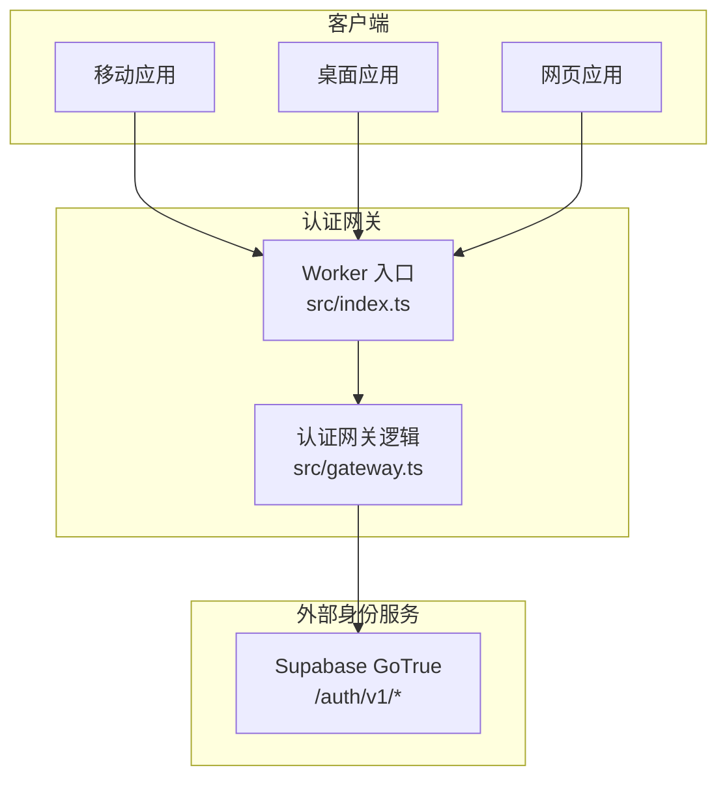
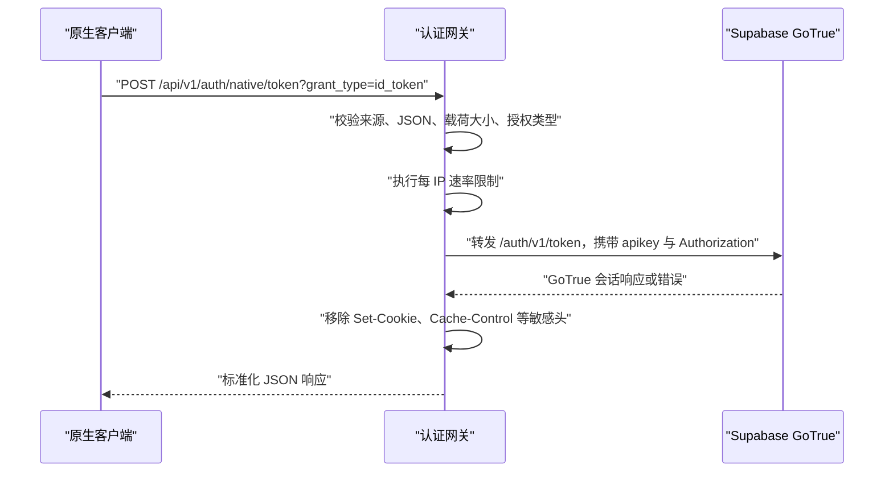
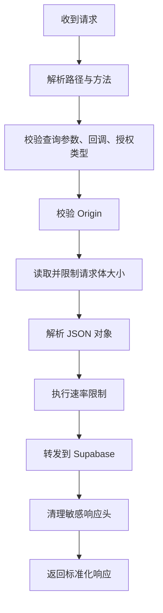
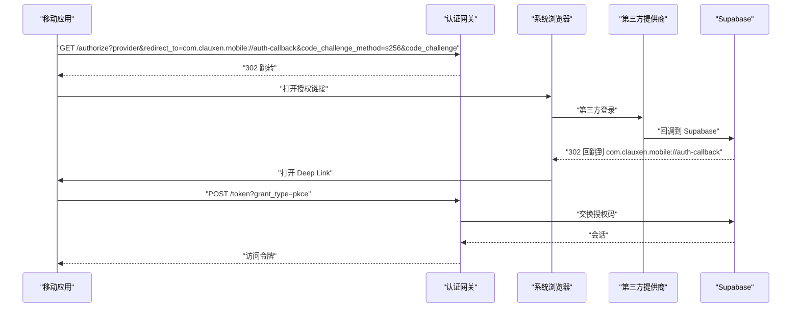
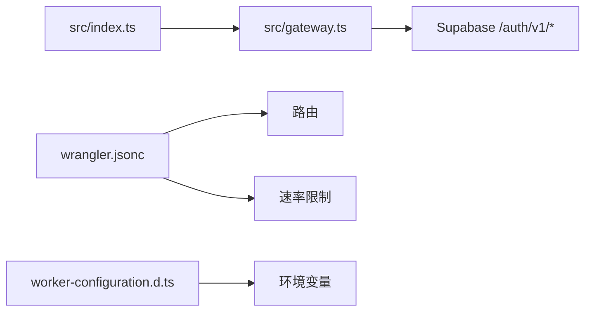

# 原生应用认证网关

<cite>
**本文引用的文件**   
- [gateway.ts](file://workers/native-auth/src/gateway.ts)
- [index.ts](file://workers/native-auth/src/index.ts)
- [worker-configuration.d.ts](file://workers/native-auth/worker-configuration.d.ts)
- [wrangler.jsonc](file://workers/native-auth/wrangler.jsonc)
- [gateway.test.ts](file://workers/native-auth/gateway.test.ts)
- [oauth-callbacks.md](file://docs/auth/oauth-callbacks.md)
</cite>

## 目录
1. [引言](#引言)
2. [项目结构](#项目结构)
3. [核心组件](#核心组件)
4. [架构总览](#架构总览)
5. [端点规范](#端点规范)
6. [安全与限制](#安全与限制)
7. [移动端集成指南](#移动端集成指南)
8. [依赖关系分析](#依赖关系分析)
9. [性能特征](#性能特征)
10. [测试用例分析](#测试用例分析)
11. [错误码定义](#错误码定义)
12. [故障排除指南](#故障排除指南)
13. [结论](#结论)

## 引言
本文件为 Clauxen 原生应用认证网关的权威文档。该网关面向移动和桌面应用，提供专用认证 API：`token`、`authorize`、`otp`、`verify`、`recover`、`logout`、`user`。网关本身不签发用户身份；它作为统一入口，对请求进行路径、方法、来源、载荷大小、PKCE、授权类型等校验，再将受控请求转发到 Supabase GoTrue 身份服务。所有最终凭据验证均由 Supabase 完成。

该网关的核心价值是：
- 为原生客户端暴露稳定、最小化的认证协议面。
- 强制使用 PKCE 和固定回调地址。
- 屏蔽浏览器 Cookie、敏感响应头及上游异常细节。
- 提供跨平台 OAuth 跳转（Google、GitHub、GitLab）以及密码、刷新令牌、短信验证码等流程。

## 项目结构
原生认证网关是一个独立的 Cloudflare Worker，部署在 `www.clauxen.com/api/v1/auth/native/*`。

**图示来源**
- [index.ts:1-5](file://workers/native-auth/src/index.ts#L1-L5)
- [gateway.ts:1-166](file://workers/native-auth/src/gateway.ts#L1-L166)

**章节来源**
- [index.ts:1-5](file://workers/native-auth/src/index.ts#L1-L5)
- [wrangler.jsonc:1-18](file://workers/native-auth/wrangler.jsonc#L1-L18)

## 核心组件
- **Worker 入口**：导出统一的 `fetch` 处理器，将每个入站请求交给网关处理函数。
- **网关处理器**：解析 URL、校验方法和查询参数、限制请求体大小、校验 JSON、校验来源、执行速率限制、构造上游请求、清理响应头、返回标准化错误。
- **环境变量**：包括 Supabase 地址、可发布密钥、速率限制绑定。
- **路由配置**：仅允许 `www.clauxen.com` 域名下的 `/api/v1/auth/native/*` 路径。

| 组件 | 职责 | 关键实现位置 |
|---|---|---|
| Worker 入口 | 接收请求并调用网关 | [index.ts:1-5](file://workers/native-auth/src/index.ts#L1-L5) |
| 网关处理器 | 路径、方法、载荷、来源、PKCE、授权类型校验 | [gateway.ts:1-166](file://workers/native-auth/src/gateway.ts#L1-L166) |
| 环境类型 | 定义 `SUPABASE_URL`、`SUPABASE_PUBLISHABLE_KEY`、`AUTH_RATE_LIMIT` | [worker-configuration.d.ts:1-44](file://workers/native-auth/worker-configuration.d.ts#L1-L44) |
| 路由与限流 | 注册域名路由、全局速率限制命名空间 | [wrangler.jsonc:1-18](file://workers/native-auth/wrangler.jsonc#L1-L18) |

**章节来源**
- [index.ts:1-5](file://workers/native-auth/src/index.ts#L1-L5)
- [gateway.ts:1-166](file://workers/native-auth/src/gateway.ts#L1-L166)
- [worker-configuration.d.ts:1-44](file://workers/native-auth/worker-configuration.d.ts#L1-L44)
- [wrangler.jsonc:1-18](file://workers/native-auth/wrangler.jsonc#L1-L18)

## 架构总览
认证网关位于客户端与 Supabase 之间，承担边界保护、协议规范化和安全响应过滤的职责。

**图示来源**
- [gateway.ts:1-166](file://workers/native-auth/src/gateway.ts#L1-L166)
- [gateway.test.ts:1-150](file://workers/native-auth/gateway.test.ts#L1-L150)

## 端点规范

### 公共前缀
所有端点均位于：
`https://www.clauxen.com/api/v1/auth/native/<endpoint>`

### 统一行为
- 成功响应默认使用 JSON 格式。
- 成功响应包含禁止缓存头：`Cache-Control: no-store, private`、`Pragma: no-cache`。
- 响应包含安全头：`X-Content-Type-Options: nosniff`、`X-Clauxen-Auth-Gateway: 1`。
- 未明确说明时，请求体必须为 JSON 对象。
- 上游返回 204 或 304 时，网关直接透传状态码，不再包装 JSON。
- 网关不会转发上游的 `Set-Cookie`。
- 网关不会转发上游的通用 `Cache-Control`；若上游返回 `Retry-After`，网关会将其复制到响应头。

**图示来源**
- [gateway.ts:1-166](file://workers/native-auth/src/gateway.ts#L1-L166)

### token 端点
用于交换访问令牌或刷新会话。

| 属性 | 值 |
|---|---|
| 路径 | `/api/v1/auth/native/token` |
| 方法 | `POST` |
| 内容类型 | `application/json` |
| 必填查询参数 | `grant_type` |
| 支持的值 | `id_token`、`password`、`refresh_token`、`pkce` |

#### grant_type=id_token
适用于 Google 原生登录。

| 字段 | 类型 | 是否必填 | 说明 |
|---|---|---:|---|
| provider | string | 是 | 当前仅允许 `google` |
| id_token | string | 是 | 第三方提供商签发的 ID Token |
| nonce | string | 是 | 长度 32 至 256 个字符，由客户端生成并与提供商协商 |

请求示例路径：
`POST /api/v1/auth/native/token?grant_type=id_token`

请求体字段：
- `provider`: `google`
- `id_token`: 第三方 ID Token
- `nonce`: 随机字符串

响应结构：
- 成功：返回 GoTrue 会话对象，包含访问令牌、刷新令牌和用户信息。
- 失败：返回带 `error_code` 和 `msg` 的 JSON。

注意：
- 网关不验证 Google ID Token 签名；该工作由 Supabase 完成。
- 网关只保留必要字段，不转发上游 Cookie。
- 响应会被标记为不可缓存。

#### grant_type=refresh_token
用于轮换访问令牌和刷新令牌。

请求体字段：
- `refresh_token`: 已有刷新令牌

行为：
- 通过同一网关转发，不创建新身份。
- 成功返回旋转后的访问令牌和刷新令牌。

#### grant_type=password
用于用户名密码登录。

请求体字段：
- 通常包含用户名和密码字段，具体由 Supabase 决定。

#### grant_type=pkce
用于 PKCE 授权码交换。

请求体字段：
- 通常包含授权码、重定向 URI 和 code verifier。

### authorize 端点
用于启动第三方 OAuth 流程。

| 属性 | 值 |
|---|---|
| 路径 | `/api/v1/auth/native/authorize` |
| 方法 | `GET` |
| 内容类型 | 不需要请求体 |
| 必填查询参数 | `provider`、`redirect_to`、`code_challenge_method`、`code_challenge` |

支持的提供商：
- `google`
- `github`
- `gitlab`

回调协议：
- 固定回调地址：`com.clauxen.mobile://auth-callback`
- 任何非固定回调值都会被拒绝。

PKCE 要求：
- `code_challenge_method` 必须为 `s256`。
- `code_challenge` 必须是长度为 43 的 Base64URL 字符串。

OAuth 跳转策略：
- GitHub、GitLab：网关返回 302，跳转到 `https://auth.clauxen.com/auth/v1/authorize`，客户端继续与共享后端交互。
- Google：如果共享后端返回 302，网关将再次 302 到最终提供商页面，保持 PKCE 和账户选择参数。

典型查询参数：
- `provider`: 提供商名称
- `redirect_to`: 固定回调地址
- `code_challenge_method`: `s256`
- `code_challenge`: 挑战值
- `scopes`: 可选作用域
- `prompt`: 可选，例如 `select_account`

### otp 端点
用于发送一次性验证码，例如短信或邮箱验证码。

| 属性 | 值 |
|---|---|
| 路径 | `/api/v1/auth/native/otp` |
| 方法 | `POST` |
| 内容类型 | `application/json` |
| 认证要求 | 无 |

请求体字段：
- 由 Supabase OTP 流程决定，常见字段包括邮箱、手机号或用户标识。

响应结构：
- 成功：返回 GoTrue OTP 相关结果。
- 失败：返回带 `error_code` 和 `msg` 的 JSON。

### verify 端点
用于验证一次性验证码或恢复链接。

| 属性 | 值 |
|---|---|
| 路径 | `/api/v1/auth/native/verify` |
| 方法 | `POST` |
| 内容类型 | `application/json` |
| 认证要求 | 无 |

请求体字段：
- 由 Supabase verify 流程决定，常见字段包括 token、type、email、phone 等。

响应结构：
- 成功：可能返回会话或确认结果。
- 失败：返回带 `error_code` 和 `msg` 的 JSON。

### recover 端点
用于触发密码重置或账号恢复流程。

| 属性 | 值 |
|---|---|
| 路径 | `/api/v1/auth/native/recover` |
| 方法 | `POST` |
| 内容类型 | `application/json` |
| 认证要求 | 无 |

请求体字段：
- 通常包含邮箱或用户名。

响应结构：
- 成功：返回恢复流程结果。
- 失败：返回带 `error_code` 和 `msg` 的 JSON。

### logout 端点
用于登出当前用户。

| 属性 | 值 |
|---|---|
| 路径 | `/api/v1/auth/native/logout` |
| 方法 | `POST` |
| 认证要求 | 需要 `Authorization: Bearer <session-jwt>` |

行为：
- 网关将请求转发给 Supabase。
- 成功时返回 204，不包含响应体。
- 不支持客户端自定义 scope，仅按标准流程处理。

### user 端点
用于查询当前用户信息。

| 属性 | 值 |
|---|---|
| 路径 | `/api/v1/auth/native/user` |
| 方法 | `GET`、`PUT` |
| 认证要求 | 需要 `Authorization: Bearer <session-jwt>` |

行为：
- 未携带有效 Bearer 令牌时返回 401。
- 成功时返回用户信息。
- PUT 可用于更新当前用户资料。

### 健康检查
网关还提供内部健康检查端点：

| 属性 | 值 |
|---|---|
| 路径 | `/api/v1/auth/native/health` |
| 方法 | `GET` |
| 响应体 | `{ ok: true, service: "clauxen-native-auth" }` |

健康检查不要求认证，也不代表 Supabase 完全可用，只能说明网关进程正常。

**章节来源**
- [gateway.ts:1-166](file://workers/native-auth/src/gateway.ts#L1-L166)
- [gateway.test.ts:1-150](file://workers/native-auth/gateway.test.ts#L1-L150)

## 安全与限制

### 来源限制
- 当请求携带 `Origin` 头时，仅允许：
  - `https://www.clauxen.com`
  - `https://clauxen.com`
- 非允许来源返回 403，错误码为 `origin_not_allowed`。

### 路径与方法限制
- 仅允许 `/api/v1/auth/native/` 前缀下的已知端点。
- 未知路径返回 404。
- 不支持的方法返回 405。

### 查询参数限制
- 不允许重复查询参数。
- `authorize` 必须指定允许的提供商。
- `authorize` 必须使用固定回调和 PKCE。
- `token` 必须使用支持的 `grant_type`。
- `token` 的 `id_token` 模式要求 Google 提供商和合法 nonce。

### 回调协议
- 固定回调：`com.clauxen.mobile://Deep Link`
- 任何自定义回调都会被拒绝。
- 对于网页 OAuth，Supabase 回调地址见 OAuth 回调文档。

### 请求大小限制
- 请求体最大 64 KiB。
- 超限返回 413，错误码 `body_too_large`。

### 响应大小限制
- 上游响应体最大 128 KiB。
- 超限会转为网关错误。

### 内容类型限制
- 有请求体时必须为 `application/json`。
- 非 JSON 内容类型返回 415，错误码 `invalid_content_type`。
- 无效 JSON 返回 400，错误码 `bad_json`。

### 速率限制
- 基于连接 IP 的粗粒度速率限制。
- 默认限制为每 60 秒 120 次请求。
- 超限时返回 429，错误码 `over_request_rate_limit`。
- 网关自动添加 `Retry-After: 60`。

### 认证要求
- `user` 和 `logout` 要求 `Authorization: Bearer <session-jwt>`。
- 缺失或格式错误时返回 401，错误码 `no_authorization`。
- 网关不验证 JWT 内容；JWT 验证由 Supabase 负责。

### 上游代理安全
- 网关始终设置 Supabase 的 `apikey`。
- 只有当上游返回 Location 且不是 `authorize` 时，才会透传上游 Location。
- 不转发上游 Cookie。
- 不转发上游 Cache-Control。
- 不暴露上游异常详情。
- 网络错误或 HTML 挑战返回 502，错误码 `upstream_unavailable`。

### 配置安全检查
- 缺少 `SUPABASE_URL` 或 `SUPABASE_PUBLISHABLE_KEY` 时返回 503。
- `SUPABASE_URL` 必须为 HTTPS、根路径且不包含用户名、密码、查询或哈希。

**章节来源**
- [gateway.ts:1-166](file://workers/native-auth/src/gateway.ts#L1-L166)
- [wrangler.jsonc:1-18](file://workers/native-auth/wrangler.jsonc#L1-L18)
- [gateway.test.ts:1-150](file://workers/native-auth/gateway.test.ts#L1-L150)

## 移动端集成指南

### 固定 Deep Link
移动应用应使用以下回调地址：
`com.clauxen.mobile://auth-callback`

该地址由网关强制校验，不能替换为任意地址。

### OAuth 授权流程
推荐步骤：
1. 生成 PKCE 挑战值。
2. 调用 `authorize` 获取 302 跳转。
3. 在移动浏览器中打开跳转地址。
4. 用户完成第三方登录。
5. 第三方回调到 Supabase，再回跳固定 Deep Link。
6. 应用捕获 Deep Link，将授权码传给 `token?grant_type=pkce`。
7. 获得访问令牌后保存会话。

**图示来源**
- [gateway.ts:1-166](file://workers/native-auth/src/gateway.ts#L1-L166)
- [gateway.test.ts:1-150](file://workers/native-auth/gateway.test.ts#L1-L150)

### Google 原生 ID Token 登录
适用场景：
- 已使用 Google SDK 获取本地 ID Token。
- 不希望经过完整浏览器 OAuth 跳转。

步骤：
1. 使用 Google Identity Services 获取 ID Token。
2. 生成 32 到 256 字符的 nonce。
3. 将 nonce 传递给 Google 获取 ID Token。
4. 调用 `token?grant_type=id_token`，提交 `provider=google`、`id_token`、`nonce`。
5. 网关将请求转发给 Supabase 完成交换。
6. 客户端保存返回的会话。

### 后台刷新策略
建议策略：
- 仅在用户活跃时刷新访问令牌。
- 避免频繁轮询；使用应用进入前台、用户主动操作或静默刷新窗口。
- 刷新失败时，提示重新登录。
- 不要在前台无限重试；加入退避策略。
- 使用网关刷新端点而不是绕过网关直接调用上游。

### 会话存储
- 移动端建议使用平台安全存储。
- 桌面端建议使用加密存储或操作系统凭据管理。
- 不要将刷新令牌写入日志、崩溃报告或明文配置文件。
- 登出时应同时清除本地会话。

### 深度链接处理
- 应用需注册 `com.clauxen.mobile://` scheme。
- 捕获回调后解析授权码。
- 将授权码发送给 `token?grant_type=pkce`。
- 成功后关闭引导页并进入主界面。

**章节来源**
- [gateway.ts:1-166](file://workers/native-auth/src/gateway.ts#L1-L166)
- [gateway.test.ts:1-150](file://workers/native-auth/gateway.test.ts#L1-L150)
- [oauth-callbacks.md:1-71](file://docs/auth/oauth-callbacks.md#L1-L71)

## 依赖关系分析

**图示来源**
- [index.ts:1-5](file://workers/native-auth/src/index.ts#L1-L5)
- [gateway.ts:1-166](file://workers/native-auth/src/gateway.ts#L1-L166)
- [wrangler.jsonc:1-18](file://workers/native-auth/wrangler.jsonc#L1-L18)
- [worker-configuration.d.ts:1-44](file://workers/native-auth/worker-configuration.d.ts#L1-L44)

**章节来源**
- [index.ts:1-5](file://workers/native-auth/src/index.ts#L1-L5)
- [gateway.ts:1-166](file://workers/native-auth/src/gateway.ts#L1-L166)
- [worker-configuration.d.ts:1-44](file://workers/native-auth/worker-configuration.d.ts#L1-L44)
- [wrangler.jsonc:1-18](file://workers/native-auth/wrangler.jsonc#L1-L18)

## 性能特征
- 网关不进行业务逻辑计算，主要开销在 JSON 解析、网络转发和响应体限制。
- 上游请求超时时间为 20 秒。
- 请求体和响应体分别限制为 64 KiB 和 128 KiB，防止大载荷攻击。
- 速率限制以 IP 为单位，适合防护暴力登录。
- 网关不缓存敏感响应，避免会话泄露。
- 观察性开启，但隐藏查询字符串，降低敏感数据风险。

优化建议：
- 客户端应避免重复刷新短命令牌。
- 批量认证请求应在客户端合并。
- 不要在高频 UI 循环中调用认证接口。
- 合理设置 PKCE 挑战值生成频率，避免无用计算。

[本节为通用性能指导，不直接分析具体代码行]

## 测试用例分析

### 测试覆盖范围
测试覆盖了以下关键路径：
- Google ID Token 交换。
- 刷新令牌流程。
- 无效提供商、缺失 nonce、过短 nonce。
- 管理员路径、非法子路径、编码路径拦截。
- 错误方法、错误内容类型、非法 JSON、超大请求体。
- OAuth 授权跳转、PKCE 校验。
- 外部回调、缺失 PKCE、重复查询参数。
- 会话 Bearer 访问 user 和 logout。
- Supabase 返回错误时的状态码透传。
- 速率限制和外部来源拦截。
- 上游网络错误和 HTML 挑战的安全处理。
- 缺失服务器配置的关闭失败行为。
- Google 浏览器回退流程。

### 关键断言要点
- 网关不会转发上游 Cookie。
- 响应必须标记为不可缓存。
- 授权跳转必须指向预期主机和路径。
- 外部来源请求不得到达上游。
- 上游错误码和错误消息应保持兼容。
- 网络异常不会泄露内部信息。
- 缺失配置应返回 503。

**章节来源**
- [gateway.test.ts:1-150](file://workers/native-auth/gateway.test.ts#L1-L150)

## 错误码定义

| HTTP 状态 | error_code | 含义 | 常见原因 |
|---:|---|---|---|
| 400 | `invalid_query` | 查询参数无效 | 重复参数 |
| 400 | `invalid_redirect` | 回调地址无效 | 使用了非固定回调 |
| 400 | `invalid_provider` | 不支持的提供商 | 未在允许列表中 |
| 400 | `invalid_pkce` | PKCE 无效 | 缺少挑战或使用非 s256 |
| 400 | `unsupported_grant_type` | 不支持的授权类型 | grant_type 不在允许列表 |
| 400 | `invalid_credentials` | 凭据无效 | Google ID Token 或 nonce 不符合要求 |
| 400 | `bad_json` | JSON 无效 | 不是对象或语法错误 |
| 401 | `no_authorization` | 缺少认证 | user 或 logout 未携带 Bearer |
| 403 | `origin_not_allowed` | 来源被拒绝 | Origin 不在允许列表 |
| 404 | `not_found` | 路径不存在 | 未知端点或路径 |
| 405 | `method_not_allowed` | 方法不被允许 | 使用了错误 HTTP 方法 |
| 413 | `body_too_large` | 请求体过大 | 超过 64 KiB |
| 415 | `invalid_content_type` | 内容类型无效 | 非 JSON |
| 429 | `over_request_rate_limit` | 请求过多 | 超出速率限制 |
| 502 | `upstream_unavailable` | 上游不可用 | 网络错误、HTML 挑战或无效响应 |
| 503 | `auth_unavailable` | 认证服务不可用 | 缺少配置或配置非法 |

注意：
- 网关错误优先使用语义化 `error_code`。
- 上游错误通常会透传其原始状态码和错误码。
- 网关自身异常统一映射为 502，并隐藏内部细节。

**章节来源**
- [gateway.ts:1-166](file://workers/native-auth/src/gateway.ts#L1-L166)
- [gateway.test.ts:1-150](file://workers/native-auth/gateway.test.ts#L1-L150)

## 故障排除指南

### 无法调用认证接口
排查顺序：
1. 确认请求路径以 `/api/v1/auth/native/` 开头。
2. 确认域名是 `www.clauxen.com`。
3. 检查 `Origin` 是否为允许来源。
4. 确认方法正确，例如 `token` 为 POST、`authorize` 为 GET。
5. 查看健康检查是否正常。

### OAuth 跳转失败
排查顺序：
1. 确认 `redirect_to` 是固定回调。
2. 确认 `code_challenge_method` 是 `s256`。
3. 确认 `code_challenge` 长度和字符集正确。
4. 确认提供商是 `google`、`github` 或 `gitlab`。
5. 检查是否有重复查询参数。

### Google ID Token 登录失败
排查顺序：
1. 确认 `provider` 是 `google`。
2. 确认 `nonce` 长度在 32 到 256 之间。
3. 确认 nonce 与获取 ID Token 时一致。
4. 检查 Supabase 是否正确配置 Google 提供商。
5. 查看上游错误码，例如无效 JWT。

### 刷新令牌失败
排查顺序：
1. 确认使用的是刷新端点。
2. 确认刷新令牌有效且未被撤销。
3. 检查是否通过网关转发，而不是绕过网关。
4. 检查速率限制是否触发。

### 429 速率限制
- 表示短时间内请求过多。
- 客户端应退避并重试。
- 不要立即无限重试。
- 检查是否存在重复刷新或 UI 层重复调用。

### 502 上游不可用
- 可能是 Supabase 不可用、网络中断或返回 HTML。
- 客户端应视为临时错误。
- 不要记录上游响应体中的敏感内容。
- 等待一段时间后重试。

### 503 认证服务不可用
- 通常是服务端配置缺失。
- 检查 `SUPABASE_URL` 和 `SUPABASE_PUBLISHABLE_KEY`。
- 确认 `SUPABASE_URL` 是 HTTPS 根路径。

### 网页 OAuth 回调问题
- 社交提供商回调应使用 Supabase 提供的标准回调地址。
- 应用回调地址需在 Supabase 中配置。
- 自定义域名与项目域名路由到同一项目，并非独立故障转移。

**章节来源**
- [gateway.ts:1-166](file://workers/native-auth/src/gateway.ts#L1-L166)
- [gateway.test.ts:1-150](file://workers/native-auth/gateway.test.ts#L1-L150)
- [oauth-callbacks.md:1-71](file://docs/auth/oauth-callbacks.md#L1-L71)

## 结论
原生应用认证网关为移动和桌面应用提供了安全的认证入口。它通过严格的路径、方法、来源、载荷和 PKCE 校验，将原生客户端与 Supabase GoTrue 解耦。开发者无需自行实现复杂的上游安全策略，只需遵循固定回调、PKCE 和标准化请求格式。

最佳实践包括：
- 始终使用固定 Deep Link 回调。
- 始终使用 PKCE。
- 在客户端管理 nonce、授权码和会话生命周期。
- 只在必要时刷新令牌。
- 正确处理 429、502、503 等网络级错误。
- 不在日志中输出令牌、nonce 或上游错误细节。