# 用户认证

<cite>
**本文引用的文件**   
- [src/server/auth/jwt.ts](file://src/server/auth/jwt.ts)
- [src/server/auth/session.ts](file://src/server/auth/session.ts)
- [src/server/auth/require-session.ts](file://src/server/auth/require-session.ts)
- [src/server/auth/supabase-session.ts](file://src/server/auth/supabase-session.ts)
- [src/app/api/v1/auth/login/route.ts](file://src/app/api/v1/auth/login/route.ts)
- [src/app/api/v1/auth/register/route.ts](file://src/app/api/v1/auth/register/route.ts)
- [src/app/api/v1/auth/logout/route.ts](file://src/app/api/v1/auth/logout/route.ts)
- [src/app/api/v1/auth/email-status/route.ts](file://src/app/api/v1/auth/email-status/route.ts)
- [src/app/api/v1/auth/magic/request/route.ts](file://src/app/api/v1/auth/magic/request/route.ts)
- [src/app/api/v1/auth/magic/complete/route.ts](file://src/app/api/v1/auth/magic/complete/route.ts)
- [src/app/api/v1/auth/magic/inspect/route.ts](file://src/app/api/v1/auth/magic/inspect/route.ts)
- [src/app/api/v1/auth/signup/request-otp/route.ts](file://src/app/api/v1/auth/signup/request-otp/route.ts)
- [src/app/api/v1/auth/signup/verify/route.ts](file://src/app/api/v1/auth/signup/verify/route.ts)
- [src/app/api/v1/auth/session/route.ts](file://src/app/api/v1/auth/session/route.ts)
- [src/app/api/oauth/authorize/route.ts](file://src/app/api/oauth/authorize/route.ts)
- [src/app/api/oauth/token/route.ts](file://src/app/api/oauth/token/route.ts)
- [src/app/api/oauth/userinfo/route.ts](file://src/app/api/oauth/userinfo/route.ts)
- [src/app/api/oauth/revoke/route.ts](file://src/app/api/oauth/revoke/route.ts)
- [src/app/auth/callback/route.ts](file://src/app/auth/callback/route.ts)
- [src/app/auth/confirm/route.ts](file://src/app/auth/confirm/route.ts)
- [src/app/auth/magic/page.tsx](file://src/app/auth/magic/page.tsx)
- [src/app/auth/oauth/route.ts](file://src/app/auth/oauth/route.ts)
- [docs/auth/oauth-callbacks.md](file://docs/auth/oauth-callbacks.md)
- [workers/native-auth/src/gateway.ts](file://workers/native-auth/src/gateway.ts)
- [workers/native-auth/src/index.ts](file://workers/native-auth/src/index.ts)
- [workers/oauth-broker/src/broker.ts](file://workers/oauth-broker/src/broker.ts)
- [workers/oauth-broker/src/flow.ts](file://workers/oauth-broker/src/flow.ts)
- [workers/oauth-broker/src/identity.ts](file://workers/oauth-broker/src/identity.ts)
- [workers/oauth-broker/src/providers.ts](file://workers/oauth-broker/src/providers.ts)
- [workers/plugin-oauth/src/oauth.ts](file://workers/plugin-oauth/src/oauth.ts)
- [workers/auth-email/src/index.ts](file://workers/auth-email/src/index.ts)
</cite>

## 目录

1. [简介](#简介)
2. [项目结构](#项目结构)
3. [核心组件](#核心组件)
4. [架构总览](#架构总览)
5. [详细组件分析](#详细组件分析)
6. [依赖关系分析](#依赖关系分析)
7. [性能与安全特性](#性能与安全特性)
8. [故障排查指南](#故障排查指南)
9. [结论](#结论)
10. [附录：第三方 OAuth 集成与回调](#附录第三方-oauth-集成与回调)

## 简介

本项目的用户认证体系围绕 Supabase 身份服务构建，同时扩展出 Web、原生应用和插件三类入口。它支持以下能力：

- **Magic Links（魔法链接）**：通过邮件发送一次性链接完成注册或登录；前端可先检查链接有效性，再引导用户设置密码并自动登录。
- **WebAuthn 与第三方 OAuth**：通过 Supabase 的 `signInWithOAuth` 发起 Google、GitHub、GitLab、X 等第三方登录；Web 端使用 PKCE 保护授权码；原生应用通过专用网关转发到 Supabase。
- **会话管理**：服务端优先解析浏览器 Cookie 中的 Supabase JWT，再校验数据库中的用户是否仍活跃；同时兼容 API Key、内部 OAuth Access Token 等无 Cookie 场景。
- **JWT 令牌处理**：本地验证 Supabase Access Token，使用 JWKS 或共享密钥；过期不刷新，由客户端负责刷新 Cookie。
- **权限控制策略**：统一从请求中解析 `SessionUser`，并通过中间函数强制要求已登录用户；未登录请求直接返回未授权错误。
- **用户资料与偏好**：将 Supabase 用户元数据合并到平台 `profiles` 表，支持显示名、首选名、头像存储路径及公开头像 URL。
- **账户安全**：禁止临时邮箱、限制登录频率、审计安全事件、删除账号后立即失效会话、OAuth 撤销接口符合 RFC 7009。
- **原生应用认证流程**：`native-auth` Worker 作为受限网关，只允许固定回调地址、PKCE S256 挑战值，并将请求代理到 Supabase GoTrue。
- **插件 OAuth**：实现 MCP OAuth 2.1 发现、动态客户端注册、PKCE 授权码交换，使插件能够代表用户使用外部资源服务器。

## 项目结构

认证相关代码分布在四层：

| 层级 | 职责 | 主要位置 |
|---|---|---|
| 应用路由层 | 暴露 Next.js API、页面、Web OAuth 入口 | `src/app/api/v1/auth/*`、`src/app/api/oauth/*`、`src/app/auth/*` |
| 服务端认证库 | JWT 解析、会话解析、权限强制 | `src/server/auth/*` |
| Worker 层 | 原生认证网关、OAuth Broker、邮件 OTP/Magic Link、插件 OAuth | `workers/*` |
| 文档与配置 | OAuth 回调说明、环境变量约束 | `docs/auth/oauth-callbacks.md` |

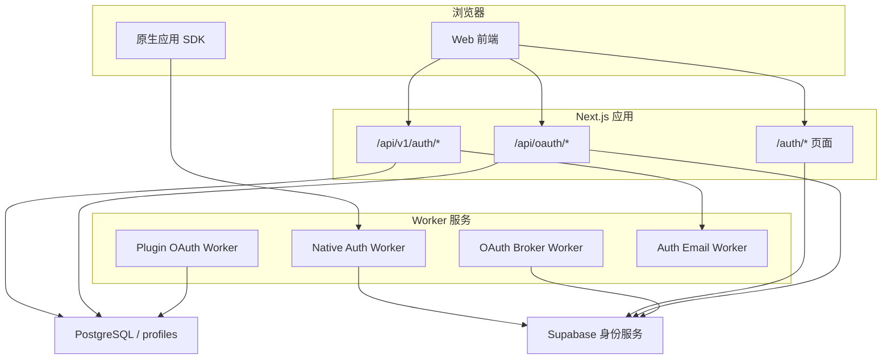

**图表来源**   
- [src/app/api/v1/auth/session/route.ts:1-182](file://src/app/api/v1/auth/session/route.ts#L1-L182)
- [src/app/auth/oauth/route.ts:1-102](file://src/app/auth/oauth/route.ts#L1-L102)
- [workers/native-auth/src/gateway.ts:1-166](file://workers/native-auth/src/gateway.ts#L1-L166)
- [workers/oauth-broker/src/broker.ts:1-113](file://workers/oauth-broker/src/broker.ts#L1-L113)
- [workers/plugin-oauth/src/oauth.ts:1-200](file://workers/plugin-oauth/src/oauth.ts#L1-L200)
- [workers/auth-email/src/index.ts:1-200](file://workers/auth-email/src/index.ts#L1-L200)

**章节来源**   
- [src/app/api/v1/auth/session/route.ts:1-182](file://src/app/api/v1/auth/session/route.ts#L1-L182)
- [src/app/auth/oauth/route.ts:1-102](file://src/app/auth/oauth/route.ts#L1-L102)
- [docs/auth/oauth-callbacks.md:1-71](file://docs/auth/oauth-callbacks.md#L1-L71)

## 核心组件

### JWT 验证与会话声明

JWT 模块负责从 Cookie 或 `Authorization` 头中取出 Supabase Access Token，并做以下处理：

- 根据 Supabase 项目 URL 构造 issuer，并缓存 JWKS。
- 支持 HS256 和 ES256/RS256；HS256 需要 `SUPABASE_JWT_SECRET`。
- 对同一 token 做内存缓存，避免重复签名校验。
- 校验 `sub`、`exp`、`iss`、`aud`，并要求 audience 为 `authenticated`。
- 提供清理 claims 缓存的方法，用于登出或账号删除后快速失效。

会话模块则进一步把身份映射为统一的 `SessionUser`，包含用户 ID、邮箱、显示名、首选名和头像 URL。它支持多种来源：

1. Supabase JWT：零网络往返解析，再查数据库确认用户仍活跃。
2. Bearer Token：识别 Clauxen Code OAuth Access Token 或 User API Key，并反查用户。
3. 传统 Session Cookie：开发模式下允许短 UUID 形式的 session cookie。

权限强制函数非常简洁：如果会话为空，直接抛出未授权错误。

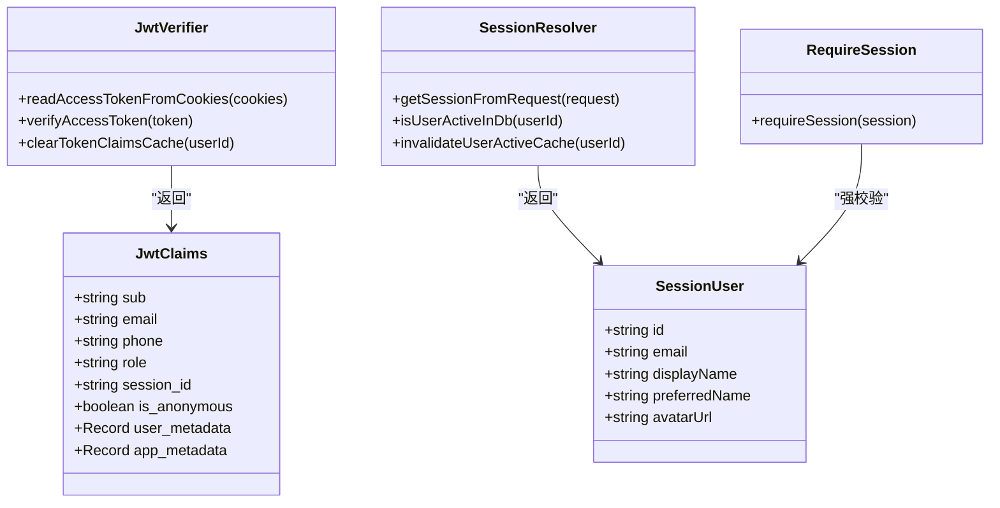

**图表来源**   
- [src/server/auth/jwt.ts:1-200](file://src/server/auth/jwt.ts#L1-L200)
- [src/server/auth/session.ts:1-200](file://src/server/auth/session.ts#L1-L200)
- [src/server/auth/require-session.ts:1-9](file://src/server/auth/require-session.ts#L1-L9)

**章节来源**   
- [src/server/auth/jwt.ts:1-200](file://src/server/auth/jwt.ts#L1-L200)
- [src/server/auth/session.ts:1-200](file://src/server/auth/session.ts#L1-L200)
- [src/server/auth/require-session.ts:1-9](file://src/server/auth/require-session.ts#L1-L9)
- [src/server/auth/supabase-session.ts:1-34](file://src/server/auth/supabase-session.ts#L1-L34)

### Magic Links 登录与注册

Magic Links 流程分为三个阶段：

| 阶段 | 接口 | 行为 |
|---|---|---|
| 请求魔法链接 | `POST /api/v1/auth/magic/request` | 调用邮件服务发送一次性注册链接。 |
| 检查链接 | `POST /api/v1/auth/magic/inspect` | 仅查看邮箱、用途和剩余时间，不消耗链接。 |
| 完成注册 | `POST /api/v1/auth/magic/complete` | 验证 token 和密码，创建 Supabase 用户，前端随后用邮箱+密码登录。 |

前端 `/auth/magic` 页面会先调用 inspect 获取邮箱和倒计时，然后引导用户输入至少 8 位密码并确认，成功后调用 complete，再通过通用登录流程进入应用。

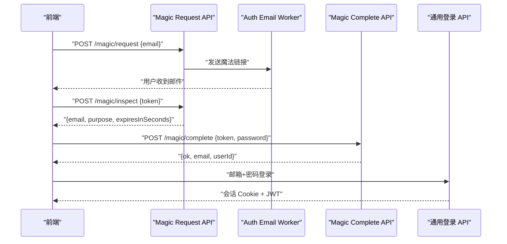

**图表来源**   
- [src/app/api/v1/auth/magic/request/route.ts:1-18](file://src/app/api/v1/auth/magic/request/route.ts#L1-L18)
- [src/app/api/v1/auth/magic/inspect/route.ts:1-23](file://src/app/api/v1/auth/magic/inspect/route.ts#L1-L23)
- [src/app/api/v1/auth/magic/complete/route.ts:1-35](file://src/app/api/v1/auth/magic/complete/route.ts#L1-L35)
- [src/app/auth/magic/page.tsx:1-200](file://src/app/auth/magic/page.tsx#L1-L200)
- [src/app/api/v1/auth/login/route.ts:1-128](file://src/app/api/v1/auth/login/route.ts#L1-L128)

**章节来源**   
- [src/app/api/v1/auth/magic/request/route.ts:1-18](file://src/app/api/v1/auth/magic/request/route.ts#L1-L18)
- [src/app/api/v1/auth/magic/inspect/route.ts:1-23](file://src/app/api/v1/auth/magic/inspect/route.ts#L1-L23)
- [src/app/api/v1/auth/magic/complete/route.ts:1-35](file://src/app/api/v1/auth/magic/complete/route.ts#L1-L35)
- [src/app/auth/magic/page.tsx:1-200](file://src/app/auth/magic/page.tsx#L1-L200)

### WebAuthn 生物识别与第三方 OAuth

项目没有直接使用自定义 WebAuthn 凭证注册逻辑，而是通过 Supabase 的 OAuth 与 OTP 能力组合实现“无密码”体验：

- **第三方 OAuth**：`GET /auth/oauth?provider=...&next=...` 使用 `createServerClient` 调用 Supabase 的 `signInWithOAuth`，并将 PKCE code verifier 以 HttpOnly Cookie 保存，防止前端篡改。
- **回调处理**：`/auth/callback` 使用 Supabase server client 交换授权码或验证 OTP，然后写回 Cookie；若检测到临时邮箱，会主动退出并提示。
- **确认链接**：`/auth/confirm` 用于处理 Supabase 发来的 `token_hash` 类型确认邮件，包括重置密码和邮箱变更。
- **Google One Tap**：文档说明在受支持的浏览器中可自动弹出 Google 一键登录，使用 FedCM 和随机 nonce。

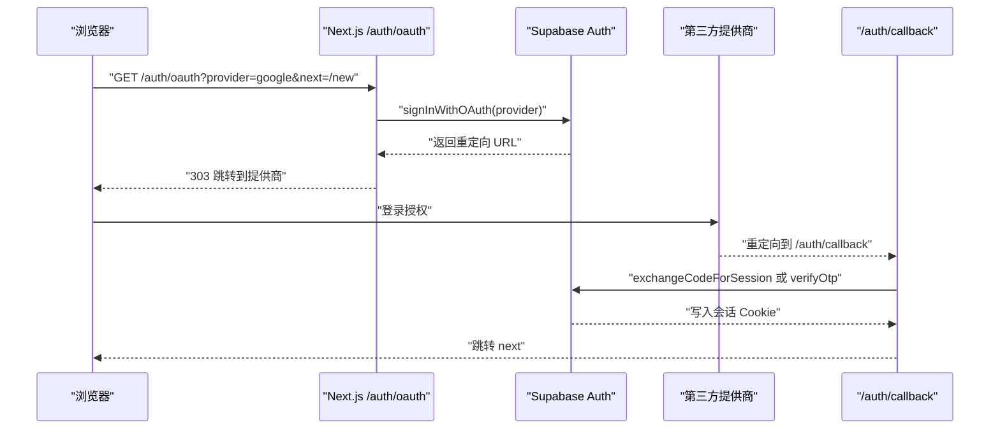

**图表来源**   
- [src/app/auth/oauth/route.ts:1-102](file://src/app/auth/oauth/route.ts#L1-L102)
- [src/app/auth/callback/route.ts:1-87](file://src/app/auth/callback/route.ts#L1-L87)
- [src/app/auth/confirm/route.ts:1-81](file://src/app/auth/confirm/route.ts#L1-L81)
- [docs/auth/oauth-callbacks.md:1-71](file://docs/auth/oauth-callbacks.md#L1-L71)

**章节来源**   
- [src/app/auth/oauth/route.ts:1-102](file://src/app/auth/oauth/route.ts#L1-L102)
- [src/app/auth/callback/route.ts:1-87](file://src/app/auth/callback/route.ts#L1-L87)
- [src/app/auth/confirm/route.ts:1-81](file://src/app/auth/confirm/route.ts#L1-L81)
- [docs/auth/oauth-callbacks.md:1-71](file://docs/auth/oauth-callbacks.md#L1-L71)

### 用户注册与邮箱状态

系统提供两条注册路径：

1. **邮箱状态探测**：`POST /api/v1/auth/email-status` 判断邮箱是否已有账户，并返回 `login` 或 `create` 模式。
2. **OTP 注册**：`POST /api/v1/auth/signup/request-otp` 发送 6 位验证码；`POST /api/v1/auth/signup/verify` 验证验证码并创建账户。
3. **开发模式注册**：`POST /api/v1/auth/register` 在未启用生产注册时直接返回不可用；启用后可注册邮箱、密码和显示名，并写入会话 Cookie。

所有邮箱都会经过临时邮箱检测。

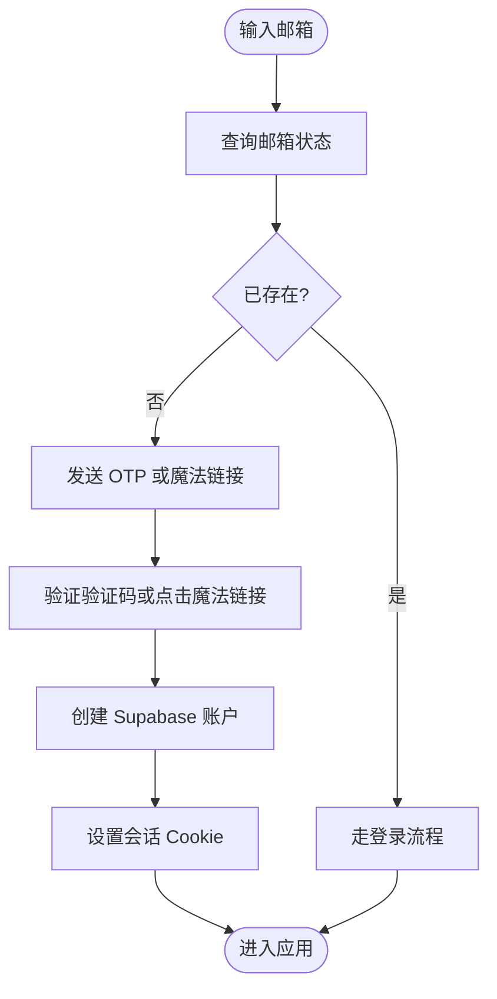

**图表来源**   
- [src/app/api/v1/auth/email-status/route.ts:1-27](file://src/app/api/v1/auth/email-status/route.ts#L1-L27)
- [src/app/api/v1/auth/signup/request-otp/route.ts:1-18](file://src/app/api/v1/auth/signup/request-otp/route.ts#L1-L18)
- [src/app/api/v1/auth/signup/verify/route.ts:1-46](file://src/app/api/v1/auth/signup/verify/route.ts#L1-L46)
- [src/app/api/v1/auth/register/route.ts:1-93](file://src/app/api/v1/auth/register/route.ts#L1-L93)

**章节来源**   
- [src/app/api/v1/auth/email-status/route.ts:1-27](file://src/app/api/v1/auth/email-status/route.ts#L1-L27)
- [src/app/api/v1/auth/signup/request-otp/route.ts:1-18](file://src/app/api/v1/auth/signup/request-otp/route.ts#L1-L18)
- [src/app/api/v1/auth/signup/verify/route.ts:1-46](file://src/app/api/v1/auth/signup/verify/route.ts#L1-L46)
- [src/app/api/v1/auth/register/route.ts:1-93](file://src/app/api/v1/auth/register/route.ts#L1-L93)

### 会话管理与登出

会话端点 `/api/v1/auth/session` 提供两种模式：

- **完整模式**：解析 Supabase JWT，确保用户仍存在，同步 profile，合并 Supabase 元数据和平台 profile，返回 `session`，并更新会话 Cookie 与身份提示 Cookie。
- **安静模式**：只返回当前会话，不触发额外同步；但如果请求携带了 Authorization 头或可读取到的访问令牌，却未能解析出有效会话，则返回“需要续期”。

登出端点清除会话 Cookie 和身份提示 Cookie。

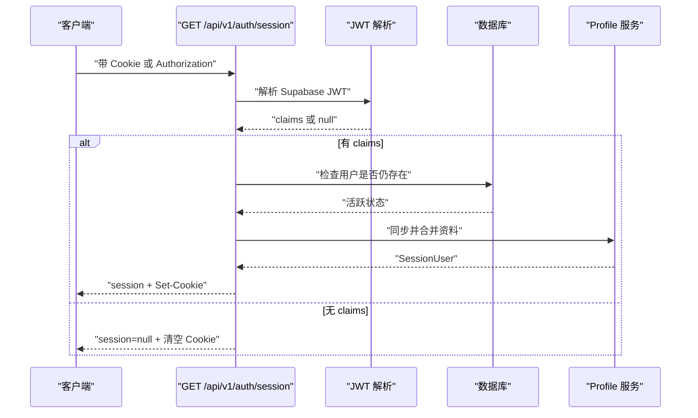

**图表来源**   
- [src/app/api/v1/auth/session/route.ts:1-182](file://src/app/api/v1/auth/session/route.ts#L1-L182)
- [src/server/auth/jwt.ts:1-200](file://src/server/auth/jwt.ts#L1-L200)
- [src/server/auth/session.ts:1-200](file://src/server/auth/session.ts#L1-L200)

**章节来源**   
- [src/app/api/v1/auth/session/route.ts:1-182](file://src/app/api/v1/auth/session/route.ts#L1-L182)
- [src/app/api/v1/auth/logout/route.ts:1-20](file://src/app/api/v1/auth/logout/route.ts#L1-L20)

### 用户资料、设置偏好与账户安全

用户资料由 Supabase 用户元数据与平台 `profiles` 表共同决定：

- Supabase `user_metadata` 提供 `preferred_name`、全名、头像 URL。
- 平台 `profiles` 表提供 `display_name`、`preferred_name`、`avatar_url`、`avatar_file_id`、`avatar_storage_path`、`avatar_updated_at`。
- 会话解析器会优先使用平台 profile，再回退到 Supabase 元数据或邮箱前缀。
- 会话端点在首次认证时调用 `ensureUserRecord`，确保 `profiles` 记录存在。
- 头像 URL 通过统一函数解析，支持存储路径和更新时间。

账户安全方面：

- 会话解析时会查询 `auth.users`，若用户被管理员删除，立即抛出“账户已删除”。
- 邮箱会被检查是否为临时邮箱。
- 登录尝试按 IP 限流，超过阈值返回 429。
- 注册和登录失败会记录安全事件，包含 IP、User-Agent 和方法信息。

**章节来源**   
- [src/server/auth/session.ts:1-200](file://src/server/auth/session.ts#L1-L200)
- [src/app/api/v1/auth/session/route.ts:1-182](file://src/app/api/v1/auth/session/route.ts#L1-L182)
- [src/app/api/v1/auth/login/route.ts:1-128](file://src/app/api/v1/auth/login/route.ts#L1-L128)
- [src/app/api/v1/auth/register/route.ts:1-93](file://src/app/api/v1/auth/register/route.ts#L1-L93)

### 内部 OAuth 授权服务器

`/api/oauth/authorize` 和 `/api/oauth/token` 实现了一个面向内部或第三方客户端的 OAuth 2.0 子集：

- authorize 接收 `client_id`、`redirect_uri`、`state`、`code_challenge`、`scope`、`action`。
- 支持 `authorization_code`、`refresh_token`、设备码轮询三种 grant_type。
- 成功时返回 `redirect_to` 或直接返回 access_token / refresh_token。
- 撤销接口 `/api/oauth/revoke` 遵循 RFC 7009，始终返回 200。
- `/api/oauth/userinfo` 返回当前用户的 `sub`、`email`、`name`、`preferred_username`、`picture`。

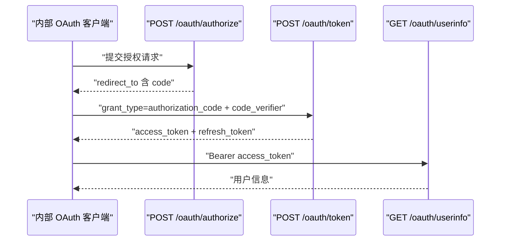

**图表来源**   
- [src/app/api/oauth/authorize/route.ts:1-92](file://src/app/api/oauth/authorize/route.ts#L1-L92)
- [src/app/api/oauth/token/route.ts:1-108](file://src/app/api/oauth/token/route.ts#L1-L108)
- [src/app/api/oauth/userinfo/route.ts:1-24](file://src/app/api/oauth/userinfo/route.ts#L1-L24)
- [src/app/api/oauth/revoke/route.ts:1-43](file://src/app/api/oauth/revoke/route.ts#L1-L43)

**章节来源**   
- [src/app/api/oauth/authorize/route.ts:1-92](file://src/app/api/oauth/authorize/route.ts#L1-L92)
- [src/app/api/oauth/token/route.ts:1-108](file://src/app/api/oauth/token/route.ts#L1-L108)
- [src/app/api/oauth/userinfo/route.ts:1-24](file://src/app/api/oauth/userinfo/route.ts#L1-L24)
- [src/app/api/oauth/revoke/route.ts:1-43](file://src/app/api/oauth/revoke/route.ts#L1-L43)

### 原生应用认证流程与 Native Auth Worker

原生应用通过 `com.clauxen.mobile://auth-callback` 回调和 `workers/native-auth` Worker 进行认证：

- 网关只允许指定 Origin。
- 请求体最大 64KB，响应体最大 128KB。
- 白名单端点包括 `token`、`authorize`、`otp`、`verify`、`recover`、`logout`、`user`。
- 授权端点只允许 `google`、`github`、`gitlab`，并要求 `code_challenge_method=s256` 和标准 Base64URL challenge。
- GitHub/GitLab 授权直接重定向到 `auth.clauxen.com/auth/v1/authorize`。
- 其他请求代理到 Supabase GoTrue，并保留必要头部，但不转发 Cookie 和缓存头。
- 所有错误都返回结构化 JSON，不泄露异常详情或上游配置。

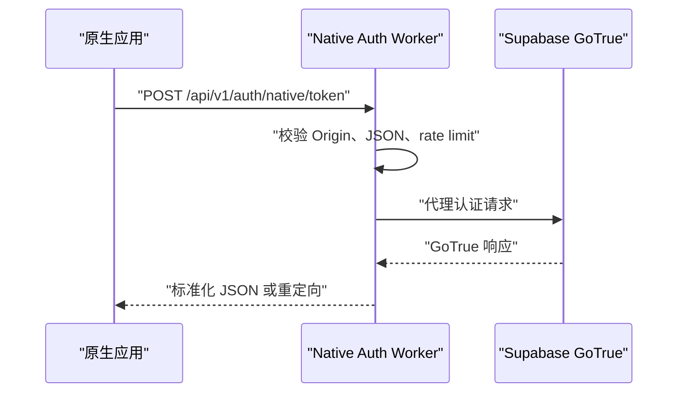

**图表来源**   
- [workers/native-auth/src/gateway.ts:1-166](file://workers/native-auth/src/gateway.ts#L1-L166)
- [workers/native-auth/src/index.ts:1-5](file://workers/native-auth/src/index.ts#L1-L5)

**章节来源**   
- [workers/native-auth/src/gateway.ts:1-166](file://workers/native-auth/src/gateway.ts#L1-L166)
- [workers/native-auth/src/index.ts:1-5](file://workers/native-auth/src/index.ts#L1-L5)

### OAuth Broker：GitHub 与 GitLab 原生提供商集成

OAuth Broker Worker 专门处理 GitHub 和 GitLab 的原生 OAuth 流程：

- 浏览器侧生成 state 和 PKCE challenge，保存在 HttpOnly Cookie 中。
- 重定向到 GitHub/GitLab 授权页。
- 回调后 Broker 验证 provider 返回的 code，换取 access_token，再拉取用户信息。
- 使用数据库函数 `clauxen_auth.resolve_oauth_identity` 解析 canonical email。
- 最终生成内部 token，格式为 `clxtoken.<id>.<secret>`，有效期很短。
- 使用 Durable Object 存储每个登录尝试的状态：pending → verifying → code → token。

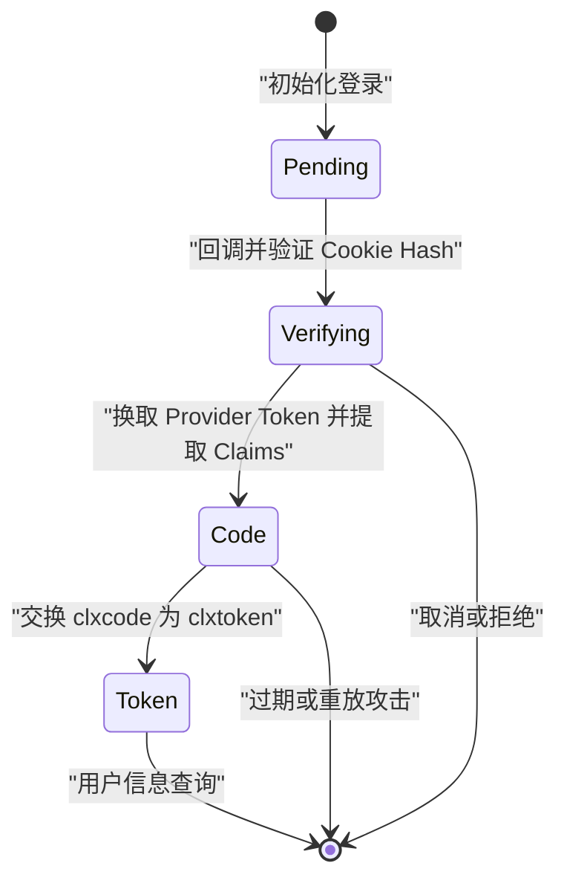

**图表来源**   
- [workers/oauth-broker/src/broker.ts:1-113](file://workers/oauth-broker/src/broker.ts#L1-L113)
- [workers/oauth-broker/src/flow.ts:1-43](file://workers/oauth-broker/src/flow.ts#L1-L43)
- [workers/oauth-broker/src/identity.ts:1-18](file://workers/oauth-broker/src/identity.ts#L1-L18)
- [workers/oauth-broker/src/providers.ts:1-37](file://workers/oauth-broker/src/providers.ts#L1-L37)

**章节来源**   
- [workers/oauth-broker/src/broker.ts:1-113](file://workers/oauth-broker/src/broker.ts#L1-L113)
- [workers/oauth-broker/src/flow.ts:1-43](file://workers/oauth-broker/src/flow.ts#L1-L43)
- [workers/oauth-broker/src/identity.ts:1-18](file://workers/oauth-broker/src/identity.ts#L1-L18)
- [workers/oauth-broker/src/providers.ts:1-37](file://workers/oauth-broker/src/providers.ts#L1-L37)

### 插件 OAuth：MCP OAuth 2.1

插件 OAuth Worker 实现了 Model Context Protocol 的 OAuth 2.1 规范：

- 从 MCP 服务器的 Protected Resource Metadata 发现授权服务器。
- 通过 RFC 8414 或 OpenID Connect Discovery 获取授权端点和令牌端点。
- 支持客户端 ID 元数据文档或动态客户端注册。
- 使用 PKCE S256 发起授权。
- 交换 token 后持久化 access_token、refresh_token、scopes。
- 支持撤销端点。

该流程适合插件代表用户调用外部 MCP 资源服务器，而不是直接替代用户登录平台。

**章节来源**   
- [workers/plugin-oauth/src/oauth.ts:1-200](file://workers/plugin-oauth/src/oauth.ts#L1-L200)

### 邮件 OTP 与魔法链接 Worker

Auth Email Worker 提供两个独立但互补的能力：

| 能力 | 端点 | 存储 | 安全机制 |
|---|---|---|---|
| OTP 注册 | `/v1/otp/send`、`/v1/otp/verify`、`/v1/otp/consume-ticket` | KV | 盐值哈希、尝试次数限制、冷却时间、一次性 ticket。 |
| Magic Link | `/v1/magic/send`、`/v1/magic/inspect`、`/v1/magic/consume` | KV | 邮箱目的、过期时间、冷却时间、一次性 signup ticket。 |

Worker 使用内部令牌或 `x-clauxen-internal` 头进行鉴权，对所有邮箱做规范化、长度校验和临时邮箱拦截。OTP 比较使用恒定时间相等函数，避免时序攻击。

**章节来源**   
- [workers/auth-email/src/index.ts:1-200](file://workers/auth-email/src/index.ts#L1-L200)

## 依赖关系分析

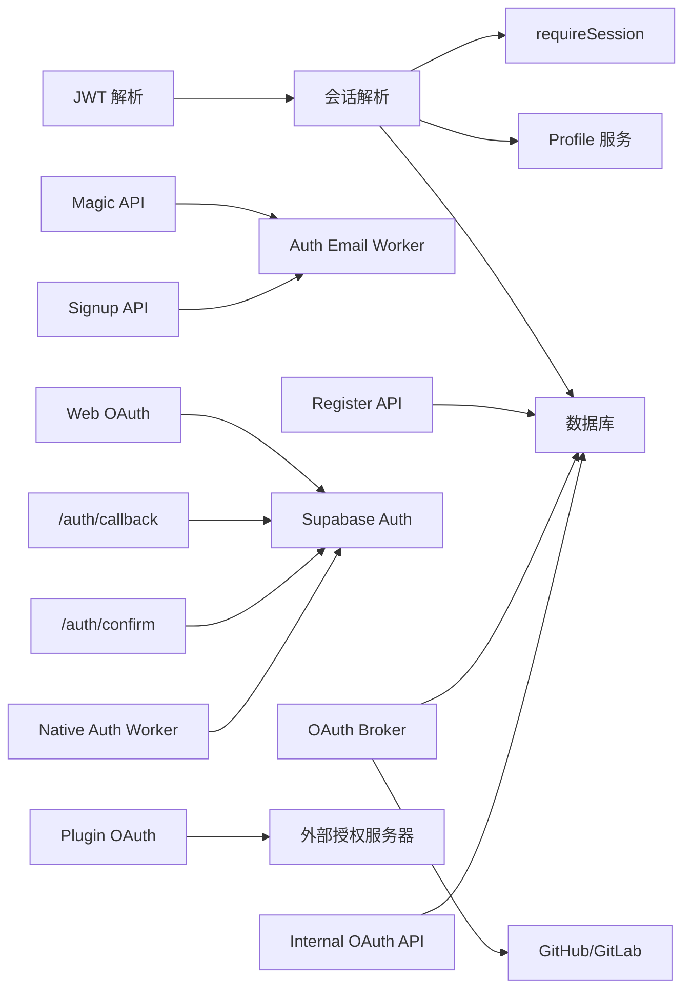

**图表来源**   
- [src/server/auth/jwt.ts:1-200](file://src/server/auth/jwt.ts#L1-L200)
- [src/server/auth/session.ts:1-200](file://src/server/auth/session.ts#L1-L200)
- [src/app/api/v1/auth/magic/request/route.ts:1-18](file://src/app/api/v1/auth/magic/request/route.ts#L1-L18)
- [src/app/api/v1/auth/signup/verify/route.ts:1-46](file://src/app/api/v1/auth/signup/verify/route.ts#L1-L46)
- [src/app/auth/oauth/route.ts:1-102](file://src/app/auth/oauth/route.ts#L1-L102)
- [src/app/auth/callback/route.ts:1-87](file://src/app/auth/callback/route.ts#L1-L87)
- [workers/native-auth/src/gateway.ts:1-166](file://workers/native-auth/src/gateway.ts#L1-L166)
- [workers/oauth-broker/src/broker.ts:1-113](file://workers/oauth-broker/src/broker.ts#L1-L113)
- [workers/plugin-oauth/src/oauth.ts:1-200](file://workers/plugin-oauth/src/oauth.ts#L1-L200)

**章节来源**   
- [src/server/auth/session.ts:1-200](file://src/server/auth/session.ts#L1-L200)
- [src/app/auth/callback/route.ts:1-87](file://src/app/auth/callback/route.ts#L1-L87)
- [workers/oauth-broker/src/broker.ts:1-113](file://workers/oauth-broker/src/broker.ts#L1-L113)

## 性能与安全特性

### 性能特性

- **JWT 本地验证**：通过 JWKS 缓存和 token 内存缓存减少网络往返和重复计算。
- **会话缓存**：`isUserActiveInDb` 对数据库活跃度检查结果做短期内存缓存，避免高频重复查询。
- **Cookie 分片解析**：复用 `@supabase/ssr` 的分片 session cookie 拼接逻辑，兼容浏览器大 Cookie。
- **OAuth Broker Durable Object**：每个登录尝试一个对象，原子状态转换，配合 alarm 清理过期状态。
- **请求体限制**：Native Auth Worker 对请求体和响应体分别限制大小，避免超大负载。

### 安全最佳实践

| 主题 | 实现方式 |
|---|---|
| 令牌验证 | 校验算法、issuer、audience、required claims；JWKS 超时返回 503。 |
| 会话一致性 | 每次会话解析都检查 `auth.users`，删除账号立即失效。 |
| 邮箱安全 | 禁止临时邮箱、邮箱长度校验、规范化小写。 |
| 登录暴力破解防护 | IP 维度登录频率限制，超限返回 429。 |
| 第三方回调安全 | PKCE、HttpOnly Cookie、state 校验、禁止开放重定向前缀。 |
| 原生应用安全 | Origin 白名单、固定回调、PKCE S256、不支持任意 upstream。 |
| OTP 安全 | 盐值哈希、恒定时间比较、尝试次数限制、冷却时间、一次性 ticket。 |
| 日志脱敏 | 错误响应不暴露异常文本、刷新令牌或上游配置。 |
| OAuth 撤销 | 符合 RFC 7009，即使失败也返回 200。 |

**章节来源**   
- [src/server/auth/jwt.ts:1-200](file://src/server/auth/jwt.ts#L1-L200)
- [src/server/auth/session.ts:1-200](file://src/server/auth/session.ts#L1-L200)
- [src/app/api/v1/auth/login/route.ts:1-128](file://src/app/api/v1/auth/login/route.ts#L1-L128)
- [workers/native-auth/src/gateway.ts:1-166](file://workers/native-auth/src/gateway.ts#L1-L166)
- [workers/auth-email/src/index.ts:1-200](file://workers/auth-email/src/index.ts#L1-L200)

## 故障排查指南

| 现象 | 可能原因 | 排查建议 |
|---|---|---|
| 登录后仍然未认证 | Supabase JWT 过期或损坏 | 调用 `/api/v1/auth/session` 检查是否需要续期；客户端应刷新 Supabase session。 |
| 会话解析返回“账户已删除” | 管理员在 Supabase 中删除了用户 | 清除 Cookie 并重新登录；检查 `auth.users`。 |
| OAuth 回调报错 | 缺少 `code` 或 `token_hash` | 检查 Supabase 应用回调配置和浏览器 Cookie。 |
| 第三方登录被拒绝 | provider 返回 error 或邮箱无效 | 查看 `/auth/callback` 的重定向参数和提供商日志。 |
| 原生应用无法登录 | Origin 不允许或 PKCE 无效 | 检查 native-auth gateway 的错误码 `origin_not_allowed`、`invalid_pkce`。 |
| 邮件验证码无效 | OTP 已过期或尝试次数过多 | 检查 auth-email worker 的 KV 记录；重新发送。 |
| Magic Link 无效 | token 已消耗或过期 | 调用 `/api/v1/auth/magic/inspect` 查看剩余时间。 |
| OAuth token 交换失败 | `code_verifier` 不匹配或 state 重放 | 检查 Broker Cookie、state 和 PKCE challenge。 |
| 插件无法发现授权服务器 | MCP 服务器未实现 Protected Resource Metadata | 检查 `resource_metadata` 或 WWW-Authenticate 响应。 |

**章节来源**   
- [src/app/api/v1/auth/session/route.ts:1-182](file://src/app/api/v1/auth/session/route.ts#L1-L182)
- [src/app/auth/callback/route.ts:1-87](file://src/app/auth/callback/route.ts#L1-L87)
- [workers/native-auth/src/gateway.ts:1-166](file://workers/native-auth/src/gateway.ts#L1-L166)
- [workers/oauth-broker/src/broker.ts:1-113](file://workers/oauth-broker/src/broker.ts#L1-L113)
- [workers/auth-email/src/index.ts:1-200](file://workers/auth-email/src/index.ts#L1-L200)
- [workers/plugin-oauth/src/oauth.ts:1-200](file://workers/plugin-oauth/src/oauth.ts#L1-L200)

## 结论

该认证系统的核心思想是：**Supabase 作为可信身份源，Next.js 作为业务会话聚合层，Worker 作为细分入口网关**。它避免了在每个请求中调用 GoTrue，通过本地 JWT 验证提升性能；同时通过数据库活跃度检查和 profile 合并保证业务一致性和用户体验。

对于不同客户端：

- Web 用户优先使用第三方 OAuth 或 Magic Links。
- 原生用户通过受限网关获得与 Web 一致的认证语义。
- 插件通过 MCP OAuth 2.1 安全访问外部资源服务器。
- 内部客户端可通过 `/api/oauth/*` 使用授权码和设备码流程。

设计上的关键取舍是：**不主动刷新 Supabase Token，而让客户端持有 refresh token 并维护 Cookie**；这减少了服务端刷新风暴，但也要求客户端正确处理会话续期。

## 附录：第三方 OAuth 集成与回调

Supabase 社交 OAuth 回调使用 Supabase 官方项目端点。文档明确指出：

- 主回调地址为 Supabase 项目 URL 下的 `/auth/v1/callback`。
- 如果使用付费自定义域名，Google 和 GitLab 也可能保留旧回调地址。
- GitHub OAuth App 只能注册一个回调地址，因此必须使用项目回调。
- 应用回调地址需要添加到 Supabase Authentication 的 URL 配置中。
- Google One Tap 使用 `NEXT_PUBLIC_GOOGLE_CLIENT_ID`，并在 CSP 和浏览器权限上做了相应配置。

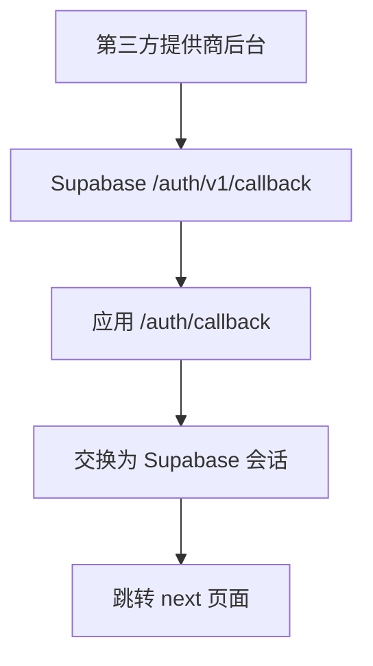

**图表来源**   
- [docs/auth/oauth-callbacks.md:1-71](file://docs/auth/oauth-callbacks.md#L1-L71)
- [src/app/auth/callback/route.ts:1-87](file://src/app/auth/callback/route.ts#L1-L87)

**章节来源**   
- [docs/auth/oauth-callbacks.md:1-71](file://docs/auth/oauth-callbacks.md#L1-L71)