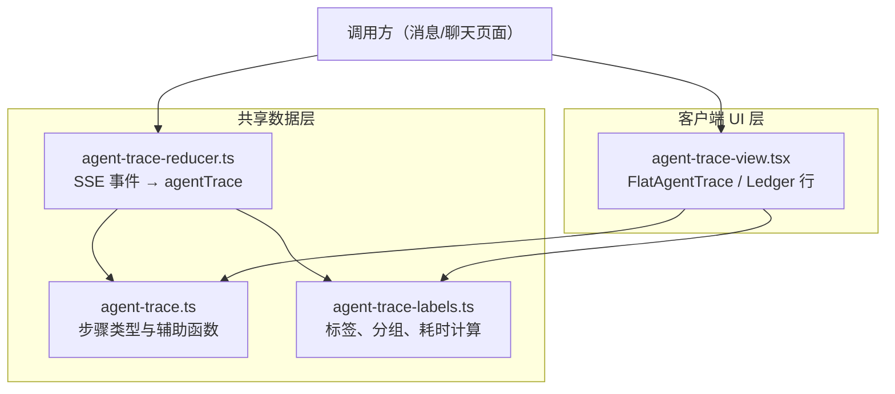
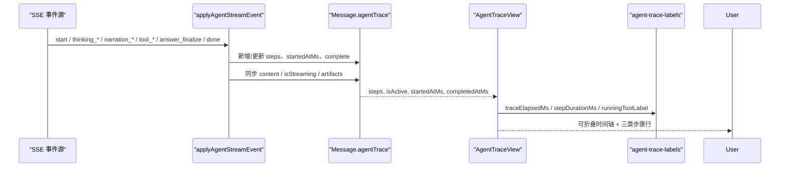
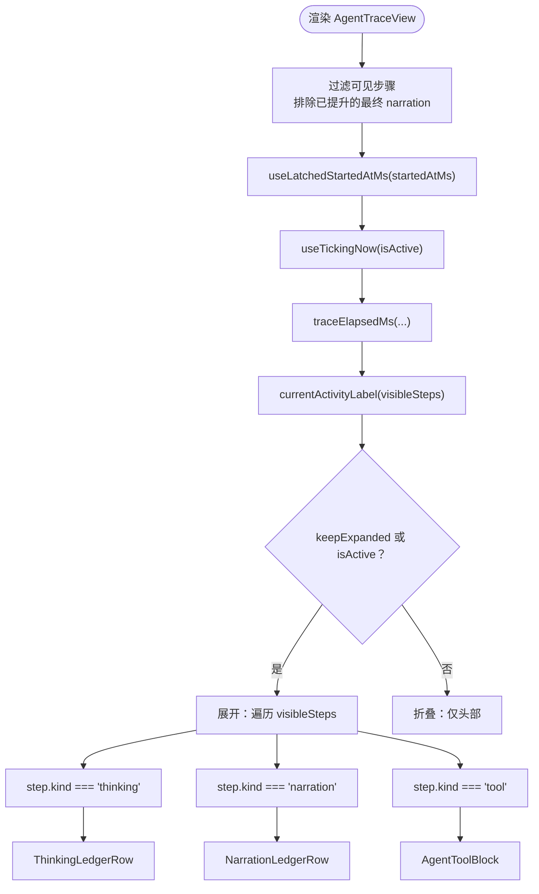
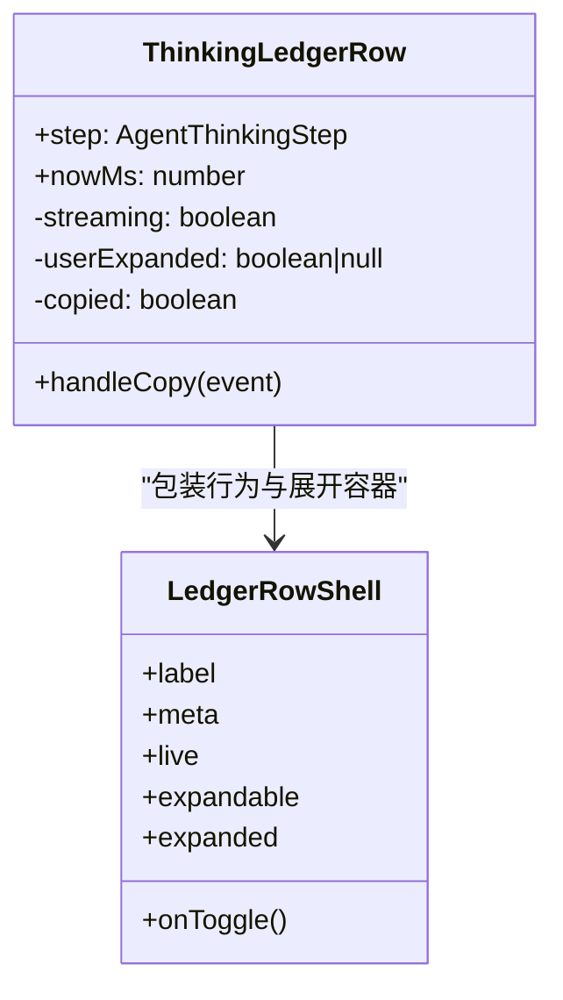
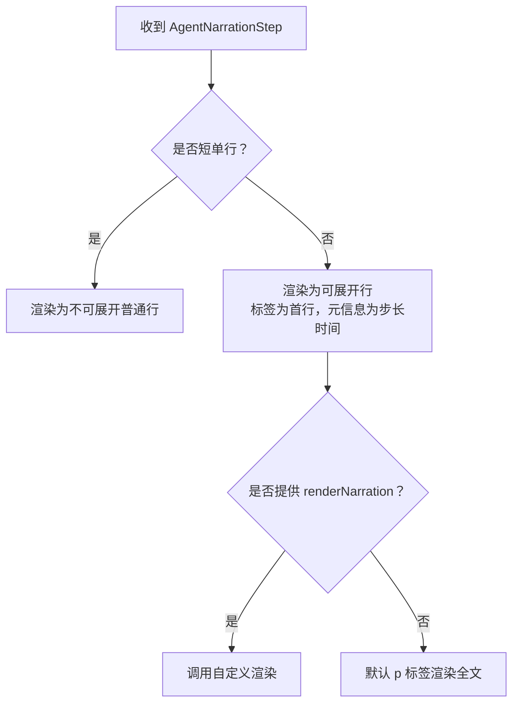
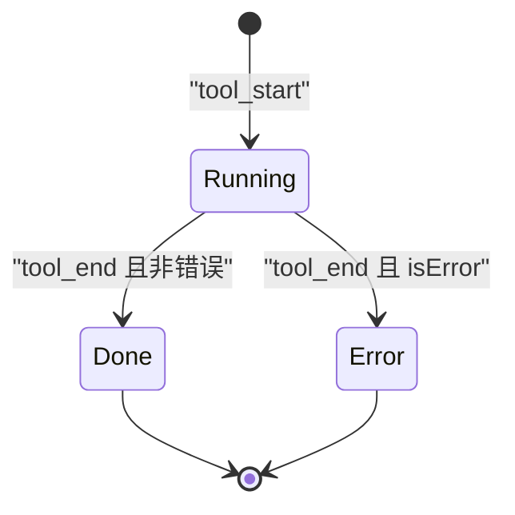
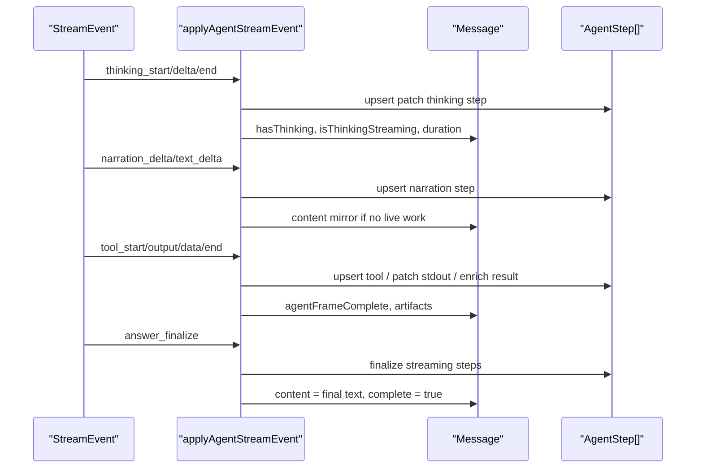
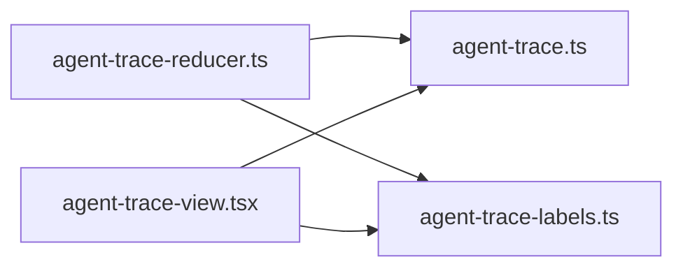

# Agent Trace 可视化

<cite>
**本文引用的文件**   
- [agent-trace-view.tsx](file://src/client/components/agent/agent-trace-view.tsx)
- [agent-trace.ts](file://src/shared/lib/agent-trace.ts)
- [agent-trace-reducer.ts](file://src/shared/lib/agent-trace-reducer.ts)
- [agent-trace-labels.ts](file://src/shared/lib/agent-trace-labels.ts)
</cite>

## 目录
1. [引言](#引言)
2. [项目结构](#项目结构)
3. [核心数据结构](#核心数据结构)
4. [架构总览](#架构总览)
5. [详细组件分析](#详细组件分析)
6. [依赖关系分析](#依赖关系分析)
7. [性能与优化](#性能与优化)
8. [故障排查](#故障排查)
9. [扩展指南与最佳实践](#扩展指南与最佳实践)
10. [结论](#结论)

## 引言
Agent Trace 可视化系统用于展示单个对话轮次中代理的工作过程。它将后端流式事件折叠为一个扁平、有序的步骤列表，并按三类步骤进行状态管理与渲染：
- thinking：模型推理或思考摘要；
- narration：第一人称进度叙述；
- tool：工具调用生命周期，包括参数、标准输出、错误和结构化结果。

该系统的目标是让“正在工作”的交互始终可读：即使时间轴折叠为头部标签，用户也能看到当前动作、失败次数和累计时长；展开后则能看到思维、叙述和工具调用的交错明细。

## 项目结构
Agent Trace 由共享数据层与客户端 UI 层组成：
- 共享数据层定义步骤类型、活跃性判断、可视相等比较和时间计算；
- 数据归约器把 SSE 协议事件转换为 `Message.agentTrace`；
- 客户端视图负责头部的可折叠时间轴、活动行、以及三类步骤的行列渲染。

**图表来源**
- [agent-trace.ts:1-224](file://src/shared/lib/agent-trace.ts#L1-L224)
- [agent-trace-reducer.ts:1-609](file://src/shared/lib/agent-trace-reducer.ts#L1-L609)
- [agent-trace-labels.ts:1-456](file://src/shared/lib/agent-trace-labels.ts#L1-L456)
- [agent-trace-view.tsx:1-601](file://src/client/components/agent/agent-trace-view.tsx#L1-L601)

**章节来源**
- [agent-trace.ts:1-224](file://src/shared/lib/agent-trace.ts#L1-L224)
- [agent-trace-reducer.ts:1-609](file://src/shared/lib/agent-trace-reducer.ts#L1-L609)
- [agent-trace-labels.ts:1-456](file://src/shared/lib/agent-trace-labels.ts#L1-L456)
- [agent-trace-view.tsx:1-601](file://src/client/components/agent/agent-trace-view.tsx#L1-L601)

## 核心数据结构
### 步骤基类与三种步骤
- `AgentStepBase`：提供全局唯一 `id` 和起止时间戳；
- `AgentThinkingStep`：kind 为 `thinking`，包含可选内容、是否流式、持续秒数；
- `AgentNarrationStep`：kind 为 `narration`，包含完整内容、delta 计数、是否流式、是否被提升为最终答案；
- `AgentToolStep`：kind 为 `tool`，包含工具名、状态、参数、stdout/stderr、搜索查询、搜索结果、文件路径和内容等。

所有步骤通过联合类型 `AgentStep` 表达，形成扁平步骤列表。

### 跟踪状态
`AgentTraceState` 持有：
- `steps`：按出现顺序排列的步骤数组；
- `complete`：整轮完成标志；
- `startedAtMs`：驱动“Working for…”计时；
- `completedAtMs`：完成时间戳。

### 关键辅助
- `createAgentTrace`：创建空跟踪；
- `findToolStep`：根据 `toolCallId` 查找最新工具步骤；
- `agentTraceIsActive`：判断是否有运行中的工具或流式 thinking/narration；
- `traceHasWork`：判断是否需要显示时间轴 chrome；
- `agentStepsVisuallyEqual`：memo-safe 比较，支持逐步变化的 args；
- `parseToolResult`：安全解析工具结果为 JSON 或回退字符串；
- `domainFromUrl`：从 URL 提取域名。

**章节来源**
- [agent-trace.ts:1-224](file://src/shared/lib/agent-trace.ts#L1-L224)

## 架构总览
Agent Trace 的运行时流程分为两条主线：

1. **数据归约主线**：SSE 事件进入 `applyAgentStreamEvent`，更新 `Message.agentTrace.steps` 和消息正文、思考状态、工件等字段。
2. **渲染主线**：`AgentTraceView` 接收步骤列表、活跃状态和时间戳，计算可见步骤、头部活动标签、展开状态，并分别渲染 thinking、narration、tool 三类行。

**图表来源**
- [agent-trace-reducer.ts:1-609](file://src/shared/lib/agent-trace-reducer.ts#L1-L609)
- [agent-trace-view.tsx:1-601](file://src/client/components/agent/agent-trace-view.tsx#L1-L601)
- [agent-trace-labels.ts:1-456](file://src/shared/lib/agent-trace-labels.ts#L1-L456)

## 详细组件分析

### FlatAgentTrace 主组件：AgentTraceView
`AgentTraceView` 是“扁平化步骤列表”的根组件，职责包括：
- 过滤最终答案对应的重复 narration 行；
- 锁定最早开始时间，避免后续 stamp 把“Working for…”推前；
- 使用每秒 tick 的 now 值驱动活体计时；
- 根据最后一条活跃步骤生成头部活动标签；
- 控制整体展开/折叠，并在活跃时自动展开、完成后折叠；
- 统计失败工具数量并显示在头部；
- 将 thinking、narration、tool 三类步骤映射到对应行组件。

#### 可见步骤与分类
- narration：只有提供了自定义 `renderNarration` 且非最终答案、且内容非空时才显示；
- thinking 和 tool：始终显示；
- 最终答案被提升时，相关 narration 行会被过滤，避免与最终回答重复。

#### 时间轴布局
- 头部显示：
  - 当前活动标签，如“Thinking”“Writing…”，或具体工具名称；
  - “Working for … / Worked for …”累计时长；
  - 失败工具计数；
  - 可展开箭头。
- 展开区域使用 CSS Grid 行动画实现平滑展开/收起。
- 未展开时只显示头部，但“Working for…”会随时间推进。

**图表来源**
- [agent-trace-view.tsx:1-601](file://src/client/components/agent/agent-trace-view.tsx#L1-L601)
- [agent-trace-labels.ts:1-456](file://src/shared/lib/agent-trace-labels.ts#L1-L456)

**章节来源**
- [agent-trace-view.tsx:1-601](file://src/client/components/agent/agent-trace-view.tsx#L1-L601)

### ThinkingStep：思考过程展示
`ThinkingLedgerRow` 负责渲染 thinking 步骤：
- 标题为“Thinking”或“Thought”，带脉冲图标表示流式；
- 元信息显示持续时间秒数；
- 当有内容时可展开；
- 流式内容通过 `StreamingTextFade` 渐进展示；
- 非流式内容以段落形式展示；
- 支持复制思考内容到剪贴板，并提供反馈提示；
- 展开/折叠保持滚动锚点，避免展开时跳屏。

**图表来源**
- [agent-trace-view.tsx:1-601](file://src/client/components/agent/agent-trace-view.tsx#L1-L601)

**章节来源**
- [agent-trace-view.tsx:1-601](file://src/client/components/agent/agent-trace-view.tsx#L1-L601)

### NarrationStep：叙述内容渲染
`NarrationLedgerRow` 负责渲染 narrator 文本：
- 短单行叙述直接作为普通行，不展开；
- 长叙述以首行作为标签，默认展开，点击折叠；
- 流式时显示“…”时长占位，结束后显示实际步长时间；
- 支持外部传入 `renderNarration`，用于自定义复杂叙述渲染；
- 展开/折叠同样保持滚动锚点。

**图表来源**
- [agent-trace-view.tsx:1-601](file://src/client/components/agent/agent-trace-view.tsx#L1-L601)

**章节来源**
- [agent-trace-view.tsx:1-601](file://src/client/components/agent/agent-trace-view.tsx#L1-L601)

### ToolCallStep：工具调用可视化
`ToolLedgerRow` 将每个工具步骤委托给 `AgentToolBlock` 渲染。工具步骤在 reducer 中维护以下状态机：
- `running`：参数可能逐步完善，stdout/stderr 逐步追加；
- `done`：正常结束；
- `error`：发生错误。

工具标签和分组逻辑来自 `agent-trace-labels.ts`，包括：
- 工具家族分组，例如 search、read、edit、command、code、skill、ask、mcp；
- 过去时标签，如“Searched for …”“Read example.com”；
- 现在时标签，如“Searching for …”“Reading a page”；
- 搜索查询、URL 主机、文件路径、命令片段等对象标签；
- 文件编辑差异统计、连接器数量统计；
- 时间轴总结字符串，例如“Ran 2 searches, read example.com”。

**图表来源**
- [agent-trace-reducer.ts:1-609](file://src/shared/lib/agent-trace-reducer.ts#L1-L609)

**章节来源**
- [agent-trace-view.tsx:1-601](file://src/client/components/agent/agent-trace-view.tsx#L1-L601)
- [agent-trace-reducer.ts:1-609](file://src/shared/lib/agent-trace-reducer.ts#L1-L609)
- [agent-trace-labels.ts:1-456](file://src/shared/lib/agent-trace-labels.ts#L1-L456)

### 数据归约流程：SSE 事件到 agentTrace
`applyAgentStreamEvent` 处理多种事件：
- `start`：初始化 agentTrace、startedAtMs、isStreaming；重试时会重置 steps；
- `thinking_start` / `thinking_delta` / `thinking_end`：管理 thinking 步骤；
- `segment_start` / `segment_end`：按 segment 启动/结束 thinking 或 narration；
- `narration_delta` / `text_delta`：拼接叙述内容，首次 delta 可能镜像为消息正文；
- `answer_finalize`：清理重复 narration、标记 complete、完成流式步骤；
- `answer_delta`：继续累积最终答案；
- `tool_start` / `tool_output_delta` / `tool_data` / `tool_end`：创建、增量、丰富、结束工具步骤；
- `artifact_upsert`：更新工件并反向填充运行中的 create_file/file_write/present_files 步骤；
- `error` / `done`：收尾并调用 `completeTrace`。

**图表来源**
- [agent-trace-reducer.ts:1-609](file://src/shared/lib/agent-trace-reducer.ts#L1-L609)

**章节来源**
- [agent-trace-reducer.ts:1-609](file://src/shared/lib/agent-trace-reducer.ts#L1-L609)

## 依赖关系分析

- `agent-trace.ts` 提供类型、活跃性、可视相等和时间基础函数；
- `agent-trace-reducer.ts` 依赖类型和工具增强逻辑，产出 `Message.agentTrace`；
- `agent-trace-labels.ts` 提供人类可读标签、分组、耗时格式化和总结；
- `agent-trace-view.tsx` 消费上述模块，只关心渲染和交互。

**图表来源**
- [agent-trace.ts:1-224](file://src/shared/lib/agent-trace.ts#L1-L224)
- [agent-trace-reducer.ts:1-609](file://src/shared/lib/agent-trace-reducer.ts#L1-L609)
- [agent-trace-labels.ts:1-456](file://src/shared/lib/agent-trace-labels.ts#L1-L456)
- [agent-trace-view.tsx:1-601](file://src/client/components/agent/agent-trace-view.tsx#L1-L601)

**章节来源**
- [agent-trace.ts:1-224](file://src/shared/lib/agent-trace.ts#L1-L224)
- [agent-trace-reducer.ts:1-609](file://src/shared/lib/agent-trace-reducer.ts#L1-L609)
- [agent-trace-labels.ts:1-456](file://src/shared/lib/agent-trace-labels.ts#L1-L456)
- [agent-trace-view.tsx:1-601](file://src/client/components/agent/agent-trace-view.tsx#L1-L601)

## 性能与优化

### 时间戳稳定性
- `useLatchedStartedAtMs` 只接受更早的 `startedAtMs`，防止后续乐观时间戳覆盖最早时间，避免“Working for 2s”跳回“Working for 0s”。

### 活体计时精度
- `useTickingNow` 在首个整秒对齐后每秒刷新一次，减少不必要的重渲染。

### 可视相等比较
- `agentStepsVisuallyEqual` 对 thinking、narration、tool 三类步骤做细粒度比较，尤其是 tool 的 shallow args 比较，避免每次参数字符变化都触发整树重渲染。

### 可见步骤裁剪
- `AgentTraceView` 过滤掉已提升为最终答案的 narration，减少 DOM 节点。

### 动画成本
- 展开/收起使用 CSS Grid 行动画，配合 `duration-200 ease-out`，避免 JS 动画开销。

### 流式文本渲染
- `StreamingTextFade` 用于 thinking 流式内容，避免一次性插入大段文本造成抖动。

### 建议
- 大量工具调用时优先复用 `AgentToolBlock`，避免重复计算工具标签；
- 超长 narration 建议使用自定义 `renderNarration` 分页或虚拟滚动；
- 对超大工具 stdout 考虑截断或懒加载；
- 避免在高频 delta 回调中进行昂贵计算，尽量放在 reducer 或 memo 中。

[本节为通用性能指导，不直接分析具体代码行]

## 故障排查

### “Working for…” 计时异常
- 检查 `startedAtMs` 是否在 `start` 事件中正确设置；
- 确认重试场景下不会用新 `Date.now()` 覆盖旧时间；
- 确认 `completedAtMs` 只在完成时写入。

**章节来源**
- [agent-trace-reducer.ts:1-609](file://src/shared/lib/agent-trace-reducer.ts#L1-L609)
- [agent-trace-view.tsx:1-601](file://src/client/components/agent/agent-trace-view.tsx#L1-L601)

### 工具步骤不更新或状态错误
- 检查 `tool_start` 是否创建了 `toolCallId` 和 `name`；
- 检查 `tool_output_delta` 是否按 `toolCallId` 找到对应步骤；
- 检查 `tool_end` 是否正确设置 `status` 和 `result`；
- 使用 `findToolStep` 调试查找结果。

**章节来源**
- [agent-trace-reducer.ts:1-609](file://src/shared/lib/agent-trace-reducer.ts#L1-L609)
- [agent-trace.ts:1-224](file://src/shared/lib/agent-trace.ts#L1-L224)

### 最终答案重复显示
- 确认 `answer_finalize` 是否清除了对应 narration 步骤；
- 确认 `AgentTraceView` 过滤条件排除了 `isFinal` 且内容与最终答案一致的 narration。

**章节来源**
- [agent-trace-reducer.ts:1-609](file://src/shared/lib/agent-trace-reducer.ts#L1-L609)
- [agent-trace-view.tsx:1-601](file://src/client/components/agent/agent-trace-view.tsx#L1-L601)

### 工具标签不正确
- 检查工具名是否匹配 `SEARCH_TOOLS`、`EDIT_TOOLS`、`EXPLORE_TOOLS`、`SHELL_TOOLS` 或 `mcp__` 前缀；
- 检查 `toolObjectLabel` 是否能从 args 中提取 query、host、path、command。

**章节来源**
- [agent-trace-labels.ts:1-456](file://src/shared/lib/agent-trace-labels.ts#L1-L456)

## 扩展指南与最佳实践

### 添加自定义步骤类型
当前系统基于三类步骤：thinking、narration、tool。若需要扩展：
1. 在 `agent-trace.ts` 中新增步骤类型，并合并进 `AgentStep`；
2. 在 `agent-trace-reducer.ts` 中处理对应事件，生成或更新新步骤；
3. 在 `agent-trace-view.tsx` 中增加分支渲染新步骤行；
4. 如需标签和分组，扩展 `agent-trace-labels.ts` 中的工具家族或新增标签函数；
5. 如需影响活跃性或可视化相等比较，更新 `agentTraceIsActive` 和 `agentStepsVisuallyEqual`。

**章节来源**
- [agent-trace.ts:1-224](file://src/shared/lib/agent-trace.ts#L1-L224)
- [agent-trace-reducer.ts:1-609](file://src/shared/lib/agent-trace-reducer.ts#L1-L609)
- [agent-trace-view.tsx:1-601](file://src/client/components/agent/agent-trace-view.tsx#L1-L601)
- [agent-trace-labels.ts:1-456](file://src/shared/lib/agent-trace-labels.ts#L1-L456)

### 自定义叙述渲染
通过 `AgentTraceView` 的 `renderNarration` 插槽替换默认叙述渲染：
- 适合富文本、表格、代码块、图片等多媒体内容；
- 注意保持展开/折叠语义，避免破坏时间轴体验；
- 对于超长内容，应加入分页、懒加载或虚拟滚动。

**章节来源**
- [agent-trace-view.tsx:1-601](file://src/client/components/agent/agent-trace-view.tsx#L1-L601)

### 样式定制
- 头部、行头、行体、时间轴容器均带有明确的 data 属性，便于测试和选择器定位；
- 通过 Tailwind 类名和 CSS 变量调整颜色、字号、间距；
- 展开/收起动画基于 Grid 行，不建议移除 transition 类，否则可能出现布局抖动。

**章节来源**
- [agent-trace-view.tsx:1-601](file://src/client/components/agent/agent-trace-view.tsx#L1-L601)

### 性能优化策略
- 在高频 delta 场景中避免深层嵌套状态更新；
- 使用 `agentStepsVisuallyEqual` 做外层 memo 比较；
- 对大型 stdout 或搜索结果进行分页或节流；
- 对 narrations 使用虚拟列表或分页；
- 避免在每次 tick 中重建复杂对象，尽量复用 label 计算结果。

[本节为通用优化建议，不直接分析具体代码行]

### 最佳实践
- 保持 `id` 稳定，以便 reducer 能准确 upsert 步骤；
- 工具调用务必携带 `toolCallId`；
- 对可能失败的工具有明确 error 状态；
- 对最终答案使用 `answer_finalize`，不要仅靠 narration 结尾；
- 对长时间运行的工具提供 stdout 增量，提升用户体验；
- 对用户输入型工具保持 `keepExpanded`，确保交互可发现。

[本节为通用最佳实践，不直接分析具体代码行]

## 结论
Agent Trace 可视化系统通过“扁平步骤列表 + 三阶段状态 + 可折叠时间轴”的设计，把代理的思考、叙述和工具调用统一到一个可理解的时间线中。共享数据层保证类型安全和可测试性，归约器负责把流式事件转为稳定的状态，UI 层则专注交互、动画和可读性。扩展时建议优先复用现有类型、标签和渲染模式，谨慎修改活跃性与相等比较逻辑，以确保流式场景下的性能和一致性。

[本节为总结，不直接分析具体代码行]